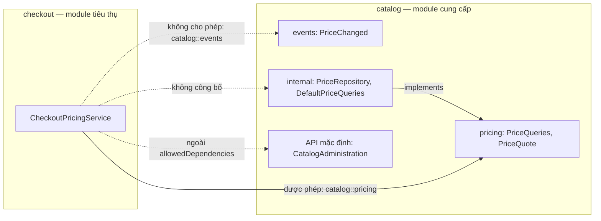

# Kiểm tra module khác chỉ dùng named interface

Trong Spring Modulith, **định nghĩa named interface** là bước công bố một phần API của application module; **kiểm tra module khác chỉ dùng named interface đó** là bước bảo đảm các phụ thuộc trong mã nguồn đi qua đúng phần API đã được phép. Hai phía phải phối hợp:

- Module **cung cấp** khai báo `@NamedInterface("pricing")` để công bố các kiểu thuộc giao diện `pricing`.
- Module **tiêu thụ** khai báo `@ApplicationModule(allowedDependencies = "catalog::pricing")` để giới hạn quyền phụ thuộc của mình.
- Bài test `ApplicationModules.of(...).verify()` kiểm chứng các quy tắc kiến trúc, phát hiện việc module tiêu thụ tham chiếu phần nội bộ hoặc phần API khác chưa được cho phép.

Bài học thuộc chương **Named interfaces** của lộ trình **SPRING_MODULITH_VERIFICATION_TESTING**. Trọng tâm là biến ranh giới kiến trúc thành kiểm chứng tự động, kết hợp `@ApplicationModuleTest`, test sự kiện, database, tích hợp và quality gate CI để phòng phụ thuộc sai cũng như hồi quy.

**Phạm vi kiểm tra:** “Chỉ dùng named interface” nghĩa là những **phụ thuộc tĩnh giữa các application module** phải hướng tới các kiểu đã công bố trong named interface được phép. Nó không có nghĩa Spring Modulith tự chặn mọi lời gọi ở runtime, cấm reflection hoặc bảo đảm chức năng nghiệp vụ hoạt động đúng.

## 1. Mô hình kiểm chứng: ai cung cấp, ai tiêu thụ?

Giả sử hệ thống bán hàng có:

- `catalog`: chủ sở hữu thông tin giá, kho dữ liệu sản phẩm và các quy tắc định giá.
- `checkout`: cần tra cứu giá để tạo đơn.
- `shipping`: có thể nhận sự kiện từ catalog nhưng không liên quan đến nghiệp vụ tra cứu giá.

Ứng dụng có lớp `ShopApplication` được gắn `@SpringBootApplication` trong package `com.example.shop`. Với cơ chế phát hiện module mặc định, các package con trực tiếp `catalog`, `checkout`, `shipping` là những application module.

```text
com.example.shop
├── ShopApplication.java
├── catalog/
│   ├── CatalogAdministration.java     ← API mặc định của catalog
│   ├── api/
│   │   ├── pricing/
│   │   │   ├── package-info.java      ← @NamedInterface("pricing")
│   │   │   ├── PriceQueries.java
│   │   │   └── PriceQuote.java
│   │   └── events/
│   │       ├── package-info.java      ← @NamedInterface("events")
│   │       └── PriceChanged.java
│   └── internal/
│       ├── PriceRepository.java
│       └── DefaultPriceQueries.java
├── checkout/
│   ├── package-info.java              ← allowedDependencies = "catalog::pricing"
│   └── CheckoutPricingService.java
└── shipping/
    └── ...
```

Các đường phụ thuộc cần phân biệt:

| Phụ thuộc từ `checkout` | Kiểu thuộc phần nào của `catalog`? | Kết quả mong đợi |
| --- | --- | --- |
| `catalog.api.pricing.PriceQueries` | Named interface `catalog::pricing` | **Được phép** |
| `catalog.api.pricing.PriceQuote` | Named interface `catalog::pricing` | **Được phép** |
| `catalog.api.events.PriceChanged` | Named interface `catalog::events` | **Bị từ chối** khi `checkout` chỉ cho phép `catalog::pricing` |
| `catalog.CatalogAdministration` | API mặc định (*unnamed interface*) | **Bị từ chối** với cùng cấu hình |
| `catalog.internal.PriceRepository` | Phần nội bộ, không công bố | **Bị từ chối** trong module đóng |

**Điểm mấu chốt:** Một kiểu có thể thuộc API được công bố của `catalog` nhưng **vẫn không được `checkout` dùng** nếu `checkout` chỉ khai báo quyền phụ thuộc vào một named interface khác. Do đó phải kiểm tra cả **API phía cung cấp** lẫn **quyền phía tiêu thụ**.

## 2. Bước 1 — Công bố đúng các kiểu của named interface

Trong Spring Modulith, kiểu `public` ở package gốc của một **closed application module** thuộc API mặc định; kiểu trong các subpackage mặc định là nội bộ, trừ khi được công bố qua named interface hoặc cơ chế cấu hình tương ứng.

Để công bố các kiểu truy vấn giá, đặt `package-info.java` ngay trong package `com.example.shop.catalog.api.pricing`:

```java
// src/main/java/com/example/shop/catalog/api/pricing/package-info.java

/**
 * API tra cứu giá dành cho các module nghiệp vụ khác.
 *
 * <p>Chỉ công bố hợp đồng tra cứu và dữ liệu báo giá.
 * Không công bố entity, repository hoặc công thức định giá nội bộ.
 */
@org.springframework.modulith.NamedInterface("pricing")
package com.example.shop.catalog.api.pricing;
```

Hai kiểu công khai trong package đó:

```java
// PriceQuote.java
package com.example.shop.catalog.api.pricing;

import java.math.BigDecimal;
import java.util.Currency;

/** Bản giá tối thiểu để checkout lập đơn. */
public record PriceQuote(
        String sku,
        BigDecimal amount,
        Currency currency
) {}
```

```java
// PriceQueries.java
package com.example.shop.catalog.api.pricing;

import java.util.Optional;

public interface PriceQueries {
    Optional<PriceQuote> findBySku(String sku);
}
```

Dù `PriceQueries` là Java `interface`, named interface `catalog::pricing` **không chỉ gồm một Java interface**. Nó đại diện cho nhóm kiểu công khai thuộc package được đánh dấu, bao gồm `PriceQuote`. Phần triển khai `DefaultPriceQueries`, repository và entity ở `catalog.internal` không nên lọt vào hợp đồng công bố.

Một package khác có thể khai báo riêng `@NamedInterface("events")`. Khi đó `catalog::events` là **một tập API khác**; công bố `events` không tự cấp quyền cho `checkout` sử dụng nó.

## 3. Bước 2 — Chỉ cho module tiêu thụ phụ thuộc vào API được chọn

Trong `checkout`, đặt quy tắc tại `package-info.java` của package gốc module:

```java
// src/main/java/com/example/shop/checkout/package-info.java

@org.springframework.modulith.ApplicationModule(
    allowedDependencies = "catalog::pricing"
)
package com.example.shop.checkout;
```

Cú pháp **`catalog::pricing`** gồm tên module cung cấp (`catalog`) và tên named interface (`pricing`). Giá trị này khác hoàn toàn với Java import `com.example.shop.catalog.api.pricing.PriceQueries`: cái thứ nhất mô tả **quyền phụ thuộc**, cái thứ hai là **phụ thuộc thực tế trong mã**.

Service của module tiêu thụ:

```java
// CheckoutPricingService.java
package com.example.shop.checkout;

import com.example.shop.catalog.api.pricing.PriceQueries;
import com.example.shop.catalog.api.pricing.PriceQuote;
import java.util.Optional;
import org.springframework.stereotype.Service;

@Service
public class CheckoutPricingService {

    private final PriceQueries prices;

    public CheckoutPricingService(PriceQueries prices) {
        this.prices = prices;
    }

    public Optional<PriceQuote> quoteFor(String sku) {
        return prices.findBySku(sku);
    }
}
```

Spring có thể inject một bean hiện thực `PriceQueries` nằm ở `catalog.internal` thông qua interface công khai. **Kiểu tham chiếu** ở phía `checkout` là `PriceQueries`, nên module tiêu thụ không cần import lớp triển khai.



Khai báo `allowedDependencies` là **danh sách các quan hệ phụ thuộc giữa application module được cho phép**. Khi `checkout` cần thêm một module khác, phải đánh giá và khai báo bổ sung đúng API cần dùng, thay vì xóa ràng buộc để test qua.

### Phân biệt các cấu hình dễ nhầm

| Cấu hình trên `checkout` | Quyền đối với `catalog` |
| --- | --- |
| `allowedDependencies = "catalog::pricing"` | Chỉ named interface `pricing` |
| `allowedDependencies = { "catalog::pricing", "catalog::events" }` | Hai named interface được liệt kê |
| `allowedDependencies = "catalog"` | API mặc định của `catalog`, **không đồng nghĩa** mọi named interface |
| Không khai báo `allowedDependencies` | Không hạn chế đích phụ thuộc bằng danh sách này; vẫn phải tuân thủ API được công bố của module đóng |

Ví dụ, nếu `checkout` thật sự cần kiểu sự kiện `PriceChanged`, giải pháp đúng là đánh giá việc tiêu thụ event và bổ sung `catalog::events` vào danh sách. Nếu không có nhu cầu, import `PriceChanged` là một vi phạm cần loại bỏ.

## 4. Bước 3 — Viết test kiến trúc có thể chạy trong CI

Đặt test JUnit ở package chứa lớp khởi động ứng dụng, sao cho Spring Modulith xác định được gốc mô hình module:

```java
// src/test/java/com/example/shop/ModulithArchitectureTest.java
package com.example.shop;

import org.junit.jupiter.api.Test;
import org.springframework.modulith.core.ApplicationModules;

class ModulithArchitectureTest {

    @Test
    void checkoutOnlyUsesPublishedModuleInterfaces() {
        ApplicationModules.of(ShopApplication.class).verify();
    }
}
```

Đây là **test kiến trúc cho toàn bộ mô hình application module** được phát hiện từ `ShopApplication`; tên method chỉ mô tả mục đích kiểm thử, **không** khiến `verify()` chỉ kiểm tra `checkout`. Nếu phát hiện vi phạm ở `checkout` hoặc module khác, phép thử có thể thất bại.

Dự án cần các dependency Spring Modulith và JUnit thích hợp để compile/chạy test. `verify()` phân tích cấu trúc module và các phụ thuộc, trong đó có:

1. **Truy cập API:** module khác không được tham chiếu kiểu trong subpackage nội bộ của **closed module** chưa công bố.
2. **Quy tắc `allowedDependencies`:** nếu module tiêu thụ giới hạn phụ thuộc, nó không được tham chiếu module hoặc named interface ngoài danh sách.
3. **Vòng phụ thuộc:** quan hệ phụ thuộc giữa các application module không được tạo chu trình kiến trúc không hợp lệ.

`verify()` phù hợp làm **quality gate nhanh** vì không cần kích hoạt toàn bộ Spring Boot application context hay kết nối database để phân tích các phụ thuộc cấu trúc. Tuy nhiên, nó không kiểm thử kết quả trả về từ `PriceQueries`, việc phát sự kiện hoặc transaction.

### Trình tự xác minh hành vi đúng và sai

Dùng bảng sau khi thực hành. Để tránh gộp các nguyên nhân, mỗi lần chỉ thay đổi **một** phụ thuộc rồi chạy lại `ModulithArchitectureTest`:

| Thí nghiệm | Thay đổi tạm thời | Kỳ vọng |
| --- | --- | --- |
| **A — Baseline** | `checkout` chỉ import `PriceQueries` và `PriceQuote` | PASS nếu các module còn lại cũng hợp lệ |
| **B — Truy cập internal** | `checkout` import `catalog.internal.PriceRepository` | FAIL do phụ thuộc vào phần không được công bố |
| **C — Dùng named interface khác** | `checkout` import `catalog.api.events.PriceChanged` | FAIL do vượt `allowedDependencies` |
| **D — Dùng API mặc định** | `checkout` import `catalog.CatalogAdministration` | FAIL do API mặc định không có trong danh sách cho phép |
| **E — Bỏ đánh dấu API** | Xóa tạm `@NamedInterface("pricing")`, giữ nguyên mã `checkout` | FAIL: package `pricing` không còn là API đã công bố của closed module |
| **F — Sửa đúng** | Khôi phục `@NamedInterface`, giữ `catalog::pricing`, bỏ mọi tham chiếu sai | PASS nếu không có vi phạm khác |

Ở thí nghiệm B, để quan sát được **lỗi kiến trúc thay vì lỗi biên dịch**, kiểu nội bộ bị import phải có độ hiển thị Java phù hợp (chẳng hạn `public`). Không cần biến repository thật thành public trong ứng dụng sản xuất; có thể dùng một kiểu nội bộ giả lập công khai chỉ cho bài thực hành, sau đó xóa mã thí nghiệm.

Ở thí nghiệm E, tham chiếu `catalog::pricing` cũng không còn khớp named interface được công bố. **Không dựa vào một chuỗi thông báo lỗi cố định**, vì cách trình bày vi phạm có thể khác giữa phiên bản thư viện. Hãy đối chiếu báo cáo với đường phụ thuộc, module cung cấp và `allowedDependencies`.

### Một ví dụ vi phạm rõ ràng

```java
// KHÔNG GIỮ ĐOẠN NÀY TRONG MÃ CHÍNH
package com.example.shop.checkout;

import com.example.shop.catalog.internal.PriceRepository;

// Giả sử PriceRepository là public để Java cho phép import.
// Khi checkout thực sự tham chiếu kiểu này, kiểm chứng kiến trúc
// phải phát hiện checkout đang sử dụng phần internal của catalog.
```

Chỉ thêm một dòng import **không được sử dụng** có thể không tạo ra phụ thuộc mà công cụ phân tích nhận diện theo cách bạn mong muốn. Khi làm thử nghiệm, hãy dùng kiểu đó trong chữ ký, field, constructor hoặc lời gọi thực tế để tạo một quan hệ phụ thuộc rõ ràng:

```java
// Minh họa tác động của phụ thuộc sai; yêu cầu PriceRepository là public.
private final PriceRepository repository;
```

Sau mỗi lần thử, **khôi phục mã hợp lệ** trước khi đưa test trở lại CI. Không lưu các nhánh cố ý thất bại vào bộ test mặc định của dự án.

## 5. Phân loại lỗi để sửa đúng nguyên nhân

Một phép kiểm chứng thất bại không nhất thiết có nghĩa `@NamedInterface` bị thiếu. Xác định xem phụ thuộc sai xuất phát từ **công bố API**, **quyền tiêu thụ** hay **thiết kế chiều phụ thuộc**.

| Dấu hiệu | Nguyên nhân thường gặp | Cách xử lý |
| --- | --- | --- |
| `checkout` tham chiếu `catalog.internal.*` | Dùng implementation/entity/repository xuyên module | Cung cấp operation/DTO thuộc `catalog::pricing`, giữ repository trong `catalog` |
| `checkout` tham chiếu `catalog.api.events.*` | Interface `events` được công bố nhưng chưa được cho phép | Bỏ phụ thuộc hoặc bổ sung `catalog::events` nếu có nhu cầu nghiệp vụ |
| `checkout` tham chiếu API gốc `catalog.*` | Chỉ cho phép `catalog::pricing` | Chuyển nhu cầu qua `pricing`; nếu cần API mặc định thật, khai báo `catalog` riêng |
| Tên `catalog::price` không khớp `@NamedInterface("pricing")` | Sai định danh named interface | Sửa về đúng tên đang được công bố |
| Dùng `PriceQueries` nhưng chữ ký trả `ProductEntity` nội bộ | API công khai làm rò rỉ kiểu triển khai | Dùng `PriceQuote` hoặc kiểu hợp đồng được công bố |
| `catalog` import trực tiếp kiểu của `checkout`, `checkout` cũng import `catalog` | Có nguy cơ vòng phụ thuộc | Đảo chiều qua hợp đồng đúng chủ sở hữu hoặc dùng event |
| Java báo không truy cập được class | Kiểu `private`/package-private hoặc thiếu dependency compile | Sửa visibility phù hợp cho hợp đồng; không coi đây là kết quả của `verify()` |

**Không sửa lỗi bằng cách công bố toàn bộ `catalog.internal`** hoặc chuyển repository vào package gốc để “hợp pháp hóa” import. Khi đó quy tắc kiến trúc có thể bớt báo lỗi nhưng thiết kế module đã mất khả năng thay đổi độc lập.

### Kiểm tra các dạng phụ thuộc ngoài import trực tiếp

Rà soát các vị trí sau của code `checkout`:

- Kiểu field, constructor parameter và method parameter, kể cả các kiểu được Spring inject.
- Kiểu trả về, `throws`, extends/implements và các kiểu generic như `List<PriceRepository>`.
- Lệnh gọi static, `new`, type reference hoặc annotation tham chiếu lớp trong module khác.
- DTO, event payload và adapter dùng xuyên module; tránh lộ entity hoặc loại lỗi nội bộ trong chữ ký.

Không nên chỉ kiểm tra những dòng `import` bằng mắt: **quan hệ phụ thuộc là cách một kiểu thực sự được sử dụng trong mã đã biên dịch**. Một số quan hệ động qua reflection, tên lớp dạng chuỗi, SQL hoặc dữ liệu ngoài mã không thể được bao phủ đầy đủ bằng phép kiểm chứng cấu trúc tĩnh. Các trường hợp đó cần thiết kế kiểm soát riêng và test tích hợp phù hợp.

## 6. Liên hệ với `@ApplicationModuleTest` và kiểm thử hành vi

Bài test `ApplicationModules.verify()` trả lời **“có dùng đúng bề mặt module API không?”**. Nó không xác nhận implementation của `PriceQueries` có tìm đúng giá, bean được khởi tạo đủ, hay sự kiện được xử lý thành công.

| Loại test | Nội dung cần kiểm chứng | Ví dụ |
| --- | --- | --- |
| **Kiến trúc: `ApplicationModules.verify()`** | API công bố, `allowedDependencies`, chu trình module | `checkout` chỉ tham chiếu `catalog::pricing` |
| **Module: `@ApplicationModuleTest`** | Bootstrapping và hành vi của một module ở phạm vi phù hợp | Test module `catalog` tạo bean `PriceQueries` và trả báo giá |
| **Database/integration** | Repository, transaction, ánh xạ dữ liệu sang hợp đồng công khai | `PriceQuote` khớp giá được lưu |
| **Event test** | Đúng loại sự kiện, payload, listener và thời điểm xử lý | Listener xử lý `PriceChanged` đúng nghiệp vụ |
| **Kiểm thử tích hợp liên module** | Các module phối hợp qua đúng hợp đồng khi cùng chạy | `checkout` lấy báo giá từ `catalog` mà không dùng repository trực tiếp |
| **CI quality gate** | Ngăn thay đổi phá vỡ ranh giới hoặc hành vi | Chặn hợp nhất khi bất kỳ test bắt buộc nào thất bại |

Ví dụ, một test `@ApplicationModuleTest` cho `checkout` có thể cần mock `PriceQueries` hoặc điều chỉnh phạm vi bootstrap theo chế độ hỗ trợ của Spring Modulith nếu phụ thuộc module `catalog` không được nạp trong test mặc định. Đừng dùng việc test module chạy thiếu bean làm lý do chuyển `DefaultPriceQueries` vào package công khai.

Nếu `catalog` công bố `PriceChanged` qua `catalog::events`, phải có test event độc lập để xác minh quá trình phát và xử lý. Việc `checkout` không được dùng `catalog::events` là một **quyết định kiến trúc**; `verify()` giữ quyết định đó, trong khi test sự kiện kiểm chứng hành vi của những module thực sự được phép tiêu thụ event.

## 7. Đưa phép kiểm tra vào quality gate CI

Đặt `ModulithArchitectureTest` trong nguồn test thông thường để mỗi lần chạy JUnit kiểm chứng cấu trúc, thay vì chỉ chạy thủ công khi thiết kế module.

Ví dụ với Gradle:

```bash
./gradlew test
```

Trên Windows dùng Gradle wrapper:

```powershell
.\gradlew.bat test
```

Hoặc nếu dự án dùng Maven:

```bash
mvn test
```

Pipeline CI chỉ chấp nhận thay đổi khi:

1. Mã Java biên dịch được, bao gồm các kiểu public trong named interface.
2. `ModulithArchitectureTest` PASS: không có phụ thuộc vào `internal`, named interface ngoài quyền hoặc chu trình không hợp lệ.
3. Các `@ApplicationModuleTest`, test sự kiện, database và tích hợp thuộc phạm vi thay đổi PASS.
4. Khi review thay đổi API, người duyệt xác nhận danh sách kiểu công bố thực sự cần thiết và không rò rỉ chi tiết triển khai.

**Không chỉ ghi log cảnh báo** nếu test kiến trúc báo vi phạm. Để quality gate có hiệu lực, test JUnit phải thất bại và lệnh build/CI phải trả trạng thái lỗi. Nếu cần ngoại lệ kiến trúc trong quá trình chuyển đổi hệ thống cũ, hãy quản lý ngoại lệ một cách có chủ đích và giới hạn thời gian, thay vì tắt toàn bộ kiểm chứng.

## 8. Bài thực hành có tiêu chí đạt rõ ràng

### Bối cảnh

`catalog` có hai named interface: `pricing` cho truy vấn giá và `events` cho sự kiện. `checkout` chỉ được gọi `pricing`. Một lập trình viên mới thêm logic để `checkout` truy cập trực tiếp `catalog.internal.PriceRepository`.

### Yêu cầu

1. **Tạo hợp đồng:** trong `catalog.api.pricing`, thêm `PriceQueries`, `PriceQuote` và `package-info.java` có `@NamedInterface("pricing")`.
2. **Giữ phần nội bộ:** đặt repository và implementation bên trong `catalog.internal`. Chữ ký public của `PriceQueries` không được chứa entity/repository.
3. **Khai báo quyền:** trong `checkout/package-info.java`, dùng `allowedDependencies = "catalog::pricing"`.
4. **Tạo baseline:** test `ApplicationModules.of(ShopApplication.class).verify()` phải PASS với mọi module hợp lệ.
5. **Tạo vi phạm 1:** để `checkout` thực sự dùng một kiểu public thuộc `catalog.internal`, chạy lại test và xác định phụ thuộc sai.
6. **Tạo vi phạm 2:** thay phụ thuộc đó bằng kiểu public thuộc `catalog.api.events`; giải thích vì sao vẫn bị chặn dù `events` cũng là named interface hợp lệ của `catalog`.
7. **Tạo vi phạm 3:** thử phụ thuộc vào `CatalogAdministration` thuộc API mặc định, xác định vì sao `catalog::pricing` không bao gồm API gốc.
8. **Khôi phục và khóa hồi quy:** đưa `checkout` trở về chỉ dùng `PriceQueries`, `PriceQuote`; chạy lại `verify()` cùng các test hành vi và đưa vào CI.

### Đáp án tự đối chiếu

- Ở bước 5, lỗi nằm ở **API cung cấp**: kiểu nội bộ chưa được công bố, nên đổi `allowedDependencies` không làm nó tự hợp lệ.
- Ở bước 6, `catalog::events` là **API đã công bố**, nhưng `checkout` không được phép phụ thuộc theo danh sách hiện tại.
- Ở bước 7, API mặc định là phần API **khác với** `catalog::pricing`. Muốn dùng nó cần quyết định kiến trúc rõ ràng và cập nhật giới hạn phụ thuộc cho đúng mục tiêu.
- Khi quay về trạng thái hợp lệ, `checkout` chỉ thấy các kiểu của `catalog::pricing`, còn implementation của `catalog` có thể thay đổi mà không làm phát sinh import mới ở `checkout`.

**Tiêu chí hoàn thành:** học viên mô tả đúng hai phía `@NamedInterface`/`allowedDependencies`, tự dựng được test `verify()`, phân biệt được lỗi truy cập nội bộ với lỗi dùng sai named interface, và biết kết hợp test kiến trúc với test hành vi trong CI.

## 9. Ghi nhớ

Để **kiểm tra module khác chỉ dùng named interface**, trước hết module cung cấp phải công bố đúng package và các kiểu hợp đồng qua `@NamedInterface`. Module tiêu thụ giới hạn đích phụ thuộc bằng **`allowedDependencies = "module::interface"`**. Cuối cùng, bài test **`ApplicationModules.of(...).verify()`** là hàng rào kiến trúc tự động nhằm phát hiện import và phụ thuộc không hợp lệ trước khi thay đổi vào nhánh chính. Các kiểm thử `@ApplicationModuleTest`, sự kiện, database và tích hợp bổ sung bảo đảm API đã được phép tiêu thụ thực sự chạy đúng.

### Tài liệu tham khảo

- [Spring Modulith Reference — Named Interfaces và Application Modules](https://docs.spring.io/spring-modulith/reference/fundamentals.html)
- [Spring Modulith Reference — Verifying Application Module Structure](https://docs.spring.io/spring-modulith/reference/verification.html)
