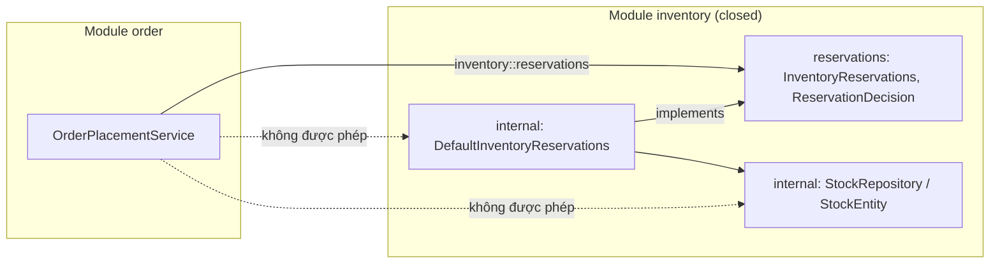

# Mở package mà không biến toàn bộ module thành public

Một ứng dụng Spring Modulith cần cho các module nghiệp vụ cộng tác mà vẫn giữ được ranh giới kiến trúc. Khi module `order` cần gọi chức năng đặt giữ hàng của `inventory`, giải pháp phù hợp là **công bố một package hợp đồng có chủ đích bằng `@NamedInterface`**, thay vì cho `order` sử dụng mọi lớp trong `inventory`.

Bài học thuộc chương **Named interfaces** của **SPRING_MODULITH_VERIFICATION_TESTING**. Mục tiêu là thực hành công bố API tối thiểu và kiểm chứng bằng `ApplicationModules`, quy tắc phụ thuộc, `@ApplicationModuleTest`, các test sự kiện, database/tích hợp và quality gate CI để phát hiện phụ thuộc sai hoặc hồi quy.

> Trong bài này, “mở package” nghĩa là **đưa một nhóm kiểu vào API công khai ở mức kiến trúc của application module**. Việc đó khác với `public` của Java, `opens`/`exports` của Java Platform Module System, public REST endpoint hoặc cấu hình bảo mật runtime.

## 1. Tình huống: cần chia sẻ một năng lực, không chia sẻ implementation

Giả sử ứng dụng bán hàng có hai module:

- **`inventory`** sở hữu số lượng tồn kho, repository và chính sách đặt giữ hàng.
- **`order`** cần yêu cầu giữ một lượng hàng trước khi xác nhận đơn.

Nếu `order` import `inventory.internal.StockRepository` để tự trừ tồn kho, `order` sẽ biết cấu trúc lưu trữ và có thể bỏ qua các quy tắc nghiệp vụ của `inventory`. Mỗi lần đổi entity, transaction hoặc thuật toán phân bổ, cả hai module có nguy cơ bị ảnh hưởng.

Mục tiêu thiết kế là cho `order` chỉ thấy:

1. `InventoryReservations`: hợp đồng yêu cầu đặt giữ hàng.
2. `ReservationDecision`: dữ liệu kết quả, được định nghĩa phù hợp để module ngoài đọc.

Phần `StockRepository`, `StockEntity`, `DefaultInventoryReservations` vẫn được quản lý **bên trong `inventory`**.



Phần API được chọn có ranh giới riêng, dù toàn bộ ứng dụng vẫn biên dịch và chạy trong cùng JVM.

## 2. Hiểu đúng khái niệm “mở” trong Spring Modulith

Với cấu trúc module mặc định, các package con trực tiếp của package chứa lớp `@SpringBootApplication` thường được nhận diện là các **application module**. Spring Modulith xem một module là **closed** theo mặc định: mã thuộc các **subpackage** của module không tự trở thành API cho module khác.

Ví dụ với lớp khởi động `com.acme.store.StoreApplication`:

```text
com.acme.store
├── StoreApplication.java
├── inventory/                         ← application module: inventory
│   ├── InventoryInformation.java      ← API mặc định nếu là kiểu public
│   ├── reservations/
│   │   ├── package-info.java         ← @NamedInterface("reservations")
│   │   ├── InventoryReservations.java
│   │   └── ReservationDecision.java
│   └── internal/
│       ├── StockEntity.java
│       ├── StockRepository.java
│       └── DefaultInventoryReservations.java
└── order/                             ← application module: order
    ├── package-info.java
    └── OrderPlacementService.java
```

Cần phân biệt ba loại “công khai”:

| Phạm vi | Quy tắc | Ví dụ |
| --- | --- | --- |
| **Java visibility** | `public` cho phép các package Java khác nhìn thấy kiểu theo luật ngôn ngữ và classpath | `public class StockRepository` vẫn có thể được Java import |
| **API mặc định của module** | Kiểu public ở package gốc của closed module được xem là API mặc định (*unnamed interface*) | `inventory.InventoryInformation` |
| **Named interface** | Đánh dấu một package bằng `@NamedInterface` để công bố các kiểu thích hợp trong package đó | `inventory.reservations.InventoryReservations` |

Một kiểu `public` ở `inventory.internal` có thể qua được bước biên dịch Java nhưng vẫn **vi phạm ranh giới kiến trúc** khi `order` phụ thuộc vào nó. Ngược lại, `@NamedInterface` không làm class package-private thành `public` về mặt Java.

Cách giải quyết là **giữ `inventory` là closed module**, chỉ thêm một điểm tiếp xúc chính thức trong `inventory.reservations`.

### Vì sao không chuyển toàn bộ module thành open?

Spring Modulith còn có chế độ **open module**, phù hợp với một số giai đoạn chuyển đổi hệ thống cũ khi chưa thể siết chặt mọi phụ thuộc. Chế độ đó nới lỏng việc truy cập các phần bên trong module, nên không đáp ứng tốt mục tiêu *chỉ cho module khác dùng API đặt giữ hàng*.

| Lựa chọn | Phần module khác có thể phụ thuộc | Phù hợp khi |
| --- | --- | --- |
| Closed module + API mặc định | Các kiểu thuộc package gốc công khai, tùy giới hạn phía tiêu thụ | API có quy mô nhỏ và nằm ở package gốc |
| **Closed module + named interface** | Một hoặc nhiều package hợp đồng được công bố có chủ đích | Cần phân chia bề mặt API, giữ các phần còn lại nội bộ |
| Open module | Phạm vi nội bộ được nới rộng so với closed module | Cần từng bước chuyển đổi ứng dụng cũ có nhiều phụ thuộc chéo |

**Đừng cấu hình module thành open chỉ để sửa một import vi phạm.** Điều nên làm là tìm năng lực nghiệp vụ cần chia sẻ và thiết kế named interface thích hợp.

## 3. Bước 1: tạo package hợp đồng nhỏ và rõ nghĩa

Hãy đặt hợp đồng ở package riêng:

```text
src/main/java/com/acme/store/inventory/reservations/
```

Package này **không** chứa entity JPA, repository, service implementation hoặc helper kỹ thuật. Nó chỉ chứa các kiểu mà `order` thực sự cần biết.

Định nghĩa dữ liệu kết quả:

```java
// ReservationDecision.java
package com.acme.store.inventory.reservations;

/**
 * Kết quả yêu cầu giữ hàng.
 *
 * @param accepted true nếu việc đặt giữ được chấp nhận
 * @param reasonCode mã kết quả thuộc hợp đồng công khai
 */
public record ReservationDecision(
        boolean accepted,
        String reasonCode
) {}
```

Định nghĩa hợp đồng nghiệp vụ:

```java
// InventoryReservations.java
package com.acme.store.inventory.reservations;

/** API yêu cầu giữ hàng mà các module khác được phép sử dụng. */
public interface InventoryReservations {

    /**
     * Yêu cầu giữ một lượng hàng theo SKU.
     *
     * @param sku mã hàng hợp lệ
     * @param quantity số lượng dương
     * @return quyết định được chuẩn hóa cho người tiêu thụ
     */
    ReservationDecision reserve(String sku, int quantity);
}
```

Ví dụ này cố ý giới hạn kiểu xuất hiện trong chữ ký ở `String`, `int` và `ReservationDecision`. Người tiêu thụ không phải biết `StockEntity`, kiểu khóa chính của repository hay ngoại lệ kỹ thuật nội bộ.

**Chú ý nghiệp vụ:** việc giữ hàng thực tế còn có transaction, đồng thời, idempotency, khả năng hết hàng và chính sách hoàn tác. Bài này chỉ định nghĩa **hình dạng hợp đồng**; những bảo đảm đó phải được mô tả rõ và kiểm thử riêng trong một hệ thống thực tế.

## 4. Bước 2: đánh dấu đúng package bằng `@NamedInterface`

Tạo file **`src/main/java/com/acme/store/inventory/reservations/package-info.java`**:

```java
/**
 * Hợp đồng đặt giữ hàng dành cho các application module khác.
 *
 * <p>Chỉ công bố InventoryReservations và ReservationDecision.
 * Dữ liệu tồn kho, repository và chiến lược phân bổ thuộc
 * phần triển khai nội bộ của inventory.
 */
@org.springframework.modulith.NamedInterface("reservations")
package com.acme.store.inventory.reservations;
```

Ý nghĩa của từng phần:

| Thành phần | Vai trò |
| --- | --- |
| `package com.acme.store.inventory.reservations;` | Xác định chính xác package Java muốn công bố |
| `@NamedInterface("reservations")` | Đặt tên logic cho một phần API của module `inventory` |
| `inventory::reservations` | Cú pháp đầy đủ mà module khác dùng khi khai báo `allowedDependencies` |
| JavaDoc | Giải thích cho con người biết trách nhiệm và giới hạn của hợp đồng |

Sau khai báo này, **các kiểu đủ điều kiện trong chính package được đánh dấu** thuộc named interface `reservations`. Việc gắn annotation ở `inventory.reservations` không đồng nghĩa với công bố toàn bộ `inventory.internal` hay mọi package con khác.

Nếu còn nhiều kiểu public trong `inventory.reservations`, chúng cũng có thể trở thành phần API được công bố. Vì vậy, đừng thêm `ReservationDebugHelper`, mapper hoặc adapter vào package chỉ vì tiện tổ chức file. Giữ package API nhỏ để tập hợp kiểu được phép sử dụng luôn rõ ràng.

**Giá trị của annotation là tên giao diện, không phải đường dẫn Java đầy đủ**. Ví dụ `"reservations"` được tham chiếu dưới dạng `inventory::reservations`; không cần điền `"com.acme.store.inventory.reservations"` vào annotation.

## 5. Bước 3: giữ implementation và repository ở bên trong module

Phần triển khai có thể nằm ở `inventory.internal`:

```java
// DefaultInventoryReservations.java
package com.acme.store.inventory.internal;

import com.acme.store.inventory.reservations.InventoryReservations;
import com.acme.store.inventory.reservations.ReservationDecision;
import org.springframework.stereotype.Service;

@Service
class DefaultInventoryReservations implements InventoryReservations {

    @Override
    public ReservationDecision reserve(String sku, int quantity) {
        if (sku == null || sku.isBlank() || quantity <= 0) {
            return new ReservationDecision(false, "INVALID_REQUEST");
        }

        // Minh họa hợp đồng; hệ thống thật cần kiểm tra tồn kho,
        // transaction và tránh tranh chấp cập nhật đồng thời.
        return new ReservationDecision(true, "ACCEPTED");
    }
}
```

Class được đặt **package-private**, vì bản thân nó không phải API cần công bố. Nếu framework hoặc cấu hình thực tế yêu cầu implementation `public`, việc đặt nó trong subpackage nội bộ vẫn giúp test kiến trúc bảo vệ ranh giới module.

`@Service` cho Spring biết đây là một bean. `@NamedInterface` cho Spring Modulith biết nhóm kiểu nào là API của module. **Hai mục đích khác nhau**: không cần đặt implementation vào package công khai chỉ để Spring quản lý hoặc inject bean.

Một số implementation thực tế sử dụng `StockRepository` và `StockEntity`. Các kiểu này tiếp tục nằm ở `inventory.internal`; mọi thao tác lưu trữ diễn ra trong module chủ sở hữu.

## 6. Bước 4: giới hạn module tiêu thụ chỉ được dùng `inventory::reservations`

Module `order` chỉ có quyền phụ thuộc vào API đặt giữ hàng đã được `inventory` công bố. Tạo `src/main/java/com/acme/store/order/package-info.java`:

```java
@org.springframework.modulith.ApplicationModule(
    allowedDependencies = "inventory::reservations"
)
package com.acme.store.order;
```

Với cấu hình trên, service ở `order` có thể sử dụng hợp đồng:

```java
// OrderPlacementService.java
package com.acme.store.order;

import com.acme.store.inventory.reservations.InventoryReservations;
import com.acme.store.inventory.reservations.ReservationDecision;
import org.springframework.stereotype.Service;

@Service
public class OrderPlacementService {

    private final InventoryReservations inventory;

    public OrderPlacementService(InventoryReservations inventory) {
        this.inventory = inventory;
    }

    public boolean tryReserveForOrder(String sku, int quantity) {
        ReservationDecision decision = inventory.reserve(sku, quantity);
        return decision.accepted();
    }
}
```

Tên `tryReserveForOrder` phản ánh việc gọi `reserve` có thể thay đổi trạng thái. Trong nghiệp vụ thực tế, phải có cơ chế bù trừ hoặc giải phóng giữ hàng nếu đơn không được tạo; đây là phần **hành vi** cần kiểm thử tích hợp sau khi ranh giới kiến trúc đã rõ.

Đối chiếu các phụ thuộc:

| Tham chiếu từ `order` | Thuộc phần nào của `inventory`? | Hợp lệ khi chỉ cho phép `inventory::reservations`? |
| --- | --- | --- |
| `inventory.reservations.InventoryReservations` | Named interface `reservations` | **Có** |
| `inventory.reservations.ReservationDecision` | Named interface `reservations` | **Có** |
| `inventory.internal.StockRepository` | Nội bộ closed module | **Không** |
| `inventory.internal.DefaultInventoryReservations` | Implementation nội bộ | **Không** |
| `inventory.InventoryInformation` | API mặc định ở package gốc | **Không** với danh sách cho phép hiện tại |
| `inventory.events.StockChanged` nếu thuộc named interface `events` | Một named interface khác | **Không** với danh sách cho phép hiện tại |

Điểm quan trọng: **một kiểu thuộc API được công bố chưa có nghĩa mọi module đều được dùng nó**. `@NamedInterface` xác định *module cung cấp công bố gì*; `allowedDependencies` xác định *module tiêu thụ chấp nhận phụ thuộc vào phần nào*.

Nếu bỏ `allowedDependencies` ở `order`, các API khác được `inventory` công bố có thể cũng trở thành đích phụ thuộc hợp lệ, nhưng những kiểu nội bộ của closed module vẫn không tự được phép sử dụng. Với mục tiêu giới hạn chính xác, hãy khai báo `inventory::reservations` tường minh.

## 7. Không vô tình mở API mặc định

Ngay cả khi đã tạo named interface, **các kiểu public ở package gốc `inventory` vẫn là API mặc định** của một closed module. Đây là một cách mở rộng bề mặt API khác mà người phát triển dễ bỏ qua.

Ví dụ sau không nên làm chỉ để các module khác import được repository:

```text
inventory/
├── StockRepository.java  ← public, ở package gốc: vô tình nằm trong API mặc định
└── reservations/
    └── ...
```

Hãy giữ `StockRepository` trong `inventory.internal`. Bất kỳ kiểu nào bắt buộc public ở package gốc cũng nên được review như một phần **hợp đồng công bố**, ngay cả khi không có `@NamedInterface`.

Nếu `order` chỉ được phụ thuộc `inventory::reservations`, nó vẫn không được dùng một kiểu API gốc `inventory.InventoryInformation` vì kiểu đó thuộc giao diện mặc định, **khác với named interface `reservations`**.

Các tùy chọn phụ thuộc cần hiểu đúng:

| Giá trị trên module tiêu thụ | Phạm vi cần lưu ý |
| --- | --- |
| `"inventory::reservations"` | Chỉ named interface `reservations` |
| `"inventory"` | API mặc định của `inventory`, không có nghĩa mọi named interface |
| `"inventory::*"` | Các named interface được khai báo tường minh, không bao gồm API mặc định |
| `"inventory::**"` | Toàn bộ API đã công bố của `inventory`: API mặc định cùng các named interface |
| Không có `allowedDependencies` | Không đặt hạn chế theo danh sách trên module tiêu thụ; ranh giới API closed module vẫn áp dụng |

Không dùng wildcard chỉ để hết lỗi kiểm chứng kiến trúc. Nếu có thêm một nhu cầu hợp lệ, hãy xem cần bổ sung named interface nào và giữ danh sách đủ hẹp.

## 8. Kiểm chứng ranh giới bằng `ApplicationModules.verify()`

Đây là bước biến tuyên bố thiết kế thành **kiểm tra tự động**.

Giả sử `StoreApplication` là lớp `@SpringBootApplication` trong package `com.acme.store`. Viết một bài test JUnit:

```java
// src/test/java/com/acme/store/ModulithArchitectureTest.java
package com.acme.store;

import org.junit.jupiter.api.Test;
import org.springframework.modulith.core.ApplicationModules;

class ModulithArchitectureTest {

    @Test
    void exposesOnlyAllowedModuleApis() {
        ApplicationModules.of(StoreApplication.class).verify();
    }
}
```

Bài test phân tích mô hình các module được Spring Modulith nhận diện từ ứng dụng. Trong những quy tắc trọng yếu, `verify()` phát hiện các phụ thuộc chéo module không hợp lệ, các tham chiếu vượt giới hạn `allowedDependencies` và chu trình phụ thuộc module. Test này **không cần truy vấn database hay khởi động toàn bộ Spring ApplicationContext** chỉ để kiểm tra ranh giới cấu trúc.

### Bộ tình huống kiểm chứng

Để học cách phân biệt nguyên nhân, mỗi lần tạo **một thay đổi** rồi chạy lại `ModulithArchitectureTest`:

| Tình huống | Thay đổi | Kết quả mong đợi |
| --- | --- | --- |
| **A — Hợp lệ** | `order` chỉ sử dụng `InventoryReservations` và `ReservationDecision` | PASS nếu không có vi phạm ở module khác |
| **B — Chạm nội bộ** | `order` tham chiếu một kiểu public ở `inventory.internal` | FAIL: kiểu chưa được `inventory` công bố |
| **C — Dùng API mặc định** | `order` tham chiếu `inventory.InventoryInformation` | FAIL: `order` chỉ được dùng `inventory::reservations` |
| **D — Dùng interface khác** | `order` tham chiếu `inventory::events`, nếu API ấy có tồn tại | FAIL: ngoài danh sách `allowedDependencies` |
| **E — Bỏ đánh dấu package** | Tạm bỏ `@NamedInterface("reservations")` nhưng vẫn dùng API trong `order` | FAIL: subpackage không còn là API được công bố |
| **F — Quay lại đúng** | Khôi phục annotation, quyền phụ thuộc, bỏ mọi import nội bộ | PASS nếu toàn bộ kiến trúc hợp lệ |

Để phân biệt lỗi Java với lỗi kiến trúc trong trường hợp B, dùng một kiểu nội bộ `public` để mã biên dịch được rồi **thực sự tham chiếu** nó (trong field/constructor/phương thức). Chỉ thêm dòng `import` không được dùng có thể không tạo phụ thuộc đủ rõ để phép phân tích kiến trúc phát hiện.

Ví dụ một tham chiếu **sai**:

```java
// Ví dụ phản chứng; không đưa vào mã sản xuất.
package com.acme.store.order;

import com.acme.store.inventory.internal.StockRepository;

class BadOrderImplementation {

    // Chỉ minh họa khi StockRepository là kiểu public.
    private final StockRepository repository;

    BadOrderImplementation(StockRepository repository) {
        this.repository = repository;
    }
}
```

Nếu `StockRepository` là package-private, lỗi biên dịch Java sẽ xảy ra trước khi JUnit chạy. Bài thực hành có thể dùng một kiểu `public` giả lập trong package `internal` để quan sát rõ lỗi do `ApplicationModules.verify()`.

Các kết quả trong bảng là **kỳ vọng kiểm chứng**, không phải báo cáo đã chạy test trong một ứng dụng cụ thể.

### Vì sao không “sửa” bằng cách chuyển module sang open?

Khi kiểm chứng báo `order -> inventory.internal.StockRepository` là sai, chuyển `inventory` thành open hoặc đưa repository lên package gốc có thể nới được giới hạn, nhưng cũng làm module khác phụ thuộc vào cấu trúc dữ liệu mà `inventory` cần sở hữu. Sửa đúng là cho `order` gọi một hợp đồng `InventoryReservations` có ngữ nghĩa nghiệp vụ và để `inventory` tự thao tác repository.

## 9. Kiểm thử hành vi bổ sung cho ranh giới đã công bố

Tách biệt **hợp lệ về cấu trúc** và **đúng về chức năng**:

| Kiểu kiểm thử | Kiểm tra điều gì? | Ví dụ |
| --- | --- | --- |
| `ApplicationModules.verify()` | Phụ thuộc giữa các module có đi qua đúng API và không tạo chu trình? | `order` không tham chiếu `inventory.internal` |
| `@ApplicationModuleTest` | Module có bootstrap và vận hành đúng trong phạm vi được chọn? | Bean `InventoryReservations` sẵn sàng khi test `inventory` |
| Database/integration test | Đặt giữ hàng có nhất quán khi cập nhật repository/transaction? | Hai yêu cầu đồng thời không giữ quá số lượng tồn |
| Event test | Sự kiện công bố được phát và xử lý đúng nghĩa? | Event `StockReserved` chỉ mang dữ liệu hợp đồng cần thiết |
| Test tích hợp liên module | Luồng tạo đơn gọi module tồn kho qua hợp đồng đúng cách? | `order` xử lý `ReservationDecision` của `inventory` |

Có thể kiểm thử module `inventory` bằng `@ApplicationModuleTest` và inject hợp đồng công khai:

```java
// src/test/java/com/acme/store/inventory/InventoryModuleTest.java
package com.acme.store.inventory;

import com.acme.store.inventory.reservations.InventoryReservations;
import org.junit.jupiter.api.Test;
import org.springframework.beans.factory.annotation.Autowired;
import org.springframework.modulith.test.ApplicationModuleTest;

import static org.assertj.core.api.Assertions.assertThat;

@ApplicationModuleTest
class InventoryModuleTest {

    @Autowired
    InventoryReservations reservations;

    @Test
    void exposesReservationsBean() {
        assertThat(reservations).isNotNull();
    }
}
```

Test này minh họa khả năng nạp bean của module, **không phải phép thay thế cho `verify()`**. Trong ứng dụng thực tế, nếu adapter dùng JPA/database, cần thiết lập datasource test phù hợp; tiếp tục bổ sung các tình huống hết hàng, số lượng không hợp lệ, tranh chấp đồng thời và rollback.

Nếu module phát sự kiện cho module khác, hãy công bố **kiểu sự kiện** qua API mặc định hoặc một named interface riêng như `inventory::events`, rồi kiểm tra việc phát/nhận bằng test sự kiện. Bất kỳ module tiêu thụ nào có `allowedDependencies` phải khai báo đúng interface sự kiện mà nó cần, thay vì lấy toàn bộ `inventory` làm dependency.

## 10. Đưa kiểm chứng vào CI để khóa ranh giới

Đặt `ModulithArchitectureTest` trong test suite của dự án và chạy cùng các bài test liên quan ở mỗi pull request. Ví dụ:

```bash
./gradlew test
```

Với Maven:

```bash
mvn test
```

Khi được cấu hình trong pipeline, một vi phạm ranh giới khiến bài test JUnit thất bại và **quality gate cần dừng việc hợp nhất thay đổi**. Dự án nên thực thi cả test kiến trúc lẫn các test module, sự kiện, database và tích hợp phù hợp với phạm vi thay đổi.

Trong code review, đặc biệt chú ý:

1. Có thêm kiểu public nào vào package `inventory.reservations` mà module ngoài không thực sự cần không?
2. Có kiểu public mới trong package gốc `inventory` vô tình trở thành API mặc định không?
3. Có API nào trả về `StockEntity`, exception nội bộ, hoặc các kiểu generic chứa cấu trúc persistence không?
4. Có module tiêu thụ nào mở rộng `allowedDependencies` hoặc dùng wildcard chỉ để cho qua bài test không?
5. Có thêm tham chiếu ngược `inventory -> order` khiến các module rơi vào vòng phụ thuộc không?
6. Test hành vi có bảo vệ hợp đồng thật sự được công bố, đặc biệt transaction và thao tác thất bại không?

Bản thân `@NamedInterface` không ngăn reflection hoặc phụ thuộc động được hình thành từ tên class trong chuỗi; `verify()` chủ yếu kiểm tra cấu trúc tĩnh. Các tương tác không thể hiện rõ qua mã nguồn/bytecode cần được bao phủ bằng review và test tích hợp thích hợp.

## 11. Những lỗi thiết kế thường gặp

**1. “Có `public` rồi thì coi như package đã mở.”** Không chính xác. Modifier Java cho phép truy cập ở mức ngôn ngữ; closed module của Spring Modulith còn yêu cầu kiểu thuộc API được công bố và tuân thủ giới hạn của module tiêu thụ.

**2. “Cứ đặt `@NamedInterface` trên package `internal` cho nhanh.”** Làm vậy đảo ngược mục tiêu: tên package `internal` phản ánh chi tiết triển khai, trong khi annotation biến phần ấy thành hợp đồng có thể được module khác sử dụng. Tốt hơn là thiết kế một package `reservations` riêng.

**3. “`@NamedInterface` tự công bố toàn bộ cây package của module.”** Không nên giả định như vậy. Xác định đúng package chứa kiểu cần chia sẻ, đánh dấu từng API cần công bố và kiểm chứng mô hình module; các subpackage kỹ thuật khác vẫn thuộc phần nội bộ trừ khi có khai báo phù hợp.

**4. “Đưa implementation vào package named interface để Spring thấy bean.”** Spring component scanning và việc công bố API module là hai vấn đề khác nhau. Giữ implementation ở `internal` rồi inject qua interface công khai.

**5. “`inventory::reservations` cho phép dùng luôn API gốc của `inventory`.”** Không. Đây là quyền đến named interface được nêu tên. API gốc là phần công bố khác, cần được cho phép riêng nếu module tiêu thụ giới hạn bằng `allowedDependencies`.

**6. “Dùng `inventory::**` sẽ an toàn hơn vì test hết lỗi.”** Wildcard mở rộng quyền phụ thuộc vào nhiều API đã công bố; nó làm giảm giá trị của hợp đồng hẹp. Hãy bổ sung đúng named interface mới khi có nhu cầu hợp lệ.

**7. “Test `verify()` PASS nghĩa là giữ hàng không bao giờ vượt tồn kho.”** Không. Test kiến trúc kiểm tra mô hình phụ thuộc; logic đồng thời, dữ liệu và transaction phải được kiểm chứng ở các bài test hành vi và tích hợp.

## 12. Bài thực hành tự kiểm chứng

### Đề bài

Module `order` cần đặt giữ hàng thông qua module `inventory`. Bạn phải cho phép đúng năng lực `InventoryReservations.reserve(...)`, đồng thời bảo vệ `StockRepository`, `StockEntity` và adapter.

### Các bước

1. **Thiết kế hợp đồng:** tạo `inventory.reservations.InventoryReservations` và `ReservationDecision` theo ví dụ. Mô tả rõ kết quả chấp nhận/từ chối và phạm vi dữ liệu được trả.
2. **Công bố một package:** thêm `inventory/reservations/package-info.java` với `@NamedInterface("reservations")` và JavaDoc giải thích mục đích API.
3. **Đóng phần còn lại:** đặt repository, entity, implementation ở `inventory.internal`; giữ module `inventory` ở chế độ closed.
4. **Giới hạn người tiêu thụ:** trong `order/package-info.java` đặt `allowedDependencies = "inventory::reservations"`; tạo service gọi `InventoryReservations` qua constructor injection.
5. **Xây dựng quality gate kiến trúc:** tạo JUnit test với `ApplicationModules.of(StoreApplication.class).verify()` và chạy baseline.
6. **Tạo vi phạm có kiểm soát:** dùng một kiểu public giả lập trong `inventory.internal` từ `order`; quan sát lỗi kiến trúc rồi xóa phần mã sai.
7. **Kiểm tra mở rộng API:** thử cho `order` sử dụng một kiểu public ở package gốc `inventory` hoặc một named interface khác; giải thích vì sao cấu hình hiện tại từ chối.
8. **Khôi phục và kiểm thử hành vi:** chạy lại `verify()`, `@ApplicationModuleTest` cùng test database/tích hợp thích hợp cho nghiệp vụ giữ hàng. Đảm bảo CI dừng khi một test bắt buộc thất bại.

### Đáp án định hướng

- **Vì sao `InventoryReservations` hợp lệ?** Vì nó nằm trong package được `inventory` công bố và `order` đã cho phép đúng `inventory::reservations`.
- **Vì sao `StockRepository` bị từ chối?** Vì nó nằm trong phần nội bộ của closed module; `public` của Java không thay thế khai báo API kiến trúc.
- **Vì sao kiểu API mặc định của `inventory` vẫn có thể bị từ chối?** Vì `order` chỉ cho phép named interface `reservations`, chưa cho phép API gốc.
- **Nên xử lý ra sao nếu `order` cần thêm dữ liệu?** Bổ sung thao tác hoặc DTO có ngữ nghĩa vào hợp đồng được công bố (hoặc tạo named interface chuyên biệt nếu khác trách nhiệm), rồi cập nhật test và `allowedDependencies` phù hợp.
- **Test `verify()` và `@ApplicationModuleTest` khác nhau ra sao?** `verify()` kiểm chứng cấu trúc phụ thuộc; `@ApplicationModuleTest` kiểm tra bootstrap và hành vi module trong phạm vi test.

## 13. Ghi nhớ

Để **mở một package mà không biến toàn bộ module thành công khai**, hãy giữ application module ở chế độ **closed**, tạo một package hợp đồng nhỏ, công bố đúng package đó bằng **`@NamedInterface`**, và giới hạn module tiêu thụ bằng **`allowedDependencies = "module::interface"`**. Các kiểu triển khai và lưu trữ vẫn ở subpackage nội bộ. Kết hợp **`ApplicationModules.verify()`** trong CI với test module, sự kiện, database và tích hợp để vừa bảo vệ ranh giới vừa kiểm chứng hành vi.

### Tài liệu tham khảo

- [Spring Modulith Reference — Application Modules và Named Interfaces](https://docs.spring.io/spring-modulith/reference/fundamentals.html)
- [Spring Modulith Reference — Verifying Application Module Structure](https://docs.spring.io/spring-modulith/reference/verification.html)
