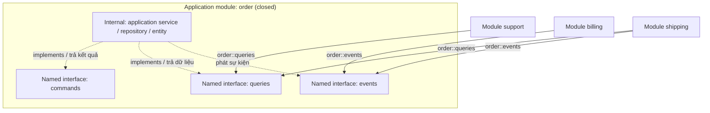

# Nhiều named interface trong một module

Một **application module** trong Spring Modulith có thể cung cấp **nhiều named interface** để các module khác sử dụng những phần API khác nhau. Cách tổ chức này đặc biệt hữu ích khi một module sở hữu nhiều kiểu tương tác: nhận lệnh thay đổi trạng thái, trả dữ liệu đọc và phát sự kiện nghiệp vụ. Thay vì mở một API lớn cho mọi người tiêu thụ, module cung cấp **nhiều hợp đồng có tên**, mỗi hợp đồng có ý nghĩa và phạm vi rõ ràng.

Bài học thuộc chương **Named interfaces** của lộ trình **SPRING_MODULITH_VERIFICATION_TESTING**. Mục tiêu là biết thiết kế nhiều giao diện trong cùng một module, giới hạn phụ thuộc bằng `allowedDependencies`, kiểm chứng bằng `ApplicationModules.verify()` và kết hợp `@ApplicationModuleTest`, test sự kiện, database/tích hợp cùng quality gate CI để ngăn phụ thuộc sai và hồi quy.

> Named interface ở đây là **một nhóm kiểu thuộc API kiến trúc của application module**, không chỉ là Java `interface`, không phải REST endpoint và không tự tạo ranh giới bảo mật lúc chạy.

## 1. Vì sao một module cần nhiều named interface?

Giả sử hệ thống bán hàng có các module `order`, `shipping`, `billing` và `support`. `order` là chủ sở hữu trạng thái đơn hàng, nhưng các module tiêu thụ có nhu cầu khác nhau:

| Module tiêu thụ | Nhu cầu | Phần API hợp lý |
| --- | --- | --- |
| `support` | Xem tình trạng đơn hàng để hỗ trợ khách | `order::queries` |
| `billing` | Biết khi có đơn được đặt để bắt đầu xử lý thanh toán | `order::events` |
| `shipping` | Nhận sự kiện đơn hàng, tra cứu thông tin cần giao | `order::events` và `order::queries` |
| Một module tiếp nhận đơn, nếu được thiết kế riêng | Yêu cầu tạo đơn hàng | `order::commands` |

Nếu tất cả các kiểu trên được gom vào package `order.api` và công bố chung với tên `api`, một module chỉ cần sự kiện vẫn có thể vô tình phụ thuộc vào chức năng tạo đơn hoặc DTO truy vấn. **Tách named interface cho phép khai báo giới hạn riêng trên từng module tiêu thụ.**

Ví dụ module `billing` chỉ có quyền dùng `order::events`. Khi lập trình viên vô tình import `order.queries.OrderQueries`, phép kiểm chứng kiến trúc có thể phát hiện phụ thuộc vượt quá hợp đồng đã chọn.

Ba giao diện có ba ý nghĩa:

- **`commands`**: yêu cầu module `order` thực hiện một thao tác có thể thay đổi trạng thái.
- **`queries`**: đọc thông tin đã được chọn lọc của `order`, không tiết lộ entity/repository.
- **`events`**: kiểu sự kiện công bố sự việc đã xảy ra để module khác phản ứng.

Đây là **cách phân nhóm theo trách nhiệm nghiệp vụ**, không phải danh sách tên bắt buộc của Spring Modulith. Hệ thống thực tế có thể dùng `reservations`, `invoicing`, `fulfillment` hoặc tên khác phù hợp với hợp đồng.

## 2. Một module, ba package API độc lập

Giả sử lớp `@SpringBootApplication` nằm ở `com.acme.shop.ShopApplication`. Theo quy ước phát hiện module mặc định, package con trực tiếp `order`, `shipping`, `billing`, `support` được Spring Modulith coi là application module.

```text
com.acme.shop
├── ShopApplication.java
├── order/                               ← một application module
│   ├── commands/
│   │   ├── package-info.java           ← @NamedInterface("commands")
│   │   └── OrderCommands.java
│   ├── queries/
│   │   ├── package-info.java           ← @NamedInterface("queries")
│   │   ├── OrderQueries.java
│   │   └── OrderView.java
│   ├── events/
│   │   ├── package-info.java           ← @NamedInterface("events")
│   │   └── OrderPlaced.java
│   └── internal/
│       ├── OrderEntity.java
│       ├── OrderRepository.java
│       └── OrderApplicationService.java
├── shipping/
│   └── package-info.java               ← được dùng queries + events
├── billing/
│   └── package-info.java               ← chỉ được dùng events
└── support/
    └── package-info.java               ← chỉ được dùng queries
```

Cả ba package `order.commands`, `order.queries`, `order.events` đều thuộc **cùng module `order`**. Chúng không tạo ba application module mới. Nếu `order` là **closed module**, những subpackage chưa công bố, chẳng hạn `order.internal`, vẫn là phần nội bộ theo quy tắc kiến trúc.

### Công bố giao diện `commands`

File `src/main/java/com/acme/shop/order/commands/package-info.java`:

```java
/**
 * API yêu cầu thực hiện các thao tác thay đổi đơn hàng.
 *
 * <p>Người tiêu thụ không được thao tác trực tiếp repository của order.
 */
@org.springframework.modulith.NamedInterface("commands")
package com.acme.shop.order.commands;
```

Kiểu hợp đồng:

```java
// src/main/java/com/acme/shop/order/commands/OrderCommands.java
package com.acme.shop.order.commands;

import java.util.UUID;

public interface OrderCommands {

    /** Yêu cầu tạo đơn; trả định danh đơn đã được tạo. */
    UUID placeOrder(UUID customerId, String sku, int quantity);
}
```

### Công bố giao diện `queries`

File `src/main/java/com/acme/shop/order/queries/package-info.java`:

```java
/**
 * API tra cứu dữ liệu đơn hàng ở dạng read model.
 *
 * <p>Không tiết lộ entity JPA, repository hoặc logic lưu trữ.
 */
@org.springframework.modulith.NamedInterface("queries")
package com.acme.shop.order.queries;
```

Các kiểu hợp đồng:

```java
// src/main/java/com/acme/shop/order/queries/OrderView.java
package com.acme.shop.order.queries;

import java.util.UUID;

public record OrderView(
        UUID orderId,
        String status
) {}
```

```java
// src/main/java/com/acme/shop/order/queries/OrderQueries.java
package com.acme.shop.order.queries;

import java.util.Optional;
import java.util.UUID;

public interface OrderQueries {

    Optional<OrderView> findById(UUID orderId);
}
```

### Công bố giao diện `events`

File `src/main/java/com/acme/shop/order/events/package-info.java`:

```java
/**
 * Các sự kiện nghiệp vụ mà order công bố cho module khác.
 *
 * <p>Payload chỉ gồm thông tin ổn định cần thiết cho người tiêu thụ.
 */
@org.springframework.modulith.NamedInterface("events")
package com.acme.shop.order.events;
```

Kiểu sự kiện:

```java
// src/main/java/com/acme/shop/order/events/OrderPlaced.java
package com.acme.shop.order.events;

import java.time.Instant;
import java.util.UUID;

public record OrderPlaced(
        UUID orderId,
        Instant occurredAt
) {}
```

Sau ba khai báo, module `order` cung cấp **ba giao diện có tên**:

| Tên kiến trúc | Package Java | Các kiểu ví dụ | Cam kết cốt lõi |
| --- | --- | --- | --- |
| `order::commands` | `com.acme.shop.order.commands` | `OrderCommands` | Yêu cầu thao tác thay đổi trạng thái |
| `order::queries` | `com.acme.shop.order.queries` | `OrderQueries`, `OrderView` | Truy vấn dữ liệu đã chuẩn hóa |
| `order::events` | `com.acme.shop.order.events` | `OrderPlaced` | Thông báo một sự việc nghiệp vụ đã xảy ra |

Ký hiệu `order::events` gồm **tên module + `::` + tên named interface**. Đây là cú pháp phụ thuộc của Spring Modulith; mã Java vẫn import bằng tên package như `com.acme.shop.order.events.OrderPlaced`.

## 3. Named interface không phải module con và không bao trùm mọi kiểu

Ba package vừa công bố là **ba phần API của một module**, nên vòng đời nghiệp vụ và quyền sở hữu vẫn nằm ở `order`. Implementation `OrderApplicationService` có thể hiện thực `OrderCommands`, dùng repository, trả `OrderView` và phát `OrderPlaced`, nhưng các chi tiết đó vẫn thuộc `order.internal`.



**Không nên suy luận** rằng một `@NamedInterface` khiến toàn bộ module công khai. Các kiểu trong `order.internal` không được công bố chỉ vì `order.commands` hoặc `order.queries` đã có annotation.

Các điểm cần phân biệt:

1. **Java `public`** chỉ là quy tắc truy cập của Java. Một kiểu `public` ở `order.internal` vẫn có thể bị `ApplicationModules.verify()` từ chối khi module khác phụ thuộc vào nó.
2. **API mặc định** nằm ở package gốc `order` (với các kiểu công khai phù hợp). Nó là một phần khác với ba named interface vừa khai báo.
3. **Named interface** công bố nhóm kiểu được xác định bởi khai báo trên package. Không thêm helper, adapter hoặc repository vào package API chỉ vì chúng cũng là `public`.
4. **Nhiều named interface** không yêu cầu mỗi nhóm phải có bean riêng. Chúng mô tả phạm vi kiểu mà module khác có thể tham chiếu; implementation, bean và transaction được thiết kế độc lập.

Một lỗi dễ gặp là để `OrderQueries.findById(...)` trả về `order.internal.OrderEntity`. Khi đó giao diện truy vấn vô tình kéo module tiêu thụ vào kiểu nội bộ, dù `OrderQueries` đang nằm trong named interface hợp lệ. Cách thiết kế đúng là trả `OrderView` thuộc `order::queries`.

## 4. Giới hạn từng module tiêu thụ bằng `allowedDependencies`

Một module cung cấp nhiều API **không có nghĩa mỗi module tiêu thụ cần hoặc được dùng tất cả**. Ở phía người tiêu thụ, đặt `@ApplicationModule(allowedDependencies = ...)` trên package gốc để thể hiện quyền phụ thuộc mong muốn.

### `support` chỉ dùng API truy vấn

File `src/main/java/com/acme/shop/support/package-info.java`:

```java
@org.springframework.modulith.ApplicationModule(
    allowedDependencies = "order::queries"
)
package com.acme.shop.support;
```

Module `support` được tham chiếu `OrderQueries` và `OrderView`. Nó không được tự động tham chiếu `OrderCommands`, `OrderPlaced` hoặc `OrderRepository`.

### `billing` chỉ dùng kiểu sự kiện

File `src/main/java/com/acme/shop/billing/package-info.java`:

```java
@org.springframework.modulith.ApplicationModule(
    allowedDependencies = "order::events"
)
package com.acme.shop.billing;
```

Module `billing` có thể khai báo listener dùng kiểu `OrderPlaced`. Phạm vi này không cho phép `billing` nhập trực tiếp `OrderQueries` hoặc gọi `OrderCommands`.

### `shipping` cần hai named interface

File `src/main/java/com/acme/shop/shipping/package-info.java`:

```java
@org.springframework.modulith.ApplicationModule(
    allowedDependencies = {
        "order::events",
        "order::queries"
    }
)
package com.acme.shop.shipping;
```

`shipping` vừa có thể tham chiếu `OrderPlaced` vừa có thể dùng `OrderQueries`. Tuy nhiên, `shipping` vẫn **không** có quyền tham chiếu `OrderCommands` hay `order.internal`.

Từ góc nhìn mỗi module tiêu thụ:

| Kiểu thuộc `order` | `support` | `billing` | `shipping` |
| --- | :---: | :---: | :---: |
| `queries.OrderQueries` | ✅ | ❌ | ✅ |
| `queries.OrderView` | ✅ | ❌ | ✅ |
| `events.OrderPlaced` | ❌ | ✅ | ✅ |
| `commands.OrderCommands` | ❌ | ❌ | ❌ |
| `internal.OrderRepository` | ❌ | ❌ | ❌ |
| Kiểu API mặc định ở `order` | ❌ | ❌ | ❌ |

Bảng này giả định `order` là closed module và `allowedDependencies` đúng như các đoạn mã ở trên. **Một kiểu đã được công bố** vẫn có thể **không được một module tiêu thụ cụ thể sử dụng** vì ràng buộc của chính module tiêu thụ.

> `@NamedInterface` không phải cơ chế liệt kê *ai được gọi* từ phía module cung cấp. Nó mô tả *cái gì được công bố*. `allowedDependencies` và các bài kiểm chứng kiến trúc xác định phạm vi phụ thuộc được chấp nhận từ phía từng module tiêu thụ.

## 5. Tương tác thực tế từ từng nhóm người tiêu thụ

Một service thuộc `support` chỉ cần truy vấn:

```java
// src/main/java/com/acme/shop/support/OrderSupportService.java
package com.acme.shop.support;

import com.acme.shop.order.queries.OrderQueries;
import com.acme.shop.order.queries.OrderView;
import java.util.Optional;
import java.util.UUID;
import org.springframework.stereotype.Service;

@Service
public class OrderSupportService {

    private final OrderQueries orders;

    public OrderSupportService(OrderQueries orders) {
        this.orders = orders;
    }

    public Optional<OrderView> lookup(UUID orderId) {
        return orders.findById(orderId);
    }
}
```

Implementation của `OrderQueries` phải được module `order` cung cấp dưới dạng bean nếu muốn Spring inject thành công. Annotation `@NamedInterface` **không tạo bean** và cũng không tự hiện thực hợp đồng.

Module `billing` có thể khai báo listener cho sự kiện đã công bố:

```java
// src/main/java/com/acme/shop/billing/OrderBillingListener.java
package com.acme.shop.billing;

import com.acme.shop.order.events.OrderPlaced;
import org.springframework.modulith.events.ApplicationModuleListener;
import org.springframework.stereotype.Component;

@Component
class OrderBillingListener {

    @ApplicationModuleListener
    void on(OrderPlaced event) {
        // Kích hoạt quy trình lập hóa đơn theo event.orderId().
        // Mã nghiệp vụ thực tế cần xử lý lỗi và khả năng chạy lại.
    }
}
```

Trong một ứng dụng thật, `order` phải thực sự phát `OrderPlaced` (ví dụ qua `ApplicationEventPublisher`) khi giao dịch nghiệp vụ đạt tới trạng thái tương ứng. Việc có named interface `events` chỉ **cho phép kiểu sự kiện được tham chiếu**; nó không tự phát sự kiện, bảo đảm sự kiện đến đúng thời điểm hoặc làm listener idempotent.

Module `shipping` có thể dùng cả hai:

```java
// src/main/java/com/acme/shop/shipping/ShippingOrderListener.java
package com.acme.shop.shipping;

import com.acme.shop.order.events.OrderPlaced;
import com.acme.shop.order.queries.OrderQueries;
import org.springframework.modulith.events.ApplicationModuleListener;
import org.springframework.stereotype.Component;

@Component
class ShippingOrderListener {

    private final OrderQueries orders;

    ShippingOrderListener(OrderQueries orders) {
        this.orders = orders;
    }

    @ApplicationModuleListener
    void on(OrderPlaced event) {
        orders.findById(event.orderId())
                .ifPresent(order -> {
                    // Khởi tạo quy trình giao hàng theo thông tin đọc.
                });
    }
}
```

Ví dụ minh họa quan hệ phụ thuộc hợp lệ; để chạy trong thực tế cần bean và các phụ thuộc Spring Modulith phù hợp, transaction/test data và implementation thật. Với việc xử lý sự kiện bất đồng bộ, cần tính tới độ trễ nhất quán dữ liệu: listener không nên giả định rằng trạng thái đọc luôn cập nhật đúng thời điểm nếu hệ thống có xử lý eventual consistency.

## 6. Khi nào nên tách thành nhiều named interface?

Không phải cứ có nhiều class là phải tách nhiều API. Mục tiêu chính là **phân chia trách nhiệm và quyền phụ thuộc theo nhu cầu thực tế**.

| Tình huống | Quyết định nên cân nhắc | Vì sao |
| --- | --- | --- |
| Người dùng API chỉ cần đọc dữ liệu | Công bố `queries` | Không buộc người tiêu thụ nhìn thấy API ghi |
| Các module phản ứng với sự kiện nhưng không gọi service | Công bố `events` | Phụ thuộc vào kiểu event, không phụ thuộc vào thao tác đồng bộ |
| Chỉ một số module được yêu cầu thay đổi trạng thái | Công bố `commands` riêng | Giúp nhìn thấy và giới hạn quyền phụ thuộc nhiều rủi ro hơn |
| Hai nhóm kiểu luôn được tiêu thụ và thay đổi cùng nhau | Cân nhắc một named interface chung | Tránh chia API thành quá nhiều mảnh khó duy trì |
| Module có rất nhiều API với chủ sở hữu nghiệp vụ khác nhau | Cân nhắc lại ranh giới application module | Có thể module đang gánh quá nhiều trách nhiệm, cần thiết kế lại |

Các tên `commands`, `queries`, `events` **không phải tính năng CQRS tự động**. Đặt tên như vậy không tự tách database đọc/ghi, không cấu hình event broker và không áp đặt một mô hình consistency; đó chỉ là cách trình bày hợp đồng trên ranh giới module.

### Một danh mục API tốt cần mô tả điều gì?

Với từng named interface, ghi rõ:

1. **Mục đích nghiệp vụ:** ví dụ `events` công bố các sự kiện đã xảy ra; `commands` yêu cầu thay đổi.
2. **Kiểu được công bố:** interface, record, enum, exception hoặc kiểu event nào là hợp đồng chính thức.
3. **Người tiêu thụ dự kiến:** `support`, `billing`, `shipping`, và lý do họ cần API đó.
4. **Hành vi và giới hạn:** tác dụng phụ, tính nhất quán, cách báo lỗi, ý nghĩa các trường dữ liệu.
5. **Chính sách thay đổi:** khi thêm/xóa/đổi tên kiểu, ai kiểm tra tác động đến các module tiêu thụ.

Nên để JavaDoc trong `package-info.java` và trên từng kiểu công khai, đồng thời tránh lộ kiểu `order.internal` qua tham số, kết quả trả về, kiểu generic hoặc payload sự kiện.

## 7. Kiểm chứng các named interface bằng `ApplicationModules.verify()`

Để bảo đảm các quy tắc trên vẫn đúng khi mã thay đổi, tạo một bài test kiến trúc JUnit:

```java
// src/test/java/com/acme/shop/ModulithArchitectureTest.java
package com.acme.shop;

import org.junit.jupiter.api.Test;
import org.springframework.modulith.core.ApplicationModules;

class ModulithArchitectureTest {

    @Test
    void moduleDependenciesFollowNamedInterfaces() {
        ApplicationModules.of(ShopApplication.class).verify();
    }
}
```

`verify()` dựng mô hình module từ `ShopApplication` và kiểm chứng ranh giới của **toàn ứng dụng**: các phụ thuộc đến kiểu nội bộ của closed module, quan hệ vượt `allowedDependencies` hoặc chu trình phụ thuộc module không hợp lệ có thể khiến test thất bại.

Dù tên method chỉ nhắc tới named interface, phép gọi `verify()` không giới hạn phạm vi ở một module duy nhất. Nếu `billing`, `shipping` hoặc module khác có phụ thuộc không hợp lệ, test vẫn có thể thất bại.

### Thí nghiệm dương và âm

Mỗi lần chỉ thêm **một phụ thuộc** rồi chạy lại test, quan sát kết quả trước khi khôi phục mã:

| Thử nghiệm | Thay đổi | Kết quả mong đợi |
| --- | --- | --- |
| **A. Baseline** | `support` dùng `OrderQueries`; `billing` dùng `OrderPlaced`; `shipping` dùng cả hai | PASS nếu không có vi phạm khác |
| **B. Sai named interface** | `billing` phụ thuộc `OrderQueries` | FAIL vì `billing` chỉ cho phép `order::events` |
| **C. Dùng quyền ghi ngoài phạm vi** | `shipping` phụ thuộc `OrderCommands` | FAIL vì không cho phép `order::commands` |
| **D. Đụng implementation** | `support` phụ thuộc một class `public` thuộc `order.internal` | FAIL vì kiểu không được công bố |
| **E. Nhầm API mặc định** | `support` phụ thuộc kiểu public trong package gốc `order` | FAIL với `allowedDependencies = "order::queries"` |
| **F. Bỏ khai báo `events`** | Tạm xóa annotation `@NamedInterface("events")` | FAIL nếu module khác còn tham chiếu kiểu ở package này |
| **G. Khôi phục** | Bỏ mọi phụ thuộc sai và khôi phục annotation | PASS nếu toàn bộ kiến trúc hợp lệ |

Đối với D, dùng một kiểu nội bộ `public` **chỉ để thử nghiệm** nhằm cho phép Java biên dịch rồi quan sát lỗi kiến trúc; nếu kiểu là package-private thì Java sẽ chặn trước. Đồng thời, một import **không được sử dụng** có thể không tạo quan hệ phụ thuộc rõ ràng ở bytecode. Hãy đưa kiểu vào field, chữ ký hoặc lệnh gọi tạm thời khi làm thí nghiệm.

Cần phân biệt hai loại lỗi:

- **Không được công bố:** một kiểu ở `order.internal` không thuộc API của closed module `order`; thêm tên nó vào `allowedDependencies` không tự làm nó trở thành API.
- **Được công bố nhưng không được phép dùng:** `OrderCommands` thuộc `order::commands`, song `shipping` không khai báo quyền phụ thuộc vào phần đó.

Kết quả ở bảng là **kỳ vọng kiểm chứng của bài thực hành**, không phải báo cáo đã chạy test trên một repository cụ thể. Thông báo và chi tiết vi phạm có thể thay đổi giữa các phiên bản Spring Modulith.

## 8. Phối hợp test kiến trúc với test module, sự kiện và database

Chạy `ApplicationModules.verify()` là cần thiết, nhưng chưa đủ để biết ba named interface hoạt động đúng.

| Phép thử | Câu hỏi chính | Ví dụ |
| --- | --- | --- |
| `ApplicationModules.verify()` | Phụ thuộc có đi qua API được công bố và được phép không? | `billing` không tham chiếu `order::commands` |
| `@ApplicationModuleTest` | Module có bootstrap đúng và bean nội bộ cung cấp hợp đồng dự kiến không? | `OrderQueries` có implementation được Spring quản lý |
| Test hành vi commands | Lệnh có thực hiện đúng quy tắc thay đổi và rollback? | `placeOrder(...)` tạo đơn hợp lệ, từ chối dữ liệu sai |
| Test read model/database | Dữ liệu công bố có phản ánh trạng thái lưu trữ? | `OrderView` trả về thông tin đúng, không lộ entity |
| Test sự kiện | `OrderPlaced` được phát và xử lý đúng, không gây xử lý lặp ngoài ý muốn? | `billing` nhận event theo `orderId` |
| Test tích hợp liên module | Những module dùng hợp đồng có phối hợp đúng không? | `shipping` đọc đơn sau khi nhận sự kiện |
| CI quality gate | Một thay đổi có gây phụ thuộc sai hoặc hồi quy hành vi không? | Test bắt buộc thất bại thì không hợp nhất thay đổi |

Ví dụ kiểm thử khả năng cung cấp bean truy vấn trong module `order`:

```java
// src/test/java/com/acme/shop/order/OrderModuleTest.java
package com.acme.shop.order;

import com.acme.shop.order.queries.OrderQueries;
import org.junit.jupiter.api.Test;
import org.springframework.beans.factory.annotation.Autowired;
import org.springframework.modulith.test.ApplicationModuleTest;

import static org.assertj.core.api.Assertions.assertThat;

@ApplicationModuleTest
class OrderModuleTest {

    @Autowired
    OrderQueries orderQueries;

    @Test
    void providesQueryContract() {
        assertThat(orderQueries).isNotNull();
    }
}
```

Test trên giả định `order` có bean hiện thực `OrderQueries`, dependency cần thiết và cấu hình database/test context phù hợp. Nó minh họa **khả năng nạp module và bean**; bài test `verify()` vẫn cần chạy riêng để kiểm chứng ranh giới.

Với `order::events`, cần test rằng hành vi tạo đơn thật sự phát `OrderPlaced`, payload đúng và các listener xử lý an toàn khi event lặp lại. Với `queries`, cần test truy vấn cho đơn tồn tại/không tồn tại, mapping DTO và trạng thái transaction. Với `commands`, cần test trường hợp thành công, từ chối và rollback.

## 9. Quality gate CI cho hệ thống có nhiều giao diện

Đặt `ModulithArchitectureTest` trong test suite JUnit thông thường để mọi pull request đều kiểm chứng mô hình module. Lệnh minh họa:

```bash
./gradlew test
```

Hoặc với Maven:

```bash
mvn test
```

Trong một pipeline kiểm tra chất lượng, có thể đặt các điều kiện:

1. **Biên dịch:** các kiểu hợp đồng và mã tiêu thụ biên dịch thành công.
2. **Kiến trúc:** `ApplicationModules.verify()` PASS, kể cả những phụ thuộc giữa các named interface khác nhau trong cùng module cung cấp.
3. **Hành vi:** test `@ApplicationModuleTest`, sự kiện, database và tích hợp liên quan PASS.
4. **Review API:** khi thêm kiểu public vào `order.commands`, `order.queries` hoặc `order.events`, xác nhận nó có thực sự thuộc hợp đồng được công bố.
5. **Review quyền:** khi một module thêm mục vào `allowedDependencies`, kiểm tra lý do nghiệp vụ và liệu có thể dùng API hẹp hơn không.

Test kiến trúc thất bại phải làm job CI thất bại. Chỉ in cảnh báo rồi bỏ qua khiến các ranh giới API mất tác dụng bảo vệ hồi quy.

Khi thay đổi tên `events` thành một tên khác, cần cập nhật `@NamedInterface`, mọi `allowedDependencies` tham chiếu `order::events` và tài liệu. Không nên thay tên chỉ để giải quyết một lời cảnh báo; tên này là một phần của **hợp đồng kiến trúc** đối với các module tiêu thụ.

## 10. Các lỗi thường gặp khi có nhiều named interface

**“Có ba named interface là có ba module nhỏ.”** Không. `commands`, `queries`, `events` là ba phần API của **cùng application module** `order`. Quan hệ từ `shipping` tới `order::events` vẫn là quan hệ phụ thuộc tới module `order`.

**“Khai báo `order::events` thì tự dùng được `order::queries`.”** Không. Mỗi named interface là một phần API riêng. Khi muốn dùng hai phần, hãy khai báo hai mục trong `allowedDependencies`.

**“Vì một package đã public, mọi module đều được dùng nó.”** Việc công bố package xác định kiểu thuộc API của module sở hữu. Một module tiêu thụ có `allowedDependencies` hẹp vẫn có thể bị chặn khi tham chiếu một phần API chưa được cho phép.

**“Đặt mọi class vào `order.events` cho tiện.”** Không phù hợp. Thêm repository, DTO quản trị hoặc service triển khai vào package được công bố sẽ làm bề mặt API rộng ra. Các kiểu nội bộ nên ở subpackage riêng.

**“Càng nhiều interface càng tốt.”** Không nhất thiết. Chỉ tách khi có ranh giới trách nhiệm hoặc nhu cầu tiêu thụ khác nhau; quá nhiều nhóm nhỏ khiến API khó hiểu và làm tăng chi phí quản lý thay đổi.

**“Đổi sang open module hoặc wildcard để test qua.”** Cách làm đó nới giới hạn phụ thuộc và che khuất nguyên nhân vi phạm. Cần xác định module tiêu thụ cần phần API nào rồi cấp quyền cụ thể.

**“`verify()` PASS thì listener và database đều đúng.”** Không. `verify()` phân tích cấu trúc; nó không kiểm tra trạng thái database, tính đúng đắn của transaction hay phát/nhận event ở runtime.

## 11. Bài thực hành: ba hợp đồng, ba nhóm người tiêu thụ

Giữ nguyên module `order` với ba named interface và thực hiện lần lượt:

1. **Thiết kế API:** tạo các package `order.commands`, `order.queries`, `order.events`. Đặt `package-info.java` tương ứng với các tên `commands`, `queries`, `events`.
2. **Định nghĩa kiểu hợp đồng:** thêm `OrderCommands`, `OrderQueries`, `OrderView` và `OrderPlaced`. Không để entity JPA hay repository xuất hiện trong chữ ký API.
3. **Giới hạn người tiêu thụ:** `support` chỉ được `order::queries`, `billing` chỉ được `order::events`, `shipping` được cả hai. Giữ `order::commands` chưa được cấp quyền cho ba module đó.
4. **Tạo mã dùng đúng API:** `support` tra cứu qua `OrderQueries`; `billing` xử lý `OrderPlaced`; `shipping` nghe event và đọc đơn qua `OrderQueries`.
5. **Tạo test kiến trúc:** chạy `ApplicationModules.of(ShopApplication.class).verify()` và ghi nhận trạng thái hợp lệ.
6. **Tạo ba vi phạm có kiểm soát:** cho `billing` dùng `OrderQueries`, `shipping` dùng `OrderCommands`, `support` tham chiếu một kiểu public giả lập ở `order.internal`. Giải thích nguyên nhân từng lỗi.
7. **Khôi phục và kiểm thử hành vi:** bỏ các phụ thuộc sai, chạy lại `verify()`, thêm test module, event và repository theo phạm vi ứng dụng.
8. **Khóa hồi quy trong CI:** xác nhận một import sai vào API chưa được phép sẽ làm job CI thất bại, trong khi các trường hợp hợp lệ vẫn PASS.

### Tự đánh giá

- **Vì sao `shipping` được dùng hai named interface trong khi `billing` chỉ được dùng một?** Vì mỗi module tiêu thụ khai báo danh sách quyền phụ thuộc của riêng mình.
- **Nếu `billing` cần cả `OrderQueries`, phải làm gì?** Xác định nhu cầu nghiệp vụ, sau đó thêm `order::queries` vào `allowedDependencies` của `billing` và chạy lại kiểm chứng.
- **Nếu `support` muốn dùng `OrderRepository` thì có nên công bố `internal`?** Không. Nên bổ sung một thao tác đọc hợp lý vào `order::queries`.
- **Một sự kiện ở `order.events` có tự được gửi chỉ nhờ `@NamedInterface` không?** Không. Nó chỉ là kiểu được công bố; phát và xử lý event cần mã runtime và test hành vi.
- **Khi thêm giao diện `order::exports`, điều gì cần kiểm tra?** Các kiểu có thực sự cần công bố, module nào cần quyền dùng chúng, chữ ký có lộ nội bộ, và test kiến trúc/CI còn bảo vệ đúng ranh giới hay không.

## 12. Ghi nhớ

Một application module có thể **công bố nhiều named interface** để chia API theo trách nhiệm, ví dụ `order::commands`, `order::queries`, `order::events`. Mỗi giao diện được khai báo trên package hợp đồng bằng `@NamedInterface`; các phần triển khai vẫn thuộc module chủ sở hữu. Từng module tiêu thụ cấp quyền hẹp bằng **`allowedDependencies`**, có thể liệt kê một hoặc nhiều named interface khi cần. **`ApplicationModules.verify()`** giúp kiểm chứng các ranh giới ấy trong CI, còn `@ApplicationModuleTest`, test sự kiện, database và tích hợp kiểm chứng hành vi của từng hợp đồng.

### Tài liệu tham khảo

- [Spring Modulith Reference — Application Modules và Named Interfaces](https://docs.spring.io/spring-modulith/reference/fundamentals.html)
- [Spring Modulith Reference — Verifying Application Module Structure](https://docs.spring.io/spring-modulith/reference/verification.html)
