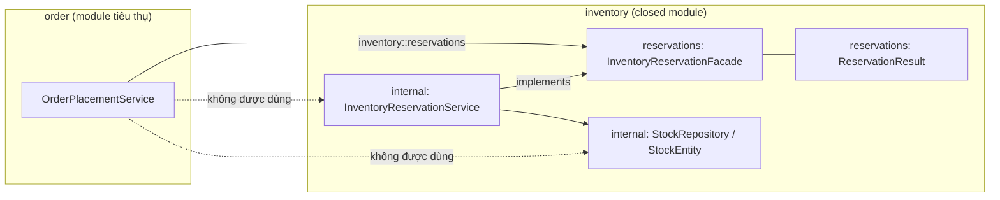

# Quan hệ giữa named interface và facade

Trong Spring Modulith, **facade** (façade, lớp hoặc giao diện mặt tiền) là một **mẫu thiết kế API**: nó cung cấp một điểm vào đơn giản cho một tập chức năng phía sau module. **Named interface** là một **khái niệm kiến trúc của Spring Modulith**: nó xác định nhóm kiểu mà một application module công bố cho các module khác. Hai khái niệm thường được dùng cùng nhau: đặt **hợp đồng facade** trong package được đánh dấu `@NamedInterface`, giữ implementation/repository nội bộ, rồi kiểm chứng module tiêu thụ chỉ phụ thuộc vào hợp đồng đã công bố.

Bài thuộc chương **Named interfaces** của **SPRING_MODULITH_VERIFICATION_TESTING**. Mục tiêu xuyên suốt là kiểm chứng ranh giới kiến trúc với `ApplicationModules` và quy tắc phụ thuộc, kết hợp `@ApplicationModuleTest`, kiểm thử sự kiện, cơ sở dữ liệu/tích hợp và quality gate CI để ngăn phụ thuộc sai và hồi quy.

> **Phân biệt ngắn:** *Facade* trả lời **“module khác nên gọi thao tác nào, qua điểm vào nào?”**; *named interface* trả lời **“những kiểu nào được công bố như API của module và mang tên gì?”**. Một named interface có thể chứa facade, DTO và sự kiện; nó không bắt buộc chỉ chứa một Java `interface`.

## 1. Vấn đề: một module khác cần chức năng, không cần nội tạng

Giả sử ứng dụng bán hàng có:

- `inventory`: quản lý tồn kho, dữ liệu, quy tắc giữ hàng và giao dịch.
- `order`: tạo đơn và cần yêu cầu `inventory` đặt giữ hàng trước khi xác nhận.

Một thiết kế phụ thuộc trực tiếp sẽ để `order` gọi `StockRepository`, cập nhật `StockEntity` hoặc biết `StockAllocationPolicy`. Khi đó `order` phải hiểu schema lưu trữ, chính sách đồng thời, ngoại lệ kỹ thuật và chi tiết triển khai của `inventory`. Những thay đổi bên trong `inventory` sẽ lan sang `order`.

Facade giảm vấn đề này bằng cách cho `order` một thao tác có nghĩa trong nghiệp vụ:

```java
ReservationResult reserve(String sku, int quantity);
```

Bên trong `inventory`, facade có thể phối hợp repository, kiểm tra quy tắc số lượng, transaction và chuyển kết quả sang DTO. Bên ngoài chỉ cần hợp đồng `reserve` và `ReservationResult`.

**Nhưng có facade chưa đủ để bảo vệ kiến trúc.** Nếu `order` vẫn được phép import tùy ý các kiểu `public` trong `inventory.internal`, đồng đội có thể bỏ qua facade vào một lần sửa mã khác. Spring Modulith cho phép biểu diễn ranh giới và xác minh các phụ thuộc đó.

## 2. Facade và named interface khác nhau ở đâu?

| Góc nhìn | Facade | Named interface |
| --- | --- | --- |
| Bản chất | Mẫu thiết kế, điểm vào cho một hoặc nhiều chức năng | Nhóm kiểu API có tên trong mô hình application module |
| Thường được thể hiện bằng | Java `interface` cùng implementation, hoặc một class public làm điểm vào | `@NamedInterface("...")` trên package chứa các kiểu API |
| Mục đích | Che giấu điều phối nghiệp vụ và sự phức tạp bên trong | Khai báo bề mặt được công bố để kiểm chứng phụ thuộc chéo module |
| Thành viên | Những phương thức facade định nghĩa | Có thể gồm một/nhiều facade, command, DTO, record, enum, event |
| Quyết định quyền phụ thuộc? | Không tự đặt ra chính sách kiến trúc | Kết hợp với `allowedDependencies` để xác định phần module tiêu thụ được phép dùng |
| Tự chạy hành vi? | Implementation facade có thể chạy logic thật | Annotation chỉ mô tả API, không tự tạo bean hoặc thực thi logic |
| Có bắt buộc phải đi cùng nhau? | Không; facade có thể ở API mặc định của module | Không; named interface có thể chỉ chứa các kiểu sự kiện hoặc DTO |

Trong Java, `public` là điều kiện truy cập của ngôn ngữ. Với một **closed application module**, Spring Modulith còn phân biệt API mặc định của package gốc, named interface công bố trong subpackage, và các subpackage nội bộ chưa được công bố. Do đó một class `public` trong `inventory.internal` **có thể biên dịch khi module khác tham chiếu**, nhưng vẫn bị test kiến trúc phát hiện là phụ thuộc sai.

## 3. Thiết kế: facade là hợp đồng thuộc named interface

Giả sử `ShopApplication` là lớp `@SpringBootApplication` ở `com.example.shop`. Với cách phát hiện module mặc định, `inventory` và `order` là hai application module con:

```text
com.example.shop
├── ShopApplication.java
├── inventory/                         ← application module: inventory
│   ├── api/
│   │   └── reservations/
│   │       ├── package-info.java    ← @NamedInterface("reservations")
│   │       ├── InventoryReservationFacade.java
│   │       └── ReservationResult.java
│   └── internal/
│       ├── InventoryReservationService.java
│       ├── StockRepository.java
│       ├── StockEntity.java
│       └── StockAllocationPolicy.java
└── order/                             ← application module: order
    ├── package-info.java
    └── OrderPlacementService.java
```

Phần giao tiếp được công bố là **`inventory::reservations`**. Tên này ghép tên application module `inventory` và tên named interface `reservations` bằng `::`. Nó **không phải** cú pháp Java `import` hay đường dẫn package.

### Bước 1: khai báo package API

Tạo `src/main/java/com/example/shop/inventory/api/reservations/package-info.java`:

```java
/**
 * Hợp đồng đặt giữ tồn kho dành cho các application module khác.
 *
 * <p>Người tiêu thụ dùng InventoryReservationFacade và
 * ReservationResult; repository, entity và thuật toán phân bổ
 * luôn thuộc phần hiện thực nội bộ của inventory.
 */
@org.springframework.modulith.NamedInterface("reservations")
package com.example.shop.inventory.api.reservations;
```

File `package-info.java` phải khai báo **đúng package** chứa API. `@NamedInterface("reservations")` công bố các kiểu phù hợp trong package này như một giao diện có tên của module `inventory`. Chỉ đặt folder tên `reservations` hoặc chỉ khai báo Java `public` **chưa đủ** để một subpackage của closed module trở thành named interface.

### Bước 2: định nghĩa facade và DTO công khai

```java
// InventoryReservationFacade.java
package com.example.shop.inventory.api.reservations;

/**
 * Điểm vào yêu cầu giữ tồn kho cho đơn hàng.
 *
 * <p>Implementation chịu trách nhiệm kiểm tra quy tắc và tính nhất quán.
 */
public interface InventoryReservationFacade {

    /**
     * Thử giữ quantity đơn vị của SKU.
     *
     * @param sku định danh hàng hóa, không rỗng
     * @param quantity số lượng dương
     * @return kết quả chấp nhận hoặc mã lý do từ chối
     */
    ReservationResult reserve(String sku, int quantity);
}
```

```java
// ReservationResult.java
package com.example.shop.inventory.api.reservations;

/** DTO kết quả không phụ thuộc entity hay repository. */
public record ReservationResult(
        boolean accepted,
        String reasonCode
) {}
```

Ở đây, **facade** là `InventoryReservationFacade`: người dùng module nhìn thấy một thao tác `reserve` với ngữ nghĩa nghiệp vụ. **Named interface** là `inventory::reservations`: tập kiểu được công bố gồm `InventoryReservationFacade` và `ReservationResult` trong package được đánh dấu.

Không đặt `StockEntity`, `StockRepository` hoặc `StockAllocationPolicy` trong package `api.reservations`. Nếu một public type mới được thêm vào package đã công bố, nó có thể vô tình mở rộng bề mặt API. Cần review cả **thành viên package** và **chữ ký public** của các kiểu trong package.

### Bước 3: giữ implementation phía sau facade

Ví dụ `inventory` tự hiện thực facade:

```java
// InventoryReservationService.java
package com.example.shop.inventory.internal;

import com.example.shop.inventory.api.reservations.InventoryReservationFacade;
import com.example.shop.inventory.api.reservations.ReservationResult;
import org.springframework.stereotype.Service;
import org.springframework.transaction.annotation.Transactional;

@Service
class InventoryReservationService implements InventoryReservationFacade {

    private final StockRepository stocks;

    InventoryReservationService(StockRepository stocks) {
        this.stocks = stocks;
    }

    @Override
    @Transactional
    public ReservationResult reserve(String sku, int quantity) {
        if (sku == null || sku.isBlank() || quantity <= 0) {
            return new ReservationResult(false, "INVALID_REQUEST");
        }

        // Hợp đồng của repository nội bộ phải cập nhật tồn kho
        // một cách an toàn dưới transaction khi có cạnh tranh.
        boolean reserved = stocks.reserveIfAvailable(sku, quantity);

        return reserved
                ? new ReservationResult(true, "ACCEPTED")
                : new ReservationResult(false, "OUT_OF_STOCK");
    }
}
```

Repository nội bộ mà ví dụ trên sử dụng có một hợp đồng tối thiểu:

```java
// StockRepository.java
package com.example.shop.inventory.internal;

interface StockRepository {
    boolean reserveIfAvailable(String sku, int quantity);
}
```

Các đoạn này minh họa **sự phân chia trách nhiệm**, chưa tạo đầy đủ một ứng dụng chạy được: hệ thống thật cần một bean hiện thực `StockRepository`, lưu dữ liệu, xử lý lỗi, idempotency và kiểm tra tranh chấp tồn kho. Phải đảm bảo `reserveIfAvailable` cập nhật có điều kiện/khóa đúng cách; đặt `@Transactional` đơn thuần không tự ngăn mọi race condition.

Spring có thể quản lý `InventoryReservationService` như bean `@Service` và inject thông qua **interface public** `InventoryReservationFacade` ở phía module khác. Không cần chuyển class implementation lên package API để Spring nhìn thấy nó.



## 4. Module tiêu thụ chỉ phụ thuộc vào facade được công bố

Định nghĩa quyền phụ thuộc từ phía `order` bằng `src/main/java/com/example/shop/order/package-info.java`:

```java
@org.springframework.modulith.ApplicationModule(
    allowedDependencies = "inventory::reservations"
)
package com.example.shop.order;
```

`allowedDependencies` thu hẹp quan hệ của `order`: nó chỉ được tham chiếu nhóm API `reservations` của `inventory`. Nếu `inventory` sau này thêm `inventory::events` hoặc API mặc định ở package gốc thì `order` **không tự được phép** sử dụng các phần ấy.

Ví dụ một service ở `order`:

```java
// OrderPlacementService.java
package com.example.shop.order;

import com.example.shop.inventory.api.reservations.InventoryReservationFacade;
import com.example.shop.inventory.api.reservations.ReservationResult;
import org.springframework.stereotype.Service;

@Service
public class OrderPlacementService {

    private final InventoryReservationFacade inventory;

    public OrderPlacementService(InventoryReservationFacade inventory) {
        this.inventory = inventory;
    }

    public boolean tryReserveForOrder(String sku, int quantity) {
        ReservationResult result = inventory.reserve(sku, quantity);
        return result.accepted();
    }
}
```

Tên `tryReserveForOrder` phản ánh thao tác **có thể làm thay đổi trạng thái tồn kho**, khác với một hàm chỉ kiểm tra khả dụng. Trong luồng tạo đơn thực tế, khi giữ hàng thành công nhưng tạo đơn thất bại, phải có cơ chế giải phóng giữ hàng hoặc bù trừ phù hợp; không coi đoạn mã ngắn này là giải pháp giao dịch liên module hoàn chỉnh.

| Tham chiếu từ `order` | Nằm ở phần nào của `inventory`? | Với `allowedDependencies = "inventory::reservations"` |
| --- | --- | --- |
| `api.reservations.InventoryReservationFacade` | Named interface `reservations` | **Hợp lệ** |
| `api.reservations.ReservationResult` | Named interface `reservations` | **Hợp lệ** |
| `internal.InventoryReservationService` | Implementation nội bộ | **Vi phạm** nếu `order` phụ thuộc trực tiếp |
| `internal.StockRepository` | Repository nội bộ | **Vi phạm** nếu `order` phụ thuộc trực tiếp |
| Kiểu public ở package gốc `inventory` | API mặc định (*unnamed interface*) | **Vi phạm** do không nằm trong quyền `reservations` |
| Kiểu trong `inventory::events` (nếu tồn tại) | Named interface khác | **Vi phạm** do chưa được cho phép |

Nếu một implementation nội bộ là package-private, Java chặn tham chiếu từ `order` ngay từ bước biên dịch. Nếu implementation là `public` vì lý do framework/kiến trúc nội bộ, Spring Modulith vẫn kiểm chứng phụ thuộc chéo module ở mức kiến trúc.

**Hai câu hỏi cần hỏi trong code review:** (1) kiểu đang dùng có thuộc API được `inventory` công bố không; (2) `order` có được phép dùng chính phần API đó không? Một `public` class hoặc bean sẵn có không tự bảo đảm cả hai điều kiện.

## 5. Những biến thể hợp lệ của facade và named interface

### Biến thể A: facade ở package gốc, dùng API mặc định

Spring Modulith coi các kiểu public ở **package gốc** của closed module là API mặc định. Nếu ứng dụng có `com.example.shop.inventory.InventoryFacade`, module tiêu thụ có thể được phép gọi nó thông qua `allowedDependencies = "inventory"`. Khi đó không nhất thiết cần `@NamedInterface` chỉ để công bố class này.

```java
// src/main/java/com/example/shop/order/package-info.java
@org.springframework.modulith.ApplicationModule(
    allowedDependencies = "inventory"
)
package com.example.shop.order;
```

Cách này phù hợp với một module có **rất ít điểm vào công khai**, tất cả thuộc API gốc đã được thiết kế cẩn thận. Tuy nhiên, nếu package gốc chứa nhiều kiểu public khác, tên `inventory` biểu thị quyền phụ thuộc vào **API mặc định** nói chung, không riêng một facade cụ thể.

### Biến thể B: facade ở named interface

Đây là ví dụ chính: `InventoryReservationFacade` nằm ở `inventory.api.reservations` và được công bố bằng `@NamedInterface("reservations")`. Người tiêu thụ giới hạn bằng `inventory::reservations`. Phù hợp khi module có nhiều kiểu giao tiếp hoặc muốn tách quyền theo năng lực.

### Biến thể C: một named interface có nhiều hợp đồng

Một named interface có thể chứa nhiều façade/port và DTO nếu chúng cùng phục vụ một năng lực, ví dụ `InventoryReservationFacade` và `ReservationQueries` trong `reservations`. Tuy nhiên, mỗi kiểu được thêm vào cũng mở rộng API có thể được tiêu thụ. Nếu chức năng đọc và ghi có người dùng hoặc quyền khác nhau, có thể tách thành `inventory::reservations` và `inventory::queries`.

### Biến thể D: named interface không chứa facade

Ví dụ `inventory::events` chỉ chứa `StockReserved` hoặc `StockDepleted` dạng record sự kiện. Module khác được phép tham chiếu **kiểu sự kiện** mà không cần gọi facade đồng bộ. Điều đó chứng minh named interface là nhóm kiểu API, không đồng nghĩa với mẫu facade.

| Thiết kế | Facade? | Named interface? | Khi nào hợp lý? |
| --- | --- | --- | --- |
| `inventory.InventoryFacade` trong package gốc | Có | Không bắt buộc | Một API mặc định nhỏ và ổn định |
| `inventory.api.reservations.InventoryReservationFacade` | Có | Có, `reservations` | Cần giới hạn một năng lực cụ thể |
| `inventory.events.StockReserved` | Không | Có, `events` | Giao tiếp qua sự kiện đã công bố |
| `inventory.internal.InventoryReservationService` | Có thể điều phối sau facade | Không công bố | Chi tiết triển khai không cho gọi xuyên module |

> **Không đồng nhất annotation với mẫu thiết kế:** thêm `@NamedInterface` không tự sinh facade; tạo một class `*Facade` cũng không tự công bố package con trong mô hình Spring Modulith.

## 6. Facade cần giữ ranh giới DTO và giao dịch

Một facade thiết kế tốt che giấu implementation nhưng **không làm lộ kiểu nội bộ qua chữ ký**.

Ví dụ sau gây rò rỉ hợp đồng:

```java
// KHÔNG NÊN THIẾT KẾ NHƯ VẬY
package com.example.shop.inventory.api.reservations;

import com.example.shop.inventory.internal.StockEntity;

public interface InventoryReservationFacade {
    StockEntity reserve(String sku, int quantity);
}
```

Dù interface nằm trong named interface hợp lệ, module tiêu thụ bị kéo theo `StockEntity` từ package `internal`. Đổi schema hoặc lazy-loading có thể phá mã tiêu thụ. Nên trả `ReservationResult` hoặc DTO/event công khai ổn định, chỉ chứa dữ liệu cần dùng.

Những điểm cần cân nhắc khi thiết kế facade:

1. **Tên tác vụ theo nghiệp vụ:** `reserve(...)`, `release(...)`, `confirm(...)`, tránh chuyển nguyên CRUD repository thành API liên module.
2. **Đầu vào/đầu ra tối thiểu:** dùng định danh, kiểu giá trị và DTO công bố; tránh nhận/trả JPA entity, repository, persistence-specific exception.
3. **Ngữ nghĩa tác dụng phụ:** ghi rõ thao tác đọc hay ghi, đơn vị giao dịch, idempotency, cách báo từ chối và xử lý lỗi.
4. **Ranh giới trách nhiệm:** facade của `inventory` chịu trách nhiệm giữ hàng; `order` điều phối quy trình tạo đơn và xử lý tình huống thất bại.
5. **Thay đổi có kiểm soát:** sửa code nội bộ không nhất thiết sửa API; thêm phương thức hoặc kiểu public là thay đổi hợp đồng cần review và test.

Spring Modulith có thể xác minh **các đường phụ thuộc tĩnh giữa application module**, nhưng không tự chứng minh một thao tác giữ hàng là atomic hoặc giao dịch xuyên module có cơ chế bù trừ. Đây là phần cần test database và tích hợp.

## 7. Kiểm chứng ranh giới bằng `ApplicationModules.verify()`

Tạo test kiến trúc JUnit tại package chứa lớp ứng dụng:

```java
// src/test/java/com/example/shop/ModulithArchitectureTest.java
package com.example.shop;

import org.junit.jupiter.api.Test;
import org.springframework.modulith.core.ApplicationModules;

class ModulithArchitectureTest {

    @Test
    void moduleConsumersUsePublishedFacades() {
        ApplicationModules.of(ShopApplication.class).verify();
    }
}
```

`verify()` kiểm tra **toàn bộ mô hình application module** được xác định từ `ShopApplication`, không chỉ module `order` dù method test có tên như vậy. Những kiểm tra cốt lõi bao gồm chu trình phụ thuộc, truy cập phần API không công bố của closed module và giới hạn `allowedDependencies`.

Thử lần lượt các thay đổi, mỗi lần chỉ thêm **một phụ thuộc tạm thời**:

| Thử nghiệm | Tình huống | Kỳ vọng |
| --- | --- | --- |
| **A — Hợp lệ** | `order` chỉ tham chiếu `InventoryReservationFacade` và `ReservationResult` | PASS nếu các module còn lại hợp lệ |
| **B — Bỏ facade** | `order` tham chiếu trực tiếp một kiểu `public` thuộc `inventory.internal` | FAIL do truy cập phần nội bộ không công bố |
| **C — Sai named interface** | `order` tham chiếu kiểu `inventory.api.events.StockReserved` đã công bố nhưng chưa được cho phép | FAIL do vượt `allowedDependencies` |
| **D — Nhầm API gốc** | `order` dùng `inventory.InventoryAdministration` công khai ở package gốc | FAIL với quyền chỉ cho `inventory::reservations` |
| **E — Bỏ annotation** | Tạm xóa `@NamedInterface("reservations")`, giữ code `order` | FAIL vì package con không còn được công bố |
| **F — Sửa đúng** | Khôi phục annotation, giữ quyền `inventory::reservations`, bỏ import sai | PASS nếu toàn bộ kiến trúc hợp lệ |

Để thử trường hợp B và nhìn thấy **vi phạm Spring Modulith** thay vì lỗi biên dịch Java, hãy dùng một kiểu `public` giả lập trong package `internal` và tham chiếu thật ở field/constructor/phương thức của `order`. Một dòng `import` không được sử dụng chưa chắc tạo phụ thuộc trong bytecode để phép kiểm chứng báo lỗi. Sau thí nghiệm phải bỏ mã cố ý vi phạm.

**Đừng sửa lỗi bằng cách đưa repository vào package API hoặc chuyển module thành open** chỉ để test qua. Việc đó làm yếu ranh giới nghiệp vụ. Sửa đúng bằng một thao tác facade phù hợp, giữ implementation phía module sở hữu.

Các kết quả PASS/FAIL trên là **kỳ vọng theo thiết kế mẫu**, chưa phải kết quả thực thi trên repository của người học.

## 8. `@ApplicationModuleTest` kiểm tra facade vận hành thế nào?

Test kiến trúc chỉ cho biết **mã phụ thuộc đúng ranh giới**, chưa chứng minh Spring tạo bean hoặc hành vi giữ hàng đúng. `@ApplicationModuleTest` giúp bootstrapping và kiểm thử một application module trong ngữ cảnh phù hợp.

Ví dụ kiểm tra bean facade có mặt khi khởi tạo module `inventory`:

```java
// src/test/java/com/example/shop/inventory/InventoryModuleTest.java
package com.example.shop.inventory;

import com.example.shop.inventory.api.reservations.InventoryReservationFacade;
import org.junit.jupiter.api.Test;
import org.springframework.beans.factory.annotation.Autowired;
import org.springframework.modulith.test.ApplicationModuleTest;

import static org.assertj.core.api.Assertions.assertThat;

@ApplicationModuleTest
class InventoryModuleTest {

    @Autowired
    InventoryReservationFacade reservations;

    @Test
    void exposesReservationFacadeBean() {
        assertThat(reservations).isNotNull();
    }
}
```

Test minh họa này cần cấu hình module test, repository bean/datasource hoặc test double thích hợp để application context nạp được. Nó chứng minh **điểm vào facade được cung cấp trong runtime**, không khẳng định mọi trường hợp giữ hàng đúng.

Để kiểm tra hợp đồng `reserve`, bổ sung các tình huống có dữ liệu kiểm soát:

| Trường hợp | Kỳ vọng hành vi | Nhóm test |
| --- | --- | --- |
| SKU hợp lệ và còn đủ hàng | `ReservationResult.accepted() == true`; dữ liệu giữ hàng được lưu đúng | Module + database/integration |
| SKU không tồn tại hoặc không đủ hàng | Kết quả từ chối ổn định; số lượng không bị trừ | Module + database |
| Số lượng bằng 0/âm | `INVALID_REQUEST`; repository không bị gọi | Unit/module |
| Hai yêu cầu đồng thời vượt số lượng thực | Không được giữ vượt tồn kho | Integration/concurrency |
| Tạo đơn thất bại sau khi đã giữ hàng | Có xử lý hoàn tác/bù trừ theo thiết kế | Integration liên module |
| Cập nhật tồn kho tạo sự kiện | Event phù hợp được phát và listener xử lý đúng, kể cả trường hợp lặp | Event/integration |

Nếu module `inventory` công bố sự kiện qua `inventory::events`, người tiêu thụ sự kiện phải được phép dùng interface ấy và có test phát/nhận riêng. **Event là một hợp đồng giao tiếp khác với facade đồng bộ**; chọn cơ chế nào phụ thuộc vào độ ghép nối và yêu cầu thời gian/transaction của luồng nghiệp vụ.

## 9. Quality gate CI: kiểm tra cả ranh giới lẫn hành vi

Lồng bài test `ModulithArchitectureTest` vào test suite bình thường của dự án, cùng các test facade và database/tích hợp phù hợp.

Ví dụ với Gradle:

```bash
./gradlew test
```

Hoặc với Maven:

```bash
mvn test
```

Một quality gate CI tối thiểu cần xác nhận:

1. **Biên dịch đúng:** public API types có thể được người tiêu thụ sử dụng theo luật Java.
2. **Kiến trúc đúng:** `ApplicationModules.verify()` PASS; `order` không dùng `inventory.internal` hoặc named interface chưa cấp phép.
3. **Wiring đúng:** `@ApplicationModuleTest` xác nhận có bean facade và module khởi tạo ở phạm vi test phù hợp.
4. **Hành vi đúng:** test repository, transaction, event và tích hợp xác nhận facade thực hiện đúng cam kết nghiệp vụ.
5. **Review hợp đồng:** thay đổi `@NamedInterface`, `allowedDependencies` hoặc DTO/facade public có lý do rõ và đánh giá được ảnh hưởng người tiêu thụ.

Khi một bài test bắt buộc thất bại, job CI cần thất bại để chặn hồi quy. Test `verify()` nên chạy mỗi lần đổi mã, vì một import trực tiếp vào implementation có thể xuất hiện trong thay đổi rất nhỏ mà không làm hỏng test hành vi hiện có.

## 10. Các hiểu lầm thường gặp

**“Named interface chính là facade.”** Không. Named interface là một **nhóm kiểu công bố**; facade là **mẫu thiết kế điểm vào cho hành vi**. Một named interface có thể chứa nhiều façade/DTO hoặc chỉ chứa sự kiện.

**“Chỉ cần tạo class `InventoryFacade` là `order` dùng hợp lệ.”** Chưa đủ. Nếu class nằm ở subpackage của closed module và chưa được công bố, `verify()` vẫn có thể từ chối phụ thuộc đó. Đặt facade ở API mặc định hoặc package `@NamedInterface` phù hợp.

**“`@NamedInterface` tự đăng ký bean facade.”** Không. Spring tạo bean qua cơ chế dependency injection/component scan/configuration riêng. Interface API phải có implementation thực tế nếu module tiêu thụ cần inject nó.

**“Facade nghĩa là công bố cả implementation.”** Không. Có thể công bố interface facade và DTO, giữ lớp `@Service` hiện thực cùng repository ở `internal`.

**“Thêm `inventory::reservations` thì được quyền dùng mọi kiểu của `inventory`.”** Không. Đó là quyền đến một named interface cụ thể. Các API mặc định, named interface khác và phần nội bộ là những phần khác nhau.

**“`ApplicationModules.verify()` PASS thì nghiệp vụ được bảo đảm.”** Không. Phép thử kiến trúc kiểm chứng quan hệ giữa các module; database, transaction, concurrency và phát/nhận event cần các test riêng.

**“Facade càng nhiều phương thức càng tốt.”** Một facade quá rộng thành API tổng hợp khó ổn định; mỗi người tiêu thụ nhìn thấy quyền quá lớn. Hãy nhóm thao tác theo năng lực nghiệp vụ, cân nhắc nhiều named interface khi trách nhiệm và người dùng khác nhau.

## 11. Bài thực hành: đưa một phụ thuộc repository về facade

### Bối cảnh

Ban đầu, `order` gọi trực tiếp `inventory.internal.StockRepository` để giữ hàng. Khi refactor, cần giữ `inventory` ở chế độ **closed module** và chỉ công bố năng lực đặt giữ hàng.

### Yêu cầu thực hiện

1. **Xác định ranh giới:** ghi rõ `inventory` sở hữu repository, entity, luật đặt giữ hàng và transaction; `order` chỉ yêu cầu kết quả giữ hàng.
2. **Thiết kế hợp đồng:** tạo `InventoryReservationFacade.reserve(...)` và `ReservationResult` trong package `inventory.api.reservations`, không trả về entity/repository nội bộ.
3. **Công bố package:** khai báo `@NamedInterface("reservations")` trong đúng `package-info.java`.
4. **Chuyển implementation:** dùng `InventoryReservationService` ở `inventory.internal` để hiện thực facade, thao tác repository phía sau.
5. **Giới hạn module tiêu thụ:** đặt `allowedDependencies = "inventory::reservations"` ở `order`, thay import repository bằng facade.
6. **Viết test kiến trúc:** tạo JUnit test `ApplicationModules.of(ShopApplication.class).verify()`; chạy baseline, tạo phụ thuộc sai và khôi phục.
7. **Viết test hành vi:** kiểm tra giữ hàng thành công/thất bại, yêu cầu không hợp lệ, giao dịch và trường hợp đồng thời; bổ sung `@ApplicationModuleTest` để xác nhận wiring của facade.
8. **Khóa hồi quy:** chạy test trong CI; review mỗi thay đổi bổ sung kiểu public trong named interface hoặc nới `allowedDependencies`.

### Tự kiểm tra

- **Facade làm gì mà named interface không làm?** Facade định nghĩa điểm vào hành vi và có implementation; named interface xác định nhóm kiểu công khai phục vụ kiểm chứng kiến trúc.
- **Vì sao `ReservationResult` nằm trong named interface cùng facade?** Vì nó là kiểu kết quả trong chữ ký public mà module tiêu thụ cần tham chiếu.
- **Có bắt buộc named interface chỉ chứa một facade không?** Không. Có thể có nhiều kiểu hợp đồng, nhưng phải kiểm soát phạm vi để tránh công bố dư.
- **Vì sao `order` không được inject `InventoryReservationService` trực tiếp?** Vì đó là implementation thuộc `inventory.internal`; dependency phải hướng vào `InventoryReservationFacade` được công bố.
- **`verify()` phát hiện gì và còn thiếu gì?** Nó phát hiện phụ thuộc kiến trúc sai; cần test module, database, sự kiện và tích hợp để xác nhận hành vi.

## 12. Ghi nhớ

**Facade** tạo một điểm vào hành vi có ngữ nghĩa nghiệp vụ và che giấu chi tiết nội bộ. **Named interface** gắn tên cho phần API module công bố, có thể chứa facade cùng các DTO/sự kiện cần thiết. Khi đặt facade trong package có **`@NamedInterface`**, giữ implementation/repository ở `internal`, và hạn chế module tiêu thụ bằng **`allowedDependencies = "module::interface"`**, ứng dụng có một hợp đồng dễ hiểu và có thể kiểm chứng. **`ApplicationModules.verify()`** bảo vệ quan hệ phụ thuộc trong CI; **`@ApplicationModuleTest`** và các test sự kiện, database, tích hợp bảo vệ chức năng thật.

### Tài liệu tham khảo

- [Spring Modulith Reference — Application Modules và Named Interfaces](https://docs.spring.io/spring-modulith/reference/fundamentals.html)
- [Spring Modulith Reference — Verifying Application Module Structure](https://docs.spring.io/spring-modulith/reference/verification.html)
- [Spring Modulith Reference — Integration Testing Application Modules](https://docs.spring.io/spring-modulith/reference/testing.html)
