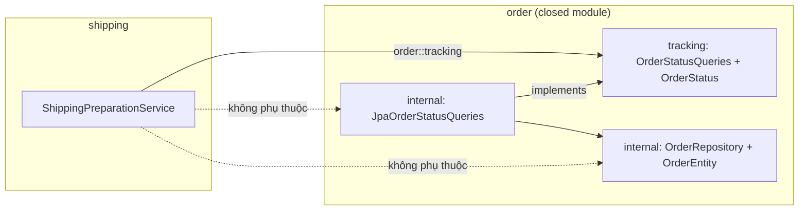

# Lỗi khi kiểu nội bộ lọt vào public API

Trong Spring Modulith, một application module có thể công bố API thông qua **package gốc** hoặc **named interface**. Ranh giới này mất ý nghĩa nếu API bên ngoài làm lộ **kiểu nội bộ** như entity JPA, repository, adapter, đối tượng cấu hình hoặc exception gắn với cơ chế triển khai. Người tiêu thụ sẽ phụ thuộc vào những thứ mà module sở hữu vốn muốn thay đổi độc lập.

Bài học thuộc chương **Named interfaces** của **SPRING_MODULITH_VERIFICATION_TESTING**. Chúng ta sẽ nhận diện các kiểu rò rỉ, phân biệt lỗi Java với lỗi kiến trúc và lỗi runtime, sửa hợp đồng qua DTO/port rõ ràng, sau đó kiểm chứng bằng `ApplicationModules`, `@ApplicationModuleTest`, kiểm thử sự kiện, cơ sở dữ liệu/tích hợp và **quality gate trong CI**.

> **Ý chính:** `@NamedInterface` công bố một tập kiểu thuộc API kiến trúc; nó **không tự chứng minh chữ ký API sạch**, không tự kiểm tra bảo mật dữ liệu và không thay Java visibility. Cần thiết kế hợp đồng có chủ đích, kiểm chứng phụ thuộc giữa các module và bổ sung các phép kiểm tra chất lượng API.

## 1. “Lọt vào public API” có thể xảy ra ở đâu?

Một kiểu nội bộ “lọt ra ngoài” không nhất thiết được sử dụng trực tiếp trong phần mã của module khác. Đôi khi nó chỉ xuất hiện ở **chữ ký public** của interface/facade nằm trong named interface; đôi khi người phát triển chuyển chính repository lên package công bố để giải quyết một lỗi truy cập.

Giả sử ứng dụng có module `order` sở hữu dữ liệu đơn hàng và module `shipping` cần tra cứu trạng thái để chuẩn bị giao hàng.

```text
com.acme.shop
├── ShopApplication.java
├── order/
│   ├── tracking/
│   │   ├── package-info.java       ← @NamedInterface("tracking")
│   │   ├── OrderStatusQueries.java ← public contract
│   │   └── OrderStatus.java        ← public DTO
│   └── internal/
│       ├── OrderEntity.java        ← entity JPA
│       ├── OrderRepository.java    ← Spring Data repository
│       └── JpaOrderStatusQueries.java
└── shipping/
    ├── package-info.java           ← chỉ được dùng order::tracking
    └── ShippingPreparationService.java
```

Trong một **closed application module** theo mô hình thông thường, các kiểu public ở package gốc `order` là **API mặc định**; các subpackage như `order.internal` không tự trở thành API. Named interface `tracking` cho phép công bố có chọn lọc những kiểu trong `order.tracking`.

### Hai hướng rò rỉ chủ yếu

| Hướng rò rỉ | Ví dụ | Nguy cơ |
| --- | --- | --- |
| **Đưa chính kiểu nội bộ ra vùng được công bố** | Chuyển `OrderRepository` vào `order.tracking` hoặc package gốc `order` | Module khác có thể phụ thuộc vào chi tiết persistence |
| **Cho kiểu nội bộ xuất hiện trong chữ ký của API được công bố** | `OrderStatusQueries.findById()` trả `Optional<OrderEntity>` | Module khác phải biết entity dù interface API nằm đúng package |

Hai hướng trên liên quan nhưng **không đồng nhất**. Kiểm chứng cấu trúc có thể phát hiện một module tiêu thụ tham chiếu kiểu không công bố, nhưng một kiểu nội bộ nằm trong chữ ký public **mà chưa được module khác tham chiếu** có thể cần kiểm tra hợp đồng bổ sung.

## 2. Tại sao Java `public` không phải ranh giới Spring Modulith?

Xét ba mức truy cập:

| Mức | Cơ chế | Điều được đảm bảo |
| --- | --- | --- |
| Java | `public`, package-private, `private` | Một kiểu/phương thức có thể được mã Java khác truy cập theo luật ngôn ngữ hay không |
| Module cung cấp | Package gốc hoặc `@NamedInterface` | Kiểu nào được coi là API được công bố của application module |
| Module tiêu thụ | `@ApplicationModule(allowedDependencies = ...)` | Phần API/module nào người tiêu thụ có quyền phụ thuộc |

Một `public class OrderEntity` bên trong `order.internal` có thể biên dịch khi `shipping` import nó nếu các kiểu và classpath cho phép. Nhưng với `order` là closed module, quan hệ đó **không thuộc API được công bố**, nên `ApplicationModules.verify()` có thể phát hiện vi phạm.

Ngược lại, nếu `OrderEntity` có mức hiển thị package-private, Java có thể chặn truy cập từ `shipping` **trước khi** test kiến trúc chạy. Không nên diễn giải lỗi biên dịch này là một thông báo do Spring Modulith phát ra.

**Mở package API** bằng `@NamedInterface` không làm những kiểu `private` hay package-private tự trở thành `public`; đồng thời không có nghĩa mọi lớp `public` ở các subpackage khác cũng được công bố.

## 3. Ví dụ sai: facade public trả về entity nội bộ

Đầu tiên, module `order` công bố named interface `tracking`. File `src/main/java/com/acme/shop/order/tracking/package-info.java`:

```java
/**
 * API tra cứu trạng thái đơn hàng cho các module nghiệp vụ khác.
 */
@org.springframework.modulith.NamedInterface("tracking")
package com.acme.shop.order.tracking;
```

Một lập trình viên viết interface:

```java
// KHÔNG NÊN DÙNG: order/tracking/OrderStatusQueries.java
package com.acme.shop.order.tracking;

import com.acme.shop.order.internal.OrderEntity;
import java.util.Optional;
import java.util.UUID;

public interface OrderStatusQueries {
    Optional<OrderEntity> findById(UUID orderId);
}
```

Giả sử `OrderEntity` là public để ví dụ này biên dịch:

```java
// order/internal/OrderEntity.java — minh họa kiểu lưu trữ
package com.acme.shop.order.internal;

import jakarta.persistence.Entity;
import jakarta.persistence.Id;
import java.util.UUID;

@Entity
public class OrderEntity {

    @Id
    private UUID id;

    private String status;

    protected OrderEntity() {}

    public UUID getId() {
        return id;
    }

    public String getStatus() {
        return status;
    }
}
```

Interface `OrderStatusQueries` **đúng vị trí công bố**, nhưng `Optional<OrderEntity>` trong chữ ký đã làm hợp đồng kéo theo kiểu từ `order.internal`. Nếu `shipping` cần thao tác với kết quả, nó bị buộc biết về entity:

```java
// VÍ DỤ PHỤ THUỘC SAI Ở PHÍA shipping
package com.acme.shop.shipping;

import com.acme.shop.order.tracking.OrderStatusQueries;
import com.acme.shop.order.internal.OrderEntity;
import java.util.Optional;
import java.util.UUID;

class BadShippingService {

    private final OrderStatusQueries orders;

    BadShippingService(OrderStatusQueries orders) {
        this.orders = orders;
    }

    Optional<OrderEntity> load(UUID orderId) {
        return orders.findById(orderId);
    }
}
```

Vì `shipping` thực sự tham chiếu `OrderEntity`, kiểm chứng kiến trúc có cơ sở phát hiện rằng nó đã phụ thuộc vào phần nội bộ của closed module `order`.

### Hậu quả tiềm ẩn

1. **Ràng buộc persistence:** thay entity, tên thuộc tính hoặc mapping JPA kéo theo sửa module `shipping`.
2. **Lazy-loading và transaction:** người tiêu thụ truy cập quan hệ JPA sau transaction có thể gặp vấn đề nạp dữ liệu lười hoặc giao dịch không đúng phạm vi.
3. **Rò rỉ dữ liệu:** entity thường có nhiều trường hơn nhu cầu thật, ví dụ thông tin thanh toán hoặc dữ liệu cá nhân.
4. **Quyền nghiệp vụ bị bỏ qua:** nếu repository hoặc entity mutable được công bố, module khác có thể chỉnh sửa mà không đi qua service chịu trách nhiệm kiểm tra quy tắc.
5. **Hồi quy lan rộng:** refactor nội bộ không còn độc lập; các test module tiêu thụ có thể hỏng vì thay đổi lẽ ra chỉ thuộc `order`.

Không phải mọi hậu quả trên sẽ xảy ra ở mọi ứng dụng; chúng là **rủi ro do lộ chi tiết triển khai**, cần được phòng ngừa từ thiết kế API.

## 4. Sửa đúng: dùng DTO thuộc named interface

Thay vì trả entity, tạo một **kiểu giá trị công khai tối thiểu** trong chính named interface.

```java
// order/tracking/OrderStatus.java
package com.acme.shop.order.tracking;

import java.util.UUID;

/** Dữ liệu tối thiểu phục vụ nghiệp vụ chuẩn bị giao hàng. */
public record OrderStatus(
        UUID orderId,
        String state
) {}
```

Sửa hợp đồng:

```java
// order/tracking/OrderStatusQueries.java
package com.acme.shop.order.tracking;

import java.util.Optional;
import java.util.UUID;

/** Tra cứu trạng thái; không công bố entity hoặc repository. */
public interface OrderStatusQueries {
    Optional<OrderStatus> findById(UUID orderId);
}
```

**Vì sao DTO cần đặt trong cùng phần API được công bố?** Nó xuất hiện trong kiểu trả về của `OrderStatusQueries`, nên module `shipping` phải tham chiếu được `OrderStatus` mà không cần đi qua package nội bộ.

Module `order` tự ánh xạ entity sang DTO. Ví dụ adapter trong `order.internal`:

```java
// order/internal/JpaOrderStatusQueries.java
package com.acme.shop.order.internal;

import com.acme.shop.order.tracking.OrderStatus;
import com.acme.shop.order.tracking.OrderStatusQueries;
import java.util.Optional;
import java.util.UUID;
import org.springframework.stereotype.Service;

@Service
class JpaOrderStatusQueries implements OrderStatusQueries {

    private final OrderRepository repository;

    JpaOrderStatusQueries(OrderRepository repository) {
        this.repository = repository;
    }

    @Override
    public Optional<OrderStatus> findById(UUID orderId) {
        return repository.findById(orderId)
                .map(entity -> new OrderStatus(
                        entity.getId(),
                        entity.getStatus()
                ));
    }
}
```

Đoạn adapter giả định `OrderRepository` có phương thức `findById(UUID)` tương ứng (chẳng hạn một Spring Data repository). Repository và entity vẫn do `order` sở hữu, còn `shipping` chỉ nhận `OrderStatus`. Cần bổ sung các kiểu repository, cấu hình datasource và dữ liệu test thực tế để chạy ví dụ đầy đủ.



## 5. Giới hạn module tiêu thụ bằng `allowedDependencies`

Đặt `src/main/java/com/acme/shop/shipping/package-info.java`:

```java
@org.springframework.modulith.ApplicationModule(
    allowedDependencies = "order::tracking"
)
package com.acme.shop.shipping;
```

Bên `shipping`, chỉ dùng các kiểu công khai thuộc `order::tracking`:

```java
// shipping/ShippingPreparationService.java
package com.acme.shop.shipping;

import com.acme.shop.order.tracking.OrderStatus;
import com.acme.shop.order.tracking.OrderStatusQueries;
import java.util.Optional;
import java.util.UUID;
import org.springframework.stereotype.Service;

@Service
public class ShippingPreparationService {

    private final OrderStatusQueries orders;

    public ShippingPreparationService(OrderStatusQueries orders) {
        this.orders = orders;
    }

    public Optional<OrderStatus> lookupForShipping(UUID orderId) {
        return orders.findById(orderId);
    }
}
```

Trong cấu hình này:

| Tham chiếu từ `shipping` | Trạng thái kỳ vọng | Lý do |
| --- | --- | --- |
| `order.tracking.OrderStatusQueries` | **Hợp lệ** | Thuộc named interface `order::tracking` |
| `order.tracking.OrderStatus` | **Hợp lệ** | DTO thuộc cùng named interface |
| `order.internal.OrderEntity` | **Vi phạm** | Kiểu của subpackage nội bộ không được công bố |
| `order.internal.OrderRepository` | **Vi phạm** | Repository là chi tiết triển khai |
| Một kiểu public trong package gốc `order` | **Không hợp lệ với quyền hiện tại** | API mặc định khác named interface `tracking` |
| Một kiểu thuộc `order::events` (nếu tồn tại) | **Không hợp lệ với quyền hiện tại** | `shipping` chỉ được phép dùng `tracking` |

Nếu không khai báo `allowedDependencies`, module tiêu thụ vẫn phải tuân thủ API được công bố của các closed module, nhưng không bị giới hạn bởi danh sách quyền riêng này. Khai báo chính xác `order::tracking` tạo ranh giới **hẹp hơn**.

## 6. Các đường rò rỉ khó phát hiện hơn

Không chỉ kiểu trả về trực tiếp: bất kỳ chỗ nào trong hợp đồng public khiến người tiêu thụ phải biết một kiểu nội bộ đều đáng kiểm tra.

| Vị trí | Ví dụ thiết kế sai | Cách sửa |
| --- | --- | --- |
| **Tham số** | `void confirm(OrderEntity entity)` | Truyền `UUID orderId` hoặc command DTO công khai |
| **Kiểu trả về** | `OrderEntity get(UUID id)` | Trả `OrderStatus` hoặc DTO nghiệp vụ |
| **Generic** | `List<OrderEntity>`, `Optional<InternalPrice>`, `Page<OrderEntity>` | Dùng collection/DTO hợp đồng; tránh gắn người tiêu thụ với persistence |
| **Checked exception** | `throws InternalOrderException` | Dùng exception thuộc hợp đồng hoặc mô hình kết quả nghiệp vụ |
| **Kế thừa interface** | `public interface OrderApi extends InternalRepository` | Công bố interface nghiệp vụ độc lập |
| **Record component** | `record OrderChanged(OrderEntity order)` | Dùng định danh và các giá trị thực sự cần phát |
| **Annotation/public metadata** | Annotation trên kiểu công khai tham chiếu cấu hình triển khai riêng | Đánh giá mức cần thiết, loại bỏ phụ thuộc không thuộc hợp đồng |
| **API mặc định** | Chuyển `OrderRepository` lên package gốc `order` | Để ở `order.internal`; chỉ giữ façade công khai ở root nếu thật sự cần |
| **Package named interface** | Đặt `JpaOrderStatusQueries` hoặc `OrderRepository` vào `order.tracking` | Giữ riêng contract package và internal implementation |

Ví dụ generic vẫn là rò rỉ:

```java
// KHÔNG NÊN DÙNG
public interface OrderHistory {
    java.util.List<com.acme.shop.order.internal.OrderEntity> listRecent();
}
```

Mặc dù caller có thể chỉ dùng `var` mà không import trực tiếp `OrderEntity`, chữ ký API đã gắn hợp đồng vào kiểu nội bộ. Bài test `verify()` **không nên được xem là bảo đảm duy nhất** cho việc phát hiện mọi trường hợp này: nếu chưa có quan hệ phụ thuộc chéo module được phân tích thành vi phạm, có thể cần thêm bài test kiểm tra chữ ký và review kiến trúc.

### Rò rỉ dữ liệu qua kiểu sự kiện

Nếu `order` phát sự kiện:

```java
// KHÔNG NÊN DÙNG TRONG API events
public record OrderPaid(
        com.acme.shop.order.internal.OrderEntity entity
) {}
```

Module nghe sự kiện sẽ phụ thuộc vào persistence model; event cũng có thể gặp rủi ro serialization hoặc thay đổi schema khi xử lý bất đồng bộ. Hợp đồng tốt hơn là một record mang `orderId`, thời điểm phát sinh và các giá trị nghiệp vụ thiết yếu, thuộc một named interface như `order::events` nếu cần công bố riêng.

Không nên phát cả entity JPA chỉ vì hệ thống cùng chạy trong một JVM. Truyền **định danh và value object công khai** giúp giảm ảnh hưởng refactor và tránh vô tình phân phối dữ liệu không cần thiết.

## 7. Kiểm chứng cấu trúc bằng `ApplicationModules.verify()`

Viết test JUnit cho mô hình module:

```java
// src/test/java/com/acme/shop/ModulithArchitectureTest.java
package com.acme.shop;

import org.junit.jupiter.api.Test;
import org.springframework.modulith.core.ApplicationModules;

class ModulithArchitectureTest {

    @Test
    void dependenciesStayWithinPublishedApis() {
        ApplicationModules.of(ShopApplication.class).verify();
    }
}
```

Lớp `ShopApplication` ở `com.acme.shop` được gắn `@SpringBootApplication`; các package `order`, `shipping` là application module theo cấu hình mặc định. Giả định dự án có dependency Spring Modulith core và JUnit cần thiết.

`verify()` kiểm tra các quy tắc cấu trúc quan trọng, bao gồm **truy cập phần nội bộ của closed module**, giới hạn `allowedDependencies` và **vòng phụ thuộc giữa các module**. Đây là phép kiểm tra mô hình phụ thuộc, không đòi hỏi chạy truy vấn database hoặc khởi tạo toàn bộ `ApplicationContext` chỉ để đánh giá ranh giới.

### Thí nghiệm PASS/FAIL có kiểm soát

| Thử nghiệm | Thay đổi | Kỳ vọng |
| --- | --- | --- |
| **A — Baseline** | `shipping` chỉ tham chiếu `OrderStatusQueries` và `OrderStatus` | PASS nếu toàn ứng dụng hợp lệ |
| **B — Truy cập entity** | `shipping` khai báo field/chữ ký kiểu `order.internal.OrderEntity` khi nó đủ `public` | FAIL do phụ thuộc vào phần chưa công bố |
| **C — Truy cập repository** | `shipping` sử dụng kiểu `order.internal.OrderRepository` public giả lập | FAIL do phụ thuộc nội bộ |
| **D — Mở sai quyền** | `shipping` tham chiếu kiểu `order::events`, chỉ cho phép `order::tracking` | FAIL do vượt `allowedDependencies` |
| **E — Rút công bố** | Xóa tạm `@NamedInterface("tracking")` nhưng vẫn dùng `OrderStatusQueries` | FAIL vì package không còn là API công bố |
| **F — Rò rỉ chữ ký chưa được tiêu thụ** | Thêm `OrderEntity` vào chữ ký một API nhưng không có module ngoài nào dùng kiểu đó | Không được mặc định là FAIL; cần kiểm tra chữ ký API bổ sung |
| **G — Khôi phục** | Đưa DTO trở lại API, bỏ tham chiếu sai, khôi phục `allowedDependencies` | PASS nếu mô hình hợp lệ |

Các kết quả là **kỳ vọng của bài thực hành**, không phải kết quả đã thực thi trên repository này. Trong B và C, nếu kiểu nội bộ là package-private, Java có thể báo lỗi biên dịch trước khi test kiến trúc chạy. Hãy dùng class `public` giả lập cho thí nghiệm, sau đó xóa nó hoặc đưa mã về trạng thái đúng.

**Không nên chỉ thêm dòng `import` không sử dụng** để kiểm tra: quan hệ phụ thuộc thực tế có thể không còn trong bytecode. Hãy tham chiếu kiểu bằng field, tham số, kết quả trả về hoặc lời gọi để thử nghiệm rõ ràng.

### Cảnh báo quan trọng về giới hạn phát hiện

`ApplicationModules.verify()` trả lời: *“các phụ thuộc giữa các module có tuân thủ ranh giới đã khai báo không?”* Nó **không phải bộ kiểm tra đầy đủ cho mọi thiết kế API public**. Nếu một repository bị chuyển vào package vốn đã mang `@NamedInterface`, công cụ có thể coi đó là API **hợp lệ theo khai báo** và không biết rằng nhóm kiến trúc **không muốn** công bố repository.

Tương tự, một chữ ký API chứa kiểu nội bộ có thể là lỗi thiết kế ngay cả khi chưa có module tiêu thụ nào tạo ra một phụ thuộc bị báo vi phạm. Vì vậy, **PASS không đồng nghĩa với “public API không bao giờ lộ kiểu nội bộ”**.

## 8. Thêm một phép kiểm tra chữ ký API chuyên biệt

Để chặn việc một phương thức cụ thể vô tình trả về kiểu thuộc `.internal.`, có thể bổ sung test phản xạ nhỏ:

```java
// src/test/java/com/acme/shop/order/OrderTrackingContractTest.java
package com.acme.shop.order;

import com.acme.shop.order.tracking.OrderStatusQueries;
import java.lang.reflect.Method;
import java.util.UUID;
import org.junit.jupiter.api.Test;

import static org.assertj.core.api.Assertions.assertThat;

class OrderTrackingContractTest {

    @Test
    void trackingResultMustNotExposeInternalTypes() throws Exception {
        Method method = OrderStatusQueries.class.getMethod(
                "findById", UUID.class
        );

        String signature = method.getGenericReturnType().getTypeName();

        assertThat(signature).doesNotContain(".internal.");
    }
}
```

Với `Optional<OrderStatus>`, test đạt. Với `Optional<com.acme.shop.order.internal.OrderEntity>`, test này báo lỗi **ngay cả khi `shipping` chưa tham chiếu trực tiếp tới entity**.

Đây là một **minh họa kiểm tra một chữ ký cụ thể**, không phải giải pháp tổng quát: nó chưa kiểm tra toàn bộ phương thức, tham số, kế thừa, exception, generic lồng sâu, annotation hay các public type mới. Để kiểm soát API lớn, có thể dùng reflection/ArchUnit hoặc các phép kiểm tra hợp đồng chuyên biệt, triển khai theo quy tắc của dự án và yêu cầu danh mục kiểu được phép công bố.

Một chính sách thực tế cho code review là: **mọi public type trong package API và mọi kiểu tùy chỉnh xuất hiện trong chữ ký API phải được xem xét**. Những kiểu bên ngoài như `String`, `UUID` hoặc `Optional` của JDK không phải chi tiết nội bộ; các kiểu nghiệp vụ tùy chỉnh cần thuộc phần hợp đồng phù hợp hoặc là dependency chung được chấp nhận có chủ đích.

## 9. Kiểm thử hành vi sau khi loại bỏ kiểu bị rò rỉ

Refactor từ `OrderEntity` sang `OrderStatus` không chỉ thay chữ ký. Cần xác nhận dữ liệu trả về và các chức năng module vẫn đúng.

| Phép thử | Phạm vi | Câu hỏi |
| --- | --- | --- |
| **Java compile** | Module cung cấp và tiêu thụ | Imports, method return type và DTO mới có khớp không? |
| **`ApplicationModules.verify()`** | Cấu trúc module | `shipping` có còn phụ thuộc `order.internal` không? |
| **Contract signature test** | API public | Chữ ký `OrderStatusQueries` có xuất hiện kiểu `.internal.` không? |
| **`@ApplicationModuleTest`** | Wiring và logic module `order` | Bean `OrderStatusQueries` có sẵn, mapping DTO có đúng? |
| **Database/integration** | Entity, repository, transaction | Trạng thái persisted có chuyển thành `OrderStatus` chính xác? |
| **Event test** | Sự kiện công bố | Event payload không mang entity; listener xử lý đúng? |
| **Tích hợp liên module** | `order` và `shipping` | `shipping` chuẩn bị giao hàng qua API công bố đúng cách? |

Ví dụ một bài test bootstrapping module:

```java
// src/test/java/com/acme/shop/order/OrderModuleTest.java
package com.acme.shop.order;

import com.acme.shop.order.tracking.OrderStatusQueries;
import org.junit.jupiter.api.Test;
import org.springframework.beans.factory.annotation.Autowired;
import org.springframework.modulith.test.ApplicationModuleTest;

import static org.assertj.core.api.Assertions.assertThat;

@ApplicationModuleTest
class OrderModuleTest {

    @Autowired
    OrderStatusQueries queries;

    @Test
    void exposesOrderStatusQueryBean() {
        assertThat(queries).isNotNull();
    }
}
```

Ví dụ giả định adapter đã được Spring quản lý và môi trường kiểm thử có repository/datasource hoặc test double thích hợp để module khởi động. **Bean tồn tại** không chứng minh mapping đúng. Cần thêm test với một đơn đã lưu, một mã không tồn tại và các tình huống dữ liệu thay đổi để xác nhận `OrderStatus` phản ánh đúng hợp đồng.

Nếu phát sự kiện, test cần kiểm tra payload của record công khai, điều kiện phát, transaction và khả năng xử lý lại theo yêu cầu hệ thống. Một DTO đẹp về mặt cấu trúc vẫn có thể làm lộ **dữ liệu nhạy cảm** qua field, vì vậy cần review ý nghĩa và quyền sử dụng của từng trường.

## 10. Quality gate CI chặn rò rỉ trước khi hợp nhất

Đưa test kiến trúc, test hợp đồng API và các test hành vi bắt buộc vào pipeline.

Với Gradle:

```bash
./gradlew test
```

Hoặc Maven:

```bash
mvn test
```

Các bước chất lượng nên bảo đảm:

1. **Compile PASS:** mọi module tiêu thụ mã và DTO công khai mới mà không tham chiếu kiểu cũ.
2. **Architecture PASS:** `ApplicationModules.verify()` không phát hiện phụ thuộc tới `order.internal`, giới hạn `allowedDependencies` được duy trì và không có vòng phụ thuộc.
3. **API contract PASS:** các kiểm tra chuyên biệt về chữ ký và tập kiểu được công bố không phát hiện kiểu nội bộ trong bề mặt API.
4. **Behavior PASS:** test `@ApplicationModuleTest`, repository, sự kiện và tích hợp chứng minh API mới có hành vi đúng.
5. **Review PASS:** người duyệt xác nhận không đặt thêm entity/repository/adapter trong named interface hoặc package gốc chỉ để làm mất lỗi biên dịch/kiến trúc.

Một job kiểm thử thất bại phải khiến **CI quality gate thất bại**. Không nên biến lỗi cấu trúc thành cảnh báo được bỏ qua, và cũng không nên chuyển module thành open hoặc mở rộng vô điều kiện `allowedDependencies` để CI xanh.

### Vì sao phải review cả package gốc?

Trong closed module, các kiểu public ở **package gốc** thường thuộc API mặc định. Do đó đưa `OrderRepository` từ `order.internal` lên `order` cũng có thể **vô tình công bố** kiểu đó mà không cần `@NamedInterface`. Khi kiểm tra API, luôn rà soát **cả named interfaces và unnamed interface**.

## 11. Quy trình khắc phục khi phát hiện rò rỉ

Một quy trình sửa có thể áp dụng trong pull request:

1. **Xác định nơi rò rỉ:** kiểu nội bộ nằm trực tiếp trong package công bố hay đi qua chữ ký/generic/event payload?
2. **Liệt kê người tiêu thụ:** module nào import kiểu đó, gọi phương thức nào, dựa vào trường nào?
3. **Xác định thông tin thực sự cần:** ví dụ `shipping` chỉ cần `orderId` và `state`, không cần `OrderEntity`.
4. **Thiết kế kiểu hợp đồng:** tạo `OrderStatus` trong `order.tracking`, định nghĩa trạng thái và mã lỗi hợp lý, loại bỏ chi tiết persistence.
5. **Ánh xạ trong module sở hữu:** `JpaOrderStatusQueries` chuyển entity sang DTO; không buộc người tiêu thụ tự đọc repository.
6. **Đồng bộ module tiêu thụ:** sửa import, chữ ký và code `shipping` để chỉ dùng `order::tracking`.
7. **Kiểm chứng ba lớp:** biên dịch, `ApplicationModules.verify()`, contract signature test và các bài test hành vi liên quan.
8. **Đặt quality gate:** duy trì kiểm tra ở CI để kiểu nội bộ không lọt lại vào API ở lần refactor kế tiếp.

Nếu kiểu nội bộ từng được dùng rộng rãi, việc rút bỏ có thể là thay đổi API không tương thích. Cần phối hợp cập nhật mọi module tiêu thụ và đánh giá chính sách phiên bản nếu module còn được phân phối như thư viện độc lập.

## 12. Sai lầm thường gặp và cách tránh

**“Entity được khai báo `public`, vậy có thể trả từ API.”** Java visibility không chứng minh đó là hợp đồng kiến trúc tốt. Entity thường gắn với database và phạm vi transaction; nên chuyển sang DTO.

**“Nếu `OrderStatusQueries` thuộc `order::tracking`, mọi kiểu trả về của nó đều được phép.”** Không. Named interface không tự công bố `order.internal.OrderEntity` chỉ vì interface hợp lệ tham chiếu tới nó.

**“`verify()` PASS chứng minh không có bất kỳ rò rỉ API nào.”** Không. Nó chủ yếu kiểm tra quan hệ phụ thuộc theo mô hình; muốn chặn kiểu nội bộ trong chữ ký chưa được tiêu thụ, cần kiểm tra chữ ký và review riêng.

**“Cứ chuyển repository sang `order.tracking` để hết vi phạm.”** Làm vậy có thể biến repository thành API được công bố; test kiến trúc không biết đội ngũ muốn giữ repository nội bộ. Cần thiết kế một hợp đồng nghiệp vụ thay thế.

**“Chỉ kiểm tra `import` trong source là đủ.”** Không. Kiểu nội bộ có thể xuất hiện trong generic, inheritance, event payload hoặc lời gọi trực tiếp. Một import thừa cũng có thể không tạo quan hệ phụ thuộc trong bytecode.

**“DTO là an toàn tuyệt đối.”** Không. DTO có thể chứa quá nhiều dữ liệu, tham chiếu collection mutable hoặc làm sai semantics. Phải chọn trường cần thiết và test bảo mật/hành vi tương ứng.

**“Thêm wildcard vào `allowedDependencies` là cách sửa hợp lệ.”** Quyền rộng hơn không sửa được vấn đề công bố sai loại kiểu, và có thể che khuất vi phạm. Hãy giữ quyền tối thiểu và sửa API ở module sở hữu.

## 13. Bài thực hành: phát hiện và loại bỏ entity khỏi hợp đồng

### Đề bài

Module `order` công bố `order::tracking`. Bản đầu của `OrderStatusQueries` trả `Optional<OrderEntity>`, nên module `shipping` phụ thuộc vào `order.internal`. Nhiệm vụ là đưa API về hợp đồng ổn định và ngăn hồi quy.

### Các bước

1. **Tạo ranh giới ban đầu:** `order/tracking/package-info.java` khai báo `@NamedInterface("tracking")`; `shipping/package-info.java` cho phép `order::tracking`.
2. **Tạo lỗi:** cho `OrderStatusQueries.findById` trả `Optional<OrderEntity>` với entity public trong `order.internal`; viết `shipping` tham chiếu thật đến `OrderEntity`.
3. **Kiểm chứng lỗi:** chạy `ApplicationModules.of(ShopApplication.class).verify()` và giải thích vì sao phụ thuộc của `shipping` vi phạm ranh giới.
4. **Sửa kiểu hợp đồng:** tạo record `OrderStatus` gồm `orderId` và `state` trong `order.tracking`; đổi interface trả `Optional<OrderStatus>`.
5. **Sửa implementation:** adapter nội bộ ánh xạ entity sang DTO, không để repository lộ qua chữ ký public.
6. **Sửa người tiêu thụ:** `shipping` chỉ import `OrderStatusQueries` và `OrderStatus`; chạy lại test kiến trúc.
7. **Đặt kiểm tra API chuyên biệt:** viết test xác nhận generic return type của `findById` không chứa `.internal.`; mở rộng khi dự án có nhiều API.
8. **Thử hồi quy khác:** tạm thêm một repository public vào package `order.tracking`. Thảo luận vì sao `verify()` có thể vẫn PASS và vì sao code review/danh mục API bắt buộc phải chặn.
9. **Khóa CI:** chạy compile, architecture test, contract test, module/database/event/integration tests phù hợp; bảo đảm mọi lỗi bắt buộc làm job thất bại.

### Tự đánh giá

**1. Kiểu `public` ở `order.internal` có tự trở thành API module không?** Không. Closed module vẫn coi subpackage chưa công bố là nội bộ.

**2. Vì sao `Optional<OrderEntity>` là rò rỉ, dù `OrderStatusQueries` ở đúng named interface?** Vì chữ ký public buộc người tiêu thụ phụ thuộc vào một kiểu triển khai không thuộc hợp đồng được công bố.

**3. Vì sao `OrderStatus` cần nằm ở `order.tracking`?** Vì người tiêu thụ phải tham chiếu được kiểu trả về mà không đi vào `order.internal`.

**4. Vì sao phải kiểm tra riêng chữ ký API?** Vì vi phạm có thể nằm trong hợp đồng chưa tạo ra phụ thuộc chéo module bị `verify()` phát hiện; test kiến trúc không thay thế một chính sách kiểm duyệt bề mặt API.

**5. Loại test nào xác nhận mapping entity sang DTO đúng?** Test module, database và integration với dữ liệu đại diện; `verify()` chỉ kiểm chứng cấu trúc phụ thuộc.

## 14. Ghi nhớ

**Một named interface sạch phải công bố đúng các kiểu mà module ngoài cần, đồng thời tránh làm lộ entity, repository, adapter và các kiểu nội bộ qua chữ ký, generic, exception hoặc event payload.** Giữ implementation ở `internal`, dùng DTO/port thuộc phần API công bố, hạn chế quyền bên tiêu thụ bằng **`allowedDependencies`**. Chạy **`ApplicationModules.verify()`** để kiểm chứng quan hệ phụ thuộc; bổ sung **kiểm tra chữ ký API** và **`@ApplicationModuleTest`**, test sự kiện, database, tích hợp để bảo vệ cả cấu trúc và hành vi trong **CI quality gate**.

### Tài liệu tham khảo

- [Spring Modulith Reference — Application Modules và Named Interfaces](https://docs.spring.io/spring-modulith/reference/fundamentals.html)
- [Spring Modulith Reference — Verifying Application Module Structure](https://docs.spring.io/spring-modulith/reference/verification.html)
- [Spring Modulith Reference — Integration Testing Application Modules](https://docs.spring.io/spring-modulith/reference/testing.html)
