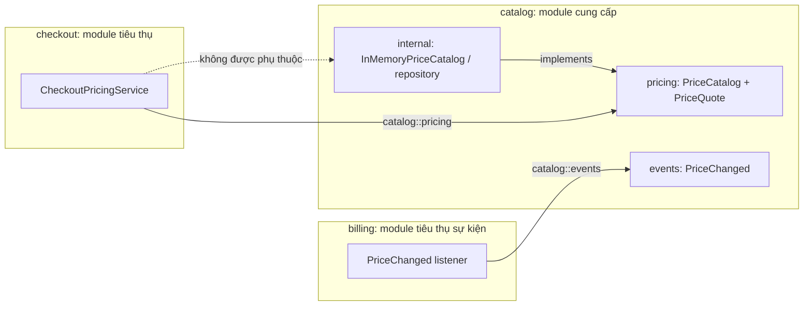

# Kiểm thử contract của named interface

Một **named interface** của Spring Modulith xác định nhóm kiểu Java được một application module công bố cho các module khác. Tuy nhiên, việc đánh dấu `@NamedInterface` mới giải quyết câu hỏi **“kiểu nào thuộc API module?”**; nó chưa chứng minh API được sử dụng đúng cách hoặc thực thi đúng hành vi đã cam kết.

Vì vậy, **kiểm thử contract (hợp đồng) của named interface** cần kết hợp ít nhất hai góc nhìn:

1. **Hợp đồng kiến trúc:** module cung cấp công bố đúng package/kiểu, module tiêu thụ chỉ phụ thuộc vào phần API được cho phép và không chạm lớp nội bộ.
2. **Hợp đồng hành vi:** lời gọi API đáp ứng quy tắc đầu vào, đầu ra, trạng thái, lỗi, giao dịch và sự kiện mà các module tiêu thụ dựa vào.

Bài học thuộc chương **Named interfaces** trong lộ trình **SPRING_MODULITH_VERIFICATION_TESTING**. Trọng tâm là kiểm chứng kiến trúc qua `ApplicationModules.verify()`, thực hành `@ApplicationModuleTest`, kiểm thử sự kiện, cơ sở dữ liệu và tích hợp, rồi đưa các kiểm tra vào **quality gate trong CI** để chặn phụ thuộc sai và hồi quy.

> **Phân biệt quan trọng:** `ApplicationModules.verify()` không phải công cụ tự động chạy mọi consumer contract test. Nó xác minh **cấu trúc phụ thuộc**. Các kỳ vọng “không tìm thấy SKU trả gì”, “sự kiện nào được phát”, “transaction có rollback không” cần các bài test hành vi riêng.

## 1. Contract của named interface bao gồm những gì?

Xét module `catalog` công bố hợp đồng tra cứu giá cho module `checkout`. Tên kiến trúc là `catalog::pricing`, còn tên package Java chứa hợp đồng là `com.acme.shop.catalog.pricing`.

Một hợp đồng đầy đủ nên trả lời các câu hỏi:

| Khía cạnh | Quy tắc cần ghi rõ | Cách kiểm chứng |
| --- | --- | --- |
| **Bề mặt công bố** | Package `catalog.pricing` thuộc named interface `pricing` | `@NamedInterface`, `ApplicationModules.verify()`, review |
| **Phạm vi người dùng** | `checkout` chỉ phụ thuộc `catalog::pricing` | `allowedDependencies`, test kiến trúc |
| **Chữ ký Java** | `findBySku(String)` trả `Optional<PriceQuote>` | Biên dịch, test chữ ký/API compatibility |
| **Giá trị hợp lệ** | SKU tồn tại trả báo giá có số tiền và tiền tệ xác định | Producer/module test |
| **Trường hợp vắng mặt** | SKU không tồn tại trả `Optional.empty()` | Producer test và consumer test |
| **Đầu vào không hợp lệ** | SKU null/rỗng bị từ chối rõ ràng | Test lỗi, validation |
| **Tính nhất quán dữ liệu** | DTO phản ánh chính xác mức giá trong nguồn dữ liệu | Database/integration test |
| **Tương thích thay đổi** | Không làm hỏng module tiêu thụ khi refactor implementation | Compile, contract test và CI |
| **Event (nếu có)** | Payload, thời điểm phát và người tiêu thụ sự kiện được xác định | Event test, module/integration test |

Một named interface có thể chỉ chứa DTO hoặc kiểu sự kiện, không nhất thiết chứa Java `interface` hay facade. Khi API có hành vi đồng bộ, mô tả ngữ nghĩa của phương thức là phần bắt buộc; khi API chỉ công bố event, mô tả ý nghĩa và vòng đời sự kiện.

## 2. Bối cảnh minh họa: `catalog::pricing` và `checkout`

Giả sử ứng dụng có lớp `@SpringBootApplication` mang tên `ShopApplication` trong `com.acme.shop`. Theo quy ước phát hiện module mặc định, hai package con `catalog` và `checkout` là hai application module.

```text
com.acme.shop
├── ShopApplication.java
├── catalog/
│   ├── pricing/
│   │   ├── package-info.java        ← @NamedInterface("pricing")
│   │   ├── PriceCatalog.java        ← contract đồng bộ
│   │   └── PriceQuote.java          ← DTO công khai
│   ├── events/
│   │   ├── package-info.java        ← @NamedInterface("events"), ví dụ mở rộng
│   │   └── PriceChanged.java
│   └── internal/
│       ├── InMemoryPriceCatalog.java
│       └── ...                      ← có thể thay bằng JPA/repository
├── checkout/
│   ├── package-info.java            ← allowedDependencies = "catalog::pricing"
│   └── CheckoutPricingService.java
└── billing/
    └── package-info.java            ← chỉ dùng catalog::events, nếu cần
```

Trong một **closed application module**, subpackage `catalog.internal` không phải API tự động công bố dù class bên trong có modifier `public`. Hợp đồng được đặt trong `catalog.pricing` để người tiêu thụ không cần biết cách module `catalog` lưu hoặc tính giá.



**Mục tiêu kiểm thử** là giữ các mũi tên hợp lệ như sơ đồ, đồng thời xác minh kết quả thực tế mà `PriceCatalog` trả về.

## 3. Công bố hợp đồng ở đúng package

File `src/main/java/com/acme/shop/catalog/pricing/package-info.java`:

```java
/**
 * Hợp đồng tra cứu báo giá cho các application module khác.
 *
 * <p>SKU không tồn tại: Optional.empty().
 * SKU null hoặc trắng: IllegalArgumentException.
 * Giá được biểu diễn bằng VND và không âm.
 * Các entity, repository và thuật toán định giá thuộc catalog.internal.
 */
@org.springframework.modulith.NamedInterface("pricing")
package com.acme.shop.catalog.pricing;
```

Các kiểu được công bố:

```java
// src/main/java/com/acme/shop/catalog/pricing/PriceQuote.java
package com.acme.shop.catalog.pricing;

import java.math.BigDecimal;
import java.util.Currency;
import java.util.Objects;

public record PriceQuote(
        String sku,
        BigDecimal amount,
        Currency currency
) {
    public PriceQuote {
        Objects.requireNonNull(sku, "sku");
        Objects.requireNonNull(amount, "amount");
        Objects.requireNonNull(currency, "currency");
        if (sku.isBlank() || amount.signum() < 0) {
            throw new IllegalArgumentException("Invalid price quote");
        }
    }
}
```

```java
// src/main/java/com/acme/shop/catalog/pricing/PriceCatalog.java
package com.acme.shop.catalog.pricing;

import java.util.Optional;

/** API chỉ đọc, không để lộ repository hoặc entity của catalog. */
public interface PriceCatalog {

    /**
     * @return báo giá nếu SKU tồn tại, Optional.empty() nếu không có
     * @throws IllegalArgumentException nếu sku null hoặc chỉ chứa khoảng trắng
     */
    Optional<PriceQuote> findBySku(String sku);
}
```

Ở đây, **`PriceCatalog` và `PriceQuote` cùng thuộc `catalog::pricing`**. Một Java interface công khai không đủ nếu kiểu tham số hoặc kiểu kết quả mà người tiêu thụ cần sử dụng lại nằm trong `catalog.internal`.

Ví dụ triển khai nhỏ có thể kiểm thử mà không cần database:

```java
// src/main/java/com/acme/shop/catalog/internal/InMemoryPriceCatalog.java
package com.acme.shop.catalog.internal;

import com.acme.shop.catalog.pricing.PriceCatalog;
import com.acme.shop.catalog.pricing.PriceQuote;
import java.math.BigDecimal;
import java.util.Currency;
import java.util.Map;
import java.util.Optional;
import org.springframework.stereotype.Service;

@Service
class InMemoryPriceCatalog implements PriceCatalog {

    private static final Map<String, BigDecimal> PRICES = Map.of(
            "SKU-101", new BigDecimal("159000"),
            "SKU-202", new BigDecimal("249000")
    );

    @Override
    public Optional<PriceQuote> findBySku(String sku) {
        if (sku == null || sku.isBlank()) {
            throw new IllegalArgumentException("sku must not be blank");
        }

        return Optional.ofNullable(PRICES.get(sku))
                .map(amount -> new PriceQuote(
                        sku, amount, Currency.getInstance("VND")
                ));
    }
}
```

Ví dụ này dùng dữ liệu cố định để tập trung vào contract; trong dự án thật có thể thay implementation bằng JPA, JDBC hoặc dịch vụ ngoài mà **không đổi hợp đồng công khai** nếu ngữ nghĩa được giữ nguyên. `@NamedInterface` **không tự tạo bean**; bean được đăng ký bằng cơ chế Spring như `@Service`.

## 4. Phía tiêu thụ: giới hạn phụ thuộc, ghi rõ giả định

File `src/main/java/com/acme/shop/checkout/package-info.java`:

```java
@org.springframework.modulith.ApplicationModule(
    allowedDependencies = "catalog::pricing"
)
package com.acme.shop.checkout;
```

Cấu hình này thể hiện hai ý riêng: `catalog` **công bố** `pricing`, còn `checkout` **chỉ được phụ thuộc** vào phần API đó của `catalog` theo danh sách cho phép.

Mã tiêu thụ:

```java
// src/main/java/com/acme/shop/checkout/CheckoutPricingService.java
package com.acme.shop.checkout;

import com.acme.shop.catalog.pricing.PriceCatalog;
import com.acme.shop.catalog.pricing.PriceQuote;
import java.math.BigDecimal;
import org.springframework.stereotype.Service;

@Service
public class CheckoutPricingService {

    private final PriceCatalog prices;

    public CheckoutPricingService(PriceCatalog prices) {
        this.prices = prices;
    }

    /** Ví dụ này giả định toàn bộ báo giá dùng VND. */
    public BigDecimal totalFor(String sku, int quantity) {
        if (quantity <= 0) {
            throw new IllegalArgumentException("quantity must be positive");
        }

        PriceQuote quote = prices.findBySku(sku)
                .orElseThrow(() -> new IllegalArgumentException(
                        "Unknown SKU: " + sku
                ));

        return quote.amount().multiply(BigDecimal.valueOf(quantity));
    }
}
```

`CheckoutPricingService` chỉ nhập `PriceCatalog` và `PriceQuote`, không import implementation hoặc repository. Ví dụ giả định một loại tiền tệ VND; hệ thống đa tiền tệ cần trả kiểu giá trị kèm đơn vị tiền và xử lý chuyển đổi/làm tròn minh bạch, không được âm thầm cộng tiền khác loại.

**Contract không chỉ là chữ ký:** nếu module `catalog` tự nhiên đổi từ VND sang USD hoặc từ giá cuối cùng sang giá chưa thuế mà vẫn trả `BigDecimal`, mã Java có thể biên dịch và `verify()` vẫn PASS, nhưng `checkout` sẽ tính sai theo giả định ban đầu.

## 5. Lớp kiểm thử 1 — Kiến trúc với `ApplicationModules.verify()`

Trước khi kiểm tra dữ liệu, hãy bảo đảm quan hệ giữa các module hợp lệ. Tạo bài test:

```java
// src/test/java/com/acme/shop/ModulithArchitectureTest.java
package com.acme.shop;

import org.junit.jupiter.api.Test;
import org.springframework.modulith.core.ApplicationModules;

class ModulithArchitectureTest {

    @Test
    void moduleDependenciesStayWithinPublishedContracts() {
        ApplicationModules.of(ShopApplication.class).verify();
    }
}
```

Đây là test **cho toàn bộ mô hình application module** được phát hiện từ lớp khởi động, không chỉ `catalog` và `checkout`. Những quy tắc quan trọng Spring Modulith có thể kiểm chứng bao gồm:

- Module tiêu thụ không tham chiếu kiểu nội bộ trong subpackage chưa công bố của **closed module**.
- Nếu có `allowedDependencies`, phụ thuộc không được vượt module/named interface được liệt kê.
- Các quan hệ phụ thuộc giữa application module không hình thành chu trình bị cấm theo quy tắc kiểm chứng.

### Ma trận tình huống dương và âm

| Mã hoặc cấu hình sau thay đổi | Kỳ vọng của `verify()` | Nguyên nhân |
| --- | --- | --- |
| `checkout` dùng `catalog.pricing.PriceCatalog` | **PASS** nếu các module khác cũng hợp lệ | Đúng `catalog::pricing` |
| `checkout` dùng `catalog.internal.InMemoryPriceCatalog` | **FAIL** nếu kiểu public và có phụ thuộc thực sự | Truy cập implementation không công bố |
| `checkout` dùng một `catalog::events` đã công bố | **FAIL** với quyền hiện tại | `checkout` chỉ được phép `catalog::pricing` |
| Bỏ `@NamedInterface("pricing")` nhưng `checkout` vẫn dùng DTO/API | **FAIL** | Subpackage không còn thuộc API công bố |
| Đổi annotation thành `@NamedInterface("prices")` nhưng giữ `allowedDependencies = "catalog::pricing"` | **FAIL** | Tên quyền không khớp tên named interface |
| Thay logic trả giá sai nhưng giữ đúng chữ ký/phụ thuộc | Có thể **PASS** | Hợp đồng hành vi không thuộc trách nhiệm `verify()` |
| Đưa thêm repository public vào package `catalog.pricing` | Có thể **PASS** | Công bố quá rộng có thể hợp lệ theo cấu hình nhưng sai thiết kế |

**Thực hành có kiểm soát:** mỗi lần chỉ tạo một lỗi, chạy test, xem loại vi phạm, sau đó khôi phục mã sạch. Với lỗi truy cập internal, một kiểu package-private có thể bị Java từ chối ngay từ bước biên dịch; dùng một kiểu `public` giả lập trong `catalog.internal` để kiểm chứng riêng kiến trúc. Chỉ thêm `import` thừa chưa chắc tạo phụ thuộc thực sự trong mã đã biên dịch; hãy dùng kiểu ở field, method parameter hoặc lời gọi tạm thời.

`verify()` là phép kiểm tra **cấu trúc**, không phải contract test hành vi. Đặc biệt, nó không biết `PriceQuote.amount()` phải bằng bao nhiêu, có phải tiền đã gồm thuế hay không, hoặc `Optional.empty()` mang ý nghĩa nghiệp vụ gì.

## 6. Lớp kiểm thử 2 — Producer contract test bằng `@ApplicationModuleTest`

**Producer** là module `catalog`: nó sở hữu implementation và phải bảo đảm kết quả phù hợp với hợp đồng đã công bố. Một bài test module có thể inject **chính kiểu API công khai** và xác nhận các tình huống quan trọng.

```java
// src/test/java/com/acme/shop/catalog/PricingContractTest.java
package com.acme.shop.catalog;

import com.acme.shop.catalog.pricing.PriceCatalog;
import org.junit.jupiter.api.Test;
import org.springframework.beans.factory.annotation.Autowired;
import org.springframework.modulith.test.ApplicationModuleTest;

import static org.assertj.core.api.Assertions.assertThat;
import static org.assertj.core.api.Assertions.assertThatThrownBy;

@ApplicationModuleTest
class PricingContractTest {

    @Autowired
    PriceCatalog prices;

    @Test
    void existingSkuReturnsExpectedQuote() {
        var quote = prices.findBySku("SKU-101").orElseThrow();

        assertThat(quote.sku()).isEqualTo("SKU-101");
        assertThat(quote.amount()).isEqualByComparingTo("159000");
        assertThat(quote.currency().getCurrencyCode()).isEqualTo("VND");
    }

    @Test
    void missingSkuReturnsEmptyOptional() {
        assertThat(prices.findBySku("UNKNOWN")).isEmpty();
    }

    @Test
    void blankSkuIsRejected() {
        assertThatThrownBy(() -> prices.findBySku("  "))
                .isInstanceOf(IllegalArgumentException.class);
    }

    @Test
    void nullSkuIsRejected() {
        assertThatThrownBy(() -> prices.findBySku(null))
                .isInstanceOf(IllegalArgumentException.class);
    }
}
```

`@ApplicationModuleTest` giúp khởi tạo phạm vi application module thích hợp và kiểm thử các bean của module trong một Spring test context. Để ví dụ chạy, dự án cần Spring Modulith test starter (hoặc dependencies tương đương), JUnit, AssertJ và lớp khởi động được cấu hình. Nếu implementation dựa vào database hoặc bean hạ tầng, cần cung cấp cấu hình test/datasource tương ứng.

Các trường hợp phía trên kiểm tra **hợp đồng đầu vào và kết quả**:

| Given (đầu vào) | When | Then (bảo đảm) |
| --- | --- | --- |
| SKU `SKU-101` đã có giá | `findBySku("SKU-101")` | Có `PriceQuote`, amount `159000`, currency `VND` |
| SKU không có trong catalog | `findBySku("UNKNOWN")` | Trả `Optional.empty()` |
| SKU chỉ chứa khoảng trắng | `findBySku("  ")` | Ném `IllegalArgumentException` |
| SKU `null` | `findBySku(null)` | Ném `IllegalArgumentException` |

Khi thay implementation từ in-memory sang JPA, **giữ lại bộ producer contract test** và thay dữ liệu test thích hợp. Điều quan trọng là cả hai implementation phải đáp ứng cùng các bảo đảm mà người tiêu thụ đang dựa vào.

### Tránh kiểm thử “đúng theo implementation”

Một test kiểm tra chính xác câu SQL, tên repository hoặc lớp adapter nội bộ không phải thước đo tốt cho contract. Những chi tiết đó có thể thay đổi mà `catalog::pricing` vẫn giữ nguyên hành vi.

Ngược lại, kiểm tra `Optional.empty()`, ngoại lệ, mã tiền tệ và giá trị trả về là kiểm tra **hành vi có thể quan sát qua API công khai**. Đó là thứ consumer cần được bảo đảm.

## 7. Lớp kiểm thử 3 — Consumer contract test

**Consumer** là `checkout`: nó cần bộc lộ những giả định về kết quả mà nó nhận được. Test consumer thường dùng một test double cho interface công khai, giúp kiểm tra logic của module tiêu thụ một cách độc lập.

Ví dụ JUnit/Mockito:

```java
// src/test/java/com/acme/shop/checkout/CheckoutPricingServiceTest.java
package com.acme.shop.checkout;

import com.acme.shop.catalog.pricing.PriceCatalog;
import com.acme.shop.catalog.pricing.PriceQuote;
import java.math.BigDecimal;
import java.util.Currency;
import java.util.Optional;
import org.junit.jupiter.api.Test;

import static org.assertj.core.api.Assertions.assertThat;
import static org.assertj.core.api.Assertions.assertThatThrownBy;
import static org.mockito.Mockito.mock;
import static org.mockito.Mockito.when;

class CheckoutPricingServiceTest {

    private final PriceCatalog prices = mock(PriceCatalog.class);
    private final CheckoutPricingService checkout =
            new CheckoutPricingService(prices);

    @Test
    void calculatesTotalUsingPublishedPriceQuote() {
        when(prices.findBySku("SKU-101")).thenReturn(Optional.of(
                new PriceQuote(
                        "SKU-101",
                        new BigDecimal("159000"),
                        Currency.getInstance("VND")
                )
        ));

        assertThat(checkout.totalFor("SKU-101", 2))
                .isEqualByComparingTo("318000");
    }

    @Test
    void rejectsUnknownSku() {
        when(prices.findBySku("UNKNOWN"))
                .thenReturn(Optional.empty());

        assertThatThrownBy(() -> checkout.totalFor("UNKNOWN", 1))
                .isInstanceOf(IllegalArgumentException.class);
    }
}
```

Test này chỉ phụ thuộc vào hai kiểu công khai thuộc `catalog::pricing`, nên không vô tình khóa `checkout` vào entity/repository. Nó làm rõ **giả định của consumer**: một SKU có giá `159000` VND phải tạo tổng `318000` VND cho hai sản phẩm; SKU không tồn tại bị từ chối.

Tuy nhiên, **mock không chứng minh producer thật tuân thủ giả định**. Producer contract test và consumer test đều có thể PASS riêng lẻ nhưng hệ thống vẫn lỗi khi wiring hoặc dữ liệu thực sai. Do đó, phải có một số test tích hợp chạy cả hai module thật.

### Test tích hợp dùng contract thật

```java
// src/test/java/com/acme/shop/CheckoutPricingIntegrationTest.java
package com.acme.shop;

import com.acme.shop.checkout.CheckoutPricingService;
import org.junit.jupiter.api.Test;
import org.springframework.beans.factory.annotation.Autowired;
import org.springframework.boot.test.context.SpringBootTest;

import static org.assertj.core.api.Assertions.assertThat;

@SpringBootTest
class CheckoutPricingIntegrationTest {

    @Autowired
    CheckoutPricingService checkout;

    @Test
    void checkoutUsesRealPricingContract() {
        assertThat(checkout.totalFor("SKU-101", 2))
                .isEqualByComparingTo("318000");
    }
}
```

Ví dụ dùng implementation in-memory đã định nghĩa. Nếu chuyển sang database thật, cần dữ liệu test được nạp có kiểm soát để kết quả không phụ thuộc môi trường. Test tích hợp này bổ sung kiểm tra Spring wiring và sự phối hợp thật giữa `checkout` với `catalog`; **nó không thay thế `ApplicationModules.verify()`**.

## 8. Kiểm tra chữ ký và tập kiểu công bố

Có hai vấn đề mà producer/consumer behavior test có thể bỏ sót:

- Một public API vô tình trả về `catalog.internal.ProductEntity` trong generic, khiến người tiêu thụ bị kéo vào kiểu nội bộ.
- Một repository/adapter public được đặt nhầm vào package đã gắn `@NamedInterface`. Về mặt khai báo, nó đã trở thành phần API công bố; `verify()` có thể không xem đây là vi phạm.

Để bảo vệ chữ ký ở mức cơ bản, có thể thêm test reflection cho hợp đồng cụ thể:

```java
// src/test/java/com/acme/shop/catalog/PricingSignatureTest.java
package com.acme.shop.catalog;

import com.acme.shop.catalog.pricing.PriceCatalog;
import java.lang.reflect.Method;
import org.junit.jupiter.api.Test;

import static org.assertj.core.api.Assertions.assertThat;

class PricingSignatureTest {

    @Test
    void pricingContractDoesNotExposeInternalReturnType()
            throws Exception {
        Method method = PriceCatalog.class.getMethod(
                "findBySku", String.class
        );

        assertThat(method.getGenericReturnType().getTypeName())
                .doesNotContain(".internal.");
    }
}
```

Đây là **kiểm tra minh họa**, chưa phải công cụ quét API đầy đủ: nó không phân tích tất cả tham số, method, exception, inheritance, annotation, generic lồng sâu hoặc những public type mới được thêm vào package. Với dự án lớn, có thể dùng reflection/ArchUnit hoặc quy tắc rà soát API chuyên biệt để kiểm chứng danh mục kiểu được phép công bố.

**Điểm cần nhớ:** `@NamedInterface` mô tả package API được phép dùng. Nó không đánh giá repository, entity hoặc dữ liệu nhạy cảm có **nên** thuộc API đó hay không. Cần review bề mặt công bố và test hợp đồng phù hợp.

## 9. Kiểm thử contract của named interface chứa sự kiện

Named interface không nhất thiết là facade đồng bộ. Một module có thể công bố riêng các kiểu event để module khác phản ứng mà không gọi trực tiếp repository hoặc method của module cung cấp.

Ví dụ `catalog` công bố `catalog::events`:

```java
// src/main/java/com/acme/shop/catalog/events/package-info.java

/**
 * Các sự kiện giá công khai cho những module được phép tiêu thụ.
 */
@org.springframework.modulith.NamedInterface("events")
package com.acme.shop.catalog.events;
```

```java
// src/main/java/com/acme/shop/catalog/events/PriceChanged.java
package com.acme.shop.catalog.events;

import java.math.BigDecimal;
import java.time.Instant;

public record PriceChanged(
        String sku,
        BigDecimal newAmount,
        Instant occurredAt
) {}
```

Nếu `billing` thực sự cần tham chiếu loại event đó, nó có thể khai báo riêng:

```java
// src/main/java/com/acme/shop/billing/package-info.java

@org.springframework.modulith.ApplicationModule(
    allowedDependencies = "catalog::events"
)
package com.acme.shop.billing;
```

**Contract event** cần nêu rõ: event biểu thị sự việc gì, được phát trước/sau khi transaction nào thành công, trường dữ liệu có ý nghĩa thế nào, người nghe có thể nhận lặp hay không và cách xử lý dữ liệu đến muộn. Việc `PriceChanged` thuộc `catalog::events` **chỉ kiểm chứng quyền tham chiếu kiểu**, không bảo đảm event thực sự được phát hoặc xử lý.

Một publisher nội bộ giản lược:

```java
// src/main/java/com/acme/shop/catalog/internal/PriceChangePublisher.java
package com.acme.shop.catalog.internal;

import com.acme.shop.catalog.events.PriceChanged;
import java.math.BigDecimal;
import java.time.Instant;
import org.springframework.context.ApplicationEventPublisher;
import org.springframework.stereotype.Service;

@Service
class PriceChangePublisher {

    private final ApplicationEventPublisher events;

    PriceChangePublisher(ApplicationEventPublisher events) {
        this.events = events;
    }

    void announce(String sku, BigDecimal newAmount) {
        events.publishEvent(
                new PriceChanged(sku, newAmount, Instant.now())
        );
    }
}
```

Test kiểm tra event **đã được phát trong Spring test context** (file test đặt cùng package nội bộ để gọi phương thức package-private):

```java
// src/test/java/com/acme/shop/catalog/internal/PriceEventContractTest.java
package com.acme.shop.catalog.internal;

import com.acme.shop.catalog.events.PriceChanged;
import java.math.BigDecimal;
import org.junit.jupiter.api.Test;
import org.springframework.beans.factory.annotation.Autowired;
import org.springframework.modulith.test.ApplicationModuleTest;
import org.springframework.test.context.event.ApplicationEvents;
import org.springframework.test.context.event.RecordApplicationEvents;

import static org.assertj.core.api.Assertions.assertThat;

@ApplicationModuleTest
@RecordApplicationEvents
class PriceEventContractTest {

    @Autowired
    PriceChangePublisher publisher;

    @Autowired
    ApplicationEvents events;

    @Test
    void publishesPriceChangedWithPublicPayload() {
        publisher.announce("SKU-101", new BigDecimal("169000"));

        assertThat(events.stream(PriceChanged.class).anyMatch(
                event -> event.sku().equals("SKU-101")
                        && event.newAmount().compareTo(
                                new BigDecimal("169000")
                        ) == 0
                        && event.occurredAt() != null
        )).isTrue();
    }
}
```

Ví dụ trên chỉ xác nhận sự kiện được **phát vào application event infrastructure** trong test; nó **không** chứng minh cơ chế giao nhận bền vững, retry, transaction-after-commit hay listener bên `billing` đã hoàn tất. Với `@ApplicationModuleListener` hoặc xử lý bất đồng bộ, cần kiểm tra riêng thời điểm, retry/idempotency và sự phối hợp thực tế; có thể dùng công cụ test event/scenario của Spring Modulith theo phiên bản thư viện đang sử dụng.

## 10. Contract khi chuyển từ in-memory sang cơ sở dữ liệu

Một cách kiểm tra tính ổn định của named interface là **thay implementation bên trong `catalog`** nhưng giữ nguyên kiểu và ngữ nghĩa API.

Giả sử `InMemoryPriceCatalog` được thay bằng `JpaPriceCatalog`. Khi đó:

| Nguy cơ refactor | Test phù hợp | Bảo đảm cần giữ |
| --- | --- | --- |
| Truy vấn không ra SKU đã lưu | Database/module test | Có `PriceQuote` cho SKU tồn tại |
| SKU không tồn tại trả `null` thay vì empty | Producer contract test | Giữ `Optional.empty()` |
| Đơn vị tiền sai hoặc giá sai precision | Database + contract test | Giá và currency đúng dữ liệu nghiệp vụ |
| Lazy-loading entity thoát ra ngoài | Review chữ ký + integration test | Chỉ trả DTO công khai |
| Transaction bị rollback/commit sai | Integration/database test | Tính nhất quán theo hợp đồng |
| Hai module tạo vòng phụ thuộc mới | `ApplicationModules.verify()` | Đúng chiều phụ thuộc module |
| App chạy nhưng thiếu bean `PriceCatalog` | `@ApplicationModuleTest`, integration test | Injection theo interface vẫn hoạt động |

Khi dùng test database, cần seed dữ liệu rõ ràng, cô lập test với transaction hoặc môi trường có thể khôi phục, và kiểm tra ít nhất các ca: bản ghi tồn tại, không tồn tại, dữ liệu lỗi và thay đổi trạng thái. Nếu có cập nhật giá, thêm test điều kiện đồng thời và phát sự kiện sau giao dịch tương ứng.

**Không đưa entity JPA vào `PriceQuote`** để “tận dụng dữ liệu”: kết quả có thể làm lộ schema, trạng thái persistence hoặc dữ liệu không nên chia sẻ. Contract API nên được thiết kế theo nhu cầu module tiêu thụ, không theo cấu trúc bảng.

## 11. Khi contract thay đổi: ai phải kiểm thử lại?

Có nhiều kiểu thay đổi cùng xảy ra khi phát triển phần API `catalog::pricing`:

| Thay đổi | Test cần ưu tiên | Vì sao |
| --- | --- | --- |
| Đổi `@NamedInterface("pricing")` thành `"offers"` | `verify()`, kiểm tra `allowedDependencies`, compile | Tên kiến trúc thay đổi dù Java class không đổi |
| Di chuyển `PriceQuote` sang package khác | Compile, `verify()`, contract test | Tên Java và phạm vi công bố có thể thay đổi |
| Thêm field vào `PriceQuote` record | Compile, serialization/event/integration test | Constructor và người dùng dữ liệu có thể bị ảnh hưởng |
| Đổi ý nghĩa `amount` từ giá cuối sang trước thuế | Producer + consumer + integration test | Chữ ký và kiến trúc có thể vẫn hoàn toàn hợp lệ |
| Thay repository JPA | Producer module + database test | Đảm bảo hành vi public không đổi |
| `checkout` import trực tiếp `catalog.internal` | `verify()` | Vi phạm ranh giới |
| Thêm class public vào package `catalog.pricing` | API review/allowlist test | Có thể vô tình mở rộng bề mặt công bố |

**Consumer-driven contract testing** thường được nhắc nhiều khi các dịch vụ độc lập trao đổi qua HTTP hoặc message broker. Trong Spring Modulith, các module có thể nằm trong một codebase và dùng Java interface; vì vậy kiểm tra producer, consumer và test tích hợp có thể chạy cùng pipeline. Không nhất thiết phải triển khai nền tảng broker hợp đồng ngoài chỉ để kiểm tra Java API nội bộ. Nhưng nếu các module thực sự giao tiếp qua HTTP/message, cần bổ sung contract test cho giao thức/serialization tương ứng.

## 12. Quality gate CI cho hợp đồng named interface

Để hợp đồng được bảo vệ lâu dài, đừng chỉ chạy `verify()` vào lúc đầu dự án. Hãy biến các kiểm tra thành phần của pipeline cho mỗi thay đổi.

Ví dụ chạy bộ test với Gradle:

```bash
./gradlew test
```

Hoặc với Maven:

```bash
mvn test
```

Nếu dự án tách test tích hợp thành task/plugin khác, phải bảo đảm pipeline gọi thêm bước đó theo cấu hình thực tế. Một lệnh `test` thông thường **không mặc định bảo đảm** mọi integration test đã được thực thi trong tất cả project.

| Gate | Mục tiêu | Khi nào từ chối thay đổi |
| --- | --- | --- |
| **Compile** | Java API, chữ ký, import hợp lệ | Module tiêu thụ vẫn gọi method/DTO cũ |
| **Architecture** | `ApplicationModules.verify()` | Có phụ thuộc internal, sai `allowedDependencies`, chu trình |
| **API surface** | Không lộ kiểu nội bộ, không công bố thêm lớp không cần thiết | Chữ ký/gói API vi phạm chính sách |
| **Producer contract** | API hiện thực đúng đầu vào/đầu ra đã hứa | Trả sai giá, sai tiền tệ, sai trường hợp empty |
| **Consumer contract** | Người dùng xử lý đúng kết quả, lỗi và giả định | `checkout` tính sai tổng hoặc không xử lý SKU vắng mặt |
| **Event / DB / integration** | Wiring, giao dịch, phát/nhận event, ánh xạ dữ liệu | Hành vi runtime không đáp ứng yêu cầu |
| **Review hợp đồng** | Đánh giá tính cần thiết và tương thích API mới | Nới quyền hoặc đưa repository vào API chỉ để test xanh |

Gate cần khiến **job CI thất bại thực sự** khi một test bắt buộc thất bại; không chỉ log cảnh báo. Không nên sửa lỗi test kiến trúc bằng cách xóa `verify()`, chuyển toàn bộ module thành open hoặc thêm wildcard vào `allowedDependencies` để hợp thức hóa việc dùng kiểu nội bộ.

## 13. Bài thực hành: bảo vệ hợp đồng khi thay implementation

### Đề bài

Module `catalog` công bố `catalog::pricing`. Module `checkout` dùng hợp đồng đó để tính tiền đơn hàng. Nhóm phát triển sắp chuyển từ `InMemoryPriceCatalog` sang `JpaPriceCatalog` và có nguy cơ làm thay đổi hành vi API.

### Các bước

1. **Lập bản mô tả contract:** viết rõ các quy tắc về SKU hợp lệ, SKU thiếu, giá trị `amount`, đơn vị `currency` và lỗi đầu vào. Xác định kiểu Java công khai thuộc `catalog::pricing`.
2. **Tạo named interface:** đặt `@NamedInterface("pricing")` trong `catalog/pricing/package-info.java`; định nghĩa `PriceCatalog` và `PriceQuote`.
3. **Giới hạn người tiêu thụ:** `checkout` chỉ khai báo `allowedDependencies = "catalog::pricing"`; không import repository hay entity.
4. **Test kiến trúc:** tạo `ApplicationModules.of(ShopApplication.class).verify()` và chạy baseline.
5. **Producer contract test:** dùng `@ApplicationModuleTest` kiểm tra SKU có giá, SKU không tồn tại và đầu vào không hợp lệ.
6. **Consumer contract test:** dùng test double `PriceCatalog` để xác nhận `checkout` nhân đơn giá với số lượng và xử lý SKU thiếu.
7. **Integration test:** khởi tạo cả hai module với implementation thật, xác nhận wiring và tổng tiền khớp dữ liệu.
8. **Tạo vi phạm:** thử cho `checkout` sử dụng `catalog.internal`, bỏ `@NamedInterface`, đổi tên interface nhưng không đổi `allowedDependencies`; quan sát test kiến trúc thất bại.
9. **Tạo hồi quy hành vi:** giữ chữ ký nhưng trả giá `159` thay vì `159000`. Xác nhận `verify()` có thể PASS còn producer/integration test phải FAIL.
10. **Thay implementation:** chuyển sang repository/database có dữ liệu test được seed; giữ nguyên named interface và các contract test, thêm test ánh xạ và transaction.
11. **Kiểm thử event (nếu có):** công bố `catalog::events`, xác nhận payload `PriceChanged` và hành vi listener phù hợp.
12. **Khôi phục và khóa CI:** bỏ các lỗi chủ ý, chạy compile + architecture + producer + consumer + event/DB/integration tests rồi bảo đảm pipeline chặn hồi quy.

### Tiêu chí hoàn thành

- Biết giải thích vì sao `@NamedInterface` cùng `allowedDependencies` bảo vệ **quan hệ phụ thuộc**, không bảo đảm giá trị trả về đúng.
- Test kiến trúc phát hiện được import vào `internal` hoặc dùng sai named interface khi mã đủ điều kiện biên dịch.
- Producer contract test kiểm chứng ít nhất **một ca thành công, một ca vắng mặt và một ca đầu vào sai**.
- Consumer test thể hiện **giả định của module dùng API**, còn integration test dùng producer thật.
- Khi đổi implementation, module tiêu thụ không phải import hoặc gọi lớp triển khai mới.
- Một lỗi cấu trúc hoặc hành vi được cố tình tạo khiến **quality gate CI** báo thất bại.

## 14. Câu hỏi tự đánh giá

**1. Vì sao `verify()` PASS nhưng contract vẫn có thể sai?** Vì `verify()` kiểm tra cấu trúc phụ thuộc, không xác minh giá đúng, đơn vị tiền tệ, dữ liệu database hoặc cách xử lý sự kiện.

**2. Vì sao test consumer dùng Mockito chưa đủ?** Vì mock do consumer tự định nghĩa; nó không chứng minh producer thật trả kết quả đó. Cần producer contract test và integration test.

**3. Khi DTO công khai trả về `ProductEntity` trong generic thì lỗi nằm ở đâu?** Hợp đồng bị lộ kiểu nội bộ. Cần thay bằng DTO công khai phù hợp, đồng thời kiểm chứng các phụ thuộc chéo module và chữ ký API.

**4. Vì sao chỉ thêm một repository public vào package named interface có thể không làm `verify()` thất bại?** Vì repository lúc ấy đã nằm trong tập kiểu được công bố theo khai báo; tính **hợp lý** của việc công bố phải được đánh giá bằng review hoặc chính sách API riêng.

**5. Event contract khác method contract ở điều gì?** Nó còn bao gồm payload, ý nghĩa sự kiện, thời điểm phát, transaction, xử lý lặp, retry và cách listener xử lý; `@NamedInterface` chỉ xác định những kiểu sự kiện được phép tham chiếu.

## 15. Ghi nhớ

**Kiểm thử contract của named interface phải bảo vệ cả “ai được phụ thuộc vào cái gì” và “API thật sự hứa điều gì”.** Dùng **`@NamedInterface`** để công bố tập kiểu, **`allowedDependencies`** để giới hạn bên tiêu thụ, và **`ApplicationModules.verify()`** để kiểm chứng quan hệ phụ thuộc. Sau đó dùng **`@ApplicationModuleTest`** cho producer, unit test của consumer, test tích hợp cho sự phối hợp thật, cùng test event, database và chữ ký công khai khi cần. Tất cả phải được duy trì trong **CI quality gate** để một lần refactor bên trong module không làm hỏng hợp đồng đã công bố.

### Tài liệu tham khảo

- [Spring Modulith Reference — Application Modules và Named Interfaces](https://docs.spring.io/spring-modulith/reference/fundamentals.html)
- [Spring Modulith Reference — Verifying Application Module Structure](https://docs.spring.io/spring-modulith/reference/verification.html)
- [Spring Modulith Reference — Integration Testing Application Modules](https://docs.spring.io/spring-modulith/reference/testing.html)
