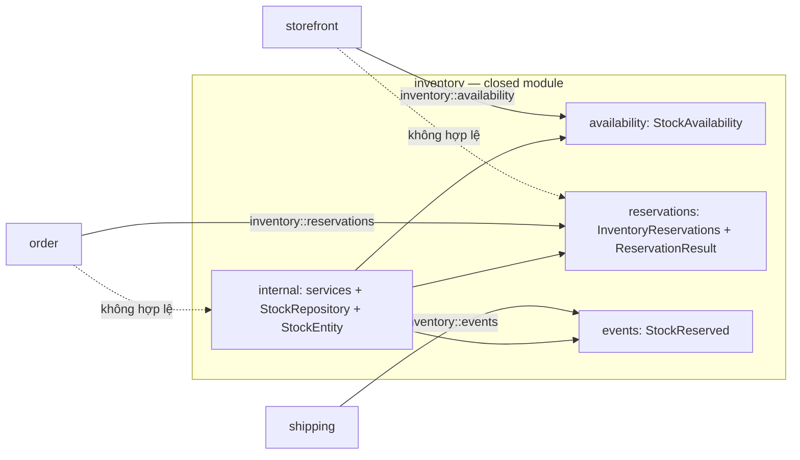

# Dùng named interface để hướng dẫn người phát triển

Trong một ứng dụng Spring Modulith, người phát triển thường gặp ba câu hỏi trước khi viết code: **module nào sở hữu chức năng mình cần?**, **được phép dùng những kiểu nào của module đó?**, và **làm sao biết mình vừa tạo một phụ thuộc sai?** `@NamedInterface` giúp biến các câu trả lời thành **hợp đồng kiến trúc có tên**, có thể được mô tả ngay trong source và kiểm chứng tự động.

Bài học thuộc chương **Named interfaces** trong lộ trình **SPRING_MODULITH_VERIFICATION_TESTING**. Mục tiêu là sử dụng named interface không chỉ để “cho phép import” mà còn để **hướng dẫn người mới và người bảo trì codebase**: đặt tên API dễ tìm, cung cấp ví dụ đúng/sai, xác định chủ sở hữu, khoanh quyền tiêu thụ bằng `allowedDependencies` và duy trì `ApplicationModules.verify()`, `@ApplicationModuleTest`, test sự kiện, database/tích hợp cùng quality gate CI nhằm ngăn phụ thuộc sai hoặc hồi quy.

> **Thông điệp chính:** named interface là một phần **API được công bố ở mức kiến trúc**, không phải cơ chế runtime security, không phải Java `module-info.java` và cũng không tự tạo Spring bean. Giá trị hướng dẫn xuất hiện khi **tên rõ nghĩa + hợp đồng dễ đọc + ví dụ dùng đúng + kiểm chứng tự động** cùng tồn tại.

## 1. Người phát triển cần một “bản đồ API” thay vì đoán từ thư mục

Giả sử dự án bán hàng có application module `inventory` sở hữu tồn kho. Ba nhóm phát triển cần chức năng khác nhau:

- Nhóm **`order`** cần đặt giữ hàng trước khi xác nhận đơn.
- Nhóm **`storefront`** chỉ cần hiển thị khả năng cung ứng ước tính.
- Nhóm **`shipping`** cần phản ứng khi một lượt đặt giữ hàng thành công.

Nếu module `inventory` phơi ra `StockRepository`, `StockEntity`, `InventoryService` và hàng chục helper `public` mà không nói rõ ranh giới, người mới có thể chọn lớp dễ gọi nhất thay vì hợp đồng đúng. Hệ quả là `order` đọc/ghi database của `inventory`, `storefront` phụ thuộc vào transaction nội bộ, hoặc `shipping` gọi đồng bộ một thao tác vốn được thiết kế dưới dạng sự kiện.

Một “bản đồ API” tốt cần thể hiện ba cửa vào khác biệt:

| Nhu cầu người tiêu thụ | API được công bố | Hành động khuyến nghị |
| --- | --- | --- |
| Yêu cầu giữ một số lượng hàng | `inventory::reservations` | Gọi `InventoryReservations`, nhận `ReservationResult` |
| Đọc khả năng cung ứng | `inventory::availability` | Gọi `StockAvailability`; không tự truy cập repository |
| Phản ứng với việc hàng đã được giữ | `inventory::events` | Nghe kiểu `StockReserved` và xử lý bất đồng bộ nếu phù hợp |
| Thay mapping database hoặc thuật toán phân bổ | **Phần nội bộ của `inventory`** | Sửa trong module sở hữu, không công bố sang module khác |

Tên `reservations`, `availability`, `events` là các **quyết định thiết kế dựa trên năng lực nghiệp vụ**, không phải những tên Spring Modulith bắt buộc. Một dự án khác có thể dùng `pricing`, `billing` hoặc `fulfillment`.

## 2. Named interface và cấu trúc package tạo tài liệu sống

Giả sử lớp `@SpringBootApplication` là `com.example.store.StoreApplication`. Theo cách phát hiện application module mặc định, các package con trực tiếp `inventory`, `order`, `storefront`, `shipping` là các module.

```text
com.example.store
├── StoreApplication.java
├── inventory/                         ← application module: inventory
│   ├── reservations/
│   │   ├── package-info.java         ← @NamedInterface("reservations")
│   │   ├── InventoryReservations.java
│   │   └── ReservationResult.java
│   ├── availability/
│   │   ├── package-info.java         ← @NamedInterface("availability")
│   │   └── StockAvailability.java
│   ├── events/
│   │   ├── package-info.java         ← @NamedInterface("events")
│   │   └── StockReserved.java
│   └── internal/
│       ├── StockEntity.java
│       ├── StockRepository.java
│       ├── ReservationService.java
│       └── AvailabilityService.java
├── order/
│   ├── package-info.java             ← chỉ dùng inventory::reservations
│   └── OrderPlacementService.java
├── storefront/
│   ├── package-info.java             ← chỉ dùng inventory::availability
│   └── StockDisplayService.java
└── shipping/
    ├── package-info.java             ← chỉ dùng inventory::events
    └── ReservationListener.java
```

Trong một **closed application module**, các kiểu public ở package gốc có thể thuộc API mặc định (*unnamed interface*), còn các subpackage chưa được công bố là nội bộ. Vì vậy, các kiểu nằm trong `inventory.internal` **không tự trở thành API module** chỉ vì chúng được khai báo `public` để phục vụ một framework.

Mỗi `package-info.java` là một vị trí đặt **lời mô tả dành cho lập trình viên** cùng annotation mô tả **ranh giới cho công cụ phân tích**. Khi code, JavaDoc và kiểm chứng được đặt gần nhau, tài liệu ít có nguy cơ trôi khỏi thực tế hơn một sơ đồ tĩnh được cập nhật thủ công.

## 3. Viết `package-info.java` như hướng dẫn sử dụng hợp đồng

### API ghi: `inventory::reservations`

Tạo `src/main/java/com/example/store/inventory/reservations/package-info.java`:

```java
/**
 * Điểm vào yêu cầu giữ tồn kho cho application module khác.
 *
 * <p>Đối tượng sử dụng: order và các luồng thực sự cần giữ hàng.
 * Dùng InventoryReservations thay vì StockRepository.
 *
 * <p>reserve(...) có tác dụng thay đổi trạng thái; người gọi phải
 * xử lý kết quả từ chối và việc giải phóng hàng nếu đơn thất bại.
 *
 * <p>Không công bố entity JPA, repository hoặc thuật toán phân bổ.
 */
@org.springframework.modulith.NamedInterface("reservations")
package com.example.store.inventory.reservations;
```

Các kiểu hợp đồng:

```java
// InventoryReservations.java
package com.example.store.inventory.reservations;

/** API ghi: yêu cầu một lần đặt giữ hàng. */
public interface InventoryReservations {

    /**
     * Thử giữ quantity đơn vị của sku.
     *
     * @throws IllegalArgumentException nếu sku rỗng hoặc quantity không dương
     */
    ReservationResult reserve(String sku, int quantity);
}
```

```java
// ReservationResult.java
package com.example.store.inventory.reservations;

import java.util.UUID;

/** Kết quả thuộc hợp đồng, không chứa StockEntity. */
public record ReservationResult(
        boolean accepted,
        UUID reservationId,
        String reasonCode
) {}
```

Trong một hệ thống thật, cần quy định rõ các bất biến của `ReservationResult`: chẳng hạn khi `accepted` là `true` thì `reservationId` phải có, khi bị từ chối thì `reasonCode` phải có giá trị hợp lệ. Các bất biến này nên được kiểm tra trong constructor hoặc producer test, không chỉ được đề cập trong tài liệu.

Tên `reservations` và JavaDoc nói cho người phát triển biết đây là **thao tác thay đổi trạng thái**, không phải API đọc số lượng tồn kho. Bản thân `@NamedInterface` chưa thực thi giao dịch hoặc xử lý trường hợp đồng thời; các hành vi đó phải được implementation và test bảo vệ.

### API đọc: `inventory::availability`

Tạo `src/main/java/com/example/store/inventory/availability/package-info.java`:

```java
/**
 * API chỉ đọc khả năng cung ứng cho giao diện người dùng.
 *
 * <p>Dùng để hiển thị tham khảo; dữ liệu đọc không thay thế
 * thao tác reserve(...) có kiểm tra đồng thời khi đặt hàng.
 */
@org.springframework.modulith.NamedInterface("availability")
package com.example.store.inventory.availability;
```

```java
// StockAvailability.java
package com.example.store.inventory.availability;

/** API chỉ đọc; không đặt giữ hay trừ số lượng hàng. */
public interface StockAvailability {
    int availableToPromise(String sku);
}
```

Đây là một API tách biệt vì người dùng và ngữ nghĩa khác `reservations`. Một trang giao diện hiển thị “còn 5 sản phẩm” **không được hiểu là** bảo đảm đặt giữ thành công; khi đơn được tạo, `order` vẫn phải gọi thao tác `reserve` có kiểm tra nhất quán.

### API sự kiện: `inventory::events`

Tạo `src/main/java/com/example/store/inventory/events/package-info.java`:

```java
/**
 * Những sự kiện nghiệp vụ inventory công bố cho module khác.
 *
 * <p>Sự kiện phản ánh việc giữ hàng đã xảy ra; người tiêu thụ
 * cần xử lý lặp, chậm hoặc lỗi theo chính sách tích hợp.
 */
@org.springframework.modulith.NamedInterface("events")
package com.example.store.inventory.events;
```

```java
// StockReserved.java
package com.example.store.inventory.events;

import java.time.Instant;
import java.util.UUID;

public record StockReserved(
        UUID reservationId,
        String sku,
        int quantity,
        Instant occurredAt
) {}
```

`StockReserved` là **kiểu dữ liệu sự kiện**; annotation trên package không tự phát event, không tạo event listener và không bảo đảm event được giao sau commit. Module sở hữu cần mã phát sự kiện và kiểm thử lifecycle giao dịch, listener cùng chính sách retry/idempotency.

### Vì sao JavaDoc là thành phần quan trọng?

Một annotation chỉ biết tên `reservations`; nó không giải thích liệu phương thức có idempotent không, `reservationId` có bắt buộc không hoặc sự kiện có thể được giao lại không. Người phát triển cần **hợp đồng hành vi** bên cạnh hợp đồng cấu trúc.

JavaDoc hữu ích khi nó trả lời: **dùng để làm gì, ai nên dùng, giới hạn dữ liệu là gì, tác dụng phụ ra sao, lỗi được báo như thế nào và nên tránh lớp nội bộ nào**. Không cần mô tả lại mọi chi tiết của repository; đó là phần mà named interface đang giúp che giấu.

## 4. `allowedDependencies` làm rõ hướng dẫn cho từng module tiêu thụ

Bên cung cấp mô tả **những phần API được công bố** bằng `@NamedInterface`. Bên tiêu thụ mô tả **phần nào được phép sử dụng** bằng `@ApplicationModule(allowedDependencies = ...)`.

Trong `src/main/java/com/example/store/order/package-info.java`:

```java
/**
 * Order chỉ được yêu cầu giữ hàng qua API reservations.
 * Không truy vấn hoặc cập nhật StockRepository trực tiếp.
 */
@org.springframework.modulith.ApplicationModule(
    allowedDependencies = "inventory::reservations"
)
package com.example.store.order;
```

Trong `src/main/java/com/example/store/storefront/package-info.java`:

```java
/**
 * Storefront chỉ đọc khả năng cung ứng; không được giữ hàng.
 */
@org.springframework.modulith.ApplicationModule(
    allowedDependencies = "inventory::availability"
)
package com.example.store.storefront;
```

Trong `src/main/java/com/example/store/shipping/package-info.java`:

```java
/**
 * Shipping chỉ tham chiếu các sự kiện tồn kho được công bố.
 */
@org.springframework.modulith.ApplicationModule(
    allowedDependencies = "inventory::events"
)
package com.example.store.shipping;
```

Bảng quyền kỳ vọng giúp người mới quyết định trước khi import:

| Kiểu trong module `inventory` | `order` | `storefront` | `shipping` |
| --- | :---: | :---: | :---: |
| `InventoryReservations` | ✅ | ❌ | ❌ |
| `ReservationResult` | ✅ | ❌ | ❌ |
| `StockAvailability` | ❌ | ✅ | ❌ |
| `StockReserved` | ❌ | ❌ | ✅ |
| `internal.StockRepository` | ❌ | ❌ | ❌ |
| `internal.StockEntity` | ❌ | ❌ | ❌ |

Bảng giả định `inventory` là **closed module**, các package API được đánh dấu đúng và ba module tiêu thụ khai báo `allowedDependencies` như trên. Nếu một module cần hai nhóm API, có thể khai báo mảng:

```java
@org.springframework.modulith.ApplicationModule(
    allowedDependencies = {
        "inventory::availability",
        "inventory::events"
    }
)
package com.example.store.reporting;
```

Ví dụ `reporting` chỉ nhằm minh họa **cú pháp nhiều named interface**; muốn dùng trong dự án thật phải có module `reporting`, nghiệp vụ hợp lệ và test tương ứng.

**Điểm cần giải thích khi onboarding:** `inventory::reservations` không có nghĩa toàn bộ module `inventory` trở thành public. Một kiểu có thể thuộc API `inventory::events` nhưng vẫn không được `order` sử dụng vì `order` chỉ cho phép `reservations`.

## 5. Ví dụ “lối đi đúng”: gọi contract, không gọi implementation

Ở phía `order`:

```java
// src/main/java/com/example/store/order/OrderPlacementService.java
package com.example.store.order;

import com.example.store.inventory.reservations.InventoryReservations;
import com.example.store.inventory.reservations.ReservationResult;
import org.springframework.stereotype.Service;

@Service
public class OrderPlacementService {

    private final InventoryReservations inventory;

    public OrderPlacementService(InventoryReservations inventory) {
        this.inventory = inventory;
    }

    public ReservationResult requestStockForOrder(
            String sku, int quantity) {
        return inventory.reserve(sku, quantity);
    }
}
```

Mã tiêu thụ chỉ biết `InventoryReservations` và `ReservationResult`. Implementation trong `inventory.internal` có thể sử dụng JPA hoặc thuật toán giữ hàng khác mà `order` không cần thay đổi import. Trong luồng tạo đơn thật, phải xử lý việc giải phóng giữ hàng khi các bước sau thất bại và kiểm thử quy tắc transaction/bù trừ.

Ở phía `storefront`:

```java
// src/main/java/com/example/store/storefront/StockDisplayService.java
package com.example.store.storefront;

import com.example.store.inventory.availability.StockAvailability;
import org.springframework.stereotype.Service;

@Service
public class StockDisplayService {

    private final StockAvailability availability;

    public StockDisplayService(StockAvailability availability) {
        this.availability = availability;
    }

    public boolean showAsAvailable(String sku) {
        return availability.availableToPromise(sku) > 0;
    }
}
```

Ở phía `shipping`:

```java
// src/main/java/com/example/store/shipping/ReservationListener.java
package com.example.store.shipping;

import com.example.store.inventory.events.StockReserved;
import org.springframework.modulith.events.ApplicationModuleListener;
import org.springframework.stereotype.Component;

@Component
class ReservationListener {

    @ApplicationModuleListener
    void on(StockReserved event) {
        // Tiếp nhận sự kiện đã công bố theo event.reservationId().
        // Hệ thống thật cần idempotency, retry và test thời điểm xử lý.
    }
}
```

Hai ví dụ Spring bean đầu giả định `inventory` cung cấp các implementation của interface cho DI. Ví dụ listener giả định có event publisher phù hợp; `@NamedInterface` không tự cấu hình việc phát event hoặc tạo dữ liệu trong database.



Sơ đồ này là một phần **hướng dẫn lựa chọn API**. Khi đổi package, tên named interface hoặc quyền tiêu thụ, cập nhật biểu diễn và kiểm chứng để tránh tài liệu lỗi thời.

## 6. Một quy trình tìm API dành cho người mới vào dự án

Khi được giao một tính năng, người phát triển có thể làm theo **luồng quyết định** dưới đây:

1. **Đặt câu hỏi nghiệp vụ:** muốn thực hiện thay đổi trạng thái, đọc dữ liệu, hay phản ứng với một sự kiện đã xảy ra?
2. **Tìm module sở hữu:** với tồn kho là `inventory`, không phải `order` hoặc `shipping`.
3. **Đọc các `package-info.java` của API công bố:** chọn `reservations`, `availability` hoặc `events` dựa trên lời mô tả.
4. **Đọc kiểu hợp đồng công khai:** kiểm tra tham số, kết quả, lỗi, tác dụng phụ và lưu ý transaction.
5. **Xem `allowedDependencies` của module mình:** nếu chưa cho phép API cần thiết, đánh giá yêu cầu thiết kế trước khi bổ sung.
6. **Chỉ import kiểu thuộc API phù hợp:** không dùng các package `internal` để truy cập tính năng nhanh hơn.
7. **Chạy test kiến trúc và hành vi:** kiểm tra đúng ranh giới trước, sau đó kiểm tra chức năng/transaction/event theo thay đổi.

Một bảng quyết định nhỏ có thể đưa vào tài liệu onboarding:

| Nếu mục tiêu là… | Hãy chọn… | Tránh… |
| --- | --- | --- |
| Giữ 3 sản phẩm cho đơn đang xử lý | `InventoryReservations.reserve(...)` | Gọi `StockRepository.save(...)` từ `order` |
| Hiển thị “còn hàng” cho trang bán | `StockAvailability.availableToPromise(...)` | Gọi `reserve(...)` chỉ để kiểm tra còn hàng |
| Bắt đầu khâu giao hàng sau khi hàng được giữ | Kiểu sự kiện `StockReserved` nếu nghiệp vụ chấp nhận luồng event | Lắng nghe/đọc entity nội bộ hoặc dùng một API ghi không cần thiết |
| Thay chiến lược lưu tồn kho | Mã trong `inventory.internal` | Công bố thêm repository sang named interface |

Named interface **không quyết định thay con người**; nó làm nhu cầu và quyền phụ thuộc trở nên rõ ràng để có thể xem xét trong code review.

## 7. Dùng lỗi kiến trúc làm phản hồi hướng dẫn

Đặt một bài test JUnit để người phát triển nhận phản hồi nhanh khi tạo phụ thuộc sai:

```java
// src/test/java/com/example/store/ModulithArchitectureTest.java
package com.example.store;

import org.junit.jupiter.api.Test;
import org.springframework.modulith.core.ApplicationModules;

class ModulithArchitectureTest {

    @Test
    void allModulesUseOnlyPublishedContracts() {
        ApplicationModules.of(StoreApplication.class).verify();
    }
}
```

`verify()` phân tích **toàn bộ mô hình application module** được phát hiện từ `StoreApplication`, không giới hạn chỉ module được nhắc trong tên method. Trong số các quy tắc trọng yếu, nó kiểm tra phụ thuộc từ module khác vào phần không được công bố của closed module, giới hạn `allowedDependencies` và vòng phụ thuộc.

Bài test này **không cần khởi tạo toàn bộ Spring ApplicationContext hoặc truy vấn database** chỉ để kiểm tra cấu trúc. Để chạy, dự án cần Spring Modulith core và JUnit phù hợp, cùng cấu trúc ứng dụng hợp lệ.

### Ma trận thử nghiệm “đường đi đúng/sai”

| Tình huống | Kỳ vọng | Lời khuyên dành cho người phát triển |
| --- | --- | --- |
| `order` dùng `InventoryReservations` | **PASS** nếu phần còn lại hợp lệ | Đã chọn đúng năng lực và quyền phụ thuộc |
| `storefront` dùng `StockAvailability` | **PASS** nếu phần còn lại hợp lệ | API đọc phù hợp với màn hình |
| `shipping` dùng `StockReserved` | **PASS** nếu phần còn lại hợp lệ | Tiêu thụ đúng kiểu sự kiện |
| `storefront` dùng `InventoryReservations` | **FAIL** | API đó được công bố nhưng không thuộc `allowedDependencies` của storefront |
| `order` dùng kiểu `public` ở `inventory.internal` | **FAIL** | Cần dùng hợp đồng `reservations`, không phụ thuộc implementation |
| `shipping` dùng `StockAvailability` | **FAIL** | Nếu cần chức năng đọc thật, phải đánh giá lại quyền của shipping |
| Bỏ `@NamedInterface("events")` nhưng shipping vẫn tham chiếu event | **FAIL** | Kiểu event không còn nằm trong API công bố của closed module |
| Chuyển repository `public` vào package `inventory.reservations` | Có thể **PASS** | Test cấu trúc không tự biết repository là lựa chọn API không phù hợp |

Các kết quả trên là **kỳ vọng theo ví dụ**, không phải log đã chạy ở repository hiện tại. Khi tạo tình huống sai, chỉ thêm một dòng `import` không được dùng có thể không tạo phụ thuộc mà công cụ nhận diện trong bytecode. Hãy thử với kiểu ở field, tham số, chữ ký hoặc lời gọi thực tế, rồi **khôi phục mã sau kiểm tra**.

Để thử lỗi phụ thuộc nội bộ, dùng một kiểu giả lập đủ `public` cho Java biên dịch; nếu lớp package-private, javac sẽ từ chối trước khi bài test Spring Modulith chạy. Phân biệt **lỗi truy cập Java** với **lỗi ranh giới module** giúp phản hồi hướng dẫn chính xác.

### Không dùng cách “sửa cho test xanh” sai mục đích

Khi test báo `storefront` đang dùng `InventoryReservations`, không nên lập tức:

- Chuyển toàn bộ `inventory` thành open module.
- Đưa repository từ `internal` vào package đã công bố.
- Xóa `allowedDependencies` hoặc mở wildcard chỉ để hết lỗi.
- Xóa `ApplicationModules.verify()` khỏi test suite.

Hãy hỏi **storefront thật sự cần đọc hay cần giữ hàng**. Nếu chỉ cần hiển thị, chuyển sang `availability`; nếu thật sự có tác vụ đặt hàng mới, thay đổi trách nhiệm và quyền phụ thuộc cần được đánh giá trong thiết kế.

## 8. JavaDoc và tài liệu kiến trúc cần giúp quyết định, không chỉ liệt kê kiểu

Một danh sách `public class` không đủ để hướng dẫn developer. Với từng named interface, nên thống nhất bộ thông tin:

| Thông tin cần cung cấp | Ví dụ cho `inventory::reservations` |
| --- | --- |
| **Mục đích** | Yêu cầu đặt giữ hàng trước khi xác nhận đơn |
| **Chủ sở hữu** | Nhóm phụ trách module `inventory` |
| **Người dùng dự kiến** | `order` và các luồng nghiệp vụ tương tự |
| **Hợp đồng chính** | `InventoryReservations.reserve(...)` |
| **Kiểu dữ liệu công khai** | `ReservationResult` |
| **Tác dụng phụ** | Có thể thay đổi trạng thái tồn kho |
| **Lỗi và ngoại lệ** | SKU/số lượng sai; không đủ hàng; xử lý từ chối |
| **Tính nhất quán** | Quy tắc cập nhật đồng thời và transaction |
| **Điều không được làm** | Gọi `StockRepository` hoặc sửa `StockEntity` từ module khác |
| **Kiểm chứng** | Test kiến trúc, module, database và tích hợp |

Tên và JavaDoc cần đủ dễ hiểu để người mới **biết mình nên dùng cái gì mà không phải đọc implementation**. Tuy nhiên, lời mô tả phải phản ánh đúng hành vi thật: nếu `reserve` không idempotent, không được ghi “an toàn khi gọi lặp” chỉ vì đó là điều mong muốn.

Một số dự án còn sinh tài liệu mô hình module/quan hệ phụ thuộc từ Spring Modulith để người phát triển quan sát sơ đồ. Có thể sử dụng công cụ tài liệu của phiên bản Spring Modulith mà dự án đang dùng, song **tài liệu tự sinh không thay thế lời giải thích ngữ nghĩa** trong JavaDoc và các bài test. Khi thay đổi API, người phát triển nên cập nhật đồng bộ mô tả, sơ đồ và các test liên quan.

## 9. Hướng dẫn cách đề xuất một named interface mới

Khi người phát triển không tìm thấy API cần dùng, đừng mặc định rằng giải pháp là `import inventory.internal.*`. Một đề xuất API mới nên có đủ căn cứ:

1. **Nhu cầu cụ thể:** module nào cần dữ liệu/hành vi gì, trong luồng nghiệp vụ nào?
2. **Chủ sở hữu đúng:** dữ liệu/chức năng thuộc trách nhiệm `inventory` hay của module khác?
3. **Lựa chọn tái sử dụng:** có thể mở rộng `inventory::availability` bằng một thao tác đọc an toàn, hay cần nhóm API riêng?
4. **Tên gắn trách nhiệm:** ví dụ `inventory::restocking` chỉ khi có một năng lực nhập bổ sung hàng với người tiêu thụ rõ ràng.
5. **Tập kiểu tối thiểu:** interface/DTO/event cần thiết, không công bố entity/repository/adapter.
6. **Quyền tiêu thụ hẹp:** cập nhật `allowedDependencies` chỉ trên các module có nhu cầu thực sự.
7. **Bảo đảm kiểm thử:** test cấu trúc, producer/consumer, database/event và CI đủ phát hiện phụ thuộc sai hoặc phá hợp đồng.

Ví dụ: `storefront` muốn biết ngày dự kiến có hàng. Không nên expose `StockEntity.getNextInboundShipment()` hoặc `InboundShipmentRepository`. Một API phù hợp hơn có thể là thao tác đọc `estimatedRestockDate(String sku)` và DTO/value type công khai trong `inventory::availability`, **nếu** nghiệp vụ cho phép công bố thông tin ấy. Khi hợp đồng có nhu cầu và vòng đời riêng, cân nhắc tách named interface chuyên biệt.

**Một named interface không tự tạo danh sách cho phép từng class.** Các kiểu public được đưa vào package đã đánh dấu có thể làm bề mặt API rộng hơn mong muốn. Code review phải rà soát kiểu mới, nhất là class helper public, exception nội bộ và DTO trả về entity.

## 10. Duy trì hướng dẫn bằng kiểm thử hành vi

Một developer mới có thể làm đúng hướng phụ thuộc nhưng implementation vẫn sai. `ApplicationModules.verify()` không xác nhận `reserve(...)` hoạt động đúng, listener có nhận sự kiện hoặc số lượng tồn có nhất quán khi có nhiều giao dịch đồng thời hay không.

Các lớp kiểm thử bổ trợ:

| Lớp kiểm thử | Câu hỏi cho người phát triển | Ví dụ |
| --- | --- | --- |
| **Architecture test** | Tôi có đi qua đúng API được công bố không? | `order` dùng `inventory::reservations`, không dùng `internal` |
| **`@ApplicationModuleTest`** | Module có khởi động và cung cấp bean hợp đồng không? | `InventoryReservations` được Spring inject |
| **Contract/unit test** | Đầu vào và kết quả có đúng cam kết không? | Số lượng âm bị từ chối; đủ hàng thì giữ thành công |
| **Database/integration test** | Persistence và transaction có đúng không? | Không đặt giữ vượt tồn kho khi có cạnh tranh |
| **Event test** | Sự kiện được phát, payload và listener đúng không? | `StockReserved` chứa reservationId và quantity phù hợp |
| **Cross-module integration** | Module tiêu thụ phối hợp với provider thật được không? | `order` nhận kết quả giữ hàng và xử lý bù trừ khi cần |
| **CI quality gate** | Thay đổi có làm sai ranh giới hoặc hồi quy không? | Test bắt buộc thất bại thì không cho hợp nhất |

Ví dụ `@ApplicationModuleTest` kiểm tra contract bean từ phía module cung cấp:

```java
// src/test/java/com/example/store/inventory/InventoryModuleTest.java
package com.example.store.inventory;

import com.example.store.inventory.reservations.InventoryReservations;
import org.junit.jupiter.api.Test;
import org.springframework.beans.factory.annotation.Autowired;
import org.springframework.modulith.test.ApplicationModuleTest;

import static org.assertj.core.api.Assertions.assertThat;

@ApplicationModuleTest
class InventoryModuleTest {

    @Autowired
    InventoryReservations reservations;

    @Test
    void providesReservationContract() {
        assertThat(reservations).isNotNull();
    }
}
```

Test minh họa này giả định `inventory` có bean hiện thực `InventoryReservations`; có thể cần datasource/test double và các dependency Spring Modulith test thích hợp để nạp được module. Nó kiểm tra **wiring của hợp đồng**, không thay thế test số lượng, transaction hoặc kiến trúc.

Với contract sự kiện, có thể kiểm tra event được phát bằng công cụ test event trong Spring Test/Spring Modulith và listener xử lý đúng khi nhận lặp hoặc trễ. Named interface `events` chỉ công bố kiểu; chất lượng tương tác event cần test thời điểm phát, transaction, idempotency và lỗi tích hợp tương ứng.

## 11. Quality gate CI: biến hướng dẫn thành quy tắc không thể bỏ qua

Một tài liệu tốt có thể bị bỏ quên; một bài test kiến trúc chạy trong CI tạo ra **phản hồi bắt buộc** khi code đi ngược quy tắc.

Ví dụ chạy suite JUnit với Gradle:

```bash
./gradlew test
```

Hoặc với Maven:

```bash
mvn test
```

Nếu dự án có integration test tách khỏi unit test, CI phải chạy task/plugin tương ứng; một lệnh `test` không mặc định bảo đảm mọi integration test đều đã chạy. Điều quan trọng là pipeline **thực sự fail** nếu bài test kiến trúc hoặc hành vi bắt buộc thất bại.

Một danh sách kiểm tra dành cho pull request:

- [ ] Tôi đã xác định **application module sở hữu** chức năng thay vì dùng trực tiếp lớp nội bộ của module khác.
- [ ] Import mới chỉ tham chiếu kiểu thuộc **named interface/API mặc định được công bố** và đúng phạm vi `allowedDependencies`.
- [ ] Nếu thêm/đổi tên named interface, tôi đã cập nhật `package-info.java`, JavaDoc, các module tiêu thụ và test kiến trúc.
- [ ] Nếu thêm kiểu public vào package API, tôi đã rà soát bề mặt công bố và loại bỏ entity/repository/adapter không cần thiết.
- [ ] Chữ ký công khai không làm lộ kiểu `.internal.` qua generic, tham số, kết quả, exception hoặc event payload.
- [ ] Tôi đã chạy `ApplicationModules.verify()` và các test `@ApplicationModuleTest`, event, database/tích hợp phù hợp với thay đổi.
- [ ] Tôi không mở rộng quyền phụ thuộc, chuyển module thành open hoặc xóa test chỉ để giải quyết cảnh báo mà chưa làm rõ nhu cầu nghiệp vụ.

Về mặt phối hợp nhóm, người review có thể hỏi: **“Vì sao module tiêu thụ cần thêm named interface này?”** và **“Nếu thay repository trong module sở hữu, mã tiêu thụ có còn hoạt động không?”**. Hai câu hỏi giúp phát hiện thiết kế phụ thuộc quá chặt dù test hiện tại có thể PASS.

## 12. Bài thực hành: onboarding một lập trình viên mới

### Bối cảnh

Bạn là người phụ trách onboarding. Một đồng nghiệp được giao tính năng **hiển thị tồn kho trong `storefront`**. Người đó phát hiện `inventory.internal.StockRepository` và định import trực tiếp vì repository có sẵn. Bạn phải hướng dẫn họ tìm API đúng và bảo vệ quyết định bằng kiểm thử.

### Nhiệm vụ

1. **Vẽ bản đồ module:** mô tả trách nhiệm của `inventory`, `storefront`, `order` và `shipping`; xác định ai sở hữu dữ liệu tồn kho.
2. **Đặt ba tên API:** tạo các package `inventory.availability`, `inventory.reservations`, `inventory.events`; đánh dấu từng package bằng `@NamedInterface` tương ứng.
3. **Viết tài liệu gần code:** mỗi `package-info.java` phải nêu mục đích, người dùng dự kiến, tác dụng phụ và phần triển khai không được dùng.
4. **Giữ contract sạch:** định nghĩa `StockAvailability`, `InventoryReservations`, `ReservationResult`, `StockReserved`; không dùng entity hoặc repository trong chữ ký công khai.
5. **Giới hạn người tiêu thụ:** `storefront` chỉ cho phép `inventory::availability`, `order` chỉ `inventory::reservations`, `shipping` chỉ `inventory::events`.
6. **Viết code đúng:** tạo `StockDisplayService` chỉ inject `StockAvailability`; không import `inventory.internal`.
7. **Dựng test kiến trúc:** viết `ApplicationModules.of(StoreApplication.class).verify()`; xác nhận kiến trúc hợp lệ.
8. **Tạo sai lệch có kiểm soát:** cho `storefront` phụ thuộc thực sự vào kiểu `public` giả lập trong `inventory.internal`, sau đó thử sử dụng `InventoryReservations`; giải thích nguyên nhân hai lỗi khác nhau.
9. **Khôi phục và kiểm thử hành vi:** bỏ mã vi phạm, bổ sung `@ApplicationModuleTest`, test event/database và tích hợp phù hợp; chạy lại suite.
10. **Đặt quality gate CI:** yêu cầu bài test kiến trúc PASS khi review pull request, và cập nhật checklist khi công bố API mới.

### Đáp án định hướng

**Vì sao `storefront` nên dùng `inventory::availability`?** Vì nó chỉ cần **đọc thông tin cung ứng để hiển thị**, không yêu cầu thao tác giữ hàng hoặc quyền sửa dữ liệu.

**Vì sao `@NamedInterface("reservations")` chưa đủ để `storefront` được gọi `InventoryReservations`?** Vì module tiêu thụ còn có `allowedDependencies = "inventory::availability"`, giới hạn cụ thể quyền phụ thuộc.

**Tại sao repository public trong package `internal` vẫn không phải lối vào hợp lệ?** Vì `public` chỉ là Java visibility; trong closed module, subpackage chưa công bố không thuộc API kiến trúc.

**Nếu người phát triển cần một dữ liệu chưa có trong API thì sao?** Xác định nhu cầu và yêu cầu module sở hữu bổ sung một contract/DTO phù hợp; không đưa entity hoặc repository ra ngoài để né thiết kế.

**Nếu `verify()` PASS, có bảo đảm trang bán hiển thị tồn kho đúng không?** Không. Cần test hành vi và database/tích hợp; `verify()` kiểm tra cấu trúc phụ thuộc, không xác nhận giá trị hay transaction đúng.

### Tiêu chí hoàn thành

Học viên có thể nhìn tên và JavaDoc của named interface để **chọn đúng API mà không cần đọc repository**, giải thích được vì sao một import nội bộ là sai, tự viết `allowedDependencies` cho module tiêu thụ, quan sát `ApplicationModules.verify()` phát hiện phụ thuộc không hợp lệ và gắn kiểm tra vào CI.

## 13. Ghi nhớ

**Named interface là công cụ hướng dẫn người phát triển khi nó mô tả rõ một năng lực được công bố và có quy tắc phụ thuộc đi kèm.** Hãy đặt tên theo trách nhiệm nghiệp vụ, viết JavaDoc trong `package-info.java`, công bố các kiểu contract tối thiểu, giữ entity/repository/implementation nội bộ, giới hạn từng module tiêu thụ bằng `allowedDependencies` và dùng **`ApplicationModules.verify()`** như phản hồi tự động. Kết hợp **`@ApplicationModuleTest`**, test sự kiện, database và tích hợp để bảo vệ hành vi, rồi duy trì mọi điều kiện cần thiết trong **CI quality gate**. Khi đó tài liệu kiến trúc không chỉ để đọc: nó giúp người mới chọn lối đi đúng và khiến các phụ thuộc sai khó tồn tại qua code review.

### Tài liệu tham khảo

- [Spring Modulith Reference — Application Modules và Named Interfaces](https://docs.spring.io/spring-modulith/reference/fundamentals.html)
- [Spring Modulith Reference — Verifying Application Module Structure](https://docs.spring.io/spring-modulith/reference/verification.html)
- [Spring Modulith Reference — Integration Testing Application Modules](https://docs.spring.io/spring-modulith/reference/testing.html)
