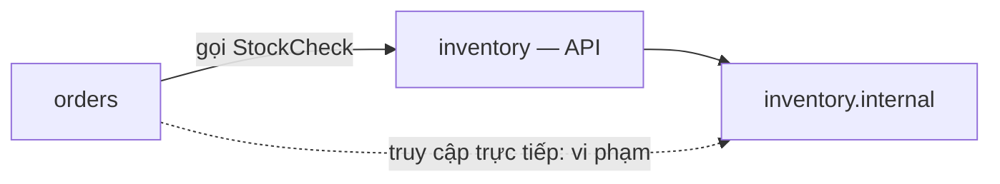
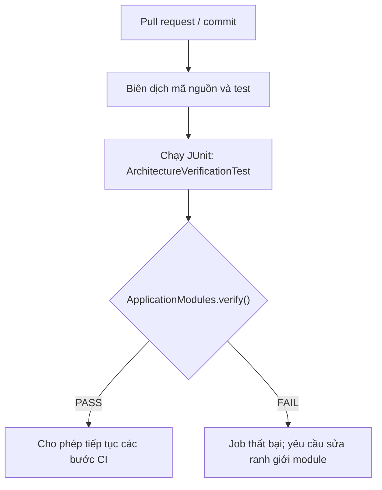

# Chạy `verify()` như một architectural test

> **Chương:** Verification trong build  
> **Phạm vi:** Spring Modulith Verification & Testing — kiểm chứng ranh giới module bằng `ApplicationModules` và đưa phép kiểm chứng vào vòng đời build/CI.

## 1. Mục tiêu học tập

Sau bài này, bạn có thể:

1. Giải thích vì sao một ứng dụng vẫn biên dịch và chạy được nhưng vi phạm kiến trúc module đã thống nhất.
2. Tạo bài kiểm thử JUnit gọi `ApplicationModules.of(...).verify()` để phát hiện phụ thuộc sai giữa các application module.
3. Phân biệt lỗi chu trình phụ thuộc, truy cập vào package nội bộ và vi phạm danh sách phụ thuộc cho phép.
4. Đọc kết quả kiểm thử thất bại, sửa phụ thuộc tại đúng ranh giới và kiểm chứng lại.
5. Biến bài kiểm thử kiến trúc thành **quality gate** trong Maven/Gradle và CI, đồng thời hiểu những gì phép kiểm này chưa bao phủ.

## 2. Vì sao phải kiểm chứng kiến trúc ngay trong build?

Java cho phép một lớp sử dụng lớp `public` thuộc package khác khi các quy tắc truy cập của ngôn ngữ cho phép. Tuy nhiên, quyền truy cập ở mức Java chưa chắc đồng nghĩa với **quyền phụ thuộc ở mức kiến trúc**. Trong ứng dụng có module `orders` và `inventory`, ví dụ:

- `orders` được phép gọi dịch vụ tra cứu tồn kho do `inventory` công bố.
- `orders` không được biết `inventory.internal.StockJpaRepository`, vì đó là chi tiết lưu trữ riêng của module tồn kho.
- `inventory` không nên phụ thuộc ngược vào `orders` để tránh chu trình giữa hai module.

Một lệnh `javac` hoặc bài unit test chỉ kiểm tra thuật toán của `OrderService` có thể vẫn thành công khi có import sai. Lỗi này thường xuất hiện dần trong các pull request nhỏ, tạo ra coupling, khiến thay đổi của một module gây ảnh hưởng dây chuyền sang module khác.

**Architectural test** biến quy tắc thiết kế thành điều kiện có thể chạy tự động. Trong Spring Modulith, `ApplicationModules` mô hình hóa các module từ cấu trúc ứng dụng; phương thức `verify()` kiểm tra những bất biến kiến trúc quan trọng. Đặt phép gọi đó trong một bài JUnit thông thường giúp Maven/Gradle và CI đánh dấu build thất bại khi có vi phạm.

> **Hai ý nghĩa khác nhau của “verify”:** `ApplicationModules.verify()` là phương thức kiểm chứng kiến trúc của Spring Modulith; `mvn verify` là một phase trong Maven lifecycle. Chúng không phải cùng API. Bài JUnit gọi `ApplicationModules.verify()` sẽ chạy trong Maven lifecycle nếu cấu hình test phù hợp, kể cả khi thực thi `mvn test` hoặc `mvn verify`.

## 3. Spring Modulith nhìn ranh giới module như thế nào?

Giả sử ứng dụng Spring Boot có lớp chính `com.example.shop.ShopApplication` và các package sau:

```text
src/main/java/com/example/shop/
├── ShopApplication.java
├── orders/
│   ├── OrderService.java
│   ├── package-info.java
│   └── internal/
│       └── OrderJpaRepository.java
└── inventory/
    ├── StockCheck.java
    ├── InventoryFacade.java
    └── internal/
        ├── InventoryService.java
        └── StockJpaRepository.java
```

Với cách tổ chức module trực tiếp dưới package gốc của ứng dụng, Spring Modulith nhận diện `orders` và `inventory` là các **application module**. Theo quy ước mặc định, các kiểu đặt ngay tại package gốc của một module là phần API được module khác truy cập; các package con như `inventory.internal` là chi tiết triển khai không được module khác phụ thuộc trực tiếp. Cách phát hiện module và public interface có thể được tùy chỉnh, vì vậy cần đối chiếu với cấu hình thật của dự án.



Điểm cần phân biệt:

| Lớp quy tắc | Công cụ xác nhận | Ví dụ |
| --- | --- | --- |
| Ngôn ngữ Java | Compiler | `public`, `private`, khả năng import lớp |
| Kiến trúc module | `ApplicationModules.verify()` | `orders` không truy cập `inventory.internal` |
| Hành vi nghiệp vụ | Unit/integration test | Đặt hàng khi hết tồn kho phải bị từ chối |
| Tích hợp runtime | `@ApplicationModuleTest`, kiểm thử sự kiện/DB | Event được xuất bản và listener xử lý đúng |

Architectural test bổ sung một tầng bảo vệ cho chất lượng hệ thống; nó không thay thế các bài kiểm thử hành vi và tích hợp.

## 4. Tạo một bài JUnit kiểm chứng kiến trúc

### 4.1. Chuẩn bị dependency

Trong dự án dùng Spring Modulith, thêm dependency hỗ trợ kiểm thử vào **test scope**. Ví dụ Maven, khi phiên bản Spring Modulith đã được quản lý bởi BOM/dependency management của dự án:

```xml
<dependency>
    <groupId>org.springframework.modulith</groupId>
    <artifactId>spring-modulith-starter-test</artifactId>
    <scope>test</scope>
</dependency>
```

Hoặc Gradle (Groovy DSL), cũng với điều kiện dự án đã quản lý phiên bản dependency:

```groovy
dependencies {
    testImplementation 'org.springframework.modulith:spring-modulith-starter-test'
}

tasks.named('test', Test) {
    useJUnitPlatform()
}
```

Nếu dự án chưa khai báo BOM hoặc dependency management tương ứng, cần bổ sung cấu hình phiên bản Spring Modulith **tương thích với phiên bản Spring Boot đang sử dụng**. Ví dụ trên cố ý không ghim một phiên bản vì bài học tập trung vào kiến trúc và cơ chế build.

### 4.2. Viết architectural test

Tạo file `src/test/java/com/example/shop/ArchitectureVerificationTest.java`:

```java
package com.example.shop;

import org.junit.jupiter.api.Test;
import org.springframework.modulith.core.ApplicationModules;

class ArchitectureVerificationTest {

    @Test
    void verifiesApplicationModuleBoundaries() {
        ApplicationModules modules =
                ApplicationModules.of(ShopApplication.class);

        modules.verify();
    }
}
```

Ý nghĩa từng thành phần:

- `ShopApplication.class` xác định package gốc để Spring Modulith xây dựng mô hình ứng dụng. Lớp này cần nằm đúng vùng bao phủ các module muốn kiểm tra.
- `ApplicationModules.of(...)` khám phá các module và mối quan hệ phụ thuộc từ mã nguồn đã biên dịch.
- `modules.verify()` xác thực các quy tắc kiến trúc. Nếu có vi phạm, phép gọi báo lỗi, khiến JUnit test thất bại.
- Tên lớp kết thúc bằng `Test` giúp các cấu hình chạy test phổ biến nhận diện bài kiểm thử. Không cần `@SpringBootTest` hay khởi động ApplicationContext chỉ để chạy phép kiểm tra kiến trúc này.

Kiểm chứng module là **một phép kiểm tra tĩnh đối với cấu trúc/phụ thuộc của mã**, không phải một HTTP request, truy vấn cơ sở dữ liệu hay lời gọi tới hệ thống bên ngoài. Điều này khiến bài test đủ gọn để chạy ở mọi lần build thông thường.

### 4.3. Chạy tại máy phát triển

Tại thư mục gốc dự án:

```bash
# Maven: chạy toàn bộ bài test
./mvnw test

# Maven: chỉ chạy architectural test khi cần chẩn đoán
./mvnw -Dtest=ArchitectureVerificationTest test

# Gradle: chạy toàn bộ bài test
./gradlew test

# Gradle: chỉ chạy architectural test khi cần chẩn đoán
./gradlew test --tests 'com.example.shop.ArchitectureVerificationTest'
```

Trên Windows, sử dụng `mvnw.cmd` hoặc `gradlew.bat` tương ứng. Trong CI, có thể gọi `./mvnw -B verify` (Maven) hoặc `./gradlew check` (Gradle), miễn là bài JUnit được đưa vào tác vụ kiểm thử và không bị cấu hình bỏ qua.

Khi kiến trúc hợp lệ, test kết thúc thành công như các bài JUnit khác. Khi vi phạm, `verify()` tạo lỗi với thông tin về module/kiểu phụ thuộc liên quan; build nhận exit code khác 0. Nội dung thông báo cụ thể có thể khác giữa các phiên bản Spring Modulith.

## 5. Hiểu và sửa ba nhóm vi phạm thường gặp

### 5.1. Truy cập package nội bộ của module khác

Giả sử `orders` gọi trực tiếp repository trong `inventory.internal`:

```java
package com.example.shop.orders;

import com.example.shop.inventory.internal.StockJpaRepository;

class OrderService {
    private final StockJpaRepository stockRepository;

    OrderService(StockJpaRepository stockRepository) {
        this.stockRepository = stockRepository;
    }
}
```

Đoạn mã có thể biên dịch nếu `StockJpaRepository` là kiểu `public`. Nhưng về mặt kiến trúc, `orders` đã bị gắn chặt vào cách `inventory` lưu trữ dữ liệu. `ApplicationModules.verify()` phát hiện kiểu phụ thuộc vượt qua ranh giới API mặc định của module.

Một cách sửa là tạo hợp đồng tại package gốc `inventory`:

```java
package com.example.shop.inventory;

public interface StockCheck {
    boolean isAvailable(String sku, int quantity);
}
```

`inventory.internal.InventoryService` triển khai `StockCheck`, còn `OrderService` chỉ phụ thuộc vào `com.example.shop.inventory.StockCheck`. Lúc này module tồn kho có thể thay đổi database, JPA repository hoặc cách tính tồn kho mà không buộc module đặt hàng sửa theo.

**Nguyên tắc xử lý:** tìm lớp đại diện cho ý định nghiệp vụ cần công bố, đặt hợp đồng ở API của module sở hữu dữ liệu, rồi chuyển caller sang hợp đồng đó. Không nên “chữa” lỗi bằng cách chuyển repository nội bộ ra package công khai chỉ để phép kiểm qua.

### 5.2. Chu trình phụ thuộc giữa các module

Ví dụ:

```text
orders   -> payments
payments -> orders
```

Dù mỗi cạnh phụ thuộc riêng lẻ đều có vẻ hợp lý, cả hai tạo thành một vòng. Một thay đổi API của `orders` có thể kéo theo sửa `payments`, và ngược lại. `verify()` kiểm tra sự tồn tại của chu trình giữa các application module.

Một số hướng thiết kế lại:

- Đặt hợp đồng chung vào module có trách nhiệm rõ ràng và hướng phụ thuộc theo một chiều.
- Thay lời gọi ngược trực tiếp bằng **domain event** khi nghiệp vụ cho phép xử lý bất đồng bộ hoặc tách rời thời điểm thực thi.
- Xem lại ranh giới: đôi khi hai phần đang bị chia module không phù hợp với trách nhiệm thực tế.

Việc chuyển sang event phải được đánh giá về độ trễ, tính nhất quán và lỗi xử lý; architectural test không tự xác minh các yếu tố runtime đó.

### 5.3. Phụ thuộc nằm ngoài danh sách được phép

Khi muốn quy định chặt chẽ hơn rằng `orders` chỉ được phụ thuộc vào `inventory`, có thể khai báo tại `com.example.shop.orders.package-info.java`:

```java
@ApplicationModule(allowedDependencies = "inventory")
package com.example.shop.orders;

import org.springframework.modulith.ApplicationModule;
```

Khi đó, nếu mã của `orders` xuất hiện phụ thuộc sang `payments` (hoặc module khác không nằm trong danh sách), `verify()` sẽ báo vi phạm. Quy tắc này làm rõ **dependency policy** của module, thay vì chỉ dựa vào giới hạn package nội bộ và chu trình.

Nếu module nguồn cần sử dụng một API nằm trong **package con** của module đích, có thể công bố package đó bằng named interface. Ví dụ `com.example.shop.inventory.query.package-info.java`:

```java
@NamedInterface("query")
package com.example.shop.inventory.query;

import org.springframework.modulith.NamedInterface;
```

Và tại `com.example.shop.orders.package-info.java`:

```java
@ApplicationModule(allowedDependencies = "inventory::query")
package com.example.shop.orders;

import org.springframework.modulith.ApplicationModule;
```

Ký hiệu `inventory::query` chỉ named interface `query` của module `inventory`. Chỉ nên khai báo khi đây là bề mặt API có chủ đích; các package triển khai vẫn nên được giữ kín. Cần thống nhất chính sách `allowedDependencies` với cách API được xuất bản trước khi áp dụng rộng rãi cho nhiều module.

## 6. Biến kiến trúc thành quality gate trong CI

Một architectural test chỉ bảo vệ được kiến trúc khi **mọi thay đổi liên quan đều phải chạy qua nó**. Vì đây là JUnit test thông thường, nó tham gia cùng vòng đời test của build.

Luồng mong muốn:



Ví dụ GitHub Actions cho một dự án Maven có Maven Wrapper (điều chỉnh phiên bản Java và lệnh build cho dự án thực tế):

```yaml
name: Architecture gate

on:
  pull_request:
  push:
    branches: [main]

jobs:
  test:
    runs-on: ubuntu-latest
    steps:
      - uses: actions/checkout@v4
      - uses: actions/setup-java@v4
        with:
          distribution: temurin
          java-version: '21'
      - name: Run tests including module verification
        run: ./mvnw -B verify
```

Với Gradle Wrapper, bước chạy build tương đương có thể là `./gradlew check`. Để thực sự chặn code vi phạm đi vào nhánh chính, cấu hình nhánh được bảo vệ yêu cầu job kiểm thử này thành công trước khi merge.

**Điều kiện của gate đáng tin cậy:**

| Điều kiện | Vì sao cần |
| --- | --- |
| Test nằm trong source set test chuẩn | Maven/Gradle phát hiện và thực thi cùng các bài test khác |
| Chạy trên pull request và nhánh chính | Bắt vi phạm sớm và tiếp tục phát hiện hồi quy |
| Không dùng `skipTests`, `-x test` hay exclude lớp test | Tránh build xanh dù không hề chạy `verify()` |
| CI coi exit code khác 0 là thất bại | Vi phạm kiến trúc thật sự chặn pipeline |
| Package gốc được chọn đúng | Tránh bỏ sót module nằm ngoài phạm vi quét |
| Test output còn truy cập được | Giúp tìm đường phụ thuộc và sửa tận gốc |

Không nên vô hiệu hóa test khi có lỗi kiến trúc mà chưa phân tích. Nếu một ngoại lệ phụ thuộc mới là hợp lệ về mặt nghiệp vụ, hãy cập nhật ranh giới module hoặc chính sách phụ thuộc có chủ đích, đồng thời ghi rõ lý do trong review.

## 7. Đọc thất bại và chẩn đoán theo một quy trình ổn định

Khi `ArchitectureVerificationTest` thất bại, thực hiện theo thứ tự:

1. **Định vị module nguồn và module đích.** Từ thông báo vi phạm, nhận ra kiểu/lớp nào đang tạo ra cạnh phụ thuộc. Đừng chỉ nhìn vào lớp đang có test failure.
2. **Phân loại vi phạm.** Đây là truy cập package nội bộ, chu trình hay phá vỡ `allowedDependencies`?
3. **Kiểm tra ý định nghiệp vụ.** Caller thật sự cần chức năng gì từ module đích? API đó đã tồn tại chưa?
4. **Sửa ranh giới.** Thay import vào internal bằng API; đảo lại hướng phụ thuộc; tách giao diện; hoặc công bố named interface khi hợp lý.
5. **Chạy lại architectural test**, sau đó chạy toàn bộ test của dự án. Việc hết lỗi kiến trúc không bảo đảm hành vi runtime vẫn chính xác.
6. **Xem lại báo cáo CI.** Đảm bảo job thực sự đã chạy bài test và kết thúc thành công.

Ví dụ, khi test báo một lớp trong `orders` phụ thuộc vào `inventory.internal`, hãy truy dấu import, kiểu tham số constructor, field, kiểu trả về hoặc tham chiếu static liên quan. Xóa riêng một dòng import chưa chắc loại bỏ được phụ thuộc nếu chữ ký lớp vẫn tham chiếu kiểu nội bộ.

## 8. Ranh giới của `verify()`: kiểm chứng được gì và chưa kiểm chứng được gì?

**Các bất biến kiến trúc cốt lõi** mà phép kiểm Spring Modulith hướng tới gồm:

- Không có chu trình phụ thuộc giữa các application module.
- Các module khác không tùy tiện truy cập chi tiết triển khai nằm ngoài API được công bố.
- Tôn trọng danh sách `allowedDependencies` nếu module có khai báo.

Tuy nhiên, `verify()` không trực tiếp trả lời các câu hỏi sau:

| Câu hỏi cần kiểm tra | Loại test thích hợp |
| --- | --- |
| `OrderService` tính tiền hoặc xác nhận đơn có đúng không? | Unit test |
| Một module có thể khởi tạo Spring beans và kết nối các dependency của nó không? | `@ApplicationModuleTest` |
| Event có được phát ra và consumer phản ứng đúng trong tình huống lỗi không? | Kiểm thử event và integration test |
| Repository có đọc/ghi đúng database, transaction có đúng không? | Integration test với database phù hợp |
| Request thực tế qua HTTP, security, serialization có đúng không? | Web/integration/end-to-end test |

Ngoài ra, `verify()` phân tích quan hệ phụ thuộc mà công cụ có thể nhận diện từ mã đã biên dịch. Những mối quan hệ ẩn qua reflection, tên lớp dạng chuỗi, gọi HTTP hoặc giao tiếp qua message broker không thể chỉ dựa vào architectural test này để bảo đảm hành vi. Phạm vi khám phá module cũng rất quan trọng: nếu cấu trúc package hoặc cách khởi tạo `ApplicationModules` bỏ sót một phần ứng dụng, bài test có thể xanh dù phần bỏ sót chứa vấn đề.

Vì vậy, trong một chiến lược kiểm thử Spring Modulith, architectural test là lớp bảo vệ đầu tiên của **ranh giới tĩnh**, tiếp theo là `@ApplicationModuleTest`, kiểm thử sự kiện, database và tích hợp để bảo vệ hành vi.

## 9. Bài thực hành: từ build xanh đến build đỏ rồi xanh trở lại

**Bối cảnh:** Ứng dụng cửa hàng có hai module `orders` và `inventory`. `orders` cần kiểm tra tồn kho trước khi ghi đơn hàng. Mục tiêu là giữ `inventory.internal` độc lập với phần còn lại của ứng dụng.

**Bước A — Thiết lập baseline**

1. Tạo hai package con của package gốc `ShopApplication` và một hợp đồng `StockCheck` tại package gốc `inventory`.
2. Tạo `ArchitectureVerificationTest` như mục 4.2.
3. Chạy bài test; ghi nhận trạng thái PASS khi chưa có phụ thuộc sai.

**Bước B — Cố ý đưa lỗi vào kiến trúc**

1. Trong lớp thuộc `orders`, tham chiếu trực tiếp một kiểu `public` trong `inventory.internal`.
2. Chạy lại chỉ architectural test. Dự kiến: Java vẫn có thể biên dịch, nhưng JUnit FAIL do truy cập vào internals của module khác.
3. Đọc thông báo để chỉ ra module nguồn, module đích và kiểu vi phạm.

**Bước C — Sửa bằng API**

1. Chuyển caller sang phụ thuộc `StockCheck` ở package gốc `inventory`.
2. Giữ triển khai kiểm tra tồn kho tại `inventory.internal`.
3. Chạy lại architectural test, sau đó chạy đầy đủ `test`/`check` hoặc `verify` theo build tool. Dự kiến: PASS.

**Bước D — Siết chính sách phụ thuộc**

1. Trong `orders/package-info.java`, giới hạn `allowedDependencies` vào `inventory`.
2. Tạo một phụ thuộc từ `orders` sang module thứ ba ngoài danh sách; xác nhận FAIL.
3. Xóa phụ thuộc sai hoặc điều chỉnh thiết kế/phạm vi API dựa trên yêu cầu thật; xác nhận PASS.

**Bước E — Chốt quality gate**

Đưa lệnh build có chạy architectural test vào CI cho pull request. Tạo một nhánh thử chứa lỗi cố ý và kiểm tra rằng job báo lỗi; sau khi sửa, job phải thành công. Không cần thực hiện thao tác merge cho bài thực hành này.

### Tiêu chí hoàn thành

- Có đúng một bài JUnit gọi `ApplicationModules.of(ShopApplication.class).verify()` với package gốc phù hợp.
- Khi tạo phụ thuộc xuyên vào `inventory.internal`, bài test thật sự thất bại, và thông báo đủ thông tin để xác định nguồn lỗi.
- Sau khi sửa bằng API được công bố, architectural test cùng các test hành vi liên quan đều thành công.
- Quy tắc `allowedDependencies` được thể hiện rõ ở module cần hạn chế và có trường hợp âm tính để chứng minh quy tắc hoạt động.
- CI chạy bài test và fail khi có vi phạm; kết quả không bị bỏ qua.

## 10. Câu hỏi tự kiểm tra

1. Vì sao một lớp `public` có thể được Java compiler chấp nhận nhưng vẫn bị Spring Modulith coi là phụ thuộc sai?
2. Nếu `ApplicationModules.verify()` PASS nhưng module phát sự kiện sai thời điểm, bạn cần bổ sung kiểu kiểm thử nào?
3. Điều gì xảy ra nếu `orders` và `payments` phụ thuộc vòng lại với nhau, dù mỗi bên chỉ gọi kiểu nằm ở package gốc module kia?
4. `allowedDependencies = "inventory"` và `allowedDependencies = "inventory::query"` thể hiện hai chính sách gì khác nhau?
5. Build có thể xanh “giả” trong trường hợp nào dù source code đã xuất hiện vi phạm ranh giới module?
6. Khi phát hiện import từ `orders` vào `inventory.internal`, vì sao chỉ tăng visibility hoặc chuyển một repository sang package gốc chưa chắc là giải pháp thiết kế tốt?

**Kết luận:** Một test JUnit ngắn với `ApplicationModules.verify()` đưa kiến trúc module từ tài liệu quy ước thành ràng buộc được thực thi. Kết hợp đúng phạm vi module, API rõ ràng và CI gate sẽ giúp phát hiện phụ thuộc sai ngay khi thay đổi được đề xuất, trước khi chúng tích tụ thành chi phí bảo trì và hồi quy.
