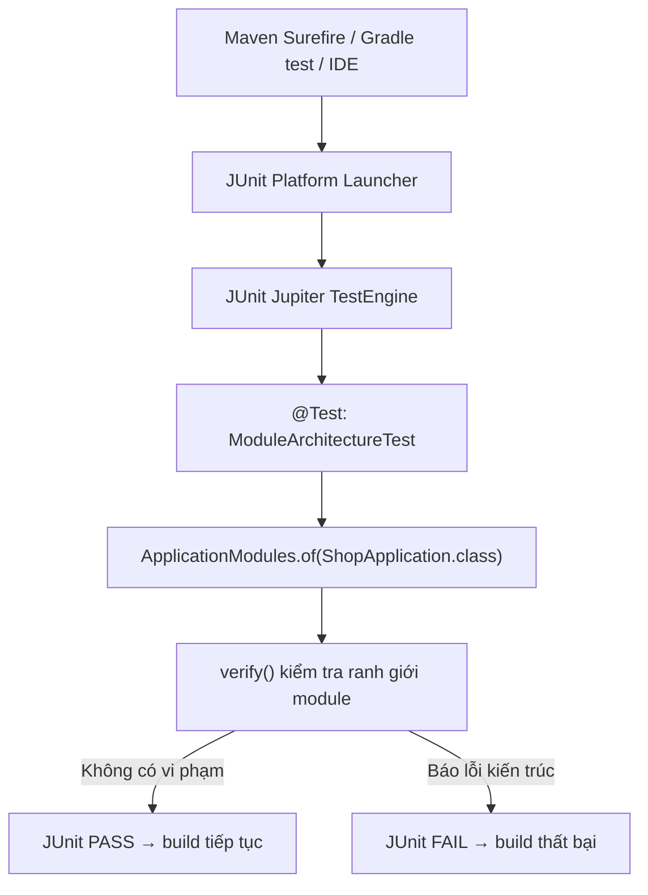
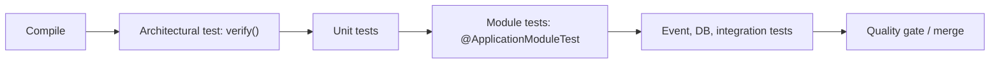

# Đưa `ApplicationModules.verify()` vào JUnit Platform

> **Chương:** Verification trong build  
> **Module học:** `SPRING_MODULITH_VERIFICATION_TESTING` — kiểm chứng ranh giới kiến trúc Spring Modulith bằng `ApplicationModules`, kết hợp kiểm thử module, sự kiện, cơ sở dữ liệu và tích hợp, rồi đưa kết quả thành quality gate trong CI.

## 1. Kết quả cần đạt

Sau bài học, bạn có thể:

1. Phân biệt **JUnit Platform**, **JUnit Jupiter** và công cụ build chạy bài test.
2. Biến lời gọi `ApplicationModules.of(...).verify()` thành một bài **JUnit Jupiter test** được phát hiện và chạy tự động.
3. Thiết lập test dependencies, test engine, vị trí file và cấu hình Maven/Gradle đúng cách.
4. Chạy architectural test độc lập hoặc cùng toàn bộ test; xem báo cáo khi kiến trúc vi phạm.
5. Sử dụng `@Tag` và bộ lọc test có kiểm soát để hỗ trợ quy trình phát triển và CI.
6. Đặt architectural test đúng vị trí so với `@ApplicationModuleTest` và các bài kiểm thử hành vi, event, database, tích hợp.

**Bài toán xuyên suốt:** Một dự án Spring Boot có các application module `orders` và `inventory`. Đội phát triển muốn mỗi pull request tự động thất bại nếu `orders` tham chiếu vào phần nội bộ của `inventory`, ngay cả khi Java vẫn biên dịch thành công.

## 2. `verify()` được JUnit Platform thực thi như thế nào?

Spring Modulith có API `ApplicationModules` để phát hiện các application module từ mã nguồn ứng dụng đã biên dịch và kiểm chứng quy tắc phụ thuộc của chúng. Phương thức `verify()` có thể báo lỗi khi xuất hiện chu trình module, truy cập không hợp lệ vào package nội bộ hoặc vi phạm chính sách phụ thuộc đã khai báo.

**JUnit Platform** là hạ tầng khám phá và thực thi bài kiểm thử dựa trên các **TestEngine**. **JUnit Jupiter** cung cấp API `@Test`, `@Tag`, `@DisplayName` và Jupiter TestEngine. Maven Surefire và Gradle `test` là các công cụ gọi hạ tầng kiểm thử đó trong quá trình build.



Mấu chốt: JUnit không cần một assertion đặc biệt để biết kiến trúc đã sai. Nếu `verify()` kết thúc bình thường, bài test PASS; nếu `verify()` ném lỗi do vi phạm, JUnit Jupiter ghi bài test là FAIL và công cụ build nhận trạng thái thất bại.

| Thành phần | Vai trò cụ thể |
| --- | --- |
| `ApplicationModules.of(ShopApplication.class)` | Xác định mô hình các module bắt đầu từ package ứng dụng |
| `ApplicationModules.verify()` | Thực thi phép kiểm chứng kiến trúc và báo lỗi nếu vi phạm |
| `@Test` của `org.junit.jupiter.api.Test` | Đánh dấu phương thức là một bài JUnit Jupiter test |
| JUnit Jupiter TestEngine | Phát hiện, thực thi và trả kết quả bài test cho JUnit Platform |
| Maven Surefire / Gradle `test` | Đưa kết quả JUnit vào vòng đời build, sinh báo cáo và mã thoát |
| CI quality gate | Chặn tích hợp thay đổi khi job kiểm thử không thành công |

Phân biệt thêm: `verify()` của Spring Modulith và **phase** `verify` của Maven trùng tên nhưng khác mục đích. Lệnh `mvn verify` có thể chạy architectural test vì Maven đi qua phase `test`; đây không phải là cách gọi trực tiếp API `ApplicationModules.verify()`.

## 3. Chuẩn bị cấu trúc dự án cho JUnit

Giả sử lớp Spring Boot chính ở `com.example.shop`, cùng package gốc với các module:

```text
src/
├── main/java/com/example/shop/
│   ├── ShopApplication.java
│   ├── orders/
│   │   ├── OrderService.java
│   │   └── internal/OrderRepository.java
│   └── inventory/
│       ├── StockQuery.java
│       └── internal/StockJpaRepository.java
└── test/java/com/example/shop/
    └── ModuleArchitectureTest.java
```

Spring Modulith mặc định nhận diện các package con trực tiếp của package ứng dụng, chẳng hạn `orders` và `inventory`, là application module. Các kiểu trong package gốc của module thường là API được công bố; kiểu trong package con `internal` không phải API công khai của module theo mặc định. Cơ chế tìm module và định nghĩa interface có thể được cấu hình khác theo dự án.

Đặt `ModuleArchitectureTest.java` dưới **test source set** `src/test/java`, không đặt trong `src/main/java`. Tên `*Test` tương thích với quy ước phát hiện test phổ biến của Maven Surefire và Gradle. Vị trí package của test không quyết định phạm vi quét kiến trúc; tham số `ShopApplication.class` mới là điểm khởi đầu quan trọng.

### 3.1. Maven: cần những dependency nào?

Với dự án Spring Boot sử dụng dependency management tương thích Spring Modulith, thêm các dependency test sau vào `pom.xml`:

```xml
<dependencies>
    <!-- JUnit Jupiter và các công cụ kiểm thử Spring Boot -->
    <dependency>
        <groupId>org.springframework.boot</groupId>
        <artifactId>spring-boot-starter-test</artifactId>
        <scope>test</scope>
    </dependency>

    <!-- Hỗ trợ test Spring Modulith và API xác minh module -->
    <dependency>
        <groupId>org.springframework.modulith</groupId>
        <artifactId>spring-modulith-starter-test</artifactId>
        <scope>test</scope>
    </dependency>
</dependencies>
```

Thông thường `spring-boot-starter-test` cung cấp JUnit Jupiter và engine; `spring-modulith-starter-test` cung cấp cơ sở hỗ trợ kiểm thử Spring Modulith. Khi dự án không dùng parent/BOM phù hợp, phải khai báo dependency management hoặc phiên bản tương ứng. Nên để Spring Boot và Spring Modulith quản lý các phiên bản thư viện kiểm thử tương thích thay vì tự trộn nhiều phiên bản JUnit Platform/Jupiter.

Đối với Maven, plugin **Surefire** chạy unit test trong phase `test`. Các dự án Spring Boot hiện đại thường đã có cấu hình plugin phù hợp. Dự án Maven tự cấu hình cần dùng bản Surefire có hỗ trợ JUnit Platform và xác nhận Jupiter TestEngine có mặt trên test runtime classpath; không chỉ thêm JUnit API rồi mặc định test sẽ được chạy.

### 3.2. Gradle: bật JUnit Platform

Ví dụ với `build.gradle` dùng Groovy DSL và dependency management phù hợp:

```groovy
dependencies {
    testImplementation 'org.springframework.boot:spring-boot-starter-test'
    testImplementation 'org.springframework.modulith:spring-modulith-starter-test'
}

tasks.named('test', Test) {
    useJUnitPlatform()
}
```

`useJUnitPlatform()` yêu cầu tác vụ `Test` chạy qua JUnit Platform. Điều này đặc biệt quan trọng khi dự án Gradle có cấu hình tùy chỉnh hoặc được nâng cấp từ test runner cũ. Nếu dùng Gradle Kotlin DSL, cú pháp khai báo sẽ khác nhưng ý nghĩa giống nhau.

## 4. Viết architectural test bằng JUnit Jupiter

Tạo `src/test/java/com/example/shop/ModuleArchitectureTest.java`:

```java
package com.example.shop;

import org.junit.jupiter.api.DisplayName;
import org.junit.jupiter.api.Tag;
import org.junit.jupiter.api.Test;
import org.springframework.modulith.core.ApplicationModules;

@Tag("architecture")
class ModuleArchitectureTest {

    @Test
    @DisplayName("Các application module tuân thủ quy tắc kiến trúc")
    void verifiesModuleBoundaries() {
        ApplicationModules modules =
                ApplicationModules.of(ShopApplication.class);

        modules.verify();
    }
}
```

Giải thích:

- `@Test` là annotation của **JUnit Jupiter** (`org.junit.jupiter.api.Test`), không phải `org.junit.Test` của JUnit 4.
- `@DisplayName` đặt tên dễ đọc trong kết quả kiểm thử.
- `@Tag("architecture")` đánh dấu bài test để có thể chọn chạy theo nhóm; tag không tự khiến bài test bị bỏ qua.
- `ApplicationModules.of(ShopApplication.class)` lấy phạm vi module từ package gốc mà lớp `ShopApplication` đại diện.
- `verify()` kiểm tra các bất biến kiến trúc; không cần gọi `assertTrue` hay `assertDoesNotThrow` chỉ để JUnit quan sát thành công/thất bại.

JUnit Jupiter cho phép lớp test và phương thức test có quyền truy cập package-private như ví dụ. Bạn có thể dùng `public`, nhưng không bắt buộc.

**Không gắn `@SpringBootTest` hoặc `@ApplicationModuleTest` vào bài test kiến trúc này chỉ vì muốn chạy `verify()`.** Nó là phép kiểm tra trên cấu trúc module và không cần khởi động Spring ApplicationContext, mở kết nối cơ sở dữ liệu hoặc phát sự kiện thật. Điều này giúp bài test thích hợp cho bước kiểm tra nhanh trong mỗi build.

Nếu ứng dụng có bootstrap class nằm sai package so với các module cần kiểm tra, phải điều chỉnh điểm khởi đầu của `ApplicationModules.of(...)` hoặc cách cấu hình tìm module; nếu không, kết quả xanh có thể chỉ phản ánh phạm vi bị quét thiếu.

## 5. Chạy test trên IDE, Maven và Gradle

### 5.1. Chạy tại IDE

Trong IntelliJ IDEA hoặc IDE hỗ trợ JUnit Jupiter, chạy trực tiếp class `ModuleArchitectureTest` hoặc phương thức `verifiesModuleBoundaries`. Nếu IDE báo không tìm thấy test, xác nhận thư mục `src/test/java` được đánh dấu là test source root và JUnit Jupiter engine đã có trên classpath.

### 5.2. Maven

```bash
# Chạy các bài test trong phase test, gồm architectural test
./mvnw test

# Chỉ chạy class architectural test
./mvnw -Dtest=ModuleArchitectureTest test

# Chạy vòng đời đến phase verify (bao gồm test thông thường)
./mvnw -B verify
```

Trên Windows dùng `mvnw.cmd`; nếu dự án không có Maven Wrapper, sử dụng `mvn`. Tùy cấu hình dự án, báo cáo Surefire nằm trong `target/surefire-reports/` (file XML và văn bản).

**Lưu ý về tên test:** Maven Surefire theo mặc định nhận diện các mẫu thường gặp như `*Test` và `*Tests`. Nếu đặt tên lớp `ModuleArchitectureIT`, dự án dùng cấu hình mặc định có thể chuyển lớp đó sang nhóm integration test của Failsafe hoặc không chạy bằng Surefire. Vì mục tiêu ở đây là một gate nhanh, hãy dùng `ModuleArchitectureTest` và kiểm tra chắc chắn nó được Maven chạy.

### 5.3. Gradle

```bash
# Chạy tất cả unit test trên JUnit Platform
./gradlew test

# Chỉ chạy một class
./gradlew test --tests 'com.example.shop.ModuleArchitectureTest'

# Chạy các phép kiểm tra được gắn vào Gradle check
./gradlew check
```

Trên Windows dùng `gradlew.bat`. Báo cáo mặc định thường nằm ở `build/test-results/test/` (XML) và `build/reports/tests/test/index.html` (HTML).

Không nên kết luận rằng phép kiểm tra kiến trúc đã chạy chỉ dựa vào dòng `BUILD SUCCESSFUL`. Hãy nhìn số bài test được thực thi và tìm `ModuleArchitectureTest` trong report, đặc biệt khi vừa thêm test engine hoặc cấu hình lọc test.

## 6. Chạy nhóm `architecture` bằng JUnit Platform Tags

Trong một dự án lớn, bạn có thể muốn chạy architectural test trước để nhận phản hồi nhanh, rồi tiếp tục chạy toàn bộ test sau đó. `@Tag("architecture")` là metadata do JUnit Jupiter cung cấp và được công cụ build dùng để lọc test.

**Maven Surefire** (với phiên bản hỗ trợ JUnit Platform và tag filtering):

```bash
./mvnw -B -Dgroups=architecture test
```

Tham số `groups` được Surefire dùng để chọn nhóm test có tag tương ứng. Đây là thao tác chạy có lọc; **không đồng nghĩa với chạy toàn bộ test**.

**Gradle:** Có thể tạo một task dành riêng cho nhóm test kiến trúc trong `build.gradle`:

```groovy
tasks.register('architectureTest', Test) {
    description = 'Runs only JUnit tests tagged architecture'
    group = 'verification'

    testClassesDirs = sourceSets.test.output.classesDirs
    classpath = sourceSets.test.runtimeClasspath

    useJUnitPlatform {
        includeTags 'architecture'
    }
}
```

Chạy:

```bash
./gradlew architectureTest
```

Task `architectureTest` sử dụng cùng các lớp test đã biên dịch của source set `test` và lọc theo tag. Đây là một task **bổ sung** cho `test`; nó không tự động thay thế task `test` hay bảo đảm có mặt trong `check`. Nếu muốn nó là bước bắt buộc, cần cấu hình phụ thuộc task hoặc yêu cầu nó trong CI.

| Nhu cầu | Cách chạy hợp lý |
| --- | --- |
| Kiểm tra nhanh ngay sau khi sửa ranh giới module | IDE chạy `ModuleArchitectureTest` hoặc Maven/Gradle lọc class |
| Chạy một nhóm architectural tests trên nhiều package | `@Tag("architecture")` và filter của build tool |
| Kiểm tra tất cả test trước khi tạo pull request | `mvn test`, `mvn verify` hoặc `gradle check`, tùy dự án |
| Chặn pull request có vi phạm kiến trúc | CI chạy architectural test và đánh dấu job thất bại khi test FAIL |

Hãy tránh thiết lập bộ lọc `architecture` làm cấu hình mặc định cho **mọi** lần chạy `test`, vì như vậy các unit test và integration test khác có thể bị loại bỏ ngoài ý muốn. Cũng không nên lọc khiến không còn bài nào được chạy mà vẫn xem build thành công là minh chứng tuân thủ kiến trúc.

## 7. Nhìn thấy kết quả PASS và FAIL

### 7.1. Trạng thái PASS

Khi không có vi phạm:

1. JUnit Jupiter tìm `ModuleArchitectureTest`.
2. `verifiesModuleBoundaries()` gọi `ApplicationModules.of(...).verify()`.
3. Phương thức test kết thúc bình thường.
4. JUnit đánh dấu test PASS; Maven/Gradle tổng hợp kết quả trong báo cáo.

### 7.2. Cố ý tạo một phụ thuộc sai

Giả sử `orders` import kiểu `public` nằm trong `inventory.internal`:

```java
package com.example.shop.orders;

import com.example.shop.inventory.internal.StockJpaRepository;

// Một lớp trong orders phụ thuộc vào chi tiết lưu trữ của inventory.
```

Nếu lớp kia tồn tại và có thể truy cập ở mức Java, mã nguồn vẫn có thể biên dịch. Nhưng phụ thuộc này vượt qua API kiến trúc mặc định của `inventory`. Khi `verify()` phân tích mô hình module, nó có thể báo vi phạm; JUnit đánh dấu bài test FAIL.

Một ví dụ minh họa dạng kết quả JUnit, **không phải thông báo lỗi nguyên văn của một phiên bản Spring Modulith cụ thể**:

```text
ModuleArchitectureTest > verifiesModuleBoundaries() FAILED
  Architecture violation:
  orders -> inventory.internal.StockJpaRepository

Tests run: 1, Failures: 1
BUILD FAILURE
```

Thông báo thực tế và kiểu exception có thể thay đổi theo phiên bản Spring Modulith. Cần đọc thông tin nguồn phụ thuộc, module đích và quy tắc bị vi phạm thay vì phụ thuộc vào một chuỗi lỗi cố định.

### 7.3. Sửa lỗi và chạy lại

Cho `inventory` công bố một giao diện nghiệp vụ tại package gốc:

```java
package com.example.shop.inventory;

public interface StockQuery {
    boolean available(String sku, int quantity);
}
```

`inventory.internal` triển khai `StockQuery`, còn `orders` chỉ tham chiếu `com.example.shop.inventory.StockQuery`. Sau khi loại bỏ phụ thuộc trực tiếp vào `StockJpaRepository`, chạy lại architectural test và các test hành vi liên quan.

Không nên sửa “cho xanh” bằng cách đổi quyền truy cập của repository hoặc đưa chi tiết `internal` vào API công khai mà chưa đánh giá ranh giới thiết kế. Một build xanh có ý nghĩa khi dependency policy vẫn phản ánh đúng trách nhiệm của từng module.

## 8. Chẩn đoán khi JUnit Platform không chạy như mong đợi

| Hiện tượng | Nguyên nhân cần kiểm tra | Hướng xử lý |
| --- | --- | --- |
| `No tests found` hoặc không có test nào được chạy | Test nằm sai source set, tên file/class không khớp filter; test bị exclude | Đặt file dưới `src/test/java`, kiểm tra tên `*Test` và các bộ lọc đang dùng |
| IDE nhận `@Test` nhưng Maven/Gradle không chạy | JUnit Jupiter TestEngine hoặc kết nối với JUnit Platform chưa đúng | Kiểm tra `spring-boot-starter-test`, Surefire hỗ trợ Platform, Gradle `useJUnitPlatform()` |
| Mã dùng nhầm `org.junit.Test` | Trộn JUnit 4 và JUnit Jupiter | Import `org.junit.jupiter.api.Test`, kiểm tra engine phù hợp |
| Test chạy nhưng không thấy phát hiện vi phạm dự kiến | `ApplicationModules.of(...)` chưa bao phủ module hoặc kiểu phụ thuộc không nằm trong phạm vi phân tích | Xem package gốc, cấu trúc module, cấu hình phát hiện và thử một trường hợp vi phạm có chủ đích |
| Test được lọc ra không còn trường hợp nào | Tag `architecture` thiếu hoặc bộ lọc class không khớp | Kiểm tra `@Tag`, tên lớp đầy đủ và báo cáo số test đã chạy |
| Test FAIL sau khi thêm một import vào `*.internal` | Phụ thuộc vượt ranh giới API của module | Tạo/sử dụng hợp đồng ở API module đích, loại bỏ tham chiếu vào chi tiết triển khai |
| Local PASS nhưng CI vẫn FAIL | Cấu hình Java, dependency, package hoặc phiên bản tool khác nhau; các test khác thất bại | So sánh command, Java/toolchain và báo cáo test ở hai môi trường |
| CI xanh dù test có thể bị lỗi | `-DskipTests`, `-x test`, exclude class hoặc job được bỏ qua | Bảo đảm test thật sự được chạy và job là required check |

**Kỹ thuật chẩn đoán hữu ích:** cố ý tạo một phụ thuộc sai trong nhánh thử nghiệm, chạy đúng lệnh CI, xác nhận bài test thất bại, sau đó khôi phục/sửa mã. Cách này kiểm tra được cả khả năng phát hiện kiến trúc và đường truyền kết quả thất bại từ JUnit tới CI.

## 9. Đặt vào pipeline CI như một quality gate

Một bài `@Test` chỉ mang lại hiệu quả phòng ngừa hồi quy khi kết quả FAIL được chuyển thành trạng thái build FAIL và job đó được yêu cầu trước khi merge.

Ví dụ GitHub Actions cho dự án Maven Wrapper (điều chỉnh phiên bản Java theo dự án thật):

```yaml
name: Module architecture and tests

on:
  pull_request:
  push:
    branches: [main]

jobs:
  test:
    runs-on: ubuntu-latest
    steps:
      - uses: actions/checkout@v4
      - uses: actions/setup-java@v4
        with:
          distribution: temurin
          java-version: '21'
      - name: Run JUnit tests and build verification
        run: ./mvnw -B verify
```

Ở pipeline này, nếu Maven Surefire chạy `ModuleArchitectureTest`, thì lỗi do `ApplicationModules.verify()` sẽ làm bước build thất bại. Cấu hình branch protection/required checks tương ứng để PR không thể merge khi job thất bại.

Với Gradle, một bước tương tự có thể chạy `./gradlew check` khi task `test` đã dùng JUnit Platform. Khi tạo task `architectureTest` riêng, có thể yêu cầu `./gradlew architectureTest check` nếu muốn hiển thị và thực thi rõ cả hai tập kiểm thử. Cần xác nhận job không bỏ qua test và không dùng cấu hình cho phép tiếp tục dù lệnh thất bại.

### 9.1. Phân lớp kiểm chứng trong một pipeline



Đây là thứ tự **tổ chức logic** để cung cấp phản hồi nhanh; pipeline thực tế có thể gom hoặc song song hóa các bài test. Mỗi lớp trả lời một câu hỏi khác:

| Loại kiểm thử | Câu hỏi |
| --- | --- |
| JUnit `@Test` gọi `verify()` | Các application module có vi phạm phụ thuộc tĩnh không? |
| Unit test | Hàm hoặc dịch vụ nghiệp vụ có đúng với các input cần xét không? |
| `@ApplicationModuleTest` | Một module có hoạt động đúng với Spring context và các thành phần liên quan không? |
| Kiểm thử sự kiện | Event có được phát và xử lý đúng theo tình huống nghiệp vụ không? |
| Kiểm thử database/tích hợp | Transaction, repository, kết nối và các hệ thống phối hợp có hoạt động đúng không? |

`@ApplicationModuleTest` cũng có thể chạy bằng JUnit Jupiter, nhưng nó dùng hạ tầng kiểm thử Spring để khởi tạo ngữ cảnh phù hợp với module. Bài test kiến trúc với `verify()` không cần điều đó. JUnit Platform là **lớp thực thi chung**: nó có thể nhận cả hai loại test và gửi kết quả về cùng hệ thống báo cáo của build.

Lưu ý `verify()` không thay thế kiểm thử động: reflection, HTTP, message broker, lỗi transaction hoặc xử lý event lúc runtime không thể được bảo đảm chỉ bằng việc kiểm tra phụ thuộc tĩnh trong mã.

## 10. Bài thực hành có tiêu chí PASS/FAIL

**Mục tiêu:** Tạo JUnit Platform gate cho `orders` và `inventory`; chứng minh gate từ chối một phụ thuộc sai rồi chấp nhận mã đã sửa.

### Nhiệm vụ A — Kiểm tra JUnit Platform

1. Xác định package gốc chứa Spring Boot application class.
2. Thêm test dependencies và cấu hình Maven Surefire/Gradle `useJUnitPlatform()` nếu dự án chưa có.
3. Tạo `ModuleArchitectureTest` với `@Test`, `@Tag("architecture")` và `ApplicationModules.of(...).verify()`.
4. Chạy test riêng từ IDE và build tool. Kiểm tra **số lượng test đã chạy = ít nhất 1**, không chỉ xem dòng build thành công.

**Kết quả mong đợi:** test được JUnit Platform/Jupiter phát hiện, thực thi và ghi vào report.

### Nhiệm vụ B — Chứng minh phát hiện vi phạm

1. Tạo một kiểu `public` trong `inventory.internal`, rồi cho lớp trong `orders` sử dụng kiểu đó.
2. Chạy lại `ModuleArchitectureTest`.
3. Xác nhận test FAIL do phụ thuộc vượt ranh giới. Chỉ ra module nguồn, module đích và kiểu được tham chiếu.
4. Loại bỏ phụ thuộc trực tiếp, thay bằng `StockQuery` trong API `inventory`, rồi chạy lại.

**Kết quả mong đợi:** trước sửa FAIL, sau sửa PASS; không cần thay đổi nội dung `ModuleArchitectureTest`.

### Nhiệm vụ C — Chạy theo nhóm và trên CI

1. Chạy toàn bộ test.
2. Chạy riêng class và chạy theo tag `architecture`. So sánh số bài test thực thi ở từng lệnh.
3. Thêm bước chạy test vào pipeline pull request.
4. Trên một nhánh thử nghiệm chứa vi phạm, xác nhận CI báo FAIL; sau khi sửa, xác nhận PASS. Không cần merge nhánh thử nghiệm.

**Kết quả mong đợi:** build tool và CI phản ánh đúng kết quả của JUnit, không bị filter hoặc skip che khuất.

### Checklist nghiệm thu

- [ ] Bài `ModuleArchitectureTest` có `org.junit.jupiter.api.Test` và gọi đúng `ApplicationModules.verify()`.
- [ ] Maven/Gradle và IDE tìm thấy cùng architectural test.
- [ ] File nằm đúng test source set, lớp ứng dụng gốc bao phủ các module cần kiểm chứng.
- [ ] Có chứng cứ FAIL khi cố ý tham chiếu module `internal`.
- [ ] Sau khi sửa bằng API hợp lệ, architectural test PASS và test hành vi liên quan không hồi quy.
- [ ] Đã kiểm tra lệnh chạy theo tag không vô tình thay thế toàn bộ test suite.
- [ ] CI ghi nhận test failure và job được dùng làm quality gate cho pull request.

## 11. Câu hỏi tự đánh giá

1. JUnit Platform và JUnit Jupiter TestEngine khác nhau ở trách nhiệm nào?
2. Vì sao gọi `ApplicationModules.verify()` bên trong phương thức `@Test` vẫn tạo được bài test hợp lệ dù không có assertion tường minh?
3. Tại sao nên đặt `ModuleArchitectureTest` trong `src/test/java` và dùng tên `*Test`?
4. Khi Gradle không chạy bất kỳ bài Jupiter test nào, bạn kiểm tra cấu hình nào trước?
5. Lệnh chỉ chạy tag `architecture` có chứng minh rằng toàn bộ unit test và integration test đều PASS không? Vì sao?
6. Bài `@ApplicationModuleTest` giải quyết điều gì mà bài `verify()` không giải quyết?
7. Bằng cách nào bạn chứng minh CI thực sự chặn một pull request có lỗi phụ thuộc module, thay vì chỉ hiển thị màu xanh?

**Ghi nhớ:** Tích hợp `ApplicationModules.verify()` vào JUnit Jupiter giúp quy tắc kiến trúc trở thành một phép kiểm có thể khám phá, chạy và báo cáo tự động trong JUnit Platform. Khi Maven/Gradle thực thi đúng test engine và CI coi test failure là lỗi build, các phụ thuộc sai được phát hiện trước khi đi vào nhánh chính; các kiểm thử module, sự kiện, database và tích hợp tiếp tục bảo vệ hành vi runtime.
