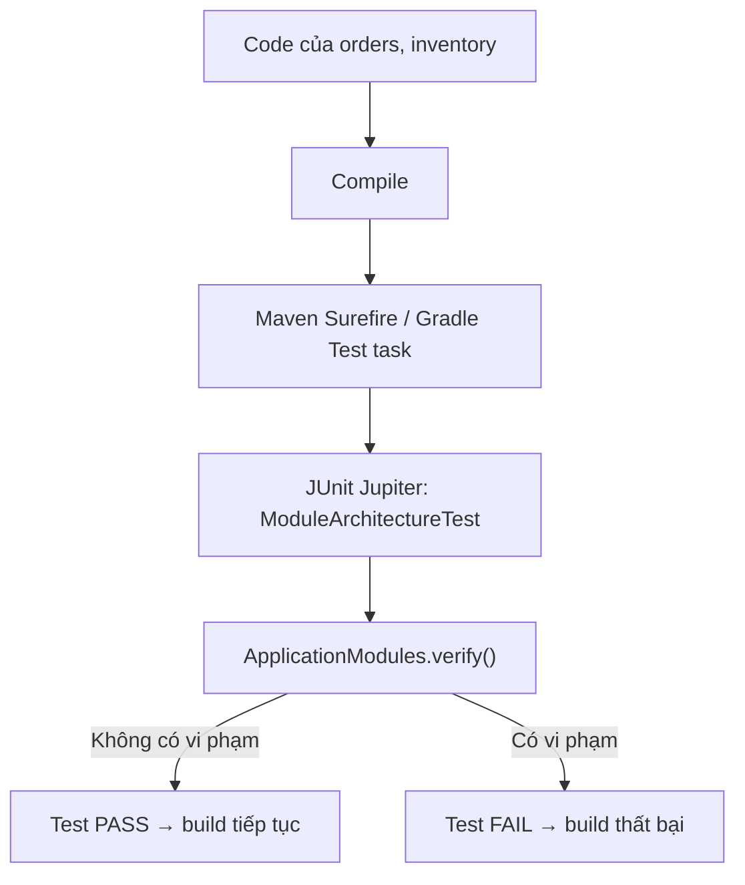
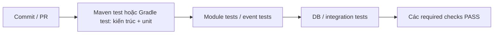

# Chạy `verify()` trong Gradle hoặc Maven

> **Chương:** Verification trong build  
> **Module đào tạo:** `SPRING_MODULITH_VERIFICATION_TESTING` — rèn kỹ năng kiểm chứng ranh giới ứng dụng Spring Modulith, từ quy tắc phụ thuộc với `ApplicationModules` đến kiểm thử module, sự kiện, cơ sở dữ liệu, tích hợp và quality gate trong CI.

## 1. Mục tiêu và tình huống thực tế

Sau bài này, bạn có thể:

1. Đưa `ApplicationModules.verify()` vào vòng đời build thông qua một bài kiểm thử JUnit Jupiter.
2. Cấu hình tối thiểu Maven và Gradle để architectural test được khám phá và thực thi.
3. Phân biệt `mvn verify`, `gradle check` với phương thức `ApplicationModules.verify()`.
4. Chạy toàn bộ suite, chạy riêng bài kiến trúc và tìm báo cáo test thất bại.
5. Xử lý các trường hợp build xanh nhưng architectural test không chạy.
6. Tích hợp kiểm chứng kiến trúc vào CI, phối hợp với `@ApplicationModuleTest` và các bài kiểm thử sự kiện, database, tích hợp.

**Tình huống:** Ứng dụng quản lý đơn hàng có hai module `orders` và `inventory`. Theo thiết kế, `orders` chỉ dùng API công khai của `inventory`; không được import `inventory.internal.StockJpaRepository`. Java compiler có thể vẫn chấp nhận import một kiểu `public`, nhưng team muốn mọi lần build tự động phát hiện lỗi vượt ranh giới module.

## 2. Hiểu đúng chữ “verify” ở ba cấp

Tên `verify` xuất hiện ở nhiều lớp khác nhau, nhưng chức năng không giống nhau:

| Tên | Thuộc về | Ý nghĩa |
| --- | --- | --- |
| `ApplicationModules.verify()` | Spring Modulith | Kiểm chứng các bất biến kiến trúc, chẳng hạn chu trình module và phụ thuộc không hợp lệ |
| `mvn verify` | Maven lifecycle | Chạy các phase đến `verify`, bao gồm `test` và các plugin được gắn vào các phase |
| `gradle check` | Gradle lifecycle (Java plugin) | Chạy các tác vụ kiểm tra đã được nối vào `check`, thông thường có `test` |

Gradle **không mặc định cung cấp một lệnh `verify` dành riêng cho Spring Modulith**. Maven `verify` cũng **không tự gọi** Spring Modulith. Cả hai chỉ phát hiện lỗi kiến trúc khi bạn đặt lời gọi `ApplicationModules.verify()` vào bài kiểm thử thực sự được chạy bởi build.



Một architectural test là phép kiểm tra cấu trúc phụ thuộc của ứng dụng; nó không cần chạy máy chủ HTTP, nạp Spring ApplicationContext, tạo schema database hay kết nối broker.

## 3. Chuẩn bị ví dụ Spring Modulith

Giả sử ứng dụng Spring Boot có cấu trúc package:

```text
src/
├── main/java/com/example/shop/
│   ├── ShopApplication.java
│   ├── orders/
│   │   ├── OrderService.java
│   │   └── internal/OrderRepository.java
│   └── inventory/
│       ├── StockQuery.java
│       └── internal/StockJpaRepository.java
└── test/java/com/example/shop/
    └── ModuleArchitectureTest.java
```

Trong cấu hình phát hiện module theo mặc định, `orders` và `inventory` là các application module nằm trực tiếp dưới package gốc `com.example.shop`. API thường được công bố tại package gốc mỗi module; `internal` là vùng triển khai mà module khác không nên truy cập trực tiếp. Dự án có thể tùy chỉnh cách phát hiện module và named interface, nên cần xác nhận phạm vi thực tế khi chạy.

Tạo file `src/test/java/com/example/shop/ModuleArchitectureTest.java`:

```java
package com.example.shop;

import org.junit.jupiter.api.DisplayName;
import org.junit.jupiter.api.Tag;
import org.junit.jupiter.api.Test;
import org.springframework.modulith.core.ApplicationModules;

@Tag("architecture")
class ModuleArchitectureTest {

    @Test
    @DisplayName("Không vi phạm ranh giới application module")
    void verifiesArchitecture() {
        ApplicationModules.of(ShopApplication.class).verify();
    }
}
```

Đây là **JUnit Jupiter test**; `@Test` phải được import từ `org.junit.jupiter.api.Test`. Nếu `verify()` phát hiện vi phạm và báo lỗi, JUnit ghi test là thất bại. Không cần thêm `assertTrue(...)` chỉ để JUnit quan sát lỗi.

`@Tag("architecture")` cho phép chọn chạy theo nhóm khi cần. Tag không khiến bài test bị bỏ qua ở chế độ chạy đầy đủ. Đặt test tại `src/test/java` và đặt tên kết thúc `Test` để tương thích với quy ước phát hiện test thông dụng.

**Điều kiện phạm vi:** `ShopApplication.class` phải là điểm khởi đầu bao phủ các module cần kiểm tra. Nếu lớp được truyền nằm trong package quá hẹp, build có thể PASS vì không kiểm chứng được những module nằm ngoài phạm vi.

## 4. Chạy bằng Maven

### 4.1. Dependency cho architectural test

Trong ứng dụng Spring Boot dùng Maven, cấu hình dependencies test điển hình:

```xml
<dependencies>
    <dependency>
        <groupId>org.springframework.boot</groupId>
        <artifactId>spring-boot-starter-test</artifactId>
        <scope>test</scope>
    </dependency>

    <dependency>
        <groupId>org.springframework.modulith</groupId>
        <artifactId>spring-modulith-starter-test</artifactId>
        <scope>test</scope>
    </dependency>
</dependencies>
```

Ví dụ giả định Maven project đã có dependency management tương thích cho Spring Boot và Spring Modulith. Nếu chưa có, hãy khai báo **Spring Modulith BOM/phiên bản phù hợp với Spring Boot** trong cấu hình dependency management của dự án. Không nên tự ghép các phiên bản JUnit Platform, Jupiter, Spring Boot và Spring Modulith tùy ý.

`spring-boot-starter-test` cung cấp hạ tầng JUnit Jupiter thông thường; `spring-modulith-starter-test` cung cấp hỗ trợ kiểm thử Spring Modulith. Chỉ có annotation `@Test` trên classpath là chưa đủ: runtime cần **JUnit Jupiter TestEngine**, và Maven phải dùng plugin có khả năng chạy test qua JUnit Platform.

### 4.2. Maven Surefire thực thi bài test ở phase `test`

Maven Surefire là plugin mặc định thường được dùng cho unit test trong vòng đời Maven. Dự án có Spring Boot parent thường đã được quản lý phiên bản/plugin; nếu dự án tự quản lý, phải chọn bản Surefire hỗ trợ JUnit Platform và kiểm tra engine có sẵn trên test runtime classpath.

Các lệnh tại thư mục chứa `pom.xml`:

```bash
# Chạy các bài test mà Surefire phát hiện
./mvnw test

# Chạy riêng architectural test để nhận phản hồi nhanh
./mvnw -Dtest=ModuleArchitectureTest test

# Chạy vòng đời Maven qua phase verify (bao gồm phase test)
./mvnw -B verify
```

Ở Windows dùng `mvnw.cmd`; nếu không có Maven Wrapper thì dùng lệnh `mvn` đã cài. `-B` bật batch mode, thích hợp cho CI.

Khi chạy `./mvnw -B verify`, Maven đi qua các phase từ đầu vòng đời đến `verify`. Bài `ModuleArchitectureTest` được Surefire chạy tại phase `test`; kết quả FAIL sẽ khiến build dừng với mã thoát khác 0. Maven phase `verify` không tự chứa kiến thức về package `orders` hay `inventory`.

**Quy ước tên lớp:** Surefire mặc định tìm các mẫu như `*Test`, `*Tests`, `Test*` và `*TestCase`. Nếu vô tình đổi tên thành `ModuleArchitectureIT`, lớp đó có thể không được Surefire chạy theo cấu hình mặc định; tên `*IT` thường dành cho Failsafe trong các dự án cấu hình integration test. Đọc báo cáo thay vì chỉ dựa vào kết quả build.

### 4.3. Surefire và Failsafe khác nhau ra sao?

| Plugin | Bài test thường gặp | Phase liên quan | Vị trí trong chiến lược kiểm thử |
| --- | --- | --- | --- |
| Maven Surefire | `*Test` | `test` | Unit test và architectural test nhanh |
| Maven Failsafe, khi dự án đã cấu hình | `*IT`, `*ITCase` | `integration-test`, `verify` | Integration test cần tài nguyên, cơ sở dữ liệu hoặc hệ thống liên quan |

`mvn verify` **không tự động chạy integration test** nếu dự án chưa cấu hình Failsafe hoặc một cơ chế khác để thực thi chúng. Ngược lại, architectural test đặt đúng quy ước `*Test` sẽ được Surefire chạy ngay cả với `mvn test`, nếu cấu hình thông thường không bị thay đổi.

### 4.4. Đọc báo cáo Maven

Sau khi chạy, kiểm tra thư mục thường gặp:

```text
target/surefire-reports/
├── TEST-com.example.shop.ModuleArchitectureTest.xml
└── com.example.shop.ModuleArchitectureTest.txt
```

Tên và vị trí report phụ thuộc cấu hình plugin, nhưng cần có bằng chứng rằng **bài kiến trúc đã được khám phá và thực thi**. Khi thất bại, báo cáo JUnit/Surefire thể hiện test, stack trace và thông tin về lỗi kiến trúc.

Nếu build thành công nhưng report không có `ModuleArchitectureTest`, hãy xem lại tên lớp, source set, JUnit engine, test filter và các cờ skip.

## 5. Chạy bằng Gradle

### 5.1. Khai báo dependencies và test engine

Ví dụ `build.gradle` sử dụng Groovy DSL cho ứng dụng Spring Boot đã quản lý phiên bản dependencies tương thích:

```groovy
dependencies {
    testImplementation 'org.springframework.boot:spring-boot-starter-test'
    testImplementation 'org.springframework.modulith:spring-modulith-starter-test'
}

tasks.named('test', Test) {
    useJUnitPlatform()
}
```

Nếu cấu hình không kế thừa cơ chế quản lý phiên bản của Spring Boot hoặc Spring Modulith BOM, cần thêm BOM/phiên bản thích hợp. Với dự án Gradle Kotlin DSL, cú pháp sẽ khác; nguyên tắc là test runtime có Jupiter engine và task `Test` gọi `useJUnitPlatform()`.

Task `test` thuộc Java plugin sẽ biên dịch test, chạy test và ghi kết quả. Tác vụ lifecycle `check` thông thường phụ thuộc `test`, còn `build` phụ thuộc các tác vụ lắp ráp và kiểm tra, trừ khi dự án đã thay đổi đồ thị task.

### 5.2. Các lệnh Gradle quan trọng

```bash
# Chạy toàn bộ test mà task test phát hiện
./gradlew test

# Chạy riêng architectural test
./gradlew test --tests 'com.example.shop.ModuleArchitectureTest'

# Chạy nhóm kiểm tra được gắn vào check (thường gồm test)
./gradlew check

# Vòng đời build thông thường (thường gồm check)
./gradlew build
```

Ở Windows dùng `gradlew.bat`. Lệnh `./gradlew check` chỉ kiểm chứng ranh giới Spring Modulith khi task `test` (hoặc task test được nối vào `check`) thực sự chạy `ModuleArchitectureTest`.

Gradle có thể hiển thị `UP-TO-DATE` hoặc `FROM-CACHE` cho task khi kết quả có thể tái sử dụng hợp lệ. Đây không mặc nhiên là lỗi; nhưng khi đang chẩn đoán việc “test không chạy”, có thể chạy lại với `./gradlew test --rerun-tasks` và kiểm tra báo cáo. Không cần ép rerun trên mọi build nếu chính sách cache và inputs của dự án hoạt động đúng.

### 5.3. Báo cáo Gradle

Với Java plugin, các vị trí phổ biến là:

```text
build/test-results/test/
└── TEST-com.example.shop.ModuleArchitectureTest.xml

build/reports/tests/test/
└── index.html
```

Mở báo cáo HTML hoặc XML để xác định test class nào được chạy, số test, số failure và nội dung exception. Không nên xem `BUILD SUCCESSFUL` là bằng chứng đủ nếu lệnh có bộ lọc hoặc cơ chế bỏ qua các test cần thiết.

## 6. Chạy kiểm tra kiến trúc riêng mà vẫn giữ toàn bộ test suite

Trên máy phát triển, đôi khi muốn chạy các architectural tests trước để có phản hồi nhanh. Nhưng trong CI, tất cả test cần thiết vẫn phải được thực thi.

### 6.1. Lọc theo class

Maven:

```bash
./mvnw -Dtest=ModuleArchitectureTest test
```

Gradle:

```bash
./gradlew test --tests 'com.example.shop.ModuleArchitectureTest'
```

Lệnh lọc class chỉ chạy bài được chọn, phù hợp để sửa nhanh một vi phạm. Lệnh đó không chứng minh toàn bộ unit/integration test đều thành công.

### 6.2. Lọc theo JUnit tag

Vì lớp test ở mục 3 có `@Tag("architecture")`, Maven Surefire hỗ trợ lọc theo nhóm bằng:

```bash
./mvnw -Dgroups=architecture test
```

Đối với Gradle, có thể khai báo một task riêng:

```groovy
tasks.register('architectureTest', Test) {
    description = 'Runs JUnit tests tagged architecture'
    group = 'verification'

    testClassesDirs = sourceSets.test.output.classesDirs
    classpath = sourceSets.test.runtimeClasspath

    useJUnitPlatform {
        includeTags 'architecture'
    }
}
```

Sau đó:

```bash
./gradlew architectureTest
```

Task mới dùng chính các test class từ source set `test` nhưng chỉ chọn tag `architecture`. Nó là một task **bổ sung**; nếu muốn được `check` gọi bắt buộc, phải nối dependency hoặc gọi rõ task trong CI. Khi tất cả architectural test đã nằm trong task `test` thông thường, **không nhất thiết** phải thêm task riêng vì `check` đã thực thi chúng qua `test`.

**Tránh sai sót:** không thêm `includeTags 'architecture'` vào cấu hình mặc định của task `test` nếu hệ quả là vô tình loại bỏ mọi unit test khác. Khi dùng bộ lọc, luôn quan sát số test được chạy; một lệnh thành công với **0 test** không chứng minh kiến trúc hợp lệ.

## 7. Thử một vi phạm để kiểm tra quality gate

Giả sử `inventory` có repository công khai ở mức Java nhưng thuộc package triển khai:

```java
package com.example.shop.inventory.internal;

public interface StockJpaRepository {
    boolean existsBySku(String sku);
}
```

Trong `orders`, cố tình tham chiếu vào kiểu nội bộ đó:

```java
package com.example.shop.orders;

import com.example.shop.inventory.internal.StockJpaRepository;

class OrderService {
    private final StockJpaRepository stockRepository;

    OrderService(StockJpaRepository stockRepository) {
        this.stockRepository = stockRepository;
    }
}
```

Ví dụ cố ý lược bỏ các thành phần ứng dụng không liên quan; mục tiêu là tạo một cạnh phụ thuộc `orders → inventory.internal`. Mã có thể biên dịch nếu kiểu đích hợp lệ về quyền truy cập Java. Tuy vậy, API của module `inventory` theo quy ước Spring Modulith không mặc nhiên mở cả package `internal`, nên architectural test dự kiến FAIL.

Chạy một trong các lệnh:

```bash
./mvnw -Dtest=ModuleArchitectureTest test
# Hoặc:
./gradlew test --tests 'com.example.shop.ModuleArchitectureTest'
```

Đọc exception và đường phụ thuộc được Spring Modulith chỉ ra. Dạng thông báo lỗi phụ thuộc phiên bản nên cần nhìn **module nguồn, module đích và kiểu tham chiếu**, không phụ thuộc vào chuỗi thông báo cố định.

Sửa ranh giới bằng cách cho `inventory` công bố một hợp đồng nghiệp vụ:

```java
package com.example.shop.inventory;

public interface StockQuery {
    boolean available(String sku, int quantity);
}
```

Triển khai `StockQuery` đặt ở `inventory.internal`, còn `orders` chỉ sử dụng `com.example.shop.inventory.StockQuery`. Sau đó chạy lại architectural test và toàn bộ test liên quan.

Phép thử FAIL → sửa → PASS có ý nghĩa hơn một lần chạy xanh ban đầu, vì nó xác nhận đường phát hiện vi phạm từ source code qua Spring Modulith, JUnit đến Maven/Gradle.

## 8. Cấu hình policy phụ thuộc để build phát hiện lỗi sớm

Ngoài kiểm soát truy cập vào package nội bộ và kiểm tra chu trình module, Spring Modulith hỗ trợ khai báo các module được phép phụ thuộc. Trong `com.example.shop.orders.package-info.java`:

```java
@ApplicationModule(allowedDependencies = "inventory")
package com.example.shop.orders;

import org.springframework.modulith.ApplicationModule;
```

Khi đó, một phụ thuộc từ `orders` tới module khác ngoài danh sách có thể khiến `verify()` báo vi phạm. `allowedDependencies` thể hiện chính sách kiến trúc; Maven và Gradle chỉ là cách chạy phép kiểm đó.

Nếu muốn công bố một giao diện nằm trong package con, Spring Modulith còn cho phép định nghĩa `@NamedInterface` và tham chiếu dạng `inventory::tên-interface`. Chỉ nên mở API có chủ đích. Không nên di chuyển lớp repository ra package gốc chỉ để architectural test xanh nếu trách nhiệm module vẫn yêu cầu che giấu chi tiết lưu trữ.

## 9. Đưa build verification vào CI

Yêu cầu tối thiểu: CI phải thực thi tác vụ test chứa `ModuleArchitectureTest`, coi exit code khác 0 là lỗi job và cấu hình job đó thành required check trước khi merge.

### 9.1. Ví dụ GitHub Actions với Maven

```yaml
name: Verify application modules

on:
  pull_request:
  push:
    branches: [main]

jobs:
  verify:
    runs-on: ubuntu-latest
    steps:
      - uses: actions/checkout@v4
      - uses: actions/setup-java@v4
        with:
          distribution: temurin
          java-version: '21'
      - name: Verify architecture and tests
        run: ./mvnw -B verify
```

Đây là ví dụ cho dự án có Maven Wrapper; thay phiên bản Java, cache và các tùy chọn build theo cấu hình thật. Maven chạy các bài Surefire test trong phase `test` trước khi đến `verify`; nếu architectural test FAIL, job phải FAIL.

### 9.2. Lệnh tương ứng cho Gradle

Trong dự án có Gradle Wrapper và task `test` dùng JUnit Platform, bước chính có thể là:

```yaml
- name: Verify architecture and tests
  run: ./gradlew --no-daemon check
```

Với Gradle Java plugin, task `check` thường phụ thuộc `test`. Nếu dự án tạo task test riêng không nối vào `check`, phải gọi task đó trực tiếp hoặc cấu hình dependency phù hợp; nếu không, CI có thể xanh mà bỏ sót bài kiểm tra.

### 9.3. Cách xác nhận gate có hiệu lực

1. Chạy chính xác lệnh CI trên máy phát triển, xem report có `ModuleArchitectureTest`.
2. Tạo vi phạm phụ thuộc có chủ đích trong một nhánh thử nghiệm.
3. Chạy lệnh CI và xác nhận **test FAIL, process exit code khác 0**.
4. Sửa lại phụ thuộc, xác nhận architectural test và toàn bộ bài test cần thiết PASS.
5. Bật required check/branch protection để trạng thái job thất bại ngăn pull request được merge.

Không cần merge nhánh thử nghiệm có lỗi. Không chấp nhận cấu hình bỏ qua thất bại của bước build nếu đây là quality gate.

## 10. Khi build xanh nhưng kiến trúc vẫn sai

| Dấu hiệu | Nguyên nhân khả dĩ | Cách kiểm chứng |
| --- | --- | --- |
| Maven báo `BUILD SUCCESS` nhưng không có kết quả `ModuleArchitectureTest` | Tên lớp không khớp Surefire, test bị exclude hoặc engine không phù hợp | Kiểm tra `target/surefire-reports`, source set, Surefire và Jupiter TestEngine |
| Gradle báo `BUILD SUCCESSFUL` nhưng 0 test | Task `test` chưa `useJUnitPlatform()`, test filter loại hết test hoặc task bị skip | Kiểm tra report, danh sách task, bộ lọc và cấu hình JUnit Platform |
| Có `-DskipTests` hoặc `-Dmaven.test.skip=true` | Maven bỏ qua thực thi test; tùy cờ có thể bỏ qua cả biên dịch test | Xóa cờ skip tại job gate và xác nhận test xuất hiện trong report |
| Có `-x test` trong lệnh Gradle | Task `test` bị loại khỏi đồ thị thực thi | Chạy `check` không loại test, kiểm tra report |
| Test PASS dù đã cố ý tạo phụ thuộc vào `internal` | `ApplicationModules.of(...)` không quét đúng module, hoặc policy đã được tùy chỉnh | Kiểm tra package gốc, cách phát hiện module, named interface và phụ thuộc thực sự |
| CI chỉ chạy nhóm `architecture` | Các kiểm thử hành vi khác bị bỏ qua | Bổ sung job/tác vụ chạy toàn bộ test cần thiết |
| Chạy `mvn verify` nhưng thiếu integration tests | Chưa cấu hình Failsafe hoặc cách chạy integration tests tương ứng | Xác định plugin/task chuyên chạy integration tests, kiểm tra report riêng |
| Trong dự án nhiều Maven/Gradle project, chỉ một project có report | Lệnh build không bao phủ project chứa architectural test | Kiểm tra reactor/subproject được chọn và vị trí lớp test |

### 10.1. Đặc biệt lưu ý dự án nhiều build module

Application module của Spring Modulith và build module của Maven/Gradle là **hai khái niệm khác nhau**. Spring Modulith thường xem các package trong ứng dụng là module kiến trúc; Maven/Gradle có thể chia project thành nhiều artifact, subproject. Một test trong project A không tự động chạy khi bạn chỉ xây project B.

Ví dụ câu lệnh chọn project để chẩn đoán:

```bash
# Maven: chọn module của reactor có chứa test (thay app-module bằng tên thật)
./mvnw -pl app-module -am test

# Gradle: chọn subproject chứa test (thay app-module bằng tên thật)
./gradlew :app-module:test
```

Với dự án multi-project, kiểm tra test runtime classpath, package được quét và module nào có trách nhiệm chạy test. Nếu muốn một quality gate bao trùm toàn ứng dụng, phải đảm bảo phép kiểm nhìn thấy đầy đủ phạm vi kiến trúc và job CI chạy project chứa test đó.

## 11. Kết hợp architectural test với kiểm thử hành vi

`ApplicationModules.verify()` kiểm tra các quan hệ phụ thuộc tĩnh mà Spring Modulith nhận diện; nó không thể chứng minh quy trình thanh toán đúng, listener xử lý event thành công hoặc transaction rollback như mong muốn.

| Tầng kiểm thử | Công cụ thường dùng | Điều cần bảo vệ |
| --- | --- | --- |
| Kiến trúc | JUnit `@Test` + `ApplicationModules.verify()` | Chu trình, truy cập API module, chính sách phụ thuộc |
| Logic nghiệp vụ | Unit test | Các trường hợp đầu vào, đầu ra, lỗi và biên |
| Ngữ cảnh module | `@ApplicationModuleTest` | Khởi tạo Spring context cho module và các thành phần cộng tác trong phạm vi test |
| Event | Kiểm thử phát và xử lý sự kiện, công cụ hỗ trợ của Modulith | Nội dung event, listener, thời điểm xử lý và nhánh lỗi |
| Cơ sở dữ liệu | Integration test với database phù hợp | Repository, transaction, migration, ràng buộc dữ liệu |
| Tích hợp đầu-cuối | Integration/end-to-end test | HTTP, bảo mật, serialization, tích hợp các hệ thống khác |

Một chiến lược CI thường chạy architectural test nhanh trong tập unit test rồi tiếp tục chạy module/integration tests. Có thể chia chúng thành các job song song để tối ưu phản hồi, nhưng **mỗi job bắt buộc đều phải được kết luận thành công** nếu các loại lỗi đó cần chặn merge.



## 12. Bài thực hành: hai build tool, một quy tắc kiến trúc

**Bối cảnh:** Team có cùng mã `orders` và `inventory` trên một dự án Spring Boot; tùy dự án sẽ sử dụng Maven **hoặc** Gradle. Không cần triển khai đồng thời hai build system trong một project.

**Phần A — Thiết lập**

1. Đặt `ShopApplication` ở package gốc phù hợp, tạo hai module `orders`, `inventory`.
2. Thêm các test dependencies và khai báo JUnit Platform theo công cụ build đang dùng.
3. Tạo `ModuleArchitectureTest` như mục 3 và chạy lệnh chỉ định một class.
4. Kiểm tra báo cáo có ít nhất một test được thực thi.

**Phần B — Tạo lỗi và xác nhận fail**

1. Cho lớp thuộc `orders` sử dụng trực tiếp kiểu `inventory.internal.StockJpaRepository` hợp lệ ở mức Java.
2. Chạy `./mvnw test` **hoặc** `./gradlew test`.
3. Ghi lại bài test thất bại và dependency bất hợp lệ được báo.
4. Sửa caller dùng `StockQuery` ở API của `inventory`; chạy lại và xác nhận PASS.

**Phần C — Kiểm tra vòng đời build**

1. Chạy `./mvnw -B verify` **hoặc** `./gradlew check`.
2. Xác nhận architectural test nằm trong báo cáo, không bị skip hoặc exclude.
3. Đưa đúng lệnh vào job CI trên pull request.
4. Chứng minh nhánh thử có lỗi làm job FAIL; nhánh đã sửa làm job PASS.

### Tiêu chí nghiệm thu

- [ ] `ModuleArchitectureTest` được JUnit Jupiter phát hiện trong test source set.
- [ ] Có bằng chứng từ báo cáo Maven/Gradle cho biết bài test đã thực thi.
- [ ] Phụ thuộc sai sang package `internal` làm build FAIL ngay cả khi Java compiler cho qua.
- [ ] Sửa bằng API module hợp lệ làm architectural test PASS.
- [ ] Lệnh build toàn bộ không vô tình bỏ qua các unit/integration tests cần thiết.
- [ ] CI dùng build command đúng của dự án và chặn merge khi job kiểm thử thất bại.

## 13. Tự kiểm tra

1. Tại sao `mvn verify` không tương đương với `ApplicationModules.verify()`?
2. Nếu chỉ chạy `./gradlew check` nhưng không bật `useJUnitPlatform()`, có thể xảy ra vấn đề gì?
3. Vì sao tên `ModuleArchitectureTest` phù hợp cho test kiến trúc chạy bằng Maven Surefire hơn `ModuleArchitectureIT` khi chưa cấu hình Failsafe?
4. Khác biệt giữa `./mvnw -Dtest=ModuleArchitectureTest test` và `./mvnw verify` là gì?
5. Điều kiện nào khiến một job CI xanh mà thực tế không kiểm chứng được kiến trúc?
6. Khi cùng có Maven/Gradle subprojects và Spring Modulith application modules, vì sao phải xác định rõ phạm vi của từng loại?
7. Vì sao architectural test PASS chưa đủ để kết luận event handler, repository và database hoạt động đúng?

**Ghi nhớ:** Spring Modulith cung cấp `ApplicationModules.verify()` để kiểm chứng quy tắc kiến trúc. Maven và Gradle đưa phép kiểm này vào quy trình build thông qua một JUnit test được phát hiện và thực thi đúng. Chỉ khi kết quả FAIL được truyền đến build và trở thành required CI check, ranh giới module mới được bảo vệ liên tục qua các thay đổi.
