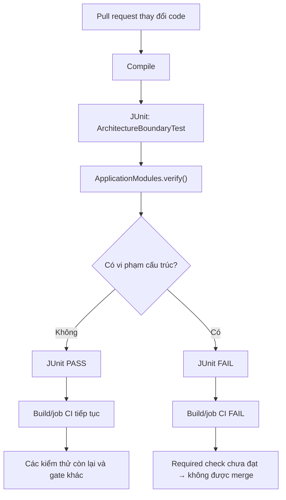
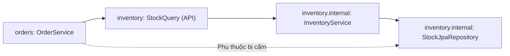
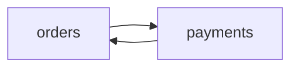
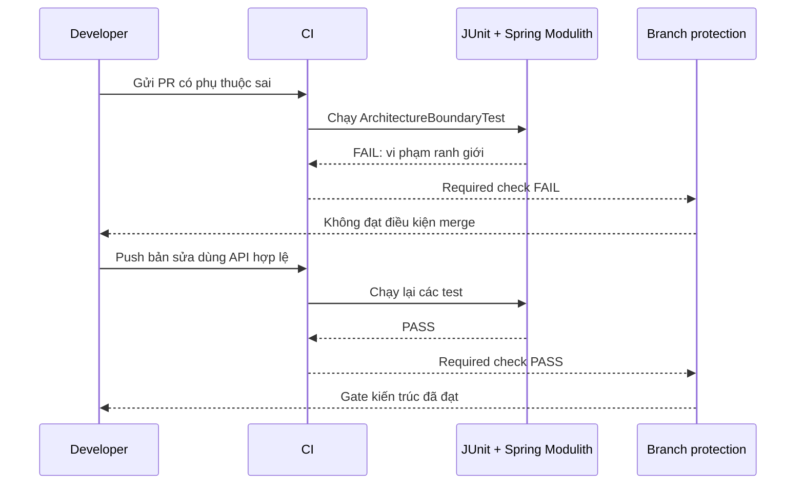

# Cổng build khi cấu trúc module vi phạm

> **Chương:** Verification trong build  
> **Phạm vi học:** `SPRING_MODULITH_VERIFICATION_TESTING` — kiểm chứng ranh giới kiến trúc của ứng dụng Spring Modulith bằng `ApplicationModules`, bảo vệ quy tắc phụ thuộc module và kết hợp kết quả với các phép thử module, sự kiện, cơ sở dữ liệu, tích hợp trong CI.

## 1. Kết quả học tập

Sau bài này, bạn có thể:

1. Diễn giải **build gate** là gì, tại sao lỗi kiến trúc cần làm build thất bại dù mã Java vẫn biên dịch.
2. Viết phép kiểm `ApplicationModules.verify()` dưới dạng JUnit Jupiter test để Maven/Gradle tự báo lỗi.
3. Đưa bài test vào CI, truyền kết quả thất bại thành trạng thái job thất bại, rồi yêu cầu job đó thành công trước khi merge.
4. Phân biệt các loại vi phạm: chu trình phụ thuộc, truy cập package nội bộ, và phụ thuộc ngoài chính sách `allowedDependencies`.
5. Kiểm tra gate bằng tình huống **PASS → cố ý tạo vi phạm → FAIL → sửa thiết kế → PASS**.
6. Phát hiện trạng thái **xanh giả** khi test bị bỏ qua, không được tìm thấy, quét thiếu module hoặc job CI không thực sự chặn merge.

**Tình huống:** Trong hệ thống bán hàng, module `orders` cần hỏi module `inventory` xem còn hàng hay không. Một developer vô tình import `inventory.internal.StockJpaRepository` từ `orders`. Kiểu đó có thể là `public`, nên Java compiler vẫn chấp nhận; tuy nhiên cách kết nối hai module đã đi ngược quy ước kiến trúc của nhóm. Pull request chứa thay đổi này phải bị từ chối bởi quality gate, trước khi được hợp nhất vào nhánh chính.

## 2. Build gate bảo vệ điều gì?

**Build gate** là một điều kiện có thể kiểm chứng tự động: khi không đáp ứng, build hoặc job CI kết thúc bằng trạng thái lỗi; khi là required check của nhánh, lỗi đó ngăn pull request được merge theo chính sách repository.

Trong Spring Modulith, `ApplicationModules.verify()` giúp kiểm tra các bất biến kiến trúc từ mô hình application module mà Spring Modulith khám phá, bao gồm:

- **Không có chu trình phụ thuộc giữa các application module.** Một quan hệ `orders → billing → orders` gây coupling vòng.
- **Không truy cập tùy tiện vào phần triển khai nội bộ của module khác.** `orders` nên dựa vào API do `inventory` công bố, không phụ thuộc trực tiếp vào `inventory.internal`.
- **Tôn trọng danh sách phụ thuộc cho phép**, nếu module có khai báo `@ApplicationModule(allowedDependencies = ...)`.

Java có quy tắc truy cập cấp ngôn ngữ như `public`, nhưng một lớp `public` chưa chắc là **API kiến trúc** mà module khác được phép sử dụng. Vì vậy `compile` PASS **không** đồng nghĩa với module boundaries PASS.

Một quality gate hiệu quả là chuỗi truyền lỗi liên tục:



Nếu một mắt xích không hoạt động — chẳng hạn test không chạy hoặc CI cho phép bỏ qua bước thất bại — gate sẽ không bảo vệ được kiến trúc.

> **Phân biệt tên gọi:** `ApplicationModules.verify()` là phương thức của Spring Modulith. `mvn verify` là một phase trong Maven lifecycle. `gradle check` là task lifecycle của Gradle với Java plugin. Hai lệnh build chỉ chạy phép kiểm Spring Modulith nếu dự án đã nối nó vào một bài test hoặc task tương ứng.

## 3. Chuẩn bị ứng dụng mẫu và ranh giới dự kiến

Giả sử ứng dụng có package gốc `com.example.shop`:

```text
src/
├── main/java/com/example/shop/
│   ├── ShopApplication.java
│   ├── orders/
│   │   ├── OrderService.java
│   │   └── package-info.java
│   └── inventory/
│       ├── StockQuery.java
│       └── internal/
│           ├── InventoryService.java
│           └── StockJpaRepository.java
└── test/java/com/example/shop/
    └── ArchitectureBoundaryTest.java
```

Theo cách phát hiện module mặc định, hai package con trực tiếp `orders` và `inventory` là application module. Các kiểu nằm ngay tại package `inventory` thường thuộc API được công bố; `inventory.internal` là chi tiết triển khai. Dự án có thể tùy chỉnh cách khai báo module và named interface; cần kiểm tra cấu hình thực tế khi phân tích kết quả.

Thiết kế phụ thuộc mong muốn:



API ở `inventory` biểu diễn năng lực nghiệp vụ cần dùng, không bắt caller biết có JPA, JDBC hay dịch vụ bên ngoài phía sau.

## 4. Tạo bài kiểm chứng khiến build tự động FAIL

Tạo file `src/test/java/com/example/shop/ArchitectureBoundaryTest.java`:

```java
package com.example.shop;

import org.junit.jupiter.api.DisplayName;
import org.junit.jupiter.api.Tag;
import org.junit.jupiter.api.Test;
import org.springframework.modulith.core.ApplicationModules;

@Tag("architecture")
class ArchitectureBoundaryTest {

    @Test
    @DisplayName("Application modules không vi phạm ranh giới kiến trúc")
    void verifiesModuleArchitecture() {
        ApplicationModules.of(ShopApplication.class).verify();
    }
}
```

Về cơ chế:

1. JUnit Jupiter nhận diện phương thức có `@Test`.
2. `ApplicationModules.of(ShopApplication.class)` xây dựng mô hình module bắt đầu từ package của `ShopApplication`.
3. `verify()` kiểm tra cấu trúc và báo lỗi nếu có vi phạm.
4. Nếu không có lỗi, phương thức kết thúc bình thường và JUnit ghi **PASS**; nếu `verify()` ném lỗi, JUnit ghi **FAIL** và công cụ build được cấu hình đúng sẽ thất bại.

Không cần thêm `assertTrue` hay `assertDoesNotThrow`: lời gọi `verify()` đã tự báo lỗi. `@Tag("architecture")` hữu ích cho việc chạy nhóm test nhưng không thay đổi logic PASS/FAIL.

**Chọn đúng phạm vi:** `ShopApplication.class` phải nằm ở package bao phủ các module cần kiểm chứng. Nếu dùng điểm khởi đầu quá hẹp, bài test có thể PASS vì bỏ sót module. Đây là một nguồn “xanh giả” cần kiểm tra bằng tình huống lỗi có chủ đích.

**Không cần `@SpringBootTest` hay `@ApplicationModuleTest`** cho lớp kiểm chứng cấu trúc trên. Kiến trúc được kiểm tra từ mô hình phụ thuộc của code đã biên dịch, không yêu cầu khởi động Spring ApplicationContext hoặc kết nối database.

## 5. Đảm bảo Maven hoặc Gradle thực sự chạy bài test

### 5.1. Dependency kiểm thử

Ví dụ Maven với dependency management/BOM Spring Boot và Spring Modulith tương thích đã được khai báo trong dự án:

```xml
<dependencies>
    <dependency>
        <groupId>org.springframework.boot</groupId>
        <artifactId>spring-boot-starter-test</artifactId>
        <scope>test</scope>
    </dependency>
    <dependency>
        <groupId>org.springframework.modulith</groupId>
        <artifactId>spring-modulith-starter-test</artifactId>
        <scope>test</scope>
    </dependency>
</dependencies>
```

Ví dụ Gradle Groovy DSL với quản lý phiên bản tương ứng:

```groovy
dependencies {
    testImplementation 'org.springframework.boot:spring-boot-starter-test'
    testImplementation 'org.springframework.modulith:spring-modulith-starter-test'
}

tasks.named('test', Test) {
    useJUnitPlatform()
}
```

JUnit Jupiter TestEngine cần có ở runtime test classpath. Với Maven, Surefire cần phiên bản hỗ trợ JUnit Platform; cấu hình Spring Boot parent/BOM phổ biến đã quản lý những phần này. Nếu tự quản lý các phiên bản dependency/plugin, cần chọn phiên bản tương thích thay vì sao chép một số phiên bản bất kỳ.

### 5.2. Lệnh tạo quality gate ở máy phát triển

Maven:

```bash
# Chạy toàn bộ bài test Surefire, gồm ArchitectureBoundaryTest
./mvnw test

# Chạy riêng test kiến trúc khi đang sửa một dependency
./mvnw -Dtest=ArchitectureBoundaryTest test

# Chạy lifecycle đến verify, gồm phase test
./mvnw -B verify
```

Gradle:

```bash
# Chạy task test trên JUnit Platform
./gradlew test

# Chạy riêng class kiểm chứng kiến trúc
./gradlew test --tests 'com.example.shop.ArchitectureBoundaryTest'

# Chạy các tác vụ verification được nối vào check
./gradlew check
```

Trên Windows có thể dùng `mvnw.cmd` và `gradlew.bat`. Lệnh `mvn test` chỉ chạy test qua Surefire theo cấu hình hiện có; `mvn verify` chạy các phase tiếp theo. Gradle `check` thông thường phụ thuộc task `test` với Java plugin, nhưng đồ thị task có thể đã được tùy chỉnh.

| Build tool | Nơi thường thấy kết quả test | Điều kiện để gate có hiệu lực |
| --- | --- | --- |
| Maven | `target/surefire-reports/` | Surefire khám phá `*Test`, dùng Jupiter engine, không skip test và không bỏ qua failure |
| Gradle | `build/test-results/test/`, `build/reports/tests/test/index.html` | Task `test` chạy JUnit Platform, không bị exclude, không `ignoreFailures` |

Bằng chứng cần tìm là `ArchitectureBoundaryTest` **đã thực thi** với số lượng test phù hợp; chỉ nhìn `BUILD SUCCESS` không đủ.

## 6. Minh họa chuyển trạng thái PASS → FAIL → PASS

### 6.1. Baseline: kiến trúc đúng

Giả sử `orders.OrderService` chỉ phụ thuộc vào hợp đồng sau:

```java
package com.example.shop.inventory;

public interface StockQuery {
    boolean available(String sku, int quantity);
}
```

Phần triển khai của `StockQuery` và persistence được đặt trong `inventory.internal`. Khi không có các phụ thuộc vi phạm khác, `ArchitectureBoundaryTest` dự kiến PASS.

### 6.2. Cố ý tạo lỗi vượt ranh giới

Tạo một kiểu có thể truy cập ở mức Java nhưng nằm trong nội bộ module:

```java
package com.example.shop.inventory.internal;

public final class InventoryDebugCounter {
    private InventoryDebugCounter() { }

    public static int currentCount() {
        return 10;
    }
}
```

Cho một lớp thuộc `orders` sử dụng trực tiếp kiểu đó:

```java
package com.example.shop.orders;

import com.example.shop.inventory.internal.InventoryDebugCounter;

class OrderStockCheck {
    boolean canProceed() {
        return InventoryDebugCounter.currentCount() > 0;
    }
}
```

Java có thể biên dịch cả hai lớp vì `InventoryDebugCounter` là `public`. Nhưng `orders` vừa vượt qua API mặc định của `inventory` để phụ thuộc vào `inventory.internal`. Bài `ArchitectureBoundaryTest` phải báo **FAIL** nếu phạm vi khám phá module và các quy tắc mặc định đang được áp dụng như dự kiến.

Một kết quả minh họa (thông báo thực tế thay đổi theo phiên bản Spring Modulith):

```text
ArchitectureBoundaryTest > verifiesModuleArchitecture() FAILED
  Violation: orders depends on inventory.internal.InventoryDebugCounter

Tests run: 1, Failures: 1
BUILD FAILURE
```

Trong log thật, đọc thông tin module nguồn/đích và kiểu hoặc dependency gây lỗi. Đừng phụ thuộc vào một chuỗi exception cố định để nhận diện vi phạm.

### 6.3. Sửa thiết kế, rồi xác nhận gate xanh trở lại

Loại bỏ lời gọi trực tiếp `InventoryDebugCounter` trong `orders`. Nếu nghiệp vụ cần kiểm tra tồn kho, `OrderStockCheck` nên nhận `StockQuery` từ API `inventory`:

```java
package com.example.shop.orders;

import com.example.shop.inventory.StockQuery;

class OrderStockCheck {
    private final StockQuery stockQuery;

    OrderStockCheck(StockQuery stockQuery) {
        this.stockQuery = stockQuery;
    }

    boolean canProceed(String sku, int quantity) {
        return stockQuery.available(sku, quantity);
    }
}
```

Chạy lại architectural test, rồi chạy test suite phù hợp. Kết quả mong đợi: architectural test PASS và unit/module tests liên quan vẫn PASS. Không cần sửa hay tắt `ArchitectureBoundaryTest` để đạt kết quả này.

**Tránh lối tắt:** chuyển kiểu `InventoryDebugCounter` hoặc một JPA repository ra package gốc `inventory` chỉ để test xanh có thể làm lộ chi tiết triển khai. Cách sửa nên phản ánh hợp đồng nghiệp vụ thực sự giữa các module.

## 7. Gate cho chu trình và chính sách phụ thuộc

Gate không chỉ dùng để bắt import vào package `internal`.

### 7.1. Chu trình giữa các module



Hai module có thể chỉ sử dụng API công khai của nhau nhưng vẫn tạo chu trình. `ApplicationModules.verify()` kiểm tra chu trình dependency; nếu test phát hiện cấu trúc này, gate sẽ FAIL.

Cách sửa có thể là điều chỉnh hướng phụ thuộc, chuyển điều phối sang một module có trách nhiệm phù hợp, hoặc thay lời gọi ngược bằng event khi đáp ứng yêu cầu nghiệp vụ. Nếu dùng event, cần có test bổ sung để xác nhận xử lý bất đồng bộ, transaction và nhánh lỗi.

### 7.2. Phụ thuộc ngoài danh sách cho phép

Nếu `orders` chỉ được phép phụ thuộc vào `inventory`, khai báo trong file `com.example.shop.orders.package-info.java`:

```java
@ApplicationModule(allowedDependencies = "inventory")
package com.example.shop.orders;

import org.springframework.modulith.ApplicationModule;
```

Một dependency từ `orders` tới module khác ngoài danh sách có thể khiến `verify()` báo lỗi. Quy tắc này giúp kiểm soát cả những phụ thuộc tới **API công khai** của module mà kiến trúc không cho phép.

Nếu có nhu cầu công bố một API trong package con, Spring Modulith hỗ trợ `@NamedInterface` và tên dependency dạng `inventory::query`. Hãy chỉ công bố bề mặt API có chủ đích và cập nhật `allowedDependencies` sau khi review thiết kế; không nới rộng chính sách chỉ để che lỗi.

| Nhóm lỗi | Gate nhận biết từ đâu? | Hướng sửa ưu tiên |
| --- | --- | --- |
| Module A dùng kiểu nằm trong phần `internal` của B | Quan hệ tham chiếu vượt API module | Dùng API công khai/named interface được thiết kế rõ |
| A phụ thuộc B rồi B phụ thuộc A | Chu trình module | Loại bỏ phụ thuộc ngược, xem lại vai trò module hoặc event |
| A phụ thuộc C ngoài `allowedDependencies` | Policy đã khai báo cho A | Xóa dependency sai hoặc sửa policy khi có căn cứ kiến trúc |

## 8. Biến lỗi test thành trạng thái CI không thể bỏ qua

Một bài test FAIL ở máy phát triển chỉ hữu ích cho cá nhân. Để ngăn hồi quy trên nhánh chính, CI cần thực thi test đó cho pull request và **required status check** cần được áp dụng cho nhánh đích.

### 8.1. GitHub Actions: Maven

Ví dụ cho repository có Maven Wrapper và ứng dụng dùng Java 21 (đổi phiên bản theo dự án):

```yaml
name: Module architecture gate

on:
  pull_request:
  push:
    branches: [main]

jobs:
  architecture-gate:
    runs-on: ubuntu-latest
    steps:
      - name: Checkout source
        uses: actions/checkout@v4

      - name: Set up Java
        uses: actions/setup-java@v4
        with:
          distribution: temurin
          java-version: '21'

      - name: Verify build including architecture tests
        run: ./mvnw -B verify

      - name: Keep test reports for review
        if: always()
        uses: actions/upload-artifact@v4
        with:
          name: surefire-test-reports
          path: target/surefire-reports/
          if-no-files-found: warn
```

Bước chạy Maven thất bại khi test báo lỗi và cơ chế build không được cấu hình bỏ qua failure. Bước `upload-artifact` chạy cả khi build thất bại nhằm giữ lại báo cáo để chẩn đoán; nó **không** chuyển bước Maven FAIL thành PASS.

Nếu repository có nhiều Maven modules, cần bảo đảm lệnh build bao phủ project thực sự chứa `ArchitectureBoundaryTest`; đường dẫn report cũng cần điều chỉnh cho từng module.

### 8.2. GitHub Actions: Gradle

Với dự án dùng Gradle Wrapper, giữ nguyên cấu trúc job nhưng thay bước Maven bằng:

```yaml
- name: Verify build including architecture tests
  run: ./gradlew --no-daemon check

- name: Keep test reports for review
  if: always()
  uses: actions/upload-artifact@v4
  with:
    name: gradle-test-reports
    path: build/test-results/test/
    if-no-files-found: warn
```

Trong dự án Java plugin thông thường, `check` phụ thuộc `test`. Nếu dự án cấu hình task `architectureTest` riêng và task đó **không** được nối vào `check`, cần gọi nó rõ ràng hoặc nối nó vào đồ thị task. Nếu không, CI có thể xanh dù chưa hề kiểm tra module boundaries.

### 8.3. Cấu hình bắt buộc trước khi merge

Sau khi workflow tồn tại và đã chạy thành công ít nhất một lần, cấu hình branch protection hoặc ruleset của repository để yêu cầu job **`architecture-gate`** thành công khi merge vào `main`. Với cách tổ chức CI khác, chọn chính xác check name của job thực thi architectural test.

Quy tắc vận hành cần thống nhất trong nhóm:

- Pull request phải chạy trên commit ứng viên phù hợp với chính sách repository.
- Job thất bại nếu test kiến trúc thất bại, không dùng cấu hình biến thất bại thành cảnh báo.
- Không bypass required check trong quy trình merge thông thường.
- Báo cáo test và log đủ thông tin để người sửa thấy dependency sai.
- Nếu thay đổi kiến trúc được chấp thuận, cập nhật API hoặc chính sách dependency một cách minh bạch và chạy lại toàn bộ test liên quan.

**CI xanh chỉ có ý nghĩa khi job được chạy đầy đủ và là điều kiện bắt buộc.** Một workflow vẫn hiển thị thành công ở phần không liên quan không bảo đảm riêng gate kiến trúc đã được thỏa mãn.

## 9. Ngăn “xanh giả”: các kiểu cấu hình làm mất hiệu lực gate

| Nguy cơ | Dấu hiệu hoặc ví dụ | Cách kiểm chứng và khắc phục |
| --- | --- | --- |
| Bỏ qua test trong Maven | `-DskipTests`, `-Dmaven.test.skip=true` | Gỡ cờ skip ở job gate, tìm tên `ArchitectureBoundaryTest` trong báo cáo Surefire |
| Bỏ qua task Gradle | `-x test` hoặc cấu hình skip task | Chạy task thực thi test và xem report thực tế |
| CI nuốt lỗi | `continue-on-error: true`, lệnh shell `|| true`, Gradle `ignoreFailures = true` | Để lệnh build truyền exit code lỗi và job FAIL |
| Maven bỏ qua test failure | Cấu hình `testFailureIgnore` / `maven.test.failure.ignore` | Đưa cơ chế báo lỗi về mặc định và chứng minh test FAIL làm Maven FAIL |
| JUnit không khám phá test | Thiếu Jupiter TestEngine, Surefire không phù hợp, Gradle chưa `useJUnitPlatform()` | Xem report và chạy trực tiếp `ArchitectureBoundaryTest` |
| Tên class sai quy ước | Test được đặt tên `*IT` nhưng chỉ chạy Surefire mặc định | Dùng `*Test` hoặc cấu hình plugin integration test rõ ràng |
| Test được lọc ra hết | `@Tag` không khớp filter, chỉ chạy test group khác | Xem số test đã chạy; chạy suite đầy đủ ở gate |
| Phạm vi quét thiếu module | `ApplicationModules.of(...)` bắt đầu từ package không phù hợp | Xem phạm vi khám phá module và thử trường hợp vi phạm có chủ đích |
| Job không được yêu cầu khi merge | Check thất bại nhưng vẫn merge được | Cấu hình đúng required check/ruleset cho nhánh chính |
| Dự án nhiều build subproject | Lệnh chỉ build module không chứa architectural test | Chạy đúng subproject hoặc toàn bộ reactor, kiểm tra report của test chứa gate |

Đặc biệt, **không coi “0 tests” là PASS của kiến trúc**. Với Maven Surefire, dự án có thể cấu hình `failIfNoTests` phù hợp để phát hiện lớp test bị mất; tuy nhiên cần cân nhắc riêng các Maven submodule vốn không có test. Với Gradle, chạy test bằng `--tests` và xem báo cáo sẽ giúp xác nhận lớp kiểm chứng tồn tại. Ngoài ra, cần xem lại các bộ lọc test theo tag nếu dùng chúng cho gate.

Tránh bật bộ lọc chỉ chạy tag `architecture` lên task `test` mặc định nếu điều đó khiến toàn bộ unit test khác bị loại bỏ. Một gate riêng để phản hồi sớm có thể chạy song song với bước chạy đầy đủ test suite, nhưng không nên tạo ra ảo giác rằng các kiểm thử hành vi cũng đã PASS.

## 10. Kiểm chứng gate bằng thí nghiệm có kiểm soát

Không thể chỉ nhìn một lần build xanh rồi khẳng định quality gate đang hoạt động. Cần một thử nghiệm để xác nhận **đường truyền lỗi**:

1. **Đo trạng thái ban đầu.** Chạy `./mvnw -B verify` hoặc `./gradlew check`; tìm bài `ArchitectureBoundaryTest` trong test report và xác nhận PASS.
2. **Cố ý đưa dependency bất hợp lệ** trong nhánh thử: `orders` dùng `inventory.internal.InventoryDebugCounter`. Bảo đảm đoạn code Java vẫn biên dịch để chứng minh đây là lỗi kiến trúc.
3. **Chạy lại đúng lệnh của CI.** Yêu cầu architectural test FAIL, build process trả exit code khác 0 và job CI chuyển sang trạng thái FAIL.
4. **Quan sát chính sách merge.** Với required check đã bật, pull request thử nghiệm không thể đi qua điều kiện này khi job FAIL.
5. **Sửa nguyên nhân.** Loại bỏ dependency nội bộ, thay bằng `inventory.StockQuery`, hoặc điều chỉnh thiết kế module theo chính sách đã thống nhất.
6. **Chạy lại.** Xác nhận architectural test PASS, các bài test hành vi cần thiết PASS và CI job thành công.



Không cần merge mã chứa lỗi để làm thí nghiệm. Hãy dùng nhánh/pull request thử nghiệm và loại bỏ dependency sai sau khi xác minh.

**Bằng chứng nghiệm thu** nên gồm tên test đã chạy, thông điệp vi phạm hoặc liên kết report, exit code/trạng thái job FAIL trước khi sửa, và kết quả PASS sau khi sửa. Đây là cách đánh giá gate thực sự hoạt động thay vì chỉ tồn tại một file YAML CI.

## 11. Chẩn đoán vi phạm để sửa đúng nguyên nhân

Khi `verify()` thất bại:

1. **Xác định module nguồn**, module đích và kiểu/đường phụ thuộc tạo lỗi.
2. **Phân loại:** package `internal`, chu trình, hay `allowedDependencies`.
3. **Xác định nhu cầu nghiệp vụ:** module gọi thật sự cần capability gì từ module đích?
4. **Sửa ranh giới:** sử dụng API đã công bố, tạo hợp đồng nghiệp vụ phù hợp, thay đổi hướng phụ thuộc hoặc thiết kế event khi cần.
5. **Chạy lại** architectural test và toàn bộ bài test chịu ảnh hưởng.
6. **Đọc lại log/report CI** để xác nhận test đã được thực thi, không bị skip.

Không phải mọi vi phạm đều được giải quyết bằng `@NamedInterface` hoặc nới rộng `allowedDependencies`. Nếu quy tắc cũ đúng, việc nới quyền chỉ làm chất lượng gate suy giảm. Nếu quy tắc thật sự cần đổi, cần review với người sở hữu module và ghi rõ quyết định kiến trúc.

## 12. Gate kiến trúc nằm ở đâu trong chiến lược kiểm thử Spring Modulith?

`ApplicationModules.verify()` là kiểm chứng **cấu trúc phụ thuộc tĩnh**. Nó không trực tiếp chứng minh rằng listener thực thi đúng, giao dịch database rollback đúng hay một HTTP endpoint hoạt động. Vì vậy module `SPRING_MODULITH_VERIFICATION_TESTING` còn cần các lớp kiểm thử khác:

| Loại test | Câu hỏi kiểm chứng | Kết quả có thể dùng làm CI gate? |
| --- | --- | --- |
| `ApplicationModules.verify()` trong JUnit | Các ranh giới module, chu trình và chính sách phụ thuộc có hợp lệ không? | Có, qua JUnit và build |
| Unit test | Logic nghiệp vụ và các nhánh lỗi có đúng không? | Có |
| `@ApplicationModuleTest` | Spring beans của module và phạm vi cộng tác có hoạt động đúng không? | Có |
| Kiểm thử sự kiện | Sự kiện được phát, chuyển và xử lý đúng trong tình huống thành công/thất bại không? | Có |
| Kiểm thử cơ sở dữ liệu | Transaction, repository, migration và ràng buộc dữ liệu có hoạt động như mong đợi không? | Có |
| Kiểm thử tích hợp | Các phần kết nối qua API, messaging và hệ thống bên ngoài có hợp tác đúng không? | Có |

Các bài test này có chi phí thực thi khác nhau; architectural test thường nhanh, phù hợp để phát hiện phụ thuộc sai sớm. CI có thể tổ chức nhiều job song song hoặc theo lớp để phản hồi nhanh, nhưng phải yêu cầu các job cần thiết cùng thành công trước khi merge.

**Giới hạn cần nhớ:** phân tích phụ thuộc tĩnh không bao phủ đầy đủ các liên hệ runtime qua reflection, class name dạng chuỗi, HTTP, message broker hoặc cơ chế dependency động khác. Nếu code nằm ngoài phạm vi khám phá module hoặc test không chạy, `verify()` có thể PASS mà hệ thống chưa được kiểm chứng toàn diện.

## 13. Bài thực hành: dựng gate chặn lỗi kiến trúc

**Yêu cầu:** Với một ứng dụng có `orders` và `inventory`, thiết lập quality gate sao cho một thay đổi hợp lệ ở Java nhưng phụ thuộc sai vào `inventory.internal` làm PR thất bại.

### Phần A — Dựng bài test

1. Tạo đúng hai application module dưới package gốc ứng dụng.
2. Thêm JUnit Jupiter và dependency test Spring Modulith theo build tool.
3. Tạo `ArchitectureBoundaryTest` gọi `ApplicationModules.of(ShopApplication.class).verify()`.
4. Chạy test từ IDE và build tool; ghi lại test report để chứng minh nó đã được thực thi.

### Phần B — Đưa vi phạm vào build

1. Cho một lớp trong `orders` tham chiếu `public` type trong `inventory.internal`.
2. Kiểm tra compile có thể thành công nhưng architectural test phải FAIL.
3. Ghi lại test failure, module nguồn/đích và trạng thái Maven/Gradle.
4. Sửa caller sử dụng `StockQuery` tại package gốc `inventory`; chạy lại và xác nhận PASS.

### Phần C — Kích hoạt CI gate

1. Thêm workflow chạy `mvn verify` hoặc `gradle check` tùy công cụ build.
2. Bảo đảm không có `skipTests`, `-x test`, `continue-on-error` hay cơ chế nuốt lỗi.
3. Thiết lập job thực thi bài test thành required check cho nhánh chính.
4. Trên nhánh thử nghiệm, xác nhận commit chứa vi phạm làm job FAIL và bị chặn merge.
5. Sau khi sửa, xác nhận job PASS; chạy thêm các kiểm thử module, event, database hoặc tích hợp liên quan.

### Checklist nghiệm thu

- [ ] Có architectural JUnit test và test được khám phá trong Maven/Gradle report.
- [ ] `ApplicationModules.of(...)` bao phủ các module cần kiểm chứng.
- [ ] Có trường hợp âm tính: code biên dịch nhưng `verify()` FAIL do truy cập module nội bộ.
- [ ] CI nhận exit code khác 0 và hiển thị job FAIL khi test lỗi.
- [ ] Job kiến trúc là required check của nhánh cần bảo vệ.
- [ ] Không thể vượt gate bằng cấu hình bỏ qua test hoặc bỏ qua failure.
- [ ] Sau khi sửa API module, build và các bài test hành vi liên quan PASS.

## 14. Câu hỏi tự đánh giá

1. Vì sao `javac` chấp nhận một import `public` nhưng `ApplicationModules.verify()` vẫn có thể báo vi phạm?
2. Cần những mắt xích nào để một exception của `verify()` thực sự chặn merge pull request?
3. Sự khác nhau giữa một task `gradle check` PASS và việc có bằng chứng `ArchitectureBoundaryTest` đã chạy là gì?
4. Vì sao một CI job có `continue-on-error: true` không đáp ứng mục tiêu quality gate?
5. Nếu test FAIL vì `orders` tham chiếu vào `inventory.internal`, hai cách sửa khả thi nào tốt hơn việc công bố toàn bộ repository nội bộ?
6. Khi sửa một chu trình giữa hai module bằng event, cần bổ sung những kiểm thử runtime nào?
7. Làm sao chứng minh một required check thực sự ngăn thay đổi vi phạm, thay vì chỉ có workflow CI tồn tại?

**Ghi nhớ:** Cổng build cho kiến trúc Spring Modulith chỉ đáng tin khi `ApplicationModules.verify()` được chạy như một test thực, lỗi được truyền xuyên suốt JUnit → Maven/Gradle → CI, và job CI trở thành required check trước khi merge. Thí nghiệm FAIL → sửa → PASS là bằng chứng rõ nhất rằng quy tắc ranh giới module đang được thực thi.
