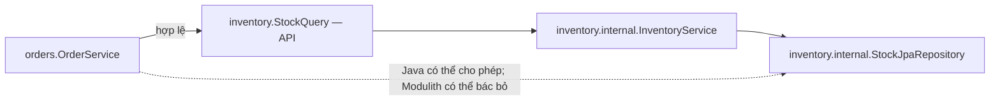
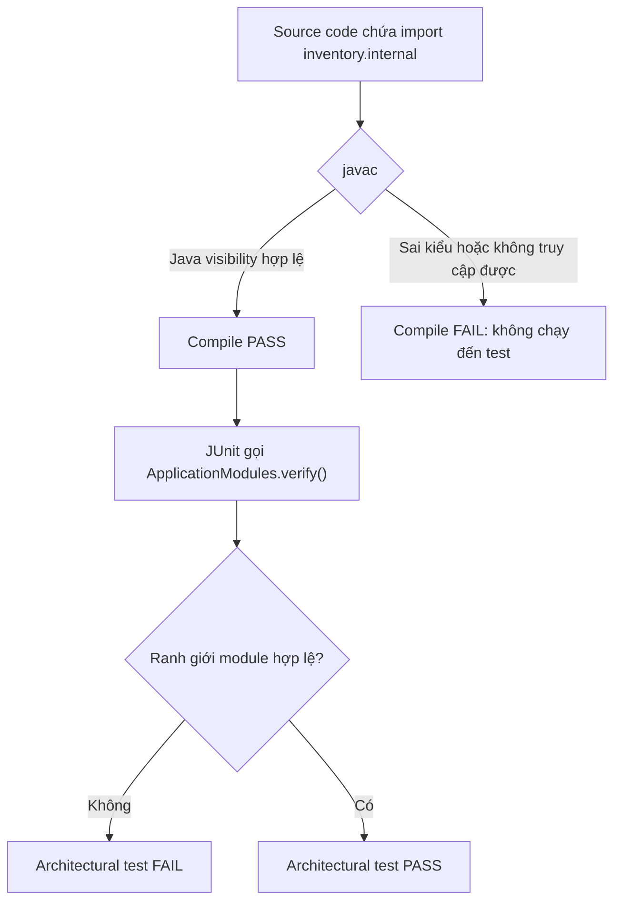
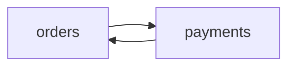
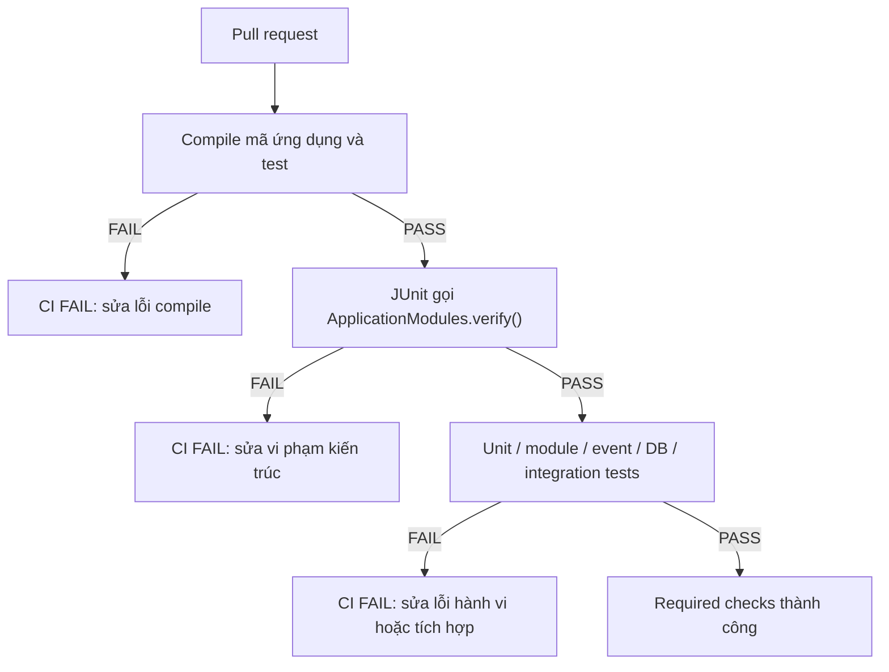

# Phân biệt lỗi compile với lỗi architectural verification

> **Chương:** Verification trong build  
> **Module học:** `SPRING_MODULITH_VERIFICATION_TESTING` — rèn kỹ năng kiểm chứng ranh giới của ứng dụng Spring Modulith bằng `ApplicationModules` và quy tắc phụ thuộc giữa module, bên cạnh `@ApplicationModuleTest`, kiểm thử sự kiện, cơ sở dữ liệu, tích hợp và quality gate trong CI.

## 1. Vấn đề thường gặp

Một pull request của ứng dụng bán hàng thêm lời gọi từ module `orders` tới `inventory.internal.StockJpaRepository`. Mã **biên dịch thành công**, nhưng job kiểm thử kiến trúc lại thất bại. Người phát triển có thể nhầm rằng “compiler bị lỗi”, hoặc nghĩ rằng có thể xóa bài test để sửa build.

Thực chất, hai tầng kiểm tra trả lời **hai câu hỏi khác nhau**:

- **Compile:** Mã Java có hợp lệ theo cú pháp, kiểu dữ liệu và quy tắc truy cập của ngôn ngữ không?
- **Architectural verification:** Dù mã hợp lệ với Java, các module của ứng dụng có tuân thủ ranh giới và chính sách phụ thuộc đã định nghĩa không?

Kết quả cần đạt sau bài học:

1. Phân biệt lỗi biên dịch mã ứng dụng, lỗi biên dịch mã test và lỗi do `ApplicationModules.verify()` báo.
2. Giải thích tại sao việc Java cho phép truy cập một kiểu `public` không có nghĩa kiểu đó là API công khai của application module.
3. Tạo hai trường hợp đối chứng: **compile FAIL** và **compile PASS nhưng architectural verification FAIL**.
4. Nhận biết lỗi qua vị trí trong build log, báo cáo JUnit và exit code; sửa đúng nguyên nhân.
5. Đặt hai tầng kiểm tra vào Maven/Gradle và CI mà không tạo trạng thái “xanh giả” do bỏ qua test.

## 2. Mô hình tư duy: compiler kiểm gì, Spring Modulith kiểm gì?

| Tiêu chí | Lỗi compile | Lỗi architectural verification |
| --- | --- | --- |
| Thành phần phát hiện | Java compiler (`javac`) do Maven/Gradle gọi | `ApplicationModules.verify()` của Spring Modulith, thường được gọi trong JUnit test |
| Câu hỏi được kiểm | Cú pháp, tên lớp, kiểu, method signature, Java visibility, dependency có nằm trên compile classpath? | Có chu trình module, truy cập ngoài API công bố, vi phạm `allowedDependencies` không? |
| Ví dụ | Gọi phương thức không tồn tại hoặc import kiểu package-private từ package khác | `orders` dùng lớp `public` trong `inventory.internal` dù package đó không thuộc API module |
| Điều kiện phát hiện | Code cần được biên dịch | Code và bài test cần biên dịch được, bài kiểm chứng cần được chạy, phạm vi module phải đúng |
| Triệu chứng điển hình | `cannot find symbol`, `incompatible types`, `is not public` | JUnit test thất bại và báo dependency/module vi phạm |
| Cách sửa | Sửa cú pháp, kiểu, quyền truy cập hoặc cấu hình dependency | Sửa hướng phụ thuộc, dùng API module, thay thiết kế hoặc điều chỉnh chính sách kiến trúc có chủ đích |
| CI | Build thất bại ở compile/testCompile | Build thường thất bại ở bước test chạy `verify()` |

Một compiler có thể xác nhận **“lớp A gọi được lớp B”**, trong khi Spring Modulith đặt thêm ràng buộc **“module sở hữu A có được phụ thuộc vào phần này của module sở hữu B hay không?”**.

Phân biệt thêm: `ApplicationModules.verify()` thực hiện kiểm chứng **cấu trúc phụ thuộc từ code**, nhưng thường được kích hoạt ở **giai đoạn test của build**. Nó không phải bước kiểm tra cú pháp của Java compiler.

## 3. Minh họa kiến trúc ứng dụng

Giả sử Spring Boot application class ở `com.example.shop` và có hai application module `orders` và `inventory`:

```text
src/main/java/com/example/shop/
├── ShopApplication.java
├── orders/
│   ├── OrderService.java
│   └── package-info.java
└── inventory/
    ├── StockQuery.java
    └── internal/
        ├── InventoryService.java
        └── StockJpaRepository.java
```

Với cơ chế phát hiện module mặc định của Spring Modulith, mỗi package con trực tiếp của package ứng dụng là một module. Thông thường:

- `com.example.shop.inventory.StockQuery` ở package gốc của module là phần có thể công bố cho module khác sử dụng.
- `com.example.shop.inventory.internal.StockJpaRepository` là chi tiết nội bộ. Nếu class được khai báo `public`, Java có thể cho code ngoài package import; **đó vẫn có thể là một dependency sai về kiến trúc**.
- Các named interface và cấu hình nhận diện module có thể thay đổi API công bố; vì vậy cần xem xét chính sách thực tế của ứng dụng khi diễn giải lỗi.



## 4. Trường hợp A: mã không qua được compiler

### 4.1. Thiếu phương thức hoặc sai kiểu dữ liệu

Giả sử lớp `StockQuery` chỉ công bố:

```java
package com.example.shop.inventory;

public interface StockQuery {
    boolean available(String sku, int quantity);
}
```

Nhưng một developer viết:

```java
package com.example.shop.orders;

import com.example.shop.inventory.StockQuery;

class OrderService {
    private final StockQuery stockQuery;

    OrderService(StockQuery stockQuery) {
        this.stockQuery = stockQuery;
    }

    boolean canOrder(String sku) {
        // Cố ý sai: StockQuery không có phương thức available(String)
        return stockQuery.available(sku);
    }
}
```

`javac` không tìm được phương thức có chữ ký tương ứng. Một thông báo thường gặp (chỉ minh họa, phụ thuộc compiler/version) có dạng:

```text
error: method available in interface StockQuery cannot be applied to given types;
  required: String,int
  found:    String
```

Đây là lỗi **compile**, dù code chỉ làm việc với API module hợp lệ. Cách sửa là truyền tham số `quantity` hoặc điều chỉnh đúng hợp đồng Java. **Chưa có cơ sở để kết luận** kiến trúc module bị vi phạm.

### 4.2. Java visibility chặn truy cập

Giả sử kiểu ở package `inventory.internal` **không có** modifier `public`:

```java
package com.example.shop.inventory.internal;

class StockJpaRepository {
    // package-private, chỉ truy cập từ cùng package
}
```

Một lớp trong `orders` cố import kiểu đó:

```java
package com.example.shop.orders;

import com.example.shop.inventory.internal.StockJpaRepository;
```

Compiler sẽ bác bỏ truy cập vì `StockJpaRepository` không public trong package đó. Đây là lỗi Java visibility, chưa cần đến quy tắc của Spring Modulith.

**Điểm rất dễ nhầm:** Cùng một ý định sai là “`orders` truy cập nội bộ `inventory`”, nhưng kết quả phụ thuộc quyền truy cập **Java**. Nếu kiểu đích không public, compiler có thể dừng build trước; nếu kiểu đích public, compile có thể PASS và lỗi kiến trúc mới xuất hiện khi gọi `verify()`.

## 5. Trường hợp B: compile PASS nhưng architectural verification FAIL

Giả sử `inventory.internal` có kiểu `public`:

```java
package com.example.shop.inventory.internal;

public final class InventoryDebugCounter {

    private InventoryDebugCounter() {
    }

    public static int currentCount() {
        return 42;
    }
}
```

Code ở `orders`:

```java
package com.example.shop.orders;

import com.example.shop.inventory.internal.InventoryDebugCounter;

class OrderService {

    boolean hasAnyStock() {
        return InventoryDebugCounter.currentCount() > 0;
    }
}
```

Hai file trên **hợp lệ với các quy tắc truy cập Java thông thường**, nếu đều nằm trong source set/classpath được biên dịch. Nhưng `orders` đã gắn chặt vào package triển khai `inventory.internal`, vốn không phải API công bố mặc định của module `inventory`.

Để phát hiện vi phạm đó, viết một bài JUnit Jupiter test ở `src/test/java/com/example/shop/ModuleArchitectureTest.java`:

```java
package com.example.shop;

import org.junit.jupiter.api.Test;
import org.springframework.modulith.core.ApplicationModules;

class ModuleArchitectureTest {

    @Test
    void respectsModuleBoundaries() {
        ApplicationModules.of(ShopApplication.class).verify();
    }
}
```

Khi `verify()` phân tích các module theo chính sách mặc định và phát hiện `orders` phụ thuộc trực tiếp vào nội bộ `inventory`, nó báo vi phạm. JUnit coi bài test là FAIL; Maven/Gradle có thể làm build thất bại dù **compile trước đó đã PASS**.



Để sửa đúng:

1. Xác định nhu cầu nghiệp vụ của `orders`, chẳng hạn hỏi có đủ tồn kho cho sản phẩm hay không.
2. Công bố hợp đồng `StockQuery` tại package gốc `inventory`.
3. Cho lớp thuộc `inventory.internal` triển khai hợp đồng.
4. Chuyển `orders` sang sử dụng `StockQuery`, xóa mọi tham chiếu tới `InventoryDebugCounter`.
5. Chạy lại architectural test cùng các bài kiểm thử nghiệp vụ liên quan.

Ví dụ caller sau sửa:

```java
package com.example.shop.orders;

import com.example.shop.inventory.StockQuery;

class OrderService {
    private final StockQuery stockQuery;

    OrderService(StockQuery stockQuery) {
        this.stockQuery = stockQuery;
    }

    boolean canOrder(String sku, int quantity) {
        return stockQuery.available(sku, quantity);
    }
}
```

Không nên giải quyết lỗi bằng cách dời `StockJpaRepository` hay `InventoryDebugCounter` ra package gốc chỉ để `verify()` PASS: điều đó có thể biến chi tiết triển khai thành một API khó thay đổi sau này.

## 6. Những lỗi kiến trúc khác mà compiler không tự phát hiện

### 6.1. Chu trình phụ thuộc module

Ví dụ một lớp ở `orders` gọi API của `payments`, trong khi một lớp ở `payments` lại gọi API của `orders`:



Miễn là các lời gọi hợp lệ theo Java và classpath, compiler vẫn có thể biên dịch. Tuy nhiên, Spring Modulith kiểm tra chu trình **giữa application module**. Khi quy tắc không có chu trình bị vi phạm, `verify()` làm architectural test FAIL.

Một số cách sửa là chỉnh hướng phụ thuộc để chỉ còn một chiều, chuyển trách nhiệm điều phối sang module thích hợp, hoặc dùng domain event khi nghiệp vụ cho phép tách rời lời gọi. Nếu dùng event, phải kiểm thử riêng việc phát, xử lý và các tình huống lỗi runtime.

### 6.2. Truy cập API công khai nhưng sai `allowedDependencies`

Giả sử `orders` chỉ được phụ thuộc vào `inventory`, được khai báo trong `com.example.shop.orders.package-info.java`:

```java
@ApplicationModule(allowedDependencies = "inventory")
package com.example.shop.orders;

import org.springframework.modulith.ApplicationModule;
```

Một import từ `orders` vào **API công khai** của `payments` vẫn có thể compile hoàn toàn bình thường. Nhưng nếu `payments` không nằm trong danh sách dependency cho phép, `verify()` có thể báo vi phạm policy.

Đây là khác biệt quan trọng: **không phải cứ import một kiểu ở package gốc của module khác là hợp lệ**. Cần thỏa mãn cả API visibility của module đích và quy tắc module nguồn đã khai báo.

### 6.3. Named interface và phạm vi quy tắc

Một package con có thể được công bố có chủ đích thông qua `@NamedInterface`. Khi đó, Spring Modulith có thể xem các kiểu được công bố trong named interface là API thay vì là phần nội bộ. Chính sách `allowedDependencies` cũng có thể nhắc đến named interface bằng cú pháp `module::interface`.

Vì thế, cùng một đường import có thể hợp lệ hay không tùy cách dự án khai báo interface module. Đừng chỉ suy từ chuỗi `internal` trong tên package; hãy xét cấu trúc module **và** chính sách thực tế được `ApplicationModules` nhận diện.

## 7. Phân biệt lỗi của mã ứng dụng và lỗi của mã test

Trong Maven và Gradle, không chỉ có một lần biên dịch:

| Giai đoạn | Ví dụ Maven/Gradle | Khi lỗi xảy ra |
| --- | --- | --- |
| Biên dịch mã ứng dụng | Maven `compile` / Gradle `compileJava` | Lỗi kiểu hoặc cú pháp trong `src/main/java`; test chưa thể thực thi |
| Biên dịch mã test | Maven `test-compile` / Gradle `compileTestJava` | Lỗi import JUnit, thiếu dependency test hoặc lỗi Java trong `src/test/java` |
| Thực thi test | Maven Surefire `test` / Gradle `test` | JUnit chạy `ModuleArchitectureTest`; `verify()` phát hiện vi phạm rồi báo FAIL |
| Kiểm thử tích hợp tùy cấu hình | Maven Failsafe / Gradle integration test task | DB, Spring context, HTTP, messaging hoặc hệ thống khác gây lỗi runtime |

Ví dụ:

- `ModuleArchitectureTest.java` import nhầm một package không tồn tại: **test compilation FAIL**, không chứng minh có lỗi kiến trúc.
- `ModuleArchitectureTest` biên dịch được nhưng `ApplicationModules.verify()` báo phụ thuộc `orders → inventory.internal`: **architectural verification FAIL**.
- `@ApplicationModuleTest` không khởi động được Spring context do thiếu bean: **module/integration test FAIL**, chưa đủ để kết luận có vi phạm tĩnh.
- Lệnh không chạy bất kỳ test nào: **không có bằng chứng** kiến trúc đúng, dù build có thể hiển thị thành công.

Khi có nhiều lỗi cùng tồn tại, **lỗi xuất hiện sớm có thể che các lỗi ở giai đoạn sau**. Sau khi sửa lỗi compile, cần chạy lại test để biết liệu lỗi kiến trúc có tiếp tục tồn tại không.

## 8. Chạy thí nghiệm đối chứng với Maven và Gradle

Để thấy rõ khác biệt, dùng một dự án Spring Boot đã khai báo Spring Modulith, JUnit Jupiter và đúng package gốc. Tạo `ModuleArchitectureTest` như mục 5.

### 8.1. Cấu hình hỗ trợ JUnit

Ví dụ Maven, khi Spring Boot và Spring Modulith đã có dependency management/BOM tương thích:

```xml
<dependency>
    <groupId>org.springframework.boot</groupId>
    <artifactId>spring-boot-starter-test</artifactId>
    <scope>test</scope>
</dependency>
<dependency>
    <groupId>org.springframework.modulith</groupId>
    <artifactId>spring-modulith-starter-test</artifactId>
    <scope>test</scope>
</dependency>
```

Ví dụ Gradle Groovy DSL trong dự án đã quản lý phiên bản các dependency:

```groovy
dependencies {
    testImplementation 'org.springframework.boot:spring-boot-starter-test'
    testImplementation 'org.springframework.modulith:spring-modulith-starter-test'
}

tasks.named('test', Test) {
    useJUnitPlatform()
}
```

Maven cần Surefire hỗ trợ JUnit Platform; Gradle cần `useJUnitPlatform()`; test runtime cần Jupiter TestEngine. Nếu thiếu BOM/dependency management phù hợp, phải bổ sung phiên bản Spring Boot và Spring Modulith tương thích theo dự án.

### 8.2. Kịch bản 1 — Lỗi compile thật

Đưa lỗi gọi sai chữ ký `stockQuery.available(sku)` như mục 4.1 vào mã ứng dụng. Chạy:

```bash
# Maven: chỉ biên dịch mã chính
./mvnw compile

# Hoặc Gradle: chỉ biên dịch mã Java chính
./gradlew compileJava
```

**Dự kiến:** Lệnh FAIL ngay trong bước biên dịch; log nói về method signature hoặc kiểu dữ liệu. Không được suy ra kết luận từ `verify()` vì test kiến trúc chưa chạy.

### 8.3. Kịch bản 2 — Compile PASS, architectural test FAIL

Sửa lỗi chữ ký để compiler PASS. Sau đó tạo dependency từ `orders` vào kiểu `public` nằm trong `inventory.internal` như mục 5.

```bash
# Maven: mã chính có thể compile thành công
./mvnw compile

# Sau đó chạy architectural test
./mvnw -Dtest=ModuleArchitectureTest test
```

Hoặc Gradle:

```bash
./gradlew compileJava
./gradlew test --tests 'com.example.shop.ModuleArchitectureTest'
```

**Dự kiến:** `compile`/`compileJava` PASS; JUnit test FAIL vì phụ thuộc xuyên ranh giới. Đây mới là **lỗi architectural verification**, không phải lỗi Java compiler.

### 8.4. Kịch bản 3 — Sửa thiết kế và xác minh lại

Xóa dependency trực tiếp vào `inventory.internal`, cho `orders` dùng `inventory.StockQuery`; đảm bảo các test hành vi vẫn phản ánh đúng nghiệp vụ. Chạy:

```bash
# Maven: chạy build qua phase verify (bao gồm Surefire test)
./mvnw -B verify

# Hoặc Gradle: chạy lifecycle verification của Java plugin
./gradlew check
```

**Dự kiến:** Architectural test PASS. Chạy toàn bộ test suite giúp phát hiện thêm lỗi hành vi nếu việc sửa dependency ảnh hưởng logic ứng dụng.

Lưu ý: `mvn verify` là **Maven lifecycle phase**, khác với `ApplicationModules.verify()`. Gradle `check` cũng không tự gọi Spring Modulith; nó chỉ chạy bài test kiến trúc nếu task `test` hoặc task tương ứng thực sự được cấu hình và thực thi.

## 9. Đọc log để xác định tầng lỗi

Khi build thất bại, đừng chỉ đọc dòng cuối `BUILD FAILURE` hoặc `BUILD FAILED`. Hãy tìm giai đoạn đầu tiên báo lỗi, rồi đối chiếu bảng sau:

| Dấu hiệu trong log | Nên nghi ngờ điều gì? | Kiểm tra tiếp |
| --- | --- | --- |
| `maven-compiler-plugin:compile`, `Task :compileJava FAILED` | Mã Java chính không biên dịch | Đường dẫn `src/main/java`, số dòng, thông báo `javac` |
| `maven-compiler-plugin:testCompile`, `Task :compileTestJava FAILED` | Test source không biên dịch | Import `org.junit.jupiter.api.Test`, dependencies test, API sai trong test |
| `maven-surefire-plugin:test`, `Task :test FAILED` | Một hoặc nhiều bài test không đạt | Test class, exception, báo cáo JUnit; chưa mặc nhiên là lỗi kiến trúc |
| `ModuleArchitectureTest.respectsModuleBoundaries()` FAIL và nêu quan hệ module sai | `verify()` phát hiện architectural violation | Module nguồn, module đích, public API, `allowedDependencies`, chu trình |
| `@ApplicationModuleTest` thất bại do context/bean | Lỗi khởi tạo hoặc hành vi module trong runtime test | Bean configuration, test bootstrap, dependency ngoài phạm vi module |
| Test dùng DB hoặc message broker thất bại | Integration failure | Kết nối, dữ liệu, transaction, event/consumer |
| Lệnh kết thúc thành công nhưng 0 test | Test không được tìm thấy hoặc đã bị lọc/skip | Tên lớp, test engine, filter, source set và báo cáo |

Ví dụ log **minh họa** của hai đường lỗi:

```text
# A. Lỗi compile: test chưa chạy
Task :compileJava FAILED
error: method available(...) cannot be applied to given types
BUILD FAILED

# B. Compile thành công, test kiến trúc thất bại
> Task :compileJava
> Task :test FAILED
ModuleArchitectureTest > respectsModuleBoundaries() FAILED
  [vi phạm: orders tham chiếu inventory.internal]
BUILD FAILED
```

Đây là thông điệp rút gọn để học cách đọc log, **không phải nguyên văn exception của Spring Modulith**. Kiểu lỗi và cách diễn đạt thay đổi theo phiên bản thư viện, Gradle hoặc Maven.

### Báo cáo tìm ở đâu?

- **Maven Surefire:** thường ở `target/surefire-reports/`, gồm XML và text theo tên class test.
- **Gradle test:** thường ở `build/test-results/test/` (XML) và `build/reports/tests/test/index.html` (HTML).

Nếu log chỉ cho biết `ModuleArchitectureTest` FAIL, mở báo cáo và xem **cause** liên quan dependency. Nếu báo cáo chứa lỗi khởi tạo test hoặc `NoClassDefFoundError`, cần phân loại lại: đó có thể là classpath/configuration failure, chưa phải bằng chứng một quy tắc kiến trúc đã bị vi phạm.

## 10. Bảng quyết định: sửa gì trước?

| Tình huống | Cách xử lý đầu tiên | Điều cần kiểm chứng sau đó |
| --- | --- | --- |
| `cannot find symbol`, sai method signature | Sửa tên, kiểu hoặc chữ ký của Java code | `compile` PASS; chạy lại architectural test |
| Import class package-private từ package khác | Xác định quyền truy cập Java và thiết kế API | Nếu nghiệp vụ cần giao tiếp module, dùng API phù hợp thay vì tùy tiện mở `public` |
| Compile PASS, test nêu `orders → inventory.internal` | Loại bỏ dependency vào internal; dùng hợp đồng module | `verify()` PASS và test nghiệp vụ vẫn đúng |
| Compile PASS, test nêu vòng `orders ↔ payments` | Sửa hướng phụ thuộc hoặc phân lại trách nhiệm | Không còn vòng, kiểm thử luồng nghiệp vụ liên quan |
| Compile PASS, test nêu `allowedDependencies` | Đối chiếu policy và nhu cầu thực | Chỉ chỉnh policy khi đó là quyết định kiến trúc có chủ đích |
| Test kết thúc trước khi `verify()` được gọi | Sửa lỗi test bootstrap/configuration | Test gọi đến `verify()` thật và có kết quả rõ |
| Maven/Gradle PASS nhưng test vắng mặt | Sửa test discovery, skip/filter/task selection | Báo cáo có test đã thực thi; thử vi phạm âm tính |

Quy tắc thực hành: **đọc đúng tầng lỗi trước khi sửa**. Tự động nâng visibility lên `public`, đưa repository ra API công khai hoặc vô hiệu hóa test có thể làm một bước xanh mà phá hỏng mục tiêu giữ module độc lập.

## 11. Đặt cả hai loại lỗi vào CI quality gate

Một quy trình CI cần bảo vệ cả tính hợp lệ của Java code lẫn tính hợp lệ của kiến trúc module:



Ví dụ GitHub Actions cho dự án Maven Wrapper; phiên bản Java cần điều chỉnh theo project:

```yaml
name: Build and architecture verification

on:
  pull_request:
  push:
    branches: [main]

jobs:
  build-and-verify:
    runs-on: ubuntu-latest
    steps:
      - uses: actions/checkout@v4
      - uses: actions/setup-java@v4
        with:
          distribution: temurin
          java-version: '21'
      - name: Compile and run JUnit verification
        run: ./mvnw -B verify
      - name: Upload test reports for diagnosis
        if: always()
        uses: actions/upload-artifact@v4
        with:
          name: test-reports
          path: target/surefire-reports/
          if-no-files-found: warn
```

Với Gradle Java project sử dụng Gradle Wrapper và JUnit Platform, bước build tương ứng là:

```yaml
- name: Compile and run JUnit verification
  run: ./gradlew --no-daemon check
```

Các lệnh trên giả định project có task/plugin test thực thi `ModuleArchitectureTest` và không bỏ qua failure. Để **chặn merge**, người quản trị repository cần đặt job kiểm chứng thành *required status check* của nhánh bảo vệ. Một workflow tồn tại nhưng job không bắt buộc thì chưa tạo thành cổng merge đáng tin cậy.

### Những nguyên nhân khiến CI “xanh giả”

- Maven chạy `-DskipTests` hoặc `-Dmaven.test.skip=true`; Gradle chạy `-x test`.
- Test class không theo quy ước phát hiện; test engine không có hoặc Gradle chưa `useJUnitPlatform()`.
- Cấu hình `continue-on-error: true`, `testFailureIgnore`, `ignoreFailures` hoặc script nuốt exit code làm job không phản ánh lỗi.
- Chỉ chạy subproject không chứa bài kiểm tra kiến trúc; task test riêng không được nối vào `check`.
- `ApplicationModules.of(...)` chọn package gốc quá hẹp, dẫn tới bỏ sót module.
- CI chỉ chạy test theo tag và vô tình loại bỏ architectural test, hoặc có **0 test** nhưng vẫn báo thành công.

**Cách chứng minh gate:** cố ý thêm một phụ thuộc từ `orders` vào kiểu `public` trong `inventory.internal` ở nhánh thử; xác nhận riêng compile PASS, architectural test FAIL, CI job FAIL và required check không đạt. Sau khi sửa bằng API module, xác nhận test và job PASS. Không cần merge mã chứa lỗi để thực hiện phép thử này.

## 12. Architectural verification chưa thay thế kiểm thử runtime

`ApplicationModules.verify()` bảo vệ các quan hệ phụ thuộc kiến trúc mà công cụ nhận diện. Nó **không** cho biết sự kiện được phát đúng lúc, Spring bean có khởi tạo được, database transaction có rollback hay HTTP endpoint có trả dữ liệu đúng không.

| Phép kiểm | Câu hỏi cụ thể |
| --- | --- |
| Java compiler | Source code hợp lệ về cú pháp, kiểu và quyền truy cập không? |
| `ApplicationModules.verify()` | Ranh giới và quy tắc phụ thuộc giữa application module có hợp lệ không? |
| Unit test | Logic nghiệp vụ có đúng với các trường hợp đầu vào và nhánh lỗi không? |
| `@ApplicationModuleTest` | Module có chạy đúng trong Spring test context của nó không? |
| Event test | Sự kiện có được phát và listener xử lý đúng trong trường hợp thành công/thất bại không? |
| Database integration test | Repository, transaction, schema/migration và dữ liệu có hoạt động đúng không? |
| Integration/end-to-end test | Các thành phần và hệ thống giao tiếp qua HTTP, DB, broker có hợp tác đúng không? |

Ngoài ra, phụ thuộc chỉ biểu diễn gián tiếp bằng reflection, tên lớp dạng chuỗi, gọi HTTP hoặc message broker có thể nằm ngoài khả năng suy luận từ quan hệ mã tĩnh. Do đó, một build PASS sau `verify()` có ý nghĩa là **những quy tắc kiến trúc được cấu hình và được phân tích đã đạt**, không phải bằng chứng toàn hệ thống không thể có lỗi.

## 13. Bài thực hành: tái hiện và phân loại ba trạng thái build

**Bối cảnh:** Ứng dụng `ShopApplication` có `orders`, `inventory` và `ModuleArchitectureTest` như các mục trên. Chọn **một** build tool thực tế của dự án; không cần duy trì đồng thời Maven và Gradle.

### Nhiệm vụ A — Tạo lỗi compile

1. Giữ `StockQuery.available(String, int)`, nhưng trong `orders` cố tình gọi `available(sku)`.
2. Chạy `./mvnw compile` hoặc `./gradlew compileJava`.
3. Ghi lại đường dẫn file, dòng lỗi và thông báo từ compiler.
4. Sửa chữ ký lời gọi và xác nhận compile PASS.

**Bằng chứng cần thu:** lỗi nằm ở compiler, **không** phải báo cáo violation từ `ApplicationModules.verify()`.

### Nhiệm vụ B — Tạo lỗi architectural verification

1. Khai báo một kiểu `public` trong `inventory.internal`.
2. Tham chiếu kiểu đó từ lớp thuộc `orders`.
3. Chạy `compile`/`compileJava`; xác nhận PASS.
4. Chạy `ModuleArchitectureTest`; xác nhận FAIL với vi phạm ranh giới.
5. Chuyển `orders` sang dùng API `StockQuery`, chạy lại test; xác nhận PASS.

**Bằng chứng cần thu:** cùng một code đã compile được nhưng không qua architectural test; sửa thiết kế giải quyết vi phạm mà không tắt test.

### Nhiệm vụ C — Kiểm tra build gate

1. Chạy lệnh build đầy đủ `./mvnw -B verify` hoặc `./gradlew check`.
2. Kiểm tra report có `ModuleArchitectureTest` và các test cần thiết khác.
3. Trên nhánh thử, tái tạo vi phạm nhưng giữ compiler PASS; xác nhận job CI FAIL.
4. Sửa kiến trúc; kiểm tra unit tests, `@ApplicationModuleTest`, event/database/integration tests liên quan; xác nhận job PASS.
5. Xác nhận job đó là required check trước khi merge.

### Tiêu chí hoàn thành

- [ ] Phân biệt được log `compile`, `testCompile` và JUnit test failure.
- [ ] Có ví dụ compile FAIL do Java type/signature, không gán nhầm thành lỗi kiến trúc.
- [ ] Có ví dụ compile PASS nhưng `ApplicationModules.verify()` FAIL.
- [ ] Có phương án sửa bằng API module hợp lệ và kiểm chứng được kết quả PASS.
- [ ] Xác nhận bài `ModuleArchitectureTest` thật sự chạy trong Maven/Gradle và CI.
- [ ] Không bỏ qua hoặc nuốt lỗi của compiler, architectural test hay test runtime.
- [ ] CI phân biệt được lỗi compile với lỗi architectural test từ báo cáo/log và ngăn merge khi có lỗi.

## 14. Câu hỏi tự đánh giá

1. Vì sao `public` trong Java không đồng nghĩa với API được Spring Modulith cho phép?
2. Nếu `StockJpaRepository` là kiểu package-private và `orders` import trực tiếp, lỗi nào thường xuất hiện trước?
3. Khi `./mvnw compile` PASS nhưng `./mvnw test` FAIL, làm sao biết đó là violation của `verify()` hay lỗi runtime của một bài test khác?
4. Tại sao biên dịch mã test thất bại vì import `org.junit.jupiter.api.Test` sai không chứng minh kiến trúc module bị vi phạm?
5. Compiler có thể phát hiện chu trình phụ thuộc **giữa application module** hoặc `allowedDependencies` không? Vì sao?
6. Một build thành công nhưng không có `ModuleArchitectureTest` trong report cho phép kết luận gì về kiến trúc?
7. Sau khi sửa dependency từ `orders` sang `inventory`, vì sao vẫn phải chạy `@ApplicationModuleTest` và các bài kiểm thử hành vi liên quan?

**Ghi nhớ:** Compile kiểm tra **Java code có hợp lệ không**; `ApplicationModules.verify()` kiểm tra **phụ thuộc giữa các application module có đúng quy tắc kiến trúc không**. Lỗi compile có thể chặn test trước khi nó chạy. Ngược lại, code compile hoàn toàn hợp lệ vẫn có thể vi phạm ranh giới module; khi JUnit chạy `verify()` trong Maven/Gradle, lỗi đó phải làm CI gate thất bại.
