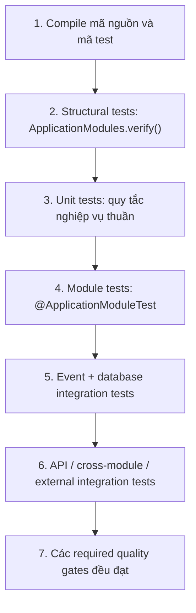
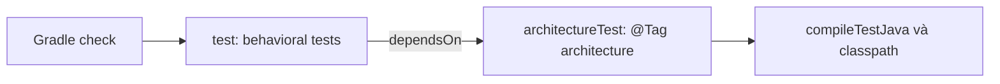
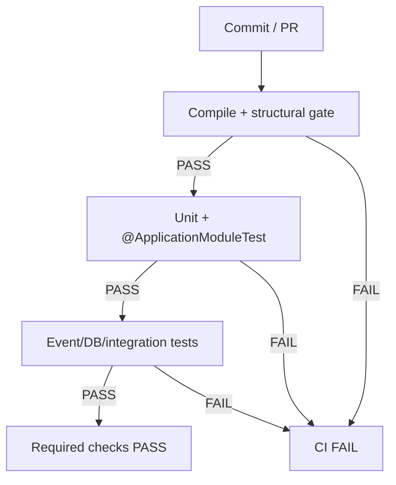
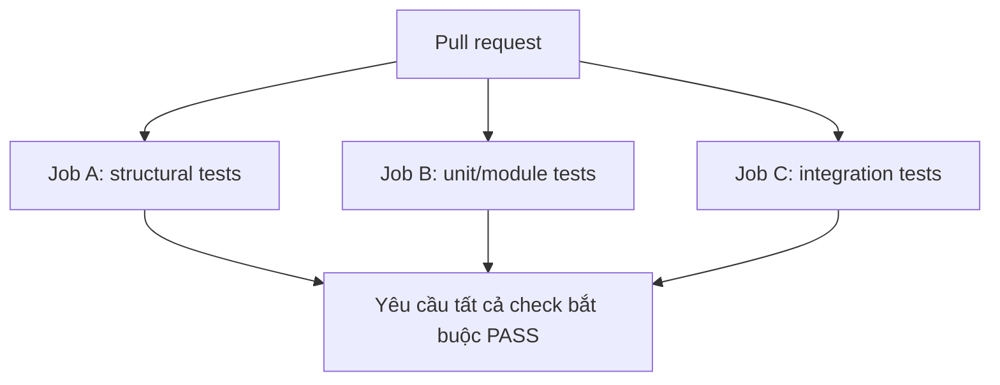

# Thứ tự chạy structural test và behavioral test

> **Chương:** Verification trong build  
> **Module học:** `SPRING_MODULITH_VERIFICATION_TESTING` — kiểm chứng ranh giới kiến trúc Spring Modulith bằng `ApplicationModules` và quy tắc phụ thuộc, đồng thời thực hành `@ApplicationModuleTest`, kiểm thử sự kiện, cơ sở dữ liệu, tích hợp và thiết lập quality gate trong CI.

## 1. Vì sao thứ tự kiểm thử quan trọng?

Hãy tưởng tượng một pull request thay đổi `orders.OrderService`. Developer vô tình gọi trực tiếp `inventory.internal.StockJpaRepository`. Ứng dụng vẫn biên dịch, nhưng đã vi phạm ranh giới module. Cùng pull request đó còn có nhiều unit test, bài kiểm thử module cần khởi tạo Spring context và một số integration test dùng database.

Nếu CI chạy tất cả bài test tích hợp nặng trước, nhóm có thể mất nhiều tài nguyên mới biết một lỗi **kiến trúc tĩnh** vốn có thể phát hiện sớm. Ngược lại, nếu chỉ chạy architectural test, build có thể xanh dù xử lý nghiệp vụ, transaction hoặc event bị hồi quy.

Vấn đề không chỉ là “test nào nhanh hơn”, mà còn là **test nào cần những điều kiện gì** và **một lỗi ở tầng này có cho phép kết luận về tầng khác hay không**.

Sau bài này, bạn có thể:

1. Phân biệt structural test và behavioral test trong ứng dụng Spring Modulith.
2. Đề xuất thứ tự chạy từ compile, architectural verification, unit test đến module/event/database/integration test.
3. Giải thích vì sao quy trình CI nên phát hiện vi phạm cấu trúc sớm nhưng vẫn bắt buộc các kiểm thử hành vi cần thiết.
4. Tổ chức Maven hoặc Gradle để thực thi các nhóm test đúng thời điểm, tránh lạm dụng thứ tự của từng phương thức `@Test`.
5. Lựa chọn giữa pipeline tuần tự và song song dựa trên chi phí, độ trễ và chính sách chất lượng.
6. Thiết kế thí nghiệm chứng minh structural gate và behavioral gate đều hoạt động.

## 2. Structural test và behavioral test trả lời hai câu hỏi khác nhau

### 2.1. Structural test: ứng dụng được nối với nhau có đúng quy tắc?

Trong Spring Modulith, `ApplicationModules` mô hình hóa các application module của ứng dụng. Phương thức `verify()` kiểm tra các bất biến kiến trúc như:

- Có chu trình phụ thuộc giữa các module hay không.
- Module này có truy cập kiểu nằm ngoài API được công bố của module khác hay không.
- Một module có phụ thuộc vào module ngoài danh sách `allowedDependencies` đã khai báo hay không.

Ví dụ, `orders` gọi `inventory.StockQuery` (API công bố) thường hợp lệ; `orders` dùng `inventory.internal.StockJpaRepository` có thể bị xem là vi phạm dù kiểu repository đó là `public` trong Java.

Structural test có thể chạy với JUnit thông thường:

```java
package com.example.shop;

import org.junit.jupiter.api.Tag;
import org.junit.jupiter.api.Test;
import org.springframework.modulith.core.ApplicationModules;

@Tag("architecture")
class ModuleArchitectureTest {

    @Test
    void verifiesBoundaries() {
        ApplicationModules.of(ShopApplication.class).verify();
    }
}
```

Lời gọi trên **không cần khởi động Spring ApplicationContext**, mở database hoặc chờ event listener. JUnit ghi FAIL nếu `verify()` báo vi phạm. Tuy nhiên, phạm vi của `ShopApplication.class` phải bao phủ các module cần kiểm chứng và bài test phải thật sự được build tool thực thi.

### 2.2. Behavioral test: module có làm đúng việc không?

Behavioral test kiểm tra hành vi quan sát được của một thành phần hoặc luồng nghiệp vụ. Ví dụ:

- Khi tồn kho không đủ, `orders` phải từ chối đặt hàng.
- Sau khi đặt hàng thành công, hệ thống phát sự kiện `OrderPlaced` với đúng thông tin.
- Một listener phản ứng đúng với event và không làm ghi dữ liệu trùng khi xử lý lại.
- Repository bảo đảm transaction và constraint dữ liệu.
- API trả trạng thái và nội dung đáp ứng quy tắc nghiệp vụ.

Trong Spring Modulith, `@ApplicationModuleTest` giúp viết các bài test khởi tạo ngữ cảnh Spring tập trung vào một module, với chế độ bootstrap và các phần phụ thuộc được cấu hình cho tình huống kiểm thử. Đây là phép thử **runtime**, khác với phép kiểm phụ thuộc tĩnh.

Ví dụ lớp module test chỉ minh họa phần bootstrap:

```java
package com.example.shop.orders;

import org.junit.jupiter.api.Test;
import org.springframework.modulith.test.ApplicationModuleTest;

@ApplicationModuleTest
class OrderModuleBootstrapTest {

    @Test
    void bootstrapsOrderModule() {
        // Test thành công khi ngữ cảnh module khởi tạo được.
        // Các bài test nghiệp vụ cần thêm assertion và dữ liệu phù hợp.
    }
}
```

Bài test này chứng minh khả năng bootstrap của một module trong phạm vi cấu hình, **chưa chứng minh** quy trình đặt hàng chạy đúng. Một behavioral test tốt cần dữ liệu và assertion cụ thể cho hành vi cần bảo vệ.

### 2.3. Cả hai đều quan trọng

| Câu hỏi | Structural test với `verify()` | Behavioral test |
| --- | --- | --- |
| `orders` import `inventory.internal` có đúng kiến trúc? | Có thể phát hiện | Có thể vẫn PASS nếu hành vi chưa bị ảnh hưởng |
| Có chu trình module hay vi phạm `allowedDependencies`? | Có thể phát hiện | Không phải mục tiêu chính |
| Khi hết tồn kho, hệ thống có từ chối đơn hàng? | Không đánh giá | Unit/module test |
| Spring beans của module có khởi tạo phù hợp? | Không cần khởi tạo context | `@ApplicationModuleTest` |
| Event phát đúng payload và listener xử lý đúng? | Không chứng minh | Event/module/integration test |
| Repository, transaction và migration hoạt động? | Không chứng minh | Database integration test |
| API và hệ thống ngoài phối hợp đúng? | Không chứng minh | Integration/end-to-end test |

**Kết luận ở mức phạm vi:** structural test PASS có nghĩa các quy tắc kiến trúc được kiểm tra đã đạt. Behavioral test PASS có nghĩa các kịch bản được chạy đã đạt. Hai kết quả không suy ra thay cho nhau.

## 3. Thứ tự khuyến nghị: từ điều kiện nền tảng đến kiểm thử tốn kém

Trong đa số dự án, một cách tổ chức hiệu quả là:



Thứ tự này là **chiến lược điều phối ở mức nhóm test/pipeline**, không phải yêu cầu rằng JUnit phải chạy phương thức `@Test` theo đúng thứ tự 1, 2, 3.

| Bước | Mục tiêu | Phụ thuộc chạy | Chi phí tương đối |
| --- | --- | --- | --- |
| Compile mã chính và mã test | Xác nhận cú pháp, kiểu, classpath | JDK, dependencies, generated sources nếu có | Thấp đến trung bình |
| Structural test | Bắt sai ranh giới module ngay khi code đã biên dịch | Test runtime, mô hình Spring Modulith | Thường thấp |
| Unit test | Kiểm tra thuật toán, điều kiện biên, business rules | Object và fixture đơn giản | Thường thấp |
| Module test | Kiểm tra cộng tác của Spring beans trong phạm vi module | Spring test context, cấu hình module | Trung bình |
| Event/DB integration test | Kiểm tra sự kiện, persistence, transaction | Context, dữ liệu, có thể cần DB/broker | Trung bình đến cao |
| API/external integration test | Kiểm tra luồng kết nối nhiều thành phần | Nhiều tài nguyên, hệ thống hoặc container | Thường cao |

**Compile luôn là điều kiện đi trước:** test kiến trúc cần mã đã biên dịch và bản thân test phải biên dịch được. Nếu compile FAIL, pipeline chưa có kết quả architectural verification có ý nghĩa. Việc xếp unit test trước structural test cũng có thể hợp lý ở dự án có unit tests cực nhanh và kiến trúc quét lâu; quy tắc quan trọng hơn thứ tự tuyệt đối là **mọi gate bắt buộc đều phải chạy và phản ánh lỗi**.

## 4. Vì sao structural test nên được ưu tiên chạy sớm?

### 4.1. Phản hồi lỗi thiết kế ngay tại pull request

Giả sử developer sửa một class:

```java
package com.example.shop.orders;

import com.example.shop.inventory.internal.StockJpaRepository;

class OrderService {
    private final StockJpaRepository repository;

    OrderService(StockJpaRepository repository) {
        this.repository = repository;
    }
}
```

Nếu `StockJpaRepository` là kiểu `public`, compiler có thể PASS. Nhưng `orders` đã phụ thuộc trực tiếp vào chi tiết lưu trữ của `inventory`, trái với quy tắc API module mặc định. Architectural test có thể báo FAIL trước khi khởi tạo database hoặc chạy các bài test API.

Sửa đúng thiết kế bằng một hợp đồng tại package công bố của module đích:

```java
package com.example.shop.inventory;

public interface StockQuery {
    boolean available(String sku, int quantity);
}
```

`inventory.internal` triển khai `StockQuery`; module `orders` phụ thuộc vào `StockQuery` thay cho repository. Sau sửa, phải chạy lại cả architectural test và behavioral tests để xác nhận logic tồn kho vẫn đúng.

### 4.2. Giảm chi phí lãng phí khi structural gate thất bại

Nếu suite integration test cần tạo database, tải schema và khởi tạo nhiều context, chạy chúng trước khi phát hiện một phụ thuộc sai có thể tốn tài nguyên. Trong một pipeline tuần tự, cho architectural test chạy trước giúp **fail fast** khi có lỗi cấu trúc.

Tuy nhiên, không nên suy rằng structural test càng sớm thì luôn tiết kiệm thời gian thực tế: với CI chạy job song song, critical path khác nhau. Quyết định nên xét thời gian của từng loại test, độ ổn định của môi trường và tốc độ phản hồi mong muốn.

### 4.3. Giảm nhầm lẫn khi chẩn đoán

Nếu structural test FAIL, người sửa có một tín hiệu tập trung: module nguồn, module đích và vi phạm policy. Nếu behavioral test FAIL, cần xem assertion, dữ liệu, Spring context, event hay database. Chia nhóm test và hiển thị job riêng giúp tránh trộn lẫn hai nguyên nhân.

## 5. Vì sao behavioral test vẫn bắt buộc chạy sau khi structural test PASS?

Ví dụ `orders` chỉ gọi API `inventory.StockQuery`, nên phụ thuộc hợp lệ. Nhưng đoạn logic sau vẫn sai:

```java
boolean canPlaceOrder(boolean stockAvailable) {
    return !stockAvailable; // Sai: cho đặt hàng khi không còn hàng.
}
```

`ApplicationModules.verify()` không thể kết luận thuật toán đó đúng hay sai. Một unit test có thể phát hiện ngay:

```java
import static org.junit.jupiter.api.Assertions.assertFalse;
import org.junit.jupiter.api.Test;

class OrderPolicyTest {

    private final OrderPolicy policy = new OrderPolicy();

    @Test
    void rejectsOrderWhenStockIsUnavailable() {
        assertFalse(policy.canPlaceOrder(false));
    }
}
```

Ví dụ giả định `OrderPolicy` là lớp nghiệp vụ có phương thức `canPlaceOrder(boolean)` như đoạn logic đã cho. Test cố ý mô tả **hành vi mong muốn**, vì vậy sẽ FAIL với triển khai `return !stockAvailable`.

Ngoài lỗi thuật toán, các vấn đề sau chỉ thể hiện rõ trong test runtime:

- `@ApplicationModuleTest` phát hiện bean thiếu dependency hoặc cấu hình module không hợp lệ ở thời điểm khởi tạo.
- Event test xác minh publisher phát `OrderPlaced` đúng payload và listener phản ứng theo hợp đồng.
- Database integration test kiểm tra transaction boundary, unique constraint, rollback và migration.
- Cross-module/API test kiểm tra request thật, serialization, authentication hoặc giao tiếp với dịch vụ khác.

Ngay cả khi structural test PASS và unit test PASS, một listener ghi dữ liệu sai transaction vẫn có thể làm integration test FAIL. Vì thế, **cổng cấu trúc là bước sớm của quy trình, không phải điểm kết thúc của chất lượng**.

## 6. Không dùng `@Order` để ép mọi JUnit test chạy theo thứ tự

JUnit Jupiter có các cơ chế chọn thứ tự thực thi test method và test class. Tuy nhiên, dùng `@TestMethodOrder` hoặc `@Order` để “structural test chạy trước toàn bộ behavioral test của repository” thường không giải quyết đúng bài toán:

- `@TestMethodOrder` chủ yếu điều khiển thứ tự **các phương thức trong một lớp test**, không tạo quan hệ phụ thuộc toàn bộ suite giữa Maven/Gradle projects hoặc CI jobs.
- Test suite có thể chạy song song, được filter theo tag, chia giữa Surefire/Failsafe hoặc task khác nhau; thứ tự method không thể đại diện cho điều phối pipeline.
- Một test chất lượng tốt nên độc lập về trạng thái và có thể chạy riêng; nếu test B chỉ PASS khi test A đã chạy trước để tạo dữ liệu, cần sửa thiết kế fixture.

Hãy dùng **task dependencies, build lifecycle, test filters và CI job dependencies** khi cần thứ tự ở mức giai đoạn. Trong từng nhóm, các bài test nên độc lập và có assertion/fixture riêng.

## 7. Maven: structural gate trước behavioral suite

### 7.1. Chuẩn bị test và build

Trong dự án Spring Boot sử dụng Maven và đã quản lý phiên bản Spring Modulith tương thích, test dependencies thường gồm:

```xml
<dependency>
    <groupId>org.springframework.boot</groupId>
    <artifactId>spring-boot-starter-test</artifactId>
    <scope>test</scope>
</dependency>
<dependency>
    <groupId>org.springframework.modulith</groupId>
    <artifactId>spring-modulith-starter-test</artifactId>
    <scope>test</scope>
</dependency>
```

`ModuleArchitectureTest` thuộc `src/test/java`, tên kết thúc `Test` để Maven Surefire thông thường phát hiện. Dự án cần JUnit Jupiter engine và bản Surefire hỗ trợ JUnit Platform. Nếu dependency versions chưa được quản lý bằng BOM hoặc parent tương thích, phải thêm dependency management theo phiên bản Spring Boot thực tế.

### 7.2. Cách đơn giản: hai lệnh CI liên tiếp

**Bước 1:** chỉ chạy structural test để phát hiện vi phạm nhanh:

```bash
./mvnw -B -Dtest=ModuleArchitectureTest test
```

**Bước 2:** khi bước 1 PASS, chạy toàn bộ các bài test và phase tiếp theo:

```bash
./mvnw -B verify
```

Trong GitHub Actions, đặt hai lệnh ở **hai step liên tiếp** của cùng job. Step sau mặc định chỉ chạy khi step trước thành công. Đây là cách dễ hiểu và có thể áp dụng khi chưa muốn tạo nhiều Maven profiles.

Lưu ý quan trọng:

- Bước 2 sẽ **chạy lại** `ModuleArchitectureTest` nếu nó nằm trong tập test mặc định. Sự lặp lại có chi phí nhưng tránh vô tình bỏ sót architectural test ở lần chạy suite đầy đủ.
- `mvn verify` gồm phase `test`, nhưng **không tự chạy integration test** nếu dự án chưa cấu hình Maven Failsafe hoặc cơ chế integration test tương đương.
- Nếu project có nhiều Maven submodule, phải bảo đảm lệnh được chạy trong reactor/phạm vi có chứa `ModuleArchitectureTest`; lệnh chọn một submodule khác có thể không chạy gate.
- Trên Windows dùng `mvnw.cmd` thay cho `./mvnw`.

### 7.3. Vị trí của kiểm thử tích hợp

Một dự án Maven có thể phân nhóm:

```text
test phase
└── Maven Surefire
    ├── ModuleArchitectureTest
    ├── OrderPolicyTest
    └── OrderModuleTest (nếu được cấu hình chạy như *Test)

integration-test + verify phases (nếu đã cấu hình)
└── Maven Failsafe
    ├── OrderDatabaseIT
    └── OrderApiIT
```

Các tên `*IT` thông thường dành cho Failsafe khi plugin được cấu hình đúng; chỉ đổi tên lớp sang `IT` không tự động kích hoạt Failsafe. Và ngay trong cùng một phase Surefire `test`, **không nên giả định** `ModuleArchitectureTest` luôn được chạy trước `OrderPolicyTest`: cần bước structural riêng như mục 7.2 nếu thứ tự là yêu cầu bắt buộc.

## 8. Gradle: một task structural riêng và quan hệ phụ thuộc rõ ràng

### 8.1. Kết nối JUnit Platform

Ví dụ dự án dùng Java plugin, Spring Boot và dependency management phù hợp, file `build.gradle` (Groovy DSL):

```groovy
dependencies {
    testImplementation 'org.springframework.boot:spring-boot-starter-test'
    testImplementation 'org.springframework.modulith:spring-modulith-starter-test'
}

tasks.named('test', Test) {
    useJUnitPlatform()
}
```

Với cấu hình này, task `test` có thể chạy cả structural và behavioral tests. Nếu muốn **chạy structural trước bằng task riêng**, cần bổ sung bước tổ chức test.

### 8.2. Tạo task `architectureTest`

Đặt annotation `@Tag("architecture")` trên lớp `ModuleArchitectureTest` như mục 2.1, rồi khai báo:

```groovy
tasks.register('architectureTest', Test) {
    description = 'Verify application module boundaries first'
    group = 'verification'

    testClassesDirs = sourceSets.test.output.classesDirs
    classpath = sourceSets.test.runtimeClasspath

    useJUnitPlatform {
        includeTags 'architecture'
    }
}
```

Task này dùng cùng các test class đã biên dịch nhưng chỉ chạy các bài JUnit có tag `architecture`. Kiểm tra report và số test được chạy để tránh tag thiếu dẫn tới không có bài kiểm chứng nào được thực thi.

### 8.3. Cho `test` chờ `architectureTest`

Nếu muốn giữ hai nhóm test riêng, cấu hình thêm:

```groovy
tasks.named('test', Test) {
    dependsOn tasks.named('architectureTest')

    useJUnitPlatform {
        excludeTags 'architecture'
    }
}
```

Với cấu hình trên, `./gradlew check` (trong Java plugin thông thường) gọi `test`; `test` phụ thuộc `architectureTest`, nên structural task cần hoàn thành trước. Nếu architectural test FAIL, Gradle thông thường sẽ không thực thi task `test` phụ thuộc vào nó; toàn bộ build báo FAIL.



Các mũi tên `dependsOn` diễn tả quan hệ phụ thuộc task, **không phải thứ tự chạy của từng `@Test`**. Trong cấu hình này, `architectureTest` chỉ được gắn vào `check` gián tiếp qua `test`. Khi cần chạy riêng structural test, dùng `./gradlew architectureTest`; để chạy toàn bộ suite theo cấu hình phân nhóm, dùng `./gradlew check`.

**Lưu ý khi chọn thiết kế này:**

- Các bài `@Tag("architecture")` sẽ **bị loại khỏi task `test`** và chỉ chạy qua `architectureTest`. Nếu ai đó chạy `./gradlew test`, dependency task vẫn bảo đảm hai nhóm được chạy.
- Nếu có nhiều task test hoặc custom test suite, phải tự nối chúng vào luồng phù hợp; chỉ cấu hình một task `test` không tự sắp xếp toàn bộ dự án nhiều subproject.
- Không dùng `ignoreFailures = true` cho structural task trong quality gate.
- Ở chế độ `--continue`, Gradle có thể tiếp tục chạy **các task độc lập** khi task khác thất bại; build cuối cùng vẫn phải FAIL. Đừng dựa vào việc mọi task đều lập tức dừng để đánh giá gate.
- Nếu muốn tối giản cấu hình, chỉ giữ task `test` mặc định chạy cả structural và behavioral tests cũng hoàn toàn phù hợp, miễn CI thực thi tất cả test bắt buộc. Điều đó không bảo đảm thứ tự structural trước unit tests.

## 9. CI: tuần tự hay song song?

Thứ tự logic không nhất thiết đồng nghĩa với việc mọi job phải chạy tuần tự. Có hai mô hình phổ biến:

### 9.1. Mô hình tuần tự: ưu tiên fail fast



Phù hợp khi architectural test nhanh, integration tests đắt đỏ và team muốn tiết kiệm tài nguyên mỗi lần lỗi ranh giới module.

GitHub Actions ví dụ dành cho Maven Wrapper:

```yaml
name: Verify module structure and behavior

on:
  pull_request:

jobs:
  verification:
    runs-on: ubuntu-latest
    steps:
      - uses: actions/checkout@v4
      - uses: actions/setup-java@v4
        with:
          distribution: temurin
          java-version: '21'

      - name: Structural gate first
        run: ./mvnw -B -Dtest=ModuleArchitectureTest test

      - name: Full test and verification suite
        run: ./mvnw -B verify
```

Trong GitHub Actions, một step thất bại sẽ khiến các step sau có điều kiện mặc định `success()` bị bỏ qua, đồng thời job thất bại. Cấu hình ví dụ cần được điều chỉnh cho JDK và dự án thực tế; test integration chỉ được chạy nếu build đã cấu hình nó.

### 9.2. Mô hình song song: ưu tiên thời gian phản hồi tổng thể



Trong mô hình này, kiến trúc sai có thể được báo sớm nhưng các job khác vẫn tiêu thụ tài nguyên. Đổi lại, tổng thời gian cho PR hợp lệ có thể ngắn hơn đáng kể. Nếu ba job đều quan trọng, cả ba cần thành công; không được chỉ xem trạng thái của job kiến trúc rồi cho phép merge.

### 9.3. Mô hình kết hợp

Một lựa chọn trung gian là cho compile + structural gate chạy đầu tiên, rồi mới kích hoạt đồng thời các job unit/module và DB/integration thông qua quan hệ `needs`. Cách này cân bằng việc giảm chi phí khi phát hiện lỗi ranh giới với tốc độ kiểm thử khi PR hợp lệ.

| Tiêu chí chọn mô hình | Tuần tự | Song song | Kết hợp |
| --- | --- | --- | --- |
| Phản hồi lỗi kiến trúc | Sớm | Sớm nếu job nhỏ | Sớm |
| Chi phí khi structural test FAIL | Thường thấp | Có thể cao do job khác vẫn chạy | Thường thấp |
| Thời gian tổng thể cho PR PASS | Có thể dài | Thường ngắn hơn | Tùy đồ thị |
| Mức độ phức tạp orchestration | Thấp | Trung bình | Trung bình |
| Điều kiện merge | Tất cả gate cần thiết PASS | Tất cả required jobs PASS | Tất cả required jobs PASS |

Thời gian ở bảng chỉ là xu hướng; cần đo trên pipeline thật trước khi kết luận mô hình nào nhanh nhất.

## 10. Những lỗi tổ chức thứ tự kiểm thử hay gặp

| Sai sót | Hệ quả | Cách khắc phục |
| --- | --- | --- |
| Chạy integration trước, structural test đặt rất muộn | Phát hiện sai dependency sau khi đã tiêu nhiều tài nguyên | Đưa structural gate vào bước sớm hoặc job riêng |
| Chỉ chạy `verify()`, bỏ toàn bộ behavioral tests | Có thể bỏ sót hồi quy nghiệp vụ, event, DB | Bắt buộc các nhóm test hành vi liên quan |
| Giả định Surefire chạy test class theo tên | Thứ tự dễ thay đổi, không tạo gate đúng nghĩa | Chạy structural test bằng bước riêng hoặc tách task |
| Dùng `@TestMethodOrder` để điều phối CI | Không quản lý được Maven/Gradle/CI jobs | Dùng task/job dependencies |
| Gradle `includeTags 'architecture'` trực tiếp trên task `test` mà không có task behavioral thay thế | Các unit/module tests khác bị loại bỏ | Tách task hoặc để task `test` chạy toàn bộ suite |
| Maven `-Dtest=ModuleArchitectureTest` là bước duy nhất của CI | Những test không được chọn bị bỏ qua | Chạy thêm full suite khi structural gate PASS |
| Maven `-DskipTests` hoặc Gradle `-x test` | Không có bằng chứng gate đã được thực thi | Bỏ cờ skip, kiểm tra test reports |
| Thất bại bị nuốt bằng `continue-on-error`, `ignoreFailures` hoặc shell xử lý sai | CI xanh giả dù test thất bại | Truyền exit code thất bại đến job và required check |
| Class `ModuleArchitectureTest` không được phát hiện | Test 0 trường hợp nhưng build vẫn có thể PASS | Kiểm tra tên lớp, source set, JUnit engine và report |
| `ApplicationModules.of(...)` quét thiếu package | Structural test xanh khi module vi phạm nằm ngoài phạm vi | Kiểm tra cấu trúc package và thử một vi phạm có chủ đích |

**Nguyên tắc khi đọc báo cáo:** phải xác nhận `ModuleArchitectureTest` được chạy thật; không suy ra kiến trúc hợp lệ từ việc build chỉ có dòng `BUILD SUCCESS`.

## 11. Thực hành: chứng minh cả hai gate độc lập

Giả sử một dự án Spring Boot có:

```text
com.example.shop
├── ShopApplication
├── orders
│   └── OrderService
└── inventory
    ├── StockQuery
    └── internal
        └── StockJpaRepository
```

**Nhiệm vụ A — Thiết lập baseline**

1. Thêm `ModuleArchitectureTest` gọi `ApplicationModules.of(ShopApplication.class).verify()`.
2. Viết `OrderPolicyTest` để kiểm tra đơn hàng bị từ chối khi hết tồn kho.
3. Có ít nhất một `@ApplicationModuleTest` xác nhận module có thể khởi tạo trong ngữ cảnh dự kiến; bổ sung event/DB integration tests tương ứng nếu nghiệp vụ dùng chúng.
4. Chạy bộ test đầy đủ, xác nhận số lượng test và báo cáo của từng nhóm.

**Nhiệm vụ B — Structural FAIL, behavioral có thể PASS**

1. Tạo kiểu `public` trong `inventory.internal` và cho `orders` tham chiếu trực tiếp.
2. Xác nhận Java compile PASS.
3. Chạy structural test: kỳ vọng FAIL vì vượt ranh giới.
4. Chạy riêng một behavioral unit test không liên quan: nó có thể PASS, nhưng không làm vi phạm kiến trúc biến mất.
5. Sửa phụ thuộc thông qua `StockQuery`, sau đó xác nhận structural test PASS.

**Nhiệm vụ C — Structural PASS, behavioral FAIL**

1. Giữ mọi phụ thuộc module hợp lệ.
2. Cố ý đảo điều kiện kiểm tra tồn kho: trả về `true` khi hàng không còn.
3. Xác nhận structural test vẫn PASS vì cấu trúc không thay đổi.
4. Xác nhận `OrderPolicyTest` FAIL vì kết quả nghiệp vụ sai.
5. Sửa điều kiện và chạy lại các test: cả structural và behavioral PASS.

**Nhiệm vụ D — Kiểm chứng thứ tự ở CI**

1. Thiết lập một chuỗi `structural → behavioral/integration` bằng hai Maven steps hoặc các Gradle task có dependency rõ ràng.
2. Trong một nhánh thử, tạo vi phạm cấu trúc rồi quan sát: architectural step FAIL và các bước phụ thuộc bị bỏ qua (trong mô hình tuần tự).
3. Trong nhánh thử khác, chỉ tạo lỗi nghiệp vụ: structural step PASS nhưng behavioral step FAIL.
4. Kiểm tra job CI trả trạng thái FAIL cho cả hai nhánh, và các required checks bảo vệ nhánh chính.
5. Sửa cả hai lỗi, chạy lại full suite và ghi nhận PASS.

### Tiêu chí nghiệm thu

- [ ] Architectural test chạy thật trong JUnit và tìm thấy trong report.
- [ ] Pipeline compile mã trước khi chạy test kiến trúc.
- [ ] Có ví dụ **compile PASS, structural FAIL** và có cách sửa bằng API module.
- [ ] Có ví dụ **structural PASS, behavioral FAIL** và test hành vi xác định được lỗi.
- [ ] CI thể hiện thứ tự giữa các nhóm test ở mức build task/job, không dựa vào thứ tự `@Test`.
- [ ] Khi kiểm tra cấu trúc PASS, các behavioral/module/event/DB/integration tests cần thiết vẫn được chạy.
- [ ] Job CI thực sự FAIL khi một trong các gate bắt buộc thất bại.
- [ ] Test reports và log đủ giúp xác định lỗi thuộc tầng nào.

## 12. Câu hỏi tự đánh giá

1. Vì sao Spring Modulith `ApplicationModules.verify()` nên được chạy sau compile nhưng trước các integration tests nặng trong một pipeline ưu tiên fail fast?
2. Một lớp JUnit có `@TestMethodOrder` có điều khiển được thứ tự chạy giữa Maven Surefire, Failsafe và các Gradle tasks không?
3. `verify()` PASS có thể chứng minh listener xử lý `OrderPlaced` đúng transaction hay không?
4. Trong Gradle, tại sao tạo `architectureTest` nhưng không nối nó vào `check` hoặc CI vẫn có nguy cơ bị bỏ qua?
5. Với Maven, tại sao chạy hai lệnh `-Dtest=ModuleArchitectureTest test` và `verify` có thể khiến architectural test chạy hai lần?
6. Khi muốn tối ưu thời gian CI, điểm đánh đổi lớn nhất giữa mô hình tuần tự và song song là gì?
7. Một PR có structural gate PASS nhưng behavioral gate FAIL có được coi là đạt chất lượng tổng thể hay không?
8. Bạn sẽ thiết kế thí nghiệm nào để chứng minh một job CI không “xanh giả” khi lỗi kiến trúc xuất hiện?

**Ghi nhớ:** Thứ tự hợp lý thường là **compile → structural verification → unit test → module test → event/DB/integration test → CI quality gates**. Structural test giúp bắt sai thiết kế sớm; behavioral tests bảo vệ kết quả runtime. Thứ tự này được điều phối bằng Maven/Gradle tasks và CI jobs, trong khi mọi bài test vẫn cần độc lập và mọi gate bắt buộc đều phải phản ánh thất bại.
