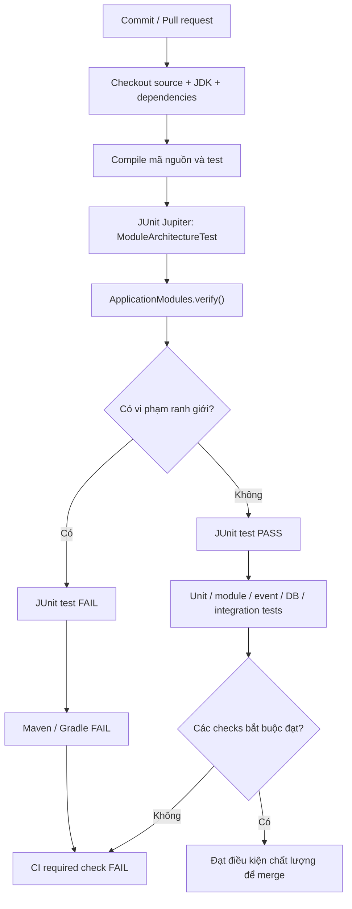
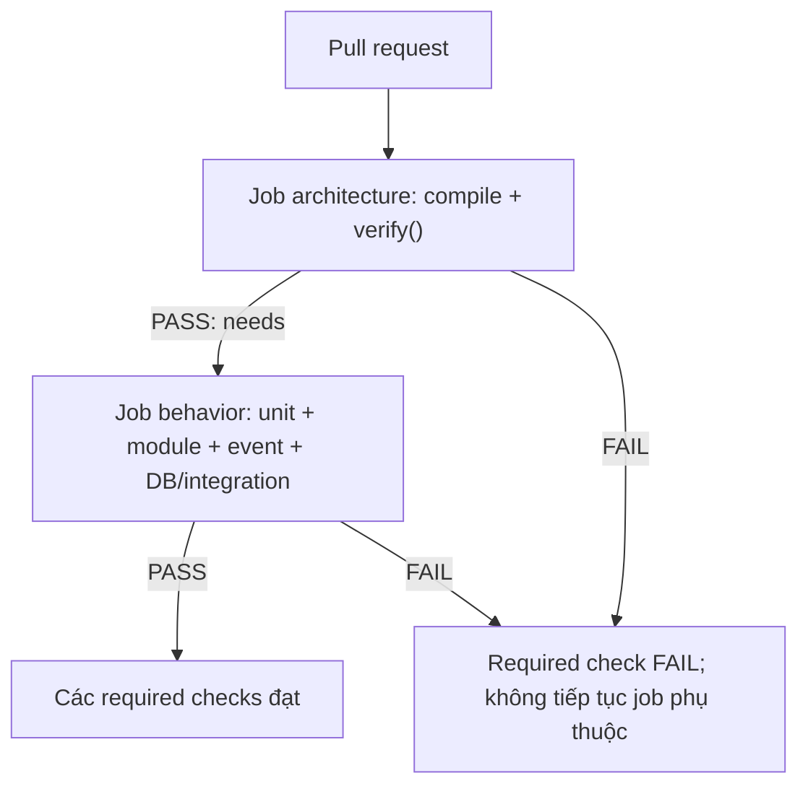

# Chạy verification trên CI

> **Chương:** Verification trong build  
> **Module học:** `SPRING_MODULITH_VERIFICATION_TESTING` — kiểm chứng ranh giới kiến trúc bằng `ApplicationModules` và chính sách phụ thuộc giữa module; phối hợp `@ApplicationModuleTest`, kiểm thử sự kiện, cơ sở dữ liệu và tích hợp thành quality gate chống hồi quy.

## 1. Mục tiêu

Sau bài học, bạn có thể:

1. Đưa `ApplicationModules.verify()` vào pipeline CI thông qua một bài JUnit Jupiter test.
2. Viết workflow GitHub Actions cho dự án Spring Modulith dùng Maven **hoặc** Gradle, từ checkout, thiết lập JDK đến chạy và lưu báo cáo test.
3. Hiểu đường đi của lỗi kiến trúc: **vi phạm phụ thuộc → JUnit FAIL → build FAIL → CI job FAIL → required check chưa đạt**.
4. Chọn cách chạy structural test sớm, sau đó chạy unit, `@ApplicationModuleTest`, event/database/integration tests.
5. Phát hiện CI “xanh giả” khi test bị skip, lọc sai, build không bao phủ module hoặc trạng thái lỗi bị bỏ qua.
6. Chứng minh quality gate hoạt động bằng phép thử có chủ đích: code biên dịch được nhưng vi phạm kiến trúc, rồi sửa và chạy lại.

**Tình huống:** Dự án bán hàng có hai application module `orders` và `inventory`. Team thống nhất `orders` chỉ sử dụng API công bố của `inventory`, không truy cập repository nằm trong `inventory.internal`. Một developer mở pull request vô tình tạo phụ thuộc không hợp lệ. Mục tiêu CI là phát hiện lỗi này trước khi merge, ngay cả khi biên dịch Java và một số unit test vẫn thành công.

## 2. “Chạy verification trên CI” thực sự gồm những bước gì?

**Continuous Integration (CI)** là quy trình tự động kiểm tra những thay đổi được đẩy lên repository. Với Spring Modulith, kiến trúc chỉ được bảo vệ nếu CI **thực thi được** phép kiểm và **giữ được trạng thái thất bại** từ phép kiểm đến quyết định merge.



Lưu ý hai thuật ngữ dễ nhầm:

| Tên | Cấp độ | Chức năng |
| --- | --- | --- |
| `ApplicationModules.verify()` | API Spring Modulith | Kiểm tra ranh giới và quy tắc phụ thuộc của application module |
| `mvn verify` | Phase vòng đời Maven | Chạy các phase đến `verify`, bao gồm `test` và plugin được cấu hình |
| `gradle check` | Task vòng đời Gradle Java plugin | Chạy các tác vụ kiểm tra gắn vào `check`, thường có `test` |
| Required status check | Quy tắc repository | Yêu cầu job/check cụ thể hoàn thành thành công trước khi merge |

Lệnh `mvn verify` không tự động biết `orders` được phép phụ thuộc vào module nào. Lệnh `gradle check` cũng vậy. **Điểm nối** là một bài JUnit gọi API `ApplicationModules.verify()` và được build tool khám phá, thực thi.

## 3. Chuẩn bị architectural test để CI có thứ cần chạy

Ví dụ ứng dụng Spring Boot đặt lớp chính ở `com.example.shop`:

```text
src/
├── main/java/com/example/shop/
│   ├── ShopApplication.java
│   ├── orders/
│   │   ├── OrderService.java
│   │   └── package-info.java
│   └── inventory/
│       ├── StockQuery.java
│       └── internal/StockJpaRepository.java
└── test/java/com/example/shop/
    └── ModuleArchitectureTest.java
```

Theo quy ước nhận diện module mặc định của Spring Modulith, `orders` và `inventory` là hai application module dưới package gốc. Các kiểu nằm ngay ở package gốc module thường thuộc API được công bố; package con như `inventory.internal` là phần triển khai. Dự án có thể tùy chỉnh phát hiện module và named interface, nên phạm vi quét cần được đối chiếu với cấu hình thực tế.

Tạo file `src/test/java/com/example/shop/ModuleArchitectureTest.java`:

```java
package com.example.shop;

import org.junit.jupiter.api.DisplayName;
import org.junit.jupiter.api.Tag;
import org.junit.jupiter.api.Test;
import org.springframework.modulith.core.ApplicationModules;

@Tag("architecture")
class ModuleArchitectureTest {

    @Test
    @DisplayName("Các application module tuân thủ ranh giới kiến trúc")
    void verifiesModuleBoundaries() {
        ApplicationModules.of(ShopApplication.class).verify();
    }
}
```

Điều kiện để test mang lại giá trị trên CI:

- Import `@Test` từ `org.junit.jupiter.api.Test` và có JUnit Jupiter TestEngine trên test runtime classpath.
- `ShopApplication.class` phải nằm trong package bao phủ các module cần kiểm chứng. Chọn lớp ở package quá hẹp có thể bỏ sót phụ thuộc sai.
- Test nằm ở source set `src/test/java`; tên `*Test` thuận lợi cho Maven Surefire và Gradle thông thường.
- Test **không cần** `@SpringBootTest` hay database: `verify()` phân tích mô hình module và báo lỗi kiến trúc mà không khởi tạo ứng dụng để phục vụ phép kiểm tĩnh.

Khi `verify()` báo lỗi, JUnit ghi FAIL. Không cần thêm assertion giả để JUnit quan sát kết quả.

### 3.1. Dependency test

Với Maven, giả sử dự án đã quản lý phiên bản Spring Boot và Spring Modulith tương thích:

```xml
<dependency>
    <groupId>org.springframework.boot</groupId>
    <artifactId>spring-boot-starter-test</artifactId>
    <scope>test</scope>
</dependency>
<dependency>
    <groupId>org.springframework.modulith</groupId>
    <artifactId>spring-modulith-starter-test</artifactId>
    <scope>test</scope>
</dependency>
```

Với Gradle Groovy DSL, cũng cần cơ chế quản lý phiên bản phù hợp:

```groovy
dependencies {
    testImplementation 'org.springframework.boot:spring-boot-starter-test'
    testImplementation 'org.springframework.modulith:spring-modulith-starter-test'
}

tasks.named('test', Test) {
    useJUnitPlatform()
}
```

Nếu dự án chưa có parent/BOM hoặc dependency management cho Spring Modulith, cần bổ sung cấu hình phiên bản phù hợp với Spring Boot đang dùng. Maven Surefire phải hỗ trợ JUnit Platform; Gradle `Test` task phải dùng `useJUnitPlatform()`. Đừng coi việc code biên dịch thành công là bằng chứng test đã được khám phá.

## 4. CI với GitHub Actions và Maven

Tại repository ứng dụng dùng Maven Wrapper, có thể tạo workflow `.github/workflows/modulith-verification.yml`. Đây là **ví dụ cấu hình**; không cần tạo file này nếu dự án dùng Gradle.

```yaml
name: Spring Modulith verification

on:
  pull_request:
    branches: [main]
  push:
    branches: [main]

permissions:
  contents: read

jobs:
  verify:
    name: Compile, test and verify
    runs-on: ubuntu-latest
    steps:
      - name: Checkout source
        uses: actions/checkout@v4

      - name: Set up Java
        uses: actions/setup-java@v4
        with:
          distribution: temurin
          java-version: '21'
          cache: maven

      - name: Run Maven verification
        run: ./mvnw -B --no-transfer-progress verify

      - name: Retain JUnit reports
        if: always()
        uses: actions/upload-artifact@v4
        with:
          name: surefire-reports
          path: '**/target/surefire-reports/**'
          if-no-files-found: warn
```

Các quyết định trong ví dụ:

1. `pull_request` kiểm tra ứng viên trước khi merge; `push` trên `main` cũng giúp phát hiện hồi quy sau khi thay đổi vào nhánh.
2. `actions/setup-java` tạo môi trường JDK thống nhất. Thay `21` bằng phiên bản Java mà dự án hỗ trợ.
3. `cache: maven` hỗ trợ tái sử dụng dependencies; nó không thay thế build hay việc chạy test.
4. `./mvnw -B --no-transfer-progress verify` chạy lifecycle Maven đến phase `verify`, trong đó Surefire thường chạy các bài JUnit `*Test` tại phase `test`.
5. `if: always()` giữ báo cáo Surefire để chẩn đoán kể cả khi một bước trước FAIL. Việc upload report không biến kết quả kiểm thử FAIL thành PASS.
6. `**/target/surefire-reports/**` có thể thu báo cáo từ các Maven submodule; đường dẫn report thực tế vẫn phụ thuộc cấu hình plugin.

**Điều kiện triển khai:** repository cần có `mvnw` và các file Maven Wrapper đi kèm; script phải chạy được trên Linux. Nếu không dùng Wrapper, thay bằng lệnh Maven được cài sẵn hoặc chuẩn hóa trên runner của tổ chức.

**Cẩn thận:** `mvn verify` chạy test tích hợp Failsafe chỉ khi dự án đã cấu hình plugin và lifecycle tương ứng. Nếu `@ApplicationModuleTest`, kiểm thử DB hoặc event được cấu hình thành các test tasks/profiles khác, workflow cần gọi thêm đúng các bước đó.

### 4.1. Điều gì khiến Maven job thất bại?

Khi test kiến trúc được Surefire thực thi:

```text
ModuleArchitectureTest.verifiesModuleBoundaries()
    → ApplicationModules.verify()
    → thông báo vi phạm phụ thuộc
    → JUnit FAIL
    → Surefire báo test failure
    → Maven exit code khác 0
    → GitHub Actions job FAIL
```

Thông báo exception cụ thể tùy phiên bản Spring Modulith. Khi phân tích cần tìm module nguồn, module đích và kiểu phụ thuộc gây lỗi, chẳng hạn `orders → inventory.internal.StockJpaRepository`.

## 5. CI với GitHub Actions và Gradle

Với dự án sử dụng Gradle Wrapper, workflow tương đương có thể là:

```yaml
name: Spring Modulith verification

on:
  pull_request:
    branches: [main]
  push:
    branches: [main]

permissions:
  contents: read

jobs:
  verify:
    name: Compile, test and check
    runs-on: ubuntu-latest
    steps:
      - name: Checkout source
        uses: actions/checkout@v4

      - name: Set up Java
        uses: actions/setup-java@v4
        with:
          distribution: temurin
          java-version: '21'
          cache: gradle

      - name: Run Gradle checks
        run: ./gradlew --no-daemon check

      - name: Retain test reports
        if: always()
        uses: actions/upload-artifact@v4
        with:
          name: gradle-test-results
          path: '**/build/test-results/**'
          if-no-files-found: warn
```

Với Java plugin, Gradle `check` thông thường phụ thuộc task `test`, còn task `test` chạy JUnit Platform khi đã gọi `useJUnitPlatform()`. Nếu project tùy chỉnh task hoặc tách `architectureTest` riêng, cần nối task đó vào `check` hoặc gọi rõ trong CI.

**Hai workflow trên là hai lựa chọn theo build tool, không phải hai file bắt buộc trong một project.** Cả hai đều cần bảo đảm câu lệnh chạy trên máy phát triển và môi trường CI cùng kiểm tra đúng module, đúng test runtime classpath.

## 6. Tách structural verification khỏi behavioral verification

Trong ứng dụng Spring Modulith, architectural test chỉ kiểm chứng các quan hệ module mà công cụ nhận diện. Nó không chứng minh được:

- `OrderService` xử lý trường hợp hết tồn kho đúng nghiệp vụ.
- Module khởi tạo Spring beans thành công trong `@ApplicationModuleTest`.
- `OrderPlaced` được phát với payload đúng và listener phản ứng chính xác.
- Transaction, JPA mapping và migration làm việc đúng với database.
- HTTP/API, message broker hoặc hệ thống bên ngoài tích hợp đúng.

Do đó, CI nên có cả **structural checks** và **behavioral checks**. Structural test thường có chi phí thấp, phù hợp để fail fast; module test và integration test có thể cần nhiều tài nguyên hơn.

| Tầng | Ví dụ | Phụ thuộc môi trường |
| --- | --- | --- |
| Compile | `javac`, `compileJava` | JDK và dependency classpath |
| Structural verification | JUnit gọi `ApplicationModules.verify()` | Test runtime, mã đã biên dịch |
| Unit test | Đơn hàng hết hàng phải bị từ chối | Fixture đơn giản, thường không cần Spring |
| Module test | `@ApplicationModuleTest` cho `orders` | Spring test context |
| Event/DB test | Publish/handle event, repository, transaction | DB/broker hoặc môi trường test phù hợp |
| Integration/API test | Luồng đặt hàng qua endpoint và các module | Nhiều thành phần runtime |

### 6.1. Một job đơn giản thường đã đủ

Nếu toàn bộ architectural, unit và module tests đều nằm trong source set `test`, còn integration tests đã được đưa vào vòng đời build, lệnh `./mvnw -B verify` hoặc `./gradlew check` có thể thực thi đủ các test cần thiết. Đây thường là cách khởi đầu ít cấu hình nhất.

Hãy kiểm tra báo cáo thực tế: tên lớp test, số test đã chạy, số failure và những nhóm test nào không được đưa vào lifecycle. Chạy `verify` hay `check` **không mặc nhiên** bao phủ mọi loại test mà nhóm đã viết.

### 6.2. Khi cần fail fast: hai bước trong cùng một job

Ví dụ Maven, chạy structural test riêng trước:

```yaml
- name: Architectural verification first
  run: ./mvnw -B -Dtest=ModuleArchitectureTest test

- name: Full test suite
  run: ./mvnw -B verify
```

Nếu architectural test FAIL, step tiếp theo thường bị bỏ qua theo điều kiện thành công mặc định của GitHub Actions, và job thất bại. Nếu PASS, full suite vẫn chạy và có thể chạy lại `ModuleArchitectureTest`. Việc chạy lại này có chi phí, nhưng giữ được sự kiểm chứng đầy đủ.

Trong Gradle, có thể làm tương tự:

```yaml
- name: Architectural verification first
  run: ./gradlew --no-daemon test --tests 'com.example.shop.ModuleArchitectureTest'

- name: Full test suite
  run: ./gradlew --no-daemon check
```

Các câu lệnh chọn riêng class phù hợp với **dự án đơn module build** hoặc khi tên/đường dẫn test đã rõ. Trong multi-module Maven reactor, `-Dtest=ModuleArchitectureTest` có thể khiến Surefire ở project không có lớp này báo lỗi; cần chọn đúng project bằng `-pl`/`-am` và cấu hình phát hiện test phù hợp. Với Gradle multi-project, dùng đường dẫn task subproject nếu cần, chẳng hạn `:app:test`.

### 6.3. Tách thành nhiều job có quan hệ phụ thuộc

Khi integration tests đòi hỏi container/database và tốn nhiều thời gian, một pipeline có thể dùng hai job:



Ví dụ phần `jobs` của GitHub Actions, dùng Maven Wrapper:

```yaml
jobs:
  architecture:
    runs-on: ubuntu-latest
    steps:
      - uses: actions/checkout@v4
      - uses: actions/setup-java@v4
        with:
          distribution: temurin
          java-version: '21'
      - name: Verify module boundaries
        run: ./mvnw -B -Dtest=ModuleArchitectureTest test

  behavior:
    needs: architecture
    runs-on: ubuntu-latest
    steps:
      - uses: actions/checkout@v4
      - uses: actions/setup-java@v4
        with:
          distribution: temurin
          java-version: '21'
      - name: Run required behavioral checks
        run: ./mvnw -B verify
```

Mỗi job chạy trong môi trường riêng; job `behavior` cần checkout, JDK và dependencies của chính nó. `needs: architecture` khiến `behavior` chỉ chạy theo điều kiện mặc định khi `architecture` thành công. Trong cấu hình này, `verify` ở job `behavior` thường chạy lại architectural test; có thể chấp nhận để full suite luôn đầy đủ.

Nếu chọn mô hình song song, bỏ quan hệ `needs` và đặt **tất cả job cần thiết** thành required checks. Job architectural FAIL không được che bởi job unit/integration PASS.

## 7. Từ job xanh/đỏ đến điều kiện merge

Một workflow khai báo trong repository mới chỉ tạo khả năng chạy CI. **Để thật sự chặn merge**, repository phải áp dụng branch protection/ruleset yêu cầu check tương ứng thành công.

Quy trình cấu hình chung cho GitHub:

1. Đẩy workflow lên repository và chạy ít nhất một lần để hệ thống ghi nhận tên check/job thực tế.
2. Mở phần cấu hình branch protection/ruleset dành cho nhánh đích, ví dụ `main`.
3. Bật yêu cầu các status checks thành công trước khi merge.
4. Chọn chính xác tên job chứa verification, ví dụ `Compile, test and verify`, hoặc cả hai job `architecture` và `behavior` nếu tách pipeline.
5. Thử trên pull request có vi phạm để xác nhận check FAIL thực sự làm PR chưa đủ điều kiện merge.

Đặt tên check ổn định và dễ phân biệt để tránh chọn nhầm job từ workflow khác. Với quy trình merge queue hoặc repository có quy tắc trigger đặc biệt, cần bảo đảm workflow được chạy trên các sự kiện phù hợp với chính sách đó.

Không nên dùng điều kiện lọc khiến **required check** không xuất hiện trên một số pull request cần được kiểm tra. Tùy quy tắc repository, check chưa chạy hoặc đang pending có thể gây kẹt merge; điều quan trọng là job cần thiết phải được kích hoạt nhất quán, không có lỗ hổng bị bỏ qua.

## 8. Một phép thử âm tính để chứng minh CI thực sự phát hiện vi phạm

Trước khi coi gate là hoàn thành, hãy tạo một vi phạm **có chủ đích** trên nhánh thử nghiệm. Đây là cách xác minh cả `verify()`, JUnit, build tool, CI và branch protection.

### 8.1. Cấu trúc hợp lệ ban đầu

Module `inventory` công bố API:

```java
package com.example.shop.inventory;

public interface StockQuery {
    boolean available(String sku, int quantity);
}
```

Module `orders` chỉ dùng `StockQuery`, còn triển khai truy vấn thực tế được giữ trong `inventory.internal`. Trước khi đưa lỗi vào, chạy architectural test và xác nhận report có bài `ModuleArchitectureTest` PASS.

### 8.2. Tạo code vẫn compile nhưng sai kiến trúc

Thêm kiểu `public` trong package nội bộ của `inventory`:

```java
package com.example.shop.inventory.internal;

public final class DebugStockCounter {

    private DebugStockCounter() {}

    public static int currentCount() {
        return 1;
    }
}
```

Sau đó tham chiếu từ `orders`:

```java
package com.example.shop.orders;

import com.example.shop.inventory.internal.DebugStockCounter;

class OrderProbe {
    boolean hasStock() {
        return DebugStockCounter.currentCount() > 0;
    }
}
```

Với quyền truy cập Java như ví dụ, mã có thể **compile PASS**. Nhưng `orders` đã phụ thuộc trực tiếp vào `inventory.internal`, vượt qua API công bố mặc định của module.

Chạy:

```bash
# Maven: code compile được, sau đó test phát hiện lỗi kiến trúc
./mvnw compile
./mvnw -Dtest=ModuleArchitectureTest test

# Hoặc với Gradle
./gradlew compileJava
./gradlew test --tests 'com.example.shop.ModuleArchitectureTest'
```

**Kết quả kỳ vọng:** compile PASS, architectural test FAIL. Khi đẩy branch thử lên pull request, job CI chứa test cũng FAIL. Nếu vẫn xanh, không nên kết luận `verify()` sai ngay; cần kiểm tra test có được thực thi, package gốc có quét đủ hai module, cấu hình API có được tùy chỉnh và lỗi có bị bỏ qua hay không.

### 8.3. Sửa dependency và quan sát gate xanh

Xóa tham chiếu `DebugStockCounter` khỏi `orders`, thay bằng `StockQuery` tại package gốc `inventory`. Để phần triển khai tồn kho nằm trong module sở hữu dữ liệu.

Chạy lại architectural test và full suite; khi tất cả gate bắt buộc PASS, check CI mới đạt. Việc **làm test xanh bằng cách tắt kiểm tra hoặc đưa repository nội bộ ra API công bố tùy tiện** có thể phá vỡ mục tiêu của bài.

## 9. Khi CI “xanh giả”: những điểm cần kiểm tra

| Tình huống | Vì sao nguy hiểm? | Cách xử lý |
| --- | --- | --- |
| Maven dùng `-DskipTests` hay `-Dmaven.test.skip=true` | Bỏ qua thực thi test, đôi khi cả biên dịch test | Gỡ cờ skip trong job gate; kiểm tra report có `ModuleArchitectureTest` |
| Gradle dùng `-x test` | Không chạy task test dù `check` có mặt | Không loại test khỏi job gate |
| `continue-on-error: true`, shell nuốt lỗi, `ignoreFailures` | Test FAIL nhưng CI vẫn có thể hiển thị PASS | Để exit code thất bại truyền đến job |
| Maven `testFailureIgnore` hoặc tương đương | Surefire có thể cho build tiếp tục dù test thất bại | Bỏ cấu hình bỏ qua test failures |
| JUnit Jupiter TestEngine thiếu | `@Test` có thể biên dịch nhưng test không chạy đúng | Kiểm tra dependency, Surefire và JUnit Platform |
| Gradle chưa gọi `useJUnitPlatform()` | Jupiter tests không được phát hiện như mong đợi | Cấu hình task `Test` chạy JUnit Platform |
| Test đặt tên không khớp Surefire | `*IT` có thể không chạy theo bộ lọc unit test mặc định | Dùng `*Test` hoặc cấu hình Failsafe phù hợp |
| CI chỉ chạy test với filter tag sai | Kết quả có thể là 0 test hoặc không có architectural test | Xem số test và report; sửa filter |
| `ApplicationModules.of(...)` quét thiếu | Vi phạm ở module nằm ngoài phạm vi vẫn không bị phát hiện | Xác nhận package gốc và thử một vi phạm có chủ đích |
| Chỉ build một Maven/Gradle subproject | Project có architectural test không được thực thi | Chạy đúng project/reactor và xem report của nó |
| Task `architectureTest` riêng không nối `check` | Lệnh `gradle check` bỏ qua gate riêng | Nối dependency task hoặc gọi task trong CI |
| Job không nằm trong required checks | Pull request có thể merge dù job FAIL | Bật branch protection/ruleset phù hợp |

### 9.1. Đọc report thay vì chỉ đọc `BUILD SUCCESS`

Vị trí báo cáo thường dùng:

```text
Maven:
target/surefire-reports/
  TEST-com.example.shop.ModuleArchitectureTest.xml

Gradle:
build/test-results/test/
  TEST-com.example.shop.ModuleArchitectureTest.xml
build/reports/tests/test/index.html
```

Đường dẫn có thể có tiền tố subproject hoặc thay đổi do cấu hình plugin. Tìm chính xác lớp `ModuleArchitectureTest`, số test được chạy và kết quả. Nếu file report không tồn tại, cần xác minh quá trình test discovery trước khi kết luận kiến trúc đã đạt.

### 9.2. Không đồng nhất lỗi compile và lỗi kiến trúc

`javac` có thể thất bại vì method signature sai, kiểu dữ liệu không tương thích, import tới lớp không tồn tại hoặc quyền truy cập Java không hợp lệ. Trường hợp này build dừng **trước khi** architectural test có kết quả.

Ngược lại, class `public` trong package nội bộ có thể được compiler chấp nhận; chỉ khi `ApplicationModules.verify()` chạy mới thấy dependency vượt ranh giới. Trong báo cáo CI phải chỉ rõ **giai đoạn và test nào** thất bại để người sửa không nhầm lỗi Java với lỗi chính sách module.

## 10. Chạy behavioral tests và tài nguyên tích hợp đáng tin cậy trên CI

Spring Modulith hỗ trợ `@ApplicationModuleTest` để chạy thử một module trong Spring test context. Đây là một bài test khác mục tiêu với `ApplicationModules.verify()`: nó có thể phát hiện lỗi khởi tạo bean, cộng tác giữa các thành phần, hoặc hành vi runtime.

Với các module dùng sự kiện và persistence, CI có thể cần:

- **Event tests:** khẳng định event đúng loại, đúng dữ liệu, listener xử lý theo contract. Những bài test liên quan đến xử lý bất đồng bộ cần đồng bộ hóa/điều kiện chờ phù hợp thay vì ngủ cố định tùy ý.
- **Database tests:** chuẩn bị database test phù hợp với loại database thật, migration/schema và dữ liệu xác định; kiểm tra transaction và constraint.
- **Integration tests:** chuẩn bị những dịch vụ phụ thuộc bằng service containers, Testcontainers hoặc test doubles theo phạm vi bài test; không giả định runner GitHub có sẵn database hay broker.
- **Secrets/configuration:** dùng cơ chế secrets của hệ thống CI cho thông tin nhạy cảm; không hardcode credentials vào workflow.

Với Maven, các lớp integration test kiểu `*IT` có thể được chạy bằng Failsafe khi đã cấu hình phù hợp. Với Gradle, có thể tạo test suite/task riêng và nối vào `check` hoặc bước CI bắt buộc. **Tên lệnh `verify` hoặc `check` tự nó không chứng minh các bài test động này đã được cấu hình chạy.**

Một pipeline đầy đủ nên có báo cáo độc lập hoặc ít nhất phân biệt được nguyên nhân lỗi: architectural dependency, assertion nghiệp vụ, bootstrap Spring context, event, database hay hệ thống tích hợp.

## 11. Checklist trước khi bật required check

| Điểm cần xác nhận | Bằng chứng nên có |
| --- | --- |
| Test kiến trúc tồn tại | `ModuleArchitectureTest` dùng JUnit Jupiter và gọi `ApplicationModules.of(...).verify()` |
| CI khám phá và chạy test | Test report chứa lớp và số test được chạy lớn hơn 0 |
| Phạm vi quét đầy đủ | Lớp ứng dụng gốc bao phủ các module và phép thử âm tính được phát hiện |
| Build truyền failure đúng | Khi `verify()` FAIL, Maven/Gradle trả mã thoát khác 0 |
| CI truyền failure đúng | Job FAIL khi architectural test FAIL, không dùng cờ bỏ qua |
| Có nhánh được bảo vệ | Job tương ứng nằm trong required checks/ruleset |
| Full suite được thực thi | Unit, `@ApplicationModuleTest`, event, DB và integration tests liên quan đều có đường chạy |
| Báo cáo còn truy cập được | Log và XML/HTML reports có thể xem khi job FAIL |
| Dự án dùng một build tool rõ ràng | Maven/Gradle workflow phù hợp repository, JDK và dependencies ổn định |
| Thử nghiệm hồi quy đã đạt | FAIL khi tạo dependency sai; PASS sau khi sửa bằng API hợp lệ |

## 12. Bài thực hành: thiết lập và kiểm chứng CI gate

**Bối cảnh:** Repository ứng dụng cửa hàng có module `orders` và `inventory`, lớp `ShopApplication` ở package gốc, bài `ModuleArchitectureTest` như mục 3. Dự án dùng **Maven hoặc Gradle** theo cấu hình có sẵn.

### Phần A — Dựng pipeline

1. Đặt file architectural test trong source set test và xác minh nó chạy trên máy phát triển.
2. Thêm GitHub Actions workflow tương ứng với build tool, JDK và tên nhánh thực tế.
3. Chạy full test suite trong CI; lưu báo cáo JUnit kể cả khi thất bại.
4. Kiểm tra report có architectural test, các bài kiểm thử nghiệp vụ/module liên quan và số lượng test đúng kỳ vọng.

### Phần B — Kiểm tra đường truyền lỗi

1. Tạo kiểu `public` trong `inventory.internal`; thêm tham chiếu từ `orders`.
2. Chạy compile riêng và xác nhận Java code vẫn hợp lệ.
3. Chạy architectural test và ghi lại thông báo vi phạm.
4. Đẩy branch thử, tạo pull request và xác nhận CI job FAIL.
5. Bật required check trên nhánh đích và xác nhận PR chưa đạt điều kiện merge.

### Phần C — Sửa và chống hồi quy

1. Xóa phụ thuộc vào kiểu nội bộ; chuyển caller sang `inventory.StockQuery`.
2. Chạy lại structural test, sau đó full suite gồm behavioral tests liên quan.
3. Đẩy commit sửa, xác nhận job/check PASS và báo cáo có kết quả test.
4. Kiểm tra lại workflow không dùng `skipTests`, `-x test`, filter sai, bỏ qua failure hay package root thiếu.

### Tiêu chí nghiệm thu

- [ ] CI có lệnh Maven/Gradle chạy JUnit architectural test thực sự.
- [ ] Có bằng chứng **compile PASS, architectural verification FAIL** khi tạo dependency sai.
- [ ] Vi phạm được phản ánh bằng JUnit failure, build failure và CI job failure.
- [ ] Required check chặn merge khi architectural job FAIL.
- [ ] Sau khi sửa bằng API module, architectural test cùng behavioral suite cần thiết PASS.
- [ ] Báo cáo CI đủ để phân biệt lỗi ranh giới, lỗi hành vi và lỗi hạ tầng test.
- [ ] Không cần merge mã có lỗi để chứng minh quality gate hoạt động.

## 13. Câu hỏi tự đánh giá

1. Vì sao chỉ khai báo `./mvnw verify` trong workflow chưa đủ để khẳng định `ApplicationModules.verify()` đã chạy?
2. Khi JUnit architectural test FAIL nhưng CI vẫn báo xanh, bạn kiểm tra những cấu hình nào trước?
3. Vì sao phải thử một phụ thuộc sai có chủ đích thay vì chỉ tin một lần build PASS?
4. `needs: architecture` thay đổi thứ tự và hành vi của job `behavior` như thế nào?
5. Kết quả `@ApplicationModuleTest` PASS có thay thế được structural verification không? Vì sao?
6. Trong dự án Maven nhiều submodule, vì sao lệnh `-Dtest=ModuleArchitectureTest test` có thể cần chọn phạm vi project cụ thể?
7. Khi workflow CI chạy thành công nhưng required check chưa được cấu hình, repository đã được bảo vệ trước vi phạm kiến trúc chưa?
8. Nếu `verify()` PASS nhưng listener xử lý sự kiện sai transaction, cần bổ sung loại test nào?

**Ghi nhớ:** Chạy verification trên CI là tạo một đường kiểm chứng xuyên suốt từ `ApplicationModules.verify()` đến JUnit, Maven/Gradle, job CI và required merge check. **Bài test phải thực sự chạy, lỗi phải được giữ nguyên và các behavioral tests vẫn phải được thực thi.** Chỉ khi đã chứng minh FAIL với vi phạm có chủ đích rồi PASS sau khi sửa, quality gate mới có bằng chứng hoạt động đúng.
