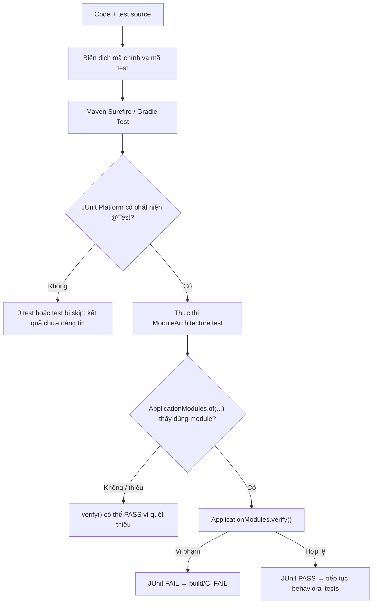
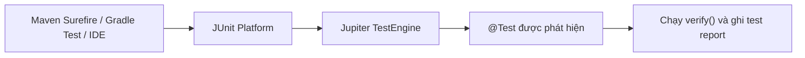

# Bảo đảm test cấu trúc được phát hiện tự động

> **Chương:** Verification trong build  
> **Module học:** `SPRING_MODULITH_VERIFICATION_TESTING` — kiểm chứng ranh giới kiến trúc ứng dụng Spring Modulith bằng `ApplicationModules` và các quy tắc phụ thuộc giữa module; phối hợp với `@ApplicationModuleTest`, kiểm thử sự kiện, cơ sở dữ liệu, tích hợp và quality gate trong CI.

## 1. Vấn đề: build xanh nhưng không có bài kiểm chứng kiến trúc nào chạy

Một nhóm phát triển tạo `ModuleArchitectureTest` để gọi `ApplicationModules.verify()`. Tuy nhiên, trong CI, Maven báo `BUILD SUCCESS` dù một lớp thuộc module `orders` vừa tham chiếu trực tiếp tới `inventory.internal.StockJpaRepository`.

Có ít nhất **hai khả năng rất khác nhau** cần điều tra:

1. **JUnit không phát hiện hoặc không thực thi `ModuleArchitectureTest`**: tên lớp không khớp quy ước, thiếu test engine, bộ lọc loại test, dùng sai source set hoặc task test bị bỏ qua.
2. **JUnit có chạy test nhưng Spring Modulith không phát hiện đúng các application module**: lớp gốc truyền vào `ApplicationModules.of(...)` nằm sai package, phạm vi quét thiếu module hoặc cơ chế khai báo module của dự án khác giả định.

Vì vậy, một cổng kiểm chứng kiến trúc đáng tin cậy cần trả lời được hai câu hỏi độc lập: **“Bài test có thực sự được chạy?”** và **“Bài test có kiểm tra đúng tập module?”**.

Sau bài này, bạn có thể:

- Giải thích chuỗi khám phá test từ build tool đến JUnit Platform/Jupiter và chuỗi phát hiện module của Spring Modulith.
- Đặt, đặt tên và cấu hình `ModuleArchitectureTest` để Maven Surefire hoặc Gradle `Test` task tự động tìm thấy.
- Kiểm tra `@Test`, JUnit Jupiter TestEngine, tag/filter, classpath, multi-project và trạng thái `@Disabled`.
- Dùng test report và một phép thử cố ý làm sai kiến trúc để chứng minh `verify()` thực sự chạy.
- Thiết lập CI quality gate ngăn trạng thái xanh giả, đồng thời không bỏ sót unit, module, event, database và integration tests.

## 2. Hai tầng “discovery” cần kiểm soát



| Tầng | Ai thực hiện? | Bằng chứng tối thiểu |
| --- | --- | --- |
| **Khám phá bài test** | JUnit Platform, Jupiter TestEngine, Maven Surefire hoặc Gradle `Test` | Báo cáo có `ModuleArchitectureTest`, số bài test đã thực thi lớn hơn 0 và không bị skip |
| **Khám phá application module** | Spring Modulith `ApplicationModules.of(...)` | Các module cần bảo vệ thực sự nằm trong mô hình được tạo từ lớp gốc; vi phạm mẫu bị `verify()` phát hiện |
| **Thực thi chính sách** | `ApplicationModules.verify()` trong phương thức `@Test` | Khi phụ thuộc sai được đưa vào, test FAIL; sau khi sửa ranh giới, test PASS |
| **Bảo vệ merge** | Maven/Gradle, CI, branch protection/ruleset | Test FAIL làm lệnh build và required job FAIL |

Đừng nhầm `mvn verify` (phase vòng đời Maven) với `ApplicationModules.verify()` (API kiểm tra kiến trúc). Maven chỉ gọi API đó nếu bài JUnit chứa lời gọi đã được khám phá và chạy trong vòng đời build.

## 3. Tạo bài test đúng vị trí, đúng annotation

Giả sử Spring Boot application class nằm trong package `com.example.shop`:

```text
src/
├── main/java/com/example/shop/
│   ├── ShopApplication.java
│   ├── orders/
│   │   ├── OrderService.java
│   │   └── internal/OrderRepository.java
│   └── inventory/
│       ├── StockQuery.java
│       └── internal/StockJpaRepository.java
└── test/java/com/example/shop/
    └── ModuleArchitectureTest.java
```

Với cách phát hiện module mặc định của Spring Modulith, `orders` và `inventory` là các application module nằm trực tiếp dưới package ứng dụng. Kiểu tại package gốc của mỗi module thường thuộc API được công bố; các package con như `inventory.internal` không tự động được công bố cho module khác. Dự án có thể điều chỉnh bằng cách khai báo module hoặc named interface, nên cần kiểm tra cấu hình thực tế.

Tạo `src/test/java/com/example/shop/ModuleArchitectureTest.java`:

```java
package com.example.shop;

import org.junit.jupiter.api.DisplayName;
import org.junit.jupiter.api.Tag;
import org.junit.jupiter.api.Test;
import org.springframework.modulith.core.ApplicationModules;

@Tag("architecture")
class ModuleArchitectureTest {

    @Test
    @DisplayName("Application modules tuân thủ ranh giới kiến trúc")
    void verifiesModuleBoundaries() {
        ApplicationModules.of(ShopApplication.class).verify();
    }
}
```

Các chi tiết quyết định việc bài test được phát hiện:

1. **Đúng source set:** `src/test/java` là vị trí chuẩn của mã test trong dự án Maven và Gradle Java thông thường. Một file ở thư mục tự tạo như `tests/architecture/` có thể không được biên dịch hoặc tìm thấy nếu chưa cấu hình.
2. **Đúng framework:** sử dụng `org.junit.jupiter.api.Test` của JUnit Jupiter; `org.junit.Test` là annotation JUnit 4 và cần runner/engine khác.
3. **Đúng engine:** JUnit Jupiter TestEngine phải có trên test runtime classpath; chỉ khai báo API `@Test` để biên dịch không đảm bảo runtime tìm thấy test.
4. **Tên lớp rõ ràng:** đuôi `Test` tương thích quy ước khám phá phổ biến của Maven Surefire. Gradle dùng JUnit Platform để tìm test, nhưng vẫn nên dùng tên nhất quán để tránh bị build tool, IDE hoặc bộ lọc bỏ sót.
5. **Không bị tắt:** kiểm tra `@Disabled`, điều kiện `@EnabledOn...`/`@DisabledOn...`, `@Tag` và các bộ lọc include/exclude của task.
6. **Không cần Spring context:** chỉ gọi `ApplicationModules.of(...).verify()` không đòi hỏi `@SpringBootTest` hoặc `@ApplicationModuleTest`.

JUnit Jupiter cho phép lớp test và phương thức `@Test` có quyền truy cập package-private. Không cần tự thêm `public` chỉ để test được khám phá.

## 4. Hiểu đúng JUnit Platform discovery

JUnit Platform là hạ tầng khám phá/thực thi; JUnit Jupiter gồm API viết test và Jupiter TestEngine thực thi test. Maven/Gradle đóng vai trò gọi hạ tầng đó khi chạy test.



Một phương thức Java tên `verifyArchitecture` không tự trở thành JUnit test. Nó cần `@Test` hoặc cơ chế test phù hợp, phải nằm trên test runtime classpath và không bị filter loại bỏ. Ngược lại, có `@Test` nhưng thiếu Jupiter engine hoặc không chạy tác vụ test thì mã vẫn có thể biên dịch mà không tạo ra một kết quả kiểm chứng có ý nghĩa.

### 4.1. `@Tag` chỉ là metadata, không tự chạy test

`@Tag("architecture")` dùng để chọn nhóm test khi cần. Nếu build mặc định chạy toàn bộ JUnit tests, lớp có tag vẫn được chạy. Tuy nhiên, các cấu hình như `includeTags("unit")` hoặc `excludeTags("architecture")` có thể vô tình loại structural test khỏi suite.

Ví dụ: một pipeline chỉ chạy `@Tag("unit")` mà `ModuleArchitectureTest` chỉ có tag `architecture` sẽ không chứng minh ranh giới module hợp lệ. Luôn xem báo cáo có tên bài test cần thiết.

### 4.2. Test được tìm thấy nhưng bị bỏ qua cũng chưa đủ

Một lớp có thể xuất hiện trong report với kết quả **skipped** thay vì executed. Chẳng hạn:

```java
import org.junit.jupiter.api.Disabled;
import org.junit.jupiter.api.Test;

@Disabled("Ví dụ: lớp này đang bị tắt")
class DisabledArchitectureTest {

    @Test
    void wouldVerifyArchitecture() {
        // Phương thức này không chạy khi lớp bị @Disabled.
    }
}
```

Đây là ví dụ để nhận diện lỗi cấu hình. Khi kiểm tra CI, không chỉ xác nhận file XML tồn tại: cần xem số test, số failure, số skipped và kết quả thực thi thật của test kiến trúc.

## 5. Maven Surefire: khám phá tự động và cách kiểm chứng

### 5.1. Dependencies và plugin

Nếu dự án dùng parent/BOM Spring Boot và Spring Modulith tương thích, phần test dependency có thể gồm:

```xml
<dependencies>
    <dependency>
        <groupId>org.springframework.boot</groupId>
        <artifactId>spring-boot-starter-test</artifactId>
        <scope>test</scope>
    </dependency>

    <dependency>
        <groupId>org.springframework.modulith</groupId>
        <artifactId>spring-modulith-starter-test</artifactId>
        <scope>test</scope>
    </dependency>
</dependencies>
```

Ví dụ không ghim phiên bản vì dự án cần quản lý phiên bản Spring Boot, Spring Modulith và JUnit tương thích. Maven Surefire phải dùng phiên bản hỗ trợ JUnit Platform; Spring Boot parent phổ biến thường quản lý plugin. Nếu tự quản lý `pom.xml`, cần xác nhận cả plugin và Jupiter TestEngine.

Theo các mẫu mặc định thường dùng, Surefire tìm các lớp có tên như:

| Tên lớp | Thường được Surefire phát hiện mặc định? | Ghi chú |
| --- | --- | --- |
| `ModuleArchitectureTest` | Có | Đuôi `*Test` phù hợp |
| `ArchitectureTests` | Có | Đuôi `*Tests` phù hợp |
| `TestArchitecture` | Có | Tiền tố `Test*` phù hợp |
| `ArchitectureTestCase` | Có | Đuôi `*TestCase` phù hợp |
| `ModuleArchitectureIT` | Không theo bộ mẫu Surefire mặc định | Thường dành cho Maven Failsafe khi đã cấu hình |
| `CheckModuleBoundaries` | Không đảm bảo | Cần cấu hình include hoặc đổi tên phù hợp |

Các mẫu này có thể bị dự án tùy chỉnh qua cấu hình `includes`/`excludes`. Việc lớp Java được biên dịch không đủ để biết nó có nằm trong tập chạy thực tế hay không.

### 5.2. Chạy có mục tiêu để xác nhận discovery

```bash
# Chạy toàn bộ bài kiểm thử theo cấu hình Surefire.
./mvnw test

# Yêu cầu chạy cụ thể bài test kiến trúc.
./mvnw -Dtest=ModuleArchitectureTest test

# Sau đó chạy toàn bộ vòng đời verification của dự án.
./mvnw -B verify
```

Trên Windows sử dụng `mvnw.cmd`; nếu dự án không có Maven Wrapper có thể dùng `mvn`. Lệnh `-Dtest=ModuleArchitectureTest` giúp quan sát trực tiếp lớp test có được chọn hay không. Theo cấu hình Surefire thông thường, yêu cầu chạy một test được chỉ định nhưng không tìm thấy sẽ làm lệnh thất bại; nếu dự án đã thay đổi `failIfNoSpecifiedTests` hoặc cơ chế skip, phải kiểm tra lại.

Nên tìm kết quả tại vị trí thường gặp:

```text
target/surefire-reports/
├── TEST-com.example.shop.ModuleArchitectureTest.xml
└── com.example.shop.ModuleArchitectureTest.txt
```

Trong XML hoặc báo cáo văn bản, xác nhận lớp `ModuleArchitectureTest` thực thi ít nhất một bài test, `skipped = 0` cho bài kiến trúc, và kết quả PASS/FAIL rõ ràng. Report path có thể khác nếu dự án tùy chỉnh plugin hoặc có nhiều Maven modules.

### 5.3. Có nên bật “fail nếu không có test”?

Maven Surefire có tùy chọn `failIfNoTests` để xem tập test rỗng là lỗi. Ví dụ cấu hình trong project **bắt buộc phải có test**:

```xml
<build>
    <plugins>
        <plugin>
            <groupId>org.apache.maven.plugins</groupId>
            <artifactId>maven-surefire-plugin</artifactId>
            <configuration>
                <failIfNoTests>true</failIfNoTests>
            </configuration>
        </plugin>
    </plugins>
</build>
```

Cấu hình này phát hiện tình huống **không có test nào** trong tập Surefire, nhưng chưa khẳng định **test kiến trúc cụ thể** đã được chạy. Đối với Maven multi-module reactor, một số submodule không có unit tests hợp lệ; bật `failIfNoTests=true` cho tất cả submodule có thể tạo lỗi giả. Hãy chọn phạm vi áp dụng phù hợp và luôn kiểm tra tên `ModuleArchitectureTest` trong report của project chứa bài kiến trúc.

## 6. Gradle: cấu hình Jupiter và xác nhận task thực thi

### 6.1. Bật JUnit Platform cho task `test`

Ví dụ `build.gradle` theo Groovy DSL với dependency management phù hợp:

```groovy
dependencies {
    testImplementation 'org.springframework.boot:spring-boot-starter-test'
    testImplementation 'org.springframework.modulith:spring-modulith-starter-test'
}

tasks.named('test', Test) {
    useJUnitPlatform()
}
```

`useJUnitPlatform()` là bước quan trọng để Gradle chạy JUnit Jupiter. Một dự án tự quản lý phiên bản JUnit cần bảo đảm cả API và engine/launcher phù hợp trên test runtime classpath. Khi áp dụng ví dụ, đối chiếu với Gradle, Spring Boot và Spring Modulith đang dùng trong project.

### 6.2. Chạy và xem báo cáo

```bash
# Kiểm tra toàn bộ tập test mặc định.
./gradlew test

# Kiểm tra đúng lớp kiến trúc theo tên đầy đủ.
./gradlew test --tests 'com.example.shop.ModuleArchitectureTest'

# Chạy task verification chung của Java plugin.
./gradlew check
```

Trên Windows sử dụng `gradlew.bat`. Khi dùng `--tests`, Gradle thường báo lỗi nếu không có test nào khớp bộ lọc, giúp phát hiện lớp bị đổi tên hoặc không được khám phá. Tuy nhiên, bộ lọc đã cấu hình và tình huống test bị disabled vẫn cần xem báo cáo:

```text
build/test-results/test/
└── TEST-com.example.shop.ModuleArchitectureTest.xml

build/reports/tests/test/
└── index.html
```

Đừng nhầm `test SKIPPED`, `NO-SOURCE` và task `test` thực sự chạy thành công. Các trạng thái `UP-TO-DATE` hoặc `FROM-CACHE` có thể là kết quả cache hợp lệ; khi đang điều tra discovery, kiểm tra đầu vào, report hoặc chạy `--rerun-tasks` cho một lần chẩn đoán có chủ đích.

### 6.3. Task chuyên biệt để thất bại nếu thiếu test kiến trúc

Nếu dự án cần một gate riêng, tạo task `architectureTest` dùng chính compiled test classes nhưng chọn **đích danh** test kiến trúc:

```groovy
tasks.register('architectureTest', Test) {
    description = 'Verify Spring Modulith boundaries'
    group = 'verification'

    dependsOn tasks.named('testClasses')
    testClassesDirs = sourceSets.test.output.classesDirs
    classpath = sourceSets.test.runtimeClasspath

    useJUnitPlatform()

    filter {
        includeTestsMatching 'com.example.shop.ModuleArchitectureTest'
        failOnNoMatchingTests = true
    }
}

tasks.named('check') {
    dependsOn tasks.named('architectureTest')
}
```

Chạy `./gradlew architectureTest` để quan sát test kiến trúc riêng, hoặc `./gradlew check` để chạy nó như một gate của build. `failOnNoMatchingTests = true` làm task thất bại nếu bộ lọc đã định không khớp bài test nào. Tên package/class trong ví dụ phải đổi theo project thật.

Đây là task bổ sung: nếu `test` mặc định đã chạy `ModuleArchitectureTest`, bài kiến trúc có thể chạy hai lần khi `check` gọi cả hai task. Điều đó chấp nhận được nếu ưu tiên khả năng kiểm soát discovery, nhưng không bắt buộc với ứng dụng nhỏ. Nếu thiết kế một suite tách riêng hoàn toàn, cần quyết định có loại test kiến trúc khỏi task `test` mặc định hay không mà vẫn bảo đảm full suite.

## 7. Test có chạy nhưng Spring Modulith quét thiếu module

Phát hiện JUnit test thành công vẫn chưa đủ. Ví dụ:

```java
@Test
void verifiesArchitecture() {
    ApplicationModules.of(ShopApplication.class).verify();
}
```

Nếu `ShopApplication` được đặt tại package không chứa `orders` và `inventory`, hoặc cách nhận diện application module đã được tùy chỉnh, phép kiểm có thể không bao phủ những phần mà team định bảo vệ.

### 7.1. Đặt lớp bootstrap trong package gốc phù hợp

Ví dụ tổ chức dễ hiểu:

```text
com.example.shop
├── ShopApplication
├── orders
└── inventory
```

Truyền `ShopApplication.class` thuộc `com.example.shop` để Spring Modulith xem các package con trực tiếp là module theo quy ước mặc định. Nếu dự án đặt các phần cần kiểm chứng ở module Maven/Gradle khác hoặc package nằm ngoài cây này, cần đánh giá cách khởi tạo `ApplicationModules` và classpath thực tế, không chỉ đổi tên lớp test.

### 7.2. Thêm một kiểm tra phòng ngừa mô hình rỗng

Trong ứng dụng mẫu dự kiến có ít nhất hai module, có thể bổ sung assertion về số lượng module được phát hiện:

```java
package com.example.shop;

import static org.junit.jupiter.api.Assertions.assertTrue;

import java.util.stream.StreamSupport;
import org.junit.jupiter.api.Test;
import org.springframework.modulith.core.ApplicationModules;

class ModuleArchitectureTest {

    @Test
    void verifiesExpectedModuleStructure() {
        ApplicationModules modules =
                ApplicationModules.of(ShopApplication.class);

        long moduleCount = StreamSupport
                .stream(modules.spliterator(), false)
                .count();

        assertTrue(moduleCount >= 2,
                "Expected at least orders and inventory modules");

        modules.verify();
    }
}
```

Ngưỡng `>= 2` chỉ phù hợp với **ví dụ có ít nhất hai module**. Với dự án thực, hãy chọn điều kiện phản ánh cấu trúc mong đợi và kiểm tra thêm **định danh các module quan trọng** khi cần; chỉ kiểm đếm số lượng không thể chứng minh hai module đúng đã được nhận diện. Cách kiểm tra mạnh nhất vẫn là một thử nghiệm chủ đích: đưa phụ thuộc sai từ `orders` sang `inventory.internal` và xác nhận phép kiểm FAIL.

### 7.3. Đừng làm lộ nội bộ chỉ để test xanh

Nếu module công bố thêm một `@NamedInterface`, package con đó có thể được coi là API hợp lệ. Cấu hình `@ApplicationModule(allowedDependencies = ...)` cũng quyết định module nguồn được phép phụ thuộc vào đâu.

Khi một phụ thuộc nghi ngờ không bị chặn, cần phân biệt:

- Test không được JUnit thực thi.
- Test được chạy nhưng `ApplicationModules` không thấy module nguồn/đích.
- Spring Modulith thấy các module nhưng quy tắc API/named interface hiện tại **cho phép** dependency.
- Phụ thuộc nằm ngoài kiểu quan hệ tĩnh mà công cụ nhận diện, chẳng hạn giao tiếp qua HTTP hay message broker.

Không nên tự động sửa policy bằng cách công bố repository nội bộ hoặc mở rộng dependency chỉ để báo cáo kiến trúc chuyển xanh.

## 8. Dự án nhiều Maven modules hoặc Gradle subprojects

**Application module** của Spring Modulith và **build module/subproject** của Maven/Gradle không phải cùng một khái niệm. Một application module thường là một phần trong cấu trúc package, trong khi build module là đơn vị biên dịch và khai báo dependency.

Ví dụ một Maven reactor:

```text
repo/
├── pom.xml
├── shop-app/           # chứa ShopApplication và ModuleArchitectureTest
├── shared-contracts/   # không chứa architectural test
└── migration-tools/    # không chứa architectural test
```

Nếu CI chỉ chạy build tại `migration-tools`, nó không thể tự suy ra cần thực thi `ModuleArchitectureTest` ở `shop-app`. Tương tự, một Gradle task `:shared-contracts:test` không đồng nghĩa với `:shop-app:test`.

Ví dụ chạy có chủ đích:

```bash
# Maven: chọn project chứa kiến trúc (dùng artifact/module path thật).
./mvnw -pl shop-app -am test

# Gradle: chạy test của subproject ứng dụng.
./gradlew :shop-app:test --tests 'com.example.shop.ModuleArchitectureTest'
```

Với Maven reactor, lệnh `-Dtest=ModuleArchitectureTest` có thể làm Surefire ở những submodule không chứa class này báo “không tìm thấy test”. Hãy chọn đúng project hoặc cấu hình test filter theo từng project; không tắt toàn bộ kiểm tra chỉ để loại bỏ thông báo. Cần xem báo cáo ở đúng thư mục chứa test, không chỉ tại repository root.

Một test còn cần thấy các lớp của module liên quan trên runtime classpath; nếu build tách code thành artifact không được đưa vào phạm vi kiểm chứng, `verify()` không thể phát hiện các dependency không hiện diện trong mô hình.

## 9. CI: biến discovery thành điều kiện kiểm chứng được

Nên thiết kế CI có **hai mức bằng chứng**:

1. **Bằng chứng JUnit discovery:** bước gọi đích danh `ModuleArchitectureTest` thật sự chạy; nếu test vắng mặt thì job báo lỗi.
2. **Bằng chứng quality gate:** toàn bộ test cần thiết tiếp tục chạy, và khi `verify()` tìm thấy phụ thuộc sai, trạng thái lỗi truyền xuyên suốt Maven/Gradle đến CI.

### 9.1. Ví dụ GitHub Actions cho Maven

Giả sử dự án dùng Maven Wrapper, JDK 21 và test nằm trong project hiện tại:

```yaml
name: Modulith architecture discovery gate

on:
  pull_request:
  push:
    branches: [main]

permissions:
  contents: read

jobs:
  verification:
    runs-on: ubuntu-latest
    steps:
      - uses: actions/checkout@v4
      - uses: actions/setup-java@v4
        with:
          distribution: temurin
          java-version: '21'

      - name: Prove architectural test is discoverable
        run: ./mvnw -B -Dtest=ModuleArchitectureTest test

      - name: Run full verification suite
        run: ./mvnw -B verify

      - name: Collect Surefire reports
        if: always()
        uses: actions/upload-artifact@v4
        with:
          name: surefire-reports
          path: '**/target/surefire-reports/**'
          if-no-files-found: warn
```

Với cấu hình Maven Surefire thông thường, nếu test được chỉ đích danh nhưng không tồn tại, bước đầu sẽ FAIL. Cần kiểm tra report cho tình huống class bị disabled hoặc đã tùy chỉnh cấu hình bỏ qua fail. Bước full suite chạy lại architectural test cùng các kiểm thử còn lại; đây là đánh đổi đơn giản, dễ kiểm chứng. Chỉnh lệnh và report path khi code nằm trong một submodule.

### 9.2. Ví dụ cho Gradle

Trong project có Gradle Wrapper và `useJUnitPlatform()`, có thể dùng hai bước:

```yaml
- name: Prove architectural test is discoverable
  run: ./gradlew --no-daemon test --tests 'com.example.shop.ModuleArchitectureTest'

- name: Run all required checks
  run: ./gradlew --no-daemon check
```

Trong Gradle multi-project, thay `test` bằng đường dẫn task như `:shop-app:test`. Nếu tạo task `architectureTest` riêng như mục 6.3 và nối task đó vào `check`, có thể chạy thẳng `./gradlew --no-daemon check` và xác nhận cả report của task kiểm chứng.

### 9.3. Đưa job vào required checks

Sau khi workflow đã chạy, cấu hình branch protection/ruleset để yêu cầu job `verification` thành công trước khi merge. Một bài test có tồn tại trong source code và một workflow có tồn tại trong repository **chưa đủ** tạo thành cổng chặn merge.

Không dùng các cách nuốt lỗi như `continue-on-error: true`, Maven `testFailureIgnore`, Gradle `ignoreFailures = true`, hoặc `-DskipTests`/`-x test` tại job bắt buộc. Ngoài ra, không nên dùng trigger/filter khiến job không chạy trên những PR cần được bảo vệ.

## 10. Chẩn đoán theo triệu chứng

| Hiện tượng | Phân loại | Hành động tiếp |
| --- | --- | --- |
| `ModuleArchitectureTest` không có trong Surefire report | Test không được khám phá/chạy | Kiểm tra `src/test/java`, đuôi `*Test`, Surefire includes/excludes, module build |
| Gradle báo không tìm thấy test với `--tests` | Test không khớp filter hoặc không được Jupiter phát hiện | Kiểm tra package/tên class, `useJUnitPlatform()`, engine và source set |
| Test có trong report nhưng skipped | Có metadata test, không có execution | Xem `@Disabled`, điều kiện OS/JRE, JUnit tags và cấu hình filter |
| `compileTestJava`/`testCompile` FAIL | Test chưa biên dịch | Sửa lỗi import, Java source hoặc test dependency trước khi đánh giá kiến trúc |
| Report có test PASS nhưng cố ý tham chiếu `inventory.internal` vẫn không FAIL | Test chạy nhưng mô hình/rule không phát hiện dependency dự kiến | Kiểm tra điểm bắt đầu `ApplicationModules.of(...)`, số/tên module, named interface và policy |
| Maven `BUILD SUCCESS` kèm `Tests run: 0` | Không có xác nhận về kiến trúc | Chạy riêng `-Dtest=ModuleArchitectureTest`, kiểm tra `failIfNoTests` và report |
| Task `test` bị `NO-SOURCE` | Không có lớp test đầu vào | Kiểm tra source sets, module được chọn, task dependencies |
| CI job xanh dù architectural test FAIL ở máy phát triển | Có đường bỏ qua hoặc môi trường khác nhau | So sánh build command, Java version, skip flags, reports, task selection |
| Chỉ chạy unit tests theo tag `unit` | Structural test `architecture` bị lọc bỏ | Chạy full suite hoặc task architecture bắt buộc |
| Project chứa test không nằm trong build CI | Multi-project selection sai | Chọn đúng Maven module/Gradle subproject chứa test |
| Test chạy nhưng không thấy lỗi phụ thuộc runtime qua REST | Ngoài phạm vi kiểm chứng tĩnh | Bổ sung API/integration tests, không kỳ vọng `verify()` kiểm tra traffic runtime |

Một **diagnostic checklist** hữu ích theo thứ tự là: mã test đã được biên dịch chưa → có Jupiter engine không → runner có chọn đúng test không → report cho thấy execution hay skip → `ApplicationModules` quét đúng module không → quy tắc dependency có đúng không → CI có truyền fail và chặn merge không.

## 11. Phân biệt structural verification với behavioral verification

Đảm bảo test kiến trúc được phát hiện tự động là một phần của chiến lược kiểm thử Spring Modulith. Những phép kiểm còn lại giải quyết các câu hỏi khác:

| Loại test | Mục tiêu | Cần tự động được phát hiện trong CI? |
| --- | --- | --- |
| JUnit `ModuleArchitectureTest` gọi `verify()` | Quy tắc phụ thuộc, ranh giới API, chu trình module | Có |
| Unit tests | Logic nghiệp vụ, điều kiện biên và nhánh lỗi | Có |
| `@ApplicationModuleTest` | Bootstrap và tương tác runtime trong phạm vi module | Có, nếu là kiểm thử bắt buộc |
| Event tests | Event được phát và listener xử lý đúng | Có, khi module giao tiếp qua sự kiện |
| Database integration tests | Repository, transaction, migration, ràng buộc dữ liệu | Có, nếu dữ liệu là phần quan trọng của module |
| API/integration tests | Giao tiếp giữa ứng dụng và thành phần khác | Có, theo tiêu chí chất lượng dự án |

Không nên sửa “test kiến trúc không chạy” bằng cách thay nó bằng `@ApplicationModuleTest`: module test có thể khởi tạo Spring context thành công trong khi code vẫn tham chiếu vào một package nội bộ không được phép. Ngược lại, `verify()` PASS không chứng minh listener xử lý đúng hay database transaction an toàn.

Trong CI, hãy bảo đảm **tất cả các nhóm test cần thiết** có đường chạy và required checks phù hợp. Một bước chỉ chọn `ModuleArchitectureTest` chủ yếu dùng xác nhận discovery hoặc fail fast, không thay thế full suite.

## 12. Bài thực hành: chứng minh không thể “xanh giả”

**Bối cảnh:** Ứng dụng `ShopApplication` có `orders`, `inventory` và `ModuleArchitectureTest`. Chọn **một** build tool đúng với project đang học.

### Phần A — Kiểm tra JUnit khám phá test

1. Tạo file đúng đường dẫn `src/test/java/com/example/shop/ModuleArchitectureTest.java` với `org.junit.jupiter.api.Test`.
2. Bảo đảm Maven Surefire/JUnit Platform hoặc Gradle `useJUnitPlatform()` có đầy đủ dependency cần thiết.
3. Chạy riêng test bằng `-Dtest=ModuleArchitectureTest` hoặc `--tests 'com.example.shop.ModuleArchitectureTest'`.
4. Mở report: ghi lại class, số test đã thực thi, số skipped và kết quả PASS/FAIL.
5. Thử đổi tên class thành tên không khớp filter/loại khỏi source set **trên nhánh thử nghiệm**, rồi xác nhận lệnh chạy đích danh phát hiện sự vắng mặt; khôi phục lại.

### Phần B — Kiểm tra Spring Modulith khám phá module

1. Xác nhận `ShopApplication` nằm ở package gốc bao phủ `orders` và `inventory`.
2. Thêm assertion kiểm tra số application module tối thiểu phù hợp với mô hình mẫu.
3. Thêm một kiểu `public` thuộc `inventory.internal`, để lớp trong `orders` dùng trực tiếp kiểu đó.
4. Chạy compile: kỳ vọng Java hợp lệ; chạy `ModuleArchitectureTest`: kỳ vọng FAIL vì phụ thuộc qua API module.
5. Nếu test vẫn PASS, kiểm tra phạm vi quét, chính sách named interface và các cấu hình dependency trước khi thay đổi test.

### Phần C — Đưa kiểm tra discovery vào CI

1. Thêm bước chạy đích danh architectural test vào workflow.
2. Thêm bước chạy full suite và lưu báo cáo test, kể cả khi một bước kiểm thử thất bại.
3. Thiết lập CI job thành required check ở nhánh cần bảo vệ.
4. Trên nhánh thử nghiệm, tạo vi phạm phụ thuộc để xác nhận JUnit FAIL → build FAIL → CI FAIL.
5. Sửa bằng API `inventory.StockQuery`, chạy lại structural và behavioral tests; xác nhận CI PASS.

### Tiêu chí nghiệm thu

- [ ] File test có tên/đường dẫn đúng và được biên dịch trong test source set.
- [ ] JUnit Jupiter engine thực sự khám phá `@Test` và report cho thấy test được thực thi, không skipped.
- [ ] Mô hình `ApplicationModules` chứa đúng các module cần bảo vệ.
- [ ] Có trường hợp compile PASS nhưng `verify()` FAIL khi dependency vượt ranh giới module.
- [ ] Build/CI FAIL nếu architectural test vắng mặt theo bộ lọc chạy đích danh.
- [ ] Build/CI FAIL khi `verify()` phát hiện vi phạm và required check chặn merge.
- [ ] Sau khi sửa, architectural test và các behavioral tests cần thiết PASS.

## 13. Câu hỏi tự đánh giá

1. Vì sao một file có `@Test` hợp lệ về cú pháp vẫn có thể không được Maven Surefire hoặc Gradle chạy?
2. Khác biệt giữa “JUnit không phát hiện test” và “Spring Modulith không phát hiện module” là gì?
3. Tại sao kiểm tra `Tests run: 0` quan trọng hơn việc chỉ nhìn `BUILD SUCCESS`?
4. `@Tag("architecture")` có làm bài test tự động chạy trong CI không?
5. Vì sao `@Disabled` có thể khiến test xuất hiện trong report mà chưa thực sự kiểm chứng được gì?
6. Cấu hình `failIfNoTests=true` của Maven có chứng minh `ModuleArchitectureTest` cụ thể đã chạy không?
7. Dự án nhiều Maven/Gradle subprojects cần xác định điều gì trước khi chạy test kiến trúc có chọn lọc?
8. Nếu `verify()` PASS dù bạn cố ý tạo phụ thuộc vào `inventory.internal`, bạn sẽ điều tra theo thứ tự nào?

**Ghi nhớ:** Tự động phát hiện structural test gồm **khám phá và thực thi JUnit test** lẫn **phát hiện đúng application modules**. Chỉ khi có báo cáo test đã chạy, phép thử âm tính bị chặn và CI truyền lỗi tới required check, kết quả PASS của `ApplicationModules.verify()` mới là bằng chứng đáng tin cậy cho ranh giới kiến trúc đã được kiểm tra.
