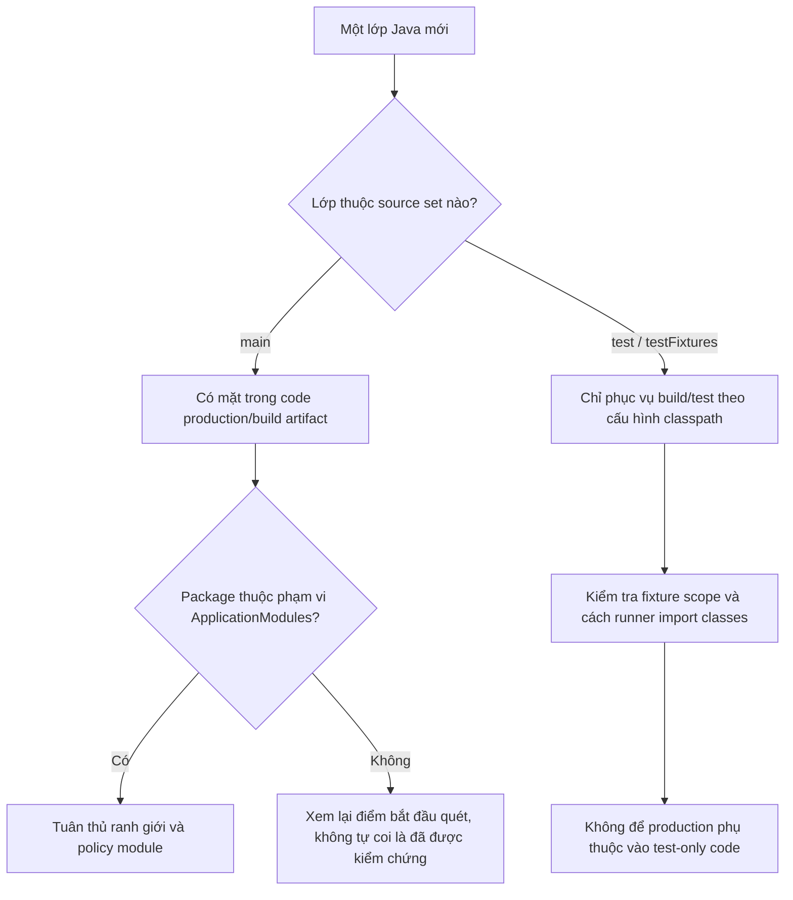

# Xử lý module demo, fixture và package thử nghiệm

> **Chương:** Verification trong build  
> **Phạm vi:** `SPRING_MODULITH_VERIFICATION_TESTING` — kiểm chứng ranh giới kiến trúc ứng dụng Spring Modulith bằng `ApplicationModules` và quy tắc phụ thuộc giữa module; kết hợp `@ApplicationModuleTest`, kiểm thử sự kiện, cơ sở dữ liệu, tích hợp và quality gate trong CI.

## 1. Bài toán: một package demo có thể làm sai mô hình module

Giả sử dự án Spring Boot có hai application module nghiệp vụ `orders` và `inventory`. Để minh họa nghiệp vụ, nhóm thêm `com.example.shop.demo` vào `src/main/java`, đặt vài lớp chạy thử ở đó và import trực tiếp `inventory.internal.StockJpaRepository`. Khi chạy `ApplicationModules.verify()`, bài kiểm chứng kiến trúc báo vi phạm — dù người viết chỉ xem các lớp đó là “demo”.

Ở chiều ngược lại, một nhóm đưa toàn bộ mã thử nghiệm vào `src/test/java` nhưng vô tình đặt fixture tại package gần giống module production; kết quả unit test, `@ApplicationModuleTest` hoặc phép kiểm cấu trúc thay đổi so với dự kiến. Việc “chỉ là test code” không giải quyết mọi vấn đề về package, classpath và phạm vi module.

Sau bài này, bạn có thể:

1. Phân biệt **application module**, **Java package**, **build module** và **source set** — bốn khái niệm thường bị nhầm khi tổ chức demo/fixture.
2. Giải thích vì sao một package `demo` hoặc `testsupport` trong `src/main/java` có thể bị xem là module thật theo quy ước mặc định của Spring Modulith.
3. Quyết định nơi đặt demo code, object fixture, `@TestConfiguration`, dữ liệu SQL và hỗ trợ test dùng chung mà không làm rò rỉ dependency vào ứng dụng production.
4. Tổ chức `@ApplicationModuleTest`, event tests và database/integration tests theo module mà chúng kiểm chứng.
5. Kiểm tra `ApplicationModules.of(...).verify()` có bao phủ đúng các module nghiệp vụ, không bỏ sót code production hoặc kiểm tra nhầm mã demo.
6. Đưa các quyết định trên thành kiểm tra lặp lại được trong Maven/Gradle và CI.

**Nguyên tắc trung tâm:** Đừng quyết định một lớp có phải thành phần của kiến trúc production hay không chỉ dựa vào từ “demo”, “fixture”, “mock” hoặc “test” trong tên package. Hãy xét đồng thời **vị trí source set, classpath, package và quy tắc module**.

## 2. Bốn lớp tổ chức không đồng nghĩa nhau

| Khái niệm | Ví dụ | Ý nghĩa đối với verification |
| --- | --- | --- |
| **Java package** | `com.example.shop.inventory.internal` | Không gian tên chứa kiểu Java; Java visibility và dependency dùng package/class |
| **Spring Modulith application module** | `inventory` | Ranh giới kiến trúc mà `ApplicationModules` khám phá theo package/quy tắc đã cấu hình |
| **Build module/subproject** | Maven `shop-app`, Gradle `:shop-app` | Đơn vị build và dependency; không mặc nhiên trùng với application module |
| **Build source set** | `src/main/java`, `src/test/java`, `src/testFixtures/java` | Quyết định lớp được biên dịch ở tập nào, xuất hiện trong artifact nào và trên classpath nào |

Với quy ước phát hiện module thông thường của Spring Modulith, những package con **trực tiếp** dưới package gốc ứng dụng có thể trở thành application module:

```text
src/main/java/com/example/shop/
├── ShopApplication.java
├── orders/                 # application module nghiệp vụ
├── inventory/              # application module nghiệp vụ
├── demo/                   # có thể bị nhận diện như module thứ ba
└── testsupport/            # cũng có thể bị nhận diện như module khác
```

Nếu dự án chỉ mong đợi `orders` và `inventory`, hai package `demo` và `testsupport` ở **main source set** là dấu hiệu phải xem lại, không phải thứ có thể tự động bỏ qua vì tên của chúng.



**Cảnh báo về phạm vi quét:** `ApplicationModules` dựa trên các lớp có thể phân tích trong phạm vi khám phá đã cấu hình. Chi tiết có nhận các class test/fixture có trên test runtime classpath hay không có thể chịu ảnh hưởng phiên bản và cấu hình importer. Không mặc định suy rằng mọi file `src/test/java` được đưa vào mô hình production, cũng không mặc định suy rằng mọi class test đều bị loại khỏi phân tích. Hãy xác minh bằng kết quả phát hiện module và phép thử có chủ đích.

## 3. Demo code: chọn vị trí theo mục đích thực sự

Từ “demo” có thể mô tả ba loại mã khác nhau:

| Demo dùng để làm gì? | Cách tổ chức nên cân nhắc | Lý do |
| --- | --- | --- |
| Ví dụ phục vụ bài học hoặc tài liệu, **không** đi vào bản phát hành | Test source set, ví dụ riêng hoặc project mẫu độc lập | Không làm phình module nghiệp vụ và artifact production |
| Khởi tạo dữ liệu / giả lập input cho **kiểm thử** | `src/test/java`, `src/test/resources` hoặc test fixtures source set | Dependency chỉ thuộc test scope; dễ kiểm soát vòng đời |
| Chức năng demo thực sự được triển khai và chạy trong ứng dụng | Coi là thành phần production có chủ đích, đặt API/module rõ ràng | Vẫn phải tuân thủ các quy tắc phụ thuộc như các module khác |

### 3.1. Anti-pattern: package `demo` nằm ngay trong main package

```text
src/main/java/com/example/shop/
├── ShopApplication.java
├── orders/
├── inventory/
└── demo/
    └── DemoOrderRunner.java
```

Với cấu trúc phát hiện module mặc định, `demo` có thể được xem là một application module độc lập. Nếu `DemoOrderRunner` gọi `inventory.internal.StockJpaRepository`, `verify()` có thể báo vi phạm chính xác. Đây không phải “false positive” chỉ vì lập trình viên dự định dùng class đó khi trình diễn.

Đặc biệt, gắn `@Profile("demo")` cho một `@Component` **không tự khiến class biến mất khỏi phân tích phụ thuộc tĩnh**. Spring profile điều khiển bean có được kích hoạt trong Spring context hay không; mã đã biên dịch và quan hệ import vẫn tồn tại.

### 3.2. Hướng xử lý A: demo chỉ dành cho test

Nếu lớp chỉ tạo input mẫu hoặc kiểm tra một tình huống, đưa nó vào source set test:

```text
src/
├── main/java/com/example/shop/
│   ├── ShopApplication.java
│   ├── orders/
│   └── inventory/
└── test/java/com/example/shop/
    └── orders/
        ├── OrderModuleTest.java
        └── OrderEventFixtures.java
```

Các lớp test-only không được đóng gói vào artifact production theo cấu hình Java/Maven/Gradle thông thường. Production `src/main/java` cũng không nên có dependency vào chúng.

### 3.3. Hướng xử lý B: tách ví dụ thành project riêng

Nếu cần một ứng dụng trình diễn có thể chạy độc lập, tạo module build hoặc repository mẫu riêng (ví dụ `shop-demo-app`). Demo app có thể dùng **API công khai** của ứng dụng chính, tự có bootstrap và test của nó. Điều này tách nhu cầu dạy học khỏi mô hình application module của ứng dụng production.

Lưu ý: tạo một Gradle/Maven subproject riêng **không tự động** bảo đảm `ApplicationModules.of(...)` không nhìn thấy mã demo. Điều đó còn phụ thuộc cách tổ chức package và classpath của project kiểm chứng. Cần xem xét cả hai.

### 3.4. Hướng xử lý C: demo thật sự là tính năng production

Nếu `demo` là một thành phần được phát hành trong ứng dụng, hãy coi nó là module kiến trúc thực:

- Thiết kế API và hướng phụ thuộc, không tham chiếu trực tiếp vào package `internal` của module khác.
- Quy định những module nào được dùng, chẳng hạn qua `@ApplicationModule(allowedDependencies = ...)` khi phù hợp.
- Kiểm tra bằng `ApplicationModules.verify()` như các module nghiệp vụ khác.
- Bổ sung behavioral tests cho luồng demo có thể chạy trong môi trường thật.

**Không nên** chọn một ngoại lệ quét chưa hiểu rõ chỉ để làm structural test xanh. Nếu muốn thay đổi phạm vi nhận diện module, quyết định phải có chủ đích và phù hợp API/cấu hình Spring Modulith đang dùng.

## 4. Fixture là gì và tại sao phải đặt đúng chỗ?

**Fixture** là dữ liệu, đối tượng, cấu hình hoặc tài nguyên cần thiết để tạo một trạng thái kiểm thử có thể lặp lại. Fixture **không phải** mặc nhiên là application module.

| Loại fixture | Ví dụ | Vị trí điển hình |
| --- | --- | --- |
| Object factory / test data builder | `OrderEventFixtures.placed()` | `src/test/java` thuộc module cần thử |
| Spring test bean / stub | `@TestConfiguration` cung cấp `StockQuery` giả | `src/test/java`, import có chủ đích |
| SQL / JSON / message payload | `orders/placed-order.json`, `orders/seed.sql` | `src/test/resources` |
| Schema/migration phục vụ test | Test migrations hoặc DB initialization | Test resources/cơ chế migration được cấu hình riêng |
| Dữ liệu dùng chung nhiều build subproject | `OrderFixtureFactory` dùng bởi nhiều test | Test fixtures source set/artifact **test scope**, có policy chia sẻ rõ |
| Container, database, broker thử nghiệm | Testcontainers hoặc test infrastructure | Test runtime; lifecycle tài nguyên do test/build quản lý |

Fixture tốt nên:

1. Có giá trị mặc định rõ ràng, đủ tối thiểu cho trường hợp thử.
2. Tạo dữ liệu **mỗi lần test** hoặc dùng trạng thái bất biến, tránh fixture giữ state toàn cục bị test khác thay đổi.
3. Có định danh cố định khi điều đó làm assertions dễ đọc; tạo ID mới khi bài test cần kiểm tra tính duy nhất.
4. Không dựa vào thứ tự chạy test hoặc một “test setup” khác đã chạy trước.
5. Không cần quyền truy cập vào `internal` của module khác trừ khi đó là một quyết định kiểm thử có kiểm soát và không làm thay đổi API production.

## 5. Ví dụ fixture sự kiện: nằm cạnh bài test của module sở hữu

Giả sử module `orders` công bố sự kiện sau tại `src/main/java/com/example/shop/orders/OrderPlaced.java`:

```java
package com.example.shop.orders;

import java.util.UUID;

public record OrderPlaced(UUID orderId, String sku, int quantity) {
}
```

Tạo fixture **chỉ cho test** tại `src/test/java/com/example/shop/orders/OrderEventFixtures.java`:

```java
package com.example.shop.orders;

import java.util.UUID;

final class OrderEventFixtures {

    private OrderEventFixtures() {
    }

    static OrderPlaced placed() {
        return new OrderPlaced(
                UUID.fromString("11111111-1111-1111-1111-111111111111"),
                "SKU-001",
                2
        );
    }
}
```

Và một JUnit test đơn giản tại `src/test/java/com/example/shop/orders/OrderEventFixtureTest.java`:

```java
package com.example.shop.orders;

import static org.junit.jupiter.api.Assertions.assertEquals;

import org.junit.jupiter.api.Test;

class OrderEventFixtureTest {

    @Test
    void createsConsistentEventData() {
        OrderPlaced event = OrderEventFixtures.placed();

        assertEquals("SKU-001", event.sku());
        assertEquals(2, event.quantity());
    }
}
```

Trong ví dụ này:

- `OrderPlaced` là mã production và có thể là hợp đồng sự kiện mà module khác sử dụng hợp lệ.
- `OrderEventFixtures` nằm ở test source set, không phải API production.
- `OrderEventFixtureTest` chỉ kiểm tra dữ liệu fixture; **chưa phải** phép kiểm rằng một service thật đã phát event hoặc listener đã nhận event.

Khi viết event test của Spring Modulith, có thể sử dụng fixture để chuẩn bị payload rồi kiểm chứng event thực sự được phát và xử lý bằng công cụ test thích hợp. Khi event xử lý bất đồng bộ, dùng cơ chế chờ/đồng bộ hóa phù hợp, tránh phụ thuộc vào `Thread.sleep` cố định.

### 5.1. Fixture nên thuộc về ai?

Nếu nghiệp vụ và hợp đồng sự kiện thuộc module `orders`, hãy ưu tiên đặt fixture ở package test của `orders`. Một thư mục test dùng chung khổng lồ như `com.example.shop.testing` dễ trở thành điểm tập trung dependency vào mọi module và làm mờ ranh giới sở hữu dữ liệu.

Khi nhiều module đều cần dữ liệu đơn hàng, có thể tách một tập **test contract fixtures** chỉ dùng qua test dependencies. Không vì nhu cầu chia sẻ test data mà chuyển một implementation repository hoặc entity nội bộ thành API production.

## 6. `@TestConfiguration` và `@ApplicationModuleTest`: hỗ trợ module test mà không lộ nội bộ

Một module test đôi khi cần thay thế một cộng tác viên ở ngoài module bằng stub, ví dụ `orders` dùng API `inventory.StockQuery` nhưng không muốn khởi động database tồn kho.

Tạo test-only configuration tại `src/test/java/com/example/shop/orders/OrderTestConfig.java`:

```java
package com.example.shop.orders;

import org.springframework.boot.test.context.TestConfiguration;
import org.springframework.context.annotation.Bean;
import org.springframework.context.annotation.Primary;

import com.example.shop.inventory.StockQuery;

@TestConfiguration(proxyBeanMethods = false)
class OrderTestConfig {

    @Bean
    @Primary
    StockQuery stockQuery() {
        return (sku, quantity) -> true;
    }
}
```

Ví dụ `StockQuery` là interface production với phương thức `boolean available(String sku, int quantity)`. Khi đó, module test có thể import test configuration:

```java
package com.example.shop.orders;

import static org.junit.jupiter.api.Assertions.assertTrue;

import org.junit.jupiter.api.Test;
import org.springframework.beans.factory.annotation.Autowired;
import org.springframework.context.annotation.Import;
import org.springframework.modulith.test.ApplicationModuleTest;

import com.example.shop.inventory.StockQuery;

@ApplicationModuleTest
@Import(OrderTestConfig.class)
class OrderModuleTest {

    @Autowired
    StockQuery stockQuery;

    @Test
    void usesTestOnlyCollaborator() {
        assertTrue(stockQuery.available("SKU-001", 2));
    }
}
```

Bài test này minh họa cách cấp một bean giả tại test runtime và xác nhận ngữ cảnh module có thể sử dụng nó. Nó **không** chứng minh chính `OrderService` đã xử lý đặt hàng đúng; để làm điều đó, cần gọi hành vi nghiệp vụ thật rồi assert kết quả hoặc event phát ra.

Những điểm cần lưu ý:

- `@TestConfiguration` chỉ để hỗ trợ môi trường test và không nên được đưa vào `src/main/java` để giải quyết vấn đề phụ thuộc.
- `@Import(OrderTestConfig.class)` làm việc sử dụng test bean rõ ràng; tránh một cấu hình chung vô tình được quét vào mọi bài test.
- `@ApplicationModuleTest` định hướng khởi tạo Spring context cho module được kiểm thử. Test class nên đặt trong package module `orders` để phạm vi bootstrap hợp lý.
- Khi dùng `@MockitoBean` hoặc công cụ mock của phiên bản Spring Boot tương ứng, nguyên tắc vẫn là test-only collaborator, không thay đổi hợp đồng module production.
- Kiểm thử database thật cần cấu hình database/test infrastructure riêng; stub `StockQuery` không thể chứng minh JPA repository hoặc transaction hoạt động đúng.

## 7. Test package khác production package có được không?

Test class không nhất thiết phải trùng package với lớp đang thử, nhưng **vị trí package ảnh hưởng cách định vị module cho `@ApplicationModuleTest`**.

Giả sử module đích là `orders`:

```text
src/test/java/com/example/shop/
├── orders/
│   ├── OrderModuleTest.java             # dễ xác định phạm vi orders
│   └── testdata/OrderEventFixtures.java
└── testing/
    └── OrderModuleTest.java             # dễ gây nhầm phạm vi module
```

Với test sử dụng `@ApplicationModuleTest`, nên đặt test trong package của module cần thử hoặc package con tương ứng, theo cách Spring Modulith xác định module từ vị trí test. Nếu đặt test ở một package ngoài module, test có thể không xác định được module mục tiêu hoặc kiểm tra sai phạm vi.

Ngược lại, architectural test dùng:

```java
ApplicationModules.of(ShopApplication.class).verify();
```

không dựa vào package của **test class** để chọn điểm bắt đầu; chính `ShopApplication.class` là đầu vào quyết định phạm vi. Hai loại test có thể cần bố trí khác nhau.

Tránh tạo package thử nghiệm mới ở `src/main/java/com/example/shop/testing` chỉ để chứa các class dùng bởi test. Hãy đưa chúng về test source set hoặc project hỗ trợ test có dependency scope rõ.

## 8. Dùng Gradle test fixtures hoặc Maven test artifact khi cần chia sẻ

Khi một fixture cần dùng bởi nhiều **build subproject**, sao chép nhiều nơi có thể gây lệch dữ liệu. Tuy nhiên, chuyển nó vào production API cũng không phải giải pháp đúng. Hãy chọn cơ chế **test-only dependency**.

### 8.1. Gradle `java-test-fixtures`

Ở project sở hữu fixture, plugin Gradle `java-test-fixtures` cung cấp source set `src/testFixtures/java` và một cách khai báo dependency dành cho test fixtures. Ví dụ minh họa:

```groovy
plugins {
    id 'java-library'
    id 'java-test-fixtures'
}
```

Tại project dùng fixture từ `:orders-domain`:

```groovy
dependencies {
    testImplementation(testFixtures(project(':orders-domain')))
}
```

Fixture được tiêu thụ qua `testImplementation`, không phải `implementation` của mã production. Điều này giúp phân biệt các loại dependency ngay trong build script.

**Cần kiểm tra:** cách `java-test-fixtures` xuất bản và chia sẻ các dependency `testFixturesApi`/`testFixturesImplementation`; không phải mọi class trong test fixture đều nên trở thành API test chung. Đồng thời kiểm tra test runtime classpath của architectural test nếu thêm một artifact fixtures mới, tránh vô tình mở rộng tập lớp được phân tích ngoài ý muốn.

### 8.2. Maven test artifact

Với Maven multi-module, một phương án là tạo artifact chứa test classes của module sở hữu bằng cơ chế `test-jar` và cho module khác phụ thuộc với **scope `test`** khi thích hợp. Đây là cấu hình tùy chọn, không tự được kích hoạt chỉ bởi thư mục `src/test/java`.

Ví dụ **mẫu dependency** ở project tiêu thụ fixture (cần điều chỉnh tọa độ và version theo reactor thực tế):

```xml
<dependency>
    <groupId>com.example.shop</groupId>
    <artifactId>orders-domain</artifactId>
    <version>${project.version}</version>
    <type>test-jar</type>
    <scope>test</scope>
</dependency>
```

Project cung cấp phải cấu hình việc tạo `test-jar` phù hợp. Cách này làm tăng coupling giữa các test modules; khi fixture lớn hoặc có dependency không rõ ràng, một module hỗ trợ test độc lập với API nhỏ có thể dễ duy trì hơn.

### 8.3. Ranh giới quan trọng nhất

Tuyến dependency được phép trong build thông thường là:

```text
production code  ──X──> test fixtures
test code         ─────> production API
test code         ─────> test fixtures (test scope)
```

Không thêm dependency test fixtures vào production `implementation` chỉ để compiler nhìn thấy lớp `FixtureFactory`. Nếu mã production “cần fixture để chạy”, nhiều khả năng cần tách lại dữ liệu cấu hình, seed data hoặc abstraction đúng cho runtime.

## 9. Dữ liệu SQL/JSON và tài nguyên tích hợp thử nghiệm

Không phải fixture nào cũng là class Java. Test database và event thường cần tài nguyên:

```text
src/test/resources/
├── orders/
│   ├── order-placed.json
│   └── orders-seed.sql
└── application-test.yml
```

Các nguyên tắc cần áp dụng:

1. **Tách dữ liệu test khỏi dữ liệu khởi tạo production.** Seed SQL chứa bản ghi giả không nên mặc nhiên chạy khi ứng dụng khởi động thật.
2. **Xác định vòng đời dữ liệu:** mỗi test/nhóm test cần biết dữ liệu được tạo, rollback hoặc dọn dẹp khi nào; tránh test phụ thuộc vào dữ liệu do test trước để lại.
3. **Ưu tiên dữ liệu tối thiểu và ổn định:** record có trường hợp biên rõ ràng; không phải snapshot database khổng lồ khó hiểu.
4. **Kiểm thử đúng công nghệ:** nếu hành vi phụ thuộc transaction, isolation hoặc constraint của database thật, dùng database/testcontainer phù hợp thay vì mặc định một in-memory database có semantics khác.
5. **Tách cấu hình kết nối:** sử dụng cấu hình và secrets cho môi trường CI, không commit credential vào resource test.
6. **Báo cáo riêng lỗi hạ tầng:** DB chưa sẵn sàng là integration test failure, không tự đồng nghĩa với lỗi ranh giới kiến trúc `ApplicationModules.verify()`.

Với sự kiện, fixture JSON giúp kiểm thử hợp đồng serialization, trong khi một test `@ApplicationModuleTest` hoặc integration test mới có thể chứng minh listener xử lý được tình huống thật. Các loại test bổ sung cho nhau, không thay thế lẫn nhau.

## 10. Architectural test: giữ tập module production đúng như dự kiến

Tạo `src/test/java/com/example/shop/ModuleArchitectureTest.java`:

```java
package com.example.shop;

import static org.junit.jupiter.api.Assertions.assertTrue;

import java.util.stream.StreamSupport;
import org.junit.jupiter.api.Tag;
import org.junit.jupiter.api.Test;
import org.springframework.modulith.core.ApplicationModules;

@Tag("architecture")
class ModuleArchitectureTest {

    @Test
    void verifiesExpectedApplicationModules() {
        ApplicationModules modules =
                ApplicationModules.of(ShopApplication.class);

        long discovered = StreamSupport
                .stream(modules.spliterator(), false)
                .count();

        assertTrue(discovered >= 2,
                "Expected at least orders and inventory modules");

        modules.verify();
    }
}
```

`ApplicationModules` có thể được duyệt như một tập module; ví dụ đếm `>= 2` giúp phát hiện một số trường hợp chọn nhầm package gốc làm mô hình gần rỗng. **Giới hạn:** có hai module bất kỳ không đồng nghĩa đã tìm đúng `orders` và `inventory`. Với dự án thực, bổ sung kiểm tra danh tính các module trọng yếu bằng API tra cứu phù hợp phiên bản và dùng phép thử vi phạm có chủ đích.

Nếu team phát hiện thêm `demo` hoặc `testsupport` trong danh sách module, hãy phân loại:

- Nó có thực sự là tính năng production không?
- Nó nằm trong main source set hay test-only source set?
- Nó được Spring Modulith nhận diện theo quy ước hay qua cấu hình tùy chỉnh?
- Những dependency nó tạo ra có hợp lệ theo chính sách API module không?

Không nên chỉ tăng/giảm con số assert để che sai lệch. Điều chỉnh package, source set hoặc module detection một cách minh bạch, rồi chạy lại structural verification.

### 10.1. Khi demo tồn tại hợp lệ trong production

Nếu `demo` là module thật, có thể định nghĩa chính sách phụ thuộc cho module đó bằng package metadata phù hợp. Ví dụ chỉ cho module demo dựa vào API của `orders` và `inventory`:

```java
@ApplicationModule(allowedDependencies = {"orders", "inventory"})
package com.example.shop.demo;

import org.springframework.modulith.ApplicationModule;
```

Quy tắc này **không** cho phép tham chiếu tùy tiện vào `orders.internal` hoặc `inventory.internal`: `allowedDependencies` giới hạn module đích, còn API công bố/named interface quyết định kiểu có thể dùng. Chỉ áp dụng ví dụ khi `demo` là module production được đội thiết kế chấp thuận.

### 10.2. Không biến package fixture thành API module công khai

Khi `inventory.internal` bị báo vi phạm, đừng vội tạo `@NamedInterface` bao phủ cả thư mục nội bộ để các test/demo truy cập được. Cách đó có thể biến chi tiết JPA, transaction hoặc wiring thành API lâu dài của hệ thống.

Nếu một test cần setup dữ liệu nội bộ, nên cân nhắc fixture test-only, một hợp đồng API chuyên cho nghiệp vụ, hoặc cơ chế chuẩn bị trạng thái qua repository của chính module trong test có kiểm soát. Chính sách production không nên bị nới rộng chỉ vì tiện lợi cho test.

## 11. Maven/Gradle và CI: đừng để fixture làm gate “xanh giả”

Việc chuyển demo/fixture sang test source set có thể khiến bộ test cũ ngừng được chạy nếu package hoặc tên lớp thay đổi. Sau khi tái cấu trúc, cần kiểm chứng cả **test discovery** và **module discovery**.

### 11.1. Các lệnh cần chạy

Với Maven Wrapper và Surefire hỗ trợ JUnit Platform:

```bash
# Chạy đích danh architectural test.
./mvnw -Dtest=ModuleArchitectureTest test

# Chạy tất cả test trong vòng đời được cấu hình.
./mvnw -B verify
```

Với Gradle có `useJUnitPlatform()`:

```bash
# Chạy architectural test theo tên lớp.
./gradlew test --tests 'com.example.shop.ModuleArchitectureTest'

# Chạy các test/checks được nối vào lifecycle.
./gradlew check
```

Trên dự án nhiều Maven/Gradle subprojects, thay lệnh/phạm vi project để đảm bảo project chứa test được chạy. `mvn verify` không tự gọi các integration tests nếu chưa có plugin phù hợp, và `gradle check` không tự gọi một task test fixtures hoặc integration suite chưa được nối vào đồ thị task.

### 11.2. Quy trình CI nên có bằng chứng gì?

| Gate | Bằng chứng cần xem |
| --- | --- |
| Compile production | `src/main/java` không phụ thuộc vào lớp test-only |
| Architectural test discovery | JUnit report có `ModuleArchitectureTest`, số test thực thi lớn hơn 0, không skipped |
| Application module discovery | Mô hình có các module production dự kiến; vi phạm âm tính bị phát hiện |
| Architectural policy | `verify()` FAIL khi `orders` vượt API `inventory`, PASS sau sửa |
| Module behavior | `@ApplicationModuleTest` được chạy cho module cần bảo vệ |
| Event/DB/integration | Có test và hạ tầng tương ứng nếu nghiệp vụ sử dụng event, persistence hoặc dịch vụ ngoài |
| CI required check | Bất kỳ gate bắt buộc FAIL đều làm PR chưa đạt điều kiện merge |

Một workflow GitHub Actions tối thiểu cho Maven có thể dùng hai bước:

```yaml
name: Modulith verification

on:
  pull_request:

jobs:
  verification:
    runs-on: ubuntu-latest
    steps:
      - uses: actions/checkout@v4
      - uses: actions/setup-java@v4
        with:
          distribution: temurin
          java-version: '21'
      - name: Check module boundaries
        run: ./mvnw -B -Dtest=ModuleArchitectureTest test
      - name: Run full test suite
        run: ./mvnw -B verify
      - name: Upload reports
        if: always()
        uses: actions/upload-artifact@v4
        with:
          name: surefire-reports
          path: '**/target/surefire-reports/**'
          if-no-files-found: warn
```

Điều chỉnh Java, command và test report path theo dự án. Full suite có thể chạy lại architectural test; việc này chấp nhận được nếu ưu tiên sự rõ ràng. Nếu muốn đưa fixture/integration tests vào một job riêng, phải nối dependency hoặc required check tương ứng. Không dùng `-DskipTests`, `-x test`, `continue-on-error: true` hoặc cấu hình nuốt lỗi tại quality gate.

## 12. Chẩn đoán theo triệu chứng: sai vì demo, fixture hay verification?

| Triệu chứng | Khả năng cần kiểm tra | Hướng xử lý |
| --- | --- | --- |
| `verify()` báo module `demo` có phụ thuộc sai | Package demo ở `src/main/java` được xem như module production | Phân loại lại demo; di chuyển sang test/example project hoặc sửa như module thật |
| `@Profile("demo")` nhưng lỗi kiến trúc vẫn xuất hiện | Profile chỉ điều khiển bean runtime, không xóa import trong class | Sửa dependency hoặc tổ chức source set/module |
| Sau khi chuyển fixture, `OrderModuleTest` không tìm thấy module | Test đặt ngoài package `orders` hoặc bootstrap scope sai | Đặt `@ApplicationModuleTest` trong module đích và kiểm tra cấu hình |
| Class fixture nằm trong main jar | Fixture được đặt ở `src/main/java` hoặc dependency sai scope | Đưa về `src/test/java`/`testFixtures`, tránh đóng gói production |
| Mã production import được fixture | Fixture bị đưa nhầm vào `implementation`/compile scope | Đổi sang test-only dependency; bỏ import ở production |
| Unit test PASS nhưng `verify()` FAIL | Fixture/test không liên quan vẫn chạy, còn phụ thuộc tĩnh sai | Đọc dependency violation, không tắt architectural test |
| `verify()` PASS dù demo/truy cập nội bộ sai | Mô hình quét thiếu, test không chạy hoặc policy đã mở | Xác minh classpath, package root, API và negative test |
| `@ApplicationModuleTest` FAIL do thiếu bean | Context test cần collaborator hoặc bootstrap phù hợp | Dùng test-only stub/`@TestConfiguration`, không tự nới API production |
| DB integration test thất bại sau khi chuyển seed SQL | Sai resource path, lifecycle dữ liệu hoặc migration | Sửa test resource/config; không coi đây là lỗi kiến trúc |
| CI xanh nhưng không có `ModuleArchitectureTest` trong report | Test bị skip, lọc sai hoặc build project sai | Chạy đích danh test, kiểm tra Surefire/Gradle discovery |
| Test fixtures dùng chung nhiều project kéo theo nhiều dependency | Test artifact bị chia sẻ thiếu kiểm soát | Tách fixture API tối thiểu, chỉ phụ thuộc ở test scope |

**Quy tắc chẩn đoán:** xác định một lớp đang thuộc loại nào và được import vào đâu **trước khi** chỉnh tên package hoặc cấu hình `ApplicationModules`. Một lỗi test bootstrap không nhất thiết là architectural violation; một architectural violation cũng không biến mất chỉ vì unit tests đang PASS.

## 13. Bài thực hành: ba trường hợp đối chứng

**Bối cảnh:** Ứng dụng Spring Boot `com.example.shop.ShopApplication` có hai module nghiệp vụ `orders`, `inventory`. Project dùng Maven hoặc Gradle đúng theo build tool hiện có.

### Trường hợp A — Demo nằm trong main source set

1. Tạo `src/main/java/com/example/shop/demo/DemoOrderRunner.java`.
2. Cho class đó tham chiếu một kiểu `public` trong `inventory.internal`, bảo đảm Java có thể biên dịch.
3. Chạy `ModuleArchitectureTest` và ghi lại những module/dependency mà `verify()` nhận diện.
4. Phân loại demo: nếu chỉ dành cho kiểm thử, chuyển nó sang test source set hoặc project ví dụ tách biệt; nếu phải phát hành, thiết kế lại nó như module production với API hợp lệ.
5. Chạy lại architectural test, xác nhận kết quả phù hợp với quyết định thiết kế.

**Kỳ vọng:** không gọi lỗi kiến trúc là “false positive” chỉ vì package có tên `demo`; sửa đúng phạm vi mã production.

### Trường hợp B — Fixture nằm nhầm package/source set

1. Tạo fixture `OrderEventFixtures` trong `src/main/java/com/example/shop/testsupport`.
2. Kiểm tra nó có mặt trong artifact production và ảnh hưởng thế nào tới mô hình module được phát hiện.
3. Di chuyển fixture sang `src/test/java/com/example/shop/orders`, sửa import trong tests.
4. Chạy `OrderEventFixtureTest` và `@ApplicationModuleTest` thuộc package `orders`.
5. Xác nhận production code không phụ thuộc trực tiếp vào fixture và test resources không bị đóng gói sai.

**Kỳ vọng:** fixture vẫn phục vụ kiểm thử nhưng không trở thành hợp đồng production hoặc module ngoài ý muốn.

### Trường hợp C — CI chứng minh đúng hai tầng discovery

1. Chạy đích danh `ModuleArchitectureTest`; xem report để xác nhận test thực thi, không bị skip.
2. Kiểm tra `ApplicationModules` bao phủ ít nhất các module nghiệp vụ mong đợi.
3. Cố ý thêm import từ `orders` sang kiểu `public` thuộc `inventory.internal`.
4. Xác nhận compile PASS nhưng `verify()` FAIL, kéo theo build và CI job FAIL.
5. Loại bỏ phụ thuộc sai, cho `orders` dùng API `inventory.StockQuery` hợp lệ; chạy lại structural và behavioral tests.
6. Xác nhận CI job PASS và required check ngăn merge ở lần thử có vi phạm.

### Checklist nghiệm thu

- [ ] Phân biệt rõ application module, Java package, build module và source set.
- [ ] Mã demo chỉ chạy thử không bị đặt nhầm vào kiến trúc production.
- [ ] Fixture/event payload/SQL test được tổ chức theo module sở hữu và vòng đời test.
- [ ] `@ApplicationModuleTest` được đặt trong package module cần kiểm chứng và dùng test-only collaborators có chủ đích.
- [ ] Production `src/main/java` không phụ thuộc vào test fixtures qua compile/implementation scope.
- [ ] `ApplicationModules.of(...)` khám phá đúng module production; bài test JUnit thực sự được chạy.
- [ ] Có tình huống âm tính compile PASS nhưng architectural verification FAIL và được CI ghi nhận.
- [ ] Sau khi sửa, structural test cùng unit/module/event/DB/integration tests liên quan PASS.

## 14. Câu hỏi tự đánh giá

1. Tại sao `com.example.shop.demo` nằm trong `src/main/java` có thể được nhận diện là application module, dù chỉ dùng để trình diễn?
2. Vì sao `@Profile("demo")` không đủ để loại bỏ một dependency khỏi kiểm chứng kiến trúc tĩnh?
3. Khác biệt giữa Gradle build subproject `:demo` và Spring Modulith module `demo` là gì?
4. Nên đặt `OrderEventFixtures` ở đâu nếu nó chỉ phục vụ test cho module `orders`?
5. Khi test `@ApplicationModuleTest` cần stub `StockQuery`, vì sao `@TestConfiguration` thuộc test source set tốt hơn việc thêm bean giả vào production?
6. Vì sao một `test-jar` Maven hoặc Gradle `java-test-fixtures` vẫn phải được tiêu thụ theo test scope?
7. Nếu `ModuleArchitectureTest` PASS nhưng bạn phát hiện thêm package `testsupport` trong danh sách module, cần xác minh điều gì?
8. Dùng cách nào để chứng minh cả JUnit đã chạy test lẫn Spring Modulith đã kiểm tra đúng các module nghiệp vụ?
9. Structural verification PASS có đủ chứng minh test event listener và database transaction đúng không? Vì sao?

**Ghi nhớ:** Demo, fixture và package thử nghiệm phải được đặt theo **mục đích sử dụng và phạm vi build**, không theo tên gọi. Demo thuộc production cần tuân thủ module boundaries; fixture test-only phải nằm trong test scope và không trở thành API production. Sau mọi lần tổ chức lại package, cần xác nhận `ApplicationModules.verify()` thực sự được chạy, khám phá đúng module và truyền lỗi về quality gate CI.
