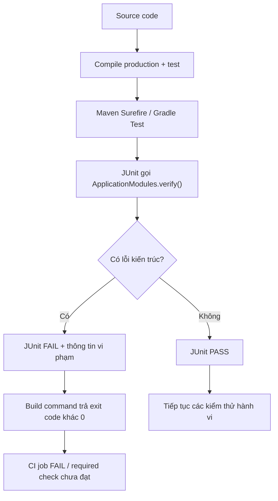
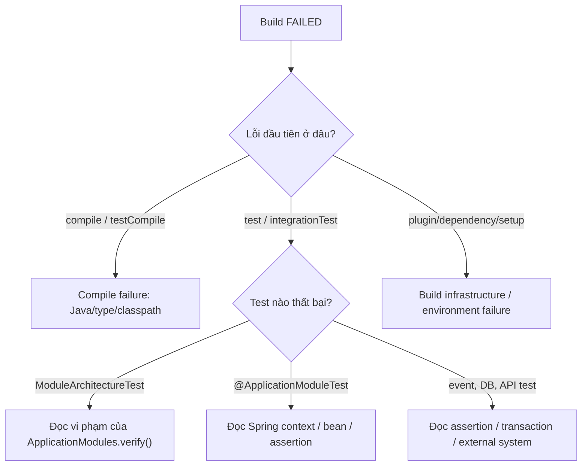

# Đọc output trong log build

> **Chương:** Verification trong build  
> **Phạm vi:** `SPRING_MODULITH_VERIFICATION_TESTING` — kiểm chứng ranh giới kiến trúc ứng dụng Spring Modulith bằng `ApplicationModules`, đồng thời phân biệt kết quả `@ApplicationModuleTest`, kiểm thử sự kiện, cơ sở dữ liệu, tích hợp và quality gate trong CI.

## 1. Mục tiêu: đọc log để biết điều gì thật sự thất bại

Một pipeline có thể kết thúc bằng dòng `BUILD FAILURE` hoặc `BUILD FAILED`, nhưng các dòng đó **không phải nguyên nhân gốc**. Trong cùng dự án Spring Modulith, lỗi có thể do Java không biên dịch được, JUnit không phát hiện bài test, `ApplicationModules.verify()` tìm thấy phụ thuộc trái phép, `@ApplicationModuleTest` không khởi động được context, hay database test không kết nối được.

Sau bài này, bạn sẽ:

1. Đọc được cấu trúc output Maven và Gradle: phase/task, tên lớp test, số test chạy, kết quả và trạng thái build.
2. Tìm đúng **bước đầu tiên thất bại**, không chẩn đoán dựa vào dòng `BUILD FAILED` cuối cùng.
3. Nhận ra dấu hiệu của **architectural violation** so với lỗi compile, unit, module, event, database và integration test.
4. Dùng báo cáo Maven Surefire hoặc Gradle Test để đối chiếu log console, kể cả khi CI cắt bớt output.
5. Phát hiện **xanh giả** khi task bị bỏ qua, test không được khám phá, filter loại `ModuleArchitectureTest` hoặc phạm vi quét `ApplicationModules` sai.
6. Tạo báo cáo chẩn đoán ngắn gọn cho pull request và xác nhận một vi phạm có chủ đích thực sự làm quality gate CI thất bại.

**Tình huống:** Pull request có một thay đổi trong `orders.OrderService`. Developer đọc dòng cuối `BUILD FAILURE` rồi tăng phiên bản dependency, nhưng thực tế trong phần báo cáo JUnit có thông tin `orders` truy cập `inventory.internal`. Nếu phân loại đúng, giải pháp là sửa quan hệ giữa module chứ không thay cấu hình Maven/Gradle.

## 2. Hình dung đường đi từ code đến log

Giả sử ứng dụng có các package:

```text
src/main/java/com/example/shop/
├── ShopApplication.java
├── orders/
│   └── OrderService.java
└── inventory/
    ├── StockQuery.java
    └── internal/StockJpaRepository.java

src/test/java/com/example/shop/
├── ModuleArchitectureTest.java
└── orders/OrderModuleTest.java
```

Structural test đặt trong source set test:

```java
package com.example.shop;

import org.junit.jupiter.api.DisplayName;
import org.junit.jupiter.api.Test;
import org.springframework.modulith.core.ApplicationModules;

class ModuleArchitectureTest {

    @Test
    @DisplayName("Application modules tuân thủ ranh giới kiến trúc")
    void verifiesBoundaries() {
        ApplicationModules.of(ShopApplication.class).verify();
    }
}
```

Với cách phát hiện module mặc định, `orders` và `inventory` là các application module nằm trực tiếp dưới package ứng dụng. Java có thể biên dịch một import vào kiểu `public` trong `inventory.internal`, nhưng `ApplicationModules.verify()` có thể coi đây là phụ thuộc vượt API được công bố.



**Phân biệt ba “verify”:** `ApplicationModules.verify()` thuộc Spring Modulith; `mvn verify` là phase trong Maven lifecycle; `gradle check` là task vòng đời kiểm tra của Gradle Java plugin. Các lệnh build chỉ thực hiện architectural verification khi JUnit test chứa lời gọi đó được chạy.

## 3. Quy trình đọc log sáu bước

Khi thấy CI đỏ, áp dụng thứ tự sau:

1. **Xác định lệnh thật sự đã chạy.** Ví dụ `./mvnw -B verify`, `./gradlew check`, hay một lệnh chỉ chọn một test. Ghi lại subproject, JDK và các tham số skip/filter.
2. **Tìm bước đầu tiên có lỗi.** Với Maven là tên phase/plugin gần các dòng `[ERROR]`; với Gradle là task `:compileJava`, `:compileTestJava`, `:test`, `:integrationTest` có `FAILED`.
3. **Tìm tên test hoặc file Java liên quan.** Compile error thường có đường dẫn source và số dòng; test failure thường có tên class, phương thức, exception và báo cáo JUnit.
4. **Đọc nguyên nhân gần gốc, không dừng ở wrapper exception.** Xem thông tin `Caused by`, assertion, bean creation, database connection hay dependency giữa module.
5. **Xác nhận test đã chạy thật.** Kiểm tra số test, skipped, báo cáo XML/HTML và đúng lớp `ModuleArchitectureTest`; nếu không có test thì chưa kết luận kiến trúc hợp lệ.
6. **Tái hiện có chọn lọc, rồi chạy lại toàn bộ gate.** Chạy riêng test lỗi để phản hồi nhanh, sửa đúng tầng và cuối cùng chạy lại lệnh CI cần thiết.

| Bằng chứng cần tìm | Câu hỏi phải trả lời |
| --- | --- |
| Build command + flags | Có `-DskipTests`, `-x test`, filter tag, `-pl` hoặc subproject giới hạn không? |
| Plugin/Gradle task | Lỗi ở compile, test compile, test runtime hay integration? |
| Test class + method | Lỗi do `ModuleArchitectureTest`, `OrderModuleTest` hay test khác? |
| Root cause + dependency path | Nếu là Modulith violation: module nguồn, module đích và kiểu tham chiếu nào sai? |
| Tests run/failures/errors/skipped | Có test đã thực thi hay chỉ có 0 test hoặc test bị skip? |
| CI job status | Exit code khác 0 có làm job/required check FAIL không? |

## 4. Đọc output Maven theo phase và plugin

Maven thường đi qua các phase như `compile`, `test-compile`, `test` rồi `verify`. Kết quả thực tế phụ thuộc plugin đã khai báo: **Surefire** thường chạy các bài `*Test` ở phase `test`, còn **Failsafe** chỉ chạy integration tests ở các phase phù hợp nếu dự án đã cấu hình.

### 4.1. Log Maven khi architectural test PASS

Ví dụ output **minh họa, rút gọn** (tên plugin/phiên bản và cách trình bày có thể khác):

```text
[INFO] --- maven-compiler-plugin:...:compile (...) @ shop-app ---
[INFO] --- maven-compiler-plugin:...:testCompile (...) @ shop-app ---
[INFO] --- maven-surefire-plugin:...:test (...) @ shop-app ---
[INFO] Running com.example.shop.ModuleArchitectureTest
[INFO] Tests run: 1, Failures: 0, Errors: 0, Skipped: 0
[INFO] Results:
[INFO] Tests run: 12, Failures: 0, Errors: 0, Skipped: 0
[INFO] BUILD SUCCESS
```

Cách đọc:

- Plugin `compiler` đã xử lý mã chính và mã test.
- Surefire chạy `ModuleArchitectureTest`; thông tin này có giá trị hơn câu `BUILD SUCCESS` đơn lẻ.
- `Tests run: 1` là kết quả của lớp kiến trúc trong ví dụ; `Tests run: 12` là tổng suite của module build đang xét.
- Các con số là **dữ liệu minh họa**, không phải chỉ số mặc định của Spring Modulith.

Nếu log chỉ có `BUILD SUCCESS` mà không thấy `ModuleArchitectureTest`, cần tìm trong báo cáo Surefire hoặc xác minh test discovery trước khi kết luận.

### 4.2. Log Maven khi `verify()` báo vi phạm

```text
[INFO] --- maven-surefire-plugin:...:test (...) @ shop-app ---
[INFO] Running com.example.shop.ModuleArchitectureTest
[ERROR] Tests run: 1, Failures: 0, Errors: 1, Skipped: 0
[ERROR] com.example.shop.ModuleArchitectureTest.verifiesBoundaries
[ERROR]   [vi phạm kiến trúc: orders phụ thuộc inventory.internal]
[ERROR] There are test failures.
[ERROR] Please refer to target/surefire-reports for the individual test results.
[INFO] BUILD FAILURE
```

Đây là **mẫu diễn giải tình huống**, không phải nguyên văn exception của một phiên bản Spring Modulith. Khi đọc log thật, hãy tìm thông tin về **source module**, **target module**, class hoặc method gây ra dependency trái phép. Một structural violation có thể hiển thị dưới dạng `Errors: 1` thay vì `Failures: 1` vì `verify()` báo lỗi thông qua exception; cả hai đều khiến test không đạt.

Trong trường hợp này, đừng sửa Maven Surefire vì nó **đã chạy đúng vai trò**. Cần sửa phụ thuộc `orders → inventory.internal`, hoặc xem lại policy nếu thiết kế đã được thay đổi có chủ đích.

### 4.3. `BUILD FAILURE` xuất hiện ở nhiều nguyên nhân

| Dòng/ngữ cảnh Maven | Nhóm lỗi có khả năng xảy ra |
| --- | --- |
| `maven-compiler-plugin:compile` + `cannot find symbol` | Mã production không biên dịch |
| `maven-compiler-plugin:testCompile` + lỗi import | Mã test hoặc test dependencies không biên dịch |
| `maven-surefire-plugin:test` + `ModuleArchitectureTest` | Có thể là vi phạm kiến trúc; phải đọc exception thực tế |
| `maven-surefire-plugin:test` + `OrderPolicyTest` | Có thể là assertion nghiệp vụ |
| `maven-surefire-plugin:test` + `OrderModuleTest` | Có thể là lỗi Spring context/bean, event hoặc nghiệp vụ module |
| `maven-failsafe-plugin` (khi đã cấu hình) + `OrderDatabaseIT` | Lỗi integration/database hoặc môi trường |
| Dependency resolution/plugin download trước compile | Maven repository, mạng, authentication hoặc dependency declaration |

Maven reactor có nhiều module build sẽ có `Reactor Summary` và một hoặc nhiều submodule `FAILURE`. Hãy xác định **submodule bị lỗi** trước khi mở file report. Application module của Spring Modulith (theo package) và Maven submodule (theo `pom.xml`) **không đồng nghĩa**.

## 5. Đọc output Gradle theo task và test report

Gradle thể hiện các task như `:compileJava`, `:compileTestJava`, `:test` và `:check`. Với dự án nhiều subproject, đường dẫn task có thể là `:shop-app:test`. Một task `test` chạy JUnit Jupiter cần `useJUnitPlatform()` và runtime dependencies phù hợp.

### 5.1. Log Gradle khi test kiến trúc FAIL

Ví dụ **rút gọn, minh họa**:

```text
> Task :compileJava
> Task :compileTestJava
> Task :test

ModuleArchitectureTest > verifiesBoundaries() FAILED
    [vi phạm kiến trúc: orders tham chiếu inventory.internal]

> Task :test FAILED
12 tests completed, 1 failed
See the report at: build/reports/tests/test/index.html

FAILURE: Build failed with an exception.
Execution failed for task ':test'.
BUILD FAILED
```

Từ mẫu này có thể kết luận `compileJava` và `compileTestJava` đã vượt qua, lỗi được báo tại task `test`, và phương thức JUnit cụ thể là `verifiesBoundaries()`. Dòng `Execution failed for task ':test'` không phải nguyên nhân độc lập; cần đọc lỗi của test phía trên và báo cáo test chi tiết.

### 5.2. Các trạng thái task dễ bị hiểu sai

| Gradle output | Ý nghĩa cần kiểm tra | Có chứng minh `verify()` vừa được chạy không? |
| --- | --- | --- |
| `> Task :test` | Task được thực thi trong lần build | Chưa đủ; cần xem report và test cụ thể |
| `> Task :test UP-TO-DATE` | Gradle tái sử dụng kết quả vì inputs/outputs không đổi | Không có execution mới trong lần đó; xem kết quả trước hoặc kiểm chứng khi cần |
| `> Task :test FROM-CACHE` | Kết quả được khôi phục từ build cache | Không có execution mới; cache có thể hợp lệ nhưng không thay bằng chứng discovery ban đầu |
| `> Task :test NO-SOURCE` | Task không có test classes đầu vào | Không; phải kiểm tra source sets và project được chọn |
| `> Task :test SKIPPED` | Task không chạy theo điều kiện hoặc cấu hình | Không; kiểm tra `onlyIf`, `enabled`, flags và task selection |
| `> Task :test FAILED` | Task test thất bại | Phải xem tên test và exception để phân loại |

Khi nghi ngờ cache che sự thay đổi, có thể chạy `./gradlew test --rerun-tasks` **cho mục đích chẩn đoán**. Không cần vô hiệu hóa cache trong mọi CI job nếu cơ chế cache và inputs được quản lý đúng. Điều cần thiết là có bằng chứng rằng test đã từng được khám phá, và một vi phạm mới sẽ làm kết quả build chuyển FAIL.

### 5.3. Không suy từ số lượng test tổng

`12 tests completed, 0 failed` cho biết một tập test hoàn thành, nhưng **chưa chắc** tập đó có `ModuleArchitectureTest`. Nếu build áp dụng tag filter, `--tests` hoặc chạy nhầm subproject, structural test có thể không có trong tập này. Mở report để xác nhận **class và phương thức**.

## 6. Phân biệt ba tầng failure qua log

Trong hệ thống Spring Modulith, có ba tầng chẩn đoán quan trọng:



### 6.1. Compile failure

Ví dụ:

```text
.../orders/OrderService.java:42: error: cannot find symbol
    stockQuery.available(sku);
              ^
  symbol: method available(String)
```

Compiler không tìm thấy method có chữ ký phù hợp. Nếu build dừng tại `compile`, `ApplicationModules.verify()` **chưa chạy**, nên chưa có bằng chứng về kiến trúc. Sửa lỗi Java rồi chạy lại phép kiểm cấu trúc; một lỗi kiến trúc khác có thể xuất hiện ở bước tiếp theo.

### 6.2. Architectural verification failure

Ví dụ class `public` trong `inventory.internal` được import từ `orders`: Java compiler có thể chấp nhận, nhưng `ApplicationModules.verify()` có thể báo vượt ranh giới module mặc định. Hoặc dependency hợp lệ về Java tạo chu trình `orders → payments → orders`, hoặc vi phạm `@ApplicationModule(allowedDependencies = ...)`.

Cần trích xuất **ba phần**: module nguồn, module đích, quy tắc vi phạm. Không tự suy rằng cứ thấy `ModuleArchitectureTest` FAIL là chắc chắn có một dependency sai; nếu lỗi là `NoClassDefFoundError`, classpath hoặc test setup có thể là nguyên nhân.

### 6.3. Behavioral/integration failure

Ví dụ:

```text
OrderModuleTest > bootsModule() FAILED
  [Spring context không khởi tạo được vì thiếu bean]

OrderEventTest > publishesOrderPlaced() FAILED
  [assertion: event payload không như mong đợi]

OrderDatabaseIT > persistsOrder() FAILED
  [database connection / transaction / constraint error]
```

Các dòng trong ngoặc vuông là **mô tả tình huống minh họa**, không phải log framework nguyên văn. `@ApplicationModuleTest` dùng Spring test context để kiểm tra module/runtime; event test và database integration test đánh giá hành vi thực thi. Chúng có thể FAIL dù `ApplicationModules.verify()` PASS, vì kiến trúc hợp lệ không bảo đảm nghiệp vụ hoặc hạ tầng chạy đúng.

## 7. Đọc stack trace: wrapper, cause, chỗ phát sinh

Một exception có thể bị bọc qua nhiều lớp:

```text
Test failed
  Framework / runner exception
    Caused by: underlying error
      at ...Class.method(...:line)
```

Đừng chọn ngay dòng `at org.junit...` hoặc `at org.gradle...` làm nơi sửa lỗi; runner chỉ ghi lại lỗi. Hãy:

1. Tìm tên test đầu tiên được đánh dấu FAIL và loại exception.
2. Xem các `Caused by:` liên quan, nhất là nguyên nhân gần gốc và phần thông điệp dễ hiểu.
3. Nếu thông báo cho biết dependency module, xác định source/target và class cụ thể.
4. Nếu lỗi Spring context, tìm bean hoặc cấu hình tạo lỗi gần nhất.
5. Nếu lỗi database, tìm loại kết nối, migration, transaction hay constraint bị vi phạm.
6. Nếu stack trace chỉ chứa lớp framework, đối chiếu file test/production ở những frame thuộc package ứng dụng và báo cáo XML đầy đủ.

**Thứ tự đọc tốt** là: test name → exception message → cause chain → frame ứng dụng → cấu hình liên quan. Không phải cứ lấy `Caused by` cuối cùng là đủ: cần kết hợp loại lỗi, message và bối cảnh test.

## 8. Xem báo cáo test thay cho console bị rút gọn

### 8.1. Maven Surefire

Vị trí thường gặp:

```text
target/surefire-reports/
├── TEST-com.example.shop.ModuleArchitectureTest.xml
└── com.example.shop.ModuleArchitectureTest.txt
```

Trong dự án Maven nhiều submodule, đường dẫn có thể nằm tại `shop-app/target/surefire-reports/`. Cấu hình Surefire/Failsafe có thể thay đổi vị trí report, vì vậy cần xem plugin tương ứng.

### 8.2. Gradle Test

```text
build/test-results/test/
└── TEST-com.example.shop.ModuleArchitectureTest.xml

build/reports/tests/test/
└── index.html
```

Trong multi-project hoặc khi dùng task `architectureTest`, đường dẫn thường có subproject/task name tương ứng. Báo cáo Gradle HTML giúp duyệt theo package, class và phương thức; XML hữu ích để hệ thống CI thu thập.

### 8.3. Hiểu trường trong báo cáo JUnit XML

Ví dụ cấu trúc **minh họa**:

```xml
<testsuite name="com.example.shop.ModuleArchitectureTest"
           tests="1" failures="0" errors="1" skipped="0">
  <testcase name="verifiesBoundaries"
            classname="com.example.shop.ModuleArchitectureTest">
    <error message="Module dependency violation">
      ...stack trace and details...
    </error>
  </testcase>
</testsuite>
```

`tests` là số trường hợp test được ghi nhận; `failures` và `errors` mô tả các test không đạt; `skipped` cho biết số bị bỏ qua. Với `ModuleArchitectureTest`, kiểm tra test case có tồn tại **và được thực thi**. Kết quả `tests=0` hoặc chỉ có `skipped` không đủ chứng minh ranh giới module đã được kiểm tra.

Lưu ý: định dạng XML, cách phân loại `failure`/`error` và các thuộc tính bổ sung phụ thuộc runner/plugin. Hãy nhìn nội dung exception chứ không đoán lỗi kiến trúc từ mỗi trường `errors=1`.

## 9. Lệnh tái hiện và mở rộng mức thông tin log

### 9.1. Lệnh ngắn để tái hiện architectural test

Maven:

```bash
# Chạy riêng structural test khi dự án có Maven Wrapper.
./mvnw -Dtest=ModuleArchitectureTest test

# Chạy build quality gate đầy đủ.
./mvnw -B verify
```

Gradle:

```bash
# Chạy riêng test theo tên đầy đủ.
./gradlew test --tests 'com.example.shop.ModuleArchitectureTest'

# Chạy lifecycle verification chung.
./gradlew check
```

Khi dự án có nhiều Maven modules, lệnh `-Dtest=ModuleArchitectureTest` có thể gặp những submodule không chứa test và báo không khớp. Khi đó chọn đúng submodule/reactor và xem cấu hình Surefire, thay vì tự động bỏ qua mọi trường hợp không có test. Với Gradle multi-project, có thể chọn task `:shop-app:test` thay cho `test` ở root.

### 9.2. Khi cần stack trace hoặc thông tin build sâu hơn

```bash
# Maven: hiển thị stack trace của lỗi build/plugin.
./mvnw -e test

# Maven: debug log chi tiết; chỉ dùng khi cần vì rất nhiều output.
./mvnw -X test

# Gradle: xem stack trace khi task thất bại.
./gradlew test --stacktrace

# Gradle: thêm chi tiết về task và quá trình test.
./gradlew test --info
```

`-e`/`-X` của Maven và `--stacktrace`/`--info` của Gradle chủ yếu giúp tìm lỗi cấu hình, resolution, classpath hoặc task execution. Với architectural violation đã ghi rõ trong report, **không cần bật debug level cho mọi CI run**. Debug output có thể lớn và tiết lộ thông tin cấu hình; cần kiểm soát secrets, masking và phạm vi chia sẻ log.

### 9.3. Lọc log để tìm nhanh trên máy phát triển

Trên môi trường Unix-like:

```bash
# Minh họa tìm những dấu hiệu quan trọng trong file log đã lưu.
grep -nE 'ModuleArchitectureTest|Tests run:|FAILED|BUILD FAILURE|Caused by:' build.log
```

Với PowerShell:

```powershell
Select-String -Path .\build.log -Pattern 'ModuleArchitectureTest','Tests run:','FAILED','BUILD FAILURE','Caused by:'
```

Đây chỉ là cách **định vị** những đoạn cần xem. Không kết luận từ một dòng grep thiếu ngữ cảnh: cần mở phần log bao quanh nó, kiểm tra module/task và report tương ứng.

## 10. Khi log báo thành công nhưng chưa đủ bằng chứng

Một số tình huống khiến CI xanh dù chất lượng chưa được kiểm chứng:

| Dấu hiệu | Vì sao đáng ngờ? | Cách xác nhận |
| --- | --- | --- |
| Maven `BUILD SUCCESS` nhưng không có `ModuleArchitectureTest` | Surefire có thể không tìm thấy test, hoặc test bị skip | Chạy riêng `-Dtest=ModuleArchitectureTest`; xem Surefire report |
| `Tests run: 0` | Chưa có bài test được thực thi trong phạm vi đó | Kiểm tra source set, naming, engine và cấu hình fail-on-zero |
| `Skipped: 1` với structural test | Test có thể bị `@Disabled`/điều kiện test | Tìm annotation, JUnit tag và điều kiện môi trường |
| Gradle `NO-SOURCE` | Task không có test class đầu vào | Xem build project, source sets và test compilation |
| Gradle `UP-TO-DATE` hoặc `FROM-CACHE` | Không có execution mới trong lần đó | Kiểm tra report/cached result; thử rerun khi chẩn đoán |
| Maven dùng `-DskipTests` hoặc `-Dmaven.test.skip=true` | Test bị loại khỏi vòng đời | Bỏ cờ skip trong required job |
| Gradle dùng `-x test` | Task kiểm thử bị loại khỏi đồ thị | Đảm bảo `check` chạy test cần thiết |
| CI có `continue-on-error: true` hoặc shell nuốt lỗi | Step test FAIL nhưng job có thể không phản ánh lỗi | Bỏ cấu hình nuốt lỗi; xác nhận exit code và job status |
| Maven `testFailureIgnore`, Gradle `ignoreFailures` | Test thất bại nhưng build bị cho phép tiếp tục | Không bật các tùy chọn này ở gate bắt buộc |
| `verify()` PASS dù cố ý tạo phụ thuộc vào `inventory.internal` | Phạm vi quét/policy có thể không phản ánh dự kiến | Kiểm tra `ApplicationModules.of(...)`, module detection và API/named interface |
| Chỉ chạy một subproject không chứa structural test | Job xanh không bao phủ ứng dụng cần kiểm chứng | Chọn đúng Maven module/Gradle task, tìm report ở đúng nơi |
| `mvn verify` thành công nhưng không có DB integration tests | Failsafe/integration plugin chưa được cấu hình | Xem integration test report và lifecycle riêng |

**Nguyên tắc:** `BUILD SUCCESS` chỉ chứng minh rằng **những việc build thực sự chạy** đã thành công. Nó không chứng minh những việc bị bỏ qua, không được khám phá hoặc không nằm trong scope cũng thành công.

## 11. CI: lưu bằng chứng và đưa thông tin hữu ích vào pull request

### 11.1. Workflow Maven tối thiểu

Ví dụ GitHub Actions cho dự án có Maven Wrapper và Java 21 (điều chỉnh theo dự án thật):

```yaml
name: Modulith build verification

on:
  pull_request:

jobs:
  verification:
    runs-on: ubuntu-latest
    steps:
      - uses: actions/checkout@v4
      - uses: actions/setup-java@v4
        with:
          distribution: temurin
          java-version: '21'

      - name: Run structural and behavioral tests
        run: ./mvnw -B verify

      - name: Keep Surefire reports
        if: always()
        uses: actions/upload-artifact@v4
        with:
          name: surefire-reports
          path: '**/target/surefire-reports/**'
          if-no-files-found: warn
```

`if: always()` giúp giữ report kể cả khi bước chạy test lỗi, nhưng **không được dùng** để che trạng thái thất bại của bước `mvn verify`. Nếu module tests, event/DB/integration tests nằm ngoài vòng đời Maven đang gọi, phải có bước hoặc job khác thực thi chúng.

### 11.2. Bước tương đương cho Gradle

```yaml
- name: Run structural and behavioral tests
  run: ./gradlew --no-daemon check

- name: Keep Gradle test results
  if: always()
  uses: actions/upload-artifact@v4
  with:
    name: gradle-test-results
    path: '**/build/test-results/**'
    if-no-files-found: warn
```

Gradle `check` trong Java plugin thông thường phụ thuộc `test`, nhưng custom task `integrationTest` hoặc `architectureTest` chỉ được chạy nếu đã nối dependency hoặc được gọi trực tiếp. Kiểm tra log task và report thực tế thay vì suy từ tên `check`.

### 11.3. Một bình luận chẩn đoán tốt gồm gì?

Khi CI FAIL vì Spring Modulith, bản tóm tắt cho pull request nên chứa:

- **Command/job:** lệnh CI, JDK, project/subproject bị lỗi.
- **Test:** `ModuleArchitectureTest.verifiesBoundaries()`.
- **Bằng chứng:** đường dẫn test report và một đoạn thông báo phụ thuộc sai đủ ngắn.
- **Nguyên nhân:** module nguồn dùng chi tiết nội bộ/module đích nào, hay tạo chu trình/quá `allowedDependencies`.
- **Hướng sửa:** thay dependency bằng API module hợp lệ hoặc thảo luận điều chỉnh policy có căn cứ.
- **Xác nhận:** chạy lại structural test và full suite; ghi nhận PASS.

Không paste toàn bộ file log nếu nó rất dài hoặc có credentials, token, URL chứa thông tin nhạy cảm hay dữ liệu khách hàng. Trích đoạn tối thiểu và liên kết đến artifact được kiểm soát quyền truy cập thường hữu ích hơn.

Để ngăn merge, job chứa architectural test cần được cấu hình thành **required status check** trong branch protection/ruleset. Một report đẹp không thay thế việc truyền exit code FAIL từ JUnit qua Maven/Gradle tới CI.

## 12. Thực hành: đọc bốn đoạn output và chỉ ra hành động

### Tình huống A — Java compiler không qua được

```text
> Task :compileJava FAILED
.../orders/OrderService.java:42: error: cannot find symbol
BUILD FAILED
```

**Chẩn đoán:** compile failure, `ApplicationModules.verify()` chưa được thực thi trong lần chạy này. Hành động là sửa Java import/chữ ký/kiểu, chạy compile lại rồi mới đánh giá structural test.

### Tình huống B — Structural test tìm thấy phụ thuộc sai

```text
> Task :compileJava
> Task :test
ModuleArchitectureTest > verifiesBoundaries() FAILED
  [orders sử dụng inventory.internal.StockJpaRepository]
> Task :test FAILED
BUILD FAILED
```

**Chẩn đoán:** build đã qua compile, JUnit test kiến trúc được chạy và báo dependency vượt API module. Sửa `orders` dùng `inventory.StockQuery` hoặc hợp đồng API được công bố đúng; **không tắt test**.

### Tình huống C — Module test lỗi Spring context

```text
[INFO] Running com.example.shop.orders.OrderModuleTest
[ERROR] OrderModuleTest > bootsModule()
  [Spring context: thiếu một bean cần thiết]
[INFO] BUILD FAILURE
```

**Chẩn đoán:** lỗi module/runtime test; chưa có căn cứ nói `ApplicationModules.verify()` tìm được vi phạm. Kiểm tra bean dependencies, test configuration, phạm vi `@ApplicationModuleTest` và test-only stubs; sau khi sửa, vẫn chạy structural test.

### Tình huống D — Task test không có nguồn

```text
> Task :shop-app:test NO-SOURCE
> Task :shop-app:check
BUILD SUCCESSFUL
```

**Chẩn đoán:** task test không có nguồn test để chạy. Kết quả `BUILD SUCCESSFUL` **không phải bằng chứng** `ModuleArchitectureTest` đã thực thi. Kiểm tra project được chọn, `src/test/java`, cách biên dịch test, JUnit Platform và report.

## 13. Bài thực hành: tái hiện FAIL, đọc log và xác nhận PASS

**Bối cảnh:** ứng dụng `com.example.shop.ShopApplication` có hai module `orders` và `inventory`, cùng test `ModuleArchitectureTest` ở mục 2. Dùng **Maven hoặc Gradle** theo build tool đang có trong dự án.

### Phần A — Thiết lập baseline có bằng chứng

1. Cấu hình JUnit Jupiter và dependency test Spring Modulith tương thích với Spring Boot của project.
2. Với Maven, bảo đảm Surefire phát hiện lớp `*Test`; với Gradle, bảo đảm task `test` có `useJUnitPlatform()`.
3. Chạy `./mvnw -B verify` hoặc `./gradlew check`.
4. Tìm `ModuleArchitectureTest` trong report, ghi số test đã chạy, failures, errors, skipped và task/plugin thực thi.
5. Ghi rõ những behavioral tests (`@ApplicationModuleTest`, event, database, integration) nào thật sự được chạy và những nhóm nào có task/plugin riêng.

### Phần B — Đối chứng compile PASS nhưng architectural test FAIL

1. Đặt một kiểu `public` trong `com.example.shop.inventory.internal`.
2. Cho `orders` tham chiếu trực tiếp kiểu đó, giữ mã hợp lệ về Java visibility.
3. Chạy compile riêng: `./mvnw compile` hoặc `./gradlew compileJava`; xác nhận PASS.
4. Chạy riêng `ModuleArchitectureTest`; xác nhận JUnit FAIL với thông tin dependency module.
5. Tìm plugin/task và nguyên nhân trong console; mở Surefire/Gradle test report để đối chiếu.
6. Đưa lỗi vào một nhánh PR thử và xác nhận CI job/required check FAIL, không merge mã vi phạm.

### Phần C — Sửa và chứng minh gate hồi phục

1. Xóa dependency tới `inventory.internal`; thay bằng hợp đồng `com.example.shop.inventory.StockQuery` hợp lệ.
2. Chạy lại structural test; xác nhận PASS và report chứa bài test đã chạy.
3. Chạy full suite; xác nhận các unit, module, event, database/integration tests liên quan vẫn PASS.
4. Kiểm tra CI job và required check đạt trạng thái thành công.
5. Lưu bản tóm tắt nguyên nhân gốc và cách sửa để các PR sau có mẫu chẩn đoán.

### Tiêu chí nghiệm thu

- [ ] Có thể chỉ ra **lệnh**, **phase/task**, **test class** và **nguyên nhân đầu tiên** từ log.
- [ ] Phân biệt compile/testCompile với architectural violation trong JUnit.
- [ ] Đọc được số test thực thi, lỗi và skipped từ report thay vì chỉ nhìn `BUILD SUCCESS`.
- [ ] Xác nhận `ModuleArchitectureTest` được khám phá và `ApplicationModules` bao phủ các module cần bảo vệ.
- [ ] Tạo được tình huống compile PASS nhưng architectural verification FAIL.
- [ ] Phân biệt được lỗi `@ApplicationModuleTest`, event, database/integration với vi phạm tĩnh.
- [ ] CI giữ nguyên trạng thái FAIL của test và required check chặn merge.
- [ ] Sau khi sửa kiến trúc, structural test và các behavioral tests bắt buộc PASS.

## 14. Câu hỏi tự đánh giá

1. Vì sao `BUILD FAILURE` cuối log không đủ để biết lỗi do Spring Modulith?
2. Trong Maven, `Tests run: 1, Failures: 0, Errors: 1` cho biết điều gì và cần đọc thêm dữ liệu nào?
3. Trong Gradle, `> Task :test UP-TO-DATE` khác `> Task :test NO-SOURCE` ra sao?
4. Tại sao `ModuleArchitectureTest` PASS vẫn có thể không chứng minh `orders` và `inventory` đều được quét đúng?
5. Khi `@ApplicationModuleTest` FAIL do bean không khởi tạo được, có thể kết luận `allowedDependencies` bị vi phạm không?
6. Vì sao chạy `mvn verify` không mặc nhiên bảo đảm Maven Failsafe đã thực thi integration tests?
7. Khi cần mở rộng log, khác biệt trong mục đích dùng `mvn -e`, `mvn -X`, `gradle --stacktrace` và `gradle --info` là gì?
8. Một pull request có log đẹp nhưng CI bỏ qua exit code FAIL có đáp ứng yêu cầu quality gate không?
9. Bạn sẽ viết tóm tắt chẩn đoán thế nào để người sửa biết module nguồn, module đích, rule sai và cách tái hiện?

**Ghi nhớ:** Đọc output build đúng cách là tìm **bước đầu tiên thất bại, test được chạy, nguyên nhân gốc và bằng chứng trong report**. Với Spring Modulith, cần phân biệt `ApplicationModules.verify()` báo dependency sai với lỗi compile, `@ApplicationModuleTest` và integration test. Log chỉ có giá trị bảo vệ kiến trúc khi bài test thực sự chạy, thất bại được truyền đến CI và required check phản ánh đúng kết quả.
