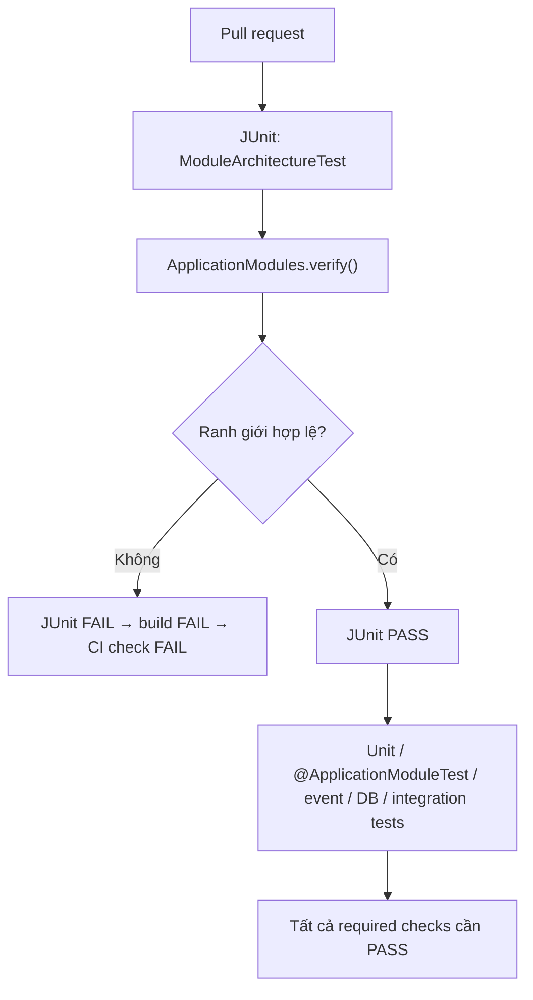
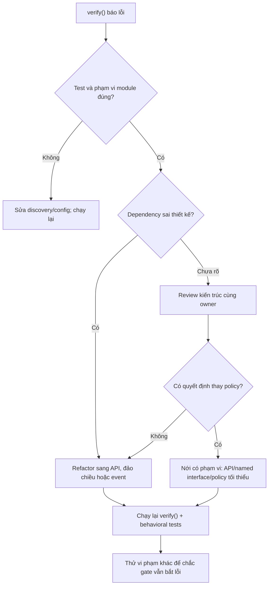

# Không biến cảnh báo kiến trúc thành suppress tùy tiện

> **Chương:** Verification trong build  
> **Phạm vi học:** `SPRING_MODULITH_VERIFICATION_TESTING` — kiểm chứng ranh giới kiến trúc ứng dụng Spring Modulith bằng `ApplicationModules` và chính sách phụ thuộc module; kết hợp `@ApplicationModuleTest`, kiểm thử sự kiện, cơ sở dữ liệu, tích hợp và CI quality gate để ngăn phụ thuộc sai, hồi quy.

## 1. Vấn đề: test đỏ, nhưng cách “sửa” lại làm mất hàng rào bảo vệ

Trong hệ thống bán hàng, module `orders` cần truy vấn tồn kho từ `inventory`. Một developer mới dùng trực tiếp kiểu `inventory.internal.StockJpaRepository` trong `orders.OrderService` vì muốn triển khai nhanh. Java compiler có thể chấp nhận import nếu kiểu đó `public`. Tuy nhiên, Spring Modulith kiểm tra ranh giới module và báo dependency trái quy tắc. Pull request chuyển đỏ.

Có hai hướng xử lý rất khác:

- **Sửa thiết kế:** `orders` dùng `inventory.StockQuery`, một hợp đồng nghiệp vụ được module `inventory` công bố; phần repository vẫn nằm trong nội bộ.
- **Che tín hiệu:** tắt bài test `verify()`, thêm `@Disabled`, chạy Maven với `-DskipTests`, bật Gradle `ignoreFailures` hoặc cho CI bỏ qua step thất bại.

Cách thứ hai có thể khiến CI xanh trong chốc lát, nhưng cũng loại bỏ khả năng phát hiện những vi phạm tiếp theo. Nó không giải quyết vấn đề kiến trúc.

Sau bài này, bạn có thể:

1. Phân biệt compiler warning, log warning, structural verification failure và behavioral test failure.
2. Nhận diện những hình thức **suppress/bypass** làm vô hiệu hóa Spring Modulith quality gate.
3. Đọc lỗi `ApplicationModules.verify()` và xác định liệu cần sửa phụ thuộc, làm rõ hợp đồng module hay điều chỉnh quy tắc với sự đồng thuận.
4. Phân biệt **ngoại lệ kiến trúc có kiểm soát** với hành động nới lỏng chính sách tùy tiện.
5. Ghi nhận lý do, người chịu trách nhiệm, rủi ro, kế hoạch loại bỏ và phép kiểm thay thế cho trường hợp chuyển tiếp.
6. Chứng minh bằng test âm tính rằng quality gate vẫn có khả năng FAIL khi xuất hiện phụ thuộc sai.

## 2. “Cảnh báo kiến trúc” là tín hiệu gì?

Trong giao tiếp nhóm, mọi tín hiệu về design đều có thể được gọi là “warning”. Nhưng build tool và test framework không xử lý chúng giống nhau:

| Tín hiệu | Nguồn phát hiện | Đọc và phản ứng đúng |
| --- | --- | --- |
| Compiler warning | `javac` hoặc plugin lint | Đánh giá mức nghiêm trọng, quy tắc lint; không tự gán là Modulith violation |
| Log `WARN` khi ứng dụng chạy | Spring Framework hoặc một thư viện | Điều tra bối cảnh runtime; chưa đủ chứng minh có vi phạm module |
| JUnit FAIL từ `ApplicationModules.verify()` | Structural test dùng Spring Modulith | Đọc module nguồn/đích và quy tắc; thất bại cần được truyền tới build |
| JUnit FAIL từ `@ApplicationModuleTest` | Module/runtime test | Kiểm tra Spring context, cộng tác bean, assertion, không tự đồng nhất với lỗi phụ thuộc tĩnh |
| Integration test FAIL | DB, event listener, broker, HTTP, transaction | Chẩn đoán hạ tầng/hành vi; structural verification có thể vẫn PASS |
| CI required check FAIL | Hệ thống CI và chính sách repository | Chặn merge đến khi lỗi được sửa hoặc quy tắc được thay đổi chính thức |

**Điểm then chốt:** `ApplicationModules.verify()` thường được gọi trong một `@Test`. Khi có vi phạm, nó báo lỗi cho JUnit, khiến test không đạt; đây không đơn thuần là một dòng log `WARN` có thể xóa bằng cấu hình log level.

Java `@SuppressWarnings` dùng cho các loại cảnh báo mà compiler/tool hỗ trợ; nó **không phải** cơ chế để “cho phép” một dependency vi phạm Spring Modulith. Cũng không nên kỳ vọng đổi mức log từ `WARN` sang `ERROR` hoặc ngược lại sẽ thay đổi kết quả `verify()`.

## 3. Khai báo architectural test thành một hợp đồng bắt buộc

Giả sử ứng dụng Spring Boot có package root `com.example.shop`:

```text
src/
├── main/java/com/example/shop/
│   ├── ShopApplication.java
│   ├── orders/
│   │   └── OrderService.java
│   └── inventory/
│       ├── StockQuery.java
│       └── internal/
│           ├── InventoryService.java
│           └── StockJpaRepository.java
└── test/java/com/example/shop/
    └── ModuleArchitectureTest.java
```

Theo cách phát hiện module mặc định, `orders` và `inventory` là hai application module trực tiếp dưới package ứng dụng. Kiểu đặt ngay tại package `inventory` thường thuộc API được công bố; kiểu trong `inventory.internal` không tự động là API. Dự án có thể cấu hình named interface hoặc cách phát hiện module khác, vì vậy phải đối chiếu với mô hình thật.

Tạo bài test tại `src/test/java/com/example/shop/ModuleArchitectureTest.java`:

```java
package com.example.shop;

import org.junit.jupiter.api.DisplayName;
import org.junit.jupiter.api.Tag;
import org.junit.jupiter.api.Test;
import org.springframework.modulith.core.ApplicationModules;

@Tag("architecture")
class ModuleArchitectureTest {

    @Test
    @DisplayName("Application modules tôn trọng ranh giới")
    void verifiesModuleBoundaries() {
        ApplicationModules.of(ShopApplication.class).verify();
    }
}
```

Test này là một **hợp đồng kiểm chứng tự động**:

1. Maven Surefire hoặc Gradle `Test` task tìm thấy và thực thi JUnit Jupiter test.
2. `ApplicationModules.of(ShopApplication.class)` khám phá tập module cần kiểm.
3. `verify()` đánh giá các ràng buộc kiến trúc, chẳng hạn chu trình module, truy cập vượt API được công bố và danh sách dependency được phép.
4. Nếu vi phạm, test báo FAIL; Maven/Gradle cần trả exit code khác 0; CI job bắt buộc phải FAIL.

Không cần `@SpringBootTest` để kiểm tra cấu trúc tĩnh này. Ngược lại, `@ApplicationModuleTest` kiểm tra runtime context và hành vi module; nó **không tự thay thế** phép kiểm cấu trúc.



## 4. Nhận diện những cách suppress/bypass nguy hiểm

### 4.1. Vô hiệu hóa trực tiếp bài test

Ví dụ **không nên áp dụng**:

```java
import org.junit.jupiter.api.Disabled;
import org.junit.jupiter.api.Test;

@Disabled("Tạm tắt vì structural test hay đỏ")
class ModuleArchitectureTest {

    @Test
    void verifiesModuleBoundaries() {
        // Kiểm tra kiến trúc không còn được thực thi.
    }
}
```

Một biến thể khác là xóa lời gọi `verify()` hoặc để phương thức `@Test` trống. Trong cả hai trường hợp, JUnit có thể thấy một lớp test nhưng không còn kiểm chứng dependency. Vì vậy **không chỉ xem số test tổng**; cần đối chiếu nội dung bài test và thử một vi phạm có chủ đích.

### 4.2. Bỏ qua toàn bộ test trong build

Các lệnh sau được liệt kê để **nhận diện anti-pattern**, không phải hướng dẫn sử dụng cho quality gate:

```bash
# Maven bỏ qua thực thi test.
./mvnw -DskipTests verify

# Maven có thể bỏ qua cả việc biên dịch test.
./mvnw -Dmaven.test.skip=true verify

# Gradle loại task test khỏi đồ thị chạy.
./gradlew check -x test
```

Khi architectural test nằm trong tập test bị bỏ qua, `BUILD SUCCESS` chỉ phản ánh những tác vụ **đã chạy**; không thể chứng minh kiến trúc hợp lệ.

### 4.3. Nuốt thất bại, biến đỏ thành xanh giả

| Cách bypass | Hệ quả | Thay thế an toàn |
| --- | --- | --- |
| `continue-on-error: true` trên step CI chạy verification | Step đỏ có thể không làm job kết thúc thất bại như mong muốn | Cho phép bước test trả lỗi bình thường |
| Shell dùng `|| true` sau lệnh build | Trạng thái lỗi bị ghi đè bằng thành công | Giữ exit code thật; upload report bằng bước `if: always()` |
| Gradle `ignoreFailures = true` | Test FAIL nhưng build có thể tiếp tục thành công | Để mặc định thất bại ở gate bắt buộc |
| Maven Surefire `testFailureIgnore` hoặc tương đương | Test FAIL nhưng Maven có thể không báo build FAIL | Không bật ở job kiểm chứng bắt buộc |
| JUnit tag/filter loại `architecture` | Các behavioral tests có thể PASS khi structural test chưa chạy | Chạy cả architectural suite và full suite |
| Task `architectureTest` không nối với `check` | `gradle check` không bảo đảm chạy verification | Dùng `dependsOn` hoặc gọi task riêng trong CI |
| Bỏ required status check của nhánh | CI FAIL nhưng pull request vẫn có đường merge theo chính sách yếu | Khôi phục branch protection/ruleset |
| Đổi package root khiến `ApplicationModules` quét thiếu | Structural test PASS do bỏ sót module | Kiểm tra mô hình và thử nghiệm âm tính |

**Không dùng “tạm tắt để merge” làm quy trình bình thường.** Một hành động bỏ qua gate nên được xem là thay đổi quản trị rủi ro có cấp phê duyệt, không phải một sửa lỗi kỹ thuật.

## 5. Đọc vi phạm trước khi quyết định sửa

Khi `verify()` báo lỗi, phân loại trước:

| Nhóm vi phạm | Ví dụ | Hướng điều tra |
| --- | --- | --- |
| Truy cập nội bộ module | `orders` import `inventory.internal.StockJpaRepository` | Caller có cần một API nghiệp vụ thay vì repository không? |
| Chu trình module | `orders → billing → orders` | Có dependency ngược không cần thiết, hoặc trách nhiệm điều phối đặt sai không? |
| Ngoài `allowedDependencies` | `orders` phụ thuộc `shipping` nhưng policy chỉ cho `inventory` | Quan hệ này được thiết kế hay chỉ xuất hiện tình cờ? |
| API/named interface sai phạm vi | Lớp ở package con chưa được công bố nhưng client dùng trực tiếp | Có hợp đồng nhỏ hơn, ổn định và được sở hữu rõ ràng không? |
| Mô hình module không đúng kỳ vọng | Module demo bị nhận nhầm, module production bị bỏ sót | Package root, build source set và cấu hình phát hiện module đúng chưa? |

Quy trình xử lý:

1. **Đọc nguyên nhân cụ thể** từ JUnit report/log, tìm module nguồn, module đích và kiểu/đường phụ thuộc.
2. **Xác nhận bài test thực sự chạy** và `ApplicationModules.of(...)` bắt đầu từ package phù hợp.
3. **Xác nhận rule hiện tại.** Kiểu đích thuộc API mặc định, named interface hay nội bộ? Có `allowedDependencies` không?
4. **Hỏi nhu cầu nghiệp vụ:** caller thật sự cần thông tin/hành động gì?
5. **Ưu tiên sửa code và thiết kế** qua API hợp lệ, đảo chiều phụ thuộc hoặc event.
6. Chỉ cân nhắc sửa quy tắc khi **kiến trúc mong muốn đã đổi**, có bằng chứng và review rõ.
7. Chạy structural test rồi các test hành vi chịu ảnh hưởng; cập nhật tài liệu quyết định nếu cần.

### Cây quyết định để tránh suppress



## 6. Sửa đúng ranh giới: từ repository nội bộ sang API nghiệp vụ

### 6.1. Mã hợp lệ với Java nhưng sai với kiến trúc

Giả sử `StockJpaRepository` là một kiểu `public` trong `inventory.internal`, và `orders` phụ thuộc trực tiếp vào nó:

```java
package com.example.shop.orders;

import com.example.shop.inventory.internal.StockJpaRepository;

class OrderService {

    private final StockJpaRepository stockRepository;

    OrderService(StockJpaRepository stockRepository) {
        this.stockRepository = stockRepository;
    }
}
```

Đây là ví dụ dependency bị cấm **nếu** `inventory.internal` không được công bố như một interface và các module được phát hiện như dự kiến. Đừng mở public toàn bộ persistence API để làm kết quả `verify()` xanh.

### 6.2. Công bố một capability có chủ đích

Module `inventory` công bố hợp đồng nghiệp vụ tại package gốc:

```java
package com.example.shop.inventory;

public interface StockQuery {
    boolean available(String sku, int quantity);
}
```

Phần triển khai vẫn do `inventory` sở hữu:

```java
package com.example.shop.inventory.internal;

import com.example.shop.inventory.StockQuery;
import org.springframework.stereotype.Service;

@Service
class StockQueryService implements StockQuery {

    @Override
    public boolean available(String sku, int quantity) {
        // Minh họa hợp đồng; phiên bản thực dùng repository và quy tắc tồn kho.
        return quantity > 0;
    }
}
```

Caller ở `orders` đổi sang phụ thuộc API:

```java
package com.example.shop.orders;

import com.example.shop.inventory.StockQuery;

class OrderService {

    private final StockQuery stockQuery;

    OrderService(StockQuery stockQuery) {
        this.stockQuery = stockQuery;
    }

    boolean canPlaceOrder(String sku, int quantity) {
        return stockQuery.available(sku, quantity);
    }
}
```

Code trên minh họa cách tổ chức dependency; phương thức `available` đơn giản của `StockQueryService` **không phải** triển khai nghiệp vụ tồn kho hoàn chỉnh. Sau khi sửa ranh giới, viết unit/module/database tests để xác nhận logic và transaction thực tế.

**Giá trị lâu dài:** `orders` biết một capability ổn định thay vì biết phương thức JPA, schema hay transaction của `inventory`.

## 7. Các lựa chọn sửa thiết kế khác thay vì nới rule

### 7.1. Đổi hướng phụ thuộc bằng port/adapter

Nếu module A chỉ cần kết quả tính toán từ B, hãy đặt interface tại ranh giới được sở hữu rõ và để implementation trong module thích hợp. Với mô hình dependency inversion, phải kiểm tra xem interface nào được phép public để không vô tình tạo vòng phụ thuộc mới.

### 7.2. Dùng event khi kết quả không cần đồng bộ ngay

Giả sử `orders` công bố `OrderPlaced`; `shipping` muốn phản ứng sau khi đơn hàng được tạo. Một cách tách coupling là publish domain event rồi để listener của `shipping` xử lý. Việc dùng event có thể loại dependency ngược không cần thiết, nhưng không phải thuốc chữa mọi chu trình:

- Nếu bước nghiệp vụ cần biết ngay kết quả để quyết định transaction, event bất đồng bộ có thể không phù hợp.
- Cần test event được phát, listener nhận đúng payload, xử lý lỗi và khả năng lặp lại.
- Cần xem transaction boundary và semantics giao hàng sự kiện trong cấu hình thực tế.

Một structural test PASS sau khi đổi sang event **chưa đảm bảo** xử lý sự kiện đúng; bổ sung `@ApplicationModuleTest` và integration tests phù hợp.

### 7.3. Tách trách nhiệm điều phối

Một vòng `orders → payments → orders` có thể cho thấy logic orchestration bị đặt sai chỗ. Có thể chuyển luồng điều phối lên thành phần sở hữu use case và giữ phụ thuộc một chiều. Đây là lựa chọn thiết kế cần xem xét nghiệp vụ, không thể tự động sửa bằng một annotation.

## 8. Khi nào được thay chính sách module?

Không phải mọi thay đổi cấu trúc đều là lỗi. Một tính năng mới có thể yêu cầu thêm hợp đồng giữa hai module. Khi đó cần **thay kiến trúc có chủ đích**, không phải bỏ kiểm chứng.

### 8.1. `allowedDependencies` là chính sách, không phải lệnh suppress mọi thứ

Ví dụ `orders` chỉ được phép phụ thuộc vào module `inventory`:

```java
@ApplicationModule(allowedDependencies = "inventory")
package com.example.shop.orders;

import org.springframework.modulith.ApplicationModule;
```

Khai báo này thu hẹp tập module đích được phép phụ thuộc. **Nó không có nghĩa** `orders` được dùng mọi kiểu trong `inventory.internal`: quy tắc API được công bố của module đích vẫn phải được tôn trọng.

Nếu một tính năng thực sự cần thêm `payments`, việc mở rộng danh sách chỉ nên xảy ra sau review hướng phụ thuộc và hậu quả tạo vòng, không phải bằng cách xóa toàn bộ giới hạn.

### 8.2. Named interface: công bố bề mặt nhỏ, không mở cả nội bộ

Spring Modulith hỗ trợ mô hình named interface để module công bố một phần API từ package con khi cần. Ví dụ một nhóm định nghĩa package `inventory.query` là API truy vấn dành cho các module khác, khác với `inventory.internal` chứa persistence adapter.

Với các phiên bản hỗ trợ, khai báo package metadata có thể có dạng:

```java
@NamedInterface("query")
package com.example.shop.inventory.query;

import org.springframework.modulith.NamedInterface;
```

Khi chính sách giới hạn theo named interface, tên dependency có thể viết theo dạng `inventory::query`:

```java
@ApplicationModule(allowedDependencies = "inventory::query")
package com.example.shop.orders;

import org.springframework.modulith.ApplicationModule;
```

**Điều kiện:** tổ chức package, phiên bản Spring Modulith và các public types của named interface phải phù hợp. Sự công bố này là quyết định API chính thức: cần đặt tên, review hợp đồng, bảo đảm không làm lộ repository hoặc entity nội bộ không cần thiết.

| Thay đổi | Có thể chấp nhận khi | Dấu hiệu nguy hiểm |
| --- | --- | --- |
| Thêm API nghiệp vụ vào package gốc module | Có caller thật, hợp đồng ổn định, module sở hữu rõ | Chuyển thẳng repository/entity nội bộ ra package công khai |
| Tạo named interface | Cần công bố một tập chức năng nhỏ từ package con | Công bố toàn bộ `internal` chỉ để qua test |
| Thêm một module vào `allowedDependencies` | Hướng phụ thuộc đã được review, không gây coupling vòng | Cho phép mọi module vì “tiện” hoặc xóa policy |
| Tổ chức lại package module | Phản ánh đúng biên giới sở hữu nghiệp vụ | Di chuyển package để mô hình không còn thấy phụ thuộc sai |

## 9. Ngoại lệ kiến trúc có kiểm soát khác suppress tùy tiện thế nào?

Có thể xảy ra tình huống chuyển tiếp: kiến trúc cũ đang phụ thuộc chéo và thay đổi cần nhiều release; không thể sửa ngay trong một pull request. Điều đó **không làm quy tắc sai biến thành đúng**. Nhóm cần quản trị khoản nợ kiến trúc thay vì vô hiệu hóa mọi phép kiểm.

### 9.1. Tiêu chí của một ngoại lệ có thể xem xét

Một ngoại lệ chuyển tiếp chỉ nên được chấp thuận khi:

1. Có bằng chứng về tác động và lý do kỹ thuật/kinh doanh khiến chưa thể sửa ngay.
2. Phạm vi giới hạn ở **đúng dependency hoặc điểm tích hợp** cần thiết, không mở quyền cho cả ứng dụng.
3. Có người chịu trách nhiệm, ticket và thời điểm đánh giá lại.
4. Có phương án loại bỏ hoặc tái cấu trúc rõ ràng cùng với các cột mốc.
5. Các quy tắc còn lại vẫn được kiểm chứng và CI vẫn chặn các vi phạm mới.
6. Review từ người sở hữu module liên quan; với thay đổi quan trọng cần review kiến trúc của nhóm.

Nếu framework hoặc công cụ bổ sung có cơ chế exclusion cho một quy tắc, **chỉ dùng khi hiểu chính xác phạm vi và tác động**, đồng thời cần test bắt lỗi ở các trường hợp khác. Spring Modulith `ApplicationModules.verify()` không có cơ chế “đặt `@SuppressWarnings` vào class và thế là bỏ qua violation” như cảnh báo Java compiler.

### 9.2. Ví dụ biểu mẫu quyết định (chỉ minh họa tài liệu)

```yaml
decision: "ADR-027"
subject: "Tạm duy trì kết nối orders -> payments cho luồng hoàn tiền"
owner: "Architecture team / owners của orders và payments"
reason: "Cần giữ tương thích API trong đợt chuyển đổi"
affected_dependency: "orders -> payments (luồng hoàn tiền)"
risk: "Coupling giữa hai module và khả năng tạo chu trình"
mitigation:
  - "Cấm thêm call site mới ngoài phạm vi đã review"
  - "Có test hợp đồng và kiểm thử hồi quy"
  - "Theo dõi structural gate ở các phần không bị ảnh hưởng"
removal_plan: "Chuyển sang API nghiệp vụ một chiều và xóa kết nối cũ"
review_by: "Ngày review cụ thể do nhóm ấn định"
```

Đây là **mẫu nội dung học tập**, không phải định dạng cấu hình mà Spring Modulith tự đọc. Một ADR/ticket **không tự làm cho `verify()` PASS**; nhóm vẫn cần một chiến lược kỹ thuật có khả năng kiểm chứng, không đánh lừa CI.

### 9.3. Cẩn thận với “baseline” vi phạm

Một số đội tạo danh sách các lỗi kiến trúc hiện hữu để từng bước giảm nợ. Cách quản trị này chỉ an toàn khi:

- Phân biệt rõ **vi phạm đã biết** với **vi phạm mới** và từ chối tăng thêm nợ.
- Baseline có owner, thời hạn review, số lượng và phạm vi cụ thể.
- Công cụ so sánh/báo cáo không vô tình thay việc chạy `verify()` mà không có biện pháp thay thế.
- Các architectural rules khác vẫn chạy bình thường và có báo cáo rõ.

Đừng áp dụng cách “bắt mọi exception rồi bỏ qua” quanh `verify()`. Ví dụ sau là **anti-pattern**, không được dùng làm gate:

```java
@Test
void architectureShouldBeValid() {
    try {
        ApplicationModules.of(ShopApplication.class).verify();
    } catch (Exception ignored) {
        // Sai: mọi vi phạm mới cũng được coi là PASS.
    }
}
```

Nếu tồn tại vi phạm chưa sửa, phải minh bạch trạng thái “chưa đạt”, thời gian xử lý và phạm vi kiểm soát; không trình bày như một bài structural test PASS hoàn chỉnh.

## 10. Cách chứng minh gate vẫn bảo vệ những thay đổi mới

Một lần `BUILD SUCCESS` không đủ. Cách kiểm tra mạnh là thử **sai có chủ đích** trong một nhánh thử nghiệm, không merge mã vi phạm.

### 10.1. Baseline hợp lệ

- `orders` sử dụng `inventory.StockQuery`.
- `inventory` triển khai query trong package `inventory.internal`.
- `ModuleArchitectureTest` thực thi, nhìn thấy cả hai module, kết quả PASS.
- Behavioral tests cần thiết vẫn chạy qua JUnit và các integration test tasks đã cấu hình.

### 10.2. Tạo vi phạm vẫn compile

Ví dụ một kiểu Java `public` trong `inventory.internal`:

```java
package com.example.shop.inventory.internal;

public final class DebugStockCounter {

    private DebugStockCounter() {}

    public static int count() {
        return 5;
    }
}
```

Caller của `orders` cố tình import lớp nội bộ:

```java
package com.example.shop.orders;

import com.example.shop.inventory.internal.DebugStockCounter;

class OrderProbe {
    int currentStock() {
        return DebugStockCounter.count();
    }
}
```

Với Java visibility trong ví dụ, code có thể biên dịch. Nhưng `orders` đã tham chiếu vào package nội bộ `inventory`, nên `verify()` phải FAIL nếu mô hình và chính sách mặc định như dự kiến.

### 10.3. Kiểm tra hai kết quả khác nhau

Với Maven:

```bash
./mvnw compile
./mvnw -Dtest=ModuleArchitectureTest test
./mvnw -B verify
```

Với Gradle:

```bash
./gradlew compileJava
./gradlew test --tests 'com.example.shop.ModuleArchitectureTest'
./gradlew check
```

**Kỳ vọng:** compile PASS nhưng structural test FAIL; lệnh build đầy đủ FAIL và CI job bắt buộc FAIL. Các lệnh chọn test riêng phải phù hợp cấu trúc multi-project thực tế. Nếu test vẫn PASS, điều tra test discovery, package root, policy và report trước khi kết luận rằng rule không có ích.

### 10.4. Sửa đúng và xác nhận PASS

Xóa import `DebugStockCounter` khỏi `orders`, chuyển caller về API `StockQuery` hoặc thiết kế hợp đồng mới được review. Chạy lại structural test và full suite.

**Bằng chứng nghiệm thu:** test report có `ModuleArchitectureTest` thực thi; vi phạm mẫu gây lỗi; sau sửa test PASS; các unit, `@ApplicationModuleTest`, event/database/integration tests chịu ảnh hưởng cũng PASS.

## 11. CI: giữ trạng thái FAIL, không làm xanh giả

### 11.1. Maven và Gradle phải chạy đúng bài test

Trong dự án Maven/Gradle đã có dependency test JUnit Jupiter và Spring Modulith tương thích, một gate phổ biến là:

- Maven: `./mvnw -B verify`, trong đó Surefire chạy `ModuleArchitectureTest` nếu tên test, engine và cấu hình đúng.
- Gradle: `./gradlew --no-daemon check`, trong đó Java plugin `check` thông thường phụ thuộc task `test` đã bật JUnit Platform.

Ví dụ Gradle Groovy DSL:

```groovy
tasks.named('test', Test) {
    useJUnitPlatform()
}
```

Nếu có task `architectureTest` riêng, phải nối nó vào `check` hoặc gọi nó trong CI. Với Maven, `mvn verify` **không tự chạy Failsafe integration tests** trừ khi đã có cấu hình plugin tương ứng.

### 11.2. GitHub Actions: một workflow không nuốt lỗi

Ví dụ Maven Wrapper với Java 21, cần điều chỉnh phiên bản theo project:

```yaml
name: Modulith quality gate

on:
  pull_request:

permissions:
  contents: read

jobs:
  verification:
    runs-on: ubuntu-latest
    steps:
      - uses: actions/checkout@v4
      - uses: actions/setup-java@v4
        with:
          distribution: temurin
          java-version: '21'

      - name: Verify module boundaries and tests
        run: ./mvnw -B verify

      - name: Keep reports even when verification fails
        if: always()
        uses: actions/upload-artifact@v4
        with:
          name: surefire-reports
          path: '**/target/surefire-reports/**'
          if-no-files-found: warn
```

`if: always()` trong bước upload nhằm giữ bằng chứng, **không** làm cho bước chạy Maven trở thành thành công. Sau khi workflow chạy, cần cấu hình branch protection/ruleset yêu cầu job `verification` đạt trạng thái thành công trước khi merge.

Nếu dự án có nhiều Maven modules, bảo đảm build bao phủ project chứa structural test. Nếu CI chạy lệnh chọn riêng `-Dtest=ModuleArchitectureTest` trong reactor, phải chọn đúng module hoặc cấu hình Surefire phù hợp; không tắt fail-on-no-tests trên toàn bộ pipeline chỉ để né phát hiện test vắng mặt.

### 11.3. Điều kiện “xanh” đáng tin

| Điều kiện | Bằng chứng |
| --- | --- |
| Structural test thật sự chạy | Tên test và số test không skipped trong Surefire/Gradle report |
| Mô hình module đúng | Các module nghiệp vụ cần bảo vệ được khám phá |
| Vi phạm mẫu bị bắt | Compile PASS, `verify()` FAIL và build FAIL |
| Các lỗi không bị suppress | Không có skip, `@Disabled`, `ignoreFailures`, `continue-on-error`, `|| true` |
| CI là cổng merge | Job bắt buộc trong branch protection/ruleset |
| Behavioral tests được giữ | Unit, module, event, DB, integration tests theo phạm vi nghiệp vụ có báo cáo |
| Chính sách thay đổi có review | API/named interface/allowedDependencies phản ánh quyết định kiến trúc |

## 12. Vì sao không được thay structural gate bằng behavioral tests?

Một module có thể hoạt động đúng ở runtime nhưng phụ thuộc sai thiết kế. Ví dụ `orders` dùng trực tiếp JPA repository của `inventory`; unit test có thể PASS với dữ liệu mẫu, còn module boundary đã bị phá vỡ.

Ngược lại, `verify()` PASS chưa đủ để chứng minh:

- `OrderService` từ chối đặt hàng khi hết tồn kho.
- `@ApplicationModuleTest` khởi tạo được context và các collaborator hợp lệ.
- `OrderPlaced` được phát đúng payload, listener xử lý đúng và chịu được lỗi/chạy lại.
- Transaction, schema migration và ràng buộc database hoạt động.
- API, message broker và hệ thống ngoài hợp tác đúng theo hợp đồng.

Do đó, một chiến lược hợp lý là chạy **structural verification sớm**, rồi thực thi đầy đủ unit/module/event/DB/integration tests cần thiết. Không dùng “behavioral tests xanh” làm lý do suppress một structural violation chưa được giải quyết.

## 13. Bài thực hành: phân loại và xử lý ba tình huống

**Bối cảnh:** Dự án `ShopApplication` có module `orders` và `inventory`, structural test `ModuleArchitectureTest` gọi `ApplicationModules.of(ShopApplication.class).verify()`.

### Tình huống A — Vi phạm thật, cách sửa sai

Một PR làm `orders` dùng `inventory.internal.StockJpaRepository`. Developer đề xuất thêm `@Disabled` vào structural test.

Yêu cầu:

1. Giải thích vì sao Java compile có thể PASS nhưng Spring Modulith vẫn FAIL.
2. Chứng minh tắt test không xóa dependency sai.
3. Đề xuất `StockQuery` hoặc hợp đồng API nghiệp vụ tương ứng.
4. Chạy lại architectural test, rồi các test chức năng và database chịu ảnh hưởng.
5. Ghi nhận kết quả FAIL trước sửa và PASS sau sửa.

### Tình huống B — Quy tắc có thể cần đổi thật

Một module mới `reporting` cần truy vấn tồn kho phục vụ báo cáo. Nhóm dự định cho `reporting` dùng trực tiếp `inventory.internal.StockJpaRepository`.

Yêu cầu:

1. Xác định capability thực sự cần: truy vấn tổng hợp, số lượng khả dụng hay lịch sử?
2. Đề xuất API hoặc named interface có bề mặt nhỏ do `inventory` sở hữu.
3. Chỉ cập nhật `allowedDependencies` nếu quan hệ `reporting → inventory` phù hợp hướng kiến trúc.
4. Kiểm tra không tạo chu trình và các module không được phép vẫn không truy cập API này.
5. Viết ghi chú review: lý do, phạm vi public API, test contract cần có.

### Tình huống C — Nợ kiến trúc cần kế hoạch chuyển tiếp

Một API cũ đã được nhiều module dùng, việc tách ngay sẽ gây rủi ro tương thích. Nhóm cân nhắc cho phép một số call sites trong thời gian chuyển đổi.

Yêu cầu:

1. Tạo bản ghi quyết định nêu module nguồn/đích, lý do, chủ sở hữu và ngày xem lại.
2. Lập lộ trình tách dependency và giảm số call sites.
3. Xác định cách giữ phần còn lại của structural gate hoạt động, không bắt mọi exception rồi bỏ qua.
4. Bổ sung behavioral/integration tests quanh luồng sẽ chuyển đổi.
5. Mô tả bằng chứng nào phải có trước khi xóa ngoại lệ và khôi phục rule đầy đủ.

### Checklist nghiệm thu

- [ ] Không tắt, xóa hoặc để rỗng `ModuleArchitectureTest` chỉ vì `verify()` báo lỗi.
- [ ] Không dùng skip/ignore failure làm cổng build xanh giả.
- [ ] Biết phân loại lỗi nội bộ module, chu trình và `allowedDependencies`.
- [ ] Phương án sửa ưu tiên API nghiệp vụ có chủ đích hoặc thay đổi hướng phụ thuộc.
- [ ] Named interface/chính sách dependency chỉ được mở rộng khi có lý do và review.
- [ ] Nếu có ngoại lệ chuyển tiếp, ghi rõ owner, phạm vi, rủi ro, thời hạn và kế hoạch loại bỏ.
- [ ] Có phép thử âm tính chứng minh vi phạm mới vẫn khiến architectural test FAIL.
- [ ] CI required check chặn merge; behavioral tests liên quan vẫn được chạy.

## 14. Câu hỏi tự đánh giá

1. Vì sao `@SuppressWarnings` của Java không phải giải pháp cho một lỗi do `ApplicationModules.verify()` phát hiện?
2. Sự khác nhau giữa `allowedDependencies` và API được công bố của module đích là gì?
3. Tại sao chuyển cả package `inventory.internal` thành named interface có thể gây hại lâu dài?
4. Khi nào việc thêm một dependency module mới là quyết định kiến trúc hợp lệ, thay vì một cách né test?
5. Nếu một CI job dùng `continue-on-error: true`, có thể coi nó là required quality gate đáng tin không?
6. Vì sao `@ApplicationModuleTest` PASS không đủ để cho phép bỏ qua structural violation?
7. Bản ghi ngoại lệ chuyển tiếp tối thiểu phải có những thông tin nào?
8. Cách nào chứng minh `ModuleArchitectureTest` vẫn phát hiện được phụ thuộc sai sau khi policy được thay đổi?
9. Khi build chỉ có `BUILD SUCCESS` nhưng không thấy structural test trong report, bạn sẽ điều tra những gì?

**Ghi nhớ:** Vi phạm kiến trúc là tín hiệu để **sửa dependency hoặc điều chỉnh quy tắc theo một quyết định thiết kế có kiểm chứng**, không phải lời mời suppress. Giữ `ApplicationModules.verify()`, JUnit, Maven/Gradle và CI required check hoạt động; chỉ công bố API hay thay policy trong phạm vi cần thiết và có review. Một lần thử cố ý tạo vi phạm khiến build FAIL là bằng chứng rõ ràng rằng hàng rào kiến trúc vẫn còn hiệu lực.
