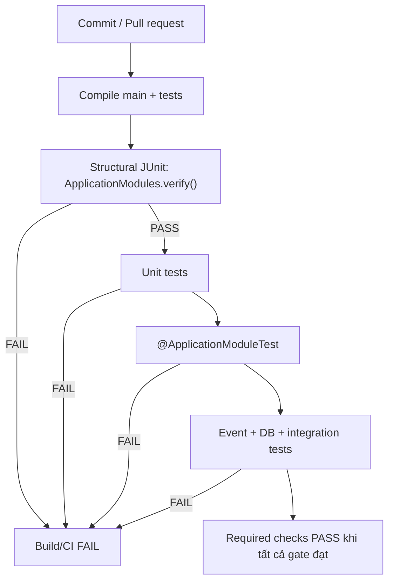

# Giữ kết quả verification tái lập giữa môi trường

> **Chương:** Verification trong build  
> **Module học:** `SPRING_MODULITH_VERIFICATION_TESTING` — kiểm chứng ranh giới Spring Modulith bằng `ApplicationModules` và các quy tắc phụ thuộc module; kết hợp `@ApplicationModuleTest`, kiểm thử sự kiện, cơ sở dữ liệu, tích hợp và quality gate trong CI để ngăn phụ thuộc sai, hồi quy.

## 1. Một thay đổi, hai kết quả: điều gì đang không tái lập?

Một developer chạy `./mvnw test` trên máy cá nhân và nhận `BUILD SUCCESS`. Cùng commit được đẩy lên CI nhưng `ModuleArchitectureTest` thất bại. Một đồng đội khác chạy `./gradlew check` ở môi trường thứ ba lại thấy **không có bài kiểm thử kiến trúc nào được thực thi**. Nếu không tách rõ các biến đầu vào, nhóm có thể kết luận sai rằng Spring Modulith “ngẫu nhiên” hoặc CI “khó tính”.

Thực tế, kết quả verification có thể khác vì **hai máy không kiểm chứng cùng một thứ**, dù đều sử dụng source code gần giống nhau. Chẳng hạn:

- Máy A gọi `compile` hoặc dùng `-DskipTests`, máy B chạy toàn bộ JUnit tests.
- Máy A dùng JDK hoặc dependency/plugin version khác với máy B.
- Test runner ở một môi trường chỉ chọn tag `unit`, làm bỏ sót `@Tag("architecture")`.
- Maven/Gradle multi-project build ở một môi trường không chứa project có `ModuleArchitectureTest`.
- Spring Modulith tạo mô hình application module từ **package root** hoặc runtime classpath khác.
- `@ApplicationModuleTest`/event/DB integration test sử dụng thời gian hệ thống, dữ liệu chia sẻ, Docker hoặc dịch vụ ngoài thay đổi giữa các lần chạy.

Bài học này hướng đến **tính tái lập của kết luận kiểm chứng**, không hứa rằng hai môi trường sẽ tạo log, thứ tự test hay thời gian thực thi giống từng byte.

### Kết quả học tập

Sau bài học, bạn có thể:

1. Định nghĩa điều kiện để một kết quả `ApplicationModules.verify()` được coi là tái lập.
2. Chuẩn hóa source revision, JDK, build wrapper, dependency/plugin versions, test discovery, package scope và tập quy tắc kiến trúc.
3. Tách khác biệt do **structural verification** khỏi lỗi/flakiness của `@ApplicationModuleTest`, event, database và integration tests.
4. Thiết kế Maven/Gradle và CI job vừa chạy đầy đủ phép kiểm vừa giữ bằng chứng để so sánh local/CI.
5. Chẩn đoán các trường hợp “local PASS/CI FAIL”, “CI PASS/local FAIL” và “cùng commit nhưng hai kết quả khác nhau”.
6. Tổ chức phép thử âm tính: cố tình tạo dependency trái quy tắc, xác nhận **cả local lẫn CI đều FAIL**, sau đó sửa và xác nhận cùng PASS.

## 2. Định nghĩa một “hợp đồng tái lập” thực tế

Với structural test, ta muốn:

> **Cùng commit, cùng tập class được phân tích, cùng phiên bản công cụ, cùng quy tắc module và cùng test được thực thi → cùng kết luận PASS/FAIL.**

Đây là phát biểu về **kết luận kiến trúc**. Lúc chạy có thể khác nhau về thời gian tải dependency, đường dẫn tuyệt đối, thứ tự in log, cách dòng lỗi hiển thị hoặc tên runner.

Một cách biểu diễn để đối chiếu hai lần chạy:

```text
Verification result
  = f(
      source revision + generated code,
      Java/compiler version,
      Maven/Gradle + plugins + resolved dependencies,
      test runtime classpath,
      JUnit discovery + filters,
      ApplicationModules root + module declarations,
      verification rules
    )
```

Với behavioral test, thêm những đầu vào runtime: Spring profile/properties, DB schema, event delivery, system clock, locale/time zone, network, test data, thứ tự và khả năng chạy song song. Kết quả `verify()` tương đối độc lập với hạ tầng runtime; **toàn bộ test suite** thì không.

| Điều cần đồng nhất | Structural test | Behavioral/integration tests |
| --- | --- | --- |
| Source revision và generated classes | Bắt buộc | Bắt buộc |
| JDK, classpath và dependency versions | Bắt buộc để so sánh có ý nghĩa | Bắt buộc |
| `ModuleArchitectureTest` thực sự chạy | Bắt buộc | Không áp dụng cho mỗi test riêng, nhưng vẫn cần full suite |
| Package root, named interfaces và `allowedDependencies` | Bắt buộc | Có thể ảnh hưởng cách bootstrap module |
| Spring profile và environment variables | Thường không phải đầu vào chính của `verify()`; vẫn cần xem nếu thay classpath/cấu hình phát hiện | Thường quan trọng |
| Database, event broker và service bên ngoài | Không cần cho kiểm tra cấu trúc tĩnh | Có thể bắt buộc |
| Clock, time zone, locale, seed và isolation | Thường không cần | Có thể quyết định độ ổn định |

**Mục tiêu đo được:** một vi phạm kiến trúc mẫu trên cùng code phải làm architectural gate FAIL trong các môi trường tương đương. Một phép kiểm không chạy hoặc quét thiếu module **không được** báo như bằng chứng kiến trúc hợp lệ.

## 3. Ví dụ xuyên suốt: package root và bài test cố định

Giả sử ứng dụng Spring Boot:

```text
src/main/java/com/example/shop/
├── ShopApplication.java
├── orders/
│   ├── OrderService.java
│   └── package-info.java
└── inventory/
    ├── StockQuery.java
    └── internal/
        └── StockJpaRepository.java

src/test/java/com/example/shop/
└── ModuleArchitectureTest.java
```

Theo quy ước phát hiện module mặc định của Spring Modulith, `orders` và `inventory` là hai application module trực tiếp dưới `com.example.shop`. Một kiểu ở package gốc `inventory` thường được công bố như API của module; package con `inventory.internal` không tự động trở thành API có thể dùng từ `orders`. Named interface và các cấu hình module của dự án có thể thay đổi chính sách này.

Thêm bài JUnit Jupiter:

```java
package com.example.shop;

import org.junit.jupiter.api.DisplayName;
import org.junit.jupiter.api.Tag;
import org.junit.jupiter.api.Test;
import org.springframework.modulith.core.ApplicationModules;

@Tag("architecture")
class ModuleArchitectureTest {

    @Test
    @DisplayName("Application modules tuân thủ ranh giới")
    void verifiesModuleBoundaries() {
        ApplicationModules.of(ShopApplication.class).verify();
    }
}
```

Điểm cố định của phép kiểm là `ShopApplication.class`: cùng một class được chọn, nhưng nếu nó được đặt sai package hoặc các class liên quan không có trên classpath cần phân tích, mô hình module thu được có thể không đúng mong đợi. Đừng lấy một lần `verify()` PASS làm bằng chứng nếu chưa xác nhận phạm vi quét.

### 3.1. Test không cần khởi tạo Spring context

Bài JUnit trên gọi trực tiếp `ApplicationModules.of(...).verify()` để kiểm tra cấu trúc tĩnh. Nó không đòi hỏi `@SpringBootTest`, database, event broker hoặc HTTP server. Đây là ưu thế lớn khi muốn reproducible: có ít phụ thuộc môi trường hơn.

Ngược lại, một bài `@ApplicationModuleTest` bootstrap Spring test context cho một module để kiểm chứng hành vi; nó có thể chịu ảnh hưởng của bean configuration, properties, profile, DB và các cộng tác viên tại runtime.

### 3.2. Kiểm tra tối thiểu mô hình không bị rỗng

Nếu ứng dụng mẫu phải có ít nhất hai application module, một guard tùy chọn có thể giúp phát hiện trường hợp package root sai:

```java
package com.example.shop;

import static org.junit.jupiter.api.Assertions.assertTrue;

import java.util.stream.StreamSupport;
import org.junit.jupiter.api.Test;
import org.springframework.modulith.core.ApplicationModules;

class ModuleArchitectureCoverageTest {

    @Test
    void detectsExpectedApplicationModules() {
        ApplicationModules modules =
                ApplicationModules.of(ShopApplication.class);

        long count = StreamSupport
                .stream(modules.spliterator(), false)
                .count();

        assertTrue(count >= 2,
                "Expected at least orders and inventory");

        modules.verify();
    }
}
```

Guard `>= 2` chỉ có giá trị trong **ví dụ có ít nhất hai module**. Nó không chứng minh hai module đúng đã được tìm thấy: dự án thực cần đối chiếu thêm **tên các module kỳ vọng** bằng API tương ứng của phiên bản đang sử dụng hoặc bằng một phép thử vi phạm có chủ đích. Không sửa con số assert chỉ để làm test PASS nếu lý do mô hình thay đổi chưa rõ.

## 4. Khóa cùng một source revision, kể cả mã được sinh ra

### 4.1. Không so “working tree” chưa commit với CI commit

Một máy có thể có thay đổi Java chưa commit hoặc file sinh ra từ lần build trước. CI thường checkout một commit rõ ràng và chạy trên workspace mới. Vì vậy, trước khi so kết quả:

```bash
# Ghi nhận commit và các thay đổi chưa commit trên máy phát triển.
git rev-parse HEAD
git status --short

# Ghi nhận JDK và build tool đang được sử dụng.
java -version
./mvnw -version
# Hoặc với dự án Gradle:
./gradlew --version
```

Các lệnh trên là hướng dẫn cho môi trường thực hành, không phải yêu cầu dùng đồng thời Maven và Gradle trong cùng project.

Khi local PASS/CI FAIL, hãy xác nhận:

- CI đang xây đúng commit của pull request hay là merge commit do nền tảng CI tạo ra.
- Local có import, dependency hoặc generated code chưa commit không.
- Annotation processors, OpenAPI/protobuf code generators, Lombok hoặc build steps tạo source có cùng input/version không.
- Các file `package-info.java` khai báo `@ApplicationModule`, `@NamedInterface` có được commit không.

**Không nên** chỉ chạy lại lệnh trên working tree chưa commit rồi so với runner CI khác revision.

### 4.2. Dọn trạng thái khi cần chẩn đoán

Lần chạy thông thường có thể tận dụng incremental build và cache. Khi nghi ngờ kết quả cũ hoặc generated classes không còn phản ánh source:

```bash
# Maven: xóa output build rồi chạy lại phép kiểm.
./mvnw -B clean verify

# Gradle: xây lại các task cần thiết và chạy test.
./gradlew clean check
```

`clean` giúp kiểm tra ảnh hưởng của output từ lần build trước nhưng **không tự đảm bảo** dependency versions được khóa hoặc mạng bên ngoài không đổi. Không cần ép clean trên mọi pipeline nếu caching đúng và đã có kiểm chứng đầu vào.

## 5. Đồng nhất JDK, build wrapper, plugin và dependencies

### 5.1. JDK là đầu vào có thể làm khác kết quả

Khác phiên bản Java có thể gây khác biệt về bytecode, xử lý annotation, API, reflection và mức độ tương thích của test libraries. Hãy chuẩn hóa một phiên bản JDK được dự án hỗ trợ.

Ví dụ nhóm chốt Java 21:

```text
Development: Temurin JDK 21
CI:          Temurin JDK 21
Compiler:    cấu hình Java release tương ứng
```

Trong Maven, có thể dùng compiler release:

```xml
<properties>
    <maven.compiler.release>21</maven.compiler.release>
</properties>
```

Trong Gradle với Java toolchains:

```groovy
java {
    toolchain {
        languageVersion = JavaLanguageVersion.of(21)
    }
}
```

`release` hoặc toolchain giúp chuẩn hóa compile target/JDK sử dụng. Chúng không thay việc kiểm tra Java runtime thật dùng để chạy test; ghi nhận `java -version` và build tool version từ log khi so sánh môi trường.

### 5.2. Ưu tiên Maven Wrapper hoặc Gradle Wrapper

Chạy `./mvnw` hoặc `./gradlew` theo project giúp mọi người và runner dùng phiên bản build tool đã được cấu hình trong repository. Dù vậy, wrapper **không** tự khóa tất cả plugin và dependencies transitively. Cần quản lý cả những đầu vào đó.

### 5.3. Spring Boot, Spring Modulith và JUnit phải tương thích

Ví dụ Maven với dependency management phù hợp của dự án:

```xml
<dependencies>
    <dependency>
        <groupId>org.springframework.boot</groupId>
        <artifactId>spring-boot-starter-test</artifactId>
        <scope>test</scope>
    </dependency>
    <dependency>
        <groupId>org.springframework.modulith</groupId>
        <artifactId>spring-modulith-starter-test</artifactId>
        <scope>test</scope>
    </dependency>
</dependencies>
```

Ví dụ Gradle Groovy DSL trong dự án đã thiết lập platform/BOM cho các phiên bản:

```groovy
dependencies {
    testImplementation 'org.springframework.boot:spring-boot-starter-test'
    testImplementation 'org.springframework.modulith:spring-modulith-starter-test'
}

tasks.named('test', Test) {
    useJUnitPlatform()
}
```

Các ví dụ trên **giả định** project đang có parent/BOM hoặc dependency management cho Spring Boot và Spring Modulith tương thích. Nếu thiếu, phải cấu hình version/BOM thực tế theo dự án; không tự để mỗi máy resolve một bộ phiên bản khác nhau.

Các nguồn không ổn định thường gặp:

- Dùng version `SNAPSHOT` hoặc `changing` dependency mà không có chính sách kiểm soát artifact.
- Maven dùng version ranges, Gradle dùng dynamic version như `1.+` mà không khóa resolution.
- Maven plugin không được quản lý version nhất quán; Gradle plugins được nâng tự động ngoài review.
- JUnit Platform/Jupiter TestEngine hoặc Surefire/Gradle test configuration khác nhau.
- Một môi trường có dependency trong local cache không còn tương ứng với artifact mà CI tải từ repository.

Trong Gradle, dependency locking có thể là một biện pháp để giữ versions đã resolve, nhưng phải cấu hình trên các configurations thích hợp và commit lock state theo quy trình của dự án. Trong Maven, ưu tiên khóa phiên bản dependencies/plugins qua parent, BOM và khai báo rõ thay vì phụ thuộc vào bản mới nhất tại thời điểm chạy.

### 5.4. Caches không phải nơi định nghĩa phiên bản

Maven `~/.m2` và Gradle cache giúp tăng tốc. Cache không nên là đầu vào làm thay đổi kết luận. Nếu hai môi trường dùng dependency versions khác nhau, cách đúng là sửa metadata/dependency resolution, **không** chỉ xóa cache rồi coi là đã giải quyết.

Khi nghi cache tạo kết quả sai, ghi nhận resolved dependency versions và chạy lại có chọn lọc:

```bash
# Maven: kiểm tra effective versions/dependencies bằng các goal phù hợp dự án.
./mvnw dependency:tree

# Gradle: xem dependency graph của test runtime.
./gradlew dependencies --configuration testRuntimeClasspath

# Gradle: buộc thực thi lại các task khi chẩn đoán output cũ.
./gradlew test --rerun-tasks
```

Các lệnh này chỉ dành cho project tương ứng; không cần áp dụng cả hai build tools đồng thời.

## 6. Bảo đảm JUnit luôn chạy cùng architectural test

Ngay cả cùng code và dependencies, hai môi trường có thể chạy **hai tập test khác nhau**:

| Sai lệch | Local | CI | Tác động |
| --- | --- | --- | --- |
| Test bị bỏ qua | `-DskipTests` | Không skip | Local xanh nhưng không có structural verification |
| Chọn test bằng tag | Chạy mọi tag | Chỉ `unit` | `@Tag("architecture")` bị bỏ sót trong CI |
| Task selection | `./gradlew test` | `./gradlew :shared:test` | CI không chạy project chứa architectural test |
| JUnit Platform | IDE có Jupiter engine | Runner thiếu engine/không bật `useJUnitPlatform()` | CI có thể không khám phá được test |
| Tên lớp | `ModuleArchitectureTest` | Filter khớp `*IT` | Test kiến trúc bị loại khỏi tập chạy |
| Điều kiện chạy | Không có `@Disabled` | Profile/condition loại test | Test có thể bị skipped |

Với Maven, kiểm chứng đúng class:

```bash
./mvnw -Dtest=ModuleArchitectureTest test
./mvnw -B verify
```

Với Gradle:

```bash
./gradlew test --tests 'com.example.shop.ModuleArchitectureTest'
./gradlew check
```

Từ kết quả, phải xác nhận trong report:

1. Lớp `ModuleArchitectureTest` được tìm thấy.
2. Phương thức `verifiesModuleBoundaries()` thực sự thực thi.
3. Số test bị skip của lớp này bằng 0.
4. Khi `verify()` báo vi phạm, build trả exit code khác 0.
5. Sau phép kiểm cấu trúc, full suite vẫn chạy các tests nghiệp vụ cần thiết.

Với Maven Surefire, báo cáo thường ở `target/surefire-reports/`. Với Gradle, thường là `build/test-results/test/` và `build/reports/tests/test/`. Dự án multi-module hoặc custom test task có đường dẫn theo từng project/task.

### 6.1. Không để build xanh khi 0 test

Một số dự án/build tasks cho phép báo thành công khi không có test nào phù hợp. Với project **bắt buộc có test**, Maven Surefire có `failIfNoTests` và Gradle test filters có chế độ fail khi không tìm thấy test theo bộ lọc.

Tuy nhiên, `failIfNoTests=true` trên Maven reactor có submodule không chứa test hợp lệ có thể tạo failure giả, còn chỉ kiểm tổng số test lớn hơn 0 không chứng minh **architectural test cụ thể** đã chạy. Giải pháp bền hơn là một bước CI chọn đích danh `ModuleArchitectureTest` trong project sở hữu test và kiểm tra báo cáo của nó.

### 6.2. Đừng che sai khác bằng skip hoặc ignore failure

Không dùng các cấu hình sau trong required gate: Maven `-DskipTests`, `-Dmaven.test.skip=true`, Surefire `testFailureIgnore`, Gradle `-x test` hoặc `ignoreFailures = true`, GitHub Actions `continue-on-error: true` hoặc shell dùng `|| true`. Chúng có thể biến một test FAIL thành trạng thái xanh giả.

## 7. ApplicationModules phải nhìn đúng cùng tập module

Thứ JUnit chạy được là **một bài test**; thứ Spring Modulith kiểm là **một mô hình module được tạo từ các class**. Nếu mô hình sai, việc chạy cùng bài test cũng có thể cho kết luận không đúng với kỳ vọng.

### 7.1. Những yếu tố cần đồng nhất

| Yếu tố | Ví dụ sai lệch | Cách khắc phục |
| --- | --- | --- |
| Package root | Local dùng `ShopApplication` tại `com.example.shop`; cấu hình khác chọn lớp ở `com.example.shop.orders` | Sử dụng cùng điểm bắt đầu và kiểm tra tập module |
| Build subprojects | CI chỉ build `shop-common`, còn architectural test ở `shop-app` | Chọn đúng project hoặc reactor |
| Runtime classpath | Một số dependency/module không hiện diện ở môi trường kiểm chứng | Kiểm tra dependency graph và cách test được thực thi |
| Package metadata | File `package-info.java` có `@ApplicationModule` hoặc `@NamedInterface` không được đưa vào build | Commit đầy đủ metadata; kiểm tra source sets |
| Test/demo source set | `demo` nằm ở `src/main/java` tại một môi trường/branch | Tách demo test-only hoặc xem là production module có chính sách rõ |
| Dependency policy | `allowedDependencies` thay đổi do commit hoặc generated config | Review chính sách, không tự thêm ngoại lệ |

Ví dụ metadata giới hạn module `orders`:

```java
@ApplicationModule(allowedDependencies = "inventory")
package com.example.shop.orders;

import org.springframework.modulith.ApplicationModule;
```

Điều này chỉ giới hạn module đích được phép phụ thuộc. Nó **không** cho phép `orders` dùng tùy tiện `inventory.internal`. Package API và named interfaces của module đích vẫn quyết định kiểu nào được công bố.

### 7.2. Code ngoài package nhưng trên classpath không mặc nhiên được kiểm

Một Maven/Gradle subproject khác không tự trở thành Spring Modulith application module chỉ vì nằm cùng repository. Ngược lại, một package con trực tiếp của application root trong production source có thể được phát hiện như module ngay cả khi được đặt tên `demo`. Cần xem cấu trúc **package và classpath** thực tế chứ không dựa vào tên thư mục build.

Nếu test kiến trúc PASS ở CI nhưng local FAIL, hãy đối chiếu:

- `ShopApplication.class` dùng trong test có cùng package và source revision không?
- Tập module được `ApplicationModules` tìm thấy có giống nhau không?
- Kiểu đích có được công bố qua named interface không?
- Dependency vào package nội bộ có thực sự tồn tại trong classpath được quét?

**Phép thử hữu ích:** thêm một import cố ý từ `orders` sang kiểu `public` trong `inventory.internal` trên nhánh thử. Nếu một môi trường vẫn PASS, phải xem lại discovery, policy và classpath.

## 8. Đừng đánh đồng structural reproducibility với behavioral test flakiness

`ApplicationModules.verify()` không chạy luồng đặt hàng hay transaction. Vì thế, khi structural test PASS ổn định nhưng full suite thỉnh thoảng FAIL, điều tra bài test runtime đang lỗi thay vì quy mọi thứ cho Spring Modulith.

### 8.1. `@ApplicationModuleTest`: cấu hình Spring context phải xác định

Một bài module test có thể chỉ bootstrap module:

```java
package com.example.shop.orders;

import org.junit.jupiter.api.Test;
import org.springframework.modulith.test.ApplicationModuleTest;

@ApplicationModuleTest
class OrderModuleBootstrapTest {

    @Test
    void startsOrderModuleContext() {
        // Ví dụ tối thiểu: test sẽ thất bại nếu context không khởi tạo được.
    }
}
```

Trong bài test nghiệp vụ thực tế, cần thêm assertion về output, state hoặc event. Để kết quả giữa local và CI ổn định, kiểm soát:

- Spring profiles/properties được dùng trong test; không để một biến môi trường cá nhân âm thầm thay endpoint/DB.
- Bean stub/mock chỉ dùng cho test, được import rõ ràng; không phụ thuộc vào bean “tình cờ” có trên classpath local.
- Phạm vi module test và chế độ bootstrap phù hợp use case.
- Các resources và generated configuration tồn tại trong source repo/test resources.

Một lỗi `Failed to load ApplicationContext` là lỗi bootstrap/runtime, **chưa tự chứng minh** có vi phạm quy tắc tĩnh do `verify()` phát hiện.

### 8.2. Event test: bỏ chờ cố định và phụ thuộc thứ tự

Event listener có thể chạy bất đồng bộ hoặc sau transaction. Test viết kiểu “publish rồi ngủ 100 ms” thường PASS trên máy nhanh nhưng FAIL trên CI tải cao.

Nguyên tắc để tái lập:

1. Đặt một điều kiện quan sát được làm đích: event payload đúng, số bản ghi được ghi hoặc trạng thái cuối.
2. Dùng khả năng chờ sự kiện/điều kiện với thời hạn rõ, thay vì `Thread.sleep(...)` cố định.
3. Tách dữ liệu của từng test bằng ID riêng; đừng dựa vào event do test khác phát.
4. Xác định transaction boundary và thời điểm listener phải chạy; không suy từ thứ tự log.
5. Nếu kiểm tra giao nhận qua broker, cấu hình broker/test infrastructure và chiến lược retry/idempotency rõ ràng.

Chỉ tăng timeout để làm test xanh là biện pháp tình thế; phải hiểu điều kiện hoàn thành và giới hạn thực tế. Timeout hợp lý là một phần của hợp đồng test, không phải cách che việc listener không thực thi đúng.

### 8.3. Clock, time zone và locale

Test về hạn thanh toán, mã đơn hàng theo ngày hoặc sự kiện có timestamp thường không tái lập nếu gọi `Instant.now()`/`LocalDate.now()` trực tiếp rồi so với một hằng số.

Thiết kế tốt hơn là đưa `Clock` vào nghiệp vụ, trong test dùng fixed clock:

```java
package com.example.shop.orders;

import java.time.Clock;
import java.time.Instant;

final class ReceiptTimeService {

    private final Clock clock;

    ReceiptTimeService(Clock clock) {
        this.clock = clock;
    }

    Instant issuedAt() {
        return Instant.now(clock);
    }
}
```

```java
package com.example.shop.orders;

import static org.junit.jupiter.api.Assertions.assertEquals;

import java.time.Clock;
import java.time.Instant;
import java.time.ZoneOffset;
import org.junit.jupiter.api.Test;

class ReceiptTimeServiceTest {

    @Test
    void usesDeterministicTime() {
        Instant fixed = Instant.parse("2026-01-01T00:00:00Z");
        Clock clock = Clock.fixed(fixed, ZoneOffset.UTC);

        assertEquals(fixed, new ReceiptTimeService(clock).issuedAt());
    }
}
```

Cấu hình CI theo `TZ=UTC` hữu ích khi dự án có phép thử phụ thuộc zone, nhưng **không thay thế** việc inject clock và dùng time zone rõ ràng trong code. Với format số/chuỗi theo locale, truyền `Locale`/`ZoneId` cụ thể khi chúng là một phần hợp đồng nghiệp vụ.

### 8.4. Database và integration tests

Một bài test persistence có thể FAIL trên CI khi schema không giống local hoặc test trước để lại dữ liệu. Để tái lập:

- Chọn một database test xác định, có version rõ; nếu nghiệp vụ dựa vào behavior của PostgreSQL thì tránh suy rằng H2 luôn tương đương.
- Chạy migration/schema initialization lặp lại được, dùng các test resources đã commit.
- Thiết lập trạng thái dữ liệu rõ ràng trước mỗi test; dùng rollback hoặc cleanup phù hợp và kiểm tra tác động của transaction.
- Tránh cùng một bảng/record bị hai test song song sửa mà không có isolation.
- Nếu dùng Testcontainers, CI cần Docker/runtime tương ứng; pin image version/tag được review, không phụ thuộc `latest`.
- Khi phụ thuộc hệ thống ngoài, ưu tiên test double hoặc container kiểm soát được cho test cấp module; tách end-to-end tests thật nếu hợp đồng yêu cầu.

Không vì database chưa khởi động ở CI mà suppress architectural test. Lỗi hạ tầng DB là một nhóm lỗi khác, cần có báo cáo và sửa riêng.

## 9. Chọn chiến lược chạy tuần tự, song song và cache có chủ đích

### 9.1. Hai tầng kiểm tra nên độc lập về ý nghĩa

Một quy trình chất lượng hợp lý:



Thứ tự này là chiến lược fail-fast; không phải yêu cầu bắt JUnit test methods chạy theo `@Order`. Trong CI có thể chọn các job chạy song song để giảm thời gian tổng, miễn **mọi required gate** đều phải đạt. Nếu tách job, chúng cần sử dụng cùng commit và những versions/cấu hình tương thích.

### 9.2. Cache và parallel execution

Với structural test, cache đúng có thể rút thời gian build mà không thay đổi kết quả. Với event/database tests, chạy song song trên cùng dữ liệu hoặc chung broker dễ gây flakiness. Quyết định về parallelism cần đi kèm isolation:

| Test | Có thể tối ưu thế nào? | Điều kiện an toàn |
| --- | --- | --- |
| Structural JUnit | Chạy sớm, không cần context | Cùng resolved classpath, module declarations và rules |
| Unit test thuần | Có thể chạy song song | Không dùng shared mutable state |
| `@ApplicationModuleTest` | Tận dụng context caching khi hợp lý | Context config và mocks không rò trạng thái |
| Event test | Chạy song song có kiểm soát | Event IDs, listeners và trạng thái tách biệt |
| DB integration test | Container/schema riêng hoặc cleanup chắc chắn | Không có race trên bảng/bản ghi dùng chung |

Khi điều tra flakiness, chạy lặp lại cùng test với inputs cố định, xem thứ tự/sự chia sẻ tài nguyên và giảm parallelism có mục đích để khoanh vùng. Không bỏ hẳn integration test chỉ vì nó không ổn định; sửa nguyên nhân hoặc cách test.

## 10. CI mẫu để đối chiếu local và runner

### 10.1. GitHub Actions với Maven Wrapper

Ví dụ workflow cho repository **dùng Maven** và Java 21. Thay JDK/nhánh theo dự án thật.

```yaml
name: Reproducible Modulith verification

on:
  pull_request:
  push:
    branches: [main]

permissions:
  contents: read

jobs:
  verify:
    runs-on: ubuntu-latest
    steps:
      - uses: actions/checkout@v4

      - uses: actions/setup-java@v4
        with:
          distribution: temurin
          java-version: '21'
          cache: maven

      - name: Record environment versions
        run: |
          java -version
          ./mvnw -version
          git rev-parse HEAD

      - name: Prove structural test is executed
        run: ./mvnw -B -Dtest=ModuleArchitectureTest test

      - name: Run full verification suite
        run: ./mvnw -B verify

      - name: Retain test reports
        if: always()
        uses: actions/upload-artifact@v4
        with:
          name: surefire-reports
          path: '**/target/surefire-reports/**'
          if-no-files-found: warn
```

Điểm đáng chú ý:

- Checkout lấy source revision mà job kiểm tra; log ghi revision thực tế để đối chiếu với local.
- `setup-java` thống nhất JDK; `cache: maven` tăng tốc chứ không phải nguồn xác định version.
- Bước gọi đích danh `ModuleArchitectureTest` giúp nhận biết test thiếu/discovery sai trong dự án mà Surefire được cấu hình phù hợp.
- `mvn verify` chạy lại architectural test cùng các tests trong lifecycle; chấp nhận lặp để dễ kiểm chứng.
- Với Maven multi-module reactor, cần chọn đúng project khi dùng `-Dtest=...`; plugin ở submodule không có test được chỉ định có thể báo lỗi.
- Integration tests kiểu `*IT` **chỉ chạy** nếu Failsafe hoặc quy trình tương ứng đã được cấu hình, không phải tự động từ tên phase `verify`.

### 10.2. GitHub Actions với Gradle Wrapper

Với repository **dùng Gradle**, lựa chọn tương đương:

```yaml
name: Reproducible Modulith verification

on:
  pull_request:
  push:
    branches: [main]

permissions:
  contents: read

jobs:
  verify:
    runs-on: ubuntu-latest
    steps:
      - uses: actions/checkout@v4

      - uses: actions/setup-java@v4
        with:
          distribution: temurin
          java-version: '21'
          cache: gradle

      - name: Record environment versions
        run: |
          java -version
          ./gradlew --version
          git rev-parse HEAD

      - name: Prove structural test is executed
        run: ./gradlew --no-daemon test --tests 'com.example.shop.ModuleArchitectureTest'

      - name: Run all required checks
        run: ./gradlew --no-daemon check

      - name: Retain test reports
        if: always()
        uses: actions/upload-artifact@v4
        with:
          name: gradle-test-results
          path: '**/build/test-results/**'
          if-no-files-found: warn
```

Yêu cầu `tasks.named('test', Test) { useJUnitPlatform() }` hoặc cấu hình tương đương trong dự án. Nếu có task `architectureTest` hoặc `integrationTest` riêng, phải nối chúng vào `check` hoặc gọi như những bước CI bắt buộc. Với Gradle multi-project, chọn đúng task path (ví dụ `:shop-app:test`).

**Hai workflow là hai lựa chọn**, không bắt buộc duy trì song song nếu project chỉ có một build tool. Trong production cần cân nhắc pin các GitHub Actions theo commit SHA được review theo chính sách supply chain của tổ chức.

### 10.3. Đừng quên quy tắc merge

Workflow chạy và có báo cáo không tự động chặn merge. Cần cấu hình branch protection/ruleset yêu cầu job chứa architectural test và các behavioral checks trọng yếu thành công. Bất kỳ bước nào báo FAIL phải truyền exit code tới job; bước upload report `if: always()` chỉ để lưu bằng chứng.

## 11. Khi local và CI cho kết quả khác: ma trận chẩn đoán

| Triệu chứng | Nguyên nhân có thể | Bước kiểm tra đầu tiên |
| --- | --- | --- |
| Local PASS, CI architectural test FAIL | Local chạy thiếu test, khác JDK/dependencies/classpath hoặc local code khác commit | So `git rev-parse HEAD`, command, report và dependency versions |
| CI PASS, local architectural test FAIL | CI chạy nhầm project, filter loại architecture, skip test hoặc quét thiếu module | Tìm `ModuleArchitectureTest` trong CI report và thử dependency sai |
| Cả hai PASS nhưng dependency sai không bị bắt | Test thực thi sai phạm vi, policy đang cho phép, hoặc phụ thuộc không nằm trong phân tích tĩnh | Kiểm tra package root, named interface, `allowedDependencies` và kiểu dependency |
| Chỉ Gradle báo `NO-SOURCE` hoặc `SKIPPED` | Sai source set/task selection, test disabled hoặc không có input | Kiểm tra `:project:test` và test discovery |
| Maven `Tests run: 0` ở một submodule | Không có test trong module hoặc filter không đúng | Chọn project sở hữu `ModuleArchitectureTest`; không suy từ reactor total |
| Local unit tests PASS, CI `@ApplicationModuleTest` FAIL | Khác Spring profile/properties hoặc missing test bean | So bootstrap config, environment và bean dependencies |
| Event test không ổn định trên CI | Async timing, transaction, shared event IDs | Bỏ fixed sleep; chờ condition/event có giới hạn |
| DB test PASS ở H2 local nhưng FAIL PostgreSQL CI | DB semantics/schema/constraint khác | Dùng môi trường DB tương thích và migration nhất quán |
| DB test chỉ FAIL khi chạy cả suite | Shared data, test order hoặc parallel execution | Cô lập fixtures/schema, cleanup và transaction |
| Kết quả khác sau dependency update không được review | Dynamic/changing version, plugin khác | Xem lockfiles, BOM, dependency graph |
| Gradle test `FROM-CACHE` nhưng nghi dữ liệu cũ | Cache/tập inputs chưa tương ứng hoặc đọc nhầm report | Chẩn đoán với `--rerun-tasks`, kiểm tra cache keys/inputs |
| CI build xanh dù log test ghi FAIL | `ignoreFailures`/`continue-on-error`/shell nuốt exit code | Loại bỏ bypass, kiểm tra required status check |

**Quy trình xử lý nhanh:** đầu tiên đối chiếu commit, command, JDK và dependency graph; sau đó xác nhận test discovery, module discovery; cuối cùng mới đánh giá khác biệt runtime/fixtures. Đổi timeout hoặc xóa cache trước khi biết lỗi thuộc tầng nào thường chỉ làm mất tín hiệu.

## 12. Bài thực hành: cùng một vi phạm, cùng một kết luận

**Bối cảnh:** Dự án có `ShopApplication`, `orders`, `inventory` và `ModuleArchitectureTest` như ví dụ. Chọn **Maven hoặc Gradle** theo project có sẵn.

### A. Chụp baseline có thể đối chiếu

1. Ghi commit/revision, JDK, Maven/Gradle wrapper version, resolved dependency versions và CI command.
2. Kiểm tra package root, `@ApplicationModule`/`@NamedInterface`/`allowedDependencies` liên quan.
3. Chạy riêng `ModuleArchitectureTest` trên local; xác nhận JUnit report có test đã thực thi, không bị skip.
4. Chạy full suite; ghi rõ những nhóm `@ApplicationModuleTest`, event/DB/integration đã thực sự chạy.
5. Đưa cùng commit vào CI, đối chiếu test reports và các versions đầu vào.

### B. Thử nghiệm âm tính của structural gate

Tạo một kiểu `public` thuộc `inventory.internal`:

```java
package com.example.shop.inventory.internal;

public final class DebugStockCounter {

    private DebugStockCounter() {}

    public static int readCount() {
        return 10;
    }
}
```

Cho một class ở `orders` tham chiếu trực tiếp:

```java
package com.example.shop.orders;

import com.example.shop.inventory.internal.DebugStockCounter;

class OrderProbe {

    int currentStock() {
        return DebugStockCounter.readCount();
    }
}
```

Theo quy tắc Java thông thường, đoạn code hợp lệ; nếu module `inventory.internal` không được công bố và cả hai module đều được quét, `ApplicationModules.verify()` phải báo vi phạm.

Thực hiện:

1. Chạy compile riêng: `./mvnw compile` hoặc `./gradlew compileJava` — dự kiến PASS.
2. Chạy `ModuleArchitectureTest` — dự kiến FAIL; lưu thông báo module nguồn/đích và test report.
3. Đẩy branch thử nghiệm, xác nhận CI **cũng FAIL** với cùng loại vi phạm.
4. Nếu kết quả khác, so lại commit, classpath, test discovery, module root, policy và lệnh build.
5. **Không merge mã vi phạm**; chỉ sử dụng làm phép thử chứng minh gate.

### C. Sửa ranh giới và tái xác nhận

1. Bỏ dependency trực tiếp từ `orders` sang `inventory.internal`.
2. Dùng API `com.example.shop.inventory.StockQuery` hoặc hợp đồng khác đã được review.
3. Chạy riêng architectural test ở local và CI — cả hai phải PASS.
4. Chạy full suite để xác nhận không có hồi quy nghiệp vụ, event, database hoặc integration.
5. Ghi lại baseline mới (commit, versions, báo cáo) làm bằng chứng cho pull request.

### D. Thử tình huống behavioral test không tái lập

Giữ structural test PASS. Tạo một test thời gian dùng `Instant.now()` và so với mốc cố định; quan sát nó có nguy cơ phụ thuộc thời điểm chạy. Sau đó thay bằng `Clock.fixed(...)` như mục 8.3.

Tương tự, với event/database tests hiện có, chọn **một** nguồn nhiễu có thể kiểm soát: asynchronous timing, shared fixture hoặc khác database engine. Sửa bằng kỹ thuật phù hợp (condition-based waiting, data isolation hoặc đồng nhất test DB) thay vì tắt test. Kết quả kỳ vọng là cả structural và behavioral tests đều ổn định theo contract của chúng.

### Tiêu chí nghiệm thu

- [ ] Local và CI kiểm cùng source revision và package/module policies.
- [ ] JDK, wrapper, plugin và resolved dependencies được quản lý/ghi nhận rõ.
- [ ] `ModuleArchitectureTest` thực thi ở cả hai môi trường, có JUnit report.
- [ ] `ApplicationModules` phát hiện đúng các module cần bảo vệ.
- [ ] Vi phạm mẫu compile PASS nhưng structural test FAIL ở cả local và CI.
- [ ] Sau khi sửa qua API hợp lệ, structural test PASS ở cả hai môi trường.
- [ ] `@ApplicationModuleTest`, event/DB/integration tests có fixtures và runtime dependencies được kiểm soát.
- [ ] Không dùng skip/ignore failure để “đồng nhất” kết quả giả.
- [ ] CI required checks phản ánh đầy đủ các gate cần thiết.

## 13. Câu hỏi tự đánh giá

1. Tính tái lập của structural verification khác việc log giống nhau từng byte như thế nào?
2. Vì sao cùng commit nhưng một máy chạy `mvn compile`, máy khác chạy `mvn verify` không phải một phép so sánh kết quả kiến trúc hợp lệ?
3. Maven Wrapper/Gradle Wrapper đã đủ để khóa toàn bộ phụ thuộc và plugin versions chưa?
4. Tại sao `ModuleArchitectureTest` chạy thành công nhưng `ApplicationModules.of(...)` quét thiếu package vẫn là một kết quả không đáng tin?
5. Khi CI report không có `ModuleArchitectureTest`, bạn cần kiểm tra điều gì trước khi điều chỉnh `allowedDependencies`?
6. Vì sao event test dùng `Thread.sleep(100)` thường không tái lập giữa laptop và CI?
7. Khi database integration test chỉ FAIL ở CI, vì sao cần so schema, migration, engine và test data trước khi sửa architectural test?
8. `FROM-CACHE` của Gradle có luôn đồng nghĩa test vừa chạy trong lần build hiện tại không?
9. Một CI workflow trả PASS dù test FAIL do `continue-on-error` có đáp ứng yêu cầu reproducible quality gate không?
10. Bạn sẽ lưu những thông tin nào trong báo cáo để người khác tái hiện chính xác lỗi verification?

**Ghi nhớ:** Kết quả verification tái lập khi **cùng code, cùng công cụ và dependency đã resolve, cùng test được chạy, cùng mô hình module và cùng chính sách** cho cùng kết luận PASS/FAIL. Với Spring Modulith, hãy tách phép kiểm tĩnh `ApplicationModules.verify()` khỏi yếu tố môi trường của `@ApplicationModuleTest`, event, DB và integration tests. Giữ báo cáo, thử vi phạm âm tính và truyền failure đến CI required check để tránh “xanh giả” giữa các môi trường.
