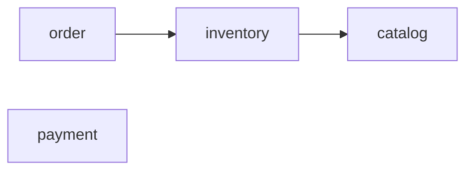

# Mục đích của `@ApplicationModuleTest` trong Spring Modulith

## 1. Vấn đề cần giải quyết

Một ứng dụng Spring Boot có thể được tổ chức thành nhiều **application module**, ví dụ `order`, `inventory` và `payment`. Các module chạy trong cùng một tiến trình, nhưng mỗi module phải có trách nhiệm và ranh giới phụ thuộc rõ ràng. Khi thay đổi nghiệp vụ đặt hàng, nhóm phát triển muốn biết riêng module `order` còn hoạt động đúng hay không, thay vì phải khởi động mọi thành phần của ứng dụng cho từng ca kiểm thử.

Với `@SpringBootTest` thông thường, Spring Boot thường khởi tạo application context của toàn ứng dụng. Điều này hữu ích cho kiểm thử tích hợp toàn hệ thống, nhưng có thể làm một bài test nghiệp vụ `order` phụ thuộc không cần thiết vào cấu hình, bean hoặc hạ tầng của `inventory` và `payment`.

**`@ApplicationModuleTest` là annotation kiểm thử tích hợp của Spring Modulith dùng để khởi tạo Spring application context trong phạm vi một application module đã chọn.** Nó giúp kiểm tra hành vi thực tế của các Spring bean thuộc module, làm lộ những phụ thuộc ra ngoài module và tạo một cấp kiểm thử nằm giữa unit test và kiểm thử tích hợp toàn ứng dụng.

Trong phạm vi học phần **Spring Modulith Verification & Testing**, đây là công cụ quan trọng để kiểm chứng tính độc lập khi khởi chạy module, kiểm thử tương tác sự kiện và phối hợp với kiểm tra quy tắc kiến trúc trong CI.

### Kết quả cần đạt

Sau bài này, bạn có thể:

- Giải thích vì sao cần kiểm thử tích hợp theo **ranh giới module** thay vì luôn khởi động toàn bộ ứng dụng.
- Mô tả phạm vi khởi tạo của `@ApplicationModuleTest`, các chế độ `STANDALONE`, `DIRECT_DEPENDENCIES` và `ALL_DEPENDENCIES`.
- Viết một bài test module đơn giản, kiểm tra Spring bean và một domain event được phát ra.
- Phân biệt kiểm thử hành vi module với kiểm chứng các quy tắc phụ thuộc bằng `ApplicationModules.verify()`.
- Nhận diện trường hợp cần mock module khác, tích hợp cơ sở dữ liệu hoặc chạy kiểm thử rộng hơn trong CI.

## 2. `@ApplicationModuleTest` làm gì?

`@ApplicationModuleTest` thuộc gói `org.springframework.modulith.test` và tích hợp với JUnit Jupiter/Spring Boot Test. Khi lớp test nằm trong package của một application module, Spring Modulith sẽ xác định module chứa lớp test đó rồi điều chỉnh quá trình khởi tạo ứng dụng:

1. **Giới hạn component scanning** theo các package của module được nạp, thay vì mặc nhiên tìm bean từ tất cả module.
2. **Giới hạn vùng auto-configuration và entity scanning liên quan đến package** theo phạm vi module được chọn. Hạ tầng Spring Boot vẫn có thể được tự cấu hình nếu cần cho bài test.
3. **Cho phép dùng Spring bean thật trong module** để kiểm tra nhiều lớp nghiệp vụ cùng nhau: service, repository, transaction, event publisher, v.v.
4. **Phát hiện vấn đề phụ thuộc khi khởi tạo**: nếu một bean cần bean từ module khác mà module đó không được nạp hay thay thế, context có thể khởi tạo thất bại.
5. **Tự động kiểm chứng cấu trúc module theo mặc định** qua tùy chọn `verifyAutomatically = true` của annotation; vẫn có thể viết bài kiểm chứng kiến trúc riêng để có quality gate rõ ràng.

Điểm cốt lõi là **kiểm thử một lát cắt dọc theo module**: kiểm tra các lớp liên quan của một năng lực nghiệp vụ cùng nhau, không chỉ một tầng như controller hoặc repository.

| Cách kiểm thử | Phạm vi điển hình | Khi nào nên dùng? |
| --- | --- | --- |
| Unit test thuần JUnit/Mockito | Một class, dependency được thay thế bằng fake/mock | Kiểm tra nhanh quy tắc và trường hợp biên của thuật toán |
| `@ApplicationModuleTest` | Application context giới hạn vào module và các phụ thuộc được chọn | Kiểm tra các bean phối hợp, event, repository và khả năng khởi tạo độc lập của module |
| `@SpringBootTest` | Application context của toàn ứng dụng theo cấu hình test | Kiểm tra cấu hình chung và các luồng xuyên nhiều module |
| `ApplicationModules.verify()` | Mô hình kiến trúc các module và quan hệ phụ thuộc | Phát hiện vi phạm ranh giới và quy tắc kiến trúc một cách tường minh |

> **Lưu ý:** Việc khởi tạo thành công không tự chứng minh mọi hành vi nghiệp vụ đúng. Bài test vẫn phải có assertion cụ thể. Ngược lại, `@ApplicationModuleTest` không thay thế hoàn toàn unit test, bài kiểm thử với cơ sở dữ liệu thật hoặc end-to-end test.

## 3. Phạm vi module và ba chế độ khởi tạo

Giả sử ứng dụng có các phụ thuộc hợp lệ sau:



Lớp kiểm thử đặt trong package `com.example.shop.order` sẽ mặc định kiểm thử module `order`. Thuộc tính `mode` của annotation quyết định có nạp thêm các module mà `order` phụ thuộc hay không.

| `BootstrapMode` | Các module được nạp trong ví dụ | Ý nghĩa |
| --- | --- | --- |
| `STANDALONE` *(mặc định)* | `order` | Tập trung vào module hiện tại; các bean cần từ module khác phải được xử lý phù hợp, thường là mock |
| `DIRECT_DEPENDENCIES` | `order`, `inventory` | Thêm các module mà `order` phụ thuộc **trực tiếp** |
| `ALL_DEPENDENCIES` | `order`, `inventory`, `catalog` | Thêm cả phụ thuộc **bắc cầu** của module hiện tại |

Ví dụ cấu hình phạm vi kiểm thử:

```java
package com.example.shop.order;

import org.springframework.modulith.test.ApplicationModuleTest;
import org.springframework.modulith.test.ApplicationModuleTest.BootstrapMode;

@ApplicationModuleTest(mode = BootstrapMode.DIRECT_DEPENDENCIES)
class OrderWithInventoryIntegrationTests {
    // Các @Test cho sự phối hợp giữa order và inventory.
}
```

Nên bắt đầu bằng `STANDALONE`. Khi context không khởi tạo được vì thiếu dependency ngoài module, hãy xem xét đây có phải là phụ thuộc cần thiết cho kịch bản kiểm thử hay không. Có thể thay bean bên ngoài bằng mock (chẳng hạn `@MockitoBean` với phiên bản Spring Boot/Spring Framework hỗ trợ), hoặc chủ đích mở rộng sang `DIRECT_DEPENDENCIES`. Sử dụng `ALL_DEPENDENCIES` một cách mặc định có thể che giấu mức độ liên kết cao giữa các module.

**Quan trọng:** Các chế độ trên mô tả *những module phụ thuộc cần nạp*, không cho phép tùy ý vượt qua các quy tắc phụ thuộc của kiến trúc. Một module gọi vào package nội bộ không được công khai của module khác vẫn có thể bị bước xác minh kiến trúc phát hiện.

## 4. Ví dụ: kiểm thử module `order` và domain event

Xét ứng dụng Spring Boot có lớp `ShopApplication` ở package gốc `com.example.shop`; `order` và `inventory` là hai package module ngang cấp. Ví dụ tối giản dưới đây tập trung vào một thao tác nghiệp vụ phát sự kiện, chưa mô hình hóa toàn bộ quá trình lưu đơn hàng.

```text
src/
├── main/java/com/example/shop/
│   ├── ShopApplication.java
│   ├── order/
│   │   ├── OrderService.java
│   │   └── OrderCompleted.java
│   └── inventory/
│       └── ...
└── test/java/com/example/shop/
    └── order/
        └── OrderModuleIntegrationTests.java
```

### Bước 1: khai báo dependency kiểm thử

Với Maven, thêm Spring Modulith test starter vào các dependency cho phạm vi `test` (phiên bản Spring Modulith nên được quản lý đồng bộ bằng BOM của dự án):

```xml
<dependency>
    <groupId>org.springframework.modulith</groupId>
    <artifactId>spring-modulith-starter-test</artifactId>
    <scope>test</scope>
</dependency>
```

Nếu dùng Gradle, khai báo tương đương:

```kotlin
dependencies {
    testImplementation("org.springframework.modulith:spring-modulith-starter-test")
}
```

Dự án cũng cần cấu hình Spring Boot Test/JUnit Jupiter phù hợp và một lớp `@SpringBootApplication` ở package gốc để Spring Boot tìm được cấu hình ứng dụng.

### Bước 2: tạo hành vi nghiệp vụ cần kiểm tra

File `OrderCompleted.java`:

```java
package com.example.shop.order;

import java.util.UUID;

public record OrderCompleted(UUID orderId) {}
```

File `OrderService.java`:

```java
package com.example.shop.order;

import java.util.UUID;
import org.springframework.context.ApplicationEventPublisher;
import org.springframework.stereotype.Service;

@Service
public class OrderService {

    private final ApplicationEventPublisher events;

    public OrderService(ApplicationEventPublisher events) {
        this.events = events;
    }

    public void complete(UUID orderId) {
        // Ví dụ rút gọn: ở hệ thống thực tế còn có kiểm tra và cập nhật trạng thái đơn.
        events.publishEvent(new OrderCompleted(orderId));
    }
}
```

Trong ví dụ này, `order` không cần gọi trực tiếp một bean của `inventory` chỉ để thông báo rằng đơn hàng đã hoàn tất. Các module quan tâm có thể phản ứng với `OrderCompleted` qua cơ chế sự kiện, giúp giảm phụ thuộc trực tiếp.

### Bước 3: viết kiểm thử tích hợp module

File `OrderModuleIntegrationTests.java` nằm trong **package `com.example.shop.order`**:

```java
package com.example.shop.order;

import static org.assertj.core.api.Assertions.assertThat;

import java.util.UUID;
import org.junit.jupiter.api.Test;
import org.springframework.beans.factory.annotation.Autowired;
import org.springframework.modulith.test.ApplicationModuleTest;
import org.springframework.modulith.test.PublishedEvents;

@ApplicationModuleTest
class OrderModuleIntegrationTests {

    @Autowired OrderService orderService;

    @Test
    void completingOrderPublishesOneMatchingEvent(PublishedEvents events) {
        UUID orderId = UUID.randomUUID();

        orderService.complete(orderId);

        assertThat(events.ofType(OrderCompleted.class)
                .matching(OrderCompleted::orderId, orderId))
                .hasSize(1);
    }
}
```

Các điểm cần quan sát:

1. `@ApplicationModuleTest` xác định module `order` thông qua package của lớp test và khởi tạo context theo `STANDALONE`.
2. `@Autowired OrderService` lấy **bean thực** do Spring quản lý, nên việc wiring và cơ chế `ApplicationEventPublisher` có mặt trong bài kiểm thử.
3. `PublishedEvents` được đưa trực tiếp vào tham số phương thức test để ghi nhận các sự kiện được phát trong quá trình chạy test.
4. Assertion chỉ chấp nhận **một** sự kiện `OrderCompleted` có `orderId` trùng với đơn vừa hoàn tất; nếu không phát, phát sai ID hoặc phát trùng, test thất bại.

Ví dụ này có thể chạy độc lập với module `inventory` vì `OrderService` không giữ tham chiếu trực tiếp tới bean của `inventory`. Đây chính là giá trị của kiểm thử module: có thể xác minh hành vi tại ranh giới sự kiện mà không phải nạp toàn bộ các module nhận sự kiện.

## 5. Đọc lỗi để nhận ra vấn đề thiết kế

Giả sử `OrderService` được sửa để constructor nhận thêm `InventoryService` thuộc module `inventory`:

```java
// Minh họa phụ thuộc trực tiếp; không phải phần của ví dụ chạy độc lập ở trên.
public OrderService(ApplicationEventPublisher events,
                    InventoryService inventoryService) {
    // ...
}
```

Trong chế độ `STANDALONE`, nếu không có bean thay thế, Spring có thể báo lỗi kiểu `UnsatisfiedDependencyException` khi tạo `OrderService`. Lỗi này cho thấy module hiện tại **không thể khởi tạo riêng theo cấu hình đang kiểm thử**. Cần phân tích nguyên nhân trước khi sửa:

- Nếu chỉ muốn kiểm tra logic `order`, mock interface/bean của module ngoài và xác nhận tương tác cần thiết.
- Nếu chủ đích kiểm tra luồng `order → inventory`, dùng `DIRECT_DEPENDENCIES` và chuẩn bị dữ liệu, hạ tầng cho cả hai module.
- Nếu việc gọi trực tiếp tạo ra phụ thuộc quá chặt, cân nhắc giao tiếp bằng domain event hoặc thiết kế lại API giữa các module.
- Nếu phụ thuộc đi vào phần `internal` của module khác, cần xử lý vi phạm ranh giới thay vì chỉ tăng bootstrap mode để context khởi động được.

**Phân biệt hai tín hiệu:** Không tạo được bean có thể là lỗi wiring/configuration; phụ thuộc sai kiến trúc cần được xác minh bằng quy tắc module. Hai loại lỗi có thể liên quan nhưng không đồng nhất.

## 6. Liên hệ với cơ sở dữ liệu, sự kiện bất đồng bộ và quality gate

`@ApplicationModuleTest` là nền tảng phù hợp để kiểm thử repository và transaction **thuộc module**, miễn là môi trường test cung cấp datasource, schema và dữ liệu cần thiết. Annotation không tự tạo một cơ sở dữ liệu dành riêng cho mỗi module. Với JPA, chỉ nên giả định các entity/repository nằm trong phạm vi module đã được nạp; schema, migration và Testcontainers/H2 vẫn phải được cấu hình phù hợp với dự án.

Khi kiểm thử listener bất đồng bộ hoặc `@ApplicationModuleListener`, chỉ assert một event đã được **phát ra** chưa đủ để chứng minh nó đã được **xử lý thành công**. Spring Modulith có API `Scenario` để kích hoạt hành động rồi chờ event hoặc thay đổi trạng thái mong đợi:

```java
@ApplicationModuleTest
class InventoryScenarioTests {

    @Test
    void reactsToIncomingEvent(Scenario scenario) {
        // Minh họa ý tưởng: thay event và assertion bằng kiểu thực tế của dự án.
        scenario.publish(new StockReplenished("SKU-01"))
                .andWaitForEventOfType(InventoryUpdated.class)
                .toArrive();
    }
}
```

Các type `StockReplenished` và `InventoryUpdated` trong đoạn này là **giả định**, chưa được định nghĩa trong ví dụ `order`. Với `Scenario`, stimulus có thể chạy trong một transaction riêng để listener giao dịch nhận được event; dữ liệu được ghi từ stimulus **không mặc nhiên rollback** theo transaction của phương thức test. Vì vậy cần thiết kế bước dọn dữ liệu hoặc cô lập database giữa các ca test.

Đối với kiểm chứng kiến trúc, nên duy trì một bài test riêng để kết quả trên CI dễ đọc và không phụ thuộc vào việc đã chạy test tích hợp của module nào:

```java
package com.example.shop;

import org.junit.jupiter.api.Test;
import org.springframework.modulith.core.ApplicationModules;

class ModuleArchitectureTests {

    @Test
    void modulesRespectArchitectureRules() {
        ApplicationModules.of(ShopApplication.class).verify();
    }
}
```

`ApplicationModules.verify()` kiểm tra các ràng buộc cấu trúc/phụ thuộc của mô hình module. `@ApplicationModuleTest` mặc định cũng bật xác minh module khi bootstrap, nhưng bài test kiến trúc tường minh là một **quality gate** hữu ích, ngay cả khi một số bài test tích hợp bị lọc khỏi lần chạy. Có thể chạy các bài test này cùng unit test và integration test trong Maven/Gradle CI (`./mvnw test` hoặc `./gradlew test` trên môi trường phù hợp).

## 7. Những hiểu nhầm cần tránh

| Hiểu nhầm | Cách hiểu đúng |
| --- | --- |
| “`@ApplicationModuleTest` chỉ là tên khác của `@SpringBootTest`.” | Nó dựa trên cơ chế Spring Boot Test nhưng thu hẹp việc bootstrap theo module và bootstrap mode. |
| “Module test luôn phải chạy được mà không có dependency ngoài.” | Ở `STANDALONE`, dependency ngoài cần được mock/thay thế hoặc cần xem lại thiết kế; một số kịch bản tích hợp thực sự cần mở rộng mode. |
| “Test chạy xanh nghĩa là kiến trúc chắc chắn hợp lệ.” | Cần assertion nghiệp vụ, xác minh quy tắc phụ thuộc và các mức kiểm thử phù hợp; chú ý tùy chọn `verifyAutomatically`. |
| “Có `PublishedEvents` là đã kiểm thử listener bất đồng bộ.” | `PublishedEvents` kiểm tra việc phát event; dùng `Scenario` hoặc assertion về state để xác minh kết quả xử lý bất đồng bộ. |
| “Module test không cần cấu hình database.” | Repository/transaction vẫn cần datasource, schema, transaction manager và cách cô lập dữ liệu phù hợp. |
| “Dùng `ALL_DEPENDENCIES` là lựa chọn an toàn nhất.” | Nó tăng số module được nạp và có thể làm mất tín hiệu về phụ thuộc chặt; chọn phạm vi nhỏ nhất đáp ứng mục tiêu test. |

## 8. Câu hỏi tự kiểm tra

1. Vì sao một bài `@SpringBootTest` toàn ứng dụng có thể che khuất vấn đề phụ thuộc của module `order`?
2. Sự khác nhau giữa `STANDALONE`, `DIRECT_DEPENDENCIES` và `ALL_DEPENDENCIES` trong ví dụ `order → inventory → catalog` là gì?
3. Nếu `@ApplicationModuleTest` thất bại do thiếu bean thuộc module khác, bạn sẽ kiểm tra những khả năng nào trước khi đổi mode?
4. `PublishedEvents` kiểm chứng điều gì, và khi nào bạn cần `Scenario`?
5. Tại sao vẫn nên chạy `ApplicationModules.verify()` trong CI dù đã có các bài `@ApplicationModuleTest`?

**Ghi nhớ:** Mục đích chính của `@ApplicationModuleTest` là **kiểm thử hành vi và khả năng khởi tạo của từng application module trong phạm vi phụ thuộc có chủ đích**. Khi kết hợp với kiểm chứng quy tắc phụ thuộc, kiểm thử sự kiện và các quality gate CI, nó giúp phát hiện sớm hồi quy và giữ ranh giới kiến trúc của ứng dụng Spring Modulith rõ ràng.

### Tài liệu tham khảo

- [Spring Modulith Reference — Integration Testing Application Modules](https://docs.spring.io/spring-modulith/reference/testing.html)
- [Spring Modulith Reference — Working with Application Events](https://docs.spring.io/spring-modulith/reference/events.html)
- [Spring Modulith API — `ApplicationModuleTest`](https://docs.spring.io/spring-modulith/docs/current/api/org/springframework/modulith/test/ApplicationModuleTest.html)
