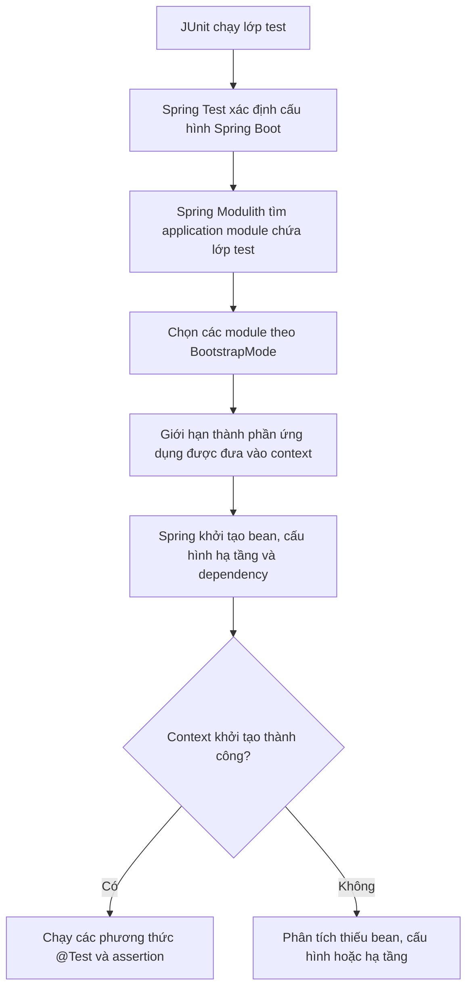
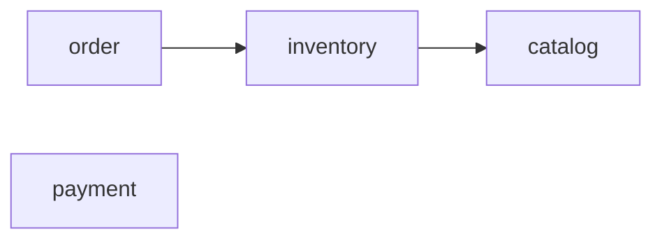

# Bootstrapper cho kiểm thử một module trong Spring Modulith

## 1. Vì sao cần bootstrap riêng cho một application module?

Trong ứng dụng Spring Boot truyền thống, một bài `@SpringBootTest` thường khởi tạo application context cho toàn bộ ứng dụng. Cách làm này phù hợp để thử một luồng nghiệp vụ xuyên hệ thống, nhưng có thể tốn tài nguyên và làm cho bài test của module `order` thất bại chỉ vì một cấu hình không liên quan của module `reporting`.

**Spring Modulith cung cấp cơ chế bootstrap theo module thông qua `@ApplicationModuleTest`.** Khi dùng annotation này, Spring Test vẫn tạo application context và các bean thật, nhưng Spring Modulith xác định module đang được kiểm thử rồi giới hạn những application module được đưa vào context. Nhờ đó, nhóm phát triển có thể kiểm chứng khả năng hoạt động độc lập và phát hiện những phụ thuộc ngoài ranh giới dự kiến.

Trong học phần **SPRING_MODULITH_VERIFICATION_TESTING**, nội dung này phục vụ mục tiêu kiểm chứng ranh giới kiến trúc bằng `ApplicationModules`, kiểm thử module với `@ApplicationModuleTest`, thử nghiệm sự kiện/cơ sở dữ liệu và đưa các kiểm tra vào quality gate CI để giảm hồi quy.

Sau bài học, bạn cần nắm được:

- Bootstrapper xác định **module mục tiêu** từ vị trí lớp test như thế nào.
- Ba chế độ `STANDALONE`, `DIRECT_DEPENDENCIES`, `ALL_DEPENDENCIES` thay đổi phạm vi context ra sao.
- Vì sao một `UnsatisfiedDependencyException` khi chạy module test có thể là tín hiệu về thiết kế phụ thuộc.
- Cách chọn giữa cô lập dependency bằng mock, mở rộng các module được nạp và thực hiện kiểm thử tích hợp xuyên module.
- Cách phối hợp bài test bootstrap với kiểm chứng kiến trúc, sự kiện và hạ tầng trong CI.

## 2. Hiểu đúng về bootstrapper

*Bootstrap* là quá trình chuẩn bị và khởi tạo môi trường chạy kiểm thử. Trong trường hợp `@ApplicationModuleTest`, nó không phải một chương trình `main()` độc lập và cũng không phải công cụ chạy JUnit riêng. Nó là sự phối hợp giữa Spring Boot Test, Spring TestContext và phần hỗ trợ kiểm thử của Spring Modulith.

Luồng khái niệm có thể hình dung như sau:



Có bốn điểm quan trọng:

1. **Xác định module:** Spring Modulith dùng mô hình application module của ứng dụng và package của lớp test để biết module nào đang được kiểm tra.
2. **Chọn phạm vi:** Thuộc tính `mode` quyết định chỉ khởi tạo module hiện tại hay kèm các module mà nó phụ thuộc trực tiếp/bắc cầu.
3. **Tạo context thật:** Các bean được chọn vẫn đi qua cơ chế dependency injection, lifecycle và auto-configuration của Spring. Do đó test có thể phát hiện lỗi wiring mà unit test thuần mock không thấy.
4. **Chạy assertion:** Bootstrap thành công chỉ chứng minh context khởi tạo được theo cấu hình đã chọn. Hành vi nghiệp vụ cần được xác minh bằng các assertion riêng.

> **Phân biệt:** `ApplicationModules` biểu diễn và xác minh **cấu trúc phụ thuộc** giữa module; `@ApplicationModuleTest` bootstrap **môi trường thực thi giới hạn theo module**. Hai công cụ hỗ trợ nhau nhưng trả lời hai câu hỏi khác nhau.

## 3. Điều kiện để bootstrapper tìm đúng module

Với cách xác định module mặc định của Spring Modulith, các package con trực tiếp dưới package ứng dụng là các application module. Ví dụ:

```text
src/
├── main/java/com/example/shop/
│   ├── ShopApplication.java          # @SpringBootApplication
│   ├── order/                         # Module order
│   │   ├── OrderService.java
│   │   ├── OrderPlaced.java
│   │   └── internal/
│   ├── inventory/                     # Module inventory
│   └── catalog/                       # Module catalog
└── test/java/com/example/shop/
    ├── order/
    │   └── OrderBootstrapTests.java  # Thuộc module order
    └── architecture/
        └── ModuleArchitectureTests.java
```

Lớp cấu hình ứng dụng đặt ở package gốc:

```java
package com.example.shop;

import org.springframework.boot.SpringApplication;
import org.springframework.boot.autoconfigure.SpringBootApplication;

@SpringBootApplication
public class ShopApplication {
    public static void main(String[] args) {
        SpringApplication.run(ShopApplication.class, args);
    }
}
```

Khi lớp `OrderBootstrapTests` nằm trong `com.example.shop.order`, bootstrapper có thể xác định module mục tiêu là `order`. Đặt lớp test nhầm ở `com.example.shop` hoặc một package ngoài mô hình module có thể khiến Spring Modulith không xác định được module cần kiểm thử.

Nếu dự án dùng cơ chế khai báo module tùy chỉnh, tên module và phạm vi package có thể khác ví dụ trên. Hãy dựa vào mô hình `ApplicationModules` của chính ứng dụng, không suy đoán module chỉ từ tên thư mục trên ổ đĩa.

## 4. `BootstrapMode`: quyết định module nào được khởi tạo

Giả sử phụ thuộc trong ứng dụng như sau:



`order` phụ thuộc trực tiếp `inventory`; `inventory` lại phụ thuộc `catalog`. `payment` không nằm trong chuỗi phụ thuộc này.

| Chế độ | Phạm vi application module cho test `order` | Mục đích |
| --- | --- | --- |
| `STANDALONE` *(mặc định)* | `order` | Cô lập module mục tiêu; các dependency ngoài phạm vi cần được xử lý rõ ràng |
| `DIRECT_DEPENDENCIES` | `order`, `inventory` | Kiểm thử tích hợp giữa module mục tiêu và các module mà nó phụ thuộc trực tiếp |
| `ALL_DEPENDENCIES` | `order`, `inventory`, `catalog` | Kiểm thử module cùng toàn bộ chuỗi phụ thuộc bắc cầu của nó |

Ví dụ chọn phạm vi bằng `mode`:

```java
package com.example.shop.order;

import org.springframework.modulith.test.ApplicationModuleTest;
import org.springframework.modulith.test.ApplicationModuleTest.BootstrapMode;

@ApplicationModuleTest(mode = BootstrapMode.STANDALONE)
class OrderStandaloneTests {
    // Chỉ kiểm tra hành vi trong phạm vi module order.
}
```

```java
package com.example.shop.order;

import org.springframework.modulith.test.ApplicationModuleTest;
import org.springframework.modulith.test.ApplicationModuleTest.BootstrapMode;

@ApplicationModuleTest(mode = BootstrapMode.DIRECT_DEPENDENCIES)
class OrderInventoryIntegrationTests {
    // Kiểm tra sự phối hợp của order với các module phụ thuộc trực tiếp.
}
```

Khi thực sự cần nạp một module bổ sung **theo tên module**, có thể sử dụng `extraIncludes`:

```java
@ApplicationModuleTest(
    mode = BootstrapMode.STANDALONE,
    extraIncludes = "inventory"
)
class OrderWithExtraModuleTests {
    // Thêm module inventory một cách có chủ đích.
}
```

Với ví dụ này, `extraIncludes = "inventory"` giả định `inventory` đúng là tên application module đã được Spring Modulith nhận diện. Không nên thêm bừa các module chỉ để làm test chạy xanh. Trong kiểm thử ranh giới, **phạm vi nhỏ nhất đáp ứng mục tiêu bài test** thường cho tín hiệu tốt hơn về mức độ liên kết.

**Giới hạn cần nhớ:** Bảng trên liệt kê *application module*. Context vẫn có thể chứa các bean và cấu hình hạ tầng do Spring Boot Test, auto-configuration hoặc test configuration cung cấp. `STANDALONE` không có nghĩa JVM chỉ chứa đúng các class thuộc `order`.

## 5. Ví dụ thực hành: bootstrap module `order` và kiểm tra sự kiện

Để có ví dụ chạy được, cần dự án Spring Boot với dependency kiểm thử `spring-modulith-starter-test`, JUnit Jupiter và AssertJ (thường đi cùng hệ sinh thái Spring Boot Test). Đồng bộ phiên bản Spring Modulith theo BOM phù hợp với phiên bản Spring Boot đang dùng.

Với Maven, dependency chính có dạng:

```xml
<dependency>
    <groupId>org.springframework.modulith</groupId>
    <artifactId>spring-modulith-starter-test</artifactId>
    <scope>test</scope>
</dependency>
```

### Bước 1: tạo event và service nằm trong module `order`

File `src/main/java/com/example/shop/order/OrderPlaced.java`:

```java
package com.example.shop.order;

import java.util.UUID;

public record OrderPlaced(UUID orderId) {}
```

File `src/main/java/com/example/shop/order/OrderService.java`:

```java
package com.example.shop.order;

import java.util.UUID;
import org.springframework.context.ApplicationEventPublisher;
import org.springframework.stereotype.Service;

@Service
public class OrderService {

    private final ApplicationEventPublisher events;

    public OrderService(ApplicationEventPublisher events) {
        this.events = events;
    }

    public UUID placeOrder() {
        UUID orderId = UUID.randomUUID();
        // Ví dụ rút gọn: ứng dụng thực còn validate và lưu trạng thái đơn hàng.
        events.publishEvent(new OrderPlaced(orderId));
        return orderId;
    }
}
```

Service chỉ cần các thành phần Spring cơ bản nên phù hợp với bootstrap `STANDALONE`.

### Bước 2: chạy module test với bean thật

File `src/test/java/com/example/shop/order/OrderBootstrapTests.java`:

```java
package com.example.shop.order;

import static org.assertj.core.api.Assertions.assertThat;

import java.util.UUID;
import org.junit.jupiter.api.Test;
import org.springframework.beans.factory.annotation.Autowired;
import org.springframework.modulith.test.ApplicationModuleTest;
import org.springframework.modulith.test.PublishedEvents;

@ApplicationModuleTest // Mặc định: BootstrapMode.STANDALONE
class OrderBootstrapTests {

    @Autowired OrderService orderService;

    @Test
    void contextStartsAndOrderEmitsEvent(PublishedEvents events) {
        UUID orderId = orderService.placeOrder();

        assertThat(events.ofType(OrderPlaced.class)
                .matching(OrderPlaced::orderId, orderId))
                .hasSize(1);
    }
}
```

Bài test này xác minh **hai điều khác nhau**:

1. Spring Test có thể bootstrap context của module `order` và inject bean `OrderService` thật. Nếu module có dependency không được đáp ứng, bài test có thể thất bại ngay trong giai đoạn chuẩn bị context.
2. Khi gọi `placeOrder()`, `ApplicationEventPublisher` tạo đúng một event `OrderPlaced` với ID được trả về. `PublishedEvents` kiểm tra event **đã phát**, chưa khẳng định listener ở module khác đã xử lý thành công.

Để kiểm tra một listener bất đồng bộ đã xử lý xong, cần bổ sung kiểm thử kết quả xử lý (ví dụ thay đổi trạng thái database) hoặc dùng hỗ trợ `Scenario` của Spring Modulith để chờ một điều kiện/event mong đợi. Đó là mục tiêu khác với kiểm tra riêng việc bootstrap.

## 6. Dependency ngoài module: nên mock hay nạp thêm module?

Giả sử sau này `order` có một service gọi API công khai của module `inventory`:

```java
package com.example.shop.order;

import com.example.shop.inventory.InventoryOperations;
import org.springframework.stereotype.Service;

@Service
class CheckoutService {

    private final InventoryOperations inventory;

    CheckoutService(InventoryOperations inventory) {
        this.inventory = inventory;
    }
}
```

Đoạn minh họa giả định module `inventory` cung cấp interface `InventoryOperations` như một API công khai. Khi chạy `@ApplicationModuleTest` ở `STANDALONE`, nếu không có bean thay thế, Spring có thể ném `UnsatisfiedDependencyException`: `CheckoutService` yêu cầu `InventoryOperations` nhưng bean triển khai đang nằm ngoài phạm vi nạp.

Có hai hướng xử lý chính, tùy mục tiêu:

**Cô lập module `order` bằng mock:** Nếu chỉ muốn kiểm tra nghiệp vụ của `order`, thay thế điểm giao tiếp với `inventory`. Ví dụ với Spring Framework 6.2+ (phần hỗ trợ `@MockitoBean`):

```java
package com.example.shop.order;

import com.example.shop.inventory.InventoryOperations;
import org.springframework.modulith.test.ApplicationModuleTest;
import org.springframework.test.context.bean.override.mockito.MockitoBean;

@ApplicationModuleTest
class OrderIsolatedTests {

    @MockitoBean
    InventoryOperations inventory;

    // @Test xác nhận hành vi order và tương tác dự kiến với inventory.
}
```

Với các phiên bản Spring Boot cũ hơn, dự án có thể còn dùng `@MockBean`; kiểm tra khả năng tương thích với stack thực tế. Mock cần có kỳ vọng/verification phù hợp, không chỉ được khai báo để che lỗi context.

**Kiểm thử hai module cùng nhau:** Nếu mục tiêu là kiểm tra sự phối hợp thực tế giữa `order` và `inventory`, sử dụng `@ApplicationModuleTest(mode = BootstrapMode.DIRECT_DEPENDENCIES)` để nạp bean thật từ module phụ thuộc trực tiếp. Lúc này test có thể cần thêm cấu hình cơ sở dữ liệu, migration, message infrastructure hoặc các dependency của `inventory` theo ứng dụng.

Việc đổi từ `STANDALONE` sang `ALL_DEPENDENCIES` chỉ vì một bean thiếu thường khiến bài test nặng hơn và làm mờ ranh giới đang cần kiểm chứng. Trước khi đổi mode, xác nhận module đó có phải là dependency hợp lệ và có cần thiết cho **hành vi đang được thử** hay không.

## 7. Bootstrap với database, transaction và các cấu hình Spring Boot

Một module test có repository JPA vẫn là bài kiểm thử Spring context thật. Nếu bean repository được nạp nhưng thiếu datasource/schema, test có thể thất bại do lỗi hạ tầng dù package module đã đúng.

Ví dụ muốn kiểm chứng `OrderRepository` ghi/đọc dữ liệu:

- Chuẩn bị datasource dành cho test bằng H2 hoặc Testcontainers tùy mức độ tương thích cần thiết với hệ quản trị thật.
- Cung cấp schema/migration và dữ liệu đầu vào có thể lặp lại. Chỉ nạp repository/entity liên quan đến phạm vi module khi thiết kế cho phép.
- Chủ động xác định cách cô lập dữ liệu giữa các bài test. Có thể dùng transaction rollback cho bài test phù hợp, nhưng không nên giả định mọi thao tác bất đồng bộ hay event listener đều rollback cùng transaction của test.
- Không kết luận bootstrapper sai ngay khi gặp lỗi `relation does not exist`, lỗi migration hoặc không kết nối được database: những lỗi này có nguyên nhân riêng ở hạ tầng.

Ví dụ với profile dành cho kiểm thử:

```java
package com.example.shop.order;

import org.springframework.modulith.test.ApplicationModuleTest;
import org.springframework.test.context.ActiveProfiles;

@ActiveProfiles("test")
@ApplicationModuleTest
class OrderPersistenceTests {
    // Các @Test về repository/transaction sau khi cấu hình datasource test.
}
```

`@ActiveProfiles("test")` chỉ chọn profile; nó **không tự tạo datasource hoặc schema**. Cấu hình thực tế phải được cung cấp bởi dự án/test infrastructure.

## 8. Đọc lỗi bootstrap để xác định đúng vấn đề

| Triệu chứng | Điều nên kiểm tra | Cách xử lý phù hợp |
| --- | --- | --- |
| Không tìm được cấu hình Spring Boot | Package gốc chứa `@SpringBootApplication`, vị trí package của lớp test, cấu hình test | Đặt test đúng package/module và bảo đảm Spring Boot tìm thấy configuration |
| Không xác định được application module của lớp test | Package của test có thực sự thuộc mô hình `ApplicationModules` không? | Chuyển test vào package của module đúng mục tiêu hoặc chỉnh cấu hình nhận diện module |
| `UnsatisfiedDependencyException` / thiếu bean | Bean thiếu nằm ở module ngoài, bean nội bộ bị loại hay test thiếu configuration? | Mock dependency ngoài, nạp module cần thiết hoặc sửa wiring phù hợp |
| Bean của module không liên quan cũng bị khởi tạo | `mode`, `extraIncludes`, cấu hình `@Import`, shared/test infrastructure | Kiểm tra cấu hình context; giữ phạm vi module theo mục tiêu test |
| Lỗi JPA, datasource, migration | Database test, entity scan, transaction manager, schema và dữ liệu | Thiết lập môi trường tích hợp nhất quán, không mở rộng module chỉ để che lỗi DB |
| Test qua bootstrap nhưng logic sai | Assertion đã kiểm tra kết quả nghiệp vụ chưa? | Bổ sung test hành vi, published events, trạng thái database hoặc các contract phù hợp |

Để chẩn đoán hiệu quả, hãy đọc **nguyên nhân gốc** trong exception chain, kiểm tra module mà test đang nằm trong và ghi lại `BootstrapMode`. Một bài test báo thiếu bean không tự động đồng nghĩa đã có vi phạm kiến trúc; đó là tín hiệu cho biết cấu hình chạy hiện tại không đáp ứng dependency.

## 9. Đưa kiểm tra bootstrap module vào CI

Chỉ bootstrap thành công chưa đủ để chứng minh dependency giữa các module đúng ranh giới. Nên kết hợp bài kiểm thử `@ApplicationModuleTest` với một bài xác minh kiến trúc tường minh:

```java
package com.example.shop;

import org.junit.jupiter.api.Test;
import org.springframework.modulith.core.ApplicationModules;

class ModuleArchitectureTests {

    @Test
    void applicationModulesRespectBoundaries() {
        ApplicationModules.of(ShopApplication.class).verify();
    }
}
```

`ApplicationModules.verify()` kiểm tra các ràng buộc cấu trúc và quy tắc phụ thuộc của các module. `@ApplicationModuleTest` cũng có tùy chọn `verifyAutomatically` (mặc định bật trong phiên bản hỗ trợ), nhưng bài test kiến trúc riêng giúp CI có tín hiệu kiểm chứng ranh giới rõ ràng ngay cả khi chỉ chạy một nhóm test tích hợp.

Một quality gate CI tối thiểu nên bao gồm **bài test kiến trúc**, **module test chế độ cô lập** cho module quan trọng và **integration test** cho tương tác sự kiện/database được chọn. Với dự án Maven/Gradle thông thường, các bài test JUnit này có thể được chạy trong stage test thông qua `./mvnw test` hoặc `./gradlew test` nếu cấu hình test task và hạ tầng đáp ứng.

## 10. Bài tập tự thực hành

1. Tạo ứng dụng ba module `order → inventory → catalog` với lớp `@SpringBootApplication` ở package gốc. Đặt một bài `@ApplicationModuleTest` trong package `order` và ghi lại module nào được nạp theo từng `BootstrapMode`.
2. Thêm một constructor dependency từ service của `order` sang API công khai của `inventory`; quan sát lỗi bootstrap ở chế độ `STANDALONE`, sau đó thử giải quyết bằng mock và bằng `DIRECT_DEPENDENCIES`.
3. Thêm event `OrderPlaced` vào một hành động của `order`; viết assertion với `PublishedEvents` để kiểm tra đúng `orderId`.
4. Nếu có repository, chuẩn bị dữ liệu test bằng database phù hợp và xác minh một phép ghi/đọc; tách lỗi database khỏi lỗi phạm vi module khi chẩn đoán.
5. Thêm `ApplicationModules.of(ShopApplication.class).verify()` vào bộ test CI, rồi cố ý tạo một phụ thuộc trái quy tắc để xác minh quality gate báo lỗi.

**Ghi nhớ:** Bootstrapper của `@ApplicationModuleTest` giúp chạy kiểm thử tích hợp trên một **lát cắt ứng dụng được giới hạn theo application module**. Sử dụng `STANDALONE` làm điểm xuất phát, mở rộng dependency có chủ đích, quan sát lỗi khởi tạo để nhận diện phụ thuộc và kết hợp `ApplicationModules.verify()` với assertion nghiệp vụ để bảo vệ kiến trúc khỏi hồi quy.

### Tài liệu tham khảo

- [Spring Modulith Reference — Integration Testing Application Modules](https://docs.spring.io/spring-modulith/reference/testing.html)
- [Spring Modulith Reference — Verifying Application Module Structure](https://docs.spring.io/spring-modulith/reference/verification.html)
- [Spring Modulith Javadoc — `ApplicationModuleTest`](https://docs.spring.io/spring-modulith/docs/current/api/org/springframework/modulith/test/ApplicationModuleTest.html)
