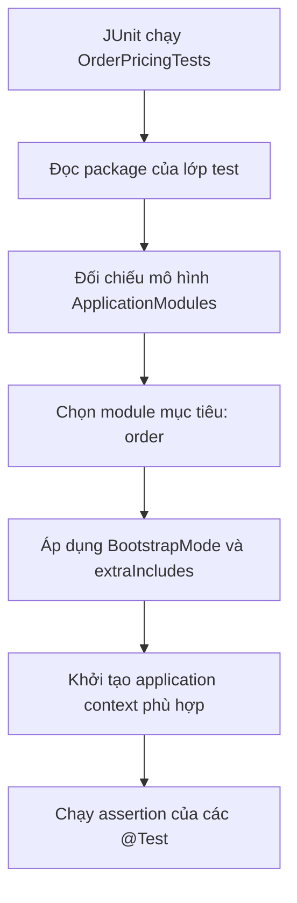
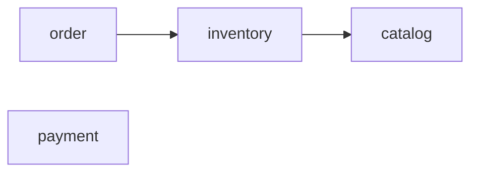

# Chọn module được bootstrap với `@ApplicationModuleTest`

## 1. Vì sao phải chọn đúng module?

Khi kiểm thử một ứng dụng Spring Modulith, mục tiêu thường là xác nhận một năng lực nghiệp vụ có thể hoạt động trong ranh giới module đã thiết kế. Chẳng hạn, nhóm phát triển muốn chạy bài test cho `order` mà không khởi tạo toàn bộ `payment`, `reporting` và các thành phần không liên quan. Nếu chọn sai module, bài test có thể chạy với những bean không mong muốn, bỏ sót các bean cần kiểm tra hoặc thất bại khi Spring không tìm được cấu hình phù hợp.

**`@ApplicationModuleTest` chọn một application module làm mục tiêu bootstrap**, sau đó quyết định có nạp thêm những module phụ thuộc hay không. Việc chọn **module mục tiêu** và việc chọn **phạm vi module được nạp** là hai quyết định liên quan nhưng khác nhau:

- **Module mục tiêu**: module mà bài test được viết để kiểm tra, ví dụ `order`.
- **Các module bổ sung**: module được đưa vào context do chế độ `BootstrapMode` hoặc thuộc tính `extraIncludes`.
- **Context thực tế**: ngoài bean của những module được chọn, Spring Boot Test vẫn có thể tạo các bean hạ tầng và test configuration cần thiết.

Trong học phần **SPRING_MODULITH_VERIFICATION_TESTING**, chọn module đúng là bước đầu để kiểm chứng ranh giới kiến trúc cùng `ApplicationModules`, thử hành vi bằng `@ApplicationModuleTest`, kiểm thử event/cơ sở dữ liệu và đưa các bài test vào quality gate CI để phát hiện phụ thuộc sai, hồi quy.

Sau bài này, bạn có thể đặt test vào đúng package, dùng `module` và `classes` khi test nằm ngoài module, dự đoán tập module được bootstrap qua `mode`/`extraIncludes`, và kiểm chứng lựa chọn bằng log hoặc bài test cụ thể.

## 2. Cách mặc định: tìm module dựa trên package của lớp test

Trong mô hình module mặc định, mỗi package con trực tiếp dưới package ứng dụng là một application module. Xét ứng dụng:

```text
src/
├── main/java/com/example/store/
│   ├── StoreApplication.java           # @SpringBootApplication
│   ├── order/                           # module order
│   │   ├── OrderPricing.java
│   │   └── internal/
│   │       └── OrderValidator.java
│   ├── inventory/                       # module inventory
│   ├── catalog/                         # module catalog
│   └── payment/                         # module payment
└── test/java/com/example/store/
    ├── order/
    │   ├── OrderPricingTests.java      # module mục tiêu: order
    │   └── internal/
    │       └── OrderRulesTests.java    # vẫn thuộc module order
    └── payment/
        └── PaymentModuleTests.java     # module mục tiêu: payment
```

Với lớp test:

```java
package com.example.store.order;

import org.springframework.modulith.test.ApplicationModuleTest;

@ApplicationModuleTest
class OrderPricingTests {
    // Các phương thức @Test đặt ở đây.
}
```

Spring Modulith sử dụng mô hình `ApplicationModules` để xác định `com.example.store.order` nằm trong module `order`. Lớp test cũng có thể ở package con như `com.example.store.order.internal`; module mục tiêu vẫn là `order`, **không phải** module độc lập tên `internal`.

Quá trình này có thể biểu diễn như sau:



Lưu ý về phạm vi:

- Spring Modulith dựa trên **mô hình module của ứng dụng**, không chỉ tìm chuỗi ký tự `order` trong tên class hay tên thư mục test.
- Nếu ứng dụng dùng chiến lược nhận diện module khác mặc định, hãy dựa trên tên và package **được nhận diện thực tế**.
- Cần có cấu hình Spring Boot thích hợp, thường là lớp `@SpringBootApplication` trong package gốc hoặc lớp cấu hình được chỉ định cho bài test.
- Tên module logic thường trùng tên package module với cấu trúc mặc định; dự án có thể có khai báo tên khác.

## 3. Ví dụ chạy được: đặt test trong module `order`

Giả sử lớp ứng dụng ở `com.example.store`:

```java
package com.example.store;

import org.springframework.boot.SpringApplication;
import org.springframework.boot.autoconfigure.SpringBootApplication;

@SpringBootApplication
public class StoreApplication {
    public static void main(String[] args) {
        SpringApplication.run(StoreApplication.class, args);
    }
}
```

File `src/main/java/com/example/store/order/OrderPricing.java`:

```java
package com.example.store.order;

import java.math.BigDecimal;
import org.springframework.stereotype.Service;

@Service
public class OrderPricing {

    public BigDecimal calculate(BigDecimal unitPrice, int quantity) {
        if (unitPrice.signum() < 0 || quantity <= 0) {
            throw new IllegalArgumentException("Price and quantity must be valid");
        }
        return unitPrice.multiply(BigDecimal.valueOf(quantity));
    }
}
```

File `src/test/java/com/example/store/order/OrderPricingTests.java`:

```java
package com.example.store.order;

import static org.assertj.core.api.Assertions.assertThat;

import java.math.BigDecimal;
import org.junit.jupiter.api.Test;
import org.springframework.beans.factory.annotation.Autowired;
import org.springframework.modulith.test.ApplicationModuleTest;

@ApplicationModuleTest
class OrderPricingTests {

    @Autowired OrderPricing pricing;

    @Test
    void calculatesOrderTotalInOrderModule() {
        BigDecimal total = pricing.calculate(new BigDecimal("19.50"), 3);

        assertThat(total).isEqualByComparingTo("58.50");
    }
}
```

Điều kiện dự án: có `spring-modulith-starter-test` với scope `test`, JUnit Jupiter và AssertJ, đồng thời các phiên bản Spring Boot/Spring Modulith được quản lý tương thích. `@ApplicationModuleTest` khởi tạo **bean thật** `OrderPricing` thuộc module `order`; assertion xác nhận hành vi tính tổng tiền. Ví dụ không khai báo bean của module khác và không yêu cầu datasource nên phù hợp để quan sát việc chọn module.

Khi thực thi, chỉ cần đặt test đúng package và dùng annotation mặc định; **không cần viết `module = "order"`**. Đây là cách nên ưu tiên khi cấu trúc thư mục test có thể đặt theo các module nghiệp vụ.

## 4. Chọn module tường minh khi lớp test nằm ngoài package module

Đôi khi một nhóm test được tổ chức trong package chung như `com.example.integrationtests` thay vì nằm dưới `com.example.store.order`. Ở vị trí này, Spring Modulith không thể suy ra module mục tiêu chỉ bằng vị trí package. **Từ Spring Modulith 1.3**, `@ApplicationModuleTest` hỗ trợ thuộc tính `module` để cung cấp **tên logic** của module cần bootstrap.

```text
src/test/java/
└── com/example/integrationtests/
    └── OrderExternalTests.java         # Ngoài package module order
```

Ví dụ khai báo rõ module và lớp cấu hình ứng dụng:

```java
package com.example.integrationtests;

import static org.assertj.core.api.Assertions.assertThat;

import com.example.store.StoreApplication;
import com.example.store.order.OrderPricing;
import java.math.BigDecimal;
import org.junit.jupiter.api.Test;
import org.springframework.beans.factory.annotation.Autowired;
import org.springframework.modulith.test.ApplicationModuleTest;

@ApplicationModuleTest(
    module = "order",
    classes = StoreApplication.class
)
class OrderExternalTests {

    @Autowired OrderPricing pricing;

    @Test
    void testsOrderModuleFromExternalPackage() {
        assertThat(pricing.calculate(new BigDecimal("12.00"), 2))
                .isEqualByComparingTo("24.00");
    }
}
```

Trong ví dụ này:

1. `module = "order"` chọn module logic `order`, dù package của lớp test là `com.example.integrationtests`.
2. `classes = StoreApplication.class` chỉ rõ lớp cấu hình Spring Boot vì test nằm ngoài nhánh package mà Spring Boot thường dùng để dò cấu hình.
3. Do không chọn `mode`, bootstrapper vẫn dùng chế độ mặc định `STANDALONE`.

`module` và `classes` có **vai trò khác nhau**: `module` nói với Spring Modulith *chọn module nghiệp vụ nào*, còn `classes` nói với Spring Boot Test *dùng cấu hình ứng dụng nào*. `classes` không đồng nghĩa với việc cho toàn bộ bean của ứng dụng tham gia module test.

Hai thuộc tính này có trong API Spring Modulith **từ phiên bản 1.3**. Nếu dự án dùng bản cũ chưa hỗ trợ, hãy đặt lớp test trong package module như ở phần trước hoặc nâng cấp theo kế hoạch tương thích của dự án.

> **Cảnh báo về tên:** Giá trị `module` phải là **tên logic của module trong mô hình `ApplicationModules`**. Không mặc định dùng `OrderService`, tên lớp `OrderExternalTests` hay toàn bộ package `com.example.store.order` làm giá trị nếu tên module thực tế là `order`.

## 5. Phân biệt chọn module mục tiêu và mở rộng phạm vi bootstrap

Sau khi xác định module mục tiêu là `order`, bootstrapper quyết định các module nào **được nạp kèm**. Giả sử quan hệ phụ thuộc được thiết kế như sau:



| Cấu hình trên lớp test của `order` | Module mục tiêu | Application module dự kiến được nạp |
| --- | --- | --- |
| `@ApplicationModuleTest` | `order` | `order` |
| `mode = STANDALONE` | `order` | `order` |
| `mode = DIRECT_DEPENDENCIES` | `order` | `order`, `inventory` |
| `mode = ALL_DEPENDENCIES` | `order` | `order`, `inventory`, `catalog` |
| `mode = STANDALONE, extraIncludes = "payment"` | `order` | `order`, `payment` |

Các giá trị trong bảng dựa trên đồ thị phụ thuộc **giả định**; danh sách thực tế phụ thuộc vào mô hình module và phụ thuộc được phân tích trong ứng dụng của bạn.

Để yêu cầu bootstrap cùng các module phụ thuộc trực tiếp:

```java
package com.example.store.order;

import org.springframework.modulith.test.ApplicationModuleTest;
import org.springframework.modulith.test.ApplicationModuleTest.BootstrapMode;

@ApplicationModuleTest(mode = BootstrapMode.DIRECT_DEPENDENCIES)
class OrderInventoryTests {
    // Module mục tiêu vẫn là order, nhưng inventory được nạp thêm.
}
```

Để nạp thêm một module được chỉ định, độc lập với `mode`:

```java
package com.example.store.order;

import org.springframework.modulith.test.ApplicationModuleTest;
import org.springframework.modulith.test.ApplicationModuleTest.BootstrapMode;

@ApplicationModuleTest(
    mode = BootstrapMode.STANDALONE,
    extraIncludes = "payment"
)
class OrderPaymentTests {
    // payment được bao gồm có chủ đích cho kịch bản tích hợp này.
}
```

`extraIncludes` chứa **tên application module**, không phải tên package tùy ý hay tên class. Nó bổ sung module được nạp, **không thay thế module mục tiêu**. Đặc biệt, nạp thêm `payment` không tự làm cho một phụ thuộc trái quy tắc từ `order` sang `payment` trở thành hợp lệ về kiến trúc.

Khi tích hợp nhiều module, những bean của module bổ sung vẫn có thể cần các dependency hoặc hạ tầng khác. Ví dụ `DIRECT_DEPENDENCIES` đưa `inventory` vào context nhưng không tự động đưa toàn bộ các dependency bắc cầu của `inventory` vào; nếu bean của `inventory` cần một bean từ `catalog`, cần xem lại phạm vi và chiến lược cô lập cho kịch bản cụ thể.

## 6. Quan sát để xác nhận đã chọn đúng module

Một bài test khởi tạo thành công không tự nói cho người đọc biết bootstrapper đã chọn module nào. Spring Modulith hỗ trợ log chi tiết trong quá trình chuẩn bị module test.

Thêm vào cấu hình test (ví dụ `src/test/resources/application-test.properties` khi test kích hoạt profile `test`, hoặc file cấu hình test được Spring Boot nạp):

```properties
logging.level.org.springframework.modulith=DEBUG
```

Sau đó chạy `OrderPricingTests` và tìm trong log các thông tin liên quan đến **module mục tiêu**, **bootstrap mode** và **các module được bao gồm**. Log DEBUG có thể thể hiện cách giới hạn component scanning và entity scanning. Câu chữ chính xác của log phụ thuộc phiên bản Spring Modulith, nên hãy dựa vào tên module, package và danh sách được báo thay vì tìm một câu thông báo cố định.

Một cách kiểm chứng khác là kiểm tra những bean thật sự được nạp. Ví dụ nếu `PaymentFacade` là một bean công khai thuộc module `payment` và ứng dụng không có cấu hình test bổ sung bean này:

```java
package com.example.store.order;

import static org.assertj.core.api.Assertions.assertThat;

import com.example.store.payment.PaymentFacade;
import org.junit.jupiter.api.Test;
import org.springframework.beans.factory.annotation.Autowired;
import org.springframework.context.ApplicationContext;
import org.springframework.modulith.test.ApplicationModuleTest;

@ApplicationModuleTest
class OrderModuleBoundaryTests {

    @Autowired ApplicationContext context;

    @Test
    void unrelatedPaymentModuleIsNotBootstrapped() {
        assertThat(context.getBeansOfType(PaymentFacade.class)).isEmpty();
    }
}
```

Đoạn kiểm tra bean này **giả định** dự án đã định nghĩa kiểu `PaymentFacade` ở module `payment`; nó không thuộc ví dụ tối giản `OrderPricing` trước đó. Nó chỉ kiểm tra rằng context hiện tại không có bean kiểu đó. Một test như vậy nên đi kèm assertion nghiệp vụ, thay vì chỉ assert bean vắng mặt.

Với module lớn, cách xác minh đáng tin cậy là **kết hợp log DEBUG, kết quả khởi tạo context và assertion về hành vi/bean**. Tránh suy luận rằng tất cả class được tải vào JVM đều là Spring bean đã được bootstrap: classpath và application context là hai khái niệm khác nhau.

## 7. Khi chọn module sai, lỗi thường xuất hiện ở đâu?

| Hiện tượng | Nguyên nhân cần kiểm tra | Hướng xử lý |
| --- | --- | --- |
| Spring Modulith không xác định được module của test | Lớp test nằm ngoài package module, hoặc chiến lược nhận diện module thay đổi | Chuyển test vào package module; nếu dùng bản hỗ trợ, khai báo `module` bằng tên logic đúng |
| Spring Boot không tìm được cấu hình ứng dụng | Package test không nằm dưới cấu hình gốc, hoặc project không khai báo đúng cấu hình | Đặt test đúng package hoặc thêm `classes = StoreApplication.class` |
| Chọn `module = "orders"` nhưng module thực tế là `order` | Nhầm tên hiển thị, tên package hoặc tên class với tên module logic | Kiểm tra tên trong `ApplicationModules`/log và sửa giá trị `module` |
| Thiếu bean từ module khác (`UnsatisfiedDependencyException`) | `STANDALONE` không nạp dependency ngoài module hoặc thiếu test bean | Mock điểm giao tiếp, xem lại ranh giới, hoặc chủ đích mở rộng `mode` |
| Test nạp quá nhiều module | Dùng `ALL_DEPENDENCIES`, `extraIncludes` rộng hoặc cấu hình test bổ sung | Thu hẹp phạm vi và xem lại nhu cầu tích hợp |
| Lỗi khởi tạo datasource/schema | Hạ tầng persistence chưa được cấu hình, entity/repository không nằm đúng phạm vi | Chuẩn bị datasource, migration/schema và test data; kiểm tra entity scanning |
| Lỗi xác minh kiến trúc khi bắt đầu test | Quy tắc phụ thuộc giữa module bị vi phạm | Sửa phụ thuộc, API công khai hoặc cấu hình kiến trúc; không giải quyết bằng cách đổi mode |

Nếu bài test thất bại, hãy đọc **root cause** trong exception chain trước khi đổi cấu hình. Lỗi thiếu bean có thể phản ánh phạm vi nạp hẹp, một constructor dependency không hợp lý, hoặc đơn giản là test thiếu hạ tầng. Việc chọn module đúng không đồng nghĩa mọi dependency đều sẵn sàng.

## 8. Liên hệ với kiểm chứng kiến trúc và kiểm thử sự kiện

Chọn module chỉ giải quyết câu hỏi **"Bài test này đang khởi tạo module nào?"**. Một hệ thống Spring Modulith cần thêm các kiểm chứng khác:

**Kiểm tra cấu trúc và quan hệ phụ thuộc.** Có thể tạo một bài test JUnit độc lập:

```java
package com.example.store;

import org.junit.jupiter.api.Test;
import org.springframework.modulith.core.ApplicationModules;

class ModuleArchitectureTests {

    @Test
    void moduleDependenciesFollowDeclaredBoundaries() {
        ApplicationModules.of(StoreApplication.class).verify();
    }
}
```

`ApplicationModules.verify()` giúp phát hiện các vi phạm quy tắc phụ thuộc; `@ApplicationModuleTest` mặc định cũng có cơ chế tự xác minh cấu trúc thông qua `verifyAutomatically = true` ở các phiên bản hỗ trợ. Vẫn hữu ích khi có một test kiến trúc tường minh trong CI để việc báo lỗi ranh giới rõ ràng, kể cả khi lọc chỉ chạy một số module test.

**Kiểm tra giao tiếp qua event.** Nếu `order` phát `OrderPlaced`, một test `STANDALONE` có thể xác nhận việc phát bằng `PublishedEvents` mà không cần nạp module nhận event. Để kiểm tra **listener thực sự chạy** và làm thay đổi dữ liệu ở module khác, cần chọn phạm vi module phù hợp rồi dùng `Scenario`, assertion trạng thái hoặc kiểm thử tích hợp cơ sở dữ liệu. Việc module nhận event không được nạp trong `STANDALONE` là hành vi có chủ đích.

**Kiểm tra persistence.** Nếu module mục tiêu có JPA repository, cần datasource/schema và chiến lược cô lập dữ liệu. `@ApplicationModuleTest` giới hạn package quét bean/entity theo module, nhưng không tự cung cấp database hoặc migration. Vì vậy, kiểm tra cả phạm vi module lẫn cấu hình persistence trước khi kết luận bài test đã bảo vệ tốt ranh giới.

**Quality gate CI.** Chạy bài test kiến trúc cùng các module test và integration test ở stage kiểm thử Maven/Gradle. Với dự án có nhiều module, phân nhóm kiểm thử theo thời gian chạy và độ phụ thuộc hạ tầng, nhưng bảo đảm một vi phạm phụ thuộc module luôn khiến build thất bại.

## 9. Checklist chọn module trước khi chạy bài test

1. **Xác định mục tiêu:** Test kiểm tra riêng `order` hay một luồng `order → inventory`?
2. **Xác nhận mô hình:** Package và tên logic của module trong `ApplicationModules` có đúng như dự kiến?
3. **Đặt lớp test:** Ưu tiên đặt trong package module; nếu ở ngoài, dùng `module` và khi cần `classes` (Spring Modulith 1.3+).
4. **Chọn mode:** Bắt đầu với `STANDALONE`; chỉ chọn `DIRECT_DEPENDENCIES`, `ALL_DEPENDENCIES` hoặc `extraIncludes` khi có lý do tích hợp cụ thể.
5. **Chuẩn bị dependency:** Bean ngoài module cần được mock hoặc nạp theo phạm vi đã chọn; database và message infrastructure phải được cấu hình nếu test cần.
6. **Xác minh thực tế:** Đọc log DEBUG, kiểm tra các bean được nạp và viết assertion nghiệp vụ.
7. **Bảo vệ kiến trúc:** Chạy `ApplicationModules.verify()` trong CI cùng các bài test hành vi.

## 10. Câu hỏi và bài tập thực hành

1. Với test ở `com.example.store.order.internal`, module mục tiêu là `order` hay `internal`? Giải thích bằng cách Spring Modulith nhận diện module.
2. Khi chuyển `OrderPricingTests` sang `com.example.integrationtests`, cần thêm thuộc tính nào để chỉ rõ module mục tiêu? Vì sao có thể cần thêm `classes`?
3. Trong đồ thị `order → inventory → catalog`, vì sao `DIRECT_DEPENDENCIES` và `ALL_DEPENDENCIES` nạp tập module khác nhau? Điều này có đổi module mục tiêu không?
4. Viết một lớp test dùng `extraIncludes = "payment"` và so sánh log bootstrap với test `STANDALONE`.
5. Tạo phụ thuộc không hợp lệ từ `order` sang package `internal` của `payment`. Kiểm tra xem `ApplicationModules.verify()` báo lỗi thế nào và vì sao việc bổ sung `payment` vào `extraIncludes` không phải giải pháp kiến trúc.

**Kết luận:** Trong Spring Modulith, chọn module bootstrap bắt đầu từ **vị trí package của lớp test**; với phiên bản 1.3+ có thể chọn tường minh bằng `module` khi test nằm ngoài module. Sau đó mới quyết định các module phụ thuộc cần nạp qua `BootstrapMode` và `extraIncludes`. Kết hợp lựa chọn rõ ràng với log, assertion và kiểm chứng `ApplicationModules` giúp bộ test bảo vệ được ranh giới kiến trúc và phát hiện hồi quy trong CI.

### Tài liệu tham khảo

- [Spring Modulith Reference — Integration Testing Application Modules](https://docs.spring.io/spring-modulith/reference/testing.html)
- [Spring Modulith API — `ApplicationModuleTest` (các thuộc tính `module`, `classes`, `mode`, `extraIncludes`)](https://docs.spring.io/spring-modulith/docs/current/api/org/springframework/modulith/test/ApplicationModuleTest.html)
- [Spring Modulith Reference — Verifying Application Module Structure](https://docs.spring.io/spring-modulith/reference/verification.html)
