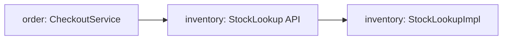
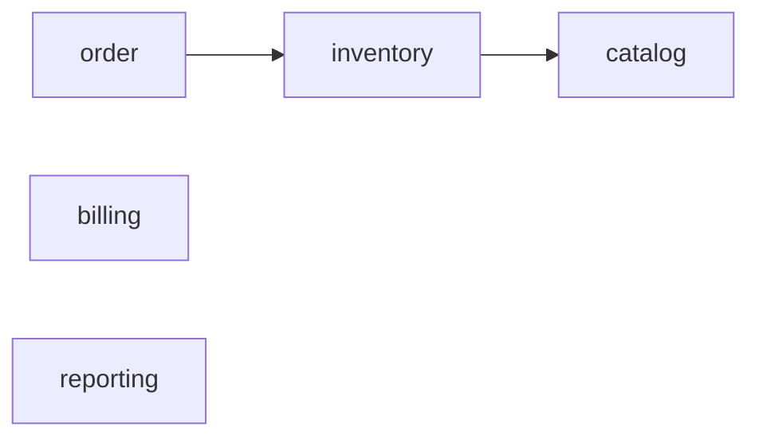

# Giới hạn `ApplicationContext` trong module đang kiểm thử

## 1. Vì sao cần giới hạn `ApplicationContext`?

Trong một ứng dụng Spring Boot theo kiến trúc modular monolith, các module như `order`, `inventory`, `payment` và `reporting` có thể cùng nằm trong một tiến trình. Chạy `@SpringBootTest` cho từng kịch bản thường khiến Spring khởi tạo phần lớn ứng dụng: bean nghiệp vụ, cấu hình, repository và những dependency của các module không liên quan. Một lỗi cấu hình của `reporting` có thể làm bài kiểm thử logic `order` thất bại trước khi assertion được thực thi.

`@ApplicationModuleTest` của Spring Modulith giải quyết vấn đề này bằng cách **khởi tạo Spring `ApplicationContext` với phạm vi các application module được chọn**. Bài kiểm thử vẫn dùng dependency injection và bean thật, nhưng quá trình quét thành phần ứng dụng được giới hạn theo module đang kiểm thử cùng các module phụ thuộc được cho phép.

Trong học phần **SPRING_MODULITH_VERIFICATION_TESTING**, kỹ thuật này là một phần của việc rèn kỹ năng kiểm chứng ranh giới kiến trúc với `ApplicationModules`, quy tắc phụ thuộc, kiểm thử sự kiện/cơ sở dữ liệu và quality gate CI nhằm ngăn phụ thuộc sai hoặc hồi quy.

Sau bài học, bạn có thể:

- Giải thích chính xác những gì Spring Modulith giới hạn khi bootstrap một module test và những gì vẫn có thể có mặt trong context.
- Viết một bài `@ApplicationModuleTest` kiểm tra cả hành vi nghiệp vụ lẫn sự hiện diện/vắng mặt của bean.
- Xác định khi nào cần dùng `STANDALONE`, mock dependency ngoài module hoặc nạp thêm dependency hợp lệ.
- Phân biệt lỗi phạm vi component/entity scanning với lỗi datasource, cấu hình Spring hoặc vi phạm kiến trúc.
- Dùng log và bài kiểm chứng kiến trúc để làm rõ phạm vi kiểm thử trong CI.

## 2. `ApplicationContext` là gì trong bài kiểm thử module?

`ApplicationContext` là container Spring giữ các bean, dependency và cấu hình được khởi tạo cho một lần chạy test. `@ApplicationModuleTest` được xây dựng trên cơ chế Spring Boot Test nhưng thay đổi việc bootstrap để **tạo một lát cắt theo module nghiệp vụ**.

Giả sử ứng dụng có cấu trúc:

```text
com.example.shop
├── ShopApplication.java        # @SpringBootApplication
├── order/
│   ├── OrderCalculator.java
│   └── internal/
├── inventory/
│   └── InventoryFacade.java
├── catalog/
│   └── CatalogFacade.java
├── billing/
│   └── BillingFacade.java
└── reporting/
    └── ReportService.java
```

Với test trong `com.example.shop.order` và không có cấu hình bổ sung, mặc định `@ApplicationModuleTest` cố gắng bootstrap module `order` ở chế độ `STANDALONE`. Các bean nghiệp vụ chỉ thuộc `billing` hoặc `reporting` sẽ không được phát hiện qua component scanning thông thường của ứng dụng trong lát cắt đó.

```mermaid
flowchart LR
    subgraph All[Ứng dụng Spring Boot đầy đủ]
        O[order]
        I[inventory]
        C[catalog]
        B[billing]
        R[reporting]
    end
    T[@ApplicationModuleTest của order] --> S[ApplicationContext theo module]
    S --> O
    S -. Không quét mặc định .-> B
    S -. Không quét mặc định .-> R
```

Ở đây, “không quét” diễn tả việc hạn chế **đăng ký bean trong container**, không phải xóa class, thư viện hoặc module khỏi classpath. Class của `billing` vẫn có thể được Java nạp nếu chương trình tham chiếu tới nó, nhưng điều đó **không đồng nghĩa** Spring đã tạo bean `BillingFacade`.

## 3. Chính xác những phần nào bị giới hạn?

Tài liệu Spring Modulith mô tả hai điều chỉnh trọng tâm khi bootstrap `@ApplicationModuleTest`:

1. **Component scanning:** giới hạn quét các thành phần Spring (`@Component`, `@Service`, `@Repository`, `@Controller`, `@Configuration` được quét theo cơ chế thông thường) về các package của module đã chọn. Bean nghiệp vụ ở module không được chọn sẽ không tự động được đăng ký chỉ vì chúng nằm dưới package gốc ứng dụng.
2. **Auto-configuration packages và entity scanning packages:** các package dùng cho việc tìm thành phần của ứng dụng qua cơ chế auto-configuration và việc tìm JPA entity được điều chỉnh theo phạm vi module. Điều này giúp tránh tự động phát hiện entity/repository của module không nằm trong lát cắt test.

Phạm vi thực tế còn phụ thuộc `mode`, `extraIncludes` và các cấu hình Spring được import rõ ràng. Có thể hình dung:

| Thành phần | Khi chạy `@ApplicationModuleTest` kiểu `STANDALONE` cho `order` | Điều cần chú ý |
| --- | --- | --- |
| `@Service` trong package `order` | Có thể được quét và tạo bean | Bean phải thỏa mãn các dependency bắt buộc |
| `@Component` trong package con `order.internal` | Vẫn thuộc module `order`; có thể được quét | `internal` thường là package nội bộ, không phải module độc lập |
| `@Service` chỉ trong `billing` | Thường không được quét | Có thể xuất hiện nếu test/configuration chủ động import hoặc cung cấp bean |
| `@Entity` và JPA repository thuộc `order` | Được xem xét trong phạm vi quét có liên quan | Cần bật JPA, datasource, schema và cấu hình persistence tương thích |
| `@Entity` của `billing` | Không nằm trong phạm vi quét entity mặc định của lát cắt `order` | Explicit `@EntityScan`, `@Import` hoặc cấu hình tùy chỉnh có thể ảnh hưởng |
| Infrastructure bean (datasource, transaction manager, event publisher, v.v.) | Có thể vẫn được Spring Boot auto-configure | Không nên hiểu `STANDALONE` là “chỉ chứa đúng bean nghiệp vụ của order” |
| Bean tạo bằng `@TestConfiguration`, `@MockitoBean` | Có thể được thêm trực tiếp vào context test | Phải giải thích vì sao test cần bean bổ sung đó |

**Quan trọng:** Hạn chế *auto-configuration package* không có nghĩa toàn bộ auto-configuration của Spring Boot bị tắt. Một số cấu hình hạ tầng vẫn chạy theo dependency, property, profile hoặc điều kiện của ứng dụng. Tương tự, các cấu hình import thủ công hay mở rộng scanning có thể làm một bean ngoài module xuất hiện trong context.

## 4. Ví dụ thực hành: chứng minh phạm vi bean của module `order`

Mẫu này không cần database, phù hợp làm ví dụ đầu tiên để phân biệt bean được bootstrap với class chỉ hiện diện trên classpath. Dự án cần `spring-modulith-starter-test`, JUnit Jupiter, AssertJ và các phiên bản Spring Boot/Spring Modulith tương thích.

Với Maven:

```xml
<dependency>
    <groupId>org.springframework.modulith</groupId>
    <artifactId>spring-modulith-starter-test</artifactId>
    <scope>test</scope>
</dependency>
```

### Bước 1: tạo ứng dụng và các bean ở hai module

File `src/main/java/com/example/shop/ShopApplication.java`:

```java
package com.example.shop;

import org.springframework.boot.SpringApplication;
import org.springframework.boot.autoconfigure.SpringBootApplication;

@SpringBootApplication
public class ShopApplication {
    public static void main(String[] args) {
        SpringApplication.run(ShopApplication.class, args);
    }
}
```

File `src/main/java/com/example/shop/order/OrderCalculator.java`:

```java
package com.example.shop.order;

import java.math.BigDecimal;
import org.springframework.stereotype.Service;

@Service
public class OrderCalculator {

    public BigDecimal total(BigDecimal unitPrice, int quantity) {
        if (unitPrice.signum() < 0 || quantity <= 0) {
            throw new IllegalArgumentException("Invalid price or quantity");
        }
        return unitPrice.multiply(BigDecimal.valueOf(quantity));
    }
}
```

File `src/main/java/com/example/shop/billing/BillingFacade.java`:

```java
package com.example.shop.billing;

import org.springframework.stereotype.Service;

@Service
public class BillingFacade {
    public String ping() {
        return "billing-ready";
    }
}
```

Với cấu trúc module mặc định, `order` và `billing` là hai application module riêng. `OrderCalculator` không cần `BillingFacade` để tạo và tính toán tổng tiền.

### Bước 2: kiểm tra bean và hành vi thực tế

File `src/test/java/com/example/shop/order/OrderModuleContextTests.java`:

```java
package com.example.shop.order;

import static org.assertj.core.api.Assertions.assertThat;

import com.example.shop.billing.BillingFacade;
import java.math.BigDecimal;
import org.junit.jupiter.api.Test;
import org.springframework.beans.factory.annotation.Autowired;
import org.springframework.context.ApplicationContext;
import org.springframework.modulith.test.ApplicationModuleTest;

@ApplicationModuleTest // Mặc định: BootstrapMode.STANDALONE
class OrderModuleContextTests {

    @Autowired OrderCalculator calculator;
    @Autowired ApplicationContext context;

    @Test
    void loadsOrderBeanButNotUnrelatedBillingBean() {
        assertThat(calculator.total(new BigDecimal("12.50"), 2))
                .isEqualByComparingTo("25.00");

        assertThat(context.getBeansOfType(OrderCalculator.class))
                .hasSize(1);
        assertThat(context.getBeansOfType(BillingFacade.class))
                .isEmpty();
    }
}
```

Bài test xác minh ba điều:

1. `OrderCalculator` đã được đăng ký thành bean thật trong context của `order` và hoạt động đúng.
2. `BillingFacade` tồn tại trong source/classpath, nhưng **không có bean nào thuộc kiểu này** trong context của test `STANDALONE` ở cấu hình ví dụ.
3. Không cần khởi động riêng module `billing` để kiểm thử tính toán của `order`.

Assertion `getBeansOfType(...)` là công cụ quan sát hữu ích khi học cơ chế bootstrap. Trong bộ test lâu dài, ưu tiên assertion nghiệp vụ; tránh cố định toàn bộ danh sách bean của Spring Boot vì danh sách hạ tầng có thể thay đổi khi nâng cấp framework.

> **Điều kiện của ví dụ:** Không có `@Import`, custom `@ComponentScan`, test configuration hoặc auto-configuration bổ sung chủ động tạo `BillingFacade`. Nếu dự án có những cấu hình đó, kết quả quan sát cần được giải thích theo cấu hình thực tế.

## 5. Khi bean `order` cần bean thuộc module khác

Giới hạn context bộc lộ rõ khi một bean của module đang thử phụ thuộc vào bean ở module khác. Giả sử `order` có nhu cầu kiểm tra tồn kho qua API công khai của `inventory`:



Đoạn mã dưới đây là **tình huống độc lập** với ví dụ `OrderCalculator` ở mục 4. File API công khai của `inventory`:

```java
package com.example.shop.inventory;

public interface StockLookup {
    boolean available(String sku);
}
```

File service thuộc `order`:

```java
package com.example.shop.order;

import com.example.shop.inventory.StockLookup;
import org.springframework.stereotype.Service;

@Service
public class CheckoutService {

    private final StockLookup stockLookup;

    public CheckoutService(StockLookup stockLookup) {
        this.stockLookup = stockLookup;
    }

    public boolean canCheckout(String sku) {
        return stockLookup.available(sku);
    }
}
```

Nếu implementation `StockLookup` chỉ tồn tại dưới module `inventory`, chạy `STANDALONE` mà không cung cấp bean thay thế sẽ khiến Spring không đáp ứng được constructor dependency của `CheckoutService`. Lỗi thường xuất hiện dưới dạng `UnsatisfiedDependencyException` hoặc `NoSuchBeanDefinitionException` trong exception chain **trước khi chạy bất kỳ assertion nào**.

### Giữ ranh giới `order`: thay bean ngoài module bằng mock

Nếu mục tiêu là kiểm tra hành vi riêng của `order`, mock API `StockLookup`. Với Spring Framework 6.2+ và stack Spring Boot tương ứng, dùng `@MockitoBean`:

```java
package com.example.shop.order;

import static org.assertj.core.api.Assertions.assertThat;
import static org.mockito.BDDMockito.given;
import static org.mockito.BDDMockito.then;

import com.example.shop.inventory.StockLookup;
import org.junit.jupiter.api.Test;
import org.springframework.beans.factory.annotation.Autowired;
import org.springframework.modulith.test.ApplicationModuleTest;
import org.springframework.test.context.bean.override.mockito.MockitoBean;

@ApplicationModuleTest
class CheckoutModuleTests {

    @MockitoBean StockLookup stockLookup;
    @Autowired CheckoutService checkout;

    @Test
    void delegatesAvailabilityCheckToInventoryApi() {
        given(stockLookup.available("SKU-01")).willReturn(true);

        assertThat(checkout.canCheckout("SKU-01")).isTrue();
        then(stockLookup).should().available("SKU-01");
    }
}
```

`@MockitoBean` đăng ký/thay thế bean trong Spring test context, cho phép `CheckoutService` vẫn khởi tạo được mà không cần nạp implementation ở `inventory`. Với stack Spring Boot cũ hơn có thể gặp `@MockBean`; kiểm tra phiên bản của dự án trước khi chọn annotation. Đây là kiểm thử **giao tiếp từ phía `order`**, chưa chứng minh implementation `inventory` thực sự hoạt động đúng.

### Khi cần kiểm thử phối hợp thực giữa các module

Nếu mục đích là xác nhận `CheckoutService` dùng implementation thật của `inventory`, chủ đích mở rộng phạm vi:

```java
package com.example.shop.order;

import org.springframework.modulith.test.ApplicationModuleTest;
import org.springframework.modulith.test.ApplicationModuleTest.BootstrapMode;

@ApplicationModuleTest(mode = BootstrapMode.DIRECT_DEPENDENCIES)
class CheckoutWithInventoryTests {
    // @Test với các bean thật từ order và dependency trực tiếp của order.
}
```

Lúc đó, `inventory` cần nằm trong **tập phụ thuộc trực tiếp hợp lệ** của module `order` theo mô hình `ApplicationModules`. Mở rộng phạm vi có thể kéo theo yêu cầu dữ liệu tồn kho, datasource hoặc cấu hình tích hợp. Nếu dependency chỉ xuất hiện do coupling không mong muốn, sửa thiết kế có thể phù hợp hơn việc nạp thêm toàn bộ module.

## 6. Cách `BootstrapMode` thay đổi phạm vi context

Xét mô hình phụ thuộc **giả định**:



| Chế độ của test `order` | Application module được nạp | Đặc điểm |
| --- | --- | --- |
| `STANDALONE` *(mặc định)* | `order` | Tập trung vào ranh giới của `order`; cần mock dependency ngoài nếu có |
| `DIRECT_DEPENDENCIES` | `order`, `inventory` | Thêm module mà `order` phụ thuộc trực tiếp |
| `ALL_DEPENDENCIES` | `order`, `inventory`, `catalog` | Thêm toàn bộ chuỗi phụ thuộc bắc cầu |

Đây là **phạm vi module nghiệp vụ**, không phải danh sách tất cả bean trong container. `billing` và `reporting` vẫn không được chọn trong đồ thị trên. Nếu có lý do tích hợp rõ ràng, `extraIncludes` cho phép bổ sung một module theo **tên logic**:

```java
@ApplicationModuleTest(
    mode = BootstrapMode.STANDALONE,
    extraIncludes = "billing"
)
class OrderWithBillingIntegrationTests {
    // Module mục tiêu: order; thêm billing theo yêu cầu kịch bản.
}
```

Ở ví dụ bổ sung này cần import `org.springframework.modulith.test.ApplicationModuleTest` và `ApplicationModuleTest.BootstrapMode` nếu viết thành một file Java riêng. `extraIncludes` không thay đổi module mục tiêu và không hợp pháp hóa một quan hệ phụ thuộc kiến trúc sai. Cần chọn bootstrap mode dựa trên kịch bản cần kiểm thử, không mở rộng scope chỉ để bỏ qua lỗi bean thiếu.

## 7. Tác động lên JPA, transaction, sự kiện và web layer

Giới hạn `ApplicationContext` có tác động khác nhau tùy hạ tầng của module:

**JPA và cơ sở dữ liệu.** Spring Modulith điều chỉnh các package được dùng để tìm entity theo module, nhưng `@ApplicationModuleTest` **không tự tạo database, schema hay dữ liệu**. Khi module `order` có JPA repository, bạn cần datasource, migration, transaction manager và cơ chế cô lập dữ liệu kiểm thử. Một lỗi `relation does not exist` hoặc lỗi kết nối database thường là vấn đề hạ tầng, không có nghĩa module đã được chọn sai. Nếu sử dụng `@EntityScan` hoặc cấu hình persistence tùy chỉnh, cần kiểm tra tác động lên phạm vi entity thực tế.

**Sự kiện ứng dụng.** Một bean trong `order` có thể gọi `ApplicationEventPublisher` để phát event và dùng `PublishedEvents` kiểm tra event được phát, kể cả khi listener ở module `billing` không được bootstrap. Cách đó phù hợp khi muốn kiểm tra **hợp đồng phát sự kiện từ phía module nguồn**. Để xác nhận một listener ở module khác đã chạy và cập nhật dữ liệu, phải nạp listener/module liên quan và kiểm tra kết quả, có thể dùng `Scenario` cho luồng bất đồng bộ/giao dịch.

**Web và security.** `@ApplicationModuleTest` hướng đến kiểm thử nhiều tầng trong một module, không mặc định chỉ chạy controller hoặc repository. Tuy nhiên, context web/security còn tùy auto-configuration, thuộc tính `webEnvironment`, test configuration và dependency của ứng dụng. Không nên giả định mọi servlet filter, endpoint hay server thật đều được khởi tạo ở mọi chế độ test. Nếu cần chỉ kiểm tra MVC hoặc JPA theo lát cắt ngang, nghiên cứu thêm cách phối hợp `@ModuleSlicing` với slice test tương ứng trong **phiên bản** Spring Modulith/Spring Boot đang dùng.

**Transaction và bất đồng bộ.** Một bài test được đánh dấu `@Transactional` có thể rollback các thao tác đồng bộ trong transaction của test, nhưng sự kiện được xử lý ở transaction/thread khác không nhất thiết rollback theo. Khi dùng `Scenario`, hãy chủ động chờ kết quả kỳ vọng và dọn/cô lập dữ liệu giữa các bài test.

## 8. Quan sát và chẩn đoán phạm vi bootstrap

Khi cấu hình logging cho test:

```properties
logging.level.org.springframework.modulith=DEBUG
```

Spring Modulith có thể ghi thông tin chi tiết về module được chọn, bootstrap mode và cách tùy chỉnh việc quét. Cần đọc log theo phiên bản thực tế vì câu chữ log không phải một API ổn định. Việc đọc bean từ `ApplicationContext`, như `context.getBeansOfType(...)` trong ví dụ, giúp kiểm tra trực tiếp điều gì đã được đăng ký.

| Triệu chứng | Khả năng thường gặp | Cách kiểm tra/xử lý |
| --- | --- | --- |
| `@Autowired` không tìm được bean thuộc module hiện tại | Bean không được quét, thiếu `@Component`/`@Bean`, cấu hình điều kiện không thỏa | Kiểm tra package, annotation, `@Profile`, `@Conditional` và cấu hình component scan |
| Thiếu bean của module ngoài | `STANDALONE` không nạp module phụ thuộc | Dùng mock cho API ngoài hoặc chọn mode tích hợp phù hợp |
| Bean `billing` xuất hiện dù test chỉ `order` | Có `@Import`, `@TestConfiguration`, auto-configuration hoặc custom scan tạo bean | Xem nguồn gốc bean/configuration; thu hẹp nếu trái mục tiêu test |
| Test không xác định được module mục tiêu | Lớp test đặt ngoài package module hoặc mô hình module tùy chỉnh | Đặt test trong package module; phiên bản hỗ trợ có thể dùng `module` và `classes` |
| Context thất bại khi tạo JPA repository | Thiếu datasource, entity, schema/migration hoặc transaction manager | Kiểm tra cấu hình persistence và phạm vi entity scan |
| Context khởi động nhưng test nghiệp vụ sai | Bean có mặt không bảo đảm hành vi đúng | Viết assertion cho kết quả, sự kiện hoặc trạng thái sau xử lý |
| CI báo vi phạm phụ thuộc kiến trúc | Module gọi vào API nội bộ hoặc phá quy tắc phụ thuộc | Xác minh bằng `ApplicationModules.verify()` và sửa quan hệ dependency |

Để tránh nhầm lẫn, luôn phân biệt ba câu hỏi: **class có trong classpath không? bean có trong context không? module dependency có hợp lệ về kiến trúc không?** Ba câu hỏi cần ba loại bằng chứng khác nhau và có thể cho kết quả khác nhau.

## 9. Kết hợp kiểm thử context với kiểm chứng kiến trúc trong CI

Một `ApplicationContext` khởi tạo được không chứng minh ranh giới module hợp lệ trong mọi trường hợp. Chẳng hạn, một lớp `order` có thể phụ thuộc trực tiếp vào package `inventory.internal`; dù context được cấu hình rộng để chạy được, quan hệ đó vẫn có thể vi phạm quy tắc kiến trúc. Đưa bài test sau vào bộ kiểm thử:

```java
package com.example.shop;

import org.junit.jupiter.api.Test;
import org.springframework.modulith.core.ApplicationModules;

class ModuleArchitectureTests {

    @Test
    void modulesRespectDeclaredBoundaries() {
        ApplicationModules.of(ShopApplication.class).verify();
    }
}
```

`@ApplicationModuleTest` có thể tự động xác minh cấu trúc theo cấu hình `verifyAutomatically` (mặc định `true` trong API hỗ trợ), nhưng một bài test kiến trúc riêng làm mục tiêu quality gate rõ ràng hơn khi CI lọc nhóm kiểm thử. Có thể tổ chức các tầng kiểm tra:

1. **Architecture test:** `ApplicationModules.verify()` kiểm tra ranh giới và quy tắc phụ thuộc.
2. **Module integration test:** `@ApplicationModuleTest` kiểm tra khả năng bootstrap một module cùng hành vi bean thực tế.
3. **Cross-module/infrastructure test:** kiểm tra luồng xuyên module, sự kiện được xử lý, repository/database và cấu hình tích hợp cần thiết.

Đảm bảo các bài test này chạy trong pipeline Maven/Gradle phù hợp (`./mvnw test` hoặc `./gradlew test` tùy dự án). Nếu hệ thống cần Testcontainers, database hoặc broker, runner CI phải cung cấp môi trường tương ứng. Không nên giảm phạm vi xác minh kiến trúc chỉ vì một số bài test tích hợp cần hạ tầng chậm hơn.

## 10. Bài tập tự kiểm tra

1. Tạo các module `order` và `billing` với một `@Service` ở mỗi module. Viết `@ApplicationModuleTest` trong `order` để xác nhận bean `billing` không nằm trong context của test `STANDALONE`.
2. Cho `order` phụ thuộc vào một API công khai của `inventory`. Quan sát lỗi khi thiếu bean ở `STANDALONE`, sau đó thử `@MockitoBean` và `DIRECT_DEPENDENCIES`; giải thích điều kiện khiến mỗi cách phù hợp.
3. Thêm một JPA repository vào `order`. Nếu test lỗi do database, mô tả cách xác định đây là vấn đề datasource/schema hay giới hạn module.
4. Thêm một event phát từ `order` và listener ở `billing`. Viết một test kiểm tra **phát event** trong `STANDALONE` và một test khác kiểm tra **listener xử lý thành công** với phạm vi được mở rộng.
5. Tạo phụ thuộc bất hợp lệ vào package nội bộ của module khác, chạy `ApplicationModules.verify()` và giải thích vì sao chỉ kiểm tra bean có mặt/vắng mặt chưa đủ.

**Ghi nhớ:** `@ApplicationModuleTest` giới hạn việc **bootstrap các thành phần ứng dụng theo module**, đặc biệt ở component scanning và những package phục vụ auto-configuration/entity scanning. Nó không loại các class khỏi classpath và không tự tắt mọi bean hạ tầng. Hiểu rõ phạm vi này giúp viết module test đáng tin cậy, phát hiện phụ thuộc chặt, kiểm chứng sự kiện/database đúng mức và bảo vệ ranh giới Spring Modulith trong CI.

### Tài liệu tham khảo

- [Spring Modulith Reference — Integration Testing Application Modules](https://docs.spring.io/spring-modulith/reference/testing.html)
- [Spring Modulith Javadoc — `ApplicationModuleTest`](https://docs.spring.io/spring-modulith/docs/current/api/org/springframework/modulith/test/ApplicationModuleTest.html)
- [Spring Modulith Reference — Verifying Application Module Structure](https://docs.spring.io/spring-modulith/reference/verification.html)
