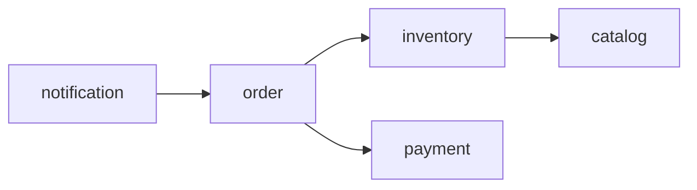
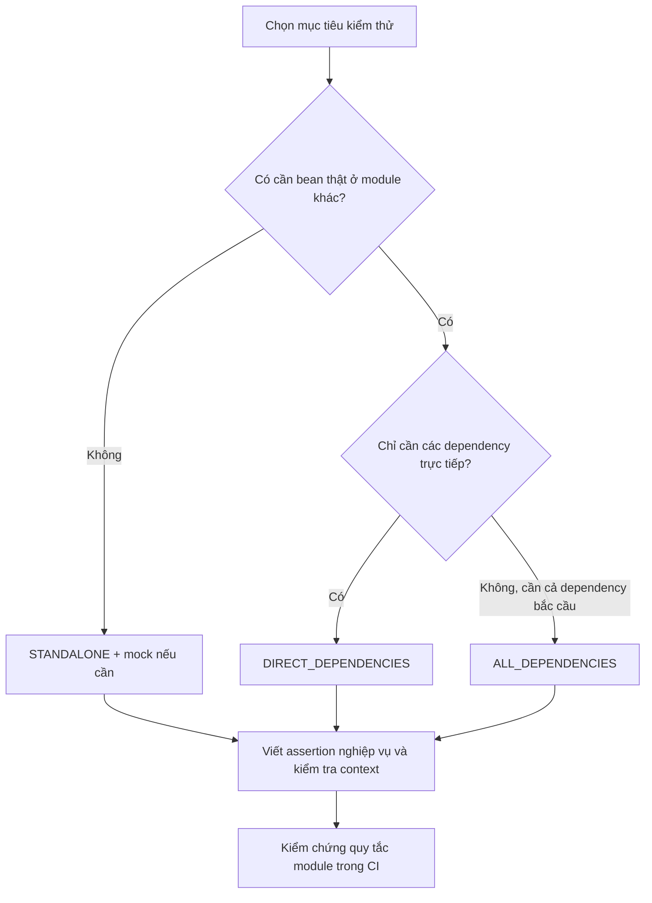

# Các kiểu bootstrap của module test trong Spring Modulith

## 1. Bootstrap mode quyết định điều gì?

Một ứng dụng Spring Boot theo kiến trúc modular monolith thường có nhiều **application module** như `order`, `inventory`, `catalog`, `payment`, `notification`. Những module này cùng chạy trong một ứng dụng nhưng có ranh giới phụ thuộc riêng. Khi kiểm thử tính toán đơn hàng, ta thường chỉ cần bean của `order`; khi kiểm thử việc kiểm tra tồn kho trước khi đặt hàng, ta có thể cần cả `inventory`.

Trong Spring Modulith, `@ApplicationModuleTest` khởi tạo một `ApplicationContext` dành cho kiểm thử tích hợp theo module. Thuộc tính **`mode`** của annotation lựa chọn mức độ đưa các module phụ thuộc vào context. Ba giá trị của `ApplicationModuleTest.BootstrapMode` là:

- `STANDALONE`: chỉ bootstrap module đang kiểm thử (**mặc định**).
- `DIRECT_DEPENDENCIES`: bootstrap module đang kiểm thử và các module mà nó **phụ thuộc trực tiếp**.
- `ALL_DEPENDENCIES`: bootstrap module đang kiểm thử và **toàn bộ các module nó phụ thuộc**, bao gồm phụ thuộc bắc cầu.

Ba mode **không thay đổi module mục tiêu** của bài test; chúng thay đổi tập module được nạp **cùng với** module mục tiêu. Việc chọn đúng mode giúp giữ kiểm thử có mục đích, phát hiện phụ thuộc chặt và phân biệt rõ lỗi khởi tạo context với lỗi nghiệp vụ.

Bài học thuộc chương **ApplicationModuleTest** của module **SPRING_MODULITH_VERIFICATION_TESTING**, hướng đến kỹ năng xác minh ranh giới kiến trúc bằng `ApplicationModules`, kiểm thử sự kiện, cơ sở dữ liệu và tích hợp, kết hợp quality gate CI để ngăn phụ thuộc sai hoặc hồi quy.

### Mục tiêu học tập

Sau khi hoàn thành, bạn có thể đọc đồ thị phụ thuộc để dự đoán các module được bootstrap ở mỗi mode, chọn mode phù hợp với mục tiêu test, xử lý dependency ngoài phạm vi và đưa kiểm thử module/kiến trúc vào CI.

## 2. Phân biệt module mục tiêu và cây phụ thuộc

Với cách tổ chức module mặc định của Spring Modulith, giả sử ứng dụng có cấu trúc:

```text
com.example.store
├── StoreApplication.java     # @SpringBootApplication
├── order/                    # module order
├── inventory/                # module inventory
├── catalog/                  # module catalog
├── payment/                  # module payment
└── notification/             # module notification
```

`OrderModuleTests` nằm trong package `com.example.store.order` sẽ chọn **`order` là module mục tiêu**. Việc chọn module dựa trên mô hình `ApplicationModules` và package chứa test; `mode` mới quyết định có nạp thêm module khác.

Đặt giả thiết về **phụ thuộc tĩnh hợp lệ trong mã nguồn** như sau:



Quy ước mũi tên `A → B` nghĩa là **module A phụ thuộc vào module B**. Ở ví dụ này:

- `order` phụ thuộc **trực tiếp** `inventory` và `payment`.
- `order` phụ thuộc **bắc cầu** `catalog` thông qua `inventory`.
- `notification` phụ thuộc vào `order`, nhưng `order` **không phụ thuộc vào** `notification`.

Đây là điểm quan trọng: `ALL_DEPENDENCIES` không đồng nghĩa “nạp mọi module của ứng dụng”. Nó chỉ nạp những module **nằm trên nhánh phụ thuộc đi ra từ module mục tiêu**, chứ không tự nạp module phụ thuộc ngược vào nó.

| Mode của bài test trong `order` | Các application module được chọn | Module **không** được chọn từ đồ thị |
| --- | --- | --- |
| `STANDALONE` | `order` | `inventory`, `payment`, `catalog`, `notification` |
| `DIRECT_DEPENDENCIES` | `order`, `inventory`, `payment` | `catalog`, `notification` |
| `ALL_DEPENDENCIES` | `order`, `inventory`, `payment`, `catalog` | `notification` |

Danh sách là kết quả của **đồ thị minh họa**; trong dự án thực, kết quả phụ thuộc vào mô hình mà Spring Modulith phân tích. Các bean hạ tầng do Spring Boot auto-configuration hoặc test configuration tạo ra vẫn có thể tồn tại dù không thuộc các module nghiệp vụ trên.

## 3. Chế độ `STANDALONE`: kiểm thử một module độc lập

`STANDALONE` là mode **mặc định** của `@ApplicationModuleTest`, tương đương với khai báo tường minh:

```java
package com.example.store.order;

import org.springframework.modulith.test.ApplicationModuleTest;
import org.springframework.modulith.test.ApplicationModuleTest.BootstrapMode;

@ApplicationModuleTest(mode = BootstrapMode.STANDALONE)
class OrderStandaloneTests {
    // Các @Test chỉ yêu cầu module order và hạ tầng test tương ứng.
}
```

Mode này thích hợp khi muốn kiểm tra khả năng khởi tạo các Spring bean thật của `order`, quy tắc nghiệp vụ, giao dịch/repository thuộc module hoặc việc phát domain event **mà không phải khởi tạo module nhận event**. Những lợi ích thường gặp là phạm vi test rõ ràng, ít phụ thuộc vào cấu hình của module khác và phát hiện sớm constructor dependency không thể đáp ứng trong phạm vi đã chọn.

### Ví dụ hoàn chỉnh: `order` phát sự kiện

Giả sử dự án sử dụng Spring Boot, JUnit Jupiter, AssertJ và dependency test của Spring Modulith. Khai báo Maven:

```xml
<dependency>
    <groupId>org.springframework.modulith</groupId>
    <artifactId>spring-modulith-starter-test</artifactId>
    <scope>test</scope>
</dependency>
```

Chọn phiên bản Spring Modulith phù hợp với Spring Boot bằng BOM/quản lý dependency của dự án; phần code dưới đây minh họa API phổ biến của `@ApplicationModuleTest` và `PublishedEvents`.

File `src/main/java/com/example/store/StoreApplication.java`:

```java
package com.example.store;

import org.springframework.boot.SpringApplication;
import org.springframework.boot.autoconfigure.SpringBootApplication;

@SpringBootApplication
public class StoreApplication {
    public static void main(String[] args) {
        SpringApplication.run(StoreApplication.class, args);
    }
}
```

File `src/main/java/com/example/store/order/OrderPlaced.java`:

```java
package com.example.store.order;

import java.util.UUID;

public record OrderPlaced(UUID orderId) {}
```

File `src/main/java/com/example/store/order/OrderService.java`:

```java
package com.example.store.order;

import java.util.UUID;
import org.springframework.context.ApplicationEventPublisher;
import org.springframework.stereotype.Service;

@Service
public class OrderService {

    private final ApplicationEventPublisher events;

    public OrderService(ApplicationEventPublisher events) {
        this.events = events;
    }

    public UUID submit() {
        UUID id = UUID.randomUUID();
        // Hệ thống thực tế còn phải validate và lưu đơn hàng.
        events.publishEvent(new OrderPlaced(id));
        return id;
    }
}
```

File `src/test/java/com/example/store/order/OrderModuleTests.java`:

```java
package com.example.store.order;

import static org.assertj.core.api.Assertions.assertThat;

import java.util.UUID;
import org.junit.jupiter.api.Test;
import org.springframework.beans.factory.annotation.Autowired;
import org.springframework.modulith.test.ApplicationModuleTest;
import org.springframework.modulith.test.PublishedEvents;

@ApplicationModuleTest // Mặc định: STANDALONE
class OrderModuleTests {

    @Autowired OrderService orderService;

    @Test
    void submittingOrderPublishesMatchingEvent(PublishedEvents events) {
        UUID id = orderService.submit();

        assertThat(events.ofType(OrderPlaced.class)
                .matching(OrderPlaced::orderId, id))
                .hasSize(1);
    }
}
```

Hai điều được kiểm chứng: (1) bean thật `OrderService` được khởi tạo và inject trong context của module `order`; (2) sự kiện `OrderPlaced` phát ra mang ID đúng. `PublishedEvents` xác nhận **event đã được publish**, không xác nhận listener ở `notification` đã xử lý thành công. Tại `STANDALONE`, listener thuộc module `notification` thông thường không được bootstrap.

### Khi `STANDALONE` không khởi động được

Giả sử một `CheckoutService` trong `order` có constructor cần `StockLookup`, interface API công khai của `inventory`:

```java
package com.example.store.order;

import com.example.store.inventory.StockLookup;
import org.springframework.stereotype.Service;

@Service
class CheckoutService {

    private final StockLookup stockLookup;

    CheckoutService(StockLookup stockLookup) {
        this.stockLookup = stockLookup;
    }

    boolean canSubmit(String sku) {
        return stockLookup.available(sku);
    }
}
```

Giả định implementation của `StockLookup` là Spring bean nằm ở module `inventory`. Chỉ nạp `order` mà không có bean thay thế thì context có thể thất bại với `UnsatisfiedDependencyException`: Spring không tìm thấy bean cần inject vào `CheckoutService`.

Nếu mục tiêu là **kiểm thử riêng hành vi `order`**, dùng mock cho điểm giao tiếp bên ngoài:

```java
package com.example.store.order;

import static org.assertj.core.api.Assertions.assertThat;
import static org.mockito.BDDMockito.given;

import com.example.store.inventory.StockLookup;
import org.junit.jupiter.api.Test;
import org.springframework.beans.factory.annotation.Autowired;
import org.springframework.modulith.test.ApplicationModuleTest;
import org.springframework.test.context.bean.override.mockito.MockitoBean;

@ApplicationModuleTest
class CheckoutStandaloneTests {

    @MockitoBean StockLookup stockLookup;
    @Autowired CheckoutService checkoutService;

    @Test
    void acceptsAvailableStock() {
        given(stockLookup.available("SKU-01")).willReturn(true);

        assertThat(checkoutService.canSubmit("SKU-01")).isTrue();
    }
}
```

Đoạn này là **kịch bản mở rộng**, giả định tồn tại interface `StockLookup` ở `com.example.store.inventory`; không phải phần bắt buộc của ví dụ tối giản `OrderService`. `@MockitoBean` yêu cầu phiên bản Spring Framework/Spring Boot có hỗ trợ annotation đó (Spring Framework 6.2+). Với phiên bản cũ hơn, dự án có thể dùng `@MockBean` tương ứng. Mock giúp kiểm tra hành vi bên gọi, nhưng không chứng minh integration với implementation thực ở `inventory`.

## 4. `DIRECT_DEPENDENCIES`: module hiện tại và các phụ thuộc trực tiếp

Khi mục tiêu là xác nhận **sự phối hợp thực tế** giữa `order` và những module mà nó sử dụng trực tiếp, chọn:

```java
package com.example.store.order;

import org.springframework.modulith.test.ApplicationModuleTest;
import org.springframework.modulith.test.ApplicationModuleTest.BootstrapMode;

@ApplicationModuleTest(mode = BootstrapMode.DIRECT_DEPENDENCIES)
class OrderDirectDependenciesTests {
    // @Test sử dụng các bean thật của order và các module nó phụ thuộc trực tiếp.
}
```

Với đồ thị ở phần 2, context dự kiến gồm bean ứng dụng thuộc `order`, `inventory` và `payment`. `catalog` không được thêm tự động chỉ vì `inventory` cần nó; `notification` cũng không được thêm vì quan hệ là `notification → order` (chiều ngược lại).

**Chú ý điểm dễ nhầm:** `DIRECT_DEPENDENCIES` chọn module theo quan hệ phụ thuộc *tĩnh được mô hình `ApplicationModules` nhận diện*, không phải tất cả module đăng ký listener cho event của `order`, và không phải mọi module được đặt gần `order` trong cấu trúc thư mục.

### Khi nào nên dùng?

- Kiểm tra một service `order` gọi **API công khai** của `inventory` và nhận kết quả từ implementation thật.
- Kiểm tra phối hợp đồng bộ giữa `order` và `payment` đã được thiết kế thành quan hệ phụ thuộc hợp lệ.
- Kiểm thử repository/service ở module mục tiêu khi dependency trực tiếp của nó cần bean thật để hoàn thành kịch bản.

### Giới hạn khi dependency trực tiếp có dependency riêng

Trong đồ thị `order → inventory → catalog`, bean `InventoryService` của `inventory` có thể lại cần một bean `CatalogQuery` thuộc `catalog`. Vì `DIRECT_DEPENDENCIES` không bao gồm `catalog`, context có thể không bootstrap được nếu dependency đó không được thay thế. Đây không phải lỗi của `DIRECT_DEPENDENCIES`: mode đang làm đúng việc **chỉ nạp một tầng phụ thuộc từ module mục tiêu**.

Giải pháp phụ thuộc mục tiêu của bài test: cung cấp mock bean `CatalogQuery` nếu không cần test `catalog`, hoặc đổi sang `ALL_DEPENDENCIES` nếu thực sự cần luồng xuyên cả ba module. Cần xem xét tính hợp lệ của quan hệ phụ thuộc thay vì chỉ tăng mode để hết lỗi.

## 5. `ALL_DEPENDENCIES`: toàn bộ cây module phụ thuộc

Nếu kịch bản có mục tiêu kiểm tra sự phối hợp qua **nhiều tầng phụ thuộc**, dùng:

```java
package com.example.store.order;

import org.springframework.modulith.test.ApplicationModuleTest;
import org.springframework.modulith.test.ApplicationModuleTest.BootstrapMode;

@ApplicationModuleTest(mode = BootstrapMode.ALL_DEPENDENCIES)
class OrderAllDependenciesTests {
    // Kịch bản tích hợp cần cả order, inventory, payment, catalog.
}
```

Với đồ thị ở trên, `catalog` được thêm vào vì `inventory → catalog`; `notification` vẫn không được chọn vì nó **phụ thuộc vào `order`**, không phải dependency của `order`.

Mode này có ích khi cần kiểm tra một chuỗi xử lý thực, ví dụ `order` tra cứu `inventory`, còn `inventory` dùng dữ liệu từ `catalog`. Tuy nhiên, nạp thêm module đồng nghĩa mở rộng số Spring bean, cấu hình và hạ tầng liên quan; bài test có thể chậm hơn và dễ bị ảnh hưởng bởi lỗi từ nhiều module hơn.

**Không dùng `ALL_DEPENDENCIES` như mặc định cho mọi test.** Nếu một test đơn giản chỉ kiểm tra phép tính của `order`, nạp cả cây phụ thuộc không đem lại bằng chứng tốt hơn về phép tính đó. Trong nhiều trường hợp, `STANDALONE` và mock ở điểm giao tiếp cho tín hiệu cô lập rõ ràng hơn.

## 6. So sánh ba mode theo mục tiêu và chi phí kiểm thử

| Tiêu chí | `STANDALONE` | `DIRECT_DEPENDENCIES` | `ALL_DEPENDENCIES` |
| --- | --- | --- | --- |
| Phạm vi module nghiệp vụ | Module mục tiêu | Mục tiêu + dependency trực tiếp | Mục tiêu + dependency trực tiếp và bắc cầu |
| Mục tiêu chính | Tính độc lập và hành vi nội bộ | Hợp đồng, phối hợp với module liền kề | Luồng tích hợp đi qua nhiều tầng phụ thuộc |
| Dependency ngoài phạm vi | Thường cần mock/thay thế | Có thể cần mock dependency của module phụ thuộc | Ít thiếu hơn do các nhánh phụ thuộc được nạp |
| Số bean/configuration tiềm năng | Nhỏ nhất trong ba mode | Tăng theo số dependency trực tiếp | Tăng theo toàn bộ cây dependency |
| Độ cô lập | Cao | Trung bình | Thấp nhất trong ba mode |
| Thời gian khởi tạo | Thường thấp hơn | Có thể tăng | Có thể cao nhất |
| Nguy cơ coupling bị che khuất | Thấp hơn | Cao hơn `STANDALONE` | Cao nhất nếu dùng không có mục đích |

Các đánh giá về thời gian và độ cô lập là **xu hướng**, không phải bảo đảm tuyệt đối: cache context của Spring Test, datasource, auto-configuration và đặc điểm từng module cũng ảnh hưởng đến kết quả thực tế.

Một quy tắc chọn mode có thể áp dụng ngay:



Nếu một test dùng `DIRECT_DEPENDENCIES` rồi thất bại vì bean ở tầng sâu hơn, không nên coi `ALL_DEPENDENCIES` là lựa chọn duy nhất: mock hoặc tách kịch bản theo trách nhiệm module cũng có thể là phương án thiết kế tốt.

## 7. `extraIncludes`: bổ sung module không phụ thuộc vào `mode`

Spring Modulith còn có thuộc tính `extraIncludes` để thêm **tên logic của những module cụ thể** vào lần bootstrap, độc lập với mode đã chọn:

```java
package com.example.store.order;

import org.springframework.modulith.test.ApplicationModuleTest;
import org.springframework.modulith.test.ApplicationModuleTest.BootstrapMode;

@ApplicationModuleTest(
    mode = BootstrapMode.STANDALONE,
    extraIncludes = "notification"
)
class OrderNotificationIntegrationTests {
    // Chủ đích nạp notification cùng order cho kịch bản cụ thể.
}
```

Trong đồ thị ở phần 2, `notification` **không thuộc cây dependency đi ra từ `order`**. Vì vậy, chỉ thay `mode` thành `ALL_DEPENDENCIES` cũng không tự nạp `notification`. `extraIncludes` cho phép chỉ rõ module cần bổ sung, ví dụ để kiểm thử việc listener ở `notification` xử lý event được phát bởi `order`.

`extraIncludes = "notification"` giả định đây đúng là tên module được Spring Modulith nhận diện. Nếu dùng chiến lược khai báo module tùy chỉnh, tên logic có thể khác tên package. Việc thêm module để chạy test **không hợp pháp hóa một phụ thuộc trái quy tắc**; kiểm chứng kiến trúc vẫn phải được thực hiện.

### `mode` và `extraIncludes` không phải cách chọn module mục tiêu

Theo mặc định, module mục tiêu được xác định từ package chứa lớp test. Ở các phiên bản Spring Modulith hỗ trợ thuộc tính `module` (từ 1.3), lớp test nằm ngoài package module có thể chỉ định:

```java
package com.example.integration;

import com.example.store.StoreApplication;
import org.springframework.modulith.test.ApplicationModuleTest;
import org.springframework.modulith.test.ApplicationModuleTest.BootstrapMode;

@ApplicationModuleTest(
    module = "order",
    classes = StoreApplication.class,
    mode = BootstrapMode.DIRECT_DEPENDENCIES
)
class ExternalOrderIntegrationTests {
    // Module mục tiêu: order; nạp thêm dependency trực tiếp của order.
}
```

Ở đây `module` chọn module nghiệp vụ, `classes` cung cấp cấu hình Spring Boot khi lớp test nằm ngoài nhánh package của ứng dụng, còn `mode` chọn phạm vi phụ thuộc. Nếu test nằm trong `com.example.store.order`, thông thường không cần `module` hoặc `classes`.

## 8. Tác động lên `ApplicationContext`, database và sự kiện

**Giới hạn quét ứng dụng.** `@ApplicationModuleTest` điều chỉnh component scanning, auto-configuration packages và entity scanning packages theo các module được chọn. Nhưng không nên hiểu mode là một cơ chế loại class khỏi classpath hoặc tắt hết Spring Boot auto-configuration. Bean hạ tầng như `ApplicationEventPublisher`, datasource hoặc transaction manager vẫn có thể được khởi tạo khi cấu hình và dependency yêu cầu.

**Cơ sở dữ liệu.** Khi chọn `DIRECT_DEPENDENCIES` hoặc `ALL_DEPENDENCIES`, nhiều entity/repository có thể tham gia context hơn và tăng yêu cầu về schema/migration. `@ApplicationModuleTest` không tự tạo H2, Testcontainers hoặc database thật. Nếu test lỗi `relation does not exist`, thiếu datasource hay migration, cần xử lý cấu hình persistence và dữ liệu test; mở rộng bootstrap mode không tự sửa những lỗi hạ tầng này.

**Sự kiện.** Mode ảnh hưởng những **listener module** nào có thể được khởi tạo. `PublishedEvents` dùng để xác minh sự kiện đã phát, phù hợp cả với test `STANDALONE`. Nếu cần chứng minh `notification` nhận event và ghi lại bản ghi thông báo, cần nạp module chứa listener, dùng một điểm quan sát kết quả (repository, fake outbound port hoặc event kết thúc) và có thể sử dụng hỗ trợ `Scenario` để chờ xử lý bất đồng bộ/giao dịch. Đừng chỉ assert event nguồn đã phát rồi kết luận listener đã chạy.

**Context cache và test isolation.** Hai lớp test có cấu hình `mode`, `extraIncludes` hoặc mock khác nhau có thể tạo những Spring Test context khác nhau. Hãy hạn chế cấu hình tùy biến không cần thiết và tránh phụ thuộc vào thứ tự chạy test. Với listener chạy trong transaction riêng, đừng giả định `@Transactional` ở phương thức test sẽ rollback tất cả side effect; dùng dữ liệu/transaction test phù hợp.

## 9. Xác minh tập module được bootstrap và chẩn đoán lỗi

Để thấy cách bootstrapper điều chỉnh phạm vi, bật logging cho Spring Modulith khi chạy test:

```properties
logging.level.org.springframework.modulith=DEBUG
```

Kiểm tra log về module mục tiêu, bootstrap mode, những module được đưa vào và giới hạn package quét. Câu chữ log có thể thay đổi theo phiên bản. Trong test, cũng có thể inject `ApplicationContext` để kiểm tra bean cụ thể có được tạo hay không:

```java
package com.example.store.order;

import static org.assertj.core.api.Assertions.assertThat;

import com.example.store.notification.NotificationService;
import org.junit.jupiter.api.Test;
import org.springframework.beans.factory.annotation.Autowired;
import org.springframework.context.ApplicationContext;
import org.springframework.modulith.test.ApplicationModuleTest;

@ApplicationModuleTest
class OrderModeBoundaryTests {

    @Autowired ApplicationContext context;

    @Test
    void notificationBeanIsAbsentInStandalone() {
        assertThat(context.getBeansOfType(NotificationService.class)).isEmpty();
    }
}
```

**Giả định của ví dụ quan sát:** `NotificationService` là bean Spring thuộc module `notification`, và không có cấu hình test/import nào tạo bean đó từ bên ngoài. Đây là đoạn minh họa riêng, chưa định nghĩa `NotificationService` trong ví dụ `OrderService`. Việc bean vắng mặt cho thấy phạm vi context đang giới hạn theo kỳ vọng, nhưng cần thêm assertion nghiệp vụ để biết module hoạt động đúng.

| Triệu chứng | Nguyên nhân cần xem xét | Hướng xử lý |
| --- | --- | --- |
| Thiếu bean thuộc module khác | Mode không nạp module đó; bean cần được thay thế | Mock dependency ngoài hoặc mở rộng mode có chủ đích |
| `DIRECT_DEPENDENCIES` vẫn thiếu bean | Bean nằm ở một dependency bắc cầu hoặc cấu hình điều kiện chưa thỏa | Xác định nguồn bean; mock tầng sâu hoặc dùng `ALL_DEPENDENCIES` khi cần |
| `ALL_DEPENDENCIES` không nạp listener `notification` | `notification` phụ thuộc vào `order`, không nằm trên cây dependency của `order` | Xem xét `extraIncludes` hoặc một bài test tích hợp riêng |
| Bean module ngoài vẫn có mặt ở `STANDALONE` | `@Import`, custom scanning, auto-configuration hoặc test configuration tạo bean | Kiểm tra nguồn gốc bean và cấu hình quét |
| Không thể xác định module mục tiêu | Lớp test đặt ngoài package module hoặc tên module sai | Đặt test trong package module, hoặc chỉ định `module`/`classes` nếu phiên bản hỗ trợ |
| Lỗi JPA, database hoặc transaction | Thiếu hạ tầng, schema, migration; entity/repository không ở đúng phạm vi | Cấu hình môi trường test trước khi đánh giá mode |
| Architecture verification thất bại | Mã nguồn có quan hệ phụ thuộc trái quy tắc | Sửa phụ thuộc/ranh giới module; không bỏ qua bằng việc đổi mode |

## 10. `BootstrapMode` và quality gate kiểm chứng kiến trúc

Một module test có context bootstrap thành công chỉ chứng minh **môi trường theo mode đang chọn có thể khởi tạo**. Nó không thay thế test cho quy tắc nghiệp vụ hoặc bộ kiểm chứng kiến trúc tường minh. Để bảo vệ ranh giới giữa các module, thêm test:

```java
package com.example.store;

import org.junit.jupiter.api.Test;
import org.springframework.modulith.core.ApplicationModules;

class ModuleArchitectureTests {

    @Test
    void modulesRespectArchitectureRules() {
        ApplicationModules.of(StoreApplication.class).verify();
    }
}
```

`ApplicationModules.verify()` kiểm tra các ràng buộc cấu trúc và phụ thuộc giữa application module. `@ApplicationModuleTest` cũng có tùy chọn `verifyAutomatically` (mặc định `true` ở API Spring Modulith tương ứng), nhưng bài test kiến trúc độc lập giúp CI công bố rõ kết quả ngay cả khi pipeline lọc chỉ chạy một số bài integration test.

Gợi ý tổ chức kiểm thử trong CI:

1. Chạy **architecture verification** để phát hiện phụ thuộc trái ranh giới và vi phạm API công khai.
2. Chạy các test **`STANDALONE`** của module quan trọng: bean thật, quy tắc nghiệp vụ, sự kiện được phát.
3. Chạy test **`DIRECT_DEPENDENCIES`** cho các hợp đồng cần implementation thực của module liền kề.
4. Chạy có chọn lọc **`ALL_DEPENDENCIES`** hoặc test có `extraIncludes` cho những luồng sự kiện/database xuyên nhiều module, với hạ tầng test được chuẩn bị đầy đủ.

Với Maven hoặc Gradle, các bài JUnit thông thường có thể được chạy qua `./mvnw test` hoặc `./gradlew test` nếu pipeline và test tasks được cấu hình đúng. Lỗi trong bất kỳ bước bắt buộc nào nên khiến quality gate thất bại; không nên giải quyết lỗi kiến trúc bằng cách đổi tất cả module test sang `ALL_DEPENDENCIES`.

## 11. Bài tập thực hành và câu hỏi tự kiểm tra

1. Vẽ đồ thị phụ thuộc `order → inventory → catalog`, `order → payment`, `notification → order`. Liệt kê chính xác tập module được bootstrap ở từng mode khi lớp test đặt trong `order`.
2. Tạo bài `STANDALONE` xác minh một `OrderService` phát đúng một event `OrderPlaced`. Vì sao test này không cần nạp `notification`?
3. Thêm một API `StockLookup` do `inventory` cung cấp và cho bean `order` phụ thuộc vào API đó. Khi `STANDALONE` thiếu bean, hãy thử mock trước, rồi so sánh với `DIRECT_DEPENDENCIES` về mục tiêu test.
4. Cho implementation `inventory` phụ thuộc vào `catalog`. Giải thích vì sao test `DIRECT_DEPENDENCIES` có thể thiếu bean và trường hợp nào `ALL_DEPENDENCIES` hợp lý.
5. Tạo listener trong `notification` để xử lý `OrderPlaced`. Dùng `extraIncludes` trong test ở `order` và thêm assertion về kết quả xử lý, có chiến lược chờ/cô lập dữ liệu phù hợp nếu listener bất đồng bộ.
6. Viết bài `ApplicationModules.of(StoreApplication.class).verify()` trong CI. Cố tình tạo một phụ thuộc vào package `internal` không được công khai của module khác và quan sát việc đổi `BootstrapMode` có giải quyết được vi phạm kiến trúc hay không.

**Ghi nhớ:** `STANDALONE`, `DIRECT_DEPENDENCIES` và `ALL_DEPENDENCIES` tạo ba mức **mở rộng theo chiều phụ thuộc đi ra từ module mục tiêu**; module phụ thuộc *vào* module mục tiêu không tự được thêm. Hãy bắt đầu bằng phạm vi nhỏ nhất đủ kiểm chứng hành vi, dùng mock cho dependency ngoài khi thích hợp, mở rộng mode cho kịch bản tích hợp thực tế, rồi kết hợp với `ApplicationModules.verify()` và kiểm thử sự kiện/cơ sở dữ liệu trong CI.

### Tài liệu tham khảo

- [Spring Modulith Reference — Integration Testing Application Modules](https://docs.spring.io/spring-modulith/reference/testing.html)
- [Spring Modulith API — `ApplicationModuleTest.BootstrapMode`](https://docs.spring.io/spring-modulith/docs/current/api/org/springframework/modulith/test/ApplicationModuleTest.BootstrapMode.html)
- [Spring Modulith API — `ApplicationModuleTest` (`mode`, `extraIncludes`, `module`, `verifyAutomatically`)](https://docs.spring.io/spring-modulith/docs/current/api/org/springframework/modulith/test/ApplicationModuleTest.html)
- [Spring Modulith Reference — Verifying Application Module Structure](https://docs.spring.io/spring-modulith/reference/verification.html)
