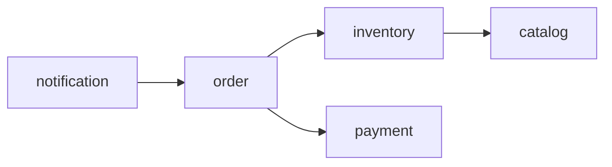

# DirectBootstrap và lựa chọn cấu hình trực tiếp khi kiểm thử Spring Modulith

## 1. Đặt vấn đề: cần điều khiển điều gì khi bootstrap?

Một ứng dụng Spring Modulith có thể chứa các module `order`, `inventory`, `catalog`, `payment` và `notification`. Khi chạy kiểm thử tích hợp cho `order`, ta cần quyết định **module nào là đối tượng kiểm thử**, **có nạp những module phụ thuộc nào**, và **Spring Boot sử dụng cấu hình ứng dụng nào**. Các lựa chọn này ảnh hưởng trực tiếp đến bean được tạo trong `ApplicationContext`, sự thành công của dependency injection và phạm vi lỗi mà bài kiểm thử có thể phát hiện.

Đề bài sử dụng tên **DirectBootstrap** để nói về việc lựa chọn cấu hình bootstrap một cách trực tiếp. Cần hiểu chính xác tên gọi: trong API công khai của Spring Modulith, **không có annotation hay `BootstrapMode` chuẩn tên `@DirectBootstrap` hoặc `DirectBootstrap`**. Cách cấu hình được Spring Modulith hỗ trợ là `@ApplicationModuleTest` cùng các thuộc tính như `mode`, `module`, `classes` và `extraIncludes`. Khi muốn nạp **các phụ thuộc trực tiếp** của module mục tiêu, giá trị enum chính xác là `BootstrapMode.DIRECT_DEPENDENCIES`.

Trong chương **ApplicationModuleTest** của học phần **SPRING_MODULITH_VERIFICATION_TESTING**, khả năng lựa chọn này phục vụ mục tiêu kiểm chứng ranh giới kiến trúc bằng `ApplicationModules`, kiểm thử module, event và cơ sở dữ liệu; từ đó thiết lập quality gate trong CI để phát hiện phụ thuộc sai hoặc hồi quy.

Sau bài này, bạn sẽ biết cách:

- Phân biệt **chọn module mục tiêu**, **chọn chế độ nạp phụ thuộc** và **chỉ định lớp cấu hình Spring Boot**.
- Viết bài test với `BootstrapMode.DIRECT_DEPENDENCIES` để kiểm tra một module cùng các module nó phụ thuộc trực tiếp.
- Sử dụng `module` và `classes` khi lớp test đặt ngoài package của application module.
- Chọn `@MockitoBean`, `extraIncludes` hoặc một test cấu hình bổ sung khi có nhu cầu cụ thể.
- Chẩn đoán lỗi thiếu bean và kiểm chứng phạm vi bootstrap bằng log, assertion cùng `ApplicationModules.verify()`.

## 2. Mô hình tư duy: bốn quyết định khác nhau

Giả sử ứng dụng có đồ thị phụ thuộc như sau:



Mũi tên `A → B` có nghĩa **A phụ thuộc vào B**. `order` phụ thuộc trực tiếp `inventory` và `payment`; `catalog` là phụ thuộc bắc cầu của `order` qua `inventory`. Ngược lại, `notification` phụ thuộc vào `order`, vì thế không phải dependency của `order`.

Khi tổ chức một module test, hãy tách bốn quyết định:

| Quyết định | Cơ chế | Câu hỏi trả lời |
| --- | --- | --- |
| **Module mục tiêu** | Package của lớp test; hoặc `module = "order"` | Bài test thuộc module nghiệp vụ nào? |
| **Độ sâu dependency** | `mode = BootstrapMode.…` | Cần nạp riêng module đó, phụ thuộc trực tiếp hay toàn bộ cây phụ thuộc? |
| **Module bổ sung cụ thể** | `extraIncludes = { "..." }` | Có module nào không nằm trong tập do `mode` chọn nhưng kịch bản cần nạp không? |
| **Cấu hình Spring Boot** | `classes = ShopApplication.class`, profile và test configuration khi cần | Spring Boot phải dùng cấu hình gốc và hạ tầng test nào? |

Các lựa chọn này có thể kết hợp nhưng **không thay thế nhau**. Chẳng hạn `classes = ShopApplication.class` chỉ định điểm vào cấu hình Spring Boot; nó không nói rằng tất cả bean thuộc mọi module đều phải được đưa vào context của module test.

## 3. `DIRECT_DEPENDENCIES`: cách trực tiếp nạp dependency gần nhất

Spring Modulith cung cấp ba chế độ bootstrap:

| Giá trị | Với test thuộc `order` trong đồ thị trên | Ý nghĩa |
| --- | --- | --- |
| `STANDALONE` *(mặc định)* | `order` | Chỉ module mục tiêu |
| `DIRECT_DEPENDENCIES` | `order`, `inventory`, `payment` | Mục tiêu và các module mà nó phụ thuộc **trực tiếp** |
| `ALL_DEPENDENCIES` | `order`, `inventory`, `payment`, `catalog` | Mục tiêu và toàn bộ cây dependency **đi ra từ nó** |

Không mode nào trong ba mode trên tự thêm `notification`, vì `notification → order` là chiều phụ thuộc ngược. Bảng mô tả tập **application module**; Spring Boot có thể vẫn tạo các bean hạ tầng, auto-configuration và bean do cấu hình test cung cấp.

Để chọn chế độ nạp phụ thuộc trực tiếp:

```java
package com.example.shop.order;

import org.springframework.modulith.test.ApplicationModuleTest;
import org.springframework.modulith.test.ApplicationModuleTest.BootstrapMode;

@ApplicationModuleTest(mode = BootstrapMode.DIRECT_DEPENDENCIES)
class OrderInventoryIntegrationTests {
    // Chạy các @Test với bean thật của order và dependency trực tiếp của order.
}
```

Thuộc tính `value` là alias của `mode`, nên một số dự án có thể viết gọn `@ApplicationModuleTest(BootstrapMode.DIRECT_DEPENDENCIES)`. Dùng `mode = ...` giúp mục đích dễ đọc hơn. Không khai báo `value` và `mode` với hai giá trị mâu thuẫn.

### Vì sao `DIRECT_DEPENDENCIES` hữu ích?

Mode này có ích khi bài test cần **implementation thật** của một API công khai thuộc module liền kề. Ví dụ một service trong `order` gọi `InventoryAvailability` của `inventory`: bài test có thể xác minh hợp đồng giữa hai module mà vẫn không khởi tạo toàn bộ hệ thống.

Tuy nhiên, nếu bean `inventory` lại bắt buộc inject bean ở `catalog`, `DIRECT_DEPENDENCIES` không tự đưa `catalog` vào. Lúc đó context có thể thiếu bean dù quan hệ module hợp lệ. Cần cân nhắc mock phụ thuộc sâu, chọn `ALL_DEPENDENCIES` khi có mục tiêu tích hợp qua cả cây, hoặc chia kịch bản kiểm thử hợp lý.

## 4. Ví dụ đầy đủ: `order` dùng bean thật từ `inventory`

Ví dụ này cố tình tối giản để tập trung vào **bootstrap trực tiếp**. Trong dự án thực, tồn kho thường đọc từ database và có giao dịch; ở đây dùng implementation in-memory để tách lỗi bootstrap khỏi lỗi hạ tầng.

### 4.1. Cấu trúc mã nguồn

```text
src/
├── main/java/com/example/shop/
│   ├── ShopApplication.java
│   ├── order/
│   │   └── CheckoutService.java
│   └── inventory/
│       ├── InventoryAvailability.java
│       └── InventoryAvailabilityService.java
└── test/java/com/example/shop/
    └── order/
        ├── CheckoutDirectDependenciesTests.java
        └── CheckoutStandaloneTests.java
```

Đặt lớp cấu hình ở package gốc của ứng dụng:

```java
package com.example.shop;

import org.springframework.boot.SpringApplication;
import org.springframework.boot.autoconfigure.SpringBootApplication;

@SpringBootApplication
public class ShopApplication {
    public static void main(String[] args) {
        SpringApplication.run(ShopApplication.class, args);
    }
}
```

Dự án cần Spring Boot Test/JUnit Jupiter, AssertJ và starter kiểm thử của Spring Modulith. Với Maven, thêm dependency và quản lý phiên bản bằng BOM phù hợp:

```xml
<dependency>
    <groupId>org.springframework.modulith</groupId>
    <artifactId>spring-modulith-starter-test</artifactId>
    <scope>test</scope>
</dependency>
```

### 4.2. API công khai của module `inventory`

File `src/main/java/com/example/shop/inventory/InventoryAvailability.java`:

```java
package com.example.shop.inventory;

public interface InventoryAvailability {
    boolean available(String sku);
}
```

File `src/main/java/com/example/shop/inventory/InventoryAvailabilityService.java`:

```java
package com.example.shop.inventory;

import org.springframework.stereotype.Service;

@Service
public class InventoryAvailabilityService implements InventoryAvailability {

    @Override
    public boolean available(String sku) {
        // Chỉ để minh họa kiểm thử bootstrap; không phải logic tồn kho thực tế.
        return "SKU-READY".equals(sku);
    }
}
```

Interface `InventoryAvailability` nằm ở package gốc của module `inventory`, tức là bề mặt API mặc định của module trong cách tổ chức thông thường. Nếu ứng dụng định nghĩa named interface hoặc chiến lược module khác, quy tắc truy cập sẽ theo cấu hình thực tế.

### 4.3. Bean của module `order` phụ thuộc vào API đó

File `src/main/java/com/example/shop/order/CheckoutService.java`:

```java
package com.example.shop.order;

import com.example.shop.inventory.InventoryAvailability;
import org.springframework.stereotype.Service;

@Service
public class CheckoutService {

    private final InventoryAvailability inventory;

    public CheckoutService(InventoryAvailability inventory) {
        this.inventory = inventory;
    }

    public boolean canCheckout(String sku) {
        return inventory.available(sku);
    }
}
```

Vì `CheckoutService` tham chiếu API `InventoryAvailability`, mô hình `ApplicationModules` có thể nhận diện quan hệ `order → inventory`. Ở `STANDALONE`, implementation bean ở `inventory` không được nạp theo component scanning thông thường; còn ở `DIRECT_DEPENDENCIES`, nó thuộc tập module cần bootstrap.

### 4.4. Test trực tiếp với implementation thật của `inventory`

File `src/test/java/com/example/shop/order/CheckoutDirectDependenciesTests.java`:

```java
package com.example.shop.order;

import static org.assertj.core.api.Assertions.assertThat;

import org.junit.jupiter.api.Test;
import org.springframework.beans.factory.annotation.Autowired;
import org.springframework.modulith.test.ApplicationModuleTest;
import org.springframework.modulith.test.ApplicationModuleTest.BootstrapMode;

@ApplicationModuleTest(mode = BootstrapMode.DIRECT_DEPENDENCIES)
class CheckoutDirectDependenciesTests {

    @Autowired CheckoutService checkoutService;

    @Test
    void usesInventoryImplementationFromDirectDependency() {
        assertThat(checkoutService.canCheckout("SKU-READY")).isTrue();
        assertThat(checkoutService.canCheckout("SKU-MISSING")).isFalse();
    }
}
```

Đây là một bài **module integration test**, vì `CheckoutService` thật của `order` gọi implementation thật của `inventory`. Nếu lỗi wiring giữa hai module hoặc logic của `InventoryAvailabilityService` thay đổi làm sai kết quả, test có thể thất bại.

Ví dụ chạy được theo nguyên tắc bootstrap trên khi dự án sử dụng phiên bản Spring Boot/Spring Modulith tương thích, không có cấu hình khác gây lỗi và không phát sinh dependency hạ tầng ngoài ví dụ. Nó không chứng minh các trường hợp tồn kho phức tạp, transaction hoặc tích hợp database.

## 5. So sánh với cấu hình `STANDALONE` và mock dependency

Trong cùng ứng dụng, nếu ta muốn kiểm tra riêng quyết định của `order` khi `inventory` báo còn hàng, có thể giữ `STANDALONE` và thay API ngoài module bằng mock. Với Spring Framework 6.2+ và stack Spring Boot tương ứng:

```java
package com.example.shop.order;

import static org.assertj.core.api.Assertions.assertThat;
import static org.mockito.BDDMockito.given;
import static org.mockito.BDDMockito.then;

import com.example.shop.inventory.InventoryAvailability;
import org.junit.jupiter.api.Test;
import org.springframework.beans.factory.annotation.Autowired;
import org.springframework.modulith.test.ApplicationModuleTest;
import org.springframework.test.context.bean.override.mockito.MockitoBean;

@ApplicationModuleTest // Mặc định: STANDALONE
class CheckoutStandaloneTests {

    @MockitoBean InventoryAvailability inventory;
    @Autowired CheckoutService checkoutService;

    @Test
    void usesTheInventoryApiContract() {
        given(inventory.available("SKU-42")).willReturn(true);

        assertThat(checkoutService.canCheckout("SKU-42")).isTrue();
        then(inventory).should().available("SKU-42");
    }
}
```

Test này chạy với bean thật `CheckoutService` nhưng dùng bean mock cho `InventoryAvailability`. Nó xác nhận cách `order` **gọi API** và xử lý kết quả đã cho, không khẳng định implementation của `inventory` hoạt động đúng. `@MockitoBean` thuộc Spring Test phiên bản mới; với Spring Boot cũ có thể sử dụng `@MockBean` nếu phiên bản đó hỗ trợ.

| Điều cần chứng minh | Cấu hình phù hợp | Vì sao? |
| --- | --- | --- |
| Hành vi của `order` với các kết quả tồn kho giả lập | `STANDALONE` + `@MockitoBean` | Kiểm soát dữ liệu đầu vào của dependency, giảm phạm vi khởi tạo |
| `order` gọi được implementation thật của `inventory` | `DIRECT_DEPENDENCIES` | Cần bean thật của dependency trực tiếp |
| Luồng `order → inventory → catalog` với tất cả bean thật | Cân nhắc `ALL_DEPENDENCIES` | Có thể cần dependency bắc cầu |
| Listener ở `notification` nhận event của `order` | `extraIncludes` hoặc bài test tích hợp riêng | `notification` là module phụ thuộc **vào** `order`, không thuộc cây dependency của `order` |

Chọn mode dựa trên điều đang được assert. Một `UnsatisfiedDependencyException` khi chạy `STANDALONE` không bắt buộc phải được giải quyết bằng `ALL_DEPENDENCIES`.

## 6. Chỉ định trực tiếp `module` và `classes` khi test đặt ở ngoài module

Nếu test đặt trong `com.example.shop.order`, Spring Modulith mặc định chọn module mục tiêu theo package. Nhưng một số dự án tổ chức test chung tại `com.example.integrationtests`, nằm **ngoài** nhánh package của application module. Từ **Spring Modulith 1.3**, `@ApplicationModuleTest` hỗ trợ hai thuộc tính hữu ích:

- **`module`:** tên **logic** của application module cần bootstrap, ví dụ `order`.
- **`classes`:** alias của `SpringBootTest.classes`, dùng để chỉ định lớp cấu hình Spring Boot, ví dụ `ShopApplication.class`, khi việc tìm cấu hình tự động theo package không phù hợp.

Ví dụ lớp test ngoài package ứng dụng:

```text
src/test/java/com/example/integrationtests/
└── CheckoutExplicitConfigurationTests.java
```

```java
package com.example.integrationtests;

import static org.assertj.core.api.Assertions.assertThat;

import com.example.shop.ShopApplication;
import com.example.shop.order.CheckoutService;
import org.junit.jupiter.api.Test;
import org.springframework.beans.factory.annotation.Autowired;
import org.springframework.modulith.test.ApplicationModuleTest;
import org.springframework.modulith.test.ApplicationModuleTest.BootstrapMode;

@ApplicationModuleTest(
    module = "order",
    classes = ShopApplication.class,
    mode = BootstrapMode.DIRECT_DEPENDENCIES
)
class CheckoutExplicitConfigurationTests {

    @Autowired CheckoutService checkoutService;

    @Test
    void testsOrderModuleUsingExplicitApplicationConfiguration() {
        assertThat(checkoutService.canCheckout("SKU-READY")).isTrue();
    }
}
```

Mỗi thuộc tính có vai trò riêng:

1. `module = "order"` chọn **module đích**, vì package `com.example.integrationtests` không nằm trong module `order`.
2. `classes = ShopApplication.class` chỉ định **cấu hình Spring Boot gốc** để Spring Test tạo context.
3. `mode = BootstrapMode.DIRECT_DEPENDENCIES` thêm `inventory` vào phạm vi module được nạp cùng `order`.

**Không nhầm `classes` với `module`.** Cung cấp `ShopApplication.class` cho Spring Boot không có nghĩa module mục tiêu tự trở thành toàn bộ ứng dụng. Ngược lại, ghi `module = "order"` không thay thế nhu cầu chỉ định lớp cấu hình khi Spring Boot không thể tìm được lớp `@SpringBootApplication` theo vị trí của test.

Khi test đã nằm trong package module và Spring Boot tìm được cấu hình gốc theo quy tắc thông thường, cấu hình tường minh có thể dư thừa. Hãy ưu tiên cấu hình tối giản rồi chỉ bổ sung thuộc tính cần thiết.

## 7. `extraIncludes` và `@Import`: bổ sung phần cần thiết một cách có chủ đích

`extraIncludes` nhận tên logic của một hoặc nhiều application module cần được nạp thêm, **không phụ thuộc vào `mode`**. Ví dụ `notification` chỉ phụ thuộc **ngược** vào `order`; muốn đưa module này vào một bài test phát/nhận sự kiện, có thể khai báo:

```java
package com.example.shop.order;

import org.springframework.modulith.test.ApplicationModuleTest;
import org.springframework.modulith.test.ApplicationModuleTest.BootstrapMode;

@ApplicationModuleTest(
    mode = BootstrapMode.STANDALONE,
    extraIncludes = "notification"
)
class OrderNotificationIntegrationTests {
    // Các @Test kiểm tra xử lý event cần cả order và notification.
}
```

Đoạn trên minh họa việc chọn phạm vi: ứng dụng thực tế phải có module `notification`, listener hợp lệ và cấu hình xử lý event phù hợp. `extraIncludes` không chứng minh listener đã hoàn thành tác vụ; cần assertion về kết quả và có thể dùng `Scenario` để đợi xử lý bất đồng bộ.

Trong khi đó, **`@Import`** là cơ chế Spring để đưa một *configuration/bean cụ thể* vào context, chứ không phải lệnh yêu cầu Spring Modulith nạp nguyên application module. Ví dụ nếu module test cần một adapter giả lập trong môi trường test, có thể định nghĩa rõ cấu hình:

```java
package com.example.shop.order;

import com.example.shop.inventory.InventoryAvailability;
import org.springframework.boot.test.context.TestConfiguration;
import org.springframework.context.annotation.Bean;

@TestConfiguration
class StubInventoryConfiguration {

    @Bean
    InventoryAvailability inventoryAvailability() {
        return sku -> "SKU-FIXTURE".equals(sku);
    }
}
```

```java
package com.example.shop.order;

import static org.assertj.core.api.Assertions.assertThat;

import org.junit.jupiter.api.Test;
import org.springframework.beans.factory.annotation.Autowired;
import org.springframework.context.annotation.Import;
import org.springframework.modulith.test.ApplicationModuleTest;

@ApplicationModuleTest
@Import(StubInventoryConfiguration.class)
class CheckoutWithTestConfigurationTests {

    @Autowired CheckoutService checkoutService;

    @Test
    void usesTestSpecificInventoryAdapter() {
        assertThat(checkoutService.canCheckout("SKU-FIXTURE")).isTrue();
    }
}
```

Đây là một cách cung cấp **fake bean** do test quản lý, phù hợp khi cần hành vi ổn định. Vì `@Import` có thể thêm bean ngoài giới hạn quét, nên chỉ dùng khi hiểu rõ nó thay đổi context ra sao. Nếu chỉ muốn thay một dependency với các kết quả khác nhau theo từng testcase, `@MockitoBean` thường gọn hơn.

## 8. Những cấu hình trực tiếp khác và tác động của chúng

Các annotation Spring Test dưới đây thường được kết hợp với `@ApplicationModuleTest`, nhưng mỗi annotation giải quyết một loại cấu hình khác nhau:

| Cấu hình | Vai trò | Có chọn module mục tiêu hoặc dependency không? |
| --- | --- | --- |
| `@ActiveProfiles("test")` | Chọn profile chứa property/bean dành cho test | Không; profile có thể ảnh hưởng bean được tạo |
| `@TestPropertySource` | Cung cấp hoặc ghi đè property test | Không; property có thể ảnh hưởng auto-configuration |
| `@Import(TestConfig.class)` | Bổ sung bean/cấu hình cụ thể | Không trực tiếp; nhưng có thể làm context chứa bean ngoài module |
| `@MockitoBean` | Thay/cung cấp bean mock | Không; chỉ thay dependency cần cô lập |
| `classes = ShopApplication.class` | Chỉ định lớp cấu hình Spring Boot | Không tự mở rộng tập application module |
| `module = "order"` | Chọn module mục tiêu tường minh | Có, dành cho test ngoài package module |
| `mode = DIRECT_DEPENDENCIES` | Nạp các module phụ thuộc trực tiếp | Có, mở rộng phạm vi dependency |
| `extraIncludes = "notification"` | Nạp module cụ thể theo tên logic | Có, thêm module được chỉ định |

Ví dụ dùng profile và property trong một bài module test:

```java
package com.example.shop.order;

import org.springframework.modulith.test.ApplicationModuleTest;
import org.springframework.test.context.ActiveProfiles;
import org.springframework.test.context.TestPropertySource;

@ActiveProfiles("test")
@TestPropertySource(properties = "app.checkout.strict-validation=true")
@ApplicationModuleTest
class CheckoutWithPropertiesTests {
    // Chỉ mang ý nghĩa khi ứng dụng đọc property app.checkout.strict-validation.
}
```

Việc chỉ định property không tự biến giá trị đó thành assertion. Cần thêm `@Test` thực sự xác nhận nhánh hành vi chịu ảnh hưởng của property. Nếu bài test dùng repository hoặc transaction, cũng phải chuẩn bị datasource, migration và dữ liệu riêng; không có lựa chọn `mode` nào tự cung cấp database.

## 9. Chẩn đoán lỗi cấu hình trực tiếp

Khi context không khởi tạo được, cần đọc **nguyên nhân gốc** trong exception chain để phân biệt lỗi kiến trúc, lỗi bean và lỗi hạ tầng.

| Triệu chứng | Nguyên nhân có thể | Hành động kiểm tra |
| --- | --- | --- |
| Không xác định được module | Test ở ngoài package module, `module` rỗng hoặc ghi sai tên logic | Đặt test trong package module hoặc khai báo `module` đúng (Spring Modulith 1.3+) |
| Không tìm thấy cấu hình Spring Boot | Lớp test ở package ngoài phạm vi dò cấu hình mặc định | Thêm `classes = ShopApplication.class` hoặc đặt test đúng package |
| `UnsatisfiedDependencyException` ở `STANDALONE` | Bean cần inject nằm ngoài module mục tiêu | Mock/fake API ngoài module hoặc dùng mode rộng hơn nếu cần tích hợp thật |
| `DIRECT_DEPENDENCIES` vẫn thiếu bean | Dependency nằm trong module bắc cầu hoặc auto-configuration không đáp ứng | Xem đồ thị phụ thuộc, chọn fake cho tầng sâu hoặc `ALL_DEPENDENCIES` khi có mục tiêu rõ |
| Test nạp module không mong đợi | `extraIncludes`, `@Import`, `@ComponentScan` hoặc test configuration thêm bean | Kiểm tra cấu hình được áp dụng; giảm phạm vi nếu cần |
| Test thất bại do JPA/schema/datasource | Thiếu database, migration hoặc cấu hình transaction | Chuẩn bị hạ tầng test, cô lập dữ liệu; không đổi mode để che lỗi cấu hình |
| `ApplicationModules.verify()` báo lỗi | Mã nguồn phụ thuộc vào API nội bộ/module không được phép | Sửa ranh giới module hoặc quan hệ dependency đúng thiết kế |

Để quan sát bootstrap, có thể bật:

```properties
logging.level.org.springframework.modulith=DEBUG
```

Log Spring Modulith giúp xác nhận module mục tiêu, mode và các module được chọn; định dạng log có thể thay đổi theo phiên bản. Với bài test có `ApplicationContext` được inject, có thể kiểm tra kiểu bean cụ thể bằng `context.getBeansOfType(InventoryAvailability.class)`, nhưng đừng dựa vào tổng số bean để đánh giá ranh giới vì Spring Boot có thể tự cấu hình thêm nhiều bean hạ tầng.

## 10. Kết hợp với sự kiện, database và quality gate CI

**Sự kiện:** Khi muốn kiểm tra module `order` phát một event, dùng `PublishedEvents` trong bài test `STANDALONE` có thể là đủ. Nếu muốn kiểm tra listener thuộc `notification` đã nhận và xử lý event, cần nạp listener cùng module của nó qua cấu hình tích hợp phù hợp, rồi assert trạng thái hoặc dùng API `Scenario` cho xử lý bất đồng bộ. Phân biệt rõ việc **phát event** với việc **xử lý event thành công**.

**Cơ sở dữ liệu:** Khi dùng implementation thật của `inventory`, một repository có thể yêu cầu datasource, transaction manager, schema và dữ liệu. `DIRECT_DEPENDENCIES` chỉ điều chỉnh phạm vi application module; việc kết nối database phải được thiết lập theo môi trường test (chẳng hạn H2 hoặc Testcontainers tùy yêu cầu tương thích). Với listener chạy transaction khác, không giả định mọi side effect sẽ rollback cùng transaction của test.

**Kiến trúc:** Một lần bootstrap thành công không thay thế xác minh cấu trúc phụ thuộc. Đặt một bài kiểm tra tường minh:

```java
package com.example.shop;

import org.junit.jupiter.api.Test;
import org.springframework.modulith.core.ApplicationModules;

class ModuleArchitectureTests {

    @Test
    void modulesRespectDependencyRules() {
        ApplicationModules.of(ShopApplication.class).verify();
    }
}
```

`ApplicationModules.verify()` phát hiện các phụ thuộc vi phạm ranh giới module. `@ApplicationModuleTest` cũng có `verifyAutomatically = true` theo mặc định ở API hiện hành, nhưng test kiến trúc tường minh giúp CI có một quality gate dễ nhận diện ngay cả khi pipeline chỉ chọn một phần integration test.

Một quy trình CI hợp lý nên chạy bài xác minh kiến trúc, các bài `STANDALONE` với assertion nghiệp vụ, một số bài `DIRECT_DEPENDENCIES` kiểm tra hợp đồng giữa module, rồi các bài tích hợp dữ liệu/event cần hạ tầng riêng. Dự án Maven/Gradle có thể chạy các bài JUnit trong stage test nếu đã cấu hình đúng dependency và runner.

## 11. Bài tập và câu hỏi tự kiểm tra

1. Với đồ thị `order → inventory → catalog`, `order → payment`, `notification → order`, liệt kê module được nạp khi bài test nằm trong `order` chạy ở từng `BootstrapMode`. Tại sao `notification` vắng mặt ở `ALL_DEPENDENCIES`?
2. Viết một `CheckoutService` sử dụng API công khai `InventoryAvailability` và một bài test `DIRECT_DEPENDENCIES` dùng implementation thật. Khi nào nên thay bằng test `STANDALONE` + `@MockitoBean`?
3. Chuyển lớp test sang package `com.example.integrationtests`: giải thích tác dụng khác nhau của `module = "order"` và `classes = ShopApplication.class`.
4. Thêm `extraIncludes = "notification"` vào test thuộc `order`. Tại sao không nên dùng thuộc tính này chỉ để bỏ qua lỗi phụ thuộc sai kiến trúc?
5. Tạo fake bean qua `@TestConfiguration` và `@Import`; so sánh với mock qua `@MockitoBean` về khả năng điều khiển dữ liệu và hành vi.
6. Thêm repository dùng database vào module `inventory`, rồi mô tả cách phân biệt lỗi bootstrap module và lỗi datasource/schema.
7. Cố tình gọi vào package `internal` không công khai của module khác. Chạy `ApplicationModules.verify()` và giải thích vì sao thay `mode` không giải quyết được vi phạm.

**Ghi nhớ:** “DirectBootstrap” trong tiêu đề là cách diễn đạt về **chọn cấu hình bootstrap trực tiếp**, không phải tên API chuẩn. Trong Spring Modulith, chọn `BootstrapMode.DIRECT_DEPENDENCIES` khi cần module mục tiêu và dependency trực tiếp; dùng `module`/`classes` khi cần chỉ định tường minh module đích và cấu hình Spring Boot; dùng `extraIncludes`, mock hoặc test configuration một cách có chủ đích. Kết hợp kiểm thử hành vi, xác minh ranh giới `ApplicationModules` và quality gate CI để kiểm soát phụ thuộc, sự kiện và hồi quy.

### Tài liệu tham khảo

- [Spring Modulith Reference — Integration Testing Application Modules](https://docs.spring.io/spring-modulith/reference/testing.html)
- [Spring Modulith API — `ApplicationModuleTest` (`mode`, `module`, `classes`, `extraIncludes`)](https://docs.spring.io/spring-modulith/docs/current/api/org/springframework/modulith/test/ApplicationModuleTest.html)
- [Spring Modulith API — `ApplicationModuleTest.BootstrapMode`](https://docs.spring.io/spring-modulith/docs/current/api/org/springframework/modulith/test/ApplicationModuleTest.BootstrapMode.html)
- [Spring Modulith Reference — Working with Application Events](https://docs.spring.io/spring-modulith/reference/events.html)
- [Spring Modulith Reference — Verifying Application Module Structure](https://docs.spring.io/spring-modulith/reference/verification.html)
