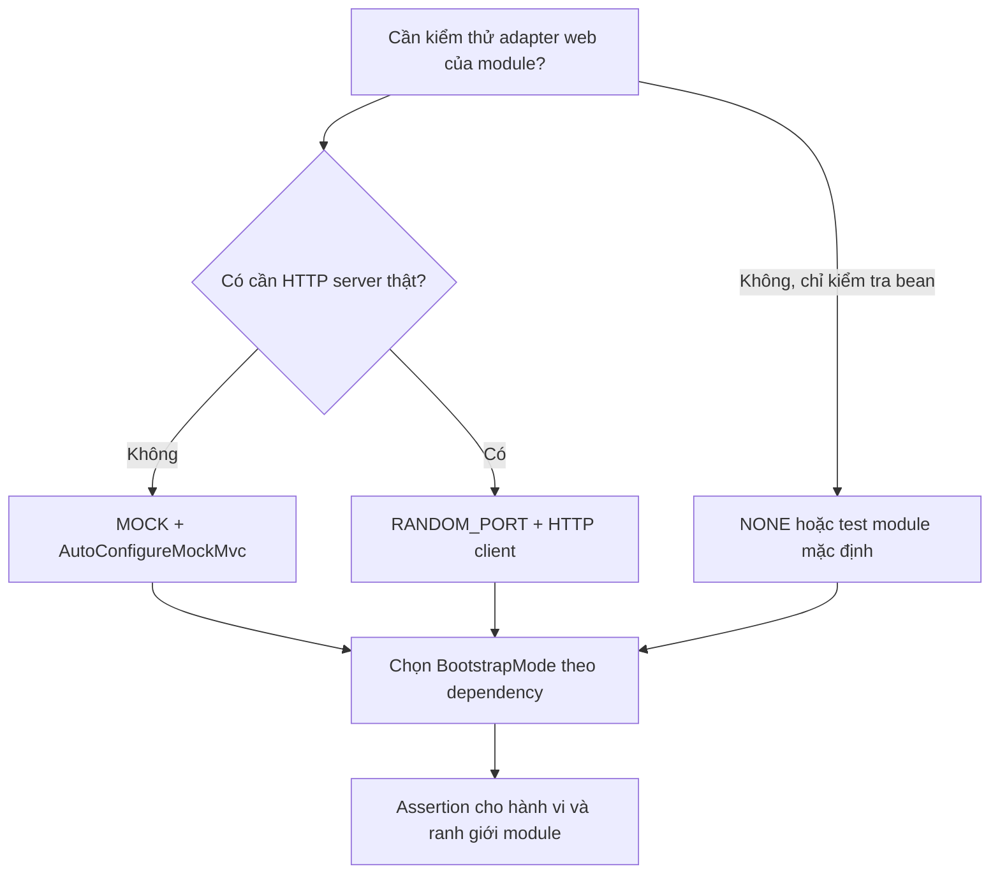

# WebBootstrap cho module có web adapter trong Spring Modulith

## 1. Mục tiêu của kiểm thử module có web adapter

Trong ứng dụng Spring Modulith, một module nghiệp vụ như `order` có thể chứa cả **use case** (xử lý đặt hàng) lẫn **web adapter** (REST controller chuyển HTTP request thành lời gọi use case). Để kiểm chứng module này, chỉ unit test `OrderService` là chưa đủ: còn cần biết request mapping, JSON binding, HTTP status và cách controller phối hợp với service có đúng không.

Ở chiều ngược lại, khởi động toàn bộ ứng dụng với `@SpringBootTest` cho mọi phép kiểm tra HTTP có thể kéo theo những module không liên quan như `billing` hoặc `reporting`. **`@ApplicationModuleTest` cho phép khởi tạo application context theo ranh giới module, đồng thời cấu hình môi trường web để kiểm tra adapter HTTP.**

Trong tiêu đề bài học, **WebBootstrap** là cách gọi mô tả việc bootstrap module để kiểm thử web adapter. Đây **không phải** tên một annotation hay giá trị `BootstrapMode` được Spring Modulith công bố. API dùng trong thực tế là `@ApplicationModuleTest` với thuộc tính `webEnvironment`, kết hợp công cụ kiểm thử HTTP của Spring Boot như `MockMvc`.

Bài thuộc chương **ApplicationModuleTest** trong học phần **SPRING_MODULITH_VERIFICATION_TESTING**. Mục tiêu chung của học phần là xác minh ranh giới ứng dụng bằng `ApplicationModules`, quy tắc phụ thuộc, kiểm thử sự kiện và cơ sở dữ liệu, đồng thời đưa quality gate vào CI để phát hiện phụ thuộc sai và hồi quy.

Sau bài học, bạn có thể:

- Phân biệt **chế độ nạp module** (`BootstrapMode`) với **môi trường web** (`SpringBootTest.WebEnvironment`).
- Dùng `@ApplicationModuleTest` và `@AutoConfigureMockMvc` để kiểm thử REST endpoint trong một module mà không cần mở cổng mạng.
- Giải thích khi nào nên dùng `MOCK`, `RANDOM_PORT`, `DEFINED_PORT` hoặc `NONE`.
- Kiểm tra ranh giới web adapter, xử lý dependency ngoài module và tổ chức kiểm thử API/security/event trong CI.

## 2. Hai trục cấu hình độc lập: module và web environment

`@ApplicationModuleTest` là annotation dựa trên cơ chế `@SpringBootTest` và hỗ trợ **hai nhóm lựa chọn** cần tách biệt:

| Nhóm | Thuộc tính/API | Câu hỏi cần trả lời |
| --- | --- | --- |
| **Phạm vi module** | `mode = BootstrapMode.STANDALONE` | Các *application module nghiệp vụ* nào được nạp vào context? |
| **Phạm vi module** | `DIRECT_DEPENDENCIES`, `ALL_DEPENDENCIES`, `extraIncludes` | Có cần bean thật từ module phụ thuộc hay module bổ sung cụ thể không? |
| **Môi trường web** | `webEnvironment = SpringBootTest.WebEnvironment.MOCK` | Có tạo web application context giả lập để kiểm tra HTTP mà không chạy server thật không? |
| **Môi trường web** | `RANDOM_PORT`, `DEFINED_PORT`, `NONE` | Có mở HTTP server trên một cổng thật, hay không cần web runtime? |

Ví dụ một lớp test REST có thể đồng thời chọn **module `order` ở `STANDALONE`** và **web environment `MOCK`**:

```java
package com.example.shop.order.web;

import org.springframework.boot.test.context.SpringBootTest;
import org.springframework.modulith.test.ApplicationModuleTest;
import org.springframework.modulith.test.ApplicationModuleTest.BootstrapMode;

@ApplicationModuleTest(
    mode = BootstrapMode.STANDALONE,
    webEnvironment = SpringBootTest.WebEnvironment.MOCK
)
class OrderWebBootstrapTests {
    // Các phương thức @Test được bổ sung ở phần thực hành.
}
```

Hai lựa chọn có hiệu lực khác nhau: `mode` quyết định module nghiệp vụ được quét; `webEnvironment` quyết định đặc điểm hạ tầng web do Spring Boot Test khởi tạo. Đổi sang `RANDOM_PORT` **không** tự nạp toàn bộ module của ứng dụng. Đổi sang `DIRECT_DEPENDENCIES` **không** tự bật HTTP server thật.

Đối với Spring MVC, `webEnvironment = MOCK` là **giá trị mặc định** của `@ApplicationModuleTest`, nên có thể bỏ thuộc tính này nếu muốn. Khi dùng MockMvc, cần cấu hình MockMvc riêng bằng `@AutoConfigureMockMvc` và bảo đảm dependency kiểm thử Spring MVC có mặt.

## 3. Các giá trị `WebEnvironment` và cách chọn

`webEnvironment` nhận enum `SpringBootTest.WebEnvironment` do Spring Boot cung cấp. Spring Modulith không tạo enum web riêng.

| Giá trị | Context và server | Công cụ kiểm thử điển hình | Khi nên dùng |
| --- | --- | --- | --- |
| `MOCK` *(mặc định)* | Tạo web application context giả lập khi có web stack; **không mở server thật** | `MockMvc` với Spring MVC | Kiểm tra routing, JSON, status, filter và phối hợp controller/service trong module |
| `RANDOM_PORT` | Chạy embedded web server trên **cổng ngẫu nhiên** | HTTP client gửi request thật | Kiểm tra hành vi qua mạng, cấu hình servlet/web server, các bộ lọc trong runtime |
| `DEFINED_PORT` | Chạy web server trên cổng cấu hình (`server.port` hoặc mặc định) | HTTP client gửi request thật | Chỉ dùng khi thật sự cần cổng xác định; dễ xung đột cổng trên CI |
| `NONE` | Tạo context không có web environment | Bean/service assertions | Kiểm thử module không cần HTTP runtime |

Những giá trị này mô tả chế độ của Spring Boot Test, **không phải** các mode `STANDALONE`, `DIRECT_DEPENDENCIES`, `ALL_DEPENDENCIES` của Spring Modulith.



**Lưu ý:** Với `MOCK`, request gửi qua `MockMvc` chạy bên trong tiến trình test mà không đi qua socket thật. Kết quả kiểm chứng bộ điều khiển Spring MVC và phần web stack giả lập; nó **không chứng minh** cấu hình reverse proxy, TLS, kết nối mạng hoặc đặc tính của server nhúng khi chạy production.

## 4. Ví dụ thực hành: web adapter của module `order`

Ta xây dựng một API `POST /orders` nhận JSON `sku`, `quantity`, gọi use case trong module `order`, trả về HTTP `201 Created` và phát một domain event `OrderPlaced`.

Ví dụ sử dụng **Spring MVC trên Spring Boot 3.5.x, Spring Modulith 1.4.x, JUnit Jupiter, AssertJ và MockMvc**. Các import `@AutoConfigureMockMvc` bên dưới là import của **Spring Boot 3.x**. Ở **Spring Boot 4.x**, annotation này chuyển sang package `org.springframework.boot.webmvc.test.autoconfigure` và dự án cần dependency kiểm thử MVC tương ứng; đối chiếu phần 9 trước khi sao chép code.

### 4.1. Cấu trúc module

```text
src/
├── main/java/com/example/shop/
│   ├── ShopApplication.java
│   ├── order/
│   │   ├── OrderService.java
│   │   ├── OrderPlaced.java
│   │   └── web/
│   │       └── OrderController.java
│   └── reporting/
│       └── ReportService.java
└── test/java/com/example/shop/
    └── order/
        └── web/
            └── OrderWebIntegrationTests.java
```

`order.web` là **package con thuộc module `order`**, không phải một application module riêng theo cách nhận diện module mặc định. Lớp test đặt trong `com.example.shop.order.web` vẫn nhận diện module mục tiêu là `order`.

Đặt lớp ứng dụng ở package gốc:

```java
package com.example.shop;

import org.springframework.boot.SpringApplication;
import org.springframework.boot.autoconfigure.SpringBootApplication;

@SpringBootApplication
public class ShopApplication {
    public static void main(String[] args) {
        SpringApplication.run(ShopApplication.class, args);
    }
}
```

### 4.2. Dependency cần thiết

Ví dụ với Maven và Spring Boot 3.x:

```xml
<!-- Trong project đã quản lý phiên bản Boot/Modulith bằng BOM phù hợp. -->
<dependency>
    <groupId>org.springframework.boot</groupId>
    <artifactId>spring-boot-starter-web</artifactId>
</dependency>
<dependency>
    <groupId>org.springframework.boot</groupId>
    <artifactId>spring-boot-starter-test</artifactId>
    <scope>test</scope>
</dependency>
<dependency>
    <groupId>org.springframework.modulith</groupId>
    <artifactId>spring-modulith-starter-test</artifactId>
    <scope>test</scope>
</dependency>
```

Starter web cung cấp Spring MVC và JSON serialization; các starter test cung cấp JUnit, AssertJ, `MockMvc` và phần hỗ trợ Spring Modulith. Nếu ứng dụng dùng WebFlux thay vì Spring MVC, cần chọn công cụ và cấu hình test phù hợp, không sao chép nguyên ví dụ `MockMvc`.

### 4.3. Viết use case và domain event

File `src/main/java/com/example/shop/order/OrderPlaced.java`:

```java
package com.example.shop.order;

import java.util.UUID;

public record OrderPlaced(UUID orderId, String sku, int quantity) {}
```

File `src/main/java/com/example/shop/order/OrderService.java`:

```java
package com.example.shop.order;

import java.util.UUID;
import org.springframework.context.ApplicationEventPublisher;
import org.springframework.stereotype.Service;

@Service
public class OrderService {

    private final ApplicationEventPublisher events;

    public OrderService(ApplicationEventPublisher events) {
        this.events = events;
    }

    public UUID place(String sku, int quantity) {
        if (sku == null || sku.isBlank() || quantity <= 0) {
            throw new IllegalArgumentException("Invalid order request");
        }

        UUID orderId = UUID.randomUUID();
        // Ví dụ rút gọn: hệ thống thật còn cần lưu trạng thái đơn hàng.
        events.publishEvent(new OrderPlaced(orderId, sku, quantity));
        return orderId;
    }
}
```

Use case không biết gì về HTTP: nó nhận tham số Java, kiểm tra quy tắc tối thiểu và phát sự kiện. Điều này giúp `order` có thể được gọi từ REST adapter, job hoặc event listener mà không phụ thuộc vào Spring MVC.

### 4.4. Viết REST controller làm web adapter

File `src/main/java/com/example/shop/order/web/OrderController.java`:

```java
package com.example.shop.order.web;

import java.util.UUID;
import com.example.shop.order.OrderService;
import org.springframework.http.HttpStatus;
import org.springframework.http.ResponseEntity;
import org.springframework.web.bind.annotation.PostMapping;
import org.springframework.web.bind.annotation.RequestBody;
import org.springframework.web.bind.annotation.RequestMapping;
import org.springframework.web.bind.annotation.RestController;

@RestController
@RequestMapping("/orders")
public class OrderController {

    private final OrderService orders;

    public OrderController(OrderService orders) {
        this.orders = orders;
    }

    @PostMapping
    public ResponseEntity<OrderResponse> place(@RequestBody PlaceOrderRequest request) {
        UUID id = orders.place(request.sku(), request.quantity());
        return ResponseEntity.status(HttpStatus.CREATED)
                .body(new OrderResponse(id.toString(), "ACCEPTED"));
    }

    public record PlaceOrderRequest(String sku, int quantity) {}

    public record OrderResponse(String orderId, String status) {}
}
```

Đây là adapter mỏng: nhận JSON, ủy quyền cho `OrderService`, trả về response và HTTP status. Hai record lồng nhau công khai giúp Jackson có thể ánh xạ JSON trong ví dụ. **Chưa có** `@Valid`, exception handler hay persistence; các trường hợp lỗi HTTP 400 và giao dịch cần được bổ sung đúng cấu hình trước khi viết assertion tương ứng.

### 4.5. Kiểm tra request/response bằng `MockMvc`

File `src/test/java/com/example/shop/order/web/OrderWebIntegrationTests.java`:

```java
package com.example.shop.order.web;

import static org.assertj.core.api.Assertions.assertThat;
import static org.springframework.test.web.servlet.request.MockMvcRequestBuilders.post;
import static org.springframework.test.web.servlet.result.MockMvcResultMatchers.jsonPath;
import static org.springframework.test.web.servlet.result.MockMvcResultMatchers.status;

import org.junit.jupiter.api.Test;
import org.springframework.beans.factory.annotation.Autowired;
import org.springframework.boot.test.autoconfigure.web.servlet.AutoConfigureMockMvc;
import org.springframework.boot.test.context.SpringBootTest;
import org.springframework.http.MediaType;
import org.springframework.modulith.test.ApplicationModuleTest;
import org.springframework.modulith.test.PublishedEvents;
import org.springframework.test.web.servlet.MockMvc;
import com.example.shop.order.OrderPlaced;

@ApplicationModuleTest(webEnvironment = SpringBootTest.WebEnvironment.MOCK)
@AutoConfigureMockMvc
class OrderWebIntegrationTests {

    @Autowired MockMvc mvc;

    @Test
    void createsOrderAndPublishesEvent(PublishedEvents events) throws Exception {
        mvc.perform(post("/orders")
                .contentType(MediaType.APPLICATION_JSON)
                .content("""
                    {"sku":"SKU-01","quantity":2}
                    """))
            .andExpect(status().isCreated())
            .andExpect(jsonPath("$.status").value("ACCEPTED"))
            .andExpect(jsonPath("$.orderId").isNotEmpty());

        assertThat(events.ofType(OrderPlaced.class)
                .matching(OrderPlaced::sku, "SKU-01"))
                .hasSize(1);
    }
}
```

Điều được kiểm chứng:

1. Lớp test thuộc package `order.web` nên module mục tiêu là `order`.
2. `@ApplicationModuleTest` dựng context chứa bean thật của module `order` ở chế độ `STANDALONE` và môi trường web `MOCK`.
3. `@AutoConfigureMockMvc` tạo `MockMvc` để mô phỏng request qua Spring MVC, bao gồm request mapping, JSON binding và response serialization.
4. Assertion kiểm tra HTTP `201`, trường JSON `status`, `orderId` cùng event nghiệp vụ đã phát với `sku` phù hợp.

Vì không mở cổng HTTP thật, đây là **module integration test tại ranh giới MVC**, không phải kiểm thử kết nối mạng end-to-end. Kết quả mong đợi giả định không có security filter hoặc cấu hình khác chặn `POST /orders`; nếu dự án bật Spring Security, xem phần 8.

## 5. Từ web adapter sang dependency thuộc module khác

Giả sử `OrderService` cần kiểm tra tồn kho qua API công khai `InventoryAvailability` của module `inventory`. Khi đó một module test ở `STANDALONE` có thể lỗi `UnsatisfiedDependencyException` vì implementation thật của `InventoryAvailability` không được nạp.

Có hai hướng hợp lý tùy mục tiêu:

**Kiểm tra HTTP của `order` trong trạng thái cô lập:** Giữ `STANDALONE` và thêm mock cho API bên ngoài. Với Spring Framework 6.2+:

```java
package com.example.shop.order.web;

import com.example.shop.inventory.InventoryAvailability;
import org.springframework.boot.test.autoconfigure.web.servlet.AutoConfigureMockMvc;
import org.springframework.modulith.test.ApplicationModuleTest;
import org.springframework.test.context.bean.override.mockito.MockitoBean;

@ApplicationModuleTest
@AutoConfigureMockMvc
class OrderWebWithInventoryMockTests {

    @MockitoBean InventoryAvailability inventory;

    // Thêm @Autowired MockMvc và @Test với given(...).willReturn(...).
}
```

Interface `InventoryAvailability` ở đây là **ví dụ mở rộng, chưa được khai báo trong mẫu `OrderService` ở phần 4**. Nếu muốn chạy đoạn test này, cần thật sự bổ sung interface và constructor dependency tương ứng vào ứng dụng. Mock kiểm soát phản hồi của module ngoài, còn controller/service của `order` vẫn là bean thật.

**Kiểm tra HTTP cùng implementation thật của dependency trực tiếp:** Chọn `mode = BootstrapMode.DIRECT_DEPENDENCIES` khi mô hình module xác nhận `order → inventory`:

```java
@ApplicationModuleTest(
    mode = BootstrapMode.DIRECT_DEPENDENCIES,
    webEnvironment = SpringBootTest.WebEnvironment.MOCK
)
@AutoConfigureMockMvc
class OrderWebWithInventoryIntegrationTests {
    // Test tích hợp HTTP + service order + service inventory.
}
```

Đoạn minh họa cần import `ApplicationModuleTest`, `ApplicationModuleTest.BootstrapMode`, `SpringBootTest` và `AutoConfigureMockMvc` trong file Java thực tế. Mở rộng mode có thể khiến context cần database/schema hoặc hạ tầng của `inventory`; đây là tác động có chủ đích của kiểm thử tích hợp nhiều module.

**Điểm cần nhớ:** Web adapter nằm trong module `order`, nhưng việc có REST controller không tạo quyền truy cập tự động vào các bean nội bộ của module khác. Quan hệ phụ thuộc phải hợp lệ và được xác minh bằng `ApplicationModules`.

## 6. Khi cần HTTP server thật: `RANDOM_PORT`

Với kịch bản cần xác minh hành vi HTTP đi qua server nhúng, có thể chọn:

```java
package com.example.shop.order.web;

import org.springframework.boot.test.context.SpringBootTest;
import org.springframework.modulith.test.ApplicationModuleTest;

@ApplicationModuleTest(webEnvironment = SpringBootTest.WebEnvironment.RANDOM_PORT)
class OrderRealHttpTests {
    // Dùng HTTP client gửi request đến server trên cổng ngẫu nhiên.
}
```

Ở `RANDOM_PORT`, Spring Boot khởi động server thật và chọn cổng trống. Dùng `@LocalServerPort` cùng HTTP client tương thích phiên bản Spring Boot (hoặc `java.net.http.HttpClient`) để gửi request. Cần nhớ:

- `RANDOM_PORT` **không tự mở rộng** `BootstrapMode`: phạm vi module nghiệp vụ vẫn do `mode` và `extraIncludes` quyết định.
- Request đi qua kết nối HTTP thật, nên test có thể kiểm tra những thành phần phụ thuộc server mà `MockMvc` không bao phủ.
- Trong Spring Boot 4, việc tự cấu hình các test HTTP client như `TestRestTemplate` thay đổi so với 3.x; cần kiểm tra dependency và annotation mới thay vì mặc định client luôn được inject.
- Kiểm thử server thật thường tốn tài nguyên hơn `MockMvc`. Trên CI nên ưu tiên `RANDOM_PORT` thay vì `DEFINED_PORT` để giảm rủi ro đụng cổng khi các test chạy song song.

Khi module cần broker, database, TLS hoặc reverse proxy thực, vẫn phải cấp/cấu hình những hạ tầng đó; `RANDOM_PORT` chỉ quyết định cách khởi chạy web server trong tiến trình test, không cung cấp toàn bộ môi trường production.

## 7. Kết hợp lát cắt module với lát cắt Spring MVC

`@ApplicationModuleTest` hỗ trợ kiểm thử **nhiều tầng trong một module** (controller → service → repository nếu có). Khi chỉ muốn kiểm tra mapping/serialization của controller, có thể dùng **lát cắt ngang Spring MVC** bằng `@WebMvcTest`.

Spring Modulith cung cấp `@ModuleSlicing` để phối hợp **lát cắt dọc theo module** với các slice test của Spring Boot. Đây là lựa chọn cho test controller thật nhưng service là mock:

```java
package com.example.shop.order.web;

import static org.mockito.BDDMockito.given;
import static org.springframework.test.web.servlet.request.MockMvcRequestBuilders.post;
import static org.springframework.test.web.servlet.result.MockMvcResultMatchers.jsonPath;
import static org.springframework.test.web.servlet.result.MockMvcResultMatchers.status;

import java.util.UUID;
import com.example.shop.order.OrderService;
import org.junit.jupiter.api.Test;
import org.springframework.beans.factory.annotation.Autowired;
import org.springframework.boot.test.autoconfigure.web.servlet.WebMvcTest;
import org.springframework.http.MediaType;
import org.springframework.modulith.test.ModuleSlicing;
import org.springframework.test.context.bean.override.mockito.MockitoBean;
import org.springframework.test.web.servlet.MockMvc;

@ModuleSlicing
@WebMvcTest(OrderController.class)
class OrderControllerSliceTests {

    @Autowired MockMvc mvc;
    @MockitoBean OrderService orders;

    @Test
    void mapsRequestAndSerializesResponse() throws Exception {
        UUID id = UUID.fromString("00000000-0000-0000-0000-000000000123");
        given(orders.place("SKU-01", 2)).willReturn(id);

        mvc.perform(post("/orders")
                .contentType(MediaType.APPLICATION_JSON)
                .content("""
                    {"sku":"SKU-01","quantity":2}
                    """))
            .andExpect(status().isCreated())
            .andExpect(jsonPath("$.orderId").value(id.toString()));
    }
}
```

Ví dụ này sử dụng namespace Spring Boot **3.x** cho `@WebMvcTest` và Spring Framework 6.2+ cho `@MockitoBean`; ở Boot 4 cần cập nhật import của `@WebMvcTest`. `@WebMvcTest` đã tự cấu hình `MockMvc`, nên không bắt buộc thêm `@AutoConfigureMockMvc` vào lớp này.

| Mục tiêu | Cách kiểm thử thích hợp |
| --- | --- |
| Chỉ controller và hợp đồng HTTP; service giả lập | `@ModuleSlicing` + `@WebMvcTest` + mock service |
| Controller cùng service thật trong **một module** | `@ApplicationModuleTest` + `@AutoConfigureMockMvc` |
| HTTP tích hợp qua server thật nhưng vẫn giới hạn module | `@ApplicationModuleTest(webEnvironment = RANDOM_PORT)` |
| HTTP tích hợp nhiều module nghiệp vụ | `@ApplicationModuleTest(mode = DIRECT_DEPENDENCIES/ALL_DEPENDENCIES)` và web environment phù hợp |

Một controller slice test chạy xanh không chứng minh service, transaction hoặc event nghiệp vụ hoạt động đúng. Do đó nên duy trì một số test module đầy đủ tại những luồng quan trọng.

## 8. Web adapter thực tế: validation, security, exception và transaction

**Validation và lỗi HTTP.** Code mẫu ở phần 4 chỉ xử lý đường đi thành công. `IllegalArgumentException` từ use case không tự trở thành HTTP `400 Bad Request` trong mọi cấu hình; nếu muốn kiểm tra status 400, cần ràng buộc request rõ ràng (ví dụ `@Valid`, `@NotBlank`, `@Min(1)` với validation starter) hoặc một `@RestControllerAdvice` ánh xạ lỗi nghiệp vụ thành response. Sau đó mới viết assertion cho body lỗi và status. Không đặt test mong đợi 400 nếu adapter chưa định nghĩa hợp đồng lỗi.

**Spring Security.** Nếu ứng dụng có Spring Security, các filter có thể chặn `POST /orders` với `401`/`403` trước khi tới controller. Với `MockMvc`, có thể dùng `spring-security-test`, `@WithMockUser` và `SecurityMockMvcRequestPostProcessors.csrf()` theo security configuration thật. `@AutoConfigureMockMvc(addFilters = false)` có thể hữu ích cho test chỉ quan tâm mapping nhưng sẽ **bỏ qua kiểm chứng security filter**; cần bài test riêng nếu authorization là yêu cầu của endpoint.

**Dependency ngoài module.** Một web adapter của `order` không nên gọi thẳng vào package `inventory.internal`. Nếu controller cần dữ liệu từ module ngoài, ưu tiên đặt quy tắc ở use case và dùng API module hợp lệ. Ở `STANDALONE`, cung cấp mock/fake cho API bên ngoài hoặc nạp dependency thật một cách chủ đích; đừng dùng `ALL_DEPENDENCIES` như cách chữa mọi lỗi thiếu bean.

**Transaction và database.** Nếu `OrderService` ghi đơn hàng xuống repository, module test cần datasource, schema/migration và dữ liệu phù hợp. `MockMvc` chạy trong test process nhưng không thay cho database. Với `RANDOM_PORT`, request thường được xử lý trên luồng server khác nên rollback của transaction ở test không tự đảm bảo rollback side effect. Kiểm tra chiến lược dọn dữ liệu và transaction khi dùng event listener bất đồng bộ.

**Domain event.** `PublishedEvents` cho biết một event đã được phát trong bài test. Nó không chứng minh listener thuộc module khác đã nhận và cập nhật database thành công. Nếu mục tiêu là kiểm thử kết quả xử lý bất đồng bộ, cân nhắc `Scenario` và chọn phạm vi nạp listener phù hợp.

## 9. Chú ý tương thích Spring Boot 3.x và 4.x

Các ví dụ Java phía trên chọn import của Spring Boot 3.x. Khi nâng cấp lên Spring Boot 4.x, Spring Boot đã tổ chức lại một số package kiểm thử web:

| Thành phần | Spring Boot 3.x | Spring Boot 4.x |
| --- | --- | --- |
| `@AutoConfigureMockMvc` | `org.springframework.boot.test.autoconfigure.web.servlet.AutoConfigureMockMvc` | `org.springframework.boot.webmvc.test.autoconfigure.AutoConfigureMockMvc` |
| `@WebMvcTest` | `org.springframework.boot.test.autoconfigure.web.servlet.WebMvcTest` | `org.springframework.boot.webmvc.test.autoconfigure.WebMvcTest` |
| Dependency kiểm thử MVC | Thường có qua `spring-boot-starter-test`/các starter liên quan | Bảo đảm có module/starter kiểm thử MVC, ví dụ `spring-boot-starter-webmvc-test` |

Các annotation `@ApplicationModuleTest`, `@ModuleSlicing` vẫn thuộc `org.springframework.modulith.test`, còn `MockMvc` thuộc `org.springframework.test.web.servlet`. Khi sao chép ví dụ, đối chiếu **phiên bản thực tế** của ứng dụng và Spring Modulith để tránh lỗi import hoặc thiếu test auto-configuration.

## 10. Chẩn đoán lỗi web bootstrap

| Triệu chứng | Kiểm tra trước | Hướng xử lý |
| --- | --- | --- |
| Không inject được `MockMvc` | Đã thêm `@AutoConfigureMockMvc` chưa? Có Spring MVC test dependency không? | Bổ sung annotation/dependency đúng phiên bản; bảo đảm `webEnvironment = MOCK` |
| Endpoint trả `404` | Package controller có thuộc module được nạp không? `@RequestMapping`/HTTP method đúng chưa? | Kiểm tra module mục tiêu, `@RestController`, mapping và log handler mappings |
| Endpoint trả `401` hoặc `403` | Security filter, xác thực và CSRF cho POST | Cấu hình user/role/token và CSRF trong test; test riêng quyền truy cập |
| Endpoint trả `400` | JSON sai kiểu, request binding hoặc validation | Kiểm tra payload, `Content-Type`, DTO và ràng buộc validation |
| Endpoint trả `500` | Exception từ service, dependency thiếu, lỗi dữ liệu | Đọc exception gốc; thêm handler cho lỗi nghiệp vụ nếu hợp đồng HTTP yêu cầu |
| Context lỗi `UnsatisfiedDependencyException` | Controller/service cần bean ở module ngoài `STANDALONE` | Mock API ngoài hoặc mở rộng mode theo mục tiêu kiểm thử |
| `RANDOM_PORT` không bind được | Web starter/server, port, profile, cấu hình runtime | Kiểm tra dependency và web server logs; tránh dùng `DEFINED_PORT` trên CI không cần thiết |
| Test dùng JPA báo lỗi schema/datasource | Hạ tầng persistence và entity scan trong phạm vi module | Chuẩn bị schema/migration và datasource test phù hợp |
| `@ModuleSlicing`/`@WebMvcTest` thiếu service | Slice MVC không nạp service nghiệp vụ mặc định | Dùng mock service hoặc chuyển sang `@ApplicationModuleTest` nếu cần bean thật |

Để quan sát cách Spring Modulith chọn module và giới hạn scanning, bật:

```properties
logging.level.org.springframework.modulith=DEBUG
```

Nhật ký có thể mô tả module mục tiêu, các module được nạp và tùy chỉnh component/entity scanning. Chuỗi log cụ thể thay đổi theo phiên bản. Với MockMvc, `.andDo(print())` trong test có thể giúp quan sát request, response và handler được chọn; chỉ bật đầu ra chi tiết khi cần chẩn đoán.

## 11. Giữ ranh giới kiến trúc và đặt quality gate trong CI

Web adapter chạy đúng chưa chứng minh cấu trúc module hợp lệ. Ví dụ controller có thể lén phụ thuộc vào class nội bộ của `inventory`; một bài test dùng context mở rộng có thể vẫn chạy xanh trong khi quy tắc module bị vi phạm. Tách một bài kiểm chứng kiến trúc:

```java
package com.example.shop;

import org.junit.jupiter.api.Test;
import org.springframework.modulith.core.ApplicationModules;

class ArchitectureTests {

    @Test
    void applicationModulesRespectBoundaries() {
        ApplicationModules.of(ShopApplication.class).verify();
    }
}
```

`ApplicationModules.verify()` kiểm tra những ràng buộc cấu trúc/phụ thuộc giữa các module. `@ApplicationModuleTest` cũng hỗ trợ `verifyAutomatically` (mặc định `true` trong API hiện hành), nhưng bài test kiến trúc riêng giúp kết quả quality gate rõ ràng khi CI chỉ chạy một nhóm integration test.

Một bộ kiểm thử hợp lý cho module có web adapter thường gồm: **unit test** cho nghiệp vụ thuần, **MVC slice test** cho mapping/validation/security, **module integration test** cho HTTP + service + event/repository ở `STANDALONE`, và **một số bài test tích hợp đa module hoặc server thật** khi có nhu cầu. CI cần chạy cùng architecture verification để ngăn hồi quy ranh giới ngay cả khi endpoint vẫn đáp ứng HTTP đúng.

## 12. Bài tập thực hành

1. Thêm `GET /orders/{id}` vào module `order`. Viết `@ApplicationModuleTest` + `MockMvc` kiểm tra JSON response và HTTP `404` cho ID không tồn tại; hãy định nghĩa handler/logic 404 trước khi viết assertion.
2. Bổ sung `@Valid` và validation starter cho `PlaceOrderRequest`; viết test `POST /orders` sai `quantity` và kiểm tra body lỗi cùng status `400`.
3. Bật Spring Security và viết hai test: request chưa xác thực bị từ chối, request có vai trò hợp lệ và CSRF phù hợp được chấp nhận.
4. Cho `order` phụ thuộc vào API công khai của `inventory`. So sánh test web `STANDALONE` + `@MockitoBean` với test `DIRECT_DEPENDENCIES` dùng implementation thật.
5. Đổi cùng bài test từ `webEnvironment = MOCK` sang `RANDOM_PORT`. Phân tích khác biệt về kết nối HTTP, thời gian chạy và việc dọn dữ liệu trong transaction.
6. Viết `@ModuleSlicing` + `@WebMvcTest` cho controller, rồi so sánh bằng chứng nhận được với `@ApplicationModuleTest` có service thật.
7. Tạo phụ thuộc trái quy tắc vào một package `internal` của module khác, chạy `ApplicationModules.verify()` trên CI và kiểm tra quality gate có chặn lỗi dù MockMvc test có thể vẫn chạy xanh hay không.

**Ghi nhớ:** Kiểm thử web adapter của một Spring Modulith module cần chọn riêng **ranh giới module** và **web environment**. Dùng `@ApplicationModuleTest` + `@AutoConfigureMockMvc` để thử HTTP trong context module mà không mở cổng mạng; chỉ chọn `RANDOM_PORT` khi thật sự cần HTTP server. Kết hợp kiểm thử request/response, service, sự kiện, persistence và `ApplicationModules.verify()` để bảo vệ cả hợp đồng web lẫn kiến trúc ứng dụng trong CI.

### Tài liệu tham khảo

- [Spring Modulith Reference — Integration Testing Application Modules](https://docs.spring.io/spring-modulith/reference/testing.html)
- [Spring Modulith API — `ApplicationModuleTest` (`webEnvironment`, `mode`, `extraIncludes`)](https://docs.spring.io/spring-modulith/docs/current/api/org/springframework/modulith/test/ApplicationModuleTest.html)
- [Spring Boot 3.5 — Testing Spring Boot Applications](https://docs.spring.io/spring-boot/3.5/reference/testing/spring-boot-applications.html)
- [Spring Boot 3.5 API — `WebMvcTest`](https://docs.spring.io/spring-boot/3.5/api/java/org/springframework/boot/test/autoconfigure/web/servlet/WebMvcTest.html)
- [Spring Boot 4 API — `AutoConfigureMockMvc`](https://docs.spring.io/spring-boot/4.0/api/java/org/springframework/boot/webmvc/test/autoconfigure/AutoConfigureMockMvc.html)
- [Spring Modulith Reference — Verifying Application Module Structure](https://docs.spring.io/spring-modulith/reference/verification.html)
