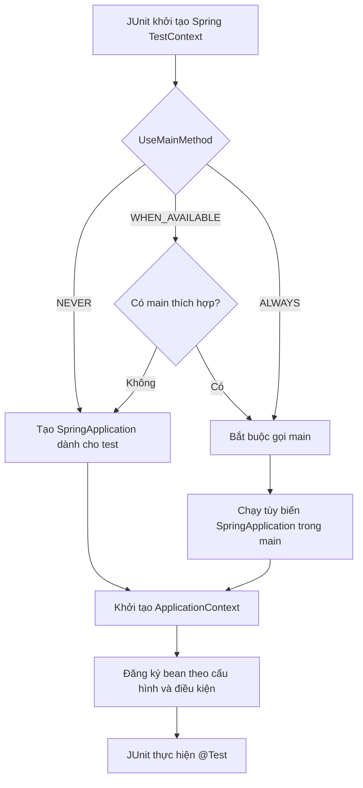
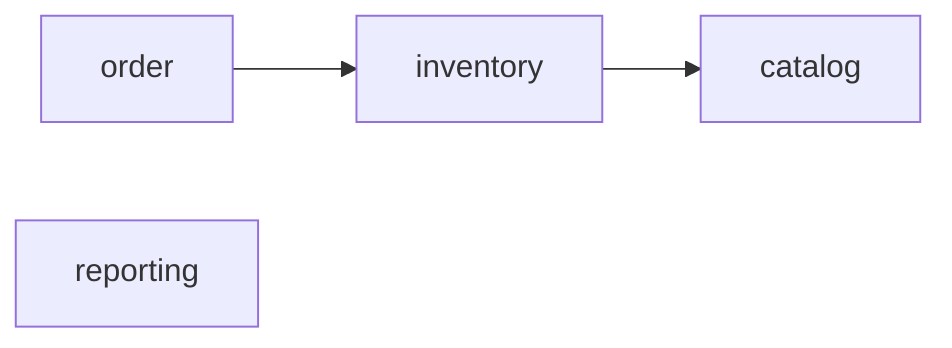

# `UseMainMethod` và ảnh hưởng đến cấu hình kiểm thử Spring Modulith

## 1. Vấn đề: ứng dụng chạy được, nhưng bài test lại dùng cấu hình khác

Một ứng dụng Spring Boot thường có lớp `@SpringBootApplication` và phương thức `public static void main(String[] args)`. Nhiều dự án dùng `main()` chỉ để gọi `SpringApplication.run(...)`; một số dự án còn tùy biến `SpringApplication`, chẳng hạn kích hoạt profile, bổ sung default properties, thay đổi banner hoặc cấu hình chế độ ứng dụng trước khi tạo `ApplicationContext`.

Khi chạy kiểm thử tích hợp, Spring Boot Test **mặc định không gọi phương thức `main()`** của ứng dụng. Nó tìm lớp cấu hình và tạo một `SpringApplication` phục vụ test. Vì vậy, nếu cấu hình quan trọng chỉ xuất hiện trong `main()`, hành vi của test có thể khác hành vi khi ứng dụng được khởi chạy thông thường.

Spring Boot cung cấp `SpringBootTest.UseMainMethod` để quyết định có gọi `main()` khi bootstrap context test hay không. Trong kiến trúc Spring Modulith, vấn đề này cần được xem xét cùng `@ApplicationModuleTest`, vì bộ test còn phải giữ **ranh giới các application module**.

**Phạm vi chính xác của API:** `UseMainMethod` là enum của **Spring Boot**, không phải một `BootstrapMode` của Spring Modulith. Javadoc hiện hành của `@ApplicationModuleTest` **không khai báo thuộc tính `useMainMethod`**, dù annotation này được meta-annotate bằng `@SpringBootTest`. Do đó, đoạn `@ApplicationModuleTest(useMainMethod = ...)` **không hợp lệ**. Bài học này trình bày cách kiểm tra hành vi tương ứng và cách kết hợp module slicing với `@SpringBootTest` khi phiên bản hỗ trợ.

Trong chương **ApplicationModuleTest** của học phần **SPRING_MODULITH_VERIFICATION_TESTING**, chủ đề này liên kết trực tiếp với mục tiêu kiểm chứng ranh giới qua `ApplicationModules`, kiểm thử module/sự kiện/cơ sở dữ liệu và thiết lập quality gate CI để ngăn sai lệch cấu hình, phụ thuộc trái phép và hồi quy.

### Kết quả học tập

Sau bài học, bạn có thể:

- Phân biệt đường khởi động bằng `main()` với đường khởi tạo context mặc định của Spring Boot Test.
- Giải thích các giá trị `NEVER`, `WHEN_AVAILABLE`, `ALWAYS` của `SpringBootTest.UseMainMethod`.
- Xác định tác động của cấu hình trong `main()` đối với profile, property, bean có điều kiện và kiểm thử module.
- Tránh khai báo thuộc tính `useMainMethod` trên `@ApplicationModuleTest`; áp dụng `@ModuleSlicing` kết hợp `@SpringBootTest` khi stack hỗ trợ.
- Viết assertion chứng minh context test có cấu hình mong muốn và duy trì bài kiểm chứng kiến trúc độc lập trong CI.

## 2. `UseMainMethod` thuộc API nào?

Thuộc tính `useMainMethod` nằm trên annotation `org.springframework.boot.test.context.SpringBootTest` (Spring Boot **3.0+**):

```java
@SpringBootTest(useMainMethod = SpringBootTest.UseMainMethod.ALWAYS)
class ApplicationStartupTests {
    // Các @Test kiểm tra ảnh hưởng của main().
}
```

Enum có ba giá trị:

| `SpringBootTest.UseMainMethod` | Cách Spring Boot tạo context kiểm thử | Khi sử dụng |
| --- | --- | --- |
| `NEVER` *(mặc định)* | Không gọi `main()`; Spring Boot Test tự tạo `SpringApplication` để chạy test | Kiểm thử thường ngày, không cần customizations nằm trong `main()` |
| `WHEN_AVAILABLE` | Gọi `main()` nếu lớp `@SpringBootConfiguration` được tìm thấy có phương thức `main`; nếu không có thì dùng cơ chế test mặc định | Muốn giữ cách khởi động thật khi có `main()`, nhưng không bắt buộc mọi cấu hình đều có nó |
| `ALWAYS` | Bắt buộc gọi `main()` của lớp cấu hình ứng dụng | Muốn xác minh rõ ràng cấu hình khởi động; test thất bại nếu không tìm thấy `main()` thích hợp |

Đoạn minh họa cú pháp **sai** dưới đây không biên dịch được với Javadoc `@ApplicationModuleTest` hiện hành:

```java
// KHÔNG hợp lệ: @ApplicationModuleTest không có thuộc tính useMainMethod.
// @ApplicationModuleTest(useMainMethod = SpringBootTest.UseMainMethod.ALWAYS)
```

Với module test thông thường, hãy giữ:

```java
package com.example.shop.order;

import org.springframework.modulith.test.ApplicationModuleTest;

@ApplicationModuleTest
class OrderModuleTests {
    // Spring Modulith giới hạn context vào application module order.
}
```

`@ApplicationModuleTest` xác định module mục tiêu từ package của lớp test và mặc định dùng `BootstrapMode.STANDALONE`. Tùy chọn `useMainMethod` giải quyết **đường khởi chạy ứng dụng**, không phải mức độ nạp các module phụ thuộc.

## 3. Hai quá trình bootstrap tạo ra kết quả gì?

Hình sau thể hiện hai đường khởi tạo của Spring Boot Test:



**Những phần luôn cần kiểm tra** khi so sánh kết quả:

1. **Lớp cấu hình gốc:** `@SpringBootConfiguration`/`@SpringBootApplication` nào được Spring Test tìm thấy hoặc được chỉ định qua `classes`?
2. **Profile đang hoạt động:** `main()` có gọi `setAdditionalProfiles(...)` không? Test có `@ActiveProfiles` hoặc property khác không?
3. **Property source:** `main()` có gọi `setDefaultProperties(...)` hay tùy chỉnh `SpringApplication` làm thay đổi property dùng bởi `@ConditionalOnProperty` không?
4. **Phạm vi module:** `@ApplicationModuleTest` hoặc `@ModuleSlicing` đang chọn `STANDALONE`, `DIRECT_DEPENDENCIES` hay `ALL_DEPENDENCIES`?
5. **Hạ tầng:** config chính có làm thay đổi datasource, web environment, transaction manager, event listener hoặc background task không?

Chạy cùng một lớp `@SpringBootApplication` **không đảm bảo hai context giống nhau**. Nếu customizations chỉ xảy ra trong `main()`, test dùng `NEVER` có thể thiếu profile hoặc property cần thiết. Ngược lại, test chạy `ALWAYS` có thể kích hoạt những bean hoặc kết nối thật không phù hợp với mục tiêu cô lập module.

## 4. Ví dụ: profile được thêm trong `main()` làm thay đổi bean

Giả sử ứng dụng có `order` và `reporting` là hai package module ngang cấp. Ta chỉ muốn quan sát một bean của `order` được tạo khi profile `started-from-main` bật, còn `reporting` vẫn ngoài phạm vi module test.

### 4.1. Cấu trúc thư mục

```text
src/
├── main/java/com/example/shop/
│   ├── ShopApplication.java
│   ├── order/
│   │   ├── OrderCalculator.java
│   │   └── MainProfilePolicy.java
│   └── reporting/
│       └── ReportingService.java
└── test/java/com/example/shop/
    ├── order/
    │   ├── OrderDefaultModuleTests.java
    │   └── OrderMainMethodTests.java
    └── StartupConfigurationTests.java
```

Ví dụ giả định dự án sử dụng phiên bản Spring Boot và Spring Modulith **tương thích**, JUnit Jupiter, AssertJ và `spring-modulith-starter-test` (scope `test`). Khi áp dụng `@ModuleSlicing` ở phần 6, dùng **Spring Modulith 2.1+** vì API này được công bố từ dòng đó.

### 4.2. Cấu hình ứng dụng có tùy biến trong `main()`

File `src/main/java/com/example/shop/ShopApplication.java`:

```java
package com.example.shop;

import org.springframework.boot.SpringApplication;
import org.springframework.boot.autoconfigure.SpringBootApplication;

@SpringBootApplication
public class ShopApplication {

    public static void main(String[] args) {
        SpringApplication application = new SpringApplication(ShopApplication.class);
        application.setAdditionalProfiles("started-from-main");
        application.run(args);
    }
}
```

Ở đây `setAdditionalProfiles(...)` được gọi **trước** khi tạo `ApplicationContext`. Khi chạy ứng dụng theo đường `main()`, profile `started-from-main` sẽ được thêm vào môi trường Spring. Nếu test không gọi `main()`, dòng cấu hình này **không được thực thi**.

Trong hệ thống thực, profile chỉ là một ví dụ. Phương thức `main()` còn có thể đặt default properties hoặc thay đổi các thiết lập khác của `SpringApplication`. Để test ổn định, hãy giữ phần khởi tạo quyết định behavior ở một vị trí kiểm soát được và hạn chế side effect lên trạng thái toàn cục của JVM.

### 4.3. Bean thuộc module `order`

File `src/main/java/com/example/shop/order/OrderCalculator.java`:

```java
package com.example.shop.order;

import org.springframework.stereotype.Service;

@Service
public class OrderCalculator {

    public long total(long unitPrice, int quantity) {
        if (unitPrice < 0 || quantity <= 0) {
            throw new IllegalArgumentException("Invalid order input");
        }
        return unitPrice * quantity;
    }
}
```

File `src/main/java/com/example/shop/order/MainProfilePolicy.java`:

```java
package com.example.shop.order;

import org.springframework.context.annotation.Profile;
import org.springframework.stereotype.Component;

@Component
@Profile("started-from-main")
public class MainProfilePolicy {

    public String mode() {
        return "main-configured";
    }
}
```

Bean `MainProfilePolicy` chỉ được đăng ký nếu profile `started-from-main` hoạt động. `OrderCalculator` không phụ thuộc vào bean này nên vẫn có thể khởi tạo nếu profile vắng mặt.

File `src/main/java/com/example/shop/reporting/ReportingService.java`:

```java
package com.example.shop.reporting;

import org.springframework.stereotype.Service;

@Service
public class ReportingService {
    public String status() {
        return "ready";
    }
}
```

Bean `ReportingService` dùng để quan sát giới hạn module; nó không thuộc mục tiêu `order`. Không có cấu hình bổ sung `@Import` hoặc component scan thủ công cho bean này trong ví dụ.

## 5. Bài test mặc định của `@ApplicationModuleTest`: không gọi `main()`

Đặt lớp test đúng package `order`:

```java
package com.example.shop.order;

import static org.assertj.core.api.Assertions.assertThat;

import org.junit.jupiter.api.Test;
import org.springframework.beans.factory.annotation.Autowired;
import org.springframework.context.ApplicationContext;
import org.springframework.core.env.Environment;
import org.springframework.core.env.Profiles;
import org.springframework.modulith.test.ApplicationModuleTest;

@ApplicationModuleTest
class OrderDefaultModuleTests {

    @Autowired ApplicationContext context;
    @Autowired Environment environment;
    @Autowired OrderCalculator calculator;

    @Test
    void startsOrderWithoutMainOnlyProfile() {
        assertThat(calculator.total(50, 2)).isEqualTo(100);
        assertThat(environment.acceptsProfiles(Profiles.of("started-from-main")))
                .isFalse();
        assertThat(context.getBeansOfType(MainProfilePolicy.class)).isEmpty();
    }
}
```

**Vì sao mong đợi kết quả này?** `@ApplicationModuleTest` được meta-annotate bằng `@SpringBootTest`, nhưng **không cung cấp alias `useMainMethod`**. Với hành vi mặc định `NEVER` của Spring Boot Test, `ShopApplication.main()` không được gọi để thêm profile. Vì vậy, nếu không có `@ActiveProfiles`, biến môi trường hoặc cấu hình khác bật `started-from-main`, bean có điều kiện theo profile sẽ vắng mặt.

Đây là hành vi **đúng theo cấu hình test**, không phải lỗi tự động của Spring Modulith. Đặc biệt, bài test vẫn kiểm tra được `OrderCalculator` và vẫn được giới hạn theo module `order`.

> **Điều kiện để tái hiện đúng:** Không kích hoạt `started-from-main` từ profile của môi trường hoặc cấu hình test khác. Nếu CI đã đặt `SPRING_PROFILES_ACTIVE=started-from-main`, assertion kỳ vọng `false` sẽ không còn phù hợp; cần chủ động cô lập cấu hình kiểm thử.

## 6. Cách chủ động dùng `main()`: `@ModuleSlicing` kết hợp `@SpringBootTest`

Từ **Spring Modulith 2.1**, `@ModuleSlicing` là nền tảng hỗ trợ cắt ứng dụng theo module và kết hợp với các annotation test của Spring Boot. Vì `@ApplicationModuleTest` không mở thuộc tính `useMainMethod`, có thể áp dụng cấu hình sau **trong stack hỗ trợ `@ModuleSlicing`**, thay vì thêm một thuộc tính không tồn tại lên `@ApplicationModuleTest`:

```java
package com.example.shop.order;

import static org.assertj.core.api.Assertions.assertThat;

import com.example.shop.ShopApplication;
import com.example.shop.reporting.ReportingService;
import org.junit.jupiter.api.Test;
import org.springframework.beans.factory.annotation.Autowired;
import org.springframework.boot.test.context.SpringBootTest;
import org.springframework.boot.test.context.SpringBootTest.UseMainMethod;
import org.springframework.context.ApplicationContext;
import org.springframework.core.env.Environment;
import org.springframework.core.env.Profiles;
import org.springframework.modulith.test.ModuleSlicing;

@ModuleSlicing
@SpringBootTest(
    classes = ShopApplication.class,
    useMainMethod = UseMainMethod.ALWAYS,
    webEnvironment = SpringBootTest.WebEnvironment.NONE
)
class OrderMainMethodTests {

    @Autowired ApplicationContext context;
    @Autowired Environment environment;
    @Autowired OrderCalculator calculator;

    @Test
    void usesMainCustomizationAndKeepsModuleBoundary() {
        assertThat(environment.acceptsProfiles(Profiles.of("started-from-main")))
                .isTrue();

        assertThat(context.getBeansOfType(MainProfilePolicy.class)).hasSize(1);
        assertThat(context.getBeansOfType(ReportingService.class)).isEmpty();
        assertThat(calculator.total(50, 2)).isEqualTo(100);
    }
}
```

Ý nghĩa của từng phần:

1. **`@ModuleSlicing`:** áp dụng giới hạn package/module do Spring Modulith hỗ trợ. Lớp test ở `com.example.shop.order` nên module mục tiêu là `order`.
2. **`@SpringBootTest(useMainMethod = ALWAYS)`:** yêu cầu Spring Boot Test đi qua phương thức `main()` của cấu hình ứng dụng, nhờ đó profile được thêm.
3. **`classes = ShopApplication.class`:** khai báo rõ lớp cấu hình gốc, giúp hành vi tìm cấu hình dễ hiểu và kiểm soát được.
4. **`webEnvironment = NONE`:** loại nhu cầu tạo web environment vì ví dụ chỉ kiểm chứng service và profile.
5. **Các assertion:** xác nhận profile có hiệu lực, bean điều kiện theo profile xuất hiện và bean của module `reporting` vẫn không được đăng ký qua quét module mặc định.

Đây là **mẫu tích hợp để chạy và xác minh trong phiên bản thực tế** của dự án: cần kiểm tra sự tương thích giữa Spring Modulith 2.1+, Spring Boot và những cấu hình tùy chỉnh của ứng dụng. Nếu phiên bản Spring Modulith chưa có `@ModuleSlicing`, không sao chép nguyên annotation trên; hãy kiểm tra `main()` bằng một bài `@SpringBootTest(useMainMethod = ...)` riêng, rồi dùng `@ApplicationModuleTest` để kiểm thử ranh giới module.

**Không cần gắn thêm `@ApplicationModuleTest` lên cùng lớp trong ví dụ này.** `@SpringBootTest` đã cung cấp bootstrapper của Spring Boot, còn `@ModuleSlicing` áp dụng giới hạn module. Tránh chồng các meta-annotation cùng chức năng mà không hiểu thứ tự và cách Spring Test hợp nhất cấu hình.

## 7. So sánh `NEVER`, `WHEN_AVAILABLE`, `ALWAYS` bằng thực nghiệm

Một bài `@SpringBootTest` thuần có thể dùng làm điểm đối chiếu để chứng minh `main()` thực sự ảnh hưởng cấu hình Spring. Với lớp `ShopApplication` đã định nghĩa `main()`, ba cấu hình có ý nghĩa:

```java
// Cách 1: Spring Boot Test tự tạo SpringApplication (mặc định).
@SpringBootTest(
    classes = ShopApplication.class,
    useMainMethod = UseMainMethod.NEVER
)
class WithoutMainTests {}
```

```java
// Cách 2: dùng main nếu có; thiếu main thì khởi tạo theo cơ chế test.
@SpringBootTest(
    classes = ShopApplication.class,
    useMainMethod = UseMainMethod.WHEN_AVAILABLE
)
class MainWhenAvailableTests {}
```

```java
// Cách 3: bắt buộc có main hợp lệ; nếu không thì test thất bại lúc bootstrap.
@SpringBootTest(
    classes = ShopApplication.class,
    useMainMethod = UseMainMethod.ALWAYS
)
class RequireMainTests {}
```

Các lớp trong ba snippet là **minh họa cấu hình**, cần bổ sung package/import và `@Test` thực tế để thành bài test hoàn chỉnh. Chúng là **Spring Boot Test toàn ứng dụng**, vì không có `@ModuleSlicing`; không dùng chúng để suy ra ranh giới application module có được giữ hay không.

| Tình huống | `NEVER` | `WHEN_AVAILABLE` | `ALWAYS` |
| --- | --- | --- | --- |
| Lớp cấu hình có `main()` thêm profile | Không thực thi `main()` | Thực thi `main()` | Thực thi `main()` |
| Lớp cấu hình không có `main()` | Vẫn có thể tạo context | Dùng cơ chế test thông thường | Thất bại khi bootstrap |
| Muốn test ổn định, không phụ thuộc customizations trong `main()` | Phù hợp | Cần cân nhắc | Cần cân nhắc |
| Muốn phát hiện hồi quy trong logic cấu hình `main()` | Không bao phủ trực tiếp | Có, nếu `main()` tồn tại | Có và bắt buộc `main()` tồn tại |

Đặc biệt, `ALWAYS` **không** có nghĩa Spring Boot sẽ luôn chọn mọi profile hoặc mọi bean. Nó chỉ điều khiển có gọi `main()` không; bean cuối cùng vẫn phụ thuộc các cấu hình/điều kiện Spring được thực thi.

## 8. Những cấu hình có thể thay đổi khi gọi `main()`

Đường khởi chạy bằng `main()` có thể tác động đến `ApplicationContext` theo nhiều cách:

| Thứ được thay đổi trong `main()` | Tác động có thể quan sát | Hệ quả cho module test |
| --- | --- | --- |
| `application.setAdditionalProfiles("...")` | Thay tập profile active | `@Profile` và cấu hình theo profile có thể tạo tập bean khác |
| `application.setDefaultProperties(...)` | Thay các property mặc định | `@ConditionalOnProperty`, cấu hình client/DB hoặc feature flag có thể khác |
| Tùy biến `SpringApplication`/initializers | Điều chỉnh môi trường hoặc quá trình bootstrap | Test có thể chạy với hạ tầng, property source hoặc bean khác |
| `application.setWebApplicationType(...)` | Ảnh hưởng kiểu ứng dụng web/non-web | Có thể thay khả năng khởi tạo controller, servlet/web server trong test |
| `main()` đọc biến môi trường/argument | Có thể lựa chọn profile, endpoint, property động | CI cần cung cấp đầu vào ổn định và tránh gọi hạ tầng thật không chủ đích |
| `main()` tự thực hiện side effect ngoài Spring context | Có thể sửa system property, tạo file hoặc gọi dịch vụ | Test có nguy cơ không cô lập hoặc phụ thuộc thứ tự chạy |

Không nên coi toàn bộ các tùy biến trên đều bắt buộc đặt trong `main()`. Khi một giá trị ảnh hưởng trực tiếp hành vi nghiệp vụ, cấu hình bằng `application-test.yml`, `@ActiveProfiles`, `@TestPropertySource` hoặc `@DynamicPropertySource` thường dễ kiểm soát hơn trong module test.

Ví dụ, thay vì bắt mọi bài `@ApplicationModuleTest` chạy `main()` chỉ để bật profile test:

```java
package com.example.shop.order;

import org.springframework.modulith.test.ApplicationModuleTest;
import org.springframework.test.context.ActiveProfiles;

@ApplicationModuleTest
@ActiveProfiles("test")
class OrderConfiguredForTestTests {
    // Dùng các @Test với property và bean được khai báo cho profile test.
}
```

Đây là cách trực tiếp, có chủ đích và phù hợp cho phần lớn module integration test. Nó **không thay thế** bài kiểm tra riêng về `main()` nếu logic khởi động ứng dụng có yêu cầu nghiệp vụ/vận hành cần bảo vệ.

## 9. `UseMainMethod` không thay đổi các quy tắc ranh giới module

Giả sử mô hình phụ thuộc hợp lệ của ứng dụng:



`UseMainMethod` trả lời **có gọi `main()` khi tạo `SpringApplication` cho test không?** Trong khi đó `BootstrapMode` của Spring Modulith trả lời **những application module nào sẽ được nạp trong context?**

| Cấu hình | Quyết định gì? | Không làm gì? |
| --- | --- | --- |
| `UseMainMethod.ALWAYS` | Gọi `main()` để tạo context theo các customizations | Không tự nạp toàn bộ module phụ thuộc |
| `BootstrapMode.STANDALONE` | Nạp module mục tiêu | Không bảo đảm gọi `main()` |
| `BootstrapMode.DIRECT_DEPENDENCIES` | Nạp mục tiêu và dependency trực tiếp | Không tự gọi `main()` hoặc nạp dependency bắc cầu |
| `BootstrapMode.ALL_DEPENDENCIES` | Nạp mục tiêu và dependency trực tiếp/bắc cầu | Không thay đổi chính sách dùng `main()` |

Trong ví dụ ở phần 6, nếu `OrderCalculator` cần một API công khai từ `inventory`, test `STANDALONE` có thể gặp `UnsatisfiedDependencyException` ngay cả khi `UseMainMethod.ALWAYS` đã chạy thành công. Khi đó cần lựa chọn phù hợp với mục tiêu: mock API ngoài module, mở rộng `@ModuleSlicing(mode = ...)`, hoặc viết test đa module có chủ đích.

Nếu lựa chọn nạp dependency trực tiếp trong cấu hình kết hợp:

```java
package com.example.shop.order;

import com.example.shop.ShopApplication;
import org.springframework.boot.test.context.SpringBootTest;
import org.springframework.boot.test.context.SpringBootTest.UseMainMethod;
import org.springframework.modulith.test.ApplicationModuleTest.BootstrapMode;
import org.springframework.modulith.test.ModuleSlicing;

@ModuleSlicing(mode = BootstrapMode.DIRECT_DEPENDENCIES)
@SpringBootTest(
    classes = ShopApplication.class,
    useMainMethod = UseMainMethod.ALWAYS
)
class OrderWithDependenciesAndMainTests {
    // Các @Test xác nhận hành vi tích hợp và cấu hình sau bootstrap.
}
```

Ví dụ trên chỉ có ý nghĩa khi mô hình thực tế xác định `order` có dependency trực tiếp như mong đợi. Một bean ở module ngoài cũng có thể xuất hiện do `@Import`, auto-configuration hoặc test configuration; kiểm tra nguồn gốc bean trước khi kết luận phạm vi bootstrap đã sai.

## 10. Chú ý đối với sự kiện, cơ sở dữ liệu và CI

**Sự kiện ứng dụng.** Nếu `main()` kích hoạt một profile chứa listener hoặc cấu hình xử lý event, `UseMainMethod` có thể thay đổi những listener thực sự được đăng ký. Một bài `PublishedEvents` chỉ chứng minh event đã được phát; muốn chứng minh listener xử lý thành công, cần nạp module của listener, chuẩn bị hạ tầng và có thể dùng `Scenario` để chờ kết quả bất đồng bộ.

**Cơ sở dữ liệu.** Nếu `main()` đặt property datasource hoặc profile có migration, một test `NEVER` có thể dùng datasource khác với lúc chạy ứng dụng bình thường. Không phải lỗi nào của `ApplicationContext` cũng là lỗi module scope: cần kiểm tra profile, `spring.datasource.*`, schema, transaction manager và trạng thái migration. Dùng cấu hình test được kiểm soát (ví dụ Testcontainers, H2 phù hợp) và cô lập dữ liệu để tránh sửa database thật.

**Tác dụng phụ của `main()`.** Tránh gọi trực tiếp `ShopApplication.main(new String[0])` từ một phương thức `@Test` chỉ để “bắt chước startup”. Cách đó có thể tạo **một application context thứ hai** ngoài context do Spring Test quản lý, không có vòng đời dọn dẹp tương ứng. Dùng cơ chế `useMainMethod` của Spring Boot Test khi muốn framework quản lý việc gọi `main()`.

**Context cache.** Hai bài test khác nhau về profile, `useMainMethod`, `@Import` hoặc module slicing có thể có các context khác nhau, tăng thời gian test. Đừng dựa vào thứ tự chạy giữa các lớp test; hạn chế dùng `System.setProperty(...)` và các biến static thay đổi toàn cục trong `main()`.

**Quality gate kiến trúc.** Dù `main()` có được gọi hay không, ứng dụng vẫn cần kiểm chứng cấu trúc module tường minh:

```java
package com.example.shop;

import org.junit.jupiter.api.Test;
import org.springframework.modulith.core.ApplicationModules;

class ModuleArchitectureTests {

    @Test
    void applicationModulesRespectBoundaries() {
        ApplicationModules.of(ShopApplication.class).verify();
    }
}
```

`ApplicationModules.verify()` xác nhận các ràng buộc cấu trúc/phụ thuộc của mô hình module. Một context test khởi tạo thành công với `main()` **không chứng minh** code không phụ thuộc vào package nội bộ của module khác. Trong CI nên chạy architecture test cùng module integration tests và một bài startup/configuration test có chủ đích.

## 11. Chẩn đoán các lỗi thường gặp

| Triệu chứng | Nguyên nhân cần kiểm tra | Cách xử lý |
| --- | --- | --- |
| `@ApplicationModuleTest(useMainMethod=...)` không biên dịch | Annotation không có thuộc tính đó | Chuyển sang test `@SpringBootTest` thích hợp; dùng `@ModuleSlicing` nếu phiên bản Spring Modulith hỗ trợ |
| `ALWAYS` thất bại khi khởi tạo | Không tìm được `main()` phù hợp trên lớp cấu hình được chọn | Xem `classes` và lớp `@SpringBootConfiguration`; chọn `WHEN_AVAILABLE` khi không bắt buộc `main()` |
| Bean `@Profile` có khi chạy app nhưng vắng trong module test | `NEVER` không thực thi cấu hình thêm profile trong `main()` | Dùng `@ActiveProfiles` cho test bình thường hoặc test riêng `main()` |
| Test `ALWAYS` khởi động kết nối ngoài không mong đợi | `main()` kích hoạt property/profile/initializers khác | Dùng profile test kiểm soát và tách startup customization có side effect |
| `@ModuleSlicing` không được nhận diện | Spring Modulith quá cũ, chưa có API hoặc thiếu starter test | Kiểm tra BOM/version; với bản cũ, tách test `@SpringBootTest` và `@ApplicationModuleTest` |
| `UnsatisfiedDependencyException` ở test module | Bean cần từ module khác không nằm trong mode được nạp | Mock API ngoài hoặc chọn `DIRECT_DEPENDENCIES`/`ALL_DEPENDENCIES` có chủ đích |
| Test chạy nhưng property/bean khác dự kiến | Có profile, property source hoặc override khác | In/đọc `Environment`, `ConditionEvaluationReport`, log bootstrap và cấu hình test |
| CI báo vi phạm module | Quan hệ phụ thuộc hoặc truy cập API không hợp lệ | Sửa ranh giới; không dùng `main()` hay mở rộng mode để che vi phạm |

Để xem log chọn module của Spring Modulith, có thể cấu hình:

```properties
logging.level.org.springframework.modulith=DEBUG
```

Để kiểm tra giá trị thực của cấu hình, dùng assertion trực tiếp trên `Environment` hoặc bean cần quan sát thay vì chỉ khẳng định “context đã khởi động”. Nếu lỗi liên quan property có điều kiện, đọc root cause và condition evaluation report trước khi sửa `BootstrapMode`.

## 12. Bài tập thực hành

1. Tạo `ShopApplication.main()` thêm profile `started-from-main` như ở phần 4. So sánh assertion trong một test `@ApplicationModuleTest` mặc định với test `@SpringBootTest(useMainMethod = ALWAYS)`.
2. Tạo một bean `@Profile("started-from-main")` trong module `order` và một bean độc lập trong `reporting`. Nếu dùng Spring Modulith 2.1+, thử `@ModuleSlicing` + `@SpringBootTest(useMainMethod = ALWAYS)` và quan sát **bean profile có mặt nhưng bean `reporting` vắng mặt**.
3. Chạy test `WHEN_AVAILABLE` với một lớp cấu hình có `main()`, rồi với lớp cấu hình test không có `main()`. Giải thích cơ chế fallback và khác biệt với `ALWAYS`.
4. Chuyển việc chọn profile test từ `main()` sang `@ActiveProfiles("test")`; so sánh độ rõ ràng và tính độc lập của bài `@ApplicationModuleTest`.
5. Cho `order` phụ thuộc vào API công khai của `inventory`; giải thích vì sao bật `UseMainMethod.ALWAYS` không thay thế `BootstrapMode.DIRECT_DEPENDENCIES` hoặc mock.
6. Thêm domain event phát ra từ `order` và listener ở module khác. So sánh test xác nhận sự kiện được **publish** với test xác nhận listener **xử lý thành công** trong các cấu hình profile khác nhau.
7. Tạo một phụ thuộc sai vào package nội bộ của module khác và chạy `ApplicationModules.verify()` trong CI. Vì sao thay đường khởi động qua `main()` không giải quyết vi phạm đó?

**Ghi nhớ:** `UseMainMethod` thuộc Spring Boot Test, điều khiển việc có gọi `main()` khi tạo `ApplicationContext` hay không; mặc định là `NEVER`. `@ApplicationModuleTest` giới hạn context theo module nhưng hiện không cung cấp thuộc tính `useMainMethod`. Khi cần vừa kiểm tra startup customization vừa giữ lát cắt module, dùng cấu hình `@ModuleSlicing` kết hợp `@SpringBootTest` trên phiên bản tương thích và xác nhận kết quả bằng assertion thực tế. Trong CI, cần kiểm chứng riêng ranh giới `ApplicationModules`, hành vi module và những cấu hình khởi động có ảnh hưởng quan trọng.

### Tài liệu tham khảo

- [Spring Boot Reference — Using the Test Configuration Main Method](https://docs.spring.io/spring-boot/reference/testing/spring-boot-applications.html)
- [Spring Boot Javadoc — `SpringBootTest` và `useMainMethod`](https://docs.spring.io/spring-boot/3.5/api/java/org/springframework/boot/test/context/SpringBootTest.html)
- [Spring Boot Javadoc — `SpringBootTest.UseMainMethod`](https://docs.spring.io/spring-boot/3.5/api/java/org/springframework/boot/test/context/SpringBootTest.UseMainMethod.html)
- [Spring Modulith Javadoc — `ApplicationModuleTest`](https://docs.spring.io/spring-modulith/docs/current/api/org/springframework/modulith/test/ApplicationModuleTest.html)
- [Spring Modulith Javadoc — `ModuleSlicing`](https://docs.spring.io/spring-modulith/docs/current/api/org/springframework/modulith/test/ModuleSlicing.html)
- [Spring Modulith Reference — Integration Testing Application Modules](https://docs.spring.io/spring-modulith/reference/testing.html)
- [Spring Modulith Reference — Verifying Application Module Structure](https://docs.spring.io/spring-modulith/reference/verification.html)
