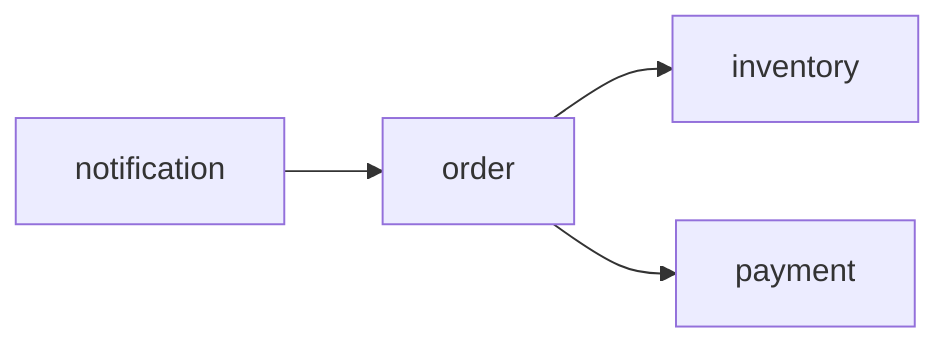
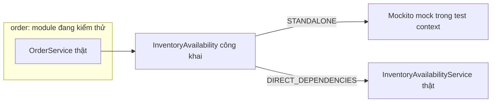

# ReplaceWithMocks và cô lập dependency module trong Spring Modulith

## 1. Vì sao cần thay dependency bằng mock?

Giả sử một ứng dụng Spring Boot được chia thành các application module `order`, `inventory`, `payment` và `notification`. Khi kiểm thử nghiệp vụ đặt hàng, module `order` có thể cần gọi API công khai của `inventory` để biết một sản phẩm còn hàng hay không. Tuy nhiên, bài kiểm thử quy tắc đặt hàng không nhất thiết phải tạo database tồn kho hoặc khởi động tất cả bean của `inventory`.

Với `@ApplicationModuleTest`, Spring Modulith có thể bootstrap **chỉ module đang kiểm thử** bằng chế độ mặc định `STANDALONE`. Nếu service của `order` cần inject một bean thuộc module ngoài phạm vi này, quá trình tạo `ApplicationContext` có thể thất bại với `UnsatisfiedDependencyException`. Ta có thể **thay dependency ngoài module bằng một Mockito mock** để tập trung kiểm tra bean thật và hành vi của `order`.

Tên **ReplaceWithMocks** trong tiêu đề bài này diễn tả *kỹ thuật thay các dependency bằng mock*. Đây **không phải** annotation `@ReplaceWithMocks`, cũng không phải thuộc tính `replaceWithMocks` của Spring Modulith. API công khai được tài liệu Spring Modulith hướng dẫn là `@MockitoBean` của Spring Test (hoặc `@MockBean` trong những phiên bản Spring Boot cũ). <https://docs.spring.io/spring-modulith/reference/testing.html>

Đây là một kỹ năng cốt lõi trong học phần **SPRING_MODULITH_VERIFICATION_TESTING**: kiểm chứng ranh giới kiến trúc bằng `ApplicationModules`, thực hành `@ApplicationModuleTest`, kiểm tra event, database và tích hợp, kết hợp quality gate CI để phát hiện phụ thuộc sai hoặc hồi quy.

Sau bài này, bạn có thể chọn đúng bean cần mock, thực hiện stubbing/verification, so sánh mock với bootstrap nhiều module, và nhận diện giới hạn của bài test dùng mock.

## 2. Mô hình phụ thuộc và phạm vi module test

Xét quan hệ phụ thuộc hợp lệ giữa các application module:



Quy ước mũi tên `A → B`: module **A phụ thuộc vào B**. `inventory` và `payment` là dependency trực tiếp của `order`; `notification` lại phụ thuộc vào `order`, nên không nằm trong cây dependency đi ra từ `order`.

Khi lớp kiểm thử nằm ở package `com.example.shop.order`, các lựa chọn phổ biến là:

| Cấu hình | Bean nghiệp vụ được nạp theo module | Cách xử lý dependency của `order` |
| --- | --- | --- |
| `@ApplicationModuleTest` | Chỉ module `order` (`STANDALONE`) | Cung cấp mock/fake cho API ngoài module nếu bean của `order` cần nó |
| `@ApplicationModuleTest(mode = DIRECT_DEPENDENCIES)` | `order`, `inventory`, `payment` | Dùng implementation thật từ dependency trực tiếp |
| `@ApplicationModuleTest(mode = ALL_DEPENDENCIES)` | `order` cùng mọi dependency trực tiếp/bắc cầu | Thử luồng phối hợp qua nhiều module |
| `STANDALONE` + `@MockitoBean` | Vẫn chỉ quét bean ứng dụng của `order`; mock được thêm vào test context | Kiểm soát phản hồi của module ngoài để thử hành vi `order` |

**Phạm vi module không đồng nghĩa với classpath.** Kiểu `InventoryAvailability` vẫn tồn tại trên classpath để `OrderService` biên dịch và nhận dependency qua constructor. Ở `STANDALONE`, implementation thuộc `inventory` thường không được component-scan; `@MockitoBean` cung cấp một bean giả đủ để Spring inject.

Ngoài bean nghiệp vụ, Spring Boot Test vẫn có thể tạo bean hạ tầng như `ApplicationEventPublisher`, transaction manager hoặc những bean từ test configuration. Việc giới hạn module không có nghĩa context chỉ có duy nhất các bean do package `order` khai báo.

## 3. `@MockitoBean` hoạt động ra sao?

Spring Framework 6.2+ cung cấp `org.springframework.test.context.bean.override.mockito.MockitoBean`. Annotation này tích hợp với Spring TestContext, dùng Mockito để đăng ký hoặc thay thế bean trong `ApplicationContext` của test:

```java
import org.springframework.test.context.bean.override.mockito.MockitoBean;

@ApplicationModuleTest
class OrderIntegrationTests {
    @MockitoBean InventoryAvailability inventory;
}
```

Có hai trường hợp khác nhau cần hiểu:

1. **Bean thật không có trong test context:** Trường hợp thường gặp với dependency ngoài module khi `STANDALONE`. `@MockitoBean` dùng chiến lược mặc định **REPLACE_OR_CREATE**, nên Spring tạo bean mock của type được khai báo rồi inject cho module đang kiểm thử.
2. **Bean thật đã có trong test context:** Ví dụ test nạp `inventory` qua `DIRECT_DEPENDENCIES`. `@MockitoBean` có thể thay bean thật bằng mock. Khi đó bài test không còn chứng minh hoạt động thực của implementation bị thay.

| Khả năng | `@MockitoBean` | `@MockitoSpyBean` | `@TestBean` |
| --- | --- | --- | --- |
| Tạo hoặc thay bean bằng Mockito mock | Có | Không; spy cần bean thật để bọc | Không dùng Mockito; dùng bean từ factory method |
| Gọi behavior thật theo mặc định | Không | Có, trừ khi stub | Tùy fake implementation |
| Phù hợp cho dependency ngoài module ở `STANDALONE` | **Có** | Thường không, vì bean thật không hiện diện | Có thể dùng để cung cấp fake |
| Dễ kiểm tra lời gọi/đối số | `then(mock).should()` | Có | Cần tự thiết kế cách quan sát |
| Rủi ro khi dùng sai | Test tự đặt sẵn kết quả nên bỏ sót lỗi implementation thật | Có thể tạo side effect từ method thật | Fake có thể lệch với hợp đồng thật |

`@MockitoBean(enforceOverride = true)` chuyển sang chiến lược **REPLACE**: bắt buộc đã có bean phù hợp trong context. Vì vậy, không dùng tùy chọn này để mock một implementation `inventory` vốn **không được nạp** trong test `order` ở `STANDALONE`.

> **Phiên bản:** `@MockitoBean` có từ Spring Framework 6.2, thường đi cùng Spring Boot 3.4+ hoặc stack mới hơn tương thích. Với Spring Boot 3.3 và các phiên bản trước đó, ví dụ có thể cần `org.springframework.boot.test.mock.mockito.MockBean`. `@MockBean` đã bị deprecated ở Spring Boot 3.4 và được thay bằng `@MockitoBean` trong các stack mới; cần theo BOM và phiên bản thực tế của dự án.

## 4. Ví dụ đầy đủ: cô lập `order` khỏi `inventory`

Ta xây dựng nghiệp vụ đơn hàng thật nhưng thay API tồn kho bằng mock. Ví dụ sử dụng Java 17+, Spring Boot/Spring Modulith tương thích, JUnit Jupiter, AssertJ và Mockito.

### 4.1. Cấu trúc ví dụ

```text
src/
├── main/java/com/example/shop/
│   ├── ShopApplication.java
│   ├── inventory/
│   │   ├── InventoryAvailability.java       # API công khai
│   │   └── InventoryAvailabilityService.java
│   ├── order/
│   │   ├── OrderService.java
│   │   └── OrderPlaced.java
│   └── payment/
└── test/java/com/example/shop/
    ├── order/
    │   ├── OrderIsolatedModuleTests.java
    │   └── OrderWithInventoryTests.java
    └── ModuleArchitectureTests.java
```

Với Maven, dependency test cần thiết của Spring Modulith:

```xml
<dependency>
    <groupId>org.springframework.modulith</groupId>
    <artifactId>spring-modulith-starter-test</artifactId>
    <scope>test</scope>
</dependency>
```

Trong project thực tế, cần có cả Spring Boot starter test và cấu hình Spring Modulith BOM tương thích, ví dụ phụ thuộc kiểm thử được quản lý bởi dependency management của ứng dụng.

Lớp cấu hình gốc `ShopApplication.java`:

```java
package com.example.shop;

import org.springframework.boot.SpringApplication;
import org.springframework.boot.autoconfigure.SpringBootApplication;

@SpringBootApplication
public class ShopApplication {
    public static void main(String[] args) {
        SpringApplication.run(ShopApplication.class, args);
    }
}
```

### 4.2. API công khai của `inventory`

File `src/main/java/com/example/shop/inventory/InventoryAvailability.java`:

```java
package com.example.shop.inventory;

public interface InventoryAvailability {
    boolean available(String sku, int quantity);
}
```

Giao diện này nằm ở **package gốc của module `inventory`**, nên là API công khai của module theo cách khai báo mặc định. Module `order` không cần import class nằm trong `inventory.internal`.

Implementation thật, dùng cho bài test tích hợp ở phần sau:

```java
package com.example.shop.inventory;

import org.springframework.stereotype.Service;

@Service
public class InventoryAvailabilityService implements InventoryAvailability {
    @Override
    public boolean available(String sku, int quantity) {
        // Minh họa bằng dữ liệu cố định, hệ thống thật thường cần repository.
        return "SKU-READY".equals(sku) && quantity <= 5;
    }
}
```

### 4.3. Bean thật thuộc module `order`

File `src/main/java/com/example/shop/order/OrderPlaced.java`:

```java
package com.example.shop.order;

import java.util.UUID;

public record OrderPlaced(UUID orderId, String sku, int quantity) {}
```

File `src/main/java/com/example/shop/order/OrderService.java`:

```java
package com.example.shop.order;

import java.util.UUID;
import com.example.shop.inventory.InventoryAvailability;
import org.springframework.context.ApplicationEventPublisher;
import org.springframework.stereotype.Service;

@Service
public class OrderService {

    private final InventoryAvailability inventory;
    private final ApplicationEventPublisher events;

    public OrderService(InventoryAvailability inventory,
                        ApplicationEventPublisher events) {
        this.inventory = inventory;
        this.events = events;
    }

    public UUID place(String sku, int quantity) {
        if (sku == null || sku.isBlank() || quantity <= 0) {
            throw new IllegalArgumentException("Invalid order request");
        }
        if (!inventory.available(sku, quantity)) {
            throw new IllegalStateException("OUT_OF_STOCK");
        }

        UUID id = UUID.randomUUID();
        events.publishEvent(new OrderPlaced(id, sku, quantity));
        return id;
    }
}
```

`OrderService` là bean thật của module `order`. Nó biết **API** `InventoryAvailability` của `inventory`, không biết implementation hay cấu hình database của module ngoài. Khi `@ApplicationModuleTest` chạy ở `STANDALONE` mà thiếu bean cung cấp `InventoryAvailability`, `OrderService` sẽ không tạo được. Đây là điểm ta chủ động bổ sung mock.

### 4.4. Module test ở `STANDALONE` dùng mock

File `src/test/java/com/example/shop/order/OrderIsolatedModuleTests.java`:

```java
package com.example.shop.order;

import static org.assertj.core.api.Assertions.assertThat;
import static org.assertj.core.api.Assertions.assertThatThrownBy;
import static org.mockito.BDDMockito.given;
import static org.mockito.BDDMockito.then;

import java.util.UUID;
import com.example.shop.inventory.InventoryAvailability;
import org.junit.jupiter.api.Test;
import org.springframework.beans.factory.annotation.Autowired;
import org.springframework.modulith.test.ApplicationModuleTest;
import org.springframework.modulith.test.PublishedEvents;
import org.springframework.test.context.bean.override.mockito.MockitoBean;

@ApplicationModuleTest // Mặc định: BootstrapMode.STANDALONE
class OrderIsolatedModuleTests {

    @Autowired OrderService orders;
    @MockitoBean InventoryAvailability inventory;

    @Test
    void acceptsOrderWhenInventorySaysAvailable(PublishedEvents events) {
        given(inventory.available("SKU-01", 2)).willReturn(true);

        UUID orderId = orders.place("SKU-01", 2);

        assertThat(orderId).isNotNull();
        assertThat(events.ofType(OrderPlaced.class)
                .matching(OrderPlaced::orderId, orderId))
                .hasSize(1);
        then(inventory).should().available("SKU-01", 2);
    }

    @Test
    void rejectsOrderWhenInventorySaysUnavailable(PublishedEvents events) {
        given(inventory.available("SKU-OUT", 1)).willReturn(false);

        assertThatThrownBy(() -> orders.place("SKU-OUT", 1))
                .isInstanceOf(IllegalStateException.class)
                .hasMessage("OUT_OF_STOCK");

        assertThat(events.ofType(OrderPlaced.class)).isEmpty();
        then(inventory).should().available("SKU-OUT", 1);
    }
}
```

**Test này chứng minh được gì?**

1. `@ApplicationModuleTest` bootstrap module `order`, inject `OrderService` **thật** và hạ tầng event của Spring.
2. `@MockitoBean` tạo mock `InventoryAvailability` bên trong test context, đủ để constructor của `OrderService` hoạt động mà không nạp `InventoryAvailabilityService` thật.
3. `given(...).willReturn(...)` định nghĩa phản hồi từ dependency bên ngoài, giúp thử chủ động cả nhánh có hàng và hết hàng.
4. `then(...).should()` kiểm tra chính xác API ngoài được gọi với SKU và số lượng mong đợi.
5. `PublishedEvents` kiểm tra một event được phát cho đơn thành công và **không phát** event khi đơn bị từ chối.

Ví dụ trên không khởi tạo repository tồn kho và không kiểm tra thuật toán tồn kho thật. Nó kiểm tra **cách module `order` phản ứng với hợp đồng** của `inventory`. Việc `inventory` cung cấp kết quả thực tế chính xác là trách nhiệm của bài test riêng cho module đó.

## 5. Khi nào mock là đúng, khi nào nên nạp dependency thật?

Một cách phân biệt thực tế là đặt câu hỏi: *Kết quả của test có cần chứng minh implementation ở module ngoài đang hoạt động đúng không?*

| Mục tiêu của bài test | Lựa chọn khuyến nghị | Bằng chứng nhận được |
| --- | --- | --- |
| Kiểm tra `order` có từ chối đơn khi API tồn kho báo hết hàng | `STANDALONE` + mock | Quy tắc xử lý của `order` và lời gọi API ngoài |
| Kiểm tra `order` gọi được service `inventory` thật | `DIRECT_DEPENDENCIES` | Tích hợp trực tiếp và wiring thực của hai module |
| Kiểm tra tồn kho dùng repository/JPA đúng | Module test của `inventory` với datasource test | Query, mapping, transaction và logic repository thật |
| Kiểm tra luồng nhiều module có dependency bắc cầu | `ALL_DEPENDENCIES` khi cần | Sự phối hợp của các module nằm trong cây phụ thuộc |
| Kiểm tra listener ở module phụ thuộc **vào** `order` | Chọn thêm module nhận event hoặc test tích hợp riêng | Kết quả xử lý event; cần assertion trạng thái hoặc `Scenario` |

Với implementation `InventoryAvailabilityService` ở phần 4, ta có thể tạo bài test dùng bean thật:

```java
package com.example.shop.order;

import static org.assertj.core.api.Assertions.assertThat;

import java.util.UUID;
import org.junit.jupiter.api.Test;
import org.springframework.beans.factory.annotation.Autowired;
import org.springframework.modulith.test.ApplicationModuleTest;
import org.springframework.modulith.test.ApplicationModuleTest.BootstrapMode;

@ApplicationModuleTest(mode = BootstrapMode.DIRECT_DEPENDENCIES)
class OrderWithInventoryTests {

    @Autowired OrderService orders;

    @Test
    void placesOrderUsingRealInventoryService() {
        UUID id = orders.place("SKU-READY", 3);
        assertThat(id).isNotNull();
    }
}
```

Trong ví dụ này không khai báo `@MockitoBean`: context được phép nạp implementation thực của dependency trực tiếp `inventory`. Nếu test này cần database, migration hoặc broker do `inventory` sử dụng, runner phải cung cấp hạ tầng tương ứng. Một bài test tích hợp như vậy kiểm chứng hợp đồng thực tốt hơn, nhưng cũng có phạm vi rộng và có thể chậm hơn.

**Đừng để mock tạo sự tự tin giả.** Nếu cả `order` và `inventory` thay đổi cách diễn giải `sku` nhưng test `order` vẫn stub câu trả lời đã chọn, test mock có thể tiếp tục xanh. Vì thế, kết hợp kiểm thử cô lập với một số bài kiểm thử API module thực hoặc contract test khi thay đổi hợp đồng.

## 6. Cô lập đúng điểm giao tiếp: API công khai, adapter và event

Mock có giá trị nhất khi nằm ở **ranh giới hợp lệ** giữa hai module. Những vị trí phù hợp thường là interface/API công khai do module khác cung cấp hoặc cổng gọi hệ thống ngoài (payment gateway, email sender, HTTP client).



Không nên mock `OrderService` rồi kết luận module `order` đã được kiểm thử nghiệp vụ: cách đó loại chính thành phần cần xác minh. Tương tự, mock repository nội bộ của `order` có thể phù hợp với test service, nhưng bài test đó không kiểm tra JPA query, entity mapping hoặc transaction thật. Nếu kiểm thử persistence là mục tiêu, phải chạy repository thật với cơ sở dữ liệu thử nghiệm.

Với giao tiếp **qua domain event**, module phát event có thể không cần biết bean nhận event thuộc module nào. `@ApplicationModuleTest` cùng `PublishedEvents` cho phép kiểm tra event đã phát mà không cần mock listener ở module ngoài. Nếu muốn kiểm tra listener bất đồng bộ đã xử lý xong, cần nạp module listener và dùng `Scenario` hoặc kiểm tra trạng thái thực; mock event listener không thay thế được kiểm thử quy trình xử lý sự kiện.

## 7. Các tình huống nâng cao của `@MockitoBean`

### 7.1. Nhiều bean cùng interface

Khi có nhiều implementation của cùng interface trong **context đang kiểm thử**, `@MockitoBean` phải tìm đúng bean cần thay. Có thể dùng `@Qualifier`, tên bean hoặc thuộc tính `name` để tránh nhầm lẫn:

```java
// Ví dụ minh họa khi trong context đã có bean tên "externalPaymentClient".
@MockitoBean(name = "externalPaymentClient")
PaymentClient externalPaymentClient;
```

Ví dụ này giả định `PaymentClient` là interface tồn tại trong dự án và có bean tương ứng. Khi không xác định rõ đối tượng bị thay, bài test có thể fail vì có nhiều candidate hoặc tạo thêm mock ngoài ý muốn. Spring Test còn sử dụng qualifier/tên field như một phần nhận diện cấu hình context; hãy đặt tên nhất quán giữa các lớp test dùng chung mock để tránh tạo nhiều context cache không cần thiết.

### 7.2. `enforceOverride = true`

```java
// Chỉ hợp lý nếu bean hiện diện trong context và ta bắt buộc phải thay nó.
@MockitoBean(enforceOverride = true)
PaymentClient paymentClient;
```

Mặc định, `@MockitoBean` có thể tạo bean nếu chưa có bean thật. `enforceOverride = true` yêu cầu bean đã tồn tại, hữu ích khi muốn phát hiện cấu hình vô tình không nạp bean định thay. **Không dùng cho một API ngoài module cố ý vắng mặt ở `STANDALONE`**: lúc đó yêu cầu enforce sẽ làm test khởi tạo thất bại đúng theo thiết kế.

### 7.3. Spy khác mock

`@MockitoSpyBean` bọc một bean thật, cho phép dùng method thật trừ khi bị stub, và yêu cầu có đúng một bean phù hợp để bọc. Trong test cần cô lập module ngoài, spy thường không phù hợp vì implementation thật không được nạp. Ngoài ra, stubbing spy bằng `when(spy.method())` có thể vô tình gọi method thật; nên dùng `doReturn(...).when(spy)...` nếu muốn tránh side effect.

### 7.4. Mock có vòng đời giữa các test

Mockito mock trong Spring Test có cơ chế reset theo cấu hình của annotation/test support; tránh phụ thuộc vào lịch sử stub hoặc số lần gọi giữa các phương thức `@Test`. Mỗi test nên tự thiết lập `given(...)`, thực thi một hành động và kiểm tra các tương tác liên quan. Đừng sử dụng biến `static` tự quản lý mock hoặc `Mockito.mock(...)` bên ngoài container rồi kỳ vọng Spring tự inject nếu chưa đăng ký bean.

## 8. Cách khác khi không muốn dùng Mockito: `@TestBean` và fake

Nếu cần một implementation giả có quy tắc ổn định, Spring Framework 6.2+ hỗ trợ `@TestBean`. Khác `@MockitoBean`, giá trị bean được tạo bởi một **factory method static**. Ví dụ trong cùng cấu trúc `order`:

```java
package com.example.shop.order;

import static org.assertj.core.api.Assertions.assertThat;

import com.example.shop.inventory.InventoryAvailability;
import org.junit.jupiter.api.Test;
import org.springframework.beans.factory.annotation.Autowired;
import org.springframework.modulith.test.ApplicationModuleTest;
import org.springframework.test.context.bean.override.convention.TestBean;

@ApplicationModuleTest
class OrderWithFakeInventoryTests {

    @Autowired OrderService orders;
    @TestBean InventoryAvailability inventory;

    static InventoryAvailability inventory() {
        return (sku, quantity) -> "SKU-FAKE".equals(sku)
                && quantity <= 10;
    }

    @Test
    void acceptsFixtureSku() {
        assertThat(orders.place("SKU-FAKE", 2)).isNotNull();
    }
}
```

Factory method trong ví dụ cùng tên với field `inventory`, trả về interface tương thích. Đây là một fake cố định, có thể phù hợp cho nhiều trường hợp test dựa trên dữ liệu mẫu. Cũng như `@MockitoBean`, `@TestBean` mặc định có thể **tạo bean khi chưa có bean tương ứng**, còn tùy chọn `enforceOverride = true` chỉ nên dùng khi chắc chắn có bean thật trong context.

Sự lựa chọn không phải “mock luôn tốt hơn fake” hay ngược lại. Mockito thuận tiện khi cần thay đổi response theo testcase và verify tương tác; fake giúp tập trung mô phỏng một tập quy tắc có thể lặp lại. Cả hai đều phải tôn trọng hợp đồng của API công khai.

## 9. Chẩn đoán lỗi khi thay dependency

| Hiện tượng | Nguyên nhân cần kiểm tra | Cách xử lý |
| --- | --- | --- |
| `UnsatisfiedDependencyException` với API từ module ngoài | Chưa cung cấp `@MockitoBean`, fake hoặc module thật không được nạp | Đặt mock đúng type trong lớp test module, hoặc chọn integration mode phù hợp |
| `@MockitoBean` không biên dịch | Spring Framework/Spring Boot quá cũ hoặc sai import | Xem version; dùng `@MockBean` nếu stack cũ hỗ trợ |
| Bean thật vẫn được gọi dù muốn mock | Mock sai type/name, inject nhầm bean, hoặc instance tạo thủ công ngoài Spring | Kiểm tra `@Qualifier`, nguồn bean và constructor injection |
| Lỗi nhiều bean cùng type | Có nhiều candidate và không xác định bean cần thay | Dùng tên bean hoặc qualifier hợp lệ |
| `enforceOverride = true` báo không có bean | Trong `STANDALONE`, bean ngoài module vốn không hiện diện | Bỏ enforce cho mock tạo mới, hoặc nạp bean thật nếu chủ đích test là thay thế |
| Mock trả `false`, `null` hoặc 0 ngoài mong đợi | Mockito trả giá trị mặc định khi chưa stub | Thiết lập `given(...)` cho đúng tham số; kiểm tra lời gọi bằng `then(...)` |
| Bài test xanh nhưng integration thực lỗi | Chỉ kiểm tra phản hồi giả định, chưa thử implementation thật | Thêm test `DIRECT_DEPENDENCIES`, contract test hoặc kiểm thử môi trường tích hợp |
| Test phụ thuộc thứ tự hoặc flaky | Mock dùng chung ngoài cơ chế Spring Test, dữ liệu/side effect chưa cô lập | Mỗi test tự stub; cô lập fixture và tránh trạng thái static chia sẻ |
| CI báo vi phạm ranh giới module | `order` gọi API nội bộ hoặc phụ thuộc bị cấm | Sửa kiến trúc và chạy `ApplicationModules.verify()`; mock không hợp thức hóa phụ thuộc |

Để kiểm tra phạm vi bootstrap, bật log Spring Modulith trong cấu hình test:

```properties
logging.level.org.springframework.modulith=DEBUG
```

Đọc log về module mục tiêu và phạm vi scanning; dùng `ApplicationContext.getBeansOfType(...)` khi cần xác nhận bean thật/giả đã được đăng ký. Lưu ý kiểu mock do Mockito tạo có thể hiện diện dù implementation thật của module khác không nằm trong context.

## 10. Mock và kiểm chứng kiến trúc trong CI

Một module test dùng mock có thể chạy xanh khi behavior của module đang thử đúng với response giả lập. Tuy vậy, nó **không** kiểm chứng toàn bộ các quy tắc phụ thuộc hay độ chính xác của implementation module ngoài. Nên có một bài test kiến trúc độc lập:

```java
package com.example.shop;

import org.junit.jupiter.api.Test;
import org.springframework.modulith.core.ApplicationModules;

class ModuleArchitectureTests {

    @Test
    void checksModuleDependencyRules() {
        ApplicationModules.of(ShopApplication.class).verify();
    }
}
```

`ApplicationModules.verify()` phát hiện ràng buộc module bị vi phạm, ví dụ phụ thuộc vào package nội bộ không được công khai. `@ApplicationModuleTest` hiện cũng mặc định bật `verifyAutomatically = true`, nhưng bài test độc lập tạo **quality gate rõ ràng** dù pipeline chọn lọc chỉ chạy một số module test.

Một chuỗi kiểm chứng CI cân bằng có thể gồm:

1. **Architecture test:** xác minh ranh giới `ApplicationModules` và quy tắc dependency.
2. **Module integration test cô lập:** `STANDALONE` cùng `@MockitoBean` cho API module ngoài; kiểm tra nhánh nghiệp vụ, đối số gọi API và event phát ra.
3. **Test implementation của module phụ thuộc:** xác minh logic `inventory`, repository và transaction thật với dữ liệu thử nghiệm.
4. **Một số integration test xuyên module:** `DIRECT_DEPENDENCIES` hoặc `ALL_DEPENDENCIES` cho các luồng quan trọng; dùng database, broker/Testcontainers nếu cần.

Với Maven/Gradle, các bài JUnit có thể chạy trong CI bằng `./mvnw test` hoặc `./gradlew test` tùy dự án. Nếu một bài kiểm tra ranh giới hoặc hành vi quan trọng thất bại, quality gate cần chặn build. **Không mở rộng toàn bộ module test để chữa lỗi bean thiếu** mà chưa xem nguyên nhân và phạm vi nghiệp vụ cần kiểm chứng.

## 11. Bài tập thực hành

1. Với đồ thị `order → inventory`, đặt test trong `com.example.shop.order`. Thử chạy `@ApplicationModuleTest` khi `OrderService` cần `InventoryAvailability` nhưng chưa khai báo mock. Đọc root cause lỗi khởi tạo context.
2. Bổ sung `@MockitoBean InventoryAvailability`. Viết các testcase hàng có sẵn, hết hàng và dữ liệu đầu vào không hợp lệ; kiểm tra tương tác `available(sku, quantity)` và số event `OrderPlaced`.
3. Thay `@MockitoBean` thành `@TestBean` cung cấp fake tồn kho; nhận xét khác biệt về stubbing và verification.
4. Bật `@MockitoBean(enforceOverride = true)` trong test `STANDALONE`, rồi giải thích vì sao nó thất bại khi implementation nằm trong module ngoài không được nạp.
5. Chạy `DIRECT_DEPENDENCIES` và bỏ mock để sử dụng implementation thật `InventoryAvailabilityService`; so sánh phạm vi test và lỗi có thể phát hiện.
6. Cho một service `order` phụ thuộc vào class thuộc `inventory.internal`. Dù mock làm test chạy xanh, dùng `ApplicationModules.verify()` để kiểm tra tính hợp lệ của quan hệ đó.
7. Bổ sung repository JPA cho `inventory`, dùng database test và giải thích loại lỗi nào bài mock ở `order` không thể bắt được.

**Ghi nhớ:** “ReplaceWithMocks” là kỹ thuật **cung cấp mock tại ranh giới module**, không phải tên API Spring Modulith. Kết hợp `@ApplicationModuleTest` ở `STANDALONE` với `@MockitoBean` để kiểm tra hành vi của module mục tiêu mà không phải nạp implementation dependency ngoài. Chọn `DIRECT_DEPENDENCIES` hoặc các bài kiểm thử tích hợp riêng khi cần bean thật, và luôn dùng `ApplicationModules.verify()` cùng các quality gate CI để bảo vệ ranh giới kiến trúc.

### Tài liệu tham khảo

- [Spring Modulith Reference — Integration Testing Application Modules, Dealing with Efferent Dependencies](https://docs.spring.io/spring-modulith/reference/testing.html)
- [Spring Modulith Javadoc — `ApplicationModuleTest`](https://docs.spring.io/spring-modulith/docs/current/api/org/springframework/modulith/test/ApplicationModuleTest.html)
- [Spring Framework Reference — `@MockitoBean` and `@MockitoSpyBean`](https://docs.spring.io/spring-framework/reference/testing/annotations/integration-spring/annotation-mockitobean.html)
- [Spring Framework Reference — `@TestBean`](https://docs.spring.io/spring-framework/reference/testing/annotations/integration-spring/annotation-testbean.html)
- [Spring Modulith Reference — Verifying Application Module Structure](https://docs.spring.io/spring-modulith/reference/verification.html)
