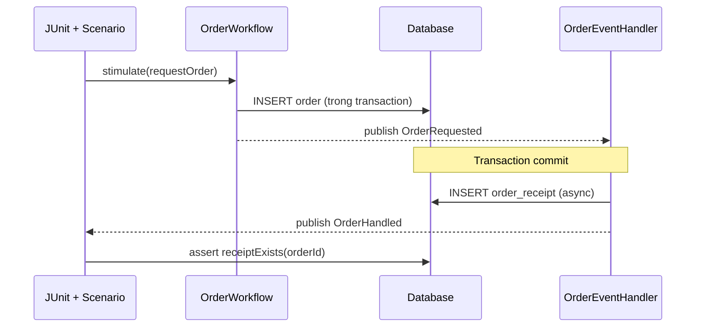
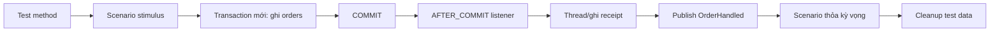
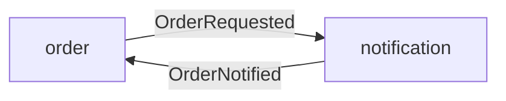

# ScenarioTestBootstrapper và kiểm thử event flow trong Spring Modulith

## 1. Vì sao cần kiểm thử cả một luồng sự kiện?

Trong ứng dụng Spring Modulith, một use case có thể phát domain event để một thành phần khác xử lý sau. Ví dụ `order` nhận yêu cầu đặt hàng, ghi dữ liệu và phát `OrderRequested`; listener tiếp nhận event sau khi transaction commit, xử lý nghiệp vụ rồi phát `OrderHandled`. Việc kiểm tra duy nhất `OrderRequested` đã được phát **chưa đủ** chứng minh listener đã chạy hay cập nhật dữ liệu đúng, đặc biệt khi xử lý bất đồng bộ.

Tên **ScenarioTestBootstrapper** trong đề bài mô tả nhu cầu *khởi tạo bài kiểm thử dựa trên kịch bản sự kiện*. Trong API công khai của Spring Modulith, không có annotation hoặc bootstrap mode chuẩn tên `@ScenarioTestBootstrapper`. Công cụ được tài liệu và Javadoc công bố là **`org.springframework.modulith.test.Scenario`**, một DSL dùng làm tham số của phương thức JUnit khi lớp test có `@ApplicationModuleTest`. `Scenario` giúp khai báo **tác nhân khởi phát (stimulus) → điều kiện mong đợi → chờ đợi → assertion → dọn dữ liệu**.

Bài thuộc chương **ApplicationModuleTest** của học phần **SPRING_MODULITH_VERIFICATION_TESTING**: rèn kỹ năng xác minh ranh giới module qua `ApplicationModules`, kiểm thử `@ApplicationModuleTest`, event, database và tích hợp, kết hợp quality gate CI để ngăn phụ thuộc sai và hồi quy.

Sau bài học, bạn có thể:

- Phân biệt `PublishedEvents` với `Scenario` và chọn công cụ theo mục tiêu kiểm thử.
- Viết `scenario.publish(...)` và `scenario.stimulate(...)`, chờ event đúng ID hoặc chờ trạng thái database thay đổi.
- Hiểu tác động của **transaction mới** lên `@TransactionalEventListener`, listener bất đồng bộ và rollback của test.
- Đặt timeout, kiểm chứng trường hợp không có event, dọn dữ liệu và chẩn đoán test chờ quá hạn.
- Chọn phạm vi module phù hợp cho luồng event xuyên module và đưa kiểm chứng vào CI.

## 2. Ba khái niệm thường bị nhầm

| Khái niệm | API chính thức | Kiểm chứng điều gì? |
| --- | --- | --- |
| **Bootstrap module** | `@ApplicationModuleTest` cùng `BootstrapMode` | Bean nào thuộc module mục tiêu và các dependency được khởi tạo trong context? |
| **Ghi nhận event đã phát** | `PublishedEvents`/`AssertablePublishedEvents` | Event có được publish trong quá trình test, với nội dung mong đợi không? |
| **Kiểm thử event flow** | `Scenario` | Sau một hành động/event đầu vào, event kết quả hoặc trạng thái mong đợi có xuất hiện **trong thời hạn chờ** không? |

`Scenario` **không thay thế** `@ApplicationModuleTest`: bài test vẫn phải có application context, listener và transaction manager cần thiết. `Scenario` cũng **không tự tạo** database, message broker hay các module ngoài phạm vi đã chọn.

Một luồng đơn giản:



Để sơ đồ đúng trong môi trường thực, listener phải được nạp, cơ chế event phải được cấu hình và transaction phải commit; các phần sau triển khai chi tiết các điều kiện đó.

## 3. Cấu trúc một kịch bản `Scenario`

Spring Modulith cho phép inject `Scenario` trực tiếp vào tham số phương thức `@Test`:

```java
package com.example.shop.order;

import org.junit.jupiter.api.Test;
import org.springframework.modulith.test.ApplicationModuleTest;
import org.springframework.modulith.test.Scenario;

@ApplicationModuleTest
class OrderEventFlowTests {

    @Test
    void eventFlow(Scenario scenario) {
        // Khai báo stimulus, kết quả mong đợi và bước verify ở đây.
    }
}
```

Quy trình chung có bốn phần:

1. **Stimulus:** `scenario.publish(event)` để phát một event đầu vào, hoặc `scenario.stimulate(() -> service.method())` để thực thi một use case thực tế.
2. **Tùy biến thực thi:** đặt timeout qua `andWaitAtMost(Duration)` hoặc cấu hình Awaitility chi tiết qua `customize(...)`; tùy chọn `andCleanup(...)` để dọn dữ liệu sau khi Scenario kết thúc.
3. **Kỳ vọng:** `andWaitForEventOfType(Event.class)`/`forEventOfType(...)` để chờ event, hoặc `andWaitForStateChange(...)`/`forStateChange(...)` để quan sát state.
4. **Kết thúc và xác minh:** `toArriveAndVerify(...)`, `toArrive()`, `andVerify(...)` hoặc `notToArrive()` tùy loại kỳ vọng. Việc chạy thực sự bắt đầu khi gọi phương thức kết thúc thích hợp.

Ví dụ rút gọn để đọc cấu trúc (các type nghiệp vụ sẽ được định nghĩa trong phần thực hành):

```java
scenario.stimulate(() -> workflow.request(orderId, "SKU-01"))
        .andWaitAtMost(Duration.ofSeconds(5))
        .forEventOfType(OrderHandled.class)
        .matching(event -> event.orderId().equals(orderId))
        .toArriveAndVerify(event -> {
            assertThat(event.sku()).isEqualTo("SKU-01");
        });
```

Điểm quan trọng là predicate `matching(...)` phải ràng buộc **correlation ID** (`orderId`) của kịch bản. Nếu chỉ chờ `OrderHandled.class`, một event từ test hoặc xử lý khác có thể khiến bài kiểm thử xanh sai.

## 4. Chuẩn bị ví dụ chạy được: JDBC, transaction và listener bất đồng bộ

Để quan sát rõ luồng *event → transaction commit → listener → dữ liệu → event kết quả*, ví dụ sử dụng **một module `order`** và database H2 dành cho test. Việc đặt listener cùng module giúp demo chạy trong `STANDALONE`; chuyển listener sang module khác sẽ được bàn ở phần 9.

Giả định môi trường: Java 17+, Spring Boot 3.x, Spring Modulith 1.x tương thích, JUnit Jupiter, AssertJ. Với Spring Boot 4/Spring Modulith 2.x, cần đối chiếu BOM, starter và Javadoc của stack thực tế trước khi sao chép dependency.

### 4.1. Cấu trúc mã nguồn

```text
src/
├── main/java/com/example/shop/
│   ├── ShopApplication.java
│   └── order/
│       ├── OrderRequested.java
│       ├── OrderHandled.java
│       ├── OrderWorkflow.java
│       ├── OrderReadModel.java
│       └── internal/
│           ├── OrderAsyncConfiguration.java
│           └── OrderEventHandler.java
└── test/
    ├── java/com/example/shop/order/OrderEventFlowTests.java
    └── resources/schema.sql
```

Với cấu trúc module mặc định, `order.internal` là package con nội bộ **trong module `order`**, không phải một module độc lập.

### 4.2. Dependency cần có

Một phần các dependency Maven của ví dụ (phiên bản được quản lý bởi BOM tương thích):

```xml
<dependency>
    <groupId>org.springframework.boot</groupId>
    <artifactId>spring-boot-starter-jdbc</artifactId>
</dependency>
<dependency>
    <groupId>com.h2database</groupId>
    <artifactId>h2</artifactId>
    <scope>test</scope>
</dependency>
<dependency>
    <groupId>org.springframework.boot</groupId>
    <artifactId>spring-boot-starter-test</artifactId>
    <scope>test</scope>
</dependency>
<dependency>
    <groupId>org.springframework.modulith</groupId>
    <artifactId>spring-modulith-starter-test</artifactId>
    <scope>test</scope>
</dependency>
```

`spring-boot-starter-jdbc` cùng H2 cung cấp `JdbcTemplate`, datasource và transaction manager phù hợp cho demo. `Scenario` dùng cơ chế transaction; vì vậy ví dụ có một database test thật và không phụ thuộc vào một transaction manager giả định không tồn tại. Với dự án Spring Data JPA, có thể dùng transaction manager và repository do stack JPA cấu hình, kèm migration/schema thích hợp.

File `src/test/resources/schema.sql`:

```sql
CREATE TABLE orders (
    order_id VARCHAR(36) PRIMARY KEY,
    sku VARCHAR(80) NOT NULL
);

CREATE TABLE order_receipts (
    order_id VARCHAR(36) PRIMARY KEY,
    sku VARCHAR(80) NOT NULL
);
```

Trong ví dụ mặc định với một datasource H2 nhúng và Spring Boot SQL initialization, `schema.sql` được nạp khi context test khởi tạo. Nếu dự án tắt SQL initialization hoặc dùng datasource ngoài, cần cấu hình `spring.sql.init.mode`, migration và dọn schema theo môi trường tương ứng.

### 4.3. Application configuration và event type

File `ShopApplication.java`:

```java
package com.example.shop;

import org.springframework.boot.SpringApplication;
import org.springframework.boot.autoconfigure.SpringBootApplication;

@SpringBootApplication
public class ShopApplication {
    public static void main(String[] args) {
        SpringApplication.run(ShopApplication.class, args);
    }
}
```

File `OrderRequested.java`:

```java
package com.example.shop.order;

import java.util.UUID;

public record OrderRequested(UUID orderId, String sku) {}
```

File `OrderHandled.java`:

```java
package com.example.shop.order;

import java.util.UUID;

public record OrderHandled(UUID orderId, String sku) {}
```

Hai event đều mang `orderId` làm correlation ID để tránh nhầm với event từ đơn hàng khác.

### 4.4. Use case ghi dữ liệu và phát event

File `OrderWorkflow.java`:

```java
package com.example.shop.order;

import java.util.UUID;
import org.springframework.context.ApplicationEventPublisher;
import org.springframework.jdbc.core.JdbcTemplate;
import org.springframework.stereotype.Service;
import org.springframework.transaction.annotation.Transactional;

@Service
public class OrderWorkflow {

    private final JdbcTemplate jdbc;
    private final ApplicationEventPublisher events;

    public OrderWorkflow(JdbcTemplate jdbc, ApplicationEventPublisher events) {
        this.jdbc = jdbc;
        this.events = events;
    }

    @Transactional
    public void request(UUID orderId, String sku) {
        if (sku == null || sku.isBlank()) {
            throw new IllegalArgumentException("SKU must not be blank");
        }
        jdbc.update("INSERT INTO orders(order_id, sku) VALUES (?, ?)",
                orderId.toString(), sku);
        events.publishEvent(new OrderRequested(orderId, sku));
    }
}
```

`@Transactional` bảo đảm ghi đơn hàng và phát event trong cùng lượt xử lý giao dịch. Listener sử dụng `@TransactionalEventListener(AFTER_COMMIT)` sẽ được kích hoạt **sau khi giao dịch thành công**; nếu transaction rollback, listener kiểu này không được gọi theo đường xử lý sau commit.

### 4.5. Listener xử lý sau commit trên luồng khác

File `order/internal/OrderAsyncConfiguration.java`:

```java
package com.example.shop.order.internal;

import org.springframework.context.annotation.Configuration;
import org.springframework.scheduling.annotation.EnableAsync;

@Configuration
@EnableAsync
class OrderAsyncConfiguration {}
```

File `order/internal/OrderEventHandler.java`:

```java
package com.example.shop.order.internal;

import com.example.shop.order.OrderHandled;
import com.example.shop.order.OrderRequested;
import org.springframework.context.ApplicationEventPublisher;
import org.springframework.jdbc.core.JdbcTemplate;
import org.springframework.scheduling.annotation.Async;
import org.springframework.stereotype.Component;
import org.springframework.transaction.event.TransactionPhase;
import org.springframework.transaction.event.TransactionalEventListener;

@Component
class OrderEventHandler {

    private final JdbcTemplate jdbc;
    private final ApplicationEventPublisher events;

    OrderEventHandler(JdbcTemplate jdbc, ApplicationEventPublisher events) {
        this.jdbc = jdbc;
        this.events = events;
    }

    @Async
    @TransactionalEventListener(phase = TransactionPhase.AFTER_COMMIT)
    public void on(OrderRequested event) {
        jdbc.update("INSERT INTO order_receipts(order_id, sku) VALUES (?, ?)",
                event.orderId().toString(), event.sku());
        events.publishEvent(new OrderHandled(event.orderId(), event.sku()));
    }
}
```

Đây là **listener thuộc chính module `order`** để ví dụ tập trung vào cơ chế `Scenario`. `@EnableAsync` cho phép `@Async` thực thi sau commit trên executor; trong hệ thống thật nên cấu hình executor có giới hạn tài nguyên, giám sát lỗi và cơ chế xử lý lại khi cần. Đoạn listener ghi dữ liệu trước khi publish event kết quả, nên khi `OrderHandled` xuất hiện, bài test có thể kiểm tra bản ghi receipt đã tồn tại.

### 4.6. Read model dùng để quan sát trạng thái

File `OrderReadModel.java`:

```java
package com.example.shop.order;

import java.util.UUID;
import org.springframework.jdbc.core.JdbcTemplate;
import org.springframework.stereotype.Service;

@Service
public class OrderReadModel {

    private final JdbcTemplate jdbc;

    public OrderReadModel(JdbcTemplate jdbc) {
        this.jdbc = jdbc;
    }

    public boolean hasReceipt(UUID orderId) {
        Integer count = jdbc.queryForObject(
                "SELECT COUNT(*) FROM order_receipts WHERE order_id = ?",
                Integer.class, orderId.toString());
        return count != null && count > 0;
    }
}
```

`hasReceipt(...)` trả về `boolean`, phù hợp với tiêu chí state change: `Scenario` coi `true` là kết quả đủ để kết thúc chờ. Trong code production, read model có thể dùng repository, projection hoặc API truy vấn riêng.

## 5. Bài test 1: chờ event kết quả và kiểm tra payload

File `src/test/java/com/example/shop/order/OrderEventFlowTests.java`:

```java
package com.example.shop.order;

import static org.assertj.core.api.Assertions.assertThat;

import java.time.Duration;
import java.util.UUID;
import org.junit.jupiter.api.Test;
import org.springframework.beans.factory.annotation.Autowired;
import org.springframework.jdbc.core.JdbcTemplate;
import org.springframework.modulith.test.ApplicationModuleTest;
import org.springframework.modulith.test.Scenario;

@ApplicationModuleTest
class OrderEventFlowTests {

    @Autowired OrderWorkflow workflow;
    @Autowired OrderReadModel readModel;
    @Autowired JdbcTemplate jdbc;

    private void deleteOrder(UUID orderId) {
        jdbc.update("DELETE FROM order_receipts WHERE order_id = ?", orderId.toString());
        jdbc.update("DELETE FROM orders WHERE order_id = ?", orderId.toString());
    }

    @Test
    void waitsForHandledEventAndVerifiesDatabase(Scenario scenario) {
        UUID orderId = UUID.randomUUID();

        scenario.stimulate(() -> workflow.request(orderId, "SKU-01"))
                .andCleanup(() -> deleteOrder(orderId))
                .andWaitAtMost(Duration.ofSeconds(5))
                .forEventOfType(OrderHandled.class)
                .matching(event -> event.orderId().equals(orderId))
                .toArriveAndVerify(event -> {
                    assertThat(event.sku()).isEqualTo("SKU-01");
                    assertThat(readModel.hasReceipt(orderId)).isTrue();
                });
    }

    @Test
    void waitsForDatabaseStateChange(Scenario scenario) {
        UUID orderId = UUID.randomUUID();

        scenario.stimulate(() -> workflow.request(orderId, "SKU-02"))
                .andCleanup(() -> deleteOrder(orderId))
                .andWaitAtMost(Duration.ofSeconds(5))
                .forStateChange(() -> readModel.hasReceipt(orderId))
                .andVerify(found -> assertThat(found).isTrue());
    }
}
```

Hai test dùng chung lớp vì đều kiểm chứng **module `order`** nhưng có hai loại tiêu chí hoàn thành khác nhau:

1. `waitsForHandledEventAndVerifiesDatabase`: `stimulate(...)` gọi use case thật trong transaction do `Scenario` điều phối, chờ `OrderHandled` có đúng `orderId`, rồi xác nhận payload và dữ liệu đã ghi.
2. `waitsForDatabaseStateChange`: không cần event kết quả; poll `readModel.hasReceipt(orderId)` cho đến khi trả về `true` trong thời hạn chờ.

`andCleanup(...)` xóa bản ghi theo đúng `orderId` sau khi scenario kết thúc, giúp các lần chạy không phụ thuộc vào dữ liệu từ test trước. Khi triển khai thật, cleanup cần bao phủ đầy đủ dữ liệu phát sinh, kể cả publication log hoặc bảng liên quan; với luồng có khả năng xử lý trễ sau timeout, cần cô lập test database hoặc chặn/dọn tác vụ còn chạy trước khi kết thúc toàn bộ test suite.

**Tại sao không dùng `Thread.sleep(1000)`?** Thời gian xử lý bất đồng bộ trên CI khác máy cá nhân. `Scenario` dùng điều kiện hoàn thành cụ thể với timeout, cho phép test thành công ngay khi có bằng chứng, và thất bại rõ ràng khi điều kiện không đạt trong giới hạn đã đặt.

## 6. `publish(...)` và `stimulate(...)`: hai cách khởi phát khác nhau

| API | Hành động | Trường hợp phù hợp |
| --- | --- | --- |
| `scenario.publish(new OrderRequested(...))` | Phát trực tiếp event đầu vào trong transaction do Scenario quản lý | Tập trung kiểm tra **listener phản ứng với event** |
| `scenario.stimulate(() -> workflow.request(...))` | Gọi bean/use case thật; có thể phát nhiều event trong quá trình xử lý | Kiểm tra **chuỗi từ nghiệp vụ khởi phát đến kết quả cuối** |
| `scenario.stimulate(() -> service.methodReturningValue())` | Gọi use case và giữ giá trị trả về cho các bước verify phù hợp | Kiểm tra cả kết quả lời gọi và hệ quả sự kiện/trạng thái |

Ví dụ chỉ kiểm tra listener, không đi qua `OrderWorkflow`:

```java
@Test
void handlerReactstoPublishedRequest(Scenario scenario) {
    UUID id = UUID.randomUUID();

    scenario.publish(new OrderRequested(id, "SKU-03"))
            .andCleanup(() -> deleteOrder(id))
            .andWaitForEventOfType(OrderHandled.class)
            .matching(event -> event.orderId().equals(id))
            .toArriveAndVerify(event ->
                    assertThat(event.sku()).isEqualTo("SKU-03"));
}
```

Đoạn này là **phương thức bổ sung vào cùng lớp `OrderEventFlowTests`** ở phần 5, vì nó dùng `deleteOrder(...)` và bean đã có trong lớp đó. `OrderEventHandler` chỉ ghi bảng `order_receipts` nên việc không có dòng trong `orders` không gây lỗi với schema minh họa. Trong ứng dụng có khóa ngoại hoặc quy tắc dữ liệu khác, cần thiết lập fixture phù hợp trước khi phát event trực tiếp.

Khi mục tiêu là chứng minh cả quy tắc nghiệp vụ tạo đơn hàng, hãy dùng `stimulate(...)` thay vì bỏ qua use case bằng `publish(...)`.

## 7. Kiểm thử trường hợp không phát event và kiểm soát timeout

`Scenario` hỗ trợ kết thúc bằng `notToArrive()` để khẳng định **không xuất hiện event phù hợp trong khoảng chờ**. Đây là kiểm thử ranh giới thời gian, không phải bằng chứng event sẽ không bao giờ xuất hiện sau đó.

Ví dụ minh họa một quy tắc nghiệp vụ giả định: event `OrderHandled` không được phát khi request bị bộ lọc cố ý loại bỏ. Đoạn code sau chỉ chạy sau khi ứng dụng có **nhánh nghiệp vụ thật sự bỏ qua request**; ví dụ listener ở phần 4 luôn xử lý mọi `OrderRequested`, nên không thể dùng nguyên đoạn này với listener đó:

```java
scenario.publish(new OrderRequested(orderId, "SKU-BLOCKED"))
        .andWaitAtMost(Duration.ofSeconds(1))
        .forEventOfType(OrderHandled.class)
        .matching(event -> event.orderId().equals(orderId))
        .notToArrive();
```

Nếu muốn chứng minh không phát event sau một request bị từ chối **trước khi publish**, có thể dùng `PublishedEvents` cùng assertion về exception của use case, thay vì biến một exception đầu vào thành một kịch bản chờ vô nghĩa.

Chọn timeout dựa trên đặc tính của hệ thống và hạ tầng test: thời hạn quá ngắn tạo test flaky; quá dài làm pipeline chậm khi có lỗi. `andWaitAtMost(Duration)` đặt giới hạn riêng cho scenario, còn `customize(...)` cho phép cấu hình điều kiện Awaitility chi tiết. Trong dự án có nhiều scenario, có thể khai báo `ScenarioCustomizer` trên JUnit extension để đặt chính sách mặc định thống nhất, sau đó chỉ override những trường hợp thực sự khác biệt.

## 8. Transaction, rollback và dữ liệu test: điểm quan trọng nhất

Spring Modulith thực hiện stimulus của `Scenario` **trong một transaction mới** để kích hoạt các transactional event listener. Điều này có các hệ quả:

- `@TransactionalEventListener(phase = AFTER_COMMIT)` được kích hoạt khi transaction của stimulus **commit thành công**; nếu rollback, listener AFTER_COMMIT không chạy theo đường thông thường.
- `@Async` có thể khiến listener chạy ở một thread khác; transaction context của thread gốc **không tự truyền** sang thread mới. Nếu listener cần nhiều câu lệnh ghi có tính nguyên tử, hãy tạo transaction riêng cho phần xử lý đó.
- Dữ liệu được ghi trong transaction của `Scenario` **không được tự động rollback bởi transaction của phương thức JUnit test**, ngay cả khi lớp test được gắn `@Transactional`. Tài liệu khuyên dùng `andCleanup(...)` để dọn những thay đổi đã commit.
- Việc dùng H2 hay Testcontainers phải đáp ứng schema, khóa ngoại, isolation và listener transaction của ứng dụng; chỉ có annotation test là chưa đủ để database tự xuất hiện.



**Lỗi thường gặp:** ghi dữ liệu test trong transaction của phương thức `@Test`, rồi chờ listener `AFTER_COMMIT` mà transaction chưa commit. Listener không được kích hoạt đúng như kỳ vọng, test chờ đến timeout. Dùng `Scenario.stimulate(...)` hoặc `Scenario.publish(...)` để stimulus có transaction riêng và hoàn tất trước bước chờ; đồng thời tránh dựa vào rollback tự động của test.

Một failure khác xảy ra khi listener ném exception trên executor bất đồng bộ: event kết quả không được phát và scenario báo timeout. Khi đó cần kiểm tra log executor, exception handler, transaction commit và SQL statement của listener, không chỉ tăng timeout.

## 9. Event flow xuyên module và giới hạn bootstrap

Trong ứng dụng thật, listener thường nằm ở **module khác**. Giả sử `order` phát `OrderRequested`, còn module `notification` nhận event và phát `OrderNotified`:



Nếu lớp test nằm trong package `order` và chỉ dùng `@ApplicationModuleTest` mặc định, bootstrap mode là **`STANDALONE`**, nên listener ở `notification` không được khởi tạo. `Scenario` không tự động nạp module nhận event. Muốn kiểm thử **việc phát event từ `order`** thì `PublishedEvents` có thể là đủ; muốn kiểm thử **listener `notification` thực sự xử lý**, phải đưa module chứa listener vào context hoặc viết một bài test khác đặt ngay trong module đó.

Ví dụ nạp thêm module `notification` theo tên logic:

```java
package com.example.shop.order;

import org.springframework.modulith.test.ApplicationModuleTest;
import org.springframework.modulith.test.Scenario;

@ApplicationModuleTest(extraIncludes = "notification")
class OrderNotificationFlowTests {
    // @Test(Scenario scenario) với stimulus và kỳ vọng OrderNotified.
}
```

`extraIncludes = "notification"` giả định mô hình ứng dụng thật có module tên logic `notification`. Ở chiều `notification → order` (notification tham chiếu API/event của order), việc chọn `ALL_DEPENDENCIES` trên test thuộc `order` **không tự thêm** `notification`, vì đó là chiều phụ thuộc ngược. Nếu phụ thuộc trực tiếp hợp lệ từ module mục tiêu sang module listener, `DIRECT_DEPENDENCIES` có thể phù hợp; nếu không, cần `extraIncludes` hoặc bài test tích hợp riêng.

Một lựa chọn khác là đặt bài test trong package `notification` và dùng `scenario.publish(new OrderRequested(...))` để kiểm tra **hành vi riêng** của listener thông qua public event contract. Khi đó có thể cần bootstrap dependency hợp lệ, datasource và các cấu hình adapter mà listener sử dụng. Tránh gọi thẳng vào class nằm trong `order.internal` hoặc `notification.internal` từ module khác để sửa lỗi test.

**Chọn ranh giới theo câu hỏi cần trả lời:** event source có phát đúng không, consumer có xử lý đúng không, hay chuỗi tích hợp có hoàn tất không. Mỗi câu hỏi có phạm vi test riêng và tiêu chí assertion phù hợp.

## 10. So sánh `PublishedEvents`, `Scenario` và integration test qua broker

| Mục tiêu | Công cụ thích hợp | Giới hạn cần nhớ |
| --- | --- | --- |
| Xác minh event nguồn được publish đúng loại/ID | `PublishedEvents` trong `@ApplicationModuleTest` | Chưa chứng minh consumer xử lý |
| Chờ event kết quả từ listener bất đồng bộ | `Scenario` + `andWaitForEventOfType(...)` | Listener phải được nạp; event kết quả phải thực sự được publish |
| Chờ thay đổi database/trạng thái đọc được | `Scenario` + `andWaitForStateChange(...)` | Cần transaction, datasource và cách cô lập fixture đúng |
| Xác minh không xuất hiện event trong khoảng ngắn | `Scenario` + `notToArrive()` | Chỉ khẳng định trong timeout; không bảo đảm vắng mặt mãi mãi |
| Xác minh broker/Kafka/RabbitMQ thực, retry, serialization | Test tích hợp với hạ tầng thật hoặc Testcontainers | Scenario trong Spring context không tự thay thế kiểm thử network/broker |
| Kiểm tra ranh giới và phụ thuộc giữa module | `ApplicationModules.verify()` | Là kiểm chứng cấu trúc, không kiểm chứng trạng thái runtime của event flow |

Khi ứng dụng dùng event publication registry của Spring Modulith hoặc externalization ra message broker, cần test riêng cả **độ bền của publication**, retry/idempotency và hợp đồng message. Một bài `Scenario` chạy xanh trong context chỉ chứng minh các tiêu chí mà nó đã quan sát được trong môi trường test.

## 11. Chẩn đoán lỗi `Scenario` và giảm flaky test

| Triệu chứng | Nguyên nhân có thể | Cách kiểm tra và sửa |
| --- | --- | --- |
| JUnit không inject được `Scenario` | Thiếu Modulith test starter/extension, test không dùng `@ApplicationModuleTest` | Kiểm tra dependency, import `org.springframework.modulith.test.Scenario`, annotation và bản framework |
| Context lỗi thiếu transaction manager | Không cấu hình JDBC/JPA transaction infrastructure | Cung cấp datasource/transaction manager phù hợp; `Scenario` cần transaction cho stimulus |
| `@TransactionalEventListener` không chạy | Event phát không trong transaction hoặc chưa commit | Dùng `Scenario.publish`/`stimulate`; đọc log transaction và phase listener |
| Scenario timeout dù có event khác | `matching(...)` sai correlation ID, loại event không đúng | Log event, kiểm tra payload/ID và thứ tự publish |
| Listener không chạy trong `STANDALONE` | Listener thuộc application module khác không được bootstrap | Chọn `extraIncludes`, mode hợp lệ hoặc test trong module consumer |
| CI flaky | `Thread.sleep`, timeout quá thấp, executor quá tải, dữ liệu từ test trước | Dùng chờ theo điều kiện, timeout hợp lý và fixture riêng theo UUID |
| Database còn dữ liệu sau test | Stimulus commit trong transaction mới | Dùng `andCleanup`, xóa các bảng liên quan hoặc dùng database cô lập |
| Listener throw exception nhưng test chỉ timeout | Lỗi async không được đưa vào thread JUnit | Kiểm tra executor exception handler/log và thêm assertion về trạng thái/error event |
| Test xanh nhưng broker thực lỗi | Chỉ kiểm chứng event trong context | Bổ sung integration test qua broker thật/Testcontainers |
| CI báo vi phạm module | Consumer phụ thuộc sai API nội bộ hoặc quy tắc module | Sửa cấu trúc dependency, không chữa bằng timeout hoặc mode rộng hơn |

Để quan sát module bootstrap, bật:

```properties
logging.level.org.springframework.modulith=DEBUG
```

Khi điều tra async listener, bật log có chọn lọc cho package nghiệp vụ/transaction, ghi correlation ID nhưng không log dữ liệu nhạy cảm. Với một scenario timeout, cần biết **stimulus đã chạy chưa**, **transaction đã commit chưa**, **listener có được đăng ký không**, **listener có ném lỗi không**, rồi mới đánh giá điều kiện chờ.

## 12. Bảo vệ event flow và kiến trúc trong CI

Bộ kiểm thử event flow nên bao gồm ít nhất: một test cho event nguồn đúng hợp đồng, một test listener thành công (event kết quả hoặc trạng thái bền vững), một test cho nhánh lỗi quan trọng, và một bài xác minh ranh giới module. Bài kiến trúc có thể viết:

```java
package com.example.shop;

import org.junit.jupiter.api.Test;
import org.springframework.modulith.core.ApplicationModules;

class ModuleArchitectureTests {

    @Test
    void moduleDependenciesAreValid() {
        ApplicationModules.of(ShopApplication.class).verify();
    }
}
```

`ApplicationModules.verify()` kiểm tra quy tắc phụ thuộc và ranh giới module ở mức cấu trúc. `@ApplicationModuleTest` cũng có khả năng xác minh kiến trúc mặc định qua `verifyAutomatically`, nhưng bài riêng giúp CI báo lỗi kiến trúc rõ ràng ngay cả khi chỉ chọn một nhóm integration test.

Với Maven/Gradle, chạy các bài JUnit qua stage test phù hợp; khi test event flow cần H2 hoặc Testcontainers, bảo đảm runner đã có datasource, schema và tài nguyên thích hợp. Nên giới hạn độ dài timeout, áp dụng correlation ID riêng từng test, cô lập dữ liệu và kiểm tra các lỗi async để tránh pipeline xanh sai hoặc treo lâu. Nếu chạy song song, đảm bảo các fixture không dùng chung khóa và không tranh chấp executor/broker không kiểm soát được.

## 13. Bài tập tự thực hành

1. Chạy ví dụ ở phần 4 và xác minh rằng event `OrderHandled` chỉ xuất hiện **sau** khi ghi receipt. Thử sửa listener để phát event trước khi ghi database; quan sát vì sao assertion trên dữ liệu có thể phát hiện sai thứ tự.
2. Thay kịch bản `stimulate(...)` bằng `publish(...)` và giải thích phần use case nào không còn được kiểm tra.
3. Viết thêm bài test chờ một trạng thái `Optional<OrderReceipt>` thay cho `boolean`, hoặc dùng predicate khi có điều kiện đặc thù. Đảm bảo dữ liệu đọc ra chỉ thuộc `orderId` đang kiểm tra.
4. Tạo nhánh nghiệp vụ không phát `OrderHandled`; dùng `notToArrive()` và giải thích giới hạn chứng minh của một khoảng chờ 1 giây.
5. Chuyển listener sang module `notification`. So sánh test `STANDALONE` thuộc `order`, test có `extraIncludes = "notification"` và test đặt trong module `notification`.
6. Tắt transaction manager hoặc làm lỗi schema H2 để thấy sự khác biệt giữa lỗi bootstrap, lỗi stimulus và lỗi timeout.
7. Cho listener ném exception khi xử lý một SKU; bổ sung cách quan sát lỗi từ async executor thay vì chỉ tăng timeout.
8. Cố tình tạo phụ thuộc vào package `internal` của module khác; chạy `ApplicationModules.verify()` trên CI, rồi giải thích vì sao `Scenario` xanh không hợp thức hóa cấu trúc sai.

**Ghi nhớ:** “ScenarioTestBootstrapper” là tên mô tả bài học; Spring Modulith cung cấp **`Scenario`** để kiểm thử *stimulus → event/state mong đợi* trong `@ApplicationModuleTest`. Chọn phạm vi module để listener được nạp, sử dụng transaction đúng thời điểm, có điều kiện chờ thay cho `Thread.sleep`, kiểm tra correlation ID và dọn dữ liệu sau mỗi kịch bản. Kết hợp test event flow, persistence và `ApplicationModules.verify()` trong CI để ngăn hồi quy cả hành vi lẫn kiến trúc.

### Tài liệu tham khảo

- [Spring Modulith Reference — Integration Testing Application Modules / Defining Integration Test Scenarios](https://docs.spring.io/spring-modulith/reference/testing.html)
- [Spring Modulith API — `Scenario`](https://docs.spring.io/spring-modulith/docs/current/api/org/springframework/modulith/test/Scenario.html)
- [Spring Modulith API — `Scenario.When` (timeout, cleanup, event, state change)](https://docs.spring.io/spring-modulith/docs/current/api/org/springframework/modulith/test/Scenario.When.html)
- [Spring Modulith API — package `org.springframework.modulith.test`](https://docs.spring.io/spring-modulith/docs/current/api/org/springframework/modulith/test/package-summary.html)
- [Spring Modulith Reference — Verifying Application Module Structure](https://docs.spring.io/spring-modulith/reference/verification.html)
