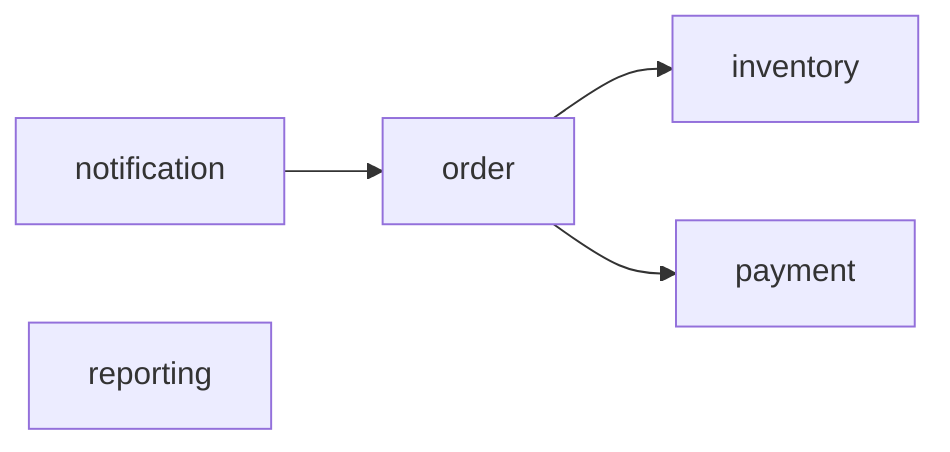

# Khi nào dùng module test thay vì `@SpringBootTest`?

## 1. Vấn đề: một thay đổi nhỏ có cần khởi động toàn bộ ứng dụng?

Ứng dụng Spring Boot dạng **modular monolith** có thể gồm các application module `order`, `inventory`, `payment`, `notification` và `reporting`. Khi sửa quy tắc đặt hàng, nhóm phát triển cần chứng minh `OrderService` xử lý đúng, phát đúng domain event và không phụ thuộc sai vào module khác. Nếu mỗi bài kiểm thử đều khởi tạo toàn bộ ứng dụng, lỗi datasource hoặc cấu hình của `reporting` có thể khiến test của `order` thất bại trước khi thực thi assertion.

`@SpringBootTest` và `@ApplicationModuleTest` đều làm việc với **Spring `ApplicationContext` thực**, nhưng chúng có phạm vi khác nhau:

- **`@SpringBootTest`**: thông thường bootstrap cấu hình của **toàn ứng dụng**, phù hợp khi muốn kiểm thử các thành phần phối hợp trên phạm vi hệ thống hoặc cấu hình khởi động tổng thể.
- **`@ApplicationModuleTest`**: bootstrap một **lát cắt dọc theo application module** bằng cơ chế Spring Boot Test, mặc định chỉ nạp module chứa lớp test. Nó phù hợp để kiểm tra wiring và hành vi thật **trong ranh giới một module** mà không phải kéo theo mọi module nghiệp vụ.

Không có annotation nào “tốt hơn trong mọi trường hợp”. **Chọn theo bằng chứng mà bài test phải cung cấp**, không chỉ theo mong muốn rút ngắn thời gian chạy.

Bài học này thuộc chương **ApplicationModuleTest** của học phần **SPRING_MODULITH_VERIFICATION_TESTING**. Nội dung hỗ trợ mục tiêu xác minh ranh giới với `ApplicationModules`, kiểm thử `@ApplicationModuleTest`, event, database và tích hợp, đồng thời xây dựng quality gate CI ngăn phụ thuộc sai và hồi quy.

Sau bài học, bạn có thể lựa chọn giữa unit test, Spring Boot slice test, module integration test và full-application integration test; xử lý dependency ngoài module; phân biệt kiểm thử phát sự kiện với kiểm thử cả event flow; và kết hợp các tầng kiểm thử trong CI.

## 2. Khác nhau về phạm vi bootstrap

Giả sử package ứng dụng và các quan hệ phụ thuộc được tổ chức như sau:

```text
com.example.shop
├── ShopApplication.java   # @SpringBootApplication
├── order/                 # application module order
├── inventory/             # application module inventory
├── payment/               # application module payment
├── notification/          # application module notification
└── reporting/             # application module reporting
```



Mũi tên `A → B` có nghĩa **A phụ thuộc vào B**. Ở đây `order` phụ thuộc vào `inventory` và `payment`; `notification` phụ thuộc vào `order`. `reporting` không nằm trong các quan hệ được vẽ.

Nếu lớp kiểm thử đặt trong `com.example.shop.order`, phạm vi có thể là:

| Annotation | Application module dự kiến được bootstrap | Điều muốn chứng minh |
| --- | --- | --- |
| `@ApplicationModuleTest` | `order` (mặc định `STANDALONE`) | Module `order` có thể khởi tạo với các dependency bên ngoài được kiểm soát |
| `@ApplicationModuleTest(mode = DIRECT_DEPENDENCIES)` | `order`, `inventory`, `payment` | Tích hợp thật với các dependency trực tiếp của `order` |
| `@ApplicationModuleTest(mode = ALL_DEPENDENCIES)` | `order` và toàn bộ cây dependency đi ra từ `order` | Tương tác qua nhiều tầng phụ thuộc, nếu có |
| `@SpringBootTest` | Các bean ứng dụng thông thường từ `order`, `inventory`, `payment`, `notification`, `reporting` | Cấu hình và hành vi phối hợp của ứng dụng đầy đủ |

Đây là **tập application module nghiệp vụ**, không phải danh sách mọi Spring bean. Ngay ở `STANDALONE`, Spring Boot vẫn có thể tạo datasource, transaction manager, event publisher, security/filter hoặc bean hạ tầng khác theo dependency, profile và auto-configuration.

Theo Reference của Spring Modulith, `@ApplicationModuleTest` giới hạn **component scanning**, các **auto-configuration packages** và **entity scanning packages** theo module được chọn. Nó không loại các class khỏi classpath và không biến kiểm thử thành unit test thuần Mockito.

### Tương quan với `@SpringBootTest`

`@ApplicationModuleTest` được **meta-annotate bằng `@SpringBootTest`** và được Spring Modulith tùy biến để thực hiện module slicing. Vì vậy, cả hai đều sử dụng Spring TestContext và có thể kiểm tra dependency injection, configuration, transaction hoặc web layer, tùy cấu hình thực tế. Khác biệt chủ chốt là **bạn chủ động hạn chế application module nào tham gia vào context**.

`@SpringBootTest` mặc định dùng môi trường web `MOCK`, **không** tự khởi động server trên cổng thật. Khi cần HTTP qua socket, dùng `webEnvironment = RANDOM_PORT` hoặc `DEFINED_PORT`. Tương tự, `@ApplicationModuleTest` cũng hỗ trợ thuộc tính `webEnvironment` trong API hiện hành; **module test không có nghĩa là không thể kiểm thử controller**.

## 3. Bảng quyết định: nên chọn loại kiểm thử nào?

| Câu hỏi cần trả lời | Lựa chọn thường phù hợp | Lý do |
| --- | --- | --- |
| Hàm Java thuần tính tổng tiền có đúng không? | **JUnit unit test** | Không cần tạo Spring context |
| Controller ánh xạ JSON/status/validation đúng không? | **`@WebMvcTest`** hoặc slice test tương ứng | Chỉ nạp lát cắt web; mock use case nếu cần |
| Repository JPA mapping/query đúng không? | **`@DataJpaTest`** | Tập trung vào persistence slice và database test |
| Service của `order` cùng bean thật trong module hoạt động đúng không? | **`@ApplicationModuleTest` `STANDALONE`** | Kiểm tra wiring và hành vi trong một module |
| `order` gọi được API thật của `inventory` không? | **`@ApplicationModuleTest(DIRECT_DEPENDENCIES)`** | Kiểm tra phối hợp với module phụ thuộc trực tiếp |
| Event phát từ `order` có đúng payload không? | **Module test + `PublishedEvents`** | Không cần nạp listener ở module khác chỉ để kiểm tra việc phát |
| Listener ở module khác đã xử lý và ghi dữ liệu chưa? | **Module test có phạm vi listener phù hợp + `Scenario`**, hoặc integration test xuyên module | Phải quan sát kết quả sau xử lý, không chỉ event nguồn |
| Toàn ứng dụng có khởi động được với mọi cấu hình production-like không? | **`@SpringBootTest`** | Cần độ phủ toàn bộ cấu hình và dependency được bật |
| Luồng end-to-end đi qua nhiều module, web, security, DB hoặc broker có chạy không? | **`@SpringBootTest`** với hạ tầng thích hợp; một số trường hợp có thể dùng module test mở rộng | Cần kiểm chứng phối hợp thực qua các thành phần liên quan |
| Các module có vi phạm ranh giới kiến trúc không? | **`ApplicationModules.verify()`** | Đây là kiểm chứng cấu trúc, không chỉ bootstrap context |

Để kiểm tra một controller **vừa** thuộc một module cụ thể **vừa** dùng web slice, Spring Modulith hiện có `@ModuleSlicing` phối hợp với slice annotations của Spring Boot trên phiên bản hỗ trợ. Tuy nhiên, chỉ thêm công cụ này khi bạn thực sự cần cả hai chiều cắt; với test service nội bộ của module, `@ApplicationModuleTest` thường dễ hiểu hơn.

### Sơ đồ chọn nhanh

```mermaid
flowchart TD
    A[Bắt đầu từ mục tiêu assertion] --> B{Có cần Spring context?}
    B -->|Không| U[JUnit unit test]
    B -->|Có| C{Chỉ cần một tầng MVC/JPA?}
    C -->|Có| H[Spring Boot slice test]
    C -->|Không| D{Cần startup và wiring toàn ứng dụng?}
    D -->|Có| F[@SpringBootTest]
    D -->|Không| M[@ApplicationModuleTest]
    M --> E{Cần bean thật ngoài module mục tiêu?}
    E -->|Không| S[STANDALONE + mock/fake ở ranh giới]
    E -->|Có| G[Chọn DIRECT/ALL DEPENDENCIES hoặc extraIncludes]
    U --> V[Assertion phù hợp với mục tiêu]
    H --> V
    F --> V
    S --> V
    G --> V
```

## 4. Khi nào nên ưu tiên `@ApplicationModuleTest`?

**Trường hợp 1 — kiểm tra tính độc lập của một module.** Bạn cần bảo đảm các bean của `order` khởi tạo được ngay cả khi `reporting` đang cấu hình lỗi hoặc chưa sẵn sàng. `STANDALONE` bộc lộ dependency bắt buộc ra ngoài module và giảm ảnh hưởng của những module không tham gia kịch bản.

**Trường hợp 2 — kiểm tra hành vi nhiều tầng trong một module.** Một use case gọi repository cùng module, ghi dữ liệu, phát event: bạn cần injection, transaction và event publisher thật, nhưng không cần toàn bộ hệ thống. Module integration test thích hợp hơn unit test thuần mock và ít rộng hơn full-application test.

**Trường hợp 3 — phát hiện coupling sớm.** Nếu `OrderService` phải inject nhiều bean nằm ở các module khác, bài test `STANDALONE` sẽ buộc người viết xác định rõ dependency nào được mock và dependency nào thực sự cần nạp. Quá nhiều mock có thể là tín hiệu cần xem lại API hoặc chuyển giao tiếp sang domain event. **Lỗi thiếu bean không tự chứng minh vi phạm kiến trúc**; cần đối chiếu quy tắc module và mục tiêu test.

**Trường hợp 4 — kiểm tra hợp đồng giữa hai module liền kề.** Nếu `order` phụ thuộc trực tiếp vào API công khai của `inventory`, `DIRECT_DEPENDENCIES` cho phép dùng implementation thật của `inventory`. Độ phủ rộng hơn `STANDALONE`, nhưng vẫn không cần những module không nằm trong cây dependency của `order`.

**Trường hợp 5 — chạy kiểm thử tập trung khi phát triển một module.** Bài test với phạm vi nhỏ hơn thường có ít cấu hình và bean phải khởi tạo hơn, giúp lỗi gần nguyên nhân hơn. Tuy nhiên, **không hứa hẹn luôn nhanh hơn**: Spring context cache, database, auto-configuration và số module được nạp có thể làm chi phí thực tế khác nhau.

## 5. Khi nào nên giữ `@SpringBootTest`?

**Khởi động toàn hệ thống.** Một bản phát hành cần chứng minh tất cả module thông thường có thể tạo chung một Spring context, không xảy ra xung đột tên bean, cấu hình auto-configuration hay migration khi các module cùng hiện diện. Một bài `@ApplicationModuleTest` cô lập không đại diện cho tình huống này.

**Luồng xuyên nhiều module không trùng cây dependency tĩnh.** Ví dụ `order` phát event mà `notification` lắng nghe: do `notification → order` là chiều phụ thuộc ngược, `ALL_DEPENDENCIES` của test thuộc `order` không tự thêm listener `notification`. Có thể dùng `extraIncludes = "notification"` hoặc test trong module `notification`; nhưng để chứng minh **toàn bộ luồng hệ thống**, `@SpringBootTest` đôi khi đơn giản và bao quát hơn.

**Hạ tầng/phối hợp ở cấp ứng dụng.** Khi mục tiêu là tính đúng đắn của security chain chung, nhiều datasource, startup listener, external adapters hoặc một luồng HTTP→DB→event broker theo cấu hình production-like, full-application integration test có thể đem lại bằng chứng phù hợp hơn. Dù vậy, `@SpringBootTest` **không tự cấp** database, Kafka, RabbitMQ hay hạ tầng ngoài; bạn vẫn phải cấu hình Testcontainers/fake phù hợp.

**Phát hiện lỗi do các module cùng tồn tại.** Một cấu hình `@Configuration` chỉ gây vấn đề khi module `payment` và `reporting` đều có mặt sẽ không được phát hiện bằng test `order` ở `STANDALONE`. Full context test được thiết kế để bắt loại lỗi tích hợp này.

**Yêu cầu xác minh startup thật hoặc HTTP server thật.** Dùng `@SpringBootTest(webEnvironment = RANDOM_PORT)` khi cần socket HTTP và server nhúng. `@ApplicationModuleTest(webEnvironment = RANDOM_PORT)` cũng có thể kiểm tra server trong phạm vi module, nhưng nếu tiêu chí thành công đòi hỏi *mọi* module ứng dụng, hãy ưu tiên full context.

**Không đánh đồng `@SpringBootTest` với end-to-end test production.** Một bài full context dùng H2 in-memory và mock broker vẫn chưa chứng minh môi trường thật vận hành đúng. Phạm vi test và **độ trung thực của hạ tầng** là hai chiều quyết định độc lập.

## 6. Ví dụ đầy đủ: cùng một use case, hai phạm vi kiểm thử

Ví dụ Java sau dùng ba module `order`, `inventory`, `reporting`. Mục tiêu là so sánh **module test có mock** với **full-application test dùng bean thật**. Dữ liệu cố định và không cần database giúp tập trung vào khác biệt bootstrap; phần 9 giải thích khi bổ sung persistence.

### 6.1. Dependency và cấu trúc

```text
src/
├── main/java/com/example/shop/
│   ├── ShopApplication.java
│   ├── order/
│   │   ├── OrderService.java
│   │   └── OrderSubmitted.java
│   ├── inventory/
│   │   ├── InventoryAvailability.java
│   │   └── InventoryAvailabilityService.java
│   └── reporting/
│       └── ReportingHeartbeat.java
└── test/java/com/example/shop/
    ├── order/
    │   ├── OrderModuleTests.java
    │   └── OrderWithInventoryTests.java
    ├── FullApplicationIntegrationTests.java
    └── ModuleArchitectureTests.java
```

Các dependency cần có (Maven; dùng BOM Spring Boot/Spring Modulith **tương thích** để quản lý phiên bản):

```xml
<dependency>
    <groupId>org.springframework.boot</groupId>
    <artifactId>spring-boot-starter</artifactId>
</dependency>
<dependency>
    <groupId>org.springframework.boot</groupId>
    <artifactId>spring-boot-starter-test</artifactId>
    <scope>test</scope>
</dependency>
<dependency>
    <groupId>org.springframework.modulith</groupId>
    <artifactId>spring-modulith-starter-test</artifactId>
    <scope>test</scope>
</dependency>
```

Mẫu dưới đây dùng `@MockitoBean` (Spring Framework 6.2+, ví dụ Spring Boot 3.4+ với phiên bản tương thích). Nếu dự án dùng Spring Boot cũ hơn, có thể cần `@MockBean` thay cho annotation này; hãy kiểm tra BOM trước khi sao chép code.

### 6.2. Tạo lớp cấu hình ứng dụng

File `src/main/java/com/example/shop/ShopApplication.java`:

```java
package com.example.shop;

import org.springframework.boot.SpringApplication;
import org.springframework.boot.autoconfigure.SpringBootApplication;

@SpringBootApplication
public class ShopApplication {
    public static void main(String[] args) {
        SpringApplication.run(ShopApplication.class, args);
    }
}
```

### 6.3. Tạo API và bean thật của `inventory`

File `src/main/java/com/example/shop/inventory/InventoryAvailability.java`:

```java
package com.example.shop.inventory;

public interface InventoryAvailability {
    boolean available(String sku, int quantity);
}
```

File `src/main/java/com/example/shop/inventory/InventoryAvailabilityService.java`:

```java
package com.example.shop.inventory;

import org.springframework.stereotype.Service;

@Service
public class InventoryAvailabilityService implements InventoryAvailability {

    @Override
    public boolean available(String sku, int quantity) {
        // Dữ liệu mẫu thay vì truy vấn tồn kho thật.
        return "SKU-READY".equals(sku) && quantity <= 3;
    }
}
```

Interface nằm ở package gốc của `inventory`, là **API công khai mặc định** trong cách nhận diện module thông thường. `order` không nên phụ thuộc trực tiếp vào lớp thuộc `inventory.internal`.

### 6.4. Bean nghiệp vụ thật của `order` và event

File `src/main/java/com/example/shop/order/OrderSubmitted.java`:

```java
package com.example.shop.order;

import java.util.UUID;

public record OrderSubmitted(UUID orderId, String sku) {}
```

File `src/main/java/com/example/shop/order/OrderService.java`:

```java
package com.example.shop.order;

import java.util.UUID;
import com.example.shop.inventory.InventoryAvailability;
import org.springframework.context.ApplicationEventPublisher;
import org.springframework.stereotype.Service;

@Service
public class OrderService {

    private final InventoryAvailability inventory;
    private final ApplicationEventPublisher events;

    public OrderService(InventoryAvailability inventory,
                        ApplicationEventPublisher events) {
        this.inventory = inventory;
        this.events = events;
    }

    public UUID submit(String sku, int quantity) {
        if (sku == null || sku.isBlank() || quantity <= 0) {
            throw new IllegalArgumentException("Invalid order");
        }
        if (!inventory.available(sku, quantity)) {
            throw new IllegalStateException("OUT_OF_STOCK");
        }

        UUID orderId = UUID.randomUUID();
        events.publishEvent(new OrderSubmitted(orderId, sku));
        return orderId;
    }
}
```

Đoạn code có một dependency module hợp lệ `order → inventory`, một dependency hạ tầng `ApplicationEventPublisher` và không có datasource. Nó cho phép quan sát rõ việc nạp bean thật so với tạo mock.

Tạo thêm bean độc lập ở module `reporting`:

```java
package com.example.shop.reporting;

import org.springframework.stereotype.Service;

@Service
public class ReportingHeartbeat {
    public boolean ready() {
        return true;
    }
}
```

### 6.5. Chạy `@ApplicationModuleTest` với mock API ngoài module

File `src/test/java/com/example/shop/order/OrderModuleTests.java`:

```java
package com.example.shop.order;

import static org.assertj.core.api.Assertions.assertThat;
import static org.assertj.core.api.Assertions.assertThatThrownBy;
import static org.mockito.BDDMockito.given;
import static org.mockito.BDDMockito.then;

import java.util.UUID;
import com.example.shop.inventory.InventoryAvailability;
import org.junit.jupiter.api.Test;
import org.springframework.beans.factory.annotation.Autowired;
import org.springframework.modulith.test.ApplicationModuleTest;
import org.springframework.modulith.test.PublishedEvents;
import org.springframework.test.context.bean.override.mockito.MockitoBean;

@ApplicationModuleTest // Mặc định: BootstrapMode.STANDALONE
class OrderModuleTests {

    @Autowired OrderService orders;
    @MockitoBean InventoryAvailability inventory;

    @Test
    void publishesEventWhenStockIsAvailable(PublishedEvents events) {
        given(inventory.available("SKU-01", 2)).willReturn(true);

        UUID id = orders.submit("SKU-01", 2);

        assertThat(events.ofType(OrderSubmitted.class)
                .matching(OrderSubmitted::orderId, id))
                .hasSize(1);
        then(inventory).should().available("SKU-01", 2);
    }

    @Test
    void rejectsOrderWhenStockIsUnavailable(PublishedEvents events) {
        given(inventory.available("SKU-EMPTY", 1)).willReturn(false);

        assertThatThrownBy(() -> orders.submit("SKU-EMPTY", 1))
                .isInstanceOf(IllegalStateException.class)
                .hasMessage("OUT_OF_STOCK");

        assertThat(events.ofType(OrderSubmitted.class)).isEmpty();
    }
}
```

**Bài test này xác minh:** Spring tạo bean thật `OrderService` thuộc module `order`; API ngoài module `InventoryAvailability` được cung cấp bằng mock; các quy tắc chấp nhận/từ chối và event phát ra đúng. Nó **không** xác minh thuật toán tồn kho trong `InventoryAvailabilityService`.

Tại sao `@MockitoBean` hoạt động ở `STANDALONE`? Spring Test có thể tạo bean mock cho type chưa có trong context, đáp ứng constructor dependency của `OrderService`. `@MockitoBean(enforceOverride = true)` **không** phù hợp trong trường hợp bean thật ngoài module chủ đích vắng mặt, vì tùy chọn đó yêu cầu bean đã tồn tại để thay.

### 6.6. Nếu muốn integration thật nhưng vẫn chỉ trong cây dependency

File `src/test/java/com/example/shop/order/OrderWithInventoryTests.java`:

```java
package com.example.shop.order;

import static org.assertj.core.api.Assertions.assertThat;

import java.util.UUID;
import org.junit.jupiter.api.Test;
import org.springframework.beans.factory.annotation.Autowired;
import org.springframework.modulith.test.ApplicationModuleTest;
import org.springframework.modulith.test.ApplicationModuleTest.BootstrapMode;

@ApplicationModuleTest(mode = BootstrapMode.DIRECT_DEPENDENCIES)
class OrderWithInventoryTests {

    @Autowired OrderService orders;

    @Test
    void submitsUsingRealInventoryBean() {
        UUID id = orders.submit("SKU-READY", 2);
        assertThat(id).isNotNull();
    }
}
```

Ở ví dụ này, implementation thật thuộc `inventory` được đưa vào context vì `order` phụ thuộc trực tiếp vào `inventory`. Không có `@MockitoBean`. `reporting` vẫn không được nạp theo đồ thị phụ thuộc đã mô tả. Cách này trả lời câu hỏi **“`order` và `inventory` phối hợp thật có hoạt động không?”**, khác câu hỏi trong test cô lập.

### 6.7. Chạy full-application test để kiểm tra toàn bộ bean ứng dụng

File `src/test/java/com/example/shop/FullApplicationIntegrationTests.java`:

```java
package com.example.shop;

import static org.assertj.core.api.Assertions.assertThat;

import java.util.UUID;
import com.example.shop.order.OrderService;
import com.example.shop.reporting.ReportingHeartbeat;
import org.junit.jupiter.api.Test;
import org.springframework.beans.factory.annotation.Autowired;
import org.springframework.boot.test.context.SpringBootTest;

@SpringBootTest
class FullApplicationIntegrationTests {

    @Autowired OrderService orders;
    @Autowired ReportingHeartbeat reporting;

    @Test
    void bootsWholeApplicationAndUsesRealInventory() {
        assertThat(reporting.ready()).isTrue();

        UUID id = orders.submit("SKU-READY", 2);
        assertThat(id).isNotNull();
    }
}
```

Trong context toàn ứng dụng, Spring có thể tạo `InventoryAvailabilityService` và `ReportingHeartbeat` thật. Bài test đồng thời phát hiện lỗi wiring/cấu hình khiến một module độc lập như `reporting` không khởi tạo được. So với `OrderModuleTests`, độ phủ về **startup toàn hệ thống** cao hơn, nhưng tín hiệu về lỗi nằm trong riêng `order` có thể kém tập trung hơn.

Lưu ý đây là full-application **integration test**, chưa phải end-to-end test qua HTTP, database hoặc broker. Dữ liệu của ví dụ được cố tình giữ đơn giản để so sánh hai cơ chế bootstrap mà không cần chuẩn bị hạ tầng ngoài.

## 7. Cách xử lý dependency khi module test không khởi động được

Một lỗi phổ biến ở `STANDALONE` là:

```text
UnsatisfiedDependencyException: ... OrderService ...
No qualifying bean of type 'InventoryAvailability' available
```

Không nên lập tức thay mọi `@ApplicationModuleTest` bằng `@SpringBootTest` hoặc đổi tất cả sang `ALL_DEPENDENCIES`. Hãy xác định mục tiêu rồi chọn cách xử lý:

| Nguyên nhân / mục tiêu | Hướng xử lý | Điều được kiểm chứng |
| --- | --- | --- |
| Module cần một API ngoài nhưng chỉ kiểm tra logic của chính nó | `@MockitoBean`/fake ở API công khai | Hành vi module mục tiêu với phản hồi giả lập |
| Test cần implementation thật của dependency trực tiếp | `DIRECT_DEPENDENCIES` | Wiring và giao tiếp thực với module liền kề |
| Test cần chuỗi dependency bắc cầu | `ALL_DEPENDENCIES` có chủ đích | Một phần luồng tích hợp nhiều module |
| Module nhận event phụ thuộc ngược chiều vào module nguồn | `extraIncludes` hoặc test riêng tại module consumer | Listener thực sự được nạp và có thể quan sát kết quả |
| Bean thiếu thuộc chính module mục tiêu | Kiểm tra `@Component`, `@Bean`, profile, conditional configuration | Sửa wiring thật, không che lỗi bằng mock ngoài module |
| Phụ thuộc đi vào package `internal` của module khác | Sửa thiết kế/API, chạy `ApplicationModules.verify()` | Hợp lệ kiến trúc; đổi mode không làm phụ thuộc sai thành đúng |

`STANDALONE` dùng để **cô lập phạm vi**; nó không phủ nhận rằng ứng dụng production có dependency hợp lệ sang module khác. Nếu một module cần quá nhiều mock bên ngoài, đó là tín hiệu nên đánh giá độ coupling và ranh giới nghiệp vụ, chứ không chỉ tối ưu test.

## 8. Event, persistence và web layer: tránh chọn sai phạm vi

### 8.1. Event: phát thành công khác với xử lý thành công

Trong ví dụ, `PublishedEvents` cho biết `OrderSubmitted` được phát đúng `orderId`. Nó **không** chứng minh listener thuộc `notification` đã nhận hoặc cập nhật dữ liệu.

Nếu mục tiêu là kiểm tra **consumer** và kết quả bất đồng bộ, phải nạp module chứa listener. Có thể dùng `@ApplicationModuleTest(extraIncludes = "notification")` khi tên logic module chính xác, rồi sử dụng `Scenario` để chờ event kết quả hoặc trạng thái database thay đổi. Nếu mục tiêu là kiểm tra việc **toàn ứng dụng** nhận và xử lý chuỗi event qua nhiều module, `@SpringBootTest` cùng assertion/hạ tầng phù hợp cũng có giá trị.

Với `@TransactionalEventListener(AFTER_COMMIT)`, listener chỉ được kích hoạt theo đường xử lý sau commit khi có transaction thực. Một test `Scenario` phải có transaction manager và hạ tầng phù hợp; chỉ dùng `PublishedEvents` không thay thế kiểm chứng transaction và delivery.

### 8.2. Database: module test không đồng nghĩa test không có database

Nếu `order` có JPA repository, `@ApplicationModuleTest` vẫn có thể nạp repository/entity thuộc module và kiểm tra ghi/đọc với **H2 hoặc Testcontainers**. Bạn vẫn phải cung cấp datasource, schema/migration và fixture thích hợp. Lỗi thiếu bảng, cấu hình datasource hoặc transaction manager là lỗi hạ tầng; không thể sửa chỉ bằng đổi bootstrap mode.

Chọn **module test** khi muốn chứng minh persistence của module `order` tự hoạt động đúng. Chọn **full-app test** khi cần chứng minh migration, quan hệ dữ liệu hoặc các repository của nhiều module cùng cấu hình chạy đúng. Những bài thử với server/broker hoặc listener chạy transaction khác cần chiến lược dọn dữ liệu riêng, không giả định mọi side effect sẽ rollback theo transaction của phương thức JUnit.

### 8.3. Web: một module test vẫn có thể thử HTTP adapter

Nếu controller thuộc package `order.web`, `@ApplicationModuleTest` có thể khởi tạo controller và service của module `order`. Với Spring MVC và Spring Boot Test phù hợp:

```java
@ApplicationModuleTest(
    webEnvironment = SpringBootTest.WebEnvironment.MOCK
)
@AutoConfigureMockMvc
class OrderWebModuleTests {
    // Inject MockMvc rồi assert HTTP status, JSON và interaction.
}
```

Đây là đoạn minh họa cấu hình; cần import `SpringBootTest`, `ApplicationModuleTest` và `AutoConfigureMockMvc` đúng với phiên bản Spring Boot đang dùng, cùng controller thực tế. Ở Spring Boot 3.x, `@AutoConfigureMockMvc` nằm trong `org.springframework.boot.test.autoconfigure.web.servlet`; ở Spring Boot 4.x, package kiểm thử MVC được tổ chức lại. Nếu chỉ cần test controller và giả lập service, `@WebMvcTest` thường nhẹ và rõ mục tiêu hơn.

Khi cần HTTP server thật, có thể dùng `webEnvironment = RANDOM_PORT`. Nếu cần kiểm tra **full application** qua HTTP, kết hợp `@SpringBootTest(webEnvironment = RANDOM_PORT)` với client phù hợp; nếu chỉ cần module đang thử, module test với server cũng là một lựa chọn.

## 9. Xác minh kiến trúc: thứ mà không annotation bootstrap nào thay thế được

Một `@SpringBootTest` thành công không chứng minh `order` chỉ gọi API công khai của `inventory`. Tương tự, module test khởi động được với mock chưa chứng minh toàn bộ phụ thuộc tuân thủ kiến trúc. Spring Modulith cung cấp mô hình `ApplicationModules` để xác minh quy tắc cấu trúc:

```java
package com.example.shop;

import org.junit.jupiter.api.Test;
import org.springframework.modulith.core.ApplicationModules;

class ModuleArchitectureTests {

    @Test
    void applicationModulesFollowDependencyRules() {
        ApplicationModules.of(ShopApplication.class).verify();
    }
}
```

`ApplicationModules.verify()` kiểm tra những quy tắc kiến trúc mà Spring Modulith áp dụng, trong đó có ranh giới package/module và phụ thuộc hợp lệ. `@ApplicationModuleTest` trong API hiện hành còn có `verifyAutomatically = true` theo mặc định. Tuy nhiên, một bài architecture test **riêng** khiến quality gate CI tường minh và không phụ thuộc vào việc pipeline có chạy nhóm module integration test hay không.

Nếu dự án cần thêm giới hạn phụ thuộc đặc thù, hãy khai báo rõ các quy tắc đó trong mô hình kiến trúc và/hoặc các test kiến trúc phù hợp. Không nên dựa vào “có khởi động được Spring context” để kết luận kiến trúc đúng.

## 10. Chẩn đoán lỗi và đánh giá hiệu năng một cách thực tế

| Triệu chứng | Loại vấn đề cần xem xét | Hành động |
| --- | --- | --- |
| Module test báo thiếu bean ở module ngoài | Phạm vi `STANDALONE` không nạp dependency | Mock API công khai hoặc dùng mode tích hợp phù hợp |
| Module test không tìm được module mục tiêu | Lớp test ngoài package module hoặc mô hình module tùy chỉnh | Đặt test trong package module; phiên bản hỗ trợ có `module` và `classes` |
| Full-app test lỗi vì cấu hình module không liên quan | Khởi động toàn bộ ứng dụng | Sửa lỗi hệ thống; giữ module test độc lập để tiếp tục phát triển từng module |
| Module test xanh nhưng full-app test đỏ | Có xung đột hoặc dependency chỉ xuất hiện khi toàn ứng dụng khởi tạo | Điều tra cấu hình/bean/migration liên module; giữ cả hai loại test |
| Module test chậm bất ngờ | Auto-configuration, database, web server, context cache | Đo startup, xem bean/hạ tầng được tạo, thu hẹp `mode` và test configuration |
| Test event timeout | Listener không được nạp, transaction chưa commit hoặc listener lỗi | Xác nhận module listener, transaction, executor và correlation ID |
| Test HTTP nhận `401`/`403` | Security filter/CSRF, không hẳn là lỗi module | Cấu hình xác thực/CSRF trong test đúng yêu cầu |
| `ApplicationModules.verify()` báo lỗi | Mã nguồn có phụ thuộc trái ranh giới | Sửa module/API; không chữa bằng `@SpringBootTest` hoặc `ALL_DEPENDENCIES` |

Để xem các module đang được nạp trong bài `@ApplicationModuleTest`, cấu hình:

```properties
logging.level.org.springframework.modulith=DEBUG
```

Log Spring Modulith thường cho biết module được chọn và cách giới hạn scanning. Câu chữ có thể khác theo phiên bản. Khi cần chứng minh bean nào có mặt/vắng mặt, inject `ApplicationContext` và kiểm tra bằng `getBeansOfType(...)`, nhưng tránh cố định **tổng số Spring bean** vì những bean hạ tầng có thể thay đổi sau nâng cấp.

**Không mặc định module test luôn nhanh hơn.** Nếu hai lớp test khởi tạo context khác nhau do profile, mock, `mode` hoặc `@Import`, Spring Test có thể phải tạo thêm context thay vì dùng lại cache. Thời gian chạy nên được đo trong pipeline thật; lợi ích chính của module test còn là **giới hạn phạm vi lỗi và ranh giới kiểm chứng**, không chỉ tốc độ.

## 11. Gợi ý thiết kế bộ kiểm thử và quality gate CI

Một bộ kiểm thử cân bằng có thể chia thành các tầng, mỗi tầng trả lời một câu hỏi khác nhau:

1. **Unit test nhanh:** quy tắc tính toán Java thuần, validation thuần và các hàm không cần Spring container.
2. **Slice test có mục tiêu:** controller (`@WebMvcTest`), repository (`@DataJpaTest`) hoặc lát cắt hẹp khác.
3. **Module integration test (`STANDALONE`):** bean thật trong module, mock các API module ngoài, assertion nghiệp vụ và `PublishedEvents`.
4. **Selected cross-module tests:** dùng `DIRECT_DEPENDENCIES`, `ALL_DEPENDENCIES`, `extraIncludes` hoặc `Scenario` khi mục tiêu thật sự cần nhiều module.
5. **Full-application smoke/integration tests:** ít nhất một số bài `@SpringBootTest` chứng minh startup và đường đi quan trọng của toàn hệ thống, với hạ tầng test thực tế khi cần.
6. **Architecture quality gate:** `ApplicationModules.verify()` chạy bắt buộc để chặn phụ thuộc sai kể cả khi các bài nghiệp vụ xanh.

Với dự án Maven/Gradle dùng JUnit, có thể cấu hình CI chạy `./mvnw test` hoặc `./gradlew test` cùng các stage integration test/quality gate theo cách tổ chức của project. Nếu cần Testcontainers hoặc broker, runner CI phải cung cấp hạ tầng tương ứng; không gộp tất cả test nặng vào vòng phản hồi nhanh của lập trình viên mà thiếu cơ chế phân tầng.

Khi một lỗi xuất hiện, nhờ phân tầng, nhóm có thể nhanh chóng biết đó là **quy tắc nghiệp vụ nội bộ**, **wiring giữa module**, **startup toàn hệ thống**, **event/database**, hay **quy tắc kiến trúc**. Đó là mục đích thực tế của việc dùng module test *bên cạnh*, chứ không phải loại bỏ hoàn toàn, `@SpringBootTest`.

## 12. Bài tập tự thực hành và câu hỏi ôn tập

1. Tạo ứng dụng `order → inventory` và `reporting` độc lập. Chạy `OrderModuleTests` ở `STANDALONE` và `FullApplicationIntegrationTests` với `@SpringBootTest`. Giải thích bean nào được nạp và điều gì được kiểm chứng trong mỗi bài.
2. Gỡ `@MockitoBean` khỏi `OrderModuleTests` rồi chạy lại. Đọc nguyên nhân thiếu bean và đề xuất hai cách sửa khác nhau theo **hai mục tiêu kiểm thử**.
3. Dùng `DIRECT_DEPENDENCIES` với implementation `InventoryAvailabilityService` thật. Tạo một lỗi có chủ đích trong `inventory`; so sánh test nào phát hiện lỗi và test nào vẫn xanh.
4. Thêm `OrderSubmitted` listener vào module `notification`. Vì sao `ALL_DEPENDENCIES` trong lớp test thuộc `order` không tự bảo đảm listener được nạp? Viết kịch bản tích hợp phù hợp.
5. Thêm JPA repository vào `order` và datasource H2 hoặc Testcontainers. Khi nào module test đủ bằng chứng, khi nào nên chạy full-application test để kiểm tra nhiều repository/migration cùng nhau?
6. Viết một web adapter `POST /orders`. So sánh `@WebMvcTest`, `@ApplicationModuleTest` + `MockMvc` và `@SpringBootTest(webEnvironment = RANDOM_PORT)` về ranh giới và tầng đang được kiểm chứng.
7. Tạo một phụ thuộc vào package `inventory.internal`, rồi chạy `ApplicationModules.verify()`. Tại sao việc chuyển từ module test sang full `@SpringBootTest` không giải quyết vi phạm đó?
8. Đo thời gian thực tế khi chạy một lớp module test và một lớp full-app test trong CI. Phân tích tác động của context cache, profile, database và auto-configuration thay vì kết luận chỉ từ tên annotation.

### Checklist chọn trước khi viết test

| Câu hỏi tự kiểm tra | Nếu câu trả lời là “có” |
| --- | --- |
| Chỉ cần kiểm tra logic không phụ thuộc Spring? | Chọn JUnit unit test |
| Cần một slice MVC/JPA, không cần toàn bộ use case thật? | Chọn slice test |
| Cần bean thật và hành vi của một application module? | Bắt đầu bằng `@ApplicationModuleTest` `STANDALONE` |
| Cần bean thật ở các dependency trực tiếp/bắc cầu? | Mở rộng module test **có chủ đích** |
| Cần chứng minh cấu hình mọi module cùng khởi động? | Thêm `@SpringBootTest` |
| Cần chứng minh luồng xử lý event/database cuối cùng? | Thêm test quan sát kết quả và hạ tầng phù hợp |
| Cần bảo đảm không vi phạm dependency giữa module? | Bắt buộc chạy `ApplicationModules.verify()` |

**Ghi nhớ:** `@ApplicationModuleTest` là lựa chọn tốt khi muốn kiểm thử tích hợp **bên trong ranh giới module** với Spring bean thật và dependency ngoài được kiểm soát. `@SpringBootTest` phù hợp khi bằng chứng cần bao phủ **cấu hình và sự phối hợp của toàn ứng dụng**. Hai loại test bổ sung cho nhau; hãy kết hợp với unit/slice test, event/database integration test và `ApplicationModules.verify()` để xây dựng quality gate CI vừa nhanh, vừa phát hiện được lỗi kiến trúc và hồi quy.

### Tài liệu tham khảo

- [Spring Modulith Reference — Integration Testing Application Modules](https://docs.spring.io/spring-modulith/reference/testing.html)
- [Spring Modulith API — `ApplicationModuleTest` và `BootstrapMode`](https://docs.spring.io/spring-modulith/docs/current/api/org/springframework/modulith/test/ApplicationModuleTest.html)
- [Spring Modulith Reference — Testing Published Events](https://docs.spring.io/spring-modulith/reference/events.html)
- [Spring Modulith Reference — Verifying Application Module Structure](https://docs.spring.io/spring-modulith/reference/verification.html)
- [Spring Boot Reference — Testing Spring Boot Applications](https://docs.spring.io/spring-boot/reference/testing/spring-boot-applications.html)
