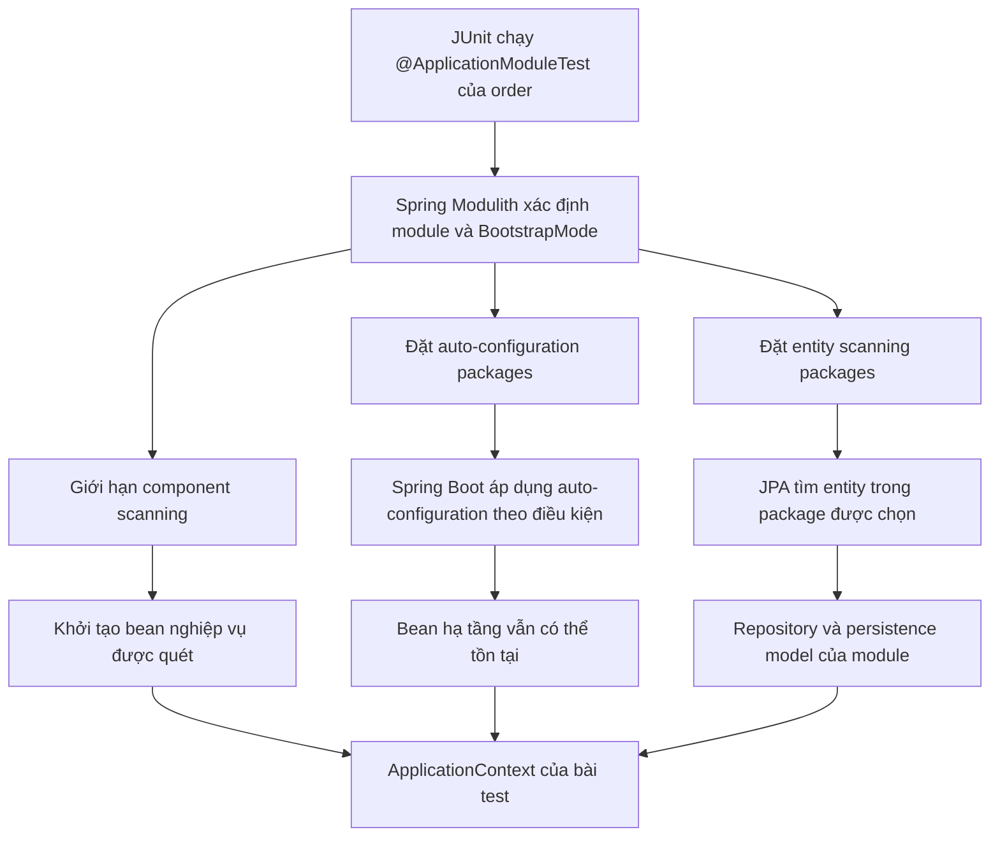
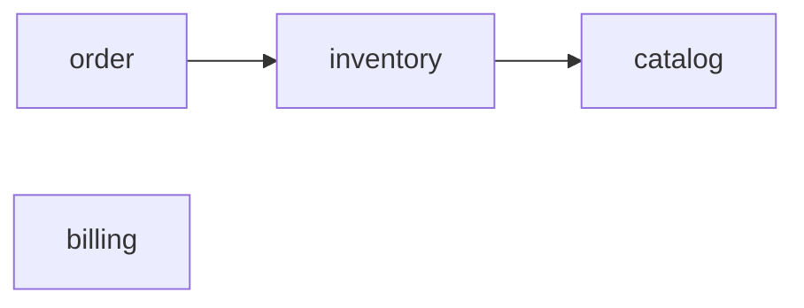

# Giới hạn auto-configuration trong module test với Spring Modulith

## 1. Vì sao module test phải quan tâm đến auto-configuration?

Trong ứng dụng Spring Boot theo kiến trúc *modular monolith*, các application module như `order`, `inventory`, `billing` và `reporting` cùng dùng một tiến trình. Spring Boot thường tự cấu hình các thành phần hạ tầng dựa trên thư viện, bean và property hiện có: datasource, JPA, transaction manager, MVC, messaging, metrics, v.v. Nếu mọi bài kiểm thử đều khởi tạo toàn ứng dụng, một lỗi cấu hình của module không liên quan có thể làm test nghiệp vụ `order` thất bại trước khi chạy assertion.

`@ApplicationModuleTest` của Spring Modulith giúp kiểm thử **một lát cắt ứng dụng theo application module**. Theo Javadoc, cơ chế bootstrap này:

1. Giới hạn **component scanning** vào package của những application module được chọn.
2. Đặt những package đó làm **auto-configuration packages** của Spring Boot.
3. Điều chỉnh **entity scanning packages** tương ứng.

**Điểm dễ nhầm nhất:** giới hạn *auto-configuration packages* **không** đồng nghĩa với việc **tắt toàn bộ auto-configuration classes** của Spring Boot. Khi các điều kiện phù hợp, Spring Boot vẫn có thể tạo `DataSource`, `EntityManagerFactory`, `PlatformTransactionManager` hoặc các bean hạ tầng khác trong module test.

Bài này thuộc chương **ApplicationModuleTest** của học phần **SPRING_MODULITH_VERIFICATION_TESTING**: rèn kỹ năng kiểm chứng ranh giới bằng `ApplicationModules` và các quy tắc phụ thuộc, thực hành module test, kiểm thử sự kiện/cơ sở dữ liệu/tích hợp, đồng thời xây dựng quality gate CI ngăn phụ thuộc sai và hồi quy.

### Mục tiêu học tập

Sau bài học, bạn có thể:

- Phân biệt **auto-configuration classes**, **auto-configuration packages**, **component scanning** và **entity scanning**.
- Dự đoán tác động của `STANDALONE`, `DIRECT_DEPENDENCIES` và `ALL_DEPENDENCIES` lên những package được quét.
- Viết bài test JPA/H2 xác minh bean, package, entity của module mục tiêu có mặt và module không liên quan vắng mặt.
- Hiểu vì sao auto-configured infrastructure bean vẫn tồn tại và cách kiểm tra điều kiện cấu hình.
- Tránh làm rò rỉ phạm vi test qua `@ComponentScan`, `@EntityScan`, `@Import` hoặc cấu hình test quá rộng.
- Kết hợp module test với `ApplicationModules.verify()` và các bài tích hợp phù hợp trong CI.

## 2. Ba cơ chế quét và một cơ chế cấu hình có điều kiện

Trong Spring Boot, bốn khái niệm sau thường xuất hiện cùng nhau nhưng **không phải một**:

| Cơ chế | Điều được lựa chọn | Ví dụ | Ảnh hưởng khi module test giới hạn phạm vi |
| --- | --- | --- | --- |
| **Component scanning** | Những lớp được Spring tìm để tạo bean dựa trên `@Component`, `@Service`, `@Controller`, `@Configuration`, v.v. | `OrderService` trong `com.example.shop.order` | Bean của module không được chọn thường không được quét theo cơ chế mặc định |
| **Auto-configuration packages** | Các package gốc được một số tính năng auto-configuration sử dụng để tìm thành phần của ứng dụng | Package dùng khi tự dò Spring Data repository | Chuyển từ package gốc ứng dụng sang tập package module được chọn |
| **Entity scanning packages** | Các package để tìm kiểu JPA `@Entity`, `@Embeddable`, `@MappedSuperclass`, v.v. theo cơ chế hỗ trợ | `OrderEntity` | Hạn chế persistence model mà JPA có thể quản lý trong test |
| **Auto-configuration classes** | Những cấu hình Spring Boot được import có điều kiện dựa trên classpath, bean, property, web environment... | `DataSourceAutoConfiguration`, `HibernateJpaAutoConfiguration` | **Không bị tắt hàng loạt chỉ vì** module test dùng `STANDALONE` |

`@SpringBootApplication` bao gồm `@EnableAutoConfiguration`. Spring Boot chọn các auto-configuration classes dựa trên điều kiện như `@ConditionalOnClass`, `@ConditionalOnMissingBean` hoặc `@ConditionalOnProperty`. **Auto-configuration packages** chỉ là một nguồn thông tin về *vùng quét mặc định* mà một số cấu hình đó cần dùng.

Ví dụ: với dependency Spring Data JPA và H2 trên classpath, Boot có thể tạo `DataSource` và transaction manager. Nhưng nếu module test chỉ cho JPA quét package `order`, các entity thuộc `billing` sẽ không tự được đưa vào persistence unit theo cấu hình chuẩn.



> **Không đánh đồng:** “Không có bean `BillingService`” là kết quả **giới hạn quét thành phần**; “Có bean `DataSource`” là kết quả **auto-configuration hạ tầng**. Hai điều có thể cùng đúng trong một `STANDALONE` module test.

## 3. `BootstrapMode` quyết định tập package bị giới hạn

Giả sử ứng dụng được chia như sau:

```text
com.example.shop
├── ShopApplication.java       # @SpringBootApplication
├── order/
│   ├── OrderService.java
│   └── OrderEntity.java
├── inventory/
│   └── InventoryService.java
├── catalog/
│   └── CatalogService.java
└── billing/
    ├── BillingService.java
    └── BillingEntity.java
```

Quan hệ phụ thuộc nghiệp vụ được thiết kế theo chiều:



Mũi tên `A → B` nghĩa là **module A phụ thuộc vào module B**. Nếu lớp test nằm trong `com.example.shop.order`, phạm vi được chọn theo `mode` có thể dự đoán:

| `@ApplicationModuleTest` của `order` | Application module trong lần chạy | Package nghiệp vụ được xét |
| --- | --- | --- |
| `STANDALONE` (mặc định) | `order` | `com.example.shop.order` và package con |
| `DIRECT_DEPENDENCIES` | `order`, `inventory` | Package của `order` và `inventory` |
| `ALL_DEPENDENCIES` | `order`, `inventory`, `catalog` | Package của ba module trên |
| `STANDALONE` + `extraIncludes = "billing"` | `order`, `billing` | Thêm package của `billing` theo tên logic |

`billing` không được tự đưa vào chỉ vì nó nằm dưới cùng package gốc ứng dụng. Nếu một module **phụ thuộc vào** `order` theo chiều ngược, nó cũng không tự xuất hiện trong `ALL_DEPENDENCIES` của `order`.

Các tập package trên chỉ nói về **những application module được bootstrap**. Hạ tầng Spring, bean thêm từ `@Import` hoặc một số custom auto-configuration vẫn có thể tồn tại trong context.

### Lựa chọn mode bằng annotation

```java
package com.example.shop.order;

import org.springframework.modulith.test.ApplicationModuleTest;
import org.springframework.modulith.test.ApplicationModuleTest.BootstrapMode;

@ApplicationModuleTest(mode = BootstrapMode.STANDALONE)
class OrderStandaloneTests {
    // Kiểm thử module order cùng hạ tầng cần thiết.
}
```

```java
package com.example.shop.order;

import org.springframework.modulith.test.ApplicationModuleTest;
import org.springframework.modulith.test.ApplicationModuleTest.BootstrapMode;

@ApplicationModuleTest(mode = BootstrapMode.DIRECT_DEPENDENCIES)
class OrderWithInventoryTests {
    // Module order và các dependency trực tiếp của order.
}
```

Việc mở rộng `mode` có thể đưa thêm repository/entity vào vùng quét và khiến Spring cần nhiều schema, migration hoặc datasource hơn. Do đó hãy chọn **mức độ phụ thuộc nhỏ nhất đủ phục vụ assertion**, không chuyển sang `ALL_DEPENDENCIES` chỉ để che một lỗi thiếu bean.

## 4. Ví dụ chạy được: module `order` với JPA và H2

Ví dụ dưới đây cho thấy **JPA auto-configuration vẫn hoạt động trong một module test**, nhưng entity và component của module khác không được nạp theo cách quét mặc định.

Mẫu sử dụng **Java 17+, Spring Boot 3.4/3.5 và Spring Modulith tương thích**. Các import `EntityScanPackages` được viết theo package của Spring Boot **3.x**; Spring Boot 4.x đã thay đổi một số package auto-configuration, cần đối chiếu Javadoc và BOM nếu chuyển phiên bản.

### 4.1. Cấu trúc dự án

```text
src/
├── main/java/com/example/shop/
│   ├── ShopApplication.java
│   ├── order/
│   │   ├── OrderEntity.java
│   │   ├── OrderRepository.java
│   │   └── OrderService.java
│   └── billing/
│       ├── BillingEntity.java
│       └── BillingService.java
└── test/java/com/example/shop/
    ├── order/
    │   └── OrderJpaModuleTests.java
    ├── FullApplicationJpaTests.java
    └── ModuleArchitectureTests.java
```

Các dependency Maven tiêu biểu (phiên bản do Spring Boot BOM và Spring Modulith BOM tương thích quản lý):

```xml
<dependency>
    <groupId>org.springframework.boot</groupId>
    <artifactId>spring-boot-starter-data-jpa</artifactId>
</dependency>
<dependency>
    <groupId>com.h2database</groupId>
    <artifactId>h2</artifactId>
    <scope>test</scope>
</dependency>
<dependency>
    <groupId>org.springframework.boot</groupId>
    <artifactId>spring-boot-starter-test</artifactId>
    <scope>test</scope>
</dependency>
<dependency>
    <groupId>org.springframework.modulith</groupId>
    <artifactId>spring-modulith-starter-test</artifactId>
    <scope>test</scope>
</dependency>
```

Với H2 chỉ dùng trong test, ví dụ không cần một database production đang chạy. Trong dự án có migration Flyway/Liquibase hoặc cấu hình database khác, cần điều chỉnh profile/schema cho phù hợp để tránh việc hai cơ chế cùng tạo bảng.

### 4.2. Cấu hình Spring Boot gốc

File `src/main/java/com/example/shop/ShopApplication.java`:

```java
package com.example.shop;

import org.springframework.boot.SpringApplication;
import org.springframework.boot.autoconfigure.SpringBootApplication;

@SpringBootApplication
public class ShopApplication {
    public static void main(String[] args) {
        SpringApplication.run(ShopApplication.class, args);
    }
}
```

Trong một bài `@SpringBootTest` thông thường, package `com.example.shop` là gốc component scan và auto-configuration package. `@ApplicationModuleTest` sẽ tùy chỉnh phạm vi đó theo application module mà lớp test thuộc về.

### 4.3. Entity, repository và service của `order`

File `src/main/java/com/example/shop/order/OrderEntity.java`:

```java
package com.example.shop.order;

import jakarta.persistence.Entity;
import jakarta.persistence.Id;
import jakarta.persistence.Table;

@Entity
@Table(name = "shop_orders")
public class OrderEntity {

    @Id
    private String id;
    private String sku;

    protected OrderEntity() {} // JPA cần constructor không tham số.

    public OrderEntity(String id, String sku) {
        this.id = id;
        this.sku = sku;
    }

    public String getId() {
        return id;
    }

    public String getSku() {
        return sku;
    }
}
```

File `src/main/java/com/example/shop/order/OrderRepository.java`:

```java
package com.example.shop.order;

import org.springframework.data.jpa.repository.JpaRepository;

public interface OrderRepository extends JpaRepository<OrderEntity, String> {}
```

File `src/main/java/com/example/shop/order/OrderService.java`:

```java
package com.example.shop.order;

import org.springframework.stereotype.Service;
import org.springframework.transaction.annotation.Transactional;

@Service
public class OrderService {

    private final OrderRepository repository;

    public OrderService(OrderRepository repository) {
        this.repository = repository;
    }

    @Transactional
    public void create(String id, String sku) {
        if (sku == null || sku.isBlank()) {
            throw new IllegalArgumentException("SKU must not be blank");
        }
        repository.save(new OrderEntity(id, sku));
    }
}
```

Repository và entity thuộc cùng module với service. Vì vậy test `STANDALONE` có thể kiểm tra bean thật và persistence mà không phải khởi động module `billing`.

### 4.4. Entity và service không liên quan ở `billing`

File `src/main/java/com/example/shop/billing/BillingEntity.java`:

```java
package com.example.shop.billing;

import jakarta.persistence.Entity;
import jakarta.persistence.Id;
import jakarta.persistence.Table;

@Entity
@Table(name = "billing_records")
public class BillingEntity {

    @Id
    private String id;

    protected BillingEntity() {}

    public BillingEntity(String id) {
        this.id = id;
    }
}
```

File `src/main/java/com/example/shop/billing/BillingService.java`:

```java
package com.example.shop.billing;

import org.springframework.stereotype.Service;

@Service
public class BillingService {
    public String status() {
        return "billing-ready";
    }
}
```

Hai class này tồn tại **trong source và classpath**, nhưng module `billing` không nằm trong phạm vi `STANDALONE` của test `order`. Việc import type `BillingEntity` từ một lớp test chỉ để thực hiện assertion **không tạo bean hoặc đăng ký entity**.

## 5. Kiểm tra trực tiếp auto-configuration packages và entity scanning

Đặt file `src/test/java/com/example/shop/order/OrderJpaModuleTests.java` trong package của module `order`:

```java
package com.example.shop.order;

import static org.assertj.core.api.Assertions.assertThat;

import java.util.Set;
import java.util.UUID;
import java.util.stream.Collectors;
import javax.sql.DataSource;

import com.example.shop.billing.BillingEntity;
import com.example.shop.billing.BillingService;
import jakarta.persistence.EntityManager;
import jakarta.persistence.PersistenceContext;

import org.junit.jupiter.api.Test;
import org.springframework.beans.factory.annotation.Autowired;
import org.springframework.boot.autoconfigure.AutoConfigurationPackages;
import org.springframework.boot.autoconfigure.domain.EntityScanPackages;
import org.springframework.context.ApplicationContext;
import org.springframework.modulith.test.ApplicationModuleTest;
import org.springframework.test.context.TestPropertySource;
import org.springframework.transaction.annotation.Transactional;

@ApplicationModuleTest
@TestPropertySource(properties = "spring.jpa.hibernate.ddl-auto=create-drop")
class OrderJpaModuleTests {

    @Autowired ApplicationContext context;
    @Autowired OrderService orders;
    @Autowired OrderRepository repository;
    @Autowired DataSource dataSource;
    @PersistenceContext EntityManager entityManager;

    @Test
    void limitsApplicationPackagesButKeepsJpaInfrastructure() {
        assertThat(AutoConfigurationPackages.get(context))
                .contains("com.example.shop.order")
                .doesNotContain("com.example.shop", "com.example.shop.billing");

        assertThat(EntityScanPackages.get(context).getPackageNames())
                .contains("com.example.shop.order")
                .doesNotContain("com.example.shop.billing");

        assertThat(context.getBeansOfType(BillingService.class)).isEmpty();
        assertThat(dataSource).isNotNull();

        Set<Class<?>> managedEntities = entityManager.getMetamodel()
                .getEntities()
                .stream()
                .map(entity -> (Class<?>) entity.getJavaType())
                .collect(Collectors.toSet());

        assertThat(managedEntities)
                .contains(OrderEntity.class)
                .doesNotContain(BillingEntity.class);
    }

    @Test
    @Transactional
    void persistsAnOrderInsideTheModule() {
        String orderId = UUID.randomUUID().toString();

        orders.create(orderId, "SKU-01");

        assertThat(repository.existsById(orderId)).isTrue();
        // Transaction của test được rollback sau phương thức này.
    }
}
```

Mẫu trên đưa ra **bốn nhóm bằng chứng độc lập**:

1. `AutoConfigurationPackages.get(context)` cho thấy các package gốc được Spring Boot sử dụng cho những tính năng tự quét phù hợp. Trong kịch bản chuẩn `STANDALONE`, vùng này là `order`, không phải toàn bộ `com.example.shop`.
2. `EntityScanPackages.get(context).getPackageNames()` ghi nhận package JPA entity scan do Spring Modulith cấu hình. `OrderEntity` có trong JPA metamodel, còn `BillingEntity` không có.
3. `BillingService` **không được tạo bean** vì ngoài phạm vi component scanning; `DataSource` **vẫn được tạo** do JPA/H2 auto-configuration được kích hoạt theo điều kiện.
4. `OrderService` và repository thật có thể ghi/đọc dữ liệu. `@Transactional` trên phương thức test giúp rollback thao tác đồng bộ trong transaction của test để tránh để lại fixture.

**Điều kiện để chạy ví dụ đúng như mô tả:** dự án không có `@EntityScan`/`@EnableJpaRepositories` quá rộng, không có `@ComponentScan` tùy biến bỏ qua bộ lọc của Modulith, không import thủ công `BillingService` hay `BillingEntity`, và H2/schema được tạo như cấu hình test.

> **Tương thích phiên bản:** Ở Spring Boot 3.x, `EntityScanPackages` nằm tại `org.springframework.boot.autoconfigure.domain`. Từ Boot 4.x, API này được chuyển sang `org.springframework.boot.persistence.autoconfigure`. Hãy điều chỉnh import theo stack thực tế; đừng suy từ ví dụ Boot 3.x rằng class ở cùng package trong mọi phiên bản.

## 6. So sánh với `@SpringBootTest` toàn ứng dụng

Đặt lớp test `src/test/java/com/example/shop/FullApplicationJpaTests.java` ở package gốc:

```java
package com.example.shop;

import static org.assertj.core.api.Assertions.assertThat;

import java.util.Set;
import java.util.stream.Collectors;

import com.example.shop.billing.BillingEntity;
import com.example.shop.billing.BillingService;
import com.example.shop.order.OrderEntity;
import jakarta.persistence.EntityManager;
import jakarta.persistence.PersistenceContext;

import org.junit.jupiter.api.Test;
import org.springframework.beans.factory.annotation.Autowired;
import org.springframework.boot.autoconfigure.AutoConfigurationPackages;
import org.springframework.boot.test.context.SpringBootTest;
import org.springframework.context.ApplicationContext;
import org.springframework.test.context.TestPropertySource;

@SpringBootTest
@TestPropertySource(properties = "spring.jpa.hibernate.ddl-auto=create-drop")
class FullApplicationJpaTests {

    @Autowired ApplicationContext context;
    @Autowired BillingService billingService;
    @PersistenceContext EntityManager entityManager;

    @Test
    void bootsBothModulesWithTheDefaultApplicationRoot() {
        assertThat(AutoConfigurationPackages.get(context))
                .contains("com.example.shop");
        assertThat(billingService.status()).isEqualTo("billing-ready");

        Set<Class<?>> managedEntities = entityManager.getMetamodel()
                .getEntities()
                .stream()
                .map(entity -> (Class<?>) entity.getJavaType())
                .collect(Collectors.toSet());

        assertThat(managedEntities)
                .contains(OrderEntity.class, BillingEntity.class);
    }
}
```

`@SpringBootTest` thường dùng cấu hình `ShopApplication` để quét toàn bộ các module thuộc package gốc. Vì vậy `BillingService` và `BillingEntity` có mặt trong ví dụ full context. Đây là **bằng chứng khác** với module test: kiểm tra việc nhiều module cùng khởi tạo và dùng chung cấu hình hạ tầng.

Không nên dùng riêng một bài `@SpringBootTest` để kết luận rằng `order` có khả năng bootstrap độc lập; cũng không nên dùng duy nhất một bài `@ApplicationModuleTest` để kết luận toàn ứng dụng chắc chắn sẽ khởi động cùng tất cả module.

## 7. Giới hạn package khác với tắt auto-configuration

Một ngộ nhận thường gặp là:

> “`STANDALONE` chỉ nạp `order`, vậy sẽ không có datasource, transaction manager, security hay message infrastructure.”

Kết luận này **sai**. Spring Boot vẫn đánh giá các lớp auto-configuration dựa trên điều kiện. Trong ví dụ JPA/H2:

- Có `spring-boot-starter-data-jpa` và H2 trên classpath, nên Boot có thể cấu hình `DataSource`, Hibernate/JPA và transaction manager.
- Spring Modulith thu hẹp **package được tự động quét** cho repository/entity.
- Bean `OrderRepository` được tạo trong phạm vi module vì repository và entity của nó được phát hiện.
- Entity/bean thuộc `billing` không tự xuất hiện nếu không được module test lựa chọn và không có cấu hình đặc biệt.

Tương tự với web hoặc sự kiện:

| Hạ tầng | Có thể tồn tại trong `STANDALONE`? | Vì sao? |
| --- | --- | --- |
| `ApplicationEventPublisher` | Có | Là cơ chế event của Spring context |
| `DataSource` / `PlatformTransactionManager` | Có | Các auto-configuration và điều kiện database phù hợp |
| JPA `EntityManagerFactory` | Có | Có starter JPA, datasource, entity scan và cấu hình cần thiết |
| `MockMvc` | Có **nếu được auto-configure** | Với Spring MVC test, thường cần thêm `@AutoConfigureMockMvc` |
| Security filters | Có thể | Phụ thuộc Spring Security, web environment và security configuration |
| Bean nghiệp vụ `BillingService` ở module ngoài | Mặc định **không** | Component scanning đã giới hạn theo module |
| Listener sự kiện ở module ngoài | Mặc định **không** | Module chứa listener không được bootstrap |

**Không có bảo đảm tuyệt đối rằng context chỉ chứa những bean trong package `order`.** Các bean được đăng ký qua `@Bean`, `@Import`, test configuration, conditional configuration hoặc auto-configuration khác có thể xuất hiện mà không cần component scan vào package đó.

## 8. Điều chỉnh auto-configuration an toàn trong module test

Khi context có nhiều bean hoặc phụ thuộc hạ tầng không cần thiết, hãy chẩn đoán **vì sao bean được tạo** trước khi thay đổi cấu hình.

### 8.1. Dùng profile/property dành cho test

Đối với database, có thể dùng `@ActiveProfiles("test")` kết hợp với `application-test.yml` của dự án, hoặc `@TestPropertySource` cho một số property nhỏ:

```java
package com.example.shop.order;

import org.springframework.modulith.test.ApplicationModuleTest;
import org.springframework.test.context.ActiveProfiles;
import org.springframework.test.context.TestPropertySource;

@ApplicationModuleTest
@ActiveProfiles("test")
@TestPropertySource(properties = {
    "spring.jpa.hibernate.ddl-auto=create-drop"
})
class OrderPersistenceWithProfileTests {
    // Bổ sung các @Test xác minh repository và transaction.
}
```

`@ActiveProfiles` không tự tạo datasource; profile phải có configuration thực tế hoặc classpath phải đáp ứng auto-configuration phù hợp. Ưu tiên profile test rõ ràng thay vì sửa cấu hình production chỉ để một bài test chạy xanh.

### 8.2. Thêm một bean giả cụ thể, không nạp cả module ngoài

Nếu `OrderService` cần API công khai của `inventory` nhưng bài test chỉ quan tâm nghiệp vụ `order`, có thể giữ `STANDALONE` và dùng `@MockitoBean` để tạo một dependency giả:

```java
package com.example.shop.order;

import com.example.shop.inventory.InventoryAvailability;
import org.springframework.modulith.test.ApplicationModuleTest;
import org.springframework.test.context.bean.override.mockito.MockitoBean;

@ApplicationModuleTest
class OrderWithInventoryMockTests {

    @MockitoBean InventoryAvailability inventoryAvailability;

    // @Test: stub kết quả của API inventory và kiểm tra hành vi order.
}
```

Đây là **tình huống mở rộng riêng**, giả định ứng dụng đã khai báo interface `InventoryAvailability` trong module `inventory` và có một bean `order` cần inject nó; interface không thuộc ví dụ JPA tối giản ở phần 4. `@MockitoBean` yêu cầu Spring Framework 6.2+ (với Spring Boot tương thích); dự án cũ có thể dùng `@MockBean`.

Mock thay thế dependency ở **ranh giới nghiệp vụ**, không nhằm tắt toàn bộ `DataSourceAutoConfiguration` hoặc làm thay đổi `EntityScanPackages`. Khi thực sự cần integration với implementation `inventory`, chọn `DIRECT_DEPENDENCIES` và chuẩn bị hạ tầng tương ứng.

### 8.3. Loại bỏ một auto-configuration có chủ đích

Spring Boot hỗ trợ tắt **một auto-configuration class cụ thể** qua `@SpringBootApplication(exclude = ...)`, `@EnableAutoConfiguration(exclude = ...)` hoặc property `spring.autoconfigure.exclude`. Đây là **cơ chế khác** với việc Spring Modulith thu hẹp auto-configuration packages.

Trước khi loại bỏ một auto-configuration, cần tự hỏi:

1. Auto-configuration đó thực sự không cần thiết cho mục tiêu test, hay đang báo đúng lỗi cấu hình hạ tầng?
2. Việc loại bỏ có làm bean `OrderRepository`/transaction manager không thể khởi tạo không?
3. Thay đổi nên chỉ áp dụng cho **test profile/test class**, hay là quy tắc đúng cho toàn ứng dụng?

Ví dụ **không nên** tắt datasource auto-configuration trong bài test JPA ở phần 5: nó đang cần datasource để tạo `EntityManagerFactory`. Nếu chỉ muốn test tính toán Java thuần mà không dùng repository, cân nhắc **unit test** hoặc tách use case không cần JPA, thay vì tự động loại hàng loạt auto-configuration.

Khi cần thêm auto-configuration đặc thù vào một **slice test** (ví dụ `@DataJpaTest`/`@WebMvcTest`), Spring Boot cung cấp `@ImportAutoConfiguration`. Không dùng `@Import` thông thường để import một auto-configuration class vì Spring Boot xử lý nhóm cấu hình này theo cơ chế riêng. Với bean/fake test riêng, `@TestConfiguration` và `@Import` lại là lựa chọn phù hợp.

## 9. Những cấu hình có thể làm “rò rỉ” phạm vi module

Nếu test `STANDALONE` bất ngờ có bean/entity từ `billing`, nguyên nhân thường là cấu hình quét **tường minh** rộng hơn mặc định:

| Cấu hình gây ảnh hưởng | Điều có thể xảy ra | Cách xử lý |
| --- | --- | --- |
| `@ComponentScan("com.example.shop")` khai báo thủ công | Bộ lọc dành cho module/slice test có thể bị bỏ qua nếu không được giữ đúng | Ưu tiên component scan mặc định của `@SpringBootApplication`; cô lập custom scan theo trách nhiệm |
| `@EntityScan("com.example.shop")` | Có thể đưa cả entity của module ngoài vào JPA persistence unit | Thu hẹp entity scan hoặc để cơ chế module test điều khiển |
| `@EnableJpaRepositories("com.example.shop")` | Có thể tìm repository ngoài module mục tiêu | Giữ phạm vi repository theo package/module thực sự cần |
| `@Import(BillingConfiguration.class)` | Tạo bean do cấu hình được import chỉ định | Chỉ import configuration khi kịch bản tích hợp thực sự cần |
| `@TestConfiguration` chứa bean module ngoài | Bean được cung cấp trực tiếp, không qua scanning thông thường | Ghi rõ vì sao cần fake/test bean; hạn chế side effect |
| `extraIncludes = "billing"` | Spring Modulith **chủ đích** nạp thêm module `billing` | Đây là một thay đổi scope hợp lệ nếu đúng mục tiêu test |
| `mode = ALL_DEPENDENCIES` | Nạp cả dependency bắc cầu, kéo thêm hạ tầng và entity | Thu hẹp mode hoặc tách bài kiểm thử |

Spring Boot cảnh báo rằng một `@ComponentScan` tường minh trên cấu hình chính có thể làm slice tests quét những thành phần không mong muốn nếu các type-exclusion filters không được áp dụng đúng. Vì vậy, tốt nhất nên giữ `@SpringBootApplication` tại package gốc với cấu hình quét mặc định và đặt cấu hình riêng vào module phù hợp.

Tương tự, `@EntityScan` và `@EnableJpaRepositories` khai báo phạm vi toàn ứng dụng có thể đi ngược mục tiêu module slicing. Nếu hệ thống buộc phải dùng cấu hình tùy chỉnh, hãy kiểm chứng **bean được tạo thực tế** và **JPA metamodel**, thay vì chỉ dựa trên tên annotation.

## 10. Chẩn đoán lỗi auto-configuration trong module test

Khi một `@ApplicationModuleTest` thất bại, đọc **root cause** trước khi đổi `BootstrapMode`.

| Triệu chứng | Nguyên nhân có thể | Bước kiểm tra / sửa |
| --- | --- | --- |
| `No qualifying bean` cho service trong module ngoài | `STANDALONE` không nạp dependency | Mock/fake API công khai hoặc chọn mode tích hợp thật |
| `OrderRepository` không được tạo | Repository scan không đúng package, thiếu starter JPA hoặc bean điều kiện chưa thỏa | Kiểm tra auto-configuration packages, dependency, cấu hình repository |
| `Not a managed type: OrderEntity` | Entity scan bỏ sót kiểu entity | Kiểm tra package của entity, `EntityScanPackages` và custom `@EntityScan` |
| Bảng DB không tồn tại | H2/schema/migration chưa được thiết lập | Chuẩn bị datasource, migration, `ddl-auto` phù hợp; không mở rộng module chỉ để chữa lỗi DB |
| `BillingService` xuất hiện trong `STANDALONE` | `@Import`, custom scan hoặc test config tạo bean | Xem bean definition/source, thu hẹp cấu hình |
| `BillingEntity` xuất hiện trong JPA metamodel | Entity scan bị mở rộng ngoài scope | Kiểm tra `@EntityScan` và cấu hình persistence |
| `DataSource` vẫn tồn tại trong `STANDALONE` | Spring Boot auto-configuration đang hoạt động đúng | Đây không phải lỗi; kiểm tra xem test có cần DB hay không |
| Security/MVC configuration làm test fail | Auto-configuration và filter của web stack còn hoạt động | Chọn môi trường web và profile phù hợp; test security riêng |
| Full-app test xanh nhưng module test đỏ | Module phụ thuộc bean ngoài hoặc quét tùy chỉnh | Kiểm tra ranh giới module, bean bị loại và mục tiêu kiểm thử |
| Module test xanh nhưng full-app test đỏ | Lỗi chỉ xuất hiện khi nhiều module cùng được nạp | Giữ cả full-application smoke test và module test |

### Bật log và điều kiện auto-configuration

Trong `src/test/resources/application-test.properties` hoặc cấu hình logging cho test:

```properties
logging.level.org.springframework.modulith=DEBUG
logging.level.org.springframework.boot.autoconfigure=DEBUG
```

Log của Spring Modulith thường thể hiện **module được chọn**, bootstrap mode và thông tin tái cấu hình các package quét. Với Spring Boot, `debug=true` hoặc condition evaluation report giúp tìm auto-configuration nào được áp dụng hay bị loại và vì sao. Câu chữ log có thể thay đổi theo phiên bản.

Để phân biệt nguyên nhân, ưu tiên các câu hỏi theo thứ tự:

1. **Module mục tiêu đúng chưa?** Package lớp test có thuộc module cần kiểm tra không?
2. **Phạm vi đúng chưa?** `mode` và `extraIncludes` có đưa đúng module liên quan vào context không?
3. **Bean nào bị thiếu?** Bean nghiệp vụ ngoài module, bean test/fake, hay bean hạ tầng?
4. **Auto-configuration condition nào không thỏa?** Thiếu dependency trên classpath, property, `@ConditionalOnBean` hoặc profile?
5. **Scanning có bị tùy biến ngoài ý muốn?** Có `@ComponentScan`, `@EntityScan`, `@Import` hoặc `@EnableJpaRepositories` không?
6. **Hạ tầng kiểm thử có đầy đủ?** Có datasource, schema, transaction manager, broker hoặc web configuration mà kịch bản thực sự cần không?

## 11. Liên hệ với event flow, ranh giới kiến trúc và CI

**Sự kiện.** Một test `order` ở `STANDALONE` vẫn có thể inject `ApplicationEventPublisher` và dùng `PublishedEvents` xác minh domain event đã được phát. Nhưng listener ở module `billing` không tự khởi tạo chỉ vì event được publish. Để kiểm tra listener thực sự xử lý, phải nạp module listener (qua mode/`extraIncludes` khi hợp lý) rồi dùng `Scenario` hoặc assertion trạng thái bền vững. Auto-configuration không thể tự thay thế việc lựa chọn phạm vi module.

**Cơ sở dữ liệu.** Khi module chứa repository, module test vẫn là integration test với JPA/SQL thật. Sử dụng H2 hoặc Testcontainers theo yêu cầu tương thích, quản lý schema bằng migration/DDL rõ ràng và cô lập transaction/dữ liệu. Nếu listener chạy sau commit ở thread hoặc transaction khác, **rollback của phương thức test không tự rollback mọi side effect**; cần cleanup có chủ đích.

**Kiến trúc.** Một Spring context bootstrap thành công không chứng minh mã nguồn không phụ thuộc vào package `internal` của module khác. Bài test cấu trúc riêng:

```java
package com.example.shop;

import org.junit.jupiter.api.Test;
import org.springframework.modulith.core.ApplicationModules;

class ModuleArchitectureTests {

    @Test
    void modulesRespectArchitecturalBoundaries() {
        ApplicationModules.of(ShopApplication.class).verify();
    }
}
```

`ApplicationModules.verify()` giúp kiểm tra các ràng buộc và quan hệ phụ thuộc của mô hình module. `@ApplicationModuleTest` hiện cũng có cơ chế xác minh tự động qua `verifyAutomatically` (mặc định `true`), nhưng architecture test độc lập làm chất lượng kiến trúc trở thành **quality gate rõ ràng** ngay cả khi CI chỉ chạy chọn lọc một nhóm test tích hợp.

Một pipeline hợp lý có thể gồm: **architecture verification → module tests `STANDALONE` → kiểm thử dependency trực tiếp/bắc cầu khi cần → full-app integration smoke tests**. Dự án Maven/Gradle thường chạy JUnit qua `./mvnw test` hoặc `./gradlew test`; các bài yêu cầu Testcontainers/broker cần runner hỗ trợ. Không tắt auto-configuration hoặc mở rộng toàn bộ module test chỉ để pipeline tạm thời xanh.

## 12. Bài tập thực hành và checklist

1. Chạy ví dụ `OrderJpaModuleTests` và liệt kê kết quả của `AutoConfigurationPackages.get(context)`, `EntityScanPackages.get(context)` và JPA metamodel. Vì sao `DataSource` có mặt nhưng `BillingService` lại vắng mặt?
2. Chạy `FullApplicationJpaTests` với cùng database test. So sánh phạm vi package và entity; giải thích tại sao hai bài trả lời hai câu hỏi kiểm thử khác nhau.
3. Thêm `InventoryRepository` vào module `inventory` và cho `order` phụ thuộc hợp lệ vào public API của `inventory`. So sánh `STANDALONE` + mock với `DIRECT_DEPENDENCIES` dùng bean thật và yêu cầu schema phát sinh.
4. Tạo một `@EntityScan("com.example.shop")` tường minh trong cấu hình test, quan sát JPA metamodel và lý giải tại sao phạm vi entity có thể vượt ra ngoài module mục tiêu.
5. Thêm `@ComponentScan` tùy chỉnh ở cấu hình gốc; dùng log/bean inspection để phát hiện nguy cơ nạp `BillingService` ngoài phạm vi dự kiến.
6. Xóa dependency H2 trong môi trường test hoặc cấu hình datasource sai, quan sát lỗi `DataSource`/Hibernate. Giải thích vì sao đây không phải bằng chứng Spring Modulith đã tắt auto-configuration.
7. Tạo event từ `order` đến listener ở `billing`; thử `STANDALONE` và cấu hình có `extraIncludes = "billing"`. So sánh assertion về **event được phát** và **event được xử lý**.
8. Cố ý cho `order` phụ thuộc vào package `billing.internal`; chạy `ApplicationModules.verify()` và chứng minh việc thay `mode` hoặc import thêm configuration không sửa được vi phạm ranh giới.

### Checklist trước khi chốt một module test

| Câu hỏi | Hành động nếu chưa rõ |
| --- | --- |
| Module mục tiêu có đúng package của lớp test? | Kiểm tra mô hình `ApplicationModules` và log Modulith |
| Test cần repository và entity thật của module? | Chuẩn bị JPA/datasource/schema thay vì tắt auto-configuration |
| Bean hạ tầng có mặt ngoài dự kiến? | Kiểm tra condition evaluation report và nguồn bean |
| Bean nghiệp vụ module khác xuất hiện? | Xem `mode`, `extraIncludes`, custom scanning và `@Import` |
| Phạm vi entity scan đã được kiểm chứng? | Kiểm tra `EntityScanPackages` và JPA metamodel |
| Test dùng mock cho API module ngoài? | Bổ sung integration/contract test nếu cần bảo đảm implementation thật |
| CI có chặn phụ thuộc sai? | Chạy `ApplicationModules.verify()` như một quality gate độc lập |

**Ghi nhớ:** Spring Modulith giới hạn **component scanning, auto-configuration packages và entity scanning packages** theo các application module được chọn; nó **không tắt toàn bộ auto-configuration của Spring Boot**. Vì vậy một test `STANDALONE` vẫn có thể dùng JPA, datasource và transaction manager thật, trong khi bean/entity thuộc module ngoài vắng mặt. Dùng log, kiểm tra bean/package/entity thực tế và `ApplicationModules.verify()` để bảo vệ ranh giới kiến trúc và ngăn hồi quy trong CI.

### Tài liệu tham khảo

- [Spring Modulith Reference — Integration Testing Application Modules](https://docs.spring.io/spring-modulith/reference/testing.html)
- [Spring Modulith Javadoc — `ApplicationModuleTest`](https://docs.spring.io/spring-modulith/docs/current/api/org/springframework/modulith/test/ApplicationModuleTest.html)
- [Spring Modulith Javadoc — `ModuleTestAutoConfiguration`](https://docs.spring.io/spring-modulith/docs/current/api/org/springframework/modulith/test/ModuleTestAutoConfiguration.html)
- [Spring Boot Reference — Auto-configuration and Auto-configuration Packages](https://docs.spring.io/spring-boot/reference/using/auto-configuration.html)
- [Spring Boot Reference — Testing Spring Boot Applications](https://docs.spring.io/spring-boot/reference/testing/spring-boot-applications.html)
- [Spring Boot Javadoc — `AutoConfigurationPackages`](https://docs.spring.io/spring-boot/3.5/api/java/org/springframework/boot/autoconfigure/AutoConfigurationPackages.html)
- [Spring Boot 3.x Javadoc — `EntityScanPackages`](https://docs.spring.io/spring-boot/3.5/api/java/org/springframework/boot/autoconfigure/domain/EntityScanPackages.html)
