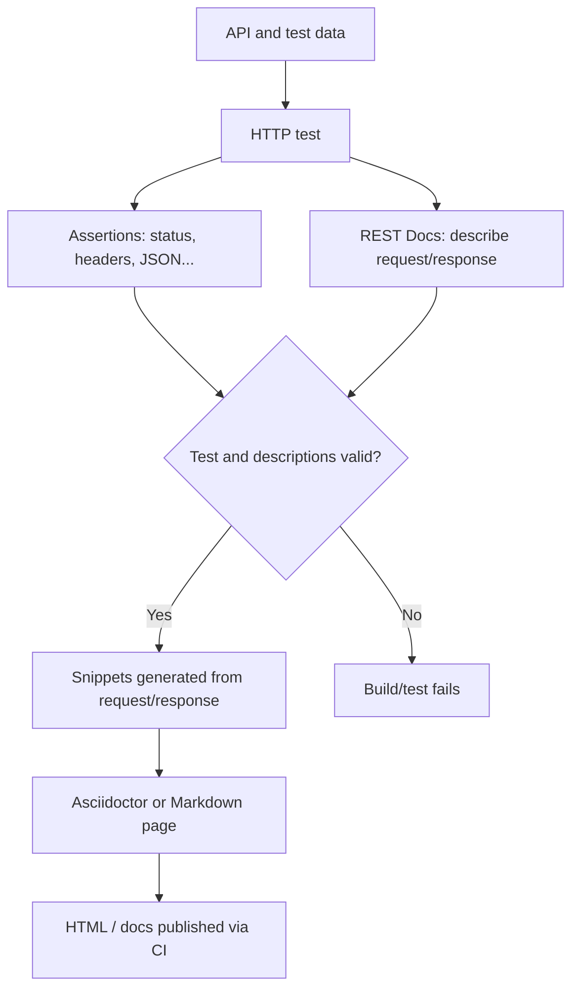
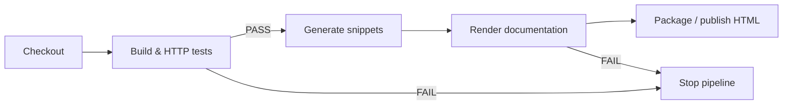

# What Is Spring REST Docs and What REST Documentation Problem Does It Solve?

## Learning Objectives

After this lesson, you will be able to:

- Explain what **Spring REST Docs** is, why REST API documentation easily drifts from the running system, and how HTTP testing helps reduce that drift.
- Describe the flow from tests using **MockMvc**, **WebTestClient**, or **REST Assured** to *snippets* and Asciidoctor/Markdown documentation.
- Identify the parts of an HTTP contract that need to be documented: method, URL, path/query parameters, headers, request body, response body, and status codes.
- Distinguish what Spring REST Docs verifies from what still needs separate testing or management; determine where it fits in the build and CI.

## 1. The Problem: API Documentation and Source Code Easily Drift Apart

Suppose the development team publishes the endpoint `GET /api/orders/{id}` with the response:

```json
{
  "id": 42,
  "status": "PAID"
}
```

A later code change replaces `status` with `paymentStatus`. The API runs with the new structure, but the guide page still shows the old example. Client applications keep reading `status` and fail. The problem is not just that authors forget to update it: when documentation is edited by hand, **there is no automated mechanism forcing the documented content to match actual HTTP behavior**.

Common types of drift include:

| Component | Common Drift | Impact on API Consumers |
| --- | --- | --- |
| URL and HTTP method | Docs state `POST`, server accepts `PUT` | Client calls the wrong endpoint or receives `405` |
| Path/query parameter | Missing required parameter, wrong name or meaning | Client constructs an invalid request |
| Header | Omitted `Content-Type`, `Accept`, or business headers | Content negotiation errors or unclear how to send requests |
| Payload | Renamed fields, changed data types, altered nesting | Client parses JSON incorrectly |
| Status code | Example shows `200`, actual response returns `201` or `404` | Client handles success/failure branches incorrectly |
| Request/response examples | Copied from outdated data | Readers cannot reproduce the operation |

**Spring REST Docs** solves an important part of this problem by **generating documentation from HTTP tests that actually execute**. A single test sends a request, asserts the response, and specifies which parts should be explained in the documentation. When the actual structure changes in a way that contradicts the declared descriptions or assertions, the test can fail during the build.

> Spring REST Docs **does not by itself prove that the entire API is correct**. It binds the documentation to the tested scenarios and documented fields. Untested endpoints, ignored fields, business logic not checked by assertions, or unrepresentative test examples can still leave the documentation incomplete or misleading.

## 2. What Is Spring REST Docs?

Spring REST Docs is a library in the Spring ecosystem that supports **test-driven API documentation**. Instead of treating the API specification as a file completely separate from the application, authors place documentation commands directly inside HTTP tests.

A typical workflow:



Core concepts:

| Concept | Meaning |
| --- | --- |
| **HTTP Test** | A test that constructs a request and observes the response, such as `GET /api/orders/42`. |
| **Assertion** | A condition verifying behavior, such as status `200`, JSON `id = 42`, and expected headers. |
| **Descriptor** | A declaration of a part to document, such as the `status` field or `id` path parameter, along with its description. |
| **Snippet** | A documentation fragment generated from the HTTP exchange and descriptors, such as `http-request.adoc` or `response-fields.adoc`. |
| **Complete Documentation** | A page composed of human-written business explanations and the auto-generated snippets. |

Spring REST Docs integrates with three popular HTTP testing approaches:

- **MockMvc:** Tests the Spring MVC layer without starting a real HTTP server; convenient for servlet/Spring MVC applications and controller documentation.
- **WebTestClient:** An HTTP test client usable in the reactive WebFlux ecosystem and certain server test setups; suitable when `WebTestClient` is already in use.
- **REST Assured:** A request/response-oriented HTTP testing DSL, commonly used when sending requests to a running server in integration tests.

All three can combine assertions with the documentation recording step; **choose the tool based on your application type and testing layer**, without needing all three in the same project.

## 3. What Does REST Docs Verify?

There are two complementary mechanisms:

1. **Test framework assertions** verify behavior. For example, `status().isOk()` checks status `200`; `jsonPath("$.status").value("PAID")` checks the returned value.
2. **REST Docs descriptors** bind the documentation content to the request/response structure observed by the test. For example, `fieldWithPath("status")` requires that field to appear in the response unless marked optional accordingly.

By default, when using *strict* field descriptors, a response field that appears without being documented can also cause the documentation step to fail. This helps catch newly added fields that have not yet been documented. You can intentionally use `optional()`, `ignored()`, or `relaxed...` variants where appropriate, though each option reduces or alters the strictness of that check.

**Important distinction:** describing `fieldWithPath("status").description("Payment status")` **does not by itself verify** that the value `"PAID"` is business-correct. To verify values, authorization, pagination, or error cases, you must write appropriate tests and assertions.

Example minimal test matrix for an order query endpoint:

| Scenario | Expected HTTP | What to Verify |
| --- | --- | --- |
| Order exists | `200 OK` | Returns accurate `id`, `status`; document success response |
| Order not found | `404 Not Found` | Error format and business error code, if any |
| Missing authorization | `401 Unauthorized` or `403 Forbidden`, depending on the case | Security mechanism and appropriate error structure |
| Malformed path parameter | Typically `400 Bad Request` if handled that way by the application | Do not assume the status; verify actual error policy |

Documentation reflects reality more accurately when tests cover **every important HTTP scenario**, not just the happy path.

## 4. Practical Example: Generating Docs for `GET /api/orders/{id}` with MockMvc

Assume the project uses Java 17+, JUnit Jupiter, Spring MVC/Test, Jackson, and the `spring-restdocs-mockmvc` dependency compatible with the Spring version in use. The following example declares a small controller directly inside the test to focus on how REST Docs works.

```java
import java.util.Map;

import org.junit.jupiter.api.BeforeEach;
import org.junit.jupiter.api.Test;
import org.junit.jupiter.api.extension.ExtendWith;
import org.springframework.http.MediaType;
import org.springframework.restdocs.RestDocumentationContextProvider;
import org.springframework.restdocs.RestDocumentationExtension;
import org.springframework.test.web.servlet.MockMvc;
import org.springframework.test.web.servlet.setup.MockMvcBuilders;
import org.springframework.web.bind.annotation.GetMapping;
import org.springframework.web.bind.annotation.PathVariable;
import org.springframework.web.bind.annotation.RestController;

import static org.springframework.restdocs.mockmvc.MockMvcRestDocumentation.document;
import static org.springframework.restdocs.mockmvc.MockMvcRestDocumentation.documentationConfiguration;
import static org.springframework.restdocs.payload.PayloadDocumentation.fieldWithPath;
import static org.springframework.restdocs.payload.PayloadDocumentation.responseFields;
import static org.springframework.restdocs.request.RequestDocumentation.parameterWithName;
import static org.springframework.restdocs.request.RequestDocumentation.pathParameters;
import static org.springframework.test.web.servlet.request.MockMvcRequestBuilders.get;
import static org.springframework.test.web.servlet.result.MockMvcResultMatchers.jsonPath;
import static org.springframework.test.web.servlet.result.MockMvcResultMatchers.status;

@ExtendWith(RestDocumentationExtension.class)
class OrderDocumentationTest {
    private MockMvc mockMvc;

    @BeforeEach
    void setUp(RestDocumentationContextProvider restDocumentation) {
        mockMvc = MockMvcBuilders.standaloneSetup(new OrderController())
                .apply(documentationConfiguration(restDocumentation))
                .build();
    }

    @Test
    void documentGetOrder() throws Exception {
        mockMvc.perform(get("/api/orders/{id}", 42)
                        .accept(MediaType.APPLICATION_JSON))
                .andExpect(status().isOk())
                .andExpect(jsonPath("$.id").value(42))
                .andExpect(jsonPath("$.status").value("PAID"))
                .andDo(document("orders-get",
                        pathParameters(
                                parameterWithName("id")
                                        .description("ID of the order to query")
                        ),
                        responseFields(
                                fieldWithPath("id").description("Order ID"),
                                fieldWithPath("status")
                                        .description("Payment status")
                        )
                ));
    }

    @RestController
    static class OrderController {
        @GetMapping(path = "/api/orders/{id}",
                    produces = MediaType.APPLICATION_JSON_VALUE)
        Map<String, Object> getOrder(@PathVariable("id") long id) {
            return Map.of("id", id, "status", "PAID");
        }
    }
}
```

Meaning of each part:

1. `RestDocumentationExtension` provides the REST Docs context and output directory in JUnit 5.
2. `documentationConfiguration(restDocumentation)` connects `MockMvc` with the documentation generator.
3. `perform(...)` sends an HTTP request to the controller through the MVC test environment.
4. `andExpect(...)` verifies key behaviors rather than merely generating an illustration.
5. `document("orders-get", ...)` assigns an identifier to this scenario's snippet set; `pathParameters(...)` and `responseFields(...)` describe the HTTP components.

If the test passes, the snippet directory typically looks similar to this (the path depends on your build configuration):

```text
build/generated-snippets/
└── orders-get/
    ├── curl-request.adoc
    ├── http-request.adoc
    ├── http-response.adoc
    ├── path-parameters.adoc
    └── response-fields.adoc
```

Here, `http-request.adoc` and `http-response.adoc` show the actual HTTP exchange; `path-parameters.adoc` and `response-fields.adoc` contain the description tables generated from the descriptors. Snippets cannot appear unless the corresponding test runs and passes.

**Try changing it:** rename the `"status"` key in the controller to `"paymentStatus"` while keeping the test unchanged. The `jsonPath("$.status")` assertion will fail. Even if you remove that assertion, the `fieldWithPath("status")` descriptor still cannot find the field under the old structure, so the strict documentation step also fails. This provides early feedback about potential drift between documentation and the API.

## 5. Snippet Types for Requests and Responses

Beyond path parameters and response fields, REST Docs lets you document many parts of an HTTP exchange:

| HTTP Part | Commonly Used Descriptor API | Example |
| --- | --- | --- |
| Path parameter | `pathParameters(...)` | `/orders/{id}` where `id` is the order ID |
| Query parameter | `queryParameters(...)` | `?page=0&size=20` |
| Request header | `requestHeaders(...)` | `Content-Type`, business headers |
| Response header | `responseHeaders(...)` | `Location` after creating a resource |
| JSON request body | `requestFields(...)` | `customerId`, `items[].quantity` |
| JSON response body | `responseFields(...)` | `id`, `status`, `items[].sku` |
| HTTP exchange | Default generated request/response snippets | Actual method, URL, headers, body |

An order creation operation `POST /api/orders` might need to document the request body, response body, `Location` header, and status `201 Created`; conversely, an endpoint `GET /api/orders?page=0` needs query parameters. Choose descriptors that reflect **the exact contract of each endpoint**.

Standalone examples for several descriptors (only the portion placed inside `document(...)`, not an independent test):

```java
queryParameters(
    parameterWithName("page").description("Page index, starting from 0")
),
requestHeaders(
    headerWithName("X-Request-Id").description("Request tracking ID")
),
requestFields(
    fieldWithPath("customerId").description("Customer ID"),
    fieldWithPath("items[].sku").description("Product SKU"),
    fieldWithPath("items[].quantity").description("Ordered quantity")
)
```

These expressions require importing the corresponding builders. Each description also requires the actual request in the test to contain the declared component; you cannot add a header or JSON field to the documentation just by writing a descriptor without sending the corresponding data.

## 6. Composing Readable Documentation

Snippets are only **documentation fragments**. Usable API documentation also needs explanations of endpoint purpose, authentication requirements, business rules, error examples, and how to distinguish statuses.

With Asciidoctor, an author can create `src/docs/asciidoc/index.adoc` like this:

```asciidoc
= Orders REST API
:toc: left
:sectnums:

== Retrieve an Order

The `GET /api/orders/{id}` endpoint returns order information by ID.

=== HTTP request
include::{snippets}/orders-get/http-request.adoc[]

=== Path parameters
include::{snippets}/orders-get/path-parameters.adoc[]

=== HTTP response
include::{snippets}/orders-get/http-response.adoc[]

=== Response fields
include::{snippets}/orders-get/response-fields.adoc[]
```

The `{snippets}` attribute must be declared in the Asciidoctor/build configuration to point to the snippet directory; the `spring-restdocs-asciidoctor` integration configures snippet inclusion in the standard way. When building the documentation, the tool combines the human-written prose with the HTTP data generated by tests and outputs HTML.

**Markdown is also a composition option**, but you must choose the appropriate snippet template format and have a tool to combine the documentation fragments. The `include::...[]` syntax above is **specific to Asciidoctor**, not a built-in feature of standard Markdown. Do not rename `.adoc` files to `.md` and expect a Markdown renderer to process include directives automatically.

## 7. Integrating Documentation Generation into Build and CI

In a project using the Gradle Groovy DSL, assuming Spring/JUnit and the `org.asciidoctor.jvm.convert` plugin are configured, the core integration can be expressed as follows:

```groovy
configurations {
    asciidoctorExt
}

dependencies {
    testImplementation 'org.springframework.restdocs:spring-restdocs-mockmvc'
    asciidoctorExt 'org.springframework.restdocs:spring-restdocs-asciidoctor'
}

def snippetsDir = file("$buildDir/generated-snippets")

tasks.named('test') {
    outputs.dir snippetsDir
}

tasks.named('asciidoctor') {
    configurations 'asciidoctorExt'
    inputs.dir snippetsDir
    dependsOn tasks.named('test')
}
```

This is an illustrative configuration snippet, not a complete `build.gradle`: you need to declare plugins, test libraries, and manage a **REST Docs version compatible** with the Spring version in use (via a BOM or explicit version). The test snippet directory configuration must match the directory read by Asciidoctor.

Running `./gradlew test asciidoctor` (on Windows you can use `gradlew.bat test asciidoctor`) executes the tests before assembling the documentation. With Maven, the equivalent idea is to let tests generate snippets in `target/generated-snippets` and then run the Asciidoctor plugin in the documentation generation phase.

In CI, a minimal pipeline typically consists of:



Useful operational rules:

- Start from a clean workspace so stale snippets are not reused when a test is removed or renamed.
- Make the documentation step depend on the test step; test failures or missing snippets must fail the build.
- Use stable test data; fix or normalize IDs, timestamps, tokens, and random values when generating examples.
- Do not include access keys, passwords, real access tokens, or personal data in snippets and artifacts. You can use dummy data and snippet preprocessors to strip or mask sensitive values.
- Store or publish HTML from the exact tested build, and treat documentation as an artifact traceable to the application version.

## 8. Comparison with Hand-Written Documentation and OpenAPI

| Criterion | Fully Manual Documentation | Spring REST Docs | OpenAPI (and related tooling) |
| --- | --- | --- | --- |
| Content source | Author manually enters examples and descriptions | HTTP tests and descriptors written by the author | OpenAPI specification document; can be written upfront or generated from code/tools |
| Link to tests | Must be organized manually | Directly integrated; snippets generated when tests run | Depends on separate workflow and spec validation tools |
| Drift detection | Mostly requires manual review | Detects drift within the scope of tests and descriptors | Can detect via contract/schema testing if configured |
| Rich explanatory HTML | Crafted by the author | Well-suited to Asciidoctor pages with custom prose | Has dedicated UIs and renderers like Swagger UI/Redoc |
| Automatic SDK/client generation | Not a strength | Not a primary goal | A core strength of the OpenAPI ecosystem |

You do not necessarily have to choose only one between Spring REST Docs and OpenAPI. If an organization needs in-depth explanatory docs, tested HTTP examples, **and** a machine-readable spec for SDK generation, a combined workflow can be built; however, synchronization between them must be clearly designed and verified.

## 9. Limitations and Common Pitfalls

**Limitations of test-driven documentation:**

- **No tests, no guarantees:** REST Docs does not automatically discover every endpoint or ensure the API is completely documented.
- **Tests may verify too little:** asserting `200` and declaring two fields does not prove authorization logic, the entire schema, error cases, or business semantics are correct.
- **Human-written descriptions can still be wrong:** `description("Payment status")` does not prove that `status` actually represents payment status.
- **Strict/relaxed is a trade-off:** strict documentation catches undocumented new fields; relaxed documentation reduces friction but also makes it easy to miss changes.
- **Dynamic data makes docs hard to read:** random UUIDs, current timestamps, or infrastructure headers must be controlled or normalized before publishing.

| Symptom | Check First |
| --- | --- |
| Test fails due to undocumented field | Compare actual JSON against `responseFields(...)`/`requestFields(...)`; update descriptors or intentionally mark as ignored if appropriate |
| Missing `orders-get/response-fields.adoc` | Check that the test ran, `document("orders-get", ...)` was invoked, and the output directory is correct |
| Asciidoctor reports missing include file | Check the `snippets` attribute, snippet path, and task order `test` → `asciidoctor` |
| Documentation examples contain strange URLs/IDs/tokens | Check host/scheme configuration, test fixture data, and document preprocessing steps |
| Documentation has success examples but no error examples | Add HTTP tests for meaningful `4xx/5xx` scenarios instead of expecting the tool to infer them |

## 10. Self-Check Exercise

For the endpoint `POST /api/orders`, suppose the request is:

```http
POST /api/orders HTTP/1.1
Content-Type: application/json

{"customerId":7,"items":[{"sku":"BOOK-01","quantity":2}]}
```

Expected response:

```http
HTTP/1.1 201 Created
Location: /api/orders/43
Content-Type: application/json

{"id":43,"status":"CREATED"}
```

Identify what should be included in a documentation test: an assertion for status `201`, the `Location` response header, at least one assertion for the response body; `requestFields(...)` for `customerId`, `items[].sku`, `items[].quantity`; `responseFields(...)` for `id`, `status`; and `responseHeaders(...)` for `Location`. Then place the snippets in an Asciidoctor section describing the business meaning of the `CREATED` status.

**Thought-check question:** If the test only asserts `201` while the API returns incorrect JSON values, is REST Docs guaranteed to report an error? **Not guaranteed.** Detection depends on the actual assertions and descriptors; values and critical business invariants must be verified with test assertions.

## Conclusion

Spring REST Docs binds **REST API documentation to HTTP tests**: requests and responses are observed via MockMvc, WebTestClient, or REST Assured; descriptors generate snippets; Asciidoctor/Markdown combines snippets with explanations; and the build and CI detect drift within the tested scope. Its core value is making documentation a testable part of the development workflow. Ultimate reliability still depends on test quality, endpoint coverage, and the accuracy of human-written explanations.
