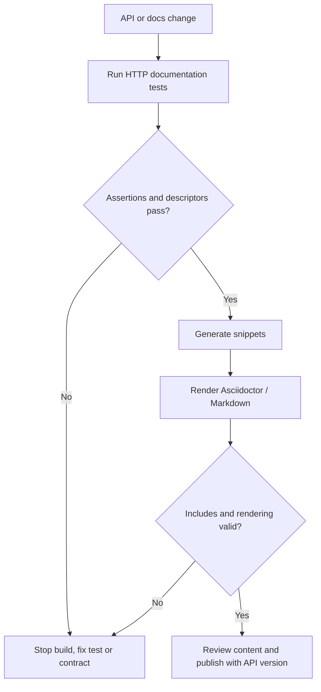

# Accurate, Readable, and Verifiable Documentation Goals

## Learning Objectives

Upon completing this lesson, you will be able to:

- Distinguish the three quality goals of REST API documentation: **accurate**, **readable**, and **verifiable**.
- Turn high-level goals into concrete acceptance criteria for endpoints, payloads, parameters, headers, HTTP status codes, and errors.
- Use **Spring REST Docs** together with HTTP tests via **MockMvc**, **WebTestClient**, or **REST Assured** to produce evidence of documented behavior.
- Organize snippets, Asciidoctor/Markdown explanations, and build/CI workflows so documentation is checked whenever the API changes.
- Recognize the limitations of test-generated documentation and know when to add assertions, test scenarios, and content reviews.

## 1. Why Does REST API Documentation Need All Three Goals?

Imagine a team providing the `POST /api/orders` API for a sales application. The documentation says that sending a valid order returns `201 Created` and a `Location` header pointing to the new resource. However, after a code change, the server actually returns `200 OK`; the request example in the docs still uses the old `customer` field name, and a newcomer does not know what unit `quantity` represents.

All three issues are documentation defects, yet they belong to different quality dimensions:

| Goal | Question to Answer | When This Goal Is Missing |
| --- | --- | --- |
| **Accurate** | Does the documentation faithfully reflect the behavior and contract of the released API version? | Clients build invalid requests/responses and mishandle status codes or JSON fields. |
| **Readable, usable** | Do integrators understand the purpose, preconditions, usage flow, and meaning of each component? | The API may be technically accurate, yet readers still do not know how to use it. |
| **Verifiable** | Is there repeatable evidence to detect documentation drift when the code changes? | Documentation is accurate when written, but lacks reliable signals as the API evolves. |

The three goals reinforce each other. A nicely formatted JSON field table is useless if field names are wrong; conversely, a collection of real HTTP traces may be accurate yet hard to use without guidance. A page containing statements that happen to be true today will not stay accurate across deployments without tests and CI.

In the **SPRING_REST_DOCS** module, Spring REST Docs is the tool that binds API descriptions to requests and responses executed in tests. By itself, it does not replace API design, writing explanations, or choosing sufficient test scenarios.

## 2. First Goal: Accurate Documentation

Accurate documentation describes **verified behavior of the exact API version**. This includes both data structures and the rules clients must follow.

### 2.1. Accuracy of the HTTP Contract

For each important operation, check:

1. **Method and path:** `GET`, `POST`, `PUT`, `PATCH`, or `DELETE`; path format, API version, and path variables.
2. **Inputs:** path/query parameters, request headers, `Content-Type`, JSON body; required/optional fields, data types, constraints, and default values.
3. **Outputs:** status code, response headers, JSON structure, field types, nullable fields, units of measurement, and data semantics.
4. **Failure cases:** authentication errors, authorization errors, invalid input, not found, conflicts, rate limits; each case must be described according to actual behavior.
5. **Business semantics:** preconditions for creating/updating a resource, valid states, idempotency guarantees if committed by the API, and pagination/filtering/sorting rules.

For example, for an API returning:

```http
HTTP/1.1 201 Created
Location: /api/orders/43
Content-Type: application/json

{"id":43,"status":"CREATED"}
```

It is not enough for the documentation to merely say "order created successfully." It must explicitly state that `201` indicates a new resource was created, `Location` contains the resource URI, and what `CREATED` means in the order lifecycle of **this application**.

### 2.2. Choosing the Source of Truth and Version Scope

Trustworthy documentation must identify which release or commit it belongs to. An HTTP example generated from a test on a development branch does not automatically represent production, especially if production is running an older version.

A useful rule is to **generate and publish documentation from the same build tested for releasing the application**. If the product supports multiple API versions, clearly state the corresponding version or path; avoid mixing examples from two versions on the same page.

### 2.3. Accurate Does Not Mean Complete

A test verifying that `GET /orders/42` returns `200` confirms only one scenario. It does not prove that every ID yields the right result, that `404` errors have the documented structure, or that unauthorized users are rejected. Therefore, distinguish between:

- **Correct in one scenario**: the request/response of a specific test has been verified.
- **Contract coverage**: important scenarios all have tests and documentation.
- **Business correctness**: assertions actually reflect product rules rather than just checking that JSON exists.

## 3. Second Goal: Readable and Usable Documentation

REST API documentation has concrete readers: integration developers, QA engineers, operations teams, or partners. They usually arrive with a task: "Create an order," "Fetch a page of results," "Handle token expiration." Therefore, organize pages around **the task the reader wants to accomplish**, and only then introduce technical details.

An endpoint documentation section can follow this order:

| Section | What the Reader Needs |
| --- | --- |
| Purpose | What task the endpoint serves; when should it be called? |
| Prerequisites | Authentication, scopes/roles, required data, special rules |
| Request | Method, URL, headers, parameters, and body with understandable examples |
| Success | Status, response headers/body, meaning of key fields |
| Failures | Error scenarios, status codes, error structure, and remediation steps |
| Integration notes | Pagination, limits, retry/idempotency if supported by the API |

### 3.1. Write Meaningful Descriptions Instead of Repeating Field Names

Compare:

| Poor Description | More Useful Description |
| --- | --- |
| `quantity`: Quantity | `quantity`: Number of items in an order line; integer greater than 0 |
| `status`: Status | `status`: Order status; `CREATED` means recorded, payment not yet completed |
| `page`: Page | `page`: Zero-based page index; defaults to 0 if omitted |
| `X-Request-Id`: Header | `X-Request-Id`: Identifier used to correlate logs between client and server |

Descriptive sentences improve documentation usability **only when they match the rules of the implemented API**. Do not state default values, constraints, or business meanings just because that is how many other APIs behave.

### 3.2. Good Examples Must Be Reproducible

Use stable dummy data that contains no personal information or real tokens. Request examples must match the headers and payload accepted by the endpoint; responses must be consistent with that request. When providing examples for multiple scenarios, use clear labels such as "Created successfully," "Missing required field," or "Not found."

Readers need to know what placeholders like `{orderId}` or `YOUR_TOKEN` represent and what values to substitute. If the body contains timestamps, currency units, or enums, explicitly state the accepted format and actual set of values.

### 3.3. Place Explanations Alongside Auto-Generated Content

Spring REST Docs can generate snippets such as `http-request`, `http-response`, `request-fields`, `response-fields`, `path-parameters`, `query-parameters`, `request-headers`, and `response-headers`. However, a page consisting solely of assembled snippets still lacks context: "Who may call this?", "When should it be called?", "What does this response mean?". Use **Asciidoctor or Markdown** to write narrative explanations; snippets serve as concrete evidence and examples for that narrative.

## 4. Third Goal: Verifiable Documentation

"Verifiable" means key claims in the documentation have a clear, repeatable way to be checked, ideally during the build itself.

With Spring REST Docs, it is important to understand three distinct layers:

| Layer | Mechanism | What It Verifies | What It Does Not Automatically Verify |
| --- | --- | --- | --- |
| **Behavior testing** | MockMvc/WebTestClient/REST Assured assertions | Status, headers, JSON values, behavior in tested scenarios | Untested scenarios; business rules without assertions |
| **Structural constraints** | REST Docs descriptors, e.g., `fieldWithPath("status")` | Documented fields/parameters/headers match the HTTP exchange under the chosen mode | Whether the prose description is semantically accurate |
| **Published documentation** | Rendering Asciidoctor/Markdown in the build | Snippet includes and links exist, page renders | Clarity, completeness, and any manual claims |

For example:

```java
// Assertions verifying concrete behavior:
.andExpect(status().isCreated())
.andExpect(jsonPath("$.status").value("CREATED"))

// Descriptors documenting the observed structure:
responseFields(
    fieldWithPath("id").description("New order ID"),
    fieldWithPath("status").description("Order status")
)
```

If the response lacks `status`, the assertion and descriptor can detect it. However, if someone writes that `CREATED` means "shipped" when the system defines it as "order recorded," these test lines will not automatically catch that semantic error. That issue requires content review against business definitions.

**Note on strictness:** `requestFields(...)` and `responseFields(...)` descriptors in strict mode typically fail when an undocumented field is present. `optional()`, `ignored()`, and `relaxed...` variants serve specific purposes, but must be used deliberately so important contract changes are not hidden.

## 5. End-to-End Example: Documenting the Order Creation API

Suppose the application supports `POST /api/orders`. The contract for this learning example is:

- The JSON request contains `customerId` and an `items` array; each element has `sku` and `quantity`.
- Success returns `201 Created`, header `Location: /api/orders/43`, and JSON `{"id":43,"status":"CREATED"}`.
- `CREATED` means the order has just been recorded, not yet paid.

Example request:

```http
POST /api/orders HTTP/1.1
Content-Type: application/json
Accept: application/json

{
  "customerId": 7,
  "items": [
    {"sku": "BOOK-01", "quantity": 2}
  ]
}
```

### 5.1. A Test That Both Verifies Results and Generates Snippets

This illustration uses **JUnit Jupiter**, **Spring MVC Test**, **Spring REST Docs MockMvc**, and Jackson on Java 17+. A mock controller with fixed data helps focus on the documentation mechanism; in a real project, test the actual controller/service and add business scenarios.

```java
import java.net.URI;
import java.util.List;

import org.junit.jupiter.api.BeforeEach;
import org.junit.jupiter.api.Test;
import org.junit.jupiter.api.extension.ExtendWith;
import org.springframework.http.MediaType;
import org.springframework.http.ResponseEntity;
import org.springframework.restdocs.RestDocumentationContextProvider;
import org.springframework.restdocs.RestDocumentationExtension;
import org.springframework.test.web.servlet.MockMvc;
import org.springframework.test.web.servlet.setup.MockMvcBuilders;
import org.springframework.web.bind.annotation.PostMapping;
import org.springframework.web.bind.annotation.RequestBody;
import org.springframework.web.bind.annotation.RestController;

import static org.springframework.restdocs.mockmvc.MockMvcRestDocumentation.document;
import static org.springframework.restdocs.mockmvc.MockMvcRestDocumentation.documentationConfiguration;
import static org.springframework.restdocs.payload.PayloadDocumentation.fieldWithPath;
import static org.springframework.restdocs.payload.PayloadDocumentation.requestFields;
import static org.springframework.restdocs.payload.PayloadDocumentation.responseFields;
import static org.springframework.restdocs.headers.HeaderDocumentation.headerWithName;
import static org.springframework.restdocs.headers.HeaderDocumentation.requestHeaders;
import static org.springframework.restdocs.headers.HeaderDocumentation.responseHeaders;
import static org.springframework.test.web.servlet.request.MockMvcRequestBuilders.post;
import static org.springframework.test.web.servlet.result.MockMvcResultMatchers.header;
import static org.springframework.test.web.servlet.result.MockMvcResultMatchers.jsonPath;
import static org.springframework.test.web.servlet.result.MockMvcResultMatchers.status;

@ExtendWith(RestDocumentationExtension.class)
class CreateOrderDocumentationTest {
    private MockMvc mvc;

    @BeforeEach
    void setUp(RestDocumentationContextProvider context) {
        mvc = MockMvcBuilders.standaloneSetup(new OrderController())
                .apply(documentationConfiguration(context))
                .build();
    }

    @Test
    void createOrder() throws Exception {
        mvc.perform(post("/api/orders")
                        .contentType(MediaType.APPLICATION_JSON)
                        .accept(MediaType.APPLICATION_JSON)
                        .content("""
                            {
                              "customerId": 7,
                              "items": [{"sku":"BOOK-01","quantity":2}]
                            }
                            """))
                .andExpect(status().isCreated())
                .andExpect(header().string("Location", "/api/orders/43"))
                .andExpect(jsonPath("$.id").value(43))
                .andExpect(jsonPath("$.status").value("CREATED"))
                .andDo(document("orders-create",
                        requestHeaders(
                                headerWithName("Content-Type")
                                        .description("JSON format of the request")
                        ),
                        requestFields(
                                fieldWithPath("customerId")
                                        .description("Customer ID"),
                                fieldWithPath("items[].sku")
                                        .description("Product SKU"),
                                fieldWithPath("items[].quantity")
                                        .description("Product quantity")
                        ),
                        responseHeaders(
                                headerWithName("Location")
                                        .description("URI of the newly created resource")
                        ),
                        responseFields(
                                fieldWithPath("id")
                                        .description("New order ID"),
                                fieldWithPath("status")
                                        .description("Order status")
                        )
                ));
    }

    record OrderItem(String sku, int quantity) {}
    record OrderRequest(long customerId, List<OrderItem> items) {}
    record OrderResponse(long id, String status) {}

    @RestController
    static class OrderController {
        @PostMapping(
                path = "/api/orders",
                consumes = MediaType.APPLICATION_JSON_VALUE,
                produces = MediaType.APPLICATION_JSON_VALUE
        )
        ResponseEntity<OrderResponse> create(@RequestBody OrderRequest request) {
            return ResponseEntity.created(URI.create("/api/orders/43"))
                    .body(new OrderResponse(43, "CREATED"));
        }
    }
}
```

*Explanation of the quality layers in the example:*

1. `status().isCreated()`, `header().string(...)`, and `jsonPath(...)` confirm the **201** status, `Location`, and JSON values. This provides evidence for the tested success scenario.
2. `requestHeaders(...)`, `requestFields(...)`, `responseHeaders(...)`, and `responseFields(...)` bind the description tables to the actual HTTP exchange. Renamed or missing fields can cause documentation generation to fail.
3. The identifier `orders-create` groups snippets for one scenario. Output is typically placed in `build/generated-snippets/orders-create/` with Gradle (or `target/generated-snippets/` in common Maven setups).
4. The `description(...)` strings help readers understand the contract, though they still require review. For example, "Customer ID" may need to be expanded with validation rules if that is an important integration condition.

The example uses a fixture creating an order with a fixed ID so snippets stay stable. A real project must test business logic separately; this mock controller **does not prove** customer validation, quantity validation, authorization, or persistence.

### 5.2. Verifying Error Cases and API Variants

Do not stop at a single success test. Build a matrix based on what the documentation promises:

| Scenario to Consider | Result to Assert in Test | Content to Include in Docs |
| --- | --- | --- |
| Valid request | `201`, `Location`, `id`, `status` | Success example, request/response fields |
| Missing `customerId` | Status and error structure defined by the API | Required fields, validation errors, how to fix |
| Invalid `quantity` | Actual application status and error code | Quantity limits, error message |
| Unauthorized order creation | `401` or `403` depending on actual authentication/authorization | Permission scope, rejection response |
| Resending the same request | Behavior defined by the API | Whether idempotency or deduplication keys are supported |

Never assume `400`, `401`, `403`, or an arbitrary error structure just because they are common. You must **verify your own application's behavior** and add corresponding tests. Similarly, if an endpoint uses path parameters, query parameters, or business headers, add descriptors like `pathParameters(...)`, `queryParameters(...)`, or `requestHeaders(...)` matching that test's request.

## 6. Composing Readable Documentation from Snippets

Snippets like `http-request.adoc`, `http-response.adoc`, `request-fields.adoc`, and `response-fields.adoc` are HTTP evidence blocks; authors need to surround them with explanations.

Example Asciidoctor file:

```asciidoc
== Create an Order

Use POST /api/orders to record a new order.
The CREATED status indicates the order has been accepted and is not yet paid.

=== HTTP request
include::{snippets}/orders-create/http-request.adoc[]

=== Request fields
include::{snippets}/orders-create/request-fields.adoc[]

=== HTTP response
include::{snippets}/orders-create/http-response.adoc[]

=== Response headers
include::{snippets}/orders-create/response-headers.adoc[]

=== Response fields
include::{snippets}/orders-create/response-fields.adoc[]
```

The `{snippets}` attribute must be configured to point to the test output. When using Asciidoctor, the build must run tests **before rendering**, so include paths always reference existing files.

If the project chooses **Markdown**, use a Markdown-compatible snippet format and an appropriate composition/integration step. The `include::{snippets}/...` syntax in the example is **Asciidoctor syntax**, not available in standard Markdown. Tooling must ensure generated content is properly embedded or linked without manually copying HTTP examples.

### How to Read an API Page to Spot Missing Information

Put yourself in the shoes of a first-time integrator and try to answer: "Which URL do I call, what headers/body do I send, what do I check for success, how do I handle errors, and can I replay the example with dummy data?" If you cannot answer from the documentation, then even if every snippet generates cleanly, the **readability and usability** goal is not yet met.

## 7. Keeping Documentation Verifiable in Build and CI

The pipeline should turn incompatible changes into early failure signals:



A reliable setup should ensure:

1. **Ordered execution:** documentation tests run before the rendering step; the rendering step declares snippet outputs as inputs.
2. **No stale outputs:** clean or isolate temporary outputs when needed, so removed tests do not accidentally leave old snippets in the documentation bundle.
3. **Repeatability:** fixtures, clocks, IDs, and data ordering should be stable or normalized; for data that is hard to fix, use appropriate snippet preprocessing.
4. **No secret leaks:** use dummy tokens and customer data; strip cookies, auth headers, secrets, and personal data from published artifacts.
5. **Version alignment:** the documentation artifact is produced from the commit/build corresponding to the released software; when multiple API versions exist, label versions clearly.
6. **Qualitative review:** people with domain knowledge review wording, error cases, and realistic examples. Tests cannot evaluate prose clarity on their own.

With Gradle, a common execution command looks like `./gradlew test asciidoctor` after configuring plugins, REST Docs dependencies, and tasks; on Windows you can use `gradlew.bat test asciidoctor`. With Maven, the analogous idea is having tests generate snippets and using the Asciidoctor plugin to render the documentation.

## 8. Traceability Matrix: Every Commitment Must Have a Way to Verify

"Verifiable" becomes clearer when each commitment in the documentation is linked to an appropriate test and piece of evidence:

| Commitment on the API Page | Appropriate Evidence | Needs Additional Manual Review? |
| --- | --- | --- |
| Successful order creation returns `201` | HTTP status assertion in the `orders-create` test | No, if that is the required contract status |
| Response has `id` and `status` | `responseFields(...)` and value assertions | Yes, to confirm descriptions and status meanings |
| `Location` points to the new order | Header assertion; `responseHeaders(...)` | Yes, if the URI must follow specific public URL rules |
| `quantity` must be greater than 0 | Validation tests for `0`, negative numbers, and valid values | Yes, cross-check against business rules |
| Unauthorized requests are rejected | Security tests for the appropriate roles/tokens | Yes, review permission descriptions |
| HTML documentation embeds snippets properly | Asciidoctor/Markdown render task succeeds | Yes, check layout and clarity |

Not every sentence in the documentation requires its own dedicated test. The matrix prioritizes **commitments that can cause integration failures or incorrect behavior**. An assertion checking only `200` cannot count as evidence for access control, data types, and all business rules.

### Quality Metrics to Use

Do not use snippet count or total test count as the sole metric. Look at:

- **Scenario coverage:** do key operations and error branches have documentation tests?
- **Assertion strength:** do tests verify meaningful values, status codes, and headers rather than merely checking that no exception was thrown?
- **Descriptor strictness:** are key fields documented in strict mode or ignored without justification?
- **Reproducibility:** do examples use dummy, stable data matching the same API version?
- **Usability:** can a reader complete an integration task using only the published guide?

These are criteria for **practical review**, not a claim that Spring REST Docs automatically measures and guarantees every indicator.

## 9. Common Mistakes That Degrade Documentation Quality

| Symptom | Common Cause | How to Fix |
| --- | --- | --- |
| Docs still render even though the API added a new field | Overly broad relaxed descriptors or `ignored()` | Review strictness; only ignore fields with good reason |
| Response examples keep changing | Non-deterministic IDs, timestamps, or result ordering | Use stable fixtures or preprocess dynamic data |
| Only `2xx` scenarios exist | No plan for documenting errors | Add tests for validation, authentication, and key error branches |
| Field table is accurate but explanations are wrong | Hand-written descriptions lack domain review | Include descriptions, enums, and constraints in code/docs review |
| Missing snippet include file | Test did not run, snippet renamed, or wrong path configured | Declare task dependencies, check paths, and clean outputs |
| Public examples contain real tokens or real data | Requests captured from live environments or unmasked headers | Use dummy fixtures and filter sensitive content |
| Docs describe unimplemented behavior | Copied from future design without noting status | Tie docs to the released version; clearly separate planned features |

A common mistake is thinking "if the tests pass, the documentation is definitely right." Tests only pass against **the checks you wrote**. Documentation quality still depends on scenario design, observation depth, description accuracy, and editing.

## 10. Acceptance Checklist for a REST API Page

Before including a documentation page in a release package, authors can use the following checklist:

- [ ] Clearly states the task, endpoint, method, API version, and authentication requirements.
- [ ] Includes request/response examples generated from executed test scenarios; contains no sensitive data.
- [ ] Fully documents important fields, parameters, and headers with data types and constraints where applicable.
- [ ] Distinguishes success from essential errors; status codes and error structures match tests.
- [ ] Important business claims have tests or have been reviewed with the responsible owners.
- [ ] Documentation tests and the rendering step ran successfully from a clean build.
- [ ] A newcomer can understand and replay the usage flow using the published guide.
- [ ] Documentation is traceable to the corresponding release/commit.

**Exercise:** Suppose the endpoint `GET /api/orders?page=0&size=20` has documentation describing `page` as 1-based while the server uses 0-based indexing. Propose: (a) an assertion verifying first-page behavior, (b) `queryParameters(...)` with the accurate description, (c) a test for the next page, and (d) a way to ensure the HTML documentation is regenerated after the fix. Note that updating the prose description alone does not prove pagination works correctly; you must verify the data returned per page.

## Conclusion

Good REST API documentation must simultaneously be **accurate to the running contract**, **helpful for readers to accomplish tasks**, and **backed by automated evidence that catches drift on future changes**. Spring REST Docs helps achieve this by connecting HTTP tests (MockMvc, WebTestClient, or REST Assured), assertions, descriptors, and snippets; Asciidoctor/Markdown completes the narrative, while the build and CI re-verify the content. Testing provides the verification foundation, whereas selecting sufficient scenarios and editing accurate semantics remain the development team's responsibility.
