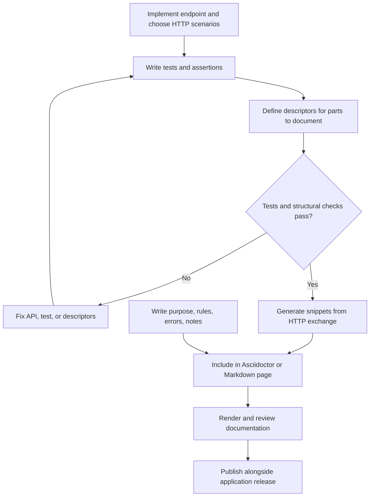
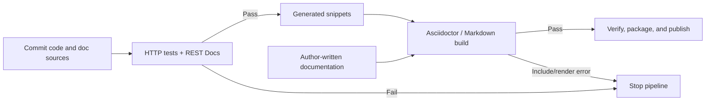

# Relationship Between Handwritten Documentation and Generated Snippets

## Learning Objectives

After this lesson, you will be able to:

- Distinguish **author-written documentation** from **snippets generated by HTTP tests** in Spring REST Docs.
- Explain why both types of content must go together so REST API documentation provides context while reflecting verified requests and responses.
- Generate snippets from a documentation test using **MockMvc** and include them in **Asciidoctor** documentation.
- Understand how to apply the same principles when using **WebTestClient**, **REST Assured**, or choosing Markdown as the output format.
- Handle API changes that cause snippets, include links, or manual explanations to fall out of sync, while integrating the necessary checks into build and CI.

## 1. Two Parts of Good REST API Documentation

Imagine you are tasked with integrating the `GET /api/orders?page=0&size=20` endpoint. You need to know how to send the HTTP request, the response fields, and the status codes. You also need to know **when to call the endpoint**, whether the `page` parameter starts at 0 or 1, what permissions the user needs, and how to handle an empty list.

These are two groups of information from different sources:

1. **Handwritten documentation** is authored by humans: business purpose, integration guides, prerequisites, rule explanations, caveats, and error handling guidance.
2. **Generated snippets** are documentation fragments captured from a request/response executed in a Spring REST Docs test, combined with the *descriptors* provided by the test author—for example: the HTTP request, HTTP response, query parameter table, request fields, or response fields.

A complete page typically looks like this:

```text
"List Orders" Page                          ← Organized and edited by the author
├── When to use this endpoint?              ← Handwritten
├── Auth prerequisites and filtering rules  ← Handwritten
├── HTTP request example                    ← Snippet from test
├── Query parameter description table       ← Snippet from test + descriptors
├── HTTP response example                   ← Snippet from test
├── Response field description table        ← Snippet from test + descriptors
├── Status semantics and pagination         ← Handwritten
└── Error cases, integration notes          ← Handwritten + corresponding snippet/test
```

In the **SPRING_REST_DOCS** module, the goal is to produce verifiable REST API documentation using **MockMvc**, **WebTestClient**, or **REST Assured**, generate snippets for requests, responses, payloads, parameters, and headers, and compile them into Asciidoctor/Markdown documentation in the build and CI pipeline.

**Core takeaway:** machines capture and verify what happened in a test; humans explain the **meaning**, **usage**, and **applicability** of that behavior. Spring REST Docs does not write a complete integration guide solely from controller or DTO names.

## 2. Boundary of Responsibility: What Belongs Where?

| Content to Document | Appropriate Source | Why? |
| --- | --- | --- |
| Actual HTTP method, URL, headers, and body of a scenario | `http-request` / `curl-request` snippet | Captured from the request executed by the test, reducing manual copying. |
| Actual response status, headers, and JSON | `http-response` snippet | Shows what the server/test actually returned in the scenario. |
| Query/path parameter names and descriptions | `query-parameters` / `path-parameters` snippet with descriptors | Binds the documented parameter list to the corresponding request. |
| Request/response field names and descriptions | `request-fields` / `response-fields` snippet with descriptors | Can detect certain structural mismatches when running tests. |
| Important business headers | `request-headers` / `response-headers` snippet with descriptors | Documents headers declared in the HTTP exchange. |
| Endpoint purpose, task the reader wants to accomplish | Handwritten documentation | Tests do not understand product goals. |
| Status semantics, pagination rules, access permissions | Handwritten documentation, verified by appropriate tests | These rules must be explained in business language. |
| Retry guidance, idempotency, system limits | Handwritten documentation, backed by tests and/or an authoritative spec | Cannot be safely inferred from a single successful HTTP example. |
| Version scope, changelog, support contact | Handwritten documentation or docs portal | Governance information that does not naturally appear in responses. |

A field description snippet is **not completely automatic**: for example, `fieldWithPath("status").description("Order status")` takes the field name from a developer-written descriptor, and the description text is also human-provided. REST Docs checks presence and certain structural constraints, but **does not verify whether the prose description is accurate in business terms**.

### 2.1. Why Not Write All HTTP Examples by Hand?

Suppose a handwritten page shows this response:

```json
{"id": 42, "status": "PAID"}
```

The application renames the field to `paymentStatus`. If the documentation is not part of the test workflow, the stale example can persist across multiple releases. When the response comes from a documentation test, the snippet reflects the HTTP exchange executed by the test; if the descriptor still points to `status` and the test uses strict checking, documentation generation fails and forces the team to address the change.

However, **generated snippets do not guarantee the entire documentation is correct**: if a test only runs against a stubbed controller, the real API may behave differently; if assertions are too sparse, returned values might be business-wrong; if handwritten prose says `page` starts at 1 while the server starts at 0, REST Docs will not catch that sentence.

### 2.2. Why Not Just Stitch Snippets Together?

An HTTP trace:

```http
GET /api/orders?page=0&size=2 HTTP/1.1
Accept: application/json
```

shows how to call the endpoint in one situation. It **does not explain** when to filter by status, what the maximum `size` limit is, how results are sorted, or what permissions are required. Those rules belong in the explanatory prose and must be verified with the API owners. A page containing only field tables and request examples may be technically accurate yet still hard to integrate.

## 3. Lifecycle from Test to Complete Documentation



The tasks are interdependent:

- **HTTP test** determines which scenario is recorded. Assertions must verify key aspects such as status, headers, and JSON values.
- **Descriptor** determines which parts are rendered as tables. For example, `responseFields(...)` requires declaring field paths and descriptions.
- **Snippet** is an intermediate artifact, typically ending in `.adoc` for Asciidoctor format. It is not yet a complete guide page.
- **Source document** holds human-authored content and snippet include/reference directives.
- **Build** runs tests and then renders documentation; **CI** re-runs these steps whenever code changes.

These steps only make sense when tied to the **same commit or build version**. A page rendered from an old version does not prove that the new release's API still matches.

## 4. Practical Example: One Test, Multiple Snippets, One Contextual Page

Consider the example endpoint:

```http
GET /api/orders?page=0&size=2 HTTP/1.1
Accept: application/json
```

Expected response:

```json
{
  "content": [
    {"id": 42, "status": "PAID"}
  ],
  "page": 0,
  "size": 2
}
```

To focus on Spring REST Docs, the example uses a mock controller returning fixed data. In a real application, pagination, sorting, filtering, and authorization logic must be tested separately.

### 4.1. Writing a Documentation Test with MockMvc

This example targets Java 17+, JUnit Jupiter, Spring MVC Test, Jackson, and a compatible `spring-restdocs-mockmvc` dependency. The test aims to record an executable HTTP scenario and generate query parameter and response field tables.

```java
import java.util.List;

import org.junit.jupiter.api.BeforeEach;
import org.junit.jupiter.api.Test;
import org.junit.jupiter.api.extension.ExtendWith;
import org.springframework.http.MediaType;
import org.springframework.restdocs.RestDocumentationContextProvider;
import org.springframework.restdocs.RestDocumentationExtension;
import org.springframework.test.web.servlet.MockMvc;
import org.springframework.test.web.servlet.setup.MockMvcBuilders;
import org.springframework.web.bind.annotation.GetMapping;
import org.springframework.web.bind.annotation.RequestParam;
import org.springframework.web.bind.annotation.RestController;

import static org.springframework.restdocs.mockmvc.MockMvcRestDocumentation.document;
import static org.springframework.restdocs.mockmvc.MockMvcRestDocumentation.documentationConfiguration;
import static org.springframework.restdocs.payload.PayloadDocumentation.fieldWithPath;
import static org.springframework.restdocs.payload.PayloadDocumentation.responseFields;
import static org.springframework.restdocs.request.RequestDocumentation.parameterWithName;
import static org.springframework.restdocs.request.RequestDocumentation.queryParameters;
import static org.springframework.test.web.servlet.request.MockMvcRequestBuilders.get;
import static org.springframework.test.web.servlet.result.MockMvcResultMatchers.jsonPath;
import static org.springframework.test.web.servlet.result.MockMvcResultMatchers.status;

@ExtendWith(RestDocumentationExtension.class)
class OrdersListDocumentationTest {
    private MockMvc mvc;

    @BeforeEach
    void setUp(RestDocumentationContextProvider context) {
        mvc = MockMvcBuilders.standaloneSetup(new OrdersController())
                .apply(documentationConfiguration(context))
                .build();
    }

    @Test
    void listOrders() throws Exception {
        mvc.perform(get("/api/orders?page={page}&size={size}", 0, 2)
                        .accept(MediaType.APPLICATION_JSON))
                .andExpect(status().isOk())
                .andExpect(jsonPath("$.page").value(0))
                .andExpect(jsonPath("$.size").value(2))
                .andExpect(jsonPath("$.content[0].id").value(42))
                .andExpect(jsonPath("$.content[0].status").value("PAID"))
                .andDo(document("orders-list",
                        queryParameters(
                                parameterWithName("page")
                                        .description("Page index, starting from 0"),
                                parameterWithName("size")
                                        .description("Requested number of items per page")
                        ),
                        responseFields(
                                fieldWithPath("content")
                                        .description("List of orders on the page"),
                                fieldWithPath("content[].id")
                                        .description("Order ID"),
                                fieldWithPath("content[].status")
                                        .description("Order status"),
                                fieldWithPath("page")
                                        .description("Returned page index"),
                                fieldWithPath("size")
                                        .description("Requested page size")
                        )
                ));
    }

    record Order(long id, String status) {}
    record OrderPage(List<Order> content, int page, int size) {}

    @RestController
    static class OrdersController {
        @GetMapping(path = "/api/orders",
                    produces = MediaType.APPLICATION_JSON_VALUE)
        OrderPage list(@RequestParam("page") int page,
                       @RequestParam("size") int size) {
            return new OrderPage(List.of(new Order(42, "PAID")), page, size);
        }
    }
}
```

In this test:

- `andExpect(...)` **verifies behavior**, including the status code and response values.
- `queryParameters(...)` **documents the parameters** actually present in the request query string.
- `responseFields(...)` **documents the JSON fields** returned by the scenario. Strict descriptors can detect undocumented fields or declared fields that do not appear.
- `document("orders-list", ...)` **assigns a stable name** to the snippet directory; the documentation will reference this name.

A passing test produces a directory structure similar to:

```text
build/generated-snippets/
└── orders-list/
    ├── curl-request.adoc
    ├── http-request.adoc
    ├── http-response.adoc
    ├── query-parameters.adoc
    └── response-fields.adoc
```

File names and formats depend on template configuration; in Maven, the directory is typically `target/generated-snippets`. The `query-parameters.adoc` file does not appear automatically just because the endpoint has a query string: you need a documentation test with the corresponding descriptors.

### 4.2. Writing the Manual Narrative and Including Snippets

The author creates `src/docs/asciidoc/index.adoc`:

```asciidoc
= Orders API
:toc: left
:sectnums:

== List Orders

Use GET /api/orders to view orders you are authorized to access.
This example illustrates pagination using the page and size parameters.

=== Prerequisites

Clients must satisfy the authentication and authorization mechanisms defined by the system.
Do not infer access permissions solely from a successful HTTP example.

=== HTTP request
include::{snippets}/orders-list/http-request.adoc[]

=== Query parameters
include::{snippets}/orders-list/query-parameters.adoc[]

=== HTTP response
include::{snippets}/orders-list/http-response.adoc[]

=== Response fields
include::{snippets}/orders-list/response-fields.adoc[]

=== Handling the Result

The page field is a 0-based page index in this API example.
Clients must handle an empty content list according to the actual contract.
```

Here:

| Page Component | Created and Maintained By | Source of Change |
| --- | --- | --- |
| "List Orders" heading and intro paragraph | Documentation author | Confirmed API goal and behavior |
| `http-request.adoc` | Spring REST Docs from HTTP test | Request executed in the test |
| `query-parameters.adoc` | Spring REST Docs + descriptors declared by test author | Parameters in the HTTP exchange and descriptions |
| `http-response.adoc` | Spring REST Docs | Response of the tested scenario |
| `response-fields.adoc` | Spring REST Docs + descriptors | Actual payload and descriptions |
| Auth prerequisites, business notes, pagination handling | Documentation author | Product rules, requiring testing/review |

The Asciidoctor `{snippets}` attribute must be configured to point to the snippet directory. During rendering, each `include::...[]` line is replaced with the corresponding snippet content. If a snippet is missing, include errors must be addressed rather than publishing documentation with missing examples.

**Important:** the access control prose in the example intentionally avoids claiming a specific authentication mechanism, because the mock controller does not enforce security. Real documentation must accurately describe token types, permissions, and `401/403` scenarios backed by verifying tests.

### 4.3. What About WebTestClient or REST Assured?

The three tools **MockMvc**, **WebTestClient**, and **REST Assured** differ in how HTTP tests are constructed and executed; the documentation mindset remains the same:

1. Prepare a request representative of an integration scenario.
2. Verify status, headers, payload, and key business conditions.
3. Attach the REST Docs documentation step and declare the required descriptors.
4. Generate snippets with stable scenario names and include them in the main page.

Choose the tool suited to your testing layer: MockMvc for Spring MVC, WebTestClient for reactive apps or environments supporting that client, and REST Assured for HTTP testing against a running server. You do not need to mix all three tools in the same test to produce good documentation.

## 5. Change Coupling: Who Updates What?

When the API changes, the **source of truth** for each piece of data must be clear. Use the following table during code reviews:

| Change | Tests/Assertions and Descriptors | Snippets | Handwritten Documentation |
| --- | --- | --- | --- |
| Rename `status` to `paymentStatus` | Update assertions/descriptors to the new contract | Regenerated from the new response | Check prose paragraphs mentioning the old field name |
| Add query parameter `sort` | Add test and descriptor | Generates updated query parameter table | Explain valid values and sort order if applicable |
| Change success status from `200` to `206` | Confirm change is intended, update assertion | Generates new response example | Explain new semantics, update client guide |
| Change authorization rules | Write security tests for the relevant scenarios | Add error snippets if documented | Update prerequisites and handling guidance |
| Rename `document("orders-list")` to `document("list-orders")` | Update snippet identifier in test | Output folder name changes | Update all include paths |
| Update business explanation without changing HTTP | Consider adding tests to ensure the rule holds | Does not necessarily change | Review and update the explanation |
| Remove an endpoint entirely | Deliberately remove corresponding tests | Must not retain stale snippet files | Remove or clearly mark as deprecated/unsupported |

Note carefully: **a prose paragraph can become stale even while every snippet remains valid**. For example, the test still documents `page=0` as valid, while the handwritten text says "the first page is 1." Tools do not understand this semantic contradiction. Code reviews, proper tests, and integrator walkthroughs remain essential.

### 5.1. Avoid Duplicating Two Sources of Data

An error-prone practice is pasting a REST Docs-generated response fields table into handwritten Markdown prose and maintaining both places. When a new field is added, one table gets updated while the other goes stale.

Instead:

- Let snippets manage HTTP examples and field/parameter tables generated from tests.
- Use handwritten sections to explain **rules and context** not clearly conveyed in tables.
- Whenever a sentence must mention a field name or status in prose, treat it as a **commitment to review whenever the API changes**.
- Keep snippet identifiers stable when refactoring test/method names to avoid breaking includes unnecessarily.

This is a division of responsibility by *data origin* and *usage purpose*, not a rule forbidding any handwritten example. Hypothetical illustrative examples remain helpful if clearly labeled, while canonical examples for clients to copy should be linked to tests.

## 6. Asciidoctor, Markdown, and Where Documentation Is Composed

Spring REST Docs provides snippet templates for documentation formats; **Asciidoctor** is the standard workflow with `.adoc` snippets and include syntax. **Markdown** can also be used when the project configures the appropriate snippet format/templates and has a mechanism to assemble pages during the build.

| Aspect | Asciidoctor | Markdown |
| --- | --- | --- |
| Typical fragments | `*.adoc` | `*.md` when configured with matching templates |
| Including snippets | `include::{snippets}/...[]` | Requires a build tool's include plugin, merge script, or supported reference mechanism |
| Rendering | Asciidoctor outputs HTML/PDF depending on config | Selected Markdown renderer or static site generator |
| Condition for reliability | Tests generate snippets first, includes point to output | Tests generate the right format, merge/render step uses fresh output |

Standard Markdown **does not support** Asciidoctor's `include::...[]` syntax. Renaming `http-request.adoc` to `http-request.md` without changing templates or pipeline tooling does not turn the content into valid included Markdown.

An illustrative folder layout with Gradle and Asciidoctor:

```text
src/
├── test/java/.../OrdersListDocumentationTest.java   # Tests + descriptors
└── docs/asciidoc/index.adoc                         # Authored documentation
build/
├── generated-snippets/orders-list/                  # Generated when tests run
│   ├── http-request.adoc
│   ├── http-response.adoc
│   ├── query-parameters.adoc
│   └── response-fields.adoc
└── docs/asciidoc/                                   # Rendered HTML output
```

Do not treat `build/generated-snippets` as a place for manual edits: the next test run will overwrite any changes. Descriptions needing edits should be updated in test descriptors; additional explanations should be updated in the documentation source files.

## 7. Integrating Tests and Authored Docs into Build and CI

To preserve the link between both parts, the build process must model the dependency relationship:



For a Gradle project that already has the Asciidoctor plugin and dependency management configured, the task wiring can be configured as follows (Groovy DSL, **not a complete build file**):

```groovy
configurations {
    asciidoctorExt
}

dependencies {
    testImplementation 'org.springframework.restdocs:spring-restdocs-mockmvc'
    asciidoctorExt 'org.springframework.restdocs:spring-restdocs-asciidoctor'
}

def snippetsDir = file("$buildDir/generated-snippets")

tasks.named('test') {
    outputs.dir snippetsDir
}

tasks.named('asciidoctor') {
    configurations 'asciidoctorExt'
    inputs.dir snippetsDir
    dependsOn tasks.named('test')
}
```

These dependencies require versions compatible with the project's Spring and Java versions via a BOM or explicit version declarations. The Asciidoctor plugin, JUnit, and Spring Test libraries must be declared in the actual configuration. Once set up completely, you can run `./gradlew test asciidoctor`, or `gradlew.bat test asciidoctor` on Windows. Maven projects follow the same idea: let tests generate snippets and use the Asciidoctor plugin at the appropriate phase to render the docs.

Additional checks to make:

1. **Stale artifacts:** a deleted test whose old snippet directory remains can cause pages to include outdated documentation. For release pipelines, ensure clean output or proper build isolation.
2. **Include paths:** scenario names in `document(...)` match paths in Asciidoctor/Markdown.
3. **Stability:** requests/responses use reproducible dummy data; normalize timestamps, random IDs, or hosts if they introduce noise.
4. **Security:** never publish real tokens, sensitive cookies, or customer data; use dummy fixtures or preprocess snippets.
5. **Prose checks:** review explanations, error scenarios, and business values alongside running tests.
6. **Release alignment:** HTML documentation should be generated from the same commit/build as the API so consumers receive the matching contract.

A green build means the **configured** checks passed. It does not replace reviewing API usability or covering endpoints that lack documentation tests.

## 8. Common Errors When Combining Handwritten Docs and Snippets

| Symptom | Possible Cause | What to Check |
| --- | --- | --- |
| Asciidoctor reports `orders-list/http-response.adoc` not found | Test did not run, `document(...)` renamed, or wrong `{snippets}` | Verify test generates file, include path, and task order |
| HTML page still shows old HTTP example | Stale snippet output from a previous build | Try a clean build and ensure rendering uses the right output directory |
| Test fails due to undocumented JSON field | Strict descriptor not updated for the new response | Compare actual response against `responseFields(...)`; update to match contract |
| Page has two conflicting field tables | One table from snippet, another copied into prose | Treat the snippet table as the source of structural data |
| Description says "`page` starts at 1" while test uses 0 | Handwritten sentence was not checked against API rules | Review and add assertions confirming pagination behavior |
| Page lacks `400/401/404` scenarios | Only happy-path test and snippet exist | Add documentation tests for key error scenarios |
| HTML contains a real access token or email | Improper fixture or missing preprocessing | Replace with dummy data and filter sensitive values |

## 9. Hands-On Exercise

A team has a handwritten page:

> "Use `GET /api/products/{id}` to view a product. The API returns status 200 and the price in VND."

However, the HTTP documentation from an existing test only contains:

```json
{"id": 10, "price": 125000}
```

Follow these steps in order:

1. Add a documentation test for `GET /api/products/{id}` with a `200` status assertion, assertions for `id`/`price` values, and `pathParameters(...)`, `responseFields(...)` descriptors.
2. Choose a stable snippet name, such as `products-get`, and include `http-request`, `path-parameters`, `http-response`, and `response-fields` in the Asciidoctor document.
3. Verify the **currency unit** against the authoritative business rules and an appropriate test/assertion; do not infer the unit merely from the number `125000`.
4. Add handwritten explanations: who is allowed access, the meaning of `price`, and how non-existent products are handled; state only what has been verified.
5. Assume the API renames `price` to `unitPrice`; identify the exact tests, descriptors, snippets, and prose paragraphs that must be revisited.
6. Put the test, render, and include checks into the CI build; intentionally rename a field once to observe strict documentation feedback.

**Self-check question:** If the HTML renders successfully, can you conclude that every handwritten sentence matches the API? **No.** Rendering only proves the documentation assembly pipeline runs as configured. Claims about business logic, permissions, default values, and errors still require tests, authoritative specs, and reviews.

## Conclusion

**Handwritten documentation** explains the usage and meaning of a REST API; **generated snippets** supply HTTP evidence and description tables tied to tests. Spring REST Docs bridges the two: tests using MockMvc, WebTestClient, or REST Assured generate request/response, payload, parameter, and header snippets; Asciidoctor/Markdown composes them into contextual pages; and the build and CI verify assembly. When the API evolves, keep **tests, descriptors, regenerated snippets, and manual explanations** updated together so documentation stays both readable and faithful to the released version.
