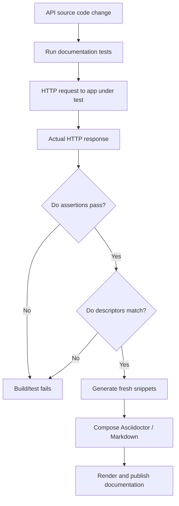
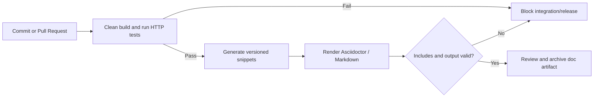

# Why Documentation Tests Help Detect Stale Documentation

## Learning Objectives

After this lesson, you will be able to:

- Explain what **stale REST API documentation** is and why hand-writing request/response examples easily introduces drift as the application changes.
- Distinguish the roles of **HTTP assertions**, **REST Docs descriptors**, and **test-generated snippets** in detecting drift.
- Run a documentation test with **Spring REST Docs and MockMvc**, then introduce deliberate changes to observe when the test fails.
- Identify changes that the tool **cannot detect automatically**, such as missing tests, weak assertions, or inaccurate business descriptions.
- Design a workflow for testing, generating snippets, composing Asciidoctor/Markdown, and running build/CI so documentation stays aligned with the API version.

## 1. How Does Stale Documentation Happen?

Suppose the first version of the endpoint `GET /api/orders/42` returns:

```http
HTTP/1.1 200 OK
Content-Type: application/json

{"id":42,"status":"PAID"}
```

An integration team builds a client that reads the `status` field. After an upgrade, the server renames the field to `paymentStatus`:

```http
HTTP/1.1 200 OK
Content-Type: application/json

{"id":42,"paymentStatus":"PAID"}
```

The new server may work properly according to the new design decision, yet the guide page still shows the old response. To readers, the documentation becomes a **false contract**: following the docs no longer produces the described outcome.

Some common types of drift include:

| Change in API | Documentation Content That Can Go Stale | Consequence |
| --- | --- | --- |
| Rename/add/remove JSON field | Response field table, JSON examples | Clients read the wrong data or miss important fields |
| Change data type, requiredness, or nesting | Payload descriptions and validation guides | Clients send data that gets rejected |
| Change HTTP status or response headers | Success/failure examples, resource creation flow | Clients take the wrong processing branch |
| Change path, path/query parameters, or header names | URL templates and parameter tables | Requests return errors or hit the wrong resource |
| Change pagination, auth, or business rules | Explanatory prose, prerequisites, error scenarios | Integration misunderstands behavior even when JSON is valid |
| Rename or delete test while keeping old outputs | Links to old snippets on HTML pages | Documentation published from a previous build |

**Root cause:** source code and documentation are changed at different times, by different people or processes. When documentation is a set of handwritten examples decoupled from tests, no mandatory check fails when HTTP behavior changes without updating the docs.

## 2. The Spring REST Docs Idea: Making Documentation Part of Testing

In the **SPRING_REST_DOCS** module, REST API documentation is generated from HTTP tests using **MockMvc**, **WebTestClient**, or **REST Assured**. A test sends a request, asserts the response, and declares which parts to document. Spring REST Docs records the HTTP exchange and generates **snippets** such as `http-request`, `http-response`, `request-fields`, `response-fields`, `path-parameters`, `query-parameters`, or header snippets.

The workflow can be visualized as follows:



The key difference lies in the **mandatory checkpoint**: to produce a valid snippet set from a test, the test must pass the assertions and checks REST Docs is configured to enforce. When the API changes in a way that violates those checks, the documentation generation step no longer succeeds as before. Issues are caught during development or in CI before a new page is published.

However, Spring REST Docs does not automatically scan every endpoint to ensure the whole system is documented. **Drift detection only applies within the scope of the tests, descriptors, and build checks actually configured.**

## 3. Three Mechanisms That Catch Mismatched Documentation

### 3.1. Assertions Catch Changing HTTP Behavior

For example, a test verifies:

```java
.andExpect(status().isOk())
.andExpect(jsonPath("$.id").value(42))
.andExpect(jsonPath("$.status").value("PAID"))
```

These assertions encode **repeatable expectations**: status must be `200 OK`, `id` is `42`, and `status` is `PAID` in the chosen scenario.

If the API changes status to `206 Partial Content`, changes the status value to `REFUNDED`, or drops the `status` field, at least one related assertion fails. The team must determine whether the change is a bug or a new requirement; if it is a new requirement, update the test, descriptors, **and** documentation accordingly.

Assertions only protect what they check: if there is only `status().isOk()`, a response JSON with incorrect values will still pass the test. Conversely, detailed assertions should target intentional business rules rather than pinning random values outside the contract.

### 3.2. Descriptors Catch Structural Drift

Spring REST Docs uses **descriptors** to document fields, parameters, and headers. For example:

```java
responseFields(
    fieldWithPath("id").description("Order ID"),
    fieldWithPath("status").description("Order status")
)
```

In the common **strict** response-field mode, REST Docs checks the actual response structure against the descriptors:

- If the docs require `status` but the response omits it, documentation generation fails because a documented field did not appear.
- If the response adds a `paymentStatus` field that is not documented, strict checking also reports an undocumented field.
- If the structure changes from `status` to `payment.status`, the old descriptor path no longer matches.

This detects a class of issues that readers of handwritten docs rarely catch early: **the structural contract changed, but the field table was not updated**.

Understand the boundaries:

| Mechanism | Typically Detects | Does Not Automatically Guarantee |
| --- | --- | --- |
| Strict `responseFields(...)` / `requestFields(...)` | Missing fields, undocumented fields, JSON path mismatches | Correct business values, whether description text is accurate |
| `pathParameters(...)` / `queryParameters(...)` | Documented parameter names/parts against the test request | Pagination/filtering rules without matching tests and assertions |
| `requestHeaders(...)` / `responseHeaders(...)` | Documented headers against the test exchange | Authentication/authorization behavior in untested scenarios |
| Assertions on status/headers/body | Specific conditions declared in the test | Uncovered behaviors and scenarios |

Options such as `optional()`, `ignored()`, `relaxedResponseFields(...)`, or `relaxedRequestFields(...)` have valid uses, but overusing them weakens the structural drift signal. For example, using `relaxedResponseFields(...)` allows an undocumented field to be added without failing the test.

### 3.3. Snippets Are Generated from Executed HTTP Exchanges

HTTP request/response snippets are generated from the interaction inside the test; authors do not copy examples from a response captured months earlier. When a test runs against new code and passes, the new snippets reflect that scenario's request and response.

This reduces the risk of **stale examples**, though it is not an automatic cross-version diffing tool. If both tests and descriptors accept the new behavior, REST Docs generates the new examples without error. The team still needs to evaluate whether the change is backward-compatible or requires notifying clients, and update handwritten explanations.

## 4. Practice: Creating a Documentation Checkpoint with MockMvc

The following example uses Java 17+, JUnit Jupiter, Spring MVC Test, Jackson, and `spring-restdocs-mockmvc`. A simulated controller is placed inside the test to illustrate the mechanism; **in real projects, replace it with the actual controller/application you are protecting and configure the relevant components**, because tests against a fake controller cannot verify production behavior.

### 4.1. Initial Version

```java
import java.util.Map;

import org.junit.jupiter.api.BeforeEach;
import org.junit.jupiter.api.Test;
import org.junit.jupiter.api.extension.ExtendWith;
import org.springframework.http.MediaType;
import org.springframework.restdocs.RestDocumentationContextProvider;
import org.springframework.restdocs.RestDocumentationExtension;
import org.springframework.test.web.servlet.MockMvc;
import org.springframework.test.web.servlet.setup.MockMvcBuilders;
import org.springframework.web.bind.annotation.GetMapping;
import org.springframework.web.bind.annotation.PathVariable;
import org.springframework.web.bind.annotation.RestController;

import static org.springframework.restdocs.mockmvc.MockMvcRestDocumentation.document;
import static org.springframework.restdocs.mockmvc.MockMvcRestDocumentation.documentationConfiguration;
import static org.springframework.restdocs.payload.PayloadDocumentation.fieldWithPath;
import static org.springframework.restdocs.payload.PayloadDocumentation.responseFields;
import static org.springframework.restdocs.request.RequestDocumentation.parameterWithName;
import static org.springframework.restdocs.request.RequestDocumentation.pathParameters;
import static org.springframework.test.web.servlet.request.MockMvcRequestBuilders.get;
import static org.springframework.test.web.servlet.result.MockMvcResultMatchers.jsonPath;
import static org.springframework.test.web.servlet.result.MockMvcResultMatchers.status;

@ExtendWith(RestDocumentationExtension.class)
class OrderDocumentationTest {
    private MockMvc mvc;

    @BeforeEach
    void setUp(RestDocumentationContextProvider documentation) {
        mvc = MockMvcBuilders.standaloneSetup(new OrderController())
                .apply(documentationConfiguration(documentation))
                .build();
    }

    @Test
    void getOrder() throws Exception {
        mvc.perform(get("/api/orders/{id}", 42)
                        .accept(MediaType.APPLICATION_JSON))
                .andExpect(status().isOk())
                .andExpect(jsonPath("$.id").value(42))
                .andExpect(jsonPath("$.status").value("PAID"))
                .andDo(document("orders-get",
                        pathParameters(
                                parameterWithName("id")
                                        .description("ID of the order to look up")
                        ),
                        responseFields(
                                fieldWithPath("id")
                                        .description("Order ID"),
                                fieldWithPath("status")
                                        .description("Payment status")
                        )
                ));
    }

    @RestController
    static class OrderController {
        @GetMapping(path = "/api/orders/{id}",
                    produces = MediaType.APPLICATION_JSON_VALUE)
        Map<String, Object> getOrder(@PathVariable("id") long id) {
            return Map.of("id", id, "status", "PAID");
        }
    }
}
```

How the steps in the test connect:

1. `get("/api/orders/{id}", 42)` executes a request using a URL template with a path variable.
2. `andExpect(...)` verifies the HTTP status and JSON data clients rely on.
3. `pathParameters(...)` and `responseFields(...)` enforce that the description tables match the exchange data per configuration.
4. `document("orders-get", ...)` generates a snippet group with a stable identifier when the test passes.

Typical Gradle output path:

```text
build/generated-snippets/
└── orders-get/
    ├── curl-request.adoc
    ├── http-request.adoc
    ├── http-response.adoc
    ├── path-parameters.adoc
    └── response-fields.adoc
```

This shows the typical default layout; paths and formats can vary depending on build and template configuration.

### 4.2. Experiment 1: Renaming a Field Without Updating the Test

Change only the controller return value from:

```java
return Map.of("id", id, "status", "PAID");
```

to:

```java
return Map.of("id", id, "paymentStatus", "PAID");
```

Keep the `jsonPath("$.status")` assertion and `fieldWithPath("status")` descriptor unchanged. Re-run the test:

- The assertion on `$.status` fails because the path no longer exists.
- Even if you remove that assertion, the strict descriptor still fails to match the new response: `status` is missing and `paymentStatus` is undocumented.
- Because the test fails, the documentation pipeline can stop before publishing new HTML.

This is the classic case where **a code change breaks the "commitment" encoded in a documentation test**. To accept a valid change, the team must update the assertions, descriptors, affected clients, and prose mentioning the field on the documentation page.

### 4.3. Experiment 2: Adding a JSON Field

Suppose the updated controller returns:

```json
{"id":42,"status":"PAID","currency":"VND"}
```

Existing assertions may still pass because `id` and `status` did not change. However, with strict `responseFields(...)`, `currency` is an undocumented response field, so the documentation step fails. The team must decide whether to expose the new field, how to describe it, and whether an assertion checking its value is needed.

This case shows why REST Docs **adds value beyond regular assertions**: strict descriptors can catch structural changes even when all old value checks still pass.

### 4.4. Experiment 3: Changing Meaning Without Changing Structure

Suppose `status` remains the string `"PAID"`, but a documentation author edits the sentence to say "the order has been delivered to the customer." All tests and descriptors above still pass, because the HTTP payload did not change and the tool does not understand the business meaning of "delivered."

**No automated signal in this example proves that explanation is right.** You must verify the status definition in the system, add business tests where observable conditions allow, and require review from the API owner.

## 5. Which Changes Are Detected and Under What Conditions?

The table below helps select tests for documentation commitments, avoiding the assumption that simply enabling REST Docs catches every drift:

| Actual Change | Condition to Detect | What Happens If the Condition Is Missing? |
| --- | --- | --- |
| `200` changes to `201` | Expected status assertion exists | `http-response` snippet may regenerate with the new status without error |
| `status` changes to `paymentStatus` | JSON assertion / strict descriptor points to old field | Undetected if no related test or declaration exists |
| Response adds a field | Strict `responseFields(...)` covers the structure | May be ignored if relaxed descriptors are used |
| Request no longer accepts query `size` | Test actually sends `size` and checks behavior | Tests omitting `size` provide no evidence |
| Server changes `Location` header | Assertion/descriptor exists for the header | Readers face drift if only body is checked |
| Authorization rules change | Tests include security filters and `401/403` cases | MockMvc without security config or only happy-path tests may miss it |
| Default value of `page` changes | Test omits `page` and asserts default value/behavior | Tests always passing `page=0` do not test the default |
| Business meaning of `PAID` changes | Behavioral tests reflect the rule or content review | Descriptors do not understand manual prose |
| New endpoint added | Endpoint inventory process and documentation tests exist | REST Docs does not auto-discover undocumented endpoints |
| Test removed while old snippets remain on disk | Clean build or strict input/artifact checks | Rendered page may continue using stale snippets |

### 5.1. Test Scope Determines Commitment Scope

Using `MockMvcBuilders.standaloneSetup(new FakeController())` with fixed data reflects a **fake controller**. That is fine for learning examples, but it does not prove that the real application endpoint behaves like the documentation. In real projects, use the real application controller and appropriate wiring/fixtures; to verify the full path through the server, combine with integration tests using WebTestClient or REST Assured.

Select representative scenarios: success, missing input, invalid format, unauthorized, not found, conflict, empty results, and key business boundaries. Not every endpoint has all of these cases; the test matrix must reflect the real contract.

### 5.2. Choosing Strictness Deliberately

Strict mode is helpful for requiring all important payload fields to be documented. However, there may be metadata fields that do not need detailed explanations, or dynamically varying payload sections. When using `ignored()`, `optional()`, or `relaxed...`:

- Document **why** a structure is allowed to be skipped.
- Do not apply relaxed mode across the whole payload just to avoid updating tests when the API changes.
- Keep dedicated assertions for important values, even when descriptors mark fields optional.
- Revisit these decisions when the API changes significantly or when clients start depending on ignored fields.

Choosing strict mode does not replace value testing. REST Docs describes the **shape** of the HTTP exchange; assertions and business tests verify **behavior**.

## 6. Composing Fresh Snippets with Handwritten Documentation

To publish pages with context, authors typically create an Asciidoctor document, e.g., `src/docs/asciidoc/index.adoc`:

```asciidoc
= Orders API
:toc: left

== Look Up an Order

GET /api/orders/{id} looks up an order by ID.
The PAID status indicates the order has been recorded as paid.

=== Request
include::{snippets}/orders-get/http-request.adoc[]

=== Path parameters
include::{snippets}/orders-get/path-parameters.adoc[]

=== Response
include::{snippets}/orders-get/http-response.adoc[]

=== Response fields
include::{snippets}/orders-get/response-fields.adoc[]
```

The `{snippets}` attribute must be configured properly during rendering. The `include::...[]` directives pull snippets generated from tests, so when a response changes and tests pass after updating the contract, the page can be re-rendered with fresh examples.

However, the sentence "The PAID status ..." is still author-written. If the meaning of `PAID` changes, test builds may not catch that the prose has become inaccurate. Explanations of auth requirements, rate limits, retry rules, permissions, and edge cases must also be reviewed regularly.

**With Markdown:** choose Markdown snippet templates and an appropriate assembly mechanism in the pipeline. Standard Markdown does not natively support Asciidoctor's `include::{snippets}/...[]` syntax, so you must configure an appropriate renderer or composition step. Do not simply rename `.adoc` to `.md` and treat it as converted.

Good documentation combines both sources:

| Source | Strength | Limitation |
| --- | --- | --- |
| Test snippets | HTTP data from executed scenarios; structure checked against descriptors | Does not explain context on its own or guarantee sufficient test coverage |
| Authored prose | Explains usage, preconditions, and business decisions | Can become stale if not reviewed when the API changes |

## 7. Why CI Helps More Than Running Tests Locally

An individual developer can forget to run documentation tests before editing an API page. CI turns verification into a repeatable check on every change or before release, giving documentation generation a chance to fail as soon as the API and tests diverge.



In a Gradle project using the Asciidoctor plugin, the following conceptual snippet wires the test step to the render step (you still need to declare plugins, dependencies, and a REST Docs version compatible with your project):

```groovy
configurations {
    asciidoctorExt
}

dependencies {
    testImplementation 'org.springframework.restdocs:spring-restdocs-mockmvc'
    asciidoctorExt 'org.springframework.restdocs:spring-restdocs-asciidoctor'
}

def snippetsDir = file("$buildDir/generated-snippets")

tasks.named('test') {
    outputs.dir snippetsDir
}

tasks.named('asciidoctor') {
    configurations 'asciidoctorExt'
    inputs.dir snippetsDir
    dependsOn tasks.named('test')
}
```

Once fully configured, you can run `./gradlew clean test asciidoctor` on Unix or `gradlew.bat clean test asciidoctor` on Windows. With Maven, the equivalent principle applies: tests generate snippets in the build output, and the documentation plugin consumes those snippets.

**Note:** not every default Asciidoctor configuration treats a "missing include" as a build error. If the goal is to prevent publishing docs with missing snippets, the pipeline must **explicitly configure or check** that missing includes/outputs fail CI. Also avoid accidentally picking up snippets from an old folder: build release documentation from a clean workspace or build-isolated output.

Checks worth having in CI:

1. Run documentation tests covering real APIs, including important error scenarios.
2. Use stable test data or snippet preprocessors to avoid noisy random IDs, timestamps, or hosts.
3. Check for missing snippets and rendering errors rather than only watching for green tests.
4. Keep real tokens, auth cookies, passwords, and personal data out of snippets and HTML artifacts.
5. Publish documentation alongside the matching application commit/version; maintain a review process for API contract changes.

CI **catches drift that has been encoded into checks**. If tests miss scenarios or manual descriptions are wrong, CI cannot infer truth beyond what has been configured.

## 8. When Tests Pass Yet Documentation Is Still Stale

To understand the boundaries clearly, consider five scenarios:

**Scenario A — Mock test does not reflect production:** the test uses a simulated controller returning `status`, while the real endpoint has changed to `paymentStatus`. The test still passes. Test the actual implementation or add contract tests at an appropriate integration layer.

**Scenario B — Assertions only check status:** the API still returns `200` while returning wrong JSON content. Without payload assertions or related descriptors, the test can pass. Add checks reflecting data commitments.

**Scenario C — Overly broad relaxed descriptors:** the response adds a new field; descriptors allow undocumented fields so they do not fail. Decide where strictness matters.

**Scenario D — Outdated prose:** the page says `page` starts at 1 while the API uses 0-based indexing. Without tests verifying that behavior or prose review, the build will not catch it.

**Scenario E — Stale artifacts still in use:** a test was renamed or deleted, yet the snippet directory from a previous build remains; documentation renders without verifying fresh sources. Run clean builds, verify includes, and trace artifacts by version.

These scenarios do not negate the value of Spring REST Docs. They highlight that **the scope of evidence** must be carefully designed. "Test-generated" documentation can still have gaps if test and process coverage are insufficient.

## 9. Checklist to Catch Stale Documentation Early

Before accepting an API change, the team can use this checklist:

- [ ] Modified endpoints have documentation tests running against real components or a sufficiently representative integration layer.
- [ ] Assertions verify status codes, headers, and payload values critical to clients.
- [ ] Publicly exposed request/response fields, path/query parameters, and headers are documented with appropriate descriptors.
- [ ] Uses of `optional()`, `ignored()`, and `relaxed...` have been reviewed so they do not mask breaking or important changes.
- [ ] Both success scenarios and important error scenarios are tested accordingly.
- [ ] Fresh snippets are generated from the exact build; stale outputs are not reused inadvertently.
- [ ] Asciidoctor/Markdown pages render from fresh snippets; CI checks for missing includes and output artifacts.
- [ ] Handwritten content on business rules, access control, examples, and errors has been reviewed when the contract changed.
- [ ] Documentation artifacts are linked to the released API version.

This turns "keep documentation up to date" into verifiable actions and conditions, instead of hoping someone remembers to update the docs after every release.

## 10. Self-Check Exercise

Suppose you maintain the `POST /api/orders` endpoint. The current version accepts:

```json
{"customerId":7,"quantity":2}
```

and returns:

```http
HTTP/1.1 201 Created
Location: /api/orders/43
Content-Type: application/json

{"id":43,"status":"CREATED"}
```

The development team proposes three changes: (1) change `quantity` to `items[].quantity`, (2) add a `currency` response field, and (3) change the business meaning of `CREATED`.

Create a list of updates that must be performed:

1. Write tests sending requests in the new structure and asserting status/headers/body per the new contract.
2. Use `requestFields(...)` to document `items[].quantity`; use `responseFields(...)` to document `currency` and the remaining fields. Try keeping the old descriptors first to observe strict failures.
3. Regenerate snippets from the documentation tests, then re-render the page with Asciidoctor/Markdown.
4. Check which prose paragraphs explain `CREATED`; verify the new meaning with business stakeholders and add matching behavioral tests if possible.
5. Re-run the pipeline from a clean output, ensuring the HTML uses snippets from the same build.

**Question:** if only the `currency` field is added and all existing assertions still pass, can Spring REST Docs detect it? **Yes, if** the test actually receives the new response and uses strict `responseFields(...)` descriptors that do not yet document `currency`. If the test did not run, receives stale fake data, or uses relaxed descriptors allowing undocumented fields, the change may go unreported.

## Conclusion

**Documentation tests help detect stale documentation because key API commitments are encoded into repeatable checks.** Assertions detect changes in HTTP behavior; Spring REST Docs descriptors detect many structural changes; snippets take request/response examples from tests instead of manual copying. Combined with Asciidoctor/Markdown pages, builds, and CI, drift within the tested scope has a strong chance of being caught before release. Final quality still depends on testing real application components, covering enough scenarios, writing meaningful assertions, and reviewing business explanations that tools cannot verify on their own.
