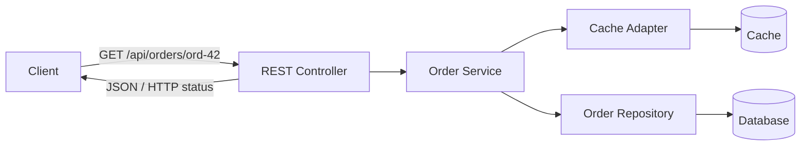
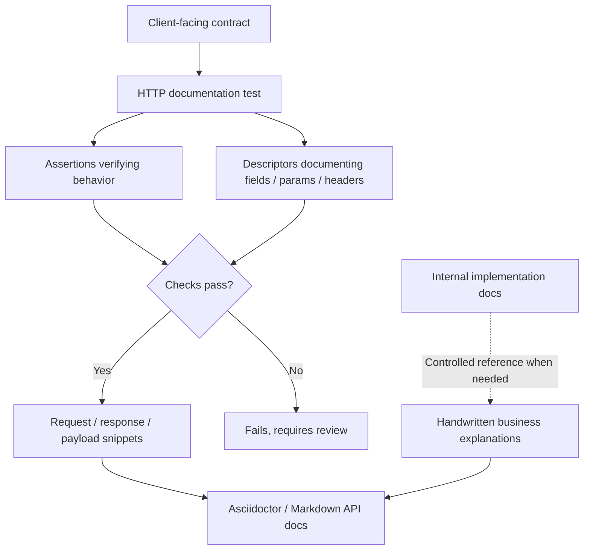
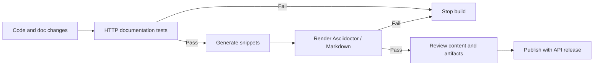

# Distinguishing API Documentation from Internal Implementation Documentation

## Learning Objectives

After this lesson, you will be able to:

- Distinguish **REST API contract documentation** for API consumers from **internal design, implementation, and operations documentation** for the team building the system.
- Determine what information belongs in API documentation: endpoints, HTTP methods, parameters, headers, payloads, status codes, errors, and integration rules.
- Identify details belonging to internal documentation: component diagrams, database schemas, caching, transactions, algorithms, infrastructure configuration, and operational strategies.
- Use **Spring REST Docs** to generate snippets from HTTP tests via MockMvc, WebTestClient, or REST Assured, while combining them with Asciidoctor/Markdown explanations.
- Assess the impact of an implementation change: when the API contract must be updated, when only internal documentation needs updating, and when both must be updated.

## 1. Two Types of Documentation Serving Two Sets of Questions

Suppose a sales application exposes the endpoint:

```http
GET /api/orders/ord-42 HTTP/1.1
Accept: application/json
```

A client application developer wants to know: does the endpoint return the order, which headers must be sent, what fields are in the response, how is `404` handled, and what permissions are required.

A service maintainer wants to know: which table stores the order data, which service does the controller call, how does the repository use transactions, what is the cache TTL, and how does the system retry when the database fails.

Both sets of questions are valid, yet they serve **different audiences and purposes**.

| Criterion | REST API Documentation | Internal Implementation Documentation |
| --- | --- | --- |
| Primary audience | Client developers, integration partners, contract QA, other calling apps | Backend developers, maintainers, SRE/DevOps, architects, operations teams |
| Central question | "How do I call the API and what can I expect?" | "How does the system implement this and how is it maintained?" |
| Units described | Endpoints, HTTP methods, URIs, headers, parameters, request/response, status, errors | Controllers/services, domain models, databases, caches, queues, deployments, configs |
| Expected stability | Contract must be managed compatibly with consumers | Can change during refactoring without affecting consumers |
| Typical example | `GET /api/orders/{id}` returns `200` with defined JSON | `OrderController → OrderService → OrderRepository` |
| Verification method | HTTP tests, contract tests, Spring REST Docs descriptors, assertions | Unit/integration tests, architecture reviews, benchmarks, security checks, runbooks |
| Sharing level | Scoped to consumers; may be public or restricted to internal clients | Usually restricted to internal need-to-know personnel |

**Do not equate an "internal API" with "internal implementation documentation."** An endpoint only called inside a corporate network still needs API documentation if other teams consume it. Conversely, a service's repository structure diagram does not become API documentation just because it is published on a docs portal.

In the **SPRING_REST_DOCS** module, the focus of Spring REST Docs is **generating verifiable REST API documentation from HTTP tests**, then compiling snippets into Asciidoctor/Markdown documentation integrated into build and CI. The tool is not meant to describe every algorithm and piece of infrastructure behind an endpoint.

## 2. API Documentation Is the Contract Between Provider and Consumer

The **provider** is the component implementing and serving the endpoint; the **consumer** is the client calling the endpoint. The API contract specifies what the client may send and how it should interpret the result, independent of whether the provider uses Java, Spring, PostgreSQL, or another technology.

Example simple contract for `GET /api/orders/{id}` in this lesson:

| Component | Example Contract |
| --- | --- |
| Method and path | `GET /api/orders/{id}` |
| Path parameter | `id` is the order identifier as a string |
| Request header | `Accept: application/json` |
| Success | `200 OK` with JSON response |
| Response fields | `orderId`, `status`, `total.amount`, `total.currency` |
| Non-existent case | Document status/error body separately per actual application behavior |
| Access permissions | Must describe actual application authentication/authorization rules |

Illustrative response:

```json
{
  "orderId": "ord-42",
  "status": "PAID",
  "total": {
    "amount": 199000,
    "currency": "VND"
  }
}
```

A Python, JavaScript, or Java client can all read this response according to the JSON contract without knowing the name `OrderEntity`, the database table location, or the server's package layout.

### 2.1. Sections That Should Appear on an Endpoint Page

1. **Purpose and use cases:** why call the endpoint, and what preconditions apply.
2. **Method, URL, and version:** path parameters, query parameters, and pagination/filtering/sorting rules when present.
3. **Authentication and authorization:** how to supply credentials and permission scopes per actual policy; never publish real tokens.
4. **Request:** headers, media type, body, requiredness, and data constraints.
5. **Success response:** status, headers, body, field meanings, and units of measurement.
6. **Error responses:** actual scenarios and HTTP status codes; error structure, retryability, and special guarantees if committed by the API.
7. **Contract boundaries:** data ordering, consistency guarantees, idempotency, versioning, and rate limits if consumers need them.

This information should be written in the integrator's language. For example, `total.amount` should be described as "order total amount in the unit associated with `total.currency`," rather than "value read from the `order_total_amount` column."

### 2.2. The HTTP Contract Can Be Influenced by Implementation

The goal is not to hide every operational characteristic. If data sharding requires clients to use cursor pagination, if an async operation returns `202 Accepted`, or if the API requires an anti-duplication header, **behaviors that clients must follow belong in the API contract**.

The boundary is the question: **"Does the client need to know this to use the API correctly?"** If yes, describe the observable behavior rather than explaining the entire implementation mechanism.

For example, an API may state "after order creation, the initial status is `PENDING` and the client may poll until completion" if that is a real commitment. It does not need to state which Kafka topic the backend uses to process orders.

## 3. Internal Implementation Documentation Describes How the Provider Produces Behavior

A Spring system can process the same request across multiple layers:



In the diagram, **the path between the client and the HTTP response** represents the contract boundary that needs API documentation. `Order Service`, `Order Repository`, cache, and database belong to implementation design; they can be replaced or refactored without changing the returned contract.

Internal documentation may include:

- **Architecture and dependencies:** layering, data flow, events, inter-service communication.
- **Storage model:** schemas, indexes, migrations, optimistic locking, entity mapping.
- **Processing rules:** pricing algorithms, transaction boundaries, domain-layer validation.
- **Performance and reliability:** cache TTL, retries, circuit breakers, infrastructure timeouts, consistency models.
- **Operations:** deployment steps, environment variables, metrics, alerts, log correlation, incident runbooks.
- **Internal security:** inter-component permissions, secret management, threat models, and key rotation procedures; sensitive information must be stored where access is properly controlled.

Example excerpt of internal documentation:

```text
OrderController
  -> OrderQueryService
  -> OrderReadRepository
  -> OrderEntity (orders table)

Notes:
- Read-path queries use an index on order_id.
- Cache invalidation triggers after order updates.
- Downstream dependency failures are logged with a correlation ID.
```

This is a **hypothetical architecture example**, not content to copy verbatim into the `GET /api/orders/{id}` guide page. If API consumers only need to pass an order ID and read JSON, they should not have to understand repositories or indexes to call it successfully.

### 3.1. Do Not Turn Implementation Details into Unintended Commitments

An API document saying "orders are read from PostgreSQL using the `orders` table" encourages consumers to assume storage details. When the backend migrates to another data store while keeping the response identical, the documentation becomes inaccurate even though the HTTP contract did not change.

Instead of describing internal mechanics, describe **observable behavior**:

| Implementation-Dependent Sentence | Better Consumer-Focused Description |
| --- | --- |
| "Controller calls `OrderRepository.findById`." | "Retrieves the order by the ID in the path." |
| "Data is read from the PostgreSQL `orders` table." | "Returns order details the caller is authorized to view." |
| "Redis cache keeps records for 60 seconds." | "Data may have up to the system-committed staleness window," **if such a commitment actually exists** |
| "Kafka consumer processes requests after writing to the database." | "Requests are accepted and processed asynchronously," **if that is the published contract** |
| "Service throws `OrderMissingException`." | "When the order is not found, the API returns the specified status and error body." |

Do not infer latency, consistency, retry rules, or status codes from the technology stack in use. They must be intentional in the design and verified with appropriate tests.

## 4. How Does Spring REST Docs Verify the Contract?

Spring REST Docs runs alongside an HTTP test. With MockMvc, WebTestClient, or REST Assured, the test sends a request, asserts the response, and generates **snippets**. Some snippets contain HTTP exchanges; others are description tables generated from **descriptors** declared by the test author.



Common snippets:

| Snippet | What Does It Provide to API Documentation? |
| --- | --- |
| `http-request`, `curl-request` | Sample HTTP request or curl command captured from the test |
| `http-response` | Status, headers, and body returned in the test scenario |
| `path-parameters`, `query-parameters` | Tables of documented path and query parameters |
| `request-headers`, `response-headers` | Tables of headers declared in the test |
| `request-fields`, `response-fields` | Description tables of JSON fields in the request or response |

**What Spring REST Docs does not generate:** database schemas, cache design rationale, transaction strategies, architecture decisions, runbooks, or disaster recovery guides. Those belong in internal documentation authored and maintained using appropriate methods.

Even within the contract portion, REST Docs does not verify that prose descriptions are accurate in business terms. For instance, `description("Order status")` is written by the author; confirming what `PAID` means requires assertions, domain fixtures, and review.

## 5. Practical Example: Keeping the Public Response Independent of the Storage Model

Suppose a system has an internal entity containing `internalId`, `tenantKey`, `entityVersion`, and persistence fields. Consumers only need:

```json
{
  "orderId": "ord-42",
  "status": "PAID",
  "total": {
    "amount": 199000,
    "currency": "VND"
  }
}
```

Define a **dedicated API DTO** instead of serializing the persistence entity directly. This keeps the HTTP contract intentionally designed and prevents internal fields from leaking unintentionally when the entity changes.

### 5.1. Documentation Test with MockMvc

The example below uses Java 17+, JUnit Jupiter, Spring MVC Test, Jackson, and Spring REST Docs MockMvc. The illustrative controller returns fixed data so the lesson is self-contained; **in real implementations, tests must target the real controller/application being protected and include corresponding business tests**.

```java
import org.junit.jupiter.api.BeforeEach;
import org.junit.jupiter.api.Test;
import org.junit.jupiter.api.extension.ExtendWith;
import org.springframework.http.MediaType;
import org.springframework.restdocs.RestDocumentationContextProvider;
import org.springframework.restdocs.RestDocumentationExtension;
import org.springframework.test.web.servlet.MockMvc;
import org.springframework.test.web.servlet.setup.MockMvcBuilders;
import org.springframework.web.bind.annotation.GetMapping;
import org.springframework.web.bind.annotation.PathVariable;
import org.springframework.web.bind.annotation.RestController;

import static org.springframework.restdocs.headers.HeaderDocumentation.headerWithName;
import static org.springframework.restdocs.headers.HeaderDocumentation.requestHeaders;
import static org.springframework.restdocs.mockmvc.MockMvcRestDocumentation.document;
import static org.springframework.restdocs.mockmvc.MockMvcRestDocumentation.documentationConfiguration;
import static org.springframework.restdocs.payload.PayloadDocumentation.fieldWithPath;
import static org.springframework.restdocs.payload.PayloadDocumentation.responseFields;
import static org.springframework.restdocs.request.RequestDocumentation.parameterWithName;
import static org.springframework.restdocs.request.RequestDocumentation.pathParameters;
import static org.springframework.test.web.servlet.request.MockMvcRequestBuilders.get;
import static org.springframework.test.web.servlet.result.MockMvcResultMatchers.jsonPath;
import static org.springframework.test.web.servlet.result.MockMvcResultMatchers.status;

@ExtendWith(RestDocumentationExtension.class)
class OrderApiDocumentationTest {
    private MockMvc mvc;

    @BeforeEach
    void setUp(RestDocumentationContextProvider context) {
        mvc = MockMvcBuilders.standaloneSetup(new OrderController())
                .apply(documentationConfiguration(context))
                .build();
    }

    @Test
    void getOrderContract() throws Exception {
        mvc.perform(get("/api/orders/{id}", "ord-42")
                        .accept(MediaType.APPLICATION_JSON))
                .andExpect(status().isOk())
                .andExpect(jsonPath("$.orderId").value("ord-42"))
                .andExpect(jsonPath("$.status").value("PAID"))
                .andExpect(jsonPath("$.total.amount").value(199000))
                .andExpect(jsonPath("$.total.currency").value("VND"))
                .andDo(document("orders-get",
                        requestHeaders(
                                headerWithName("Accept")
                                        .description("Desired JSON format")
                        ),
                        pathParameters(
                                parameterWithName("id")
                                        .description("Order ID to query")
                        ),
                        responseFields(
                                fieldWithPath("orderId")
                                        .description("Public order identifier"),
                                fieldWithPath("status")
                                        .description("Order status"),
                                fieldWithPath("total")
                                        .description("Order total amount"),
                                fieldWithPath("total.amount")
                                        .description("Numeric value of the total amount"),
                                fieldWithPath("total.currency")
                                        .description("Currency code of the total amount")
                        )
                ));
    }

    record Money(long amount, String currency) {}
    record OrderResponse(String orderId, String status, Money total) {}

    @RestController
    static class OrderController {
        @GetMapping(path = "/api/orders/{id}",
                    produces = MediaType.APPLICATION_JSON_VALUE)
        OrderResponse getOrder(@PathVariable("id") String id) {
            return new OrderResponse(id, "PAID", new Money(199000L, "VND"));
        }
    }
}
```

This test only verifies the contract of the **simulated success scenario**. In a real application, you must test `404` handling, security, service-sourced data, status rules, and other design requirements. It does not test the database, cache, transactions, or internal mapping mechanisms.

Roles of the components:

- `andExpect(...)` verifies values visible to the consumer.
- `requestHeaders(...)` documents headers present in the test request.
- `pathParameters(...)` documents variables in the URI template.
- `responseFields(...)` documents the JSON shape the consumer receives, including nested fields `total.amount` and `total.currency`.
- `document("orders-get", ...)` produces the snippet directory for the documentation page to reference.

A typical Gradle snippet directory looks like:

```text
build/generated-snippets/
└── orders-get/
    ├── curl-request.adoc
    ├── http-request.adoc
    ├── http-response.adoc
    ├── request-headers.adoc
    ├── path-parameters.adoc
    └── response-fields.adoc
```

Adding an `entityVersion` field to the **internal entity** should not automatically add it to `OrderResponse`. If the public JSON does not change, the API documentation does not need to change simply because the entity changed. If `entityVersion` is accidentally exposed in JSON, a documentation test using strict `responseFields(...)` can catch the undocumented field.

### 5.2. Composing the API Page with Asciidoctor

The source document can be `src/docs/asciidoc/index.adoc`:

```asciidoc
= Orders REST API
:toc: left

== Look Up an Order

Call GET /api/orders/{id} to retrieve order details.
The public fields describe the identifier, status, and total amount.

=== HTTP request
include::{snippets}/orders-get/http-request.adoc[]

=== Request headers
include::{snippets}/orders-get/request-headers.adoc[]

=== Path parameters
include::{snippets}/orders-get/path-parameters.adoc[]

=== HTTP response
include::{snippets}/orders-get/http-response.adoc[]

=== Response fields
include::{snippets}/orders-get/response-fields.adoc[]
```

The `{snippets}` attribute must point to the snippet directory generated by tests. Author-written paragraphs provide the endpoint's purpose; REST Docs-generated tables and HTTP examples reduce manual copying. If authentication or error structures exist, add corresponding tests and explanations matching the application.

If using **Markdown**, configure snippet templates and an assembly mechanism supported by your Markdown renderer or static site generator. The `include::...[]` syntax above belongs to Asciidoctor, not standard Markdown.

### 5.3. What About WebTestClient and REST Assured?

You can use **WebTestClient** in WebFlux/Reactive ecosystems or supported setups, and **REST Assured** when testing against a running HTTP server. Although the testing APIs differ from MockMvc, the principle does not change: send a request to the system under verification, assert the HTTP contract, declare descriptors, generate snippets, and include them in the API documentation. Choose the tool based on application architecture and test layer.

**Choose the right test layer:** isolated controller tests protect controller response mapping; integration tests can protect the full HTTP flow with security filters, serialization, and real wiring. If the test suite only uses fake data, do not claim it proves the entire behavior of the production system.

## 6. Does an Implementation Change Require Updating API Documentation?

Not every commit changes the REST contract. When code changes, analyze **the inputs, outputs, and semantics observed by clients**, then decide which documentation needs updating.

| Change | API Documentation | Internal Implementation Documentation |
| --- | --- | --- |
| Switch from JDBC to JPA, response unchanged | Usually no change needed | Update diagrams, repositories, and migrations if applicable |
| Add Redis cache without changing external commitments | Usually no change needed | Update architecture, invalidation, configuration, runbook |
| Rename `OrderService` or Java package | No change needed | Update sections referencing internal names/flows |
| Rename JSON `status` to `paymentStatus` | Update tests, snippets, field tables, client guide; consider versioning | Update DTO/service mapping where relevant |
| Add supported `sort` query parameter | Document values, defaults, examples/tests per contract | Update queries, indexes, or algorithms if changed |
| Change authentication or authorization rules | Update preconditions, errors, security tests for clients | Update security design, policies, and configuration |
| Change async strategy so API returns `202` instead of `201` | Update status, response, and how clients track completion | Update job/queue/retry architecture |
| Optimize database index without changing results or latency SLAs | No change needed | Update index/performance docs if significant |
| Change consistency guarantees or rate limits consumers rely on | Update if it is part of the contract behavior | Update operations, monitoring, and related design docs |

### 6.1. Example of an Internal-Only Change

Previously `OrderQueryService` read directly from the database. The team adds a cache layer while keeping the HTTP method, URL, status, headers, and JSON unchanged. In that case:

- The API documentation still accurately describes how to call the endpoint; do not add the cache name to the response table.
- Documentation tests should still run to guard the public behavior.
- Architecture and operations documentation must reflect the cache, TTL, invalidation mechanism, and failure modes.
- If the cache introduces data staleness exceeding a published guarantee, it is **no longer an internal-only change**; API behavior or testing must be reviewed.

### 6.2. Example of a Contract-Affecting Change

Suppose the response changes from:

```json
{"orderId":"ord-42","status":"PAID"}
```

to:

```json
{"orderId":"ord-42","paymentStatus":"PAID"}
```

This is observable by consumers, even if the backend only refactored a mapping. If the old assertions and descriptors remain, strict tests will fail because `status` no longer exists or `paymentStatus` is undocumented. The team must decide on a compatibility strategy, version if needed, and update tests and docs; simply renaming the field in HTML does not fix clients depending on the old contract.

## 7. Organizing Both Types of Docs Without Creating Two Divergent Sources

A documentation layout might look like:

```text
docs/
├── api/
│   ├── orders.adoc            # Contract and consumer guide
│   └── errors.adoc            # API error descriptions
└── internal/
    ├── architecture.md       # Components and processing flows
    ├── persistence.md        # Schemas, migrations, transactions
    ├── operations.md         # Deployment, alerts, runbooks
    └── decisions.md          # Technical decisions
```

This structure is illustrative only. Internal documentation may live in a separate repository or access-controlled portal. Never place internal network diagrams, credentials, secrets, database logins, or sensitive stack traces on widely accessible API pages.

Principles to reduce duplication:

1. **HTTP examples and field/parameter tables** come from documentation test snippets; avoid copying tables manually into another handwritten file.
2. **API usage rules** live in consumer-facing content; if a rule must be verified, add assertions/tests rather than only writing prose.
3. **System design and runbooks** live in internal documentation; API pages may link to related internal docs only when readers are authorized and have a need to know.
4. **Shared definitions** such as error codes or enums need a clear source of truth; when changed, check everywhere they are referenced, including snippets, guide prose, and code.
5. **Audience-based security:** API docs serving only internal apps may still require access restrictions, and internal operational details should still be kept properly separated.

### 7.1. Do Not Confuse API Documentation with an OpenAPI Specification

Spring REST Docs generates snippets and supports readable guide documentation; **OpenAPI** is a machine-readable REST API specification format supporting tools like Swagger UI and client generation. They can complement each other depending on project goals.

For the distinction in this lesson, both Spring REST Docs documentation and OpenAPI specifications belong to **API contract documentation**. Class diagrams, database schemas, how caching works, and runbooks remain **internal documentation**, regardless of which API documentation technology an organization chooses.

## 8. Integrating Contract Documentation into Build and CI

Because consumers rely on the REST contract, API documentation should be verified in every relevant build. A common workflow:



Partial configuration example for **Gradle Groovy DSL**, assuming the project already declares the Asciidoctor plugin, Spring Test, and JUnit:

```groovy
configurations {
    asciidoctorExt
}

dependencies {
    testImplementation 'org.springframework.restdocs:spring-restdocs-mockmvc'
    asciidoctorExt 'org.springframework.restdocs:spring-restdocs-asciidoctor'
}

def snippetsDir = file("$buildDir/generated-snippets")

tasks.named('test') {
    outputs.dir snippetsDir
}

tasks.named('asciidoctor') {
    configurations 'asciidoctorExt'
    inputs.dir snippetsDir
    dependsOn tasks.named('test')
}
```

This illustrates the relationship between tasks; a complete build file must declare plugins, compatible dependency versions, and the `{snippets}` attribute for rendering. Once configured, you can run `./gradlew clean test asciidoctor` (or `gradlew.bat clean test asciidoctor` on Windows). With Maven, the analogous pattern applies: HTTP tests generate snippets in the build output, and the documentation plugin produces output from those snippets.

For reliable results:

- Use a **clean workspace/output** when publishing so old snippets are no longer included after deleting or renaming a test.
- Configure **missing snippets or include errors** to fail the build/CI; do not assume every renderer treats missing includes as errors by default.
- Fix fixture data or normalize unstable IDs, timestamps, hosts, and headers.
- Use dummy data, filter sensitive headers, and never include real tokens, cookies, or customer data in artifacts.
- Render documentation from the same commit/build as the released application version.
- Review handwritten prose and business details alongside HTTP checks.

**CI does not automatically verify internal implementation docs:** schema changes, transaction logic, or caching still require appropriate reviews, tests, and operational checks. CI only automatically verifies what has been encoded as checks.

## 9. Common Misconceptions

| Misconception | Accurate Understanding |
| --- | --- |
| "An internal API only needs a technical README." | If there are independent consumers, a clear and verifiable HTTP contract is still needed. |
| "Spring REST Docs inspects the database schema to generate design docs." | REST Docs works from HTTP exchanges and descriptors; it does not infer system architecture. |
| "When controllers and services are renamed, API docs must change too." | Only update API docs when consumer-facing info/behavior changes or related prose is affected. |
| "Green tests prove every description is accurate." | Tests only verify declared assertions/descriptors and executed scenarios. |
| "Just include every entity field in JSON so docs are complete." | Public DTOs should expose only contract fields, avoiding leaks or forcing clients to depend on internal fields. |
| "Public docs must describe Redis, Kafka, tables, and stack traces." | Describe only behavior clients need to know; keep architecture and operational details in appropriate internal docs. |
| "If we have API docs, we don't need a runbook." | API docs do not replace deployment guides, incident recovery, migrations, or monitoring. |

## 10. Applied Exercise

A team maintains `POST /api/payments`. The implementation design notes include:

1. The service uses PostgreSQL with a `payment_attempts` table.
2. Requests require an `Idempotency-Key` header.
3. Success returns `201 Created` and a `paymentId` field.
4. A background process publishes an event to a queue.
5. Clients can call `GET /api/payments/{id}` to track status.
6. The system retries internally up to three times when a downstream dependency transiently fails.
7. Some clients receive `429 Too Many Requests` when exceeding the published API rate limit.

**Tasks:**

- Classify which items belong in **API documentation** and which belong in **internal documentation**. Some items may appear in both from different perspectives.
- For contract items, propose **documentation tests** and corresponding snippets: `requestHeaders(...)` for `Idempotency-Key`; status/assertions and `responseFields(...)` for payment creation; status polling test; `429` test/explanation if that is actual behavior.
- Explain why "internal retry up to three times" typically belongs in a runbook/design doc, whereas **what the client should do upon receiving a retryable error** (if committed by the API) must be described on the API page.
- Suppose the team replaces PostgreSQL with another storage engine; identify which documentation definitely needs review and why HTTP contract tests should still run.

**Reference hints:** items 2, 3, 5, and 7 describe behavior clients need to know; items 1 and 4 relate primarily to implementation; item 6 is an internal detail unless it directly impacts observable commitments. Do not infer status codes, processing latency, or retryability solely from technology names.

## Conclusion

**API documentation describes what consumers can send and expect over the HTTP interface; internal implementation documentation describes the architecture and technologies the provider uses to produce that behavior.** Spring REST Docs is well-suited for generating evidence of the REST contract from MockMvc, WebTestClient, or REST Assured tests: assert behavior, declare descriptors, generate request/response/payload/parameter/header snippets, and assemble them into Asciidoctor/Markdown in build and CI. When an internal change does not affect the contract, API documentation can stay unchanged; when client-visible behavior changes, update tests, snippets, explanations, and compatibility management. Keeping this boundary clear makes documentation useful for integrators while avoiding leaks or unnecessary coupling to server operational details.
