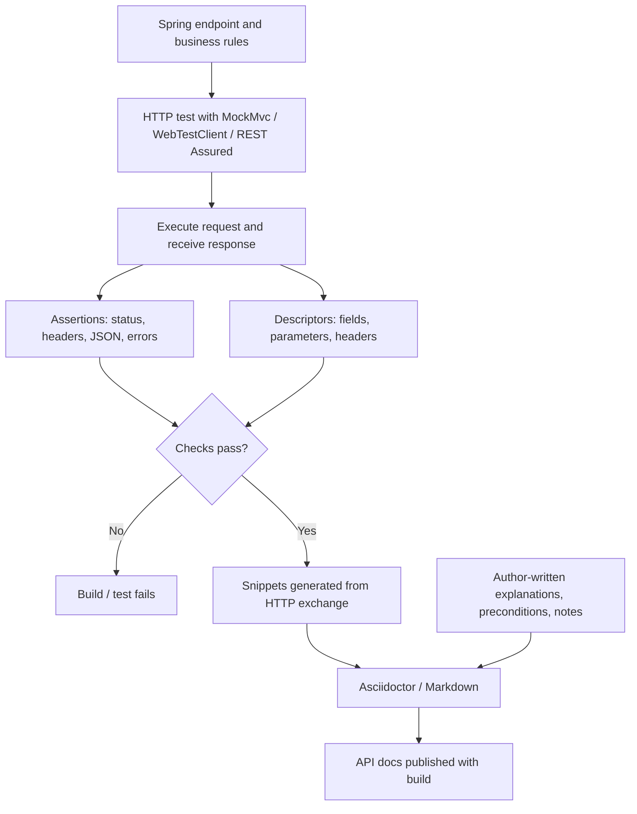
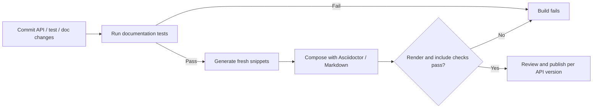

# Spring REST Docs and the Limits of Fully Code-Generated Documentation

## Learning Objectives

After this lesson, you will be able to:

- Explain where **code-generated** API documentation typically gets its information and why reading program structure alone is insufficient to prove REST API behavior.
- Distinguish *code-first* documentation from Spring REST Docs' **test-driven documentation**, avoiding the misconception that Spring REST Docs inspects all source code to write docs automatically.
- Identify information that must be verified via HTTP tests: status codes, headers, parameters, request/response payloads, and error scenarios.
- Create a documentation test with **MockMvc**, inspect the resulting snippets, and combine them with human-written explanations in **Asciidoctor**; understand how to apply the same principles with **WebTestClient**, **REST Assured**, and Markdown.
- State the limitations of both code generation and test-driven documentation, and propose quality controls in build and CI.

## 1. What Does "Code-Generated Documentation" Mean?

Some REST API documentation tools inspect **source code, annotations, data types, or metadata** to generate endpoint descriptions. For example, a Spring application has a controller:

```java
@GetMapping("/api/products/{id}")
public ProductResponse find(@PathVariable String id) {
    return productService.find(id);
}
```

Looking at this code, a tool can recognize the `GET` method, the path `/api/products/{id}`, the path parameter name `id`, and the expected Java return type of the response. If the DTO has field-description or validation annotations, an appropriate tool can use that metadata to enrich the specification.

However, **looking at the method signature alone cannot fully determine**:

- In which specific situations does the endpoint return `200`, `404`, `403`, or a business error?
- When `id` does not exist, which JSON fields appear in the error response?
- Which token and scopes do security filters require, or does a gateway alter headers?
- What currency does the `price` field use, can it be `null`, and what rounding rules apply?
- Is the returned DTO actually transformed by serializers, views, filters, or business logic?
- What task should API consumers call this endpoint to solve?

Source code is an essential source of truth, but **REST contract documentation must describe the behavior clients actually observe**. How much can be inferred from code depends on the tool, annotations, plugins, configuration, and whether supporting tests/specs exist.

In this lesson, *fully code-generated documentation* refers to relying primarily on scanning controllers/DTOs/annotations to generate pages or specs, **without an independent HTTP verification layer and without reviewed business explanations**. This differs from using a code-first tool in a system that already has solid contract tests and reviews.

## 2. Distinguish Three Approaches to Creating REST API Documentation

| Approach | Primary Inputs | Strengths | Risks If Used Alone |
| --- | --- | --- | --- |
| **Fully handwritten** | Markdown/Asciidoctor pages authored manually | Flexible business explanations and integration walkthroughs | HTTP examples and field tables easily go stale after code changes |
| **Code-first / annotation-driven** | Controllers, DTOs, annotations, schemas, metadata | Quickly produces endpoint lists and data structures; easy IDE/build integration | Can describe static types while missing dynamic behavior, errors, security, and semantics |
| **Spring REST Docs: test-driven** | HTTP exchanges executed in tests, assertions, descriptors | Snippets are tied to behavior in tested scenarios; structural drift can fail tests | Covers only the tests written; human-supplied descriptions can still be wrong |

Spring REST Docs is not simply an annotation scanner that generates full docs. It combines:

1. **HTTP tests** via MockMvc, WebTestClient, or REST Assured.
2. **Assertions** to verify status, headers, body, and chosen rules.
3. **Descriptors** declared by the test author to document parameters, headers, payloads, and more.
4. **Generated snippets** produced from the test's request/response and descriptors.
5. **Authored documentation pages** in Asciidoctor/Markdown combining explanations, examples, and snippets.

This is also the goal of the **SPRING_REST_DOCS** module: producing verifiable REST API documentation from HTTP tests rather than merely collecting a catalog of Java methods.

## 3. Common Limits of Documentation Inferred Solely from Source Code

### 3.1. Controller Signatures Do Not Reveal All HTTP Request Paths

Consider:

```java
@PostMapping("/api/orders")
public ResponseEntity<OrderResponse> create(@RequestBody CreateOrderRequest input) {
    return orderService.create(input);
}
```

The return type `ResponseEntity<OrderResponse>` does not tell you for certain which status codes every execution branch returns. The service may reject invalid input, domain logic may detect a conflict, `@ControllerAdvice` may convert exceptions into JSON errors, and security filters may block requests before the controller is ever reached.

API documentation must specify the **cases clients must handle**: success, invalid input, unauthorized, conflict, not found, etc. Never write a status matrix guessed from method names; verify against the real API and test every important scenario.

### 3.2. Data Types Do Not Explain Business Semantics

A DTO:

```java
public record OrderResponse(
        String id,
        String status,
        long amount
) {}
```

reveals Java types, yet does not answer: what values can `status` take? Is `amount` in VND, cents, or the minor unit of a currency? Does this value already include tax? Does a `PAID` order mean shipped or merely payment-confirmed?

Descriptive annotations can improve docs, yet annotation text **is still human-written and requires review**. No documentation generator can reliably infer all business semantics solely from `String` or `long` types.

### 3.3. Source Code Structure Does Not Always Match JSON Over the Wire

Actual requests and responses can be affected by:

| Runtime Component | Possible Difference |
| --- | --- |
| Jackson serializer and JSON annotations | Renamed fields, omitted fields, date/time formatting, altered nesting |
| Validation | Rejects invalid input with a different status and error body than the success response |
| Exception handlers | Translates errors into standardized HTTP status codes and payloads |
| Authentication/authorization filters | Returns `401` or `403` before reaching the controller |
| Gateway/proxy | Adds or modifies headers, path prefixes, or routing rules |
| Feature flags, profiles, existing data | Produces different responses across environments or execution branches |
| API versioning | Different releases have different contracts |

A good code-first tool can help enrich metadata for many of these cases, yet **untested metadata does not by itself prove** that the HTTP exchange matches what is described.

### 3.4. Schema-Synthesized Examples May Not Be Executable

A JSON sample auto-populated from data types may be syntactically valid while violating hidden rules: non-existent customer IDs, quantities exceeding limits, tokens lacking scopes, or disallowed state transitions. Readers copy the example and get an error even though the schema table looks reasonable.

HTTP snippets in Spring REST Docs come from a request/response **actually executed in a test**. That is a practical advantage, though tests must still use fixtures appropriate to the deployment layer being verified.

## 4. How Does Spring REST Docs Change Documentation Verification?



Three kinds of evidence must be understood properly:

| Layer | Example | Contribution to Trustworthiness |
| --- | --- | --- |
| **Behavior assertions** | `status().isOk()`, checking JSON `$.price.amount` | Fails if expectations checked by the test no longer hold |
| **Structural descriptors** | `responseFields(fieldWithPath("id"), ...)` | Binds description tables to fields present in the response |
| **Executed snippets** | `http-request.adoc`, `http-response.adoc` | Captures examples from test traffic instead of hand-copying old examples |

When using **strict** `requestFields(...)` or `responseFields(...)`, Spring REST Docs fails the test if an undocumented field appears, or if a required field in a descriptor is absent. Options like `optional()`, `ignored()`, `relaxedRequestFields(...)`, and `relaxedResponseFields(...)` change this constraint level and should be used intentionally.

For example, if the response renames `stockStatus` to `availability`, the existing test fails because old JSON assertions or old descriptors do not match. However, if the team simultaneously updates the test to accept a breaking change without reviewing the contract with consumers, **a green test does not prove the API change decision was right**.

## 5. Practice: Creating Documentation from an HTTP Test Instead of Just Reading DTOs

Suppose a product lookup endpoint returns:

```http
GET /api/catalog/book-01 HTTP/1.1
Accept: application/json
```

```json
{
  "id": "book-01",
  "title": "Notebook",
  "availability": "AVAILABLE",
  "price": {
    "amount": 59000,
    "currency": "VND"
  }
}
```

Inspecting the `CatalogResponse` record reveals field names, yet to obtain **tested HTTP examples**, write a documentation test.

### 5.1. MockMvc + JUnit Jupiter + Spring REST Docs

This example targets Java 17+, Spring MVC Test, Jackson, JUnit Jupiter, and a `spring-restdocs-mockmvc` dependency compatible with the project's Spring version. The controller is declared directly inside the test with fixed data to demonstrate the mechanism; in a real project, replace it with the actual controller/application you are protecting.

```java
import org.junit.jupiter.api.BeforeEach;
import org.junit.jupiter.api.Test;
import org.junit.jupiter.api.extension.ExtendWith;
import org.springframework.http.MediaType;
import org.springframework.restdocs.RestDocumentationContextProvider;
import org.springframework.restdocs.RestDocumentationExtension;
import org.springframework.test.web.servlet.MockMvc;
import org.springframework.test.web.servlet.setup.MockMvcBuilders;
import org.springframework.web.bind.annotation.GetMapping;
import org.springframework.web.bind.annotation.PathVariable;
import org.springframework.web.bind.annotation.RestController;

import static org.springframework.restdocs.headers.HeaderDocumentation.headerWithName;
import static org.springframework.restdocs.headers.HeaderDocumentation.requestHeaders;
import static org.springframework.restdocs.headers.HeaderDocumentation.responseHeaders;
import static org.springframework.restdocs.mockmvc.MockMvcRestDocumentation.document;
import static org.springframework.restdocs.mockmvc.MockMvcRestDocumentation.documentationConfiguration;
import static org.springframework.restdocs.payload.PayloadDocumentation.fieldWithPath;
import static org.springframework.restdocs.payload.PayloadDocumentation.responseFields;
import static org.springframework.restdocs.request.RequestDocumentation.parameterWithName;
import static org.springframework.restdocs.request.RequestDocumentation.pathParameters;
import static org.springframework.test.web.servlet.request.MockMvcRequestBuilders.get;
import static org.springframework.test.web.servlet.result.MockMvcResultMatchers.jsonPath;
import static org.springframework.test.web.servlet.result.MockMvcResultMatchers.status;

@ExtendWith(RestDocumentationExtension.class)
class CatalogDocumentationTest {
    private MockMvc mvc;

    @BeforeEach
    void setUp(RestDocumentationContextProvider context) {
        mvc = MockMvcBuilders.standaloneSetup(new CatalogController())
                .apply(documentationConfiguration(context))
                .build();
    }

    @Test
    void documentGetCatalogItem() throws Exception {
        mvc.perform(get("/api/catalog/{id}", "book-01")
                        .accept(MediaType.APPLICATION_JSON))
                .andExpect(status().isOk())
                .andExpect(jsonPath("$.id").value("book-01"))
                .andExpect(jsonPath("$.availability").value("AVAILABLE"))
                .andExpect(jsonPath("$.price.amount").value(59000))
                .andExpect(jsonPath("$.price.currency").value("VND"))
                .andDo(document("catalog-get",
                        pathParameters(
                                parameterWithName("id")
                                        .description("Product ID to look up")
                        ),
                        requestHeaders(
                                headerWithName("Accept")
                                        .description("Desired response format")
                        ),
                        responseHeaders(
                                headerWithName("Content-Type")
                                        .description("JSON response format")
                        ),
                        responseFields(
                                fieldWithPath("id")
                                        .description("Product ID"),
                                fieldWithPath("title")
                                        .description("Product title"),
                                fieldWithPath("availability")
                                        .description("Availability status"),
                                fieldWithPath("price")
                                        .description("Price details"),
                                fieldWithPath("price.amount")
                                        .description("Monetary amount per API convention"),
                                fieldWithPath("price.currency")
                                        .description("Currency code")
                        )
                ));
    }

    record Price(long amount, String currency) {}
    record CatalogResponse(
            String id, String title, String availability, Price price) {}

    @RestController
    static class CatalogController {
        @GetMapping(path = "/api/catalog/{id}",
                    produces = MediaType.APPLICATION_JSON_VALUE)
        CatalogResponse find(@PathVariable("id") String id) {
            return new CatalogResponse(
                    id, "Notebook", "AVAILABLE", new Price(59000L, "VND"));
        }
    }
}
```

**Key points of the example:**

1. `get("/api/catalog/{id}", "book-01")` routes the request through Spring MVC Test's processing pipeline instead of just reading the controller signature.
2. `andExpect(...)` verifies values that clients actually see in this scenario.
3. `pathParameters(...)`, `requestHeaders(...)`, `responseHeaders(...)`, and `responseFields(...)` document the observed request/response structure. Nested JSON fields like `price.amount` are declared explicitly.
4. `document("catalog-get", ...)` requests generation of a snippet group with a fixed identifier.
5. The text in `description(...)` **is still decided by the test author**. For example, the test does not verify currency minor units or rounding rules; do not invent unverified rules.

Typical Gradle output after the test passes:

```text
build/generated-snippets/
└── catalog-get/
    ├── curl-request.adoc
    ├── http-request.adoc
    ├── http-response.adoc
    ├── path-parameters.adoc
    ├── request-headers.adoc
    ├── response-headers.adoc
    └── response-fields.adoc
```

Paths and file extensions depend on build/template configuration; Maven typically uses `target/generated-snippets`. Table snippets are only generated if the documentation test declares the corresponding descriptors.

### 5.2. Modifying the DTO to See the Value of Testing

Suppose the controller renames `availability` to `stockStatus` while the docs have not been updated:

```json
{
  "id": "book-01",
  "title": "Notebook",
  "stockStatus": "AVAILABLE",
  "price": {"amount": 59000, "currency": "VND"}
}
```

With the test above:

- The `jsonPath("$.availability")` assertion fails because that field no longer appears.
- If you remove the assertion while keeping strict `responseFields(...)`, the `availability` descriptor cannot find the old field, and `stockStatus` is an undocumented field.
- The team must determine whether this rename is allowed under the contract, choose an appropriate compatibility approach, and then update tests, descriptors, prose, and regenerate snippets.

A DTO-scanning tool could also update the schema to `stockStatus`, yet **automatically updating the schema does not necessarily warn that clients depend on the old name**. Protecting backward compatibility requires dedicated reviews and contract tests.

### 5.3. What the Example Still Does Not Prove

Because the mock controller always returns data for any ID, the test above **does not prove**:

- That `book-01` actually exists in the production data store;
- What `404` status and error body a missing product returns;
- How unauthorized requests are rejected;
- What discount, tax, or rounding rules apply to pricing;
- Whether `AVAILABLE` accurately reflects real inventory;
- Whether production gateways, filters, and configurations produce the same response as the example.

To build trustworthy documentation for those branches, add tests on real components at the appropriate layer and write the corresponding business explanations.

## 6. Why Do Snippets Still Need Handwritten Documentation?

On a REST API page, snippets help answer **"What does the request/response look like in the tested scenario?"**. They are not enough to answer **"In what situation should I use this endpoint, why, and how do I handle the statuses?"**.

Asciidoctor example:

```asciidoc
= Catalog REST API
:toc: left

== Look Up a Product

GET /api/catalog/{id} returns details for a single product by ID.

=== HTTP request
include::{snippets}/catalog-get/http-request.adoc[]

=== Path parameters
include::{snippets}/catalog-get/path-parameters.adoc[]

=== Request headers
include::{snippets}/catalog-get/request-headers.adoc[]

=== HTTP response
include::{snippets}/catalog-get/http-response.adoc[]

=== Response fields
include::{snippets}/catalog-get/response-fields.adoc[]

=== Integration Notes

Clients must interpret availability according to the status set published by the API.
Error and authentication rules must be documented alongside their corresponding tests.
```

During rendering, the `{snippets}` attribute must point to the documentation test output. The introduction and integration notes are **authored content**; the `include::...[]` lines are **test-generated snippets**. The finished page combines both sources.

If the project uses **Markdown**, configure suitable snippet templates and a Markdown-capable merge/render tool. The `include::...[]` syntax in the example belongs to Asciidoctor; standard Markdown does not recognize it. Merely renaming `.adoc` files to `.md` does not create a valid Markdown workflow.

### Information to Assign to Documentation Authors

| Content | Can Be Generated/Verified from Tests? | What Humans Still Must Do |
| --- | --- | --- |
| Method, URI, request/response examples | Yes, from the test's HTTP exchange | Choose scenarios representative of real-world usage |
| Path/query parameters and headers | Table snippets generated from descriptors | Write meanings, defaults, and business applicability rules |
| JSON fields | Field paths checked via strict descriptors | Explain enums, units, logical constraints, and `null` cases |
| Error statuses and bodies | Yes, if dedicated error tests are written | Explain when errors arise and how clients should recover |
| Authentication/authorization | Appropriate scenarios can be tested | Document token acquisition, scopes, and access policies accurately |
| Limits, idempotency, consistency | Only within designed assertions/tests | Define system guarantees and explain integration patterns |

## 7. Which Layers Do MockMvc, WebTestClient, and REST Assured Protect?

Spring REST Docs supports multiple HTTP test styles, yet **coverage depends on how the system under test is wired**, not merely on the tool name.

| Tool | Typical Usage | Things to Keep in Mind |
| --- | --- | --- |
| **MockMvc** | Servlet-oriented Spring MVC testing without starting a real HTTP server | `standaloneSetup` can bypass filters, security, or bean wiring if not configured; know your test scope |
| **WebTestClient** | HTTP testing in WebFlux/reactive ecosystems or certain server setups | Can bind to handlers, an application context, or a live server; each mode covers different layers |
| **REST Assured** | Sending HTTP requests in integration tests to a running server | Covers more runtime components when servers, filters, and gateways are configured; requires stable fixtures |

In all three cases, the goal remains **sending executable requests, asserting behavior, describing HTTP components, and generating snippets**. A mock controller with canned responses does not automatically constitute evidence for the entire production system. When the contract critically depends on security filters, Jackson configuration, or exception handlers, test through a layer that includes those components.

To keep documentation consistent with the API, you can combine test layers: fast controller tests for snippet generation and integration/contract tests for end-to-end behavior. You do not need to adopt every tool simultaneously if a single testing approach meets your goals.

## 8. Integrating Documentation into Build and CI to Detect Drift

A trustworthy documentation page must be **regenerated and verified when the API changes**. Basic model:



The **illustrative Gradle Groovy DSL** snippet below assumes the project already has the Asciidoctor plugin and appropriate Spring/JUnit dependencies configured:

```groovy
configurations {
    asciidoctorExt
}

dependencies {
    testImplementation 'org.springframework.restdocs:spring-restdocs-mockmvc'
    asciidoctorExt 'org.springframework.restdocs:spring-restdocs-asciidoctor'
}

def snippetsDir = file("$buildDir/generated-snippets")

tasks.named('test') {
    outputs.dir snippetsDir
}

tasks.named('asciidoctor') {
    configurations 'asciidoctorExt'
    inputs.dir snippetsDir
    dependsOn tasks.named('test')
}
```

This is **not a complete `build.gradle` file**: it needs plugins, test libraries, a compatible REST Docs version or BOM, the `{snippets}` attribute setting, and full task configuration. Once complete, you can run `./gradlew clean test asciidoctor` (or `gradlew.bat clean test asciidoctor` on Windows). With Maven, the same principle applies: HTTP tests generate snippets, and the Asciidoctor plugin builds documentation from the test output.

### Critical Conditions on CI

1. **Run tests before rendering** and declare task dependencies; never publish pages if any documentation test fails.
2. **Avoid stale snippets** from earlier builds: use a clean workspace or build-isolated output for the release version.
3. **Catch broken includes**: configure checks so missing snippets, broken include paths, or render failures fail CI; do not assume every renderer blocks all errors by default.
4. **Keep examples stable**: use dummy fixtures and fix timestamps/IDs where applicable; normalize unstable values when recording snippets.
5. **Protect secrets**: never let access tokens, real cookies, passwords, personal data, or sensitive internal headers leak into HTML artifacts.
6. **Pin to versions**: build documentation from the same commit/build as the released API, clearly distinguishing contract versions if multiple are supported concurrently.
7. **Review handwritten sections**: status codes, enums, field meanings, permissions, limits, and error recovery can still be wrong even when every snippet generates cleanly.

CI does not automatically make documentation complete; it only enforces checks that have been automated. If a test for `404` is missing, no CI step can infer the exact error response from a `200` test alone.

## 9. Should You Combine Spring REST Docs with Code-First OpenAPI Tools?

**Yes, you can**, if the project genuinely needs both kinds of output. For example:

- A machine-readable **OpenAPI** specification for SDK/client generation tools or specialized UI viewers.
- **Spring REST Docs + Asciidoctor** pages for task-oriented integration guides backed by tested requests and responses.

They do not stay in sync automatically. If both exist side by side, establish a clear reconciliation workflow: review contract changes, validate schemas/HTTP contracts where appropriate, and align versions. Avoid maintaining two separate handwritten field tables with no verification between them.

**Do not conclude** that code-first docs are always wrong or that Spring REST Docs is always right. Code-first can be very effective when annotations, schemas, and tests are carefully disciplined; REST Docs can also lack coverage and contain wrong descriptions. True value depends on **the source of truth, test evidence, scenario coverage, and review process**.

## 10. Checklist for Choosing a Documentation Strategy

Before finalizing an endpoint, verify:

- [ ] There is a clear endpoint purpose and usage flow for consumers.
- [ ] The docs cover method, URL, path/query parameters, headers, request/response, and appropriate status codes.
- [ ] Important JSON fields have descriptors and meaningful assertions.
- [ ] Rules that code cannot imply on its own (units, enums, validation, auth, idempotency, retries) have verified descriptions.
- [ ] Key error scenarios have dedicated tests and snippets where needed.
- [ ] The test layer matches what needs to be proven; do not use fake controllers to draw conclusions about production.
- [ ] Any use of relaxed or ignored descriptors is justified.
- [ ] Source docs and snippets render automatically in CI, and missing inputs fail the build.
- [ ] Examples contain no sensitive data and correspond to the right API version.
- [ ] Reviewers inspect business content and contract changes that could break clients.

## 11. Thought and Practice Exercise

A Spring project has these DTOs:

```java
record CreatePaymentRequest(String accountId, long amount) {}
record PaymentResponse(String paymentId, String status) {}
```

A code-first tool generated a page describing `POST /api/payments` with the schema of both records. The integration team still asks: what unit is `amount` in; does sending a duplicate payment request create two transactions; which headers are required; and what JSON does an unauthorized error return?

Design a documentation plan:

1. List what **can be observed from the code** and what **cannot yet be confirmed** from the two records.
2. Write a documentation test for a valid request, asserting status and response body per the application contract; declare `requestFields(...)`, `responseFields(...)`, and header descriptors for any required headers.
3. Add tests for error cases, authorization, and duplicate submissions according to the agreed contract. Do not guess `400`/`401`/`409` statuses or idempotency mechanics if they have not been designed.
4. Use the snippets to compose an Asciidoctor/Markdown page, writing guidance on currency units, deduplication rules, and error handling based on verified information.
5. Try renaming `paymentId` to `id` in the real response while keeping the old strict descriptor. Explain why the documentation test fails and what the team must do before accepting the API change.
6. Integrate testing, snippet generation, rendering, and include checks into CI.

**Self-check question:** If an OpenAPI page generated from DTOs accurately lists every field, can you conclude it provides all the documentation consumers need? **No.** It may describe data structures well, yet lack information on HTTP scenarios, business semantics, and usage workflows. Those parts must be added and verified appropriately.

## Conclusion

Code-generated documentation helps automate listing endpoints and structures, yet **static code does not tell the full story of a running REST contract**. Spring REST Docs adds evidence from HTTP tests: MockMvc, WebTestClient, or REST Assured executes requests; assertions verify behavior; descriptors document structure; and snippets record the scenario's actual request and response. Combined with Asciidoctor/Markdown explanations and build/CI workflows, documentation becomes far more verifiable. This does not remove human responsibility for choosing enough scenarios, defining business rules, protecting compatibility, and reviewing what neither code nor a single isolated test can prove.
