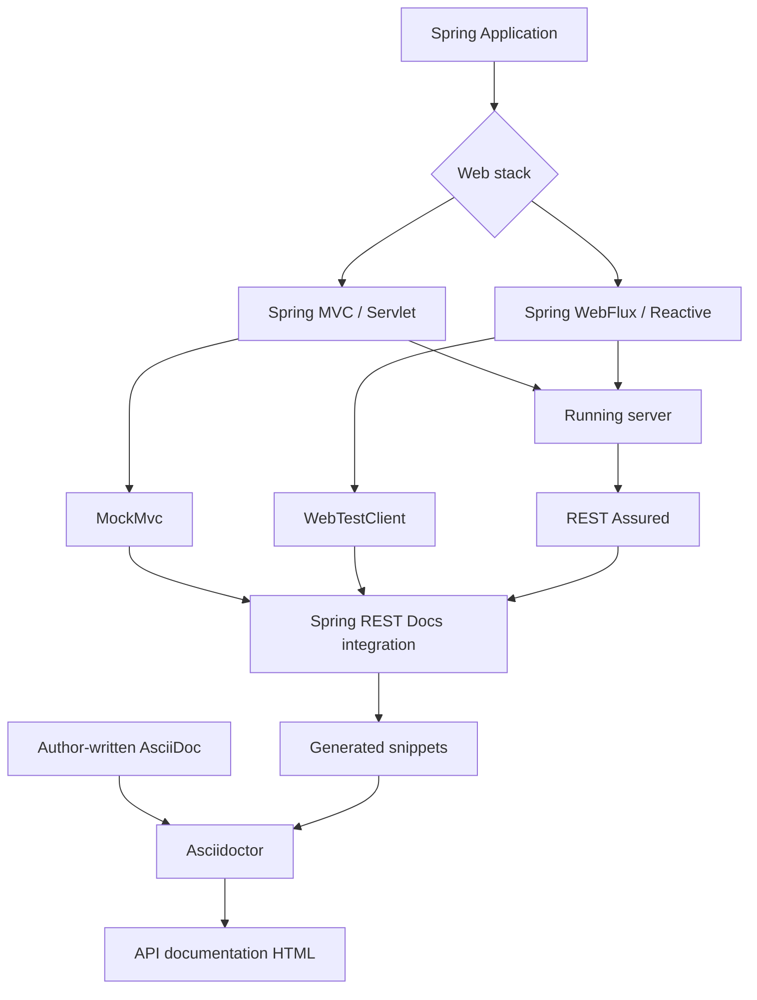
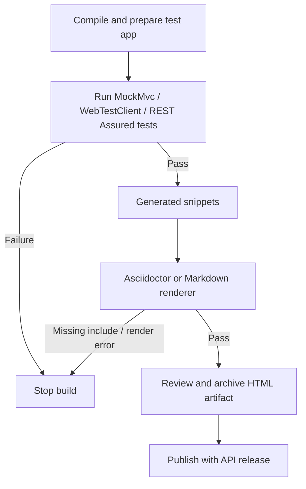

# Relationship with Spring MVC, WebFlux, REST Assured, and Asciidoctor

## Learning Objectives

After this lesson, you will be able to:

- Explain where Spring REST Docs sits in a Spring project and why it does not replace Spring MVC, Spring WebFlux, or an HTTP test client.
- Choose **MockMvc** for Spring MVC testing, **WebTestClient** for reactive/WebFlux applications or matching setups, and **REST Assured** for HTTP tests that send requests to a server.
- Describe the role of the corresponding Spring REST Docs integration modules and how they generate snippets from tested requests and responses.
- Understand **Asciidoctor** as the documentation composition/rendering step from snippets rather than an API test execution tool.
- Connect tests, snippet directories, Asciidoctor, and build/CI into a repeatable workflow.

## 1. The Big Picture: Each Component Solves One Job

A project using Spring REST Docs usually combines several libraries. They do not compete with each other because each library operates at a different layer:

| Component | Role | What It Does Not Replace |
| --- | --- | --- |
| **Spring MVC** | Servlet-based HTTP framework: request mapping, controllers, argument binding, responses | Does not generate REST Docs documentation on its own |
| **Spring WebFlux** | Reactive web framework supporting non-blocking/reactive streams and WebClient/WebTestClient | Does not generate documentation snippets on its own |
| **MockMvc** | Testing API for Spring MVC via a mock Servlet environment without starting a real HTTP server | Does not write API descriptions; test scope depends on how app/filters are wired |
| **WebTestClient** | HTTP test client well-integrated with WebFlux; can bind to controllers, context, or server | Does not automatically prove all production layers when bound in isolated mode |
| **REST Assured** | Client library and test DSL for sending requests and asserting HTTP responses, often used in server integration tests | Is not the application's web framework |
| **Spring REST Docs** | Connects HTTP tests with descriptors and generates snippets from exchanges inside tests | Does not replace the web framework or auto-discover every endpoint |
| **Asciidoctor** | Composes and renders documentation from AsciiDoc files, capable of including REST Docs snippets | Does not send HTTP requests or run API tests |

The relationships can be visualized as:



**Key takeaway:** Spring MVC/WebFlux handles application requests; MockMvc/WebTestClient/REST Assured executes tests; Spring REST Docs records and describes those HTTP exchanges; Asciidoctor combines snippets with explanations to produce readable documentation.

## 2. Spring MVC and MockMvc: Servlet-Model API Testing

### 2.1. How Does Spring MVC Handle Requests?

In a Spring MVC application, a request typically flows through a Servlet container and Spring MVC's dispatch pipeline: controller mapping, parameter/body binding, invoking application logic, and converting the result into an HTTP response. An example controller:

```java
@RestController
@RequestMapping("/api/orders")
class OrderController {
    @GetMapping("/{id}")
    OrderResponse find(@PathVariable String id) {
        return orderService.find(id);
    }
}
```

This code describes the route and Java method, yet it does not prove which status, headers, or JSON the endpoint actually returns in each situation. HTTP tests exercise the appropriate path and verify the results.

### 2.2. What Is MockMvc?

**MockMvc** is part of Spring Test and provides an API to dispatch requests into Spring MVC infrastructure via mock Servlet APIs. It lets you test mappings, argument binding, controllers, converters, and configured components without opening an HTTP port or running a real Servlet container.

MockMvc is useful when:

- The application uses Spring MVC/Servlet.
- You want fast tests for controllers and the HTTP contract.
- You need to observe requests and responses to generate REST Docs snippets.
- You want clear control over which application components are included in the test.

MockMvc is not equivalent to a request traversing a full reverse proxy or production deployment environment. When you need to verify security filters, MVC configuration, exception handlers, or real bean wiring, use a test setup that includes those components; when you need to test the server/container and network layer as well, add integration tests at the appropriate layer.

### 2.3. Combining MockMvc with Spring REST Docs

The standard integration dependency is `spring-restdocs-mockmvc`. Tests use MockMvc to send requests; Spring REST Docs attaches its documentation recorder via `documentationConfiguration(...)` and the `document(...)` action.

Illustrative example (Java 17+, JUnit Jupiter, Spring MVC Test; dependency versions must match your project's Spring version):

```java
@ExtendWith(RestDocumentationExtension.class)
class OrderDocumentationTest {
    private MockMvc mvc;

    @BeforeEach
    void setUp(RestDocumentationContextProvider context) {
        mvc = MockMvcBuilders.standaloneSetup(new OrderController())
                .apply(documentationConfiguration(context))
                .build();
    }

    @Test
    void getOrder() throws Exception {
        mvc.perform(get("/api/orders/{id}", 42)
                        .accept(MediaType.APPLICATION_JSON))
                .andExpect(status().isOk())
                .andExpect(jsonPath("$.id").value(42))
                .andDo(document("orders-get",
                        pathParameters(
                                parameterWithName("id")
                                        .description("Order ID")
                        ),
                        responseFields(
                                fieldWithPath("id")
                                        .description("Order ID"),
                                fieldWithPath("status")
                                        .description("Order status")
                        )
                ));
    }
}
```

Imports and build setup are omitted to focus on the integration. In a real test, `OrderController` is the application controller or a clearly configured test setup; the file must also declare static imports for REST Docs and MockMvc such as `document`, `pathParameters`, `responseFields`, `get`, `status`, and `jsonPath`.

Execution flow:

1. `RestDocumentationExtension` supplies the REST Docs context for JUnit Jupiter.
2. `documentationConfiguration(context)` attaches REST Docs configuration to MockMvc.
3. `perform(...)` sends an HTTP request through the MVC test infrastructure.
4. `andExpect(...)` asserts behavior; if an assertion fails, the test does not complete as expected.
5. `document("orders-get", ...)` records the HTTP exchange and generates snippets per the descriptors.

If the response structure changes, assertions or strict descriptors report an error. That signals the need to review the contract and update the documentation.

## 3. Spring WebFlux and WebTestClient: Testing Reactive Applications

### 3.1. How Does WebFlux Differ from Spring MVC?

**Spring WebFlux** is Spring's reactive web framework. It supports a non-blocking model, reactive types, and can run on reactive servers such as Reactor Netty; WebFlux can also run on compatible Servlet containers.

A reactive controller may return `Mono<T>` or `Flux<T>`:

```java
@RestController
@RequestMapping("/api/orders")
class ReactiveOrderController {
    @GetMapping("/{id}")
    Mono<OrderResponse> find(@PathVariable String id) {
        return orderService.findById(id);
    }
}
```

The key difference for test authors is how the application handles requests and the reactive return types. Spring REST Docs does not turn an MVC app into WebFlux or vice versa; you choose the integration that matches the stack under test.

### 3.2. What Is WebTestClient?

**WebTestClient** is Spring's HTTP test client, designed to work with WebFlux and also usable in certain other test setups. Depending on how it is bound, it can:

- Bind directly to a controller/handler (isolated scope).
- Bind to an application context to use more of the application's web configuration.
- Send requests to a running server via a base URL.

These three modes do not provide equal coverage. A test bound directly to a handler does not automatically verify all filters, server configuration, or production network layers.

### 3.3. Combining WebTestClient with Spring REST Docs

The standard integration dependency is `spring-restdocs-webtestclient`. REST Docs configuration is wired via a WebTestClient filter:

```java
@ExtendWith(RestDocumentationExtension.class)
class ReactiveOrderDocumentationTest {
    private WebTestClient client;

    @BeforeEach
    void setUp(ApplicationContext context,
               RestDocumentationContextProvider restDocumentation) {
        client = WebTestClient.bindToApplicationContext(context)
                .configureClient()
                .filter(documentationConfiguration(restDocumentation))
                .build();
    }

    @Test
    void getOrder() {
        client.get()
                .uri("/api/orders/{id}", 42)
                .accept(MediaType.APPLICATION_JSON)
                .exchange()
                .expectStatus().isOk()
                .expectBody()
                .jsonPath("$.id").isEqualTo(42)
                .consumeWith(document("orders-get"));
    }
}
```

This outlines the usage flow; when documenting in detail, pass snippets/descriptors to the appropriate `document(...)` overload and include the corresponding static imports. The context setup must also fit the WebFlux application type and the REST Docs version in use.

Key differences from MockMvc:

| Comparison Point | MockMvc | WebTestClient |
| --- | --- | --- |
| Typical integration | Spring MVC / Servlet | Spring WebFlux / Reactive |
| Fluent usage | `perform(...).andExpect(...)` | `get()/post()...exchange().expect...` |
| Return abstraction | MockMvc result actions | WebTestClient response/spec |
| REST Docs hook | MockMvc integration module and MockMvc configurer | WebTestClient integration module and filter |
| Test setup | Mock Servlet environment | Bind handler/context or connect to server |

If the application uses traditional Spring MVC, MockMvc is usually the direct choice. If the application is reactive WebFlux, WebTestClient is typically more natural. Do not pick WebTestClient merely because it is newer, nor force MockMvc onto an incompatible reactive stack.

## 4. REST Assured: Server-Directed HTTP Testing

### 4.1. How Does REST Assured Differ from MockMvc/WebTestClient?

**REST Assured** is a Java library with a DSL for HTTP testing. It lets you configure a request (method, path, headers, body), send it to a base URI/port, and verify the response with matchers.

Basic test syntax example:

```java
given()
    .accept("application/json")
.when()
    .get("/api/orders/{id}", 42)
.then()
    .statusCode(200)
    .body("id", equalTo(42));
```

REST Assured is commonly used when the application/server is already running in an integration test, allowing it to exercise more runtime components than a test bound directly to a controller. Actual coverage still depends on the server, database, security, and environment started by the test.

### 4.2. Combining REST Assured with Spring REST Docs

The standard integration dependency is `spring-restdocs-restassured`. REST Docs provides a filter for REST Assured to record exchanges and generate snippets:

```java
given(specification)
    .filter(document("orders-get"))
    .accept("application/json")
.when()
    .get("/api/orders/{id}", 42)
.then()
    .statusCode(200)
    .body("id", equalTo(42));
```

In a complete test, `specification` is built from REST Docs configuration (e.g., `documentationConfiguration(restDocumentation)`) and snippets/descriptors can be passed to `document(...)`. When executed, REST Assured sends an HTTP request to the server started by the test; the REST Docs filter captures the exchange.

Characteristics of this approach:

- Well-suited for tests needing HTTP interaction over a server port.
- Can cover serialization, filters, controller mappings, and real integrations if the test environment initializes them.
- Test execution cost is usually higher than isolated MVC tests, especially when starting a server and external dependencies.
- Requires controlling ports, test data, ordering, and execution timing so snippets remain stable.

### 4.3. Choosing the Tool by Scope to Protect

| Need | Commonly Reasonable Choice | Reason |
| --- | --- | --- |
| Fast Spring MVC controller test and snippet generation | MockMvc | Integrates directly with Spring MVC Test |
| Testing reactive WebFlux handlers/controllers | WebTestClient | Provides reactive APIs and WebFlux integration |
| Testing against a running server with a familiar HTTP DSL | REST Assured | Sends requests like an HTTP client and asserts responses |
| Verifying full path through security, serialization, server config | WebTestClient/REST Assured or full MockMvc setup | Choose a test setup containing the actual components to verify |

You do not need all three for the same endpoint. A project can use MockMvc for most documentation tests and select certain integration tests with REST Assured for contracts requiring server-level verification.

## 5. Role of Spring REST Docs Across All Three Testing Approaches

The three integration modules hook into tests differently, yet all aim for the same goal: **from a verified HTTP exchange, generate snippets ready to include in documentation**.

| Integration | Typical Dependency | How REST Docs Hooks In |
| --- | --- | --- |
| MockMvc | `spring-restdocs-mockmvc` | `documentationConfiguration(context)` on MockMvc; `document(...)` in result actions |
| WebTestClient | `spring-restdocs-webtestclient` | REST Docs documentation filter on WebTestClient; `consumeWith(document(...))` on the exchange |
| REST Assured | `spring-restdocs-restassured` | REST Docs filter attached to the REST Assured request specification |

Exact dependency coordinates and APIs should be checked against your compatible Spring REST Docs version. Do not mix classes/methods across integration modules arbitrarily: for instance, a MockMvc configurer cannot replace a WebTestClient filter.

Snippet types you will encounter:

| Group | Examples | Generated From |
| --- | --- | --- |
| HTTP request/response | `http-request.adoc`, `http-response.adoc` | Request and response recorded in the test |
| Curl | `curl-request.adoc` | Request formatted as a curl command |
| Parameters | `path-parameters.adoc`, `query-parameters.adoc` | Descriptors and actual request parameters |
| Headers | `request-headers.adoc`, `response-headers.adoc` | Descriptors and headers in the exchange |
| Payload fields | `request-fields.adoc`, `response-fields.adoc` | JSON/body and field descriptors |

A descriptor like `fieldWithPath("status").description("Order status")` has two parts: the field path must match the exchange, and the explanation is provided by the author. REST Docs can validate part of the structure; it does not verify the business accuracy of the description sentence.

## 6. Asciidoctor: From Snippets to Documentation Pages

### 6.1. What Does Asciidoctor Do?

**Asciidoctor** is a tool for composing and rendering documentation from the AsciiDoc markup language. In the standard Spring REST Docs workflow:

1. Tests run and generate snippets, typically as `.adoc` files.
2. Authors write an `index.adoc` or multiple AsciiDoc pages.
3. Source pages use `include::...[]` directives to embed snippets.
4. Asciidoctor renders the documentation into HTML (or another configured format).

Asciidoctor **does not execute tests**. It requires existing snippets; therefore, the build must ensure the test task runs before the render task.

### 6.2. Example AsciiDoc Page

Assuming a test from any of the three integration modules generated the `orders-get` folder:

```asciidoc
= Orders API
:toc: left
:sectnums:

== Look Up an Order

Use GET /api/orders/{id} to retrieve an order by ID.
This endpoint returns JSON according to the released version's contract.

=== HTTP request
include::{snippets}/orders-get/http-request.adoc[]

=== Path parameters
include::{snippets}/orders-get/path-parameters.adoc[]

=== HTTP response
include::{snippets}/orders-get/http-response.adoc[]

=== Response fields
include::{snippets}/orders-get/response-fields.adoc[]
```

The `{snippets}` attribute must be configured to point to the snippet directory. Explanatory paragraphs before and after includes are written by authors; HTTP exchanges and description tables come from snippets. This gives the page context while avoiding manual request/response copying.

### 6.3. Suggested Directory Layout

```text
src/
├── test/java/.../OrderDocumentationTest.java
└── docs/asciidoc/
    ├── index.adoc
    └── images/
build/
└── generated-snippets/
    └── orders-get/
        ├── http-request.adoc
        ├── http-response.adoc
        ├── path-parameters.adoc
        └── response-fields.adoc
```

The `build/generated-snippets` output is a test artifact, not a place for manual edits. To change a field description, edit the descriptor in the test; to add business explanations, edit the AsciiDoc source file.

## 7. Can Markdown Be Used Instead of Asciidoctor?

You can build documentation in **Markdown** if you configure Spring REST Docs/templates to generate snippets in a compatible format and have an include/merge mechanism supported by your Markdown renderer or static site generator.

Points to remember:

- AsciiDoc commonly uses `.adoc` snippets and `include::{snippets}/...[]` directives.
- Standard Markdown does not have Asciidoctor's include syntax.
- Renaming files from `.adoc` to `.md` does not automatically convert syntax or templates.
- A Markdown pipeline must define where snippets come from, how they are embedded, and how to fail if a referenced file is missing.

If a project already uses Asciidoctor, continuing with AsciiDoc is usually simpler. If an existing docs portal uses Markdown, evaluate include-capable renderers/plugins before choosing the snippet format.

## 8. Build and CI: Wiring the Steps in the Right Order

Minimal build flow:



With Gradle Groovy DSL and the Asciidoctor plugin, conceptual wiring:

```groovy
configurations {
    asciidoctorExt
}

dependencies {
    testImplementation 'org.springframework.restdocs:spring-restdocs-mockmvc'
    asciidoctorExt 'org.springframework.restdocs:spring-restdocs-asciidoctor'
}

def snippetsDir = file("$buildDir/generated-snippets")

tasks.named('test') {
    outputs.dir snippetsDir
}

tasks.named('asciidoctor') {
    configurations 'asciidoctorExt'
    inputs.dir snippetsDir
    dependsOn tasks.named('test')
}
```

This illustrates the connected components, not a complete build script. You must declare plugins, a compatible REST Docs version, appropriate Spring/JUnit dependencies, the `{snippets}` attribute, and consistent output directories. When using WebTestClient or REST Assured, replace the integration dependency with the matching module; you do not need to declare all three.

Once fully configured, the typical command is:

```bash
./gradlew clean test asciidoctor
```

On Windows you can run:

```bat
gradlew.bat clean test asciidoctor
```

Practices for reliable CI:

1. **Clean builds:** avoid reusing old snippets when a test has been deleted, renamed, or no longer runs.
2. **Explicit task dependencies:** rendering must depend on the tests that generate snippets.
3. **Treat missing includes as errors:** verify your renderer/pipeline configuration actually fails the build if a referenced snippet does not exist; do not assume every setup does so by default.
4. **Stable data:** fix IDs, timestamps, collection ordering, and volatile values; use preprocessing if needed.
5. **Protect sensitive data:** use dummy data only; never output tokens, cookies, secrets, or personal data into snippets.
6. **Version alignment:** build documentation from the same commit/build as the released API.
7. **Review explanations:** tests and snippets cannot validate the full semantics of handwritten content.

## 9. Choosing the Right Stack Combination for Your Project

| Project Type | Starting Combination | When to Supplement |
| --- | --- | --- |
| Spring MVC, synchronous REST controllers | MockMvc + `spring-restdocs-mockmvc` + Asciidoctor | Integration tests for security, serialization, gateway, or real server |
| Spring WebFlux, reactive controllers | WebTestClient + `spring-restdocs-webtestclient` + Asciidoctor | Live-server tests when transport/configuration verification is needed |
| Spring app booting a server for end-to-end tests | REST Assured + `spring-restdocs-restassured` + Asciidoctor | Isolated fixture/service tests to pinpoint root causes on failure |
| Markdown-based docs portal | Integration matching web stack + Markdown snippet templates + include-capable renderer | Verify snippet files, links, and portal HTML output |

There is no single combination that fits every project. Pick the test client based on your web stack and desired verification scope; pick Asciidoctor/Markdown based on your documentation ecosystem; keep dependencies and configuration APIs on compatible versions.

## 10. Common Misconceptions

| Inaccurate Claim | Accurate Understanding |
| --- | --- |
| "MockMvc is a web framework like Spring MVC." | Spring MVC handles requests; MockMvc is a test tool simulating a Servlet environment. |
| "WebTestClient only works with WebFlux." | It was designed for WebFlux but supports broader binding/client modes; choose the right setup. |
| "REST Assured competes with Spring REST Docs." | REST Assured sends and asserts requests; REST Docs integrates to generate snippets from those tests. |
| "Asciidoctor calls the API to generate snippets." | Tests and REST Docs generate snippets; Asciidoctor only composes and renders content. |
| "Green tests prove the entire documentation is right." | Tests only prove the configured assertions, descriptors, and scenarios. |
| "All integration dependencies must be added." | Only add the module matching the test client you actually use. |
| "Using WebTestClient/REST Assured guarantees production is tested." | Coverage depends on how the client is bound and which server and dependencies are started. |

## 11. Self-Check Exercise

A project provides two APIs: a Spring MVC module for `GET /api/customers/{id}` and a WebFlux module for `GET /api/events/stream`. The team also has an end-to-end test that boots the server on a random port.

Propose a design:

1. Choose MockMvc for the MVC endpoint and explain why it is the direct option.
2. Choose WebTestClient to test the reactive handler; determine whether binding to controller, application context, or server fits the goal.
3. Choose REST Assured for the end-to-end test if the team already has a server-booting fixture; describe how the REST Docs filter records the exchange.
4. Organize snippets with separate identifiers, such as `customers-get`, `events-stream-get`, and `customers-e2e-get` if they represent distinct scenarios.
5. Write an AsciiDoc page including the appropriate snippets; document auth prerequisites and stream format according to the real contract.
6. Put tests and Asciidoctor into CI, verifying clean output and include errors.

**Question:** If `GET /api/events/stream` returns data as an unbounded stream, should it be documented like an ordinary JSON response? Do not assume that by default. Determine the media type, per-event protocol/format, termination or reconnection behavior, and how to test and document according to the real contract. A reactive-capable test client does not decide the contract on behalf of the API designers.

## Conclusion

Spring MVC and WebFlux are web stacks; MockMvc, WebTestClient, and REST Assured are options for executing and asserting HTTP calls; Spring REST Docs links those tests to descriptors and snippets; **Asciidoctor** combines snippets with explanations into publishable documentation. Picking the integration that matches your application tests the right layer: MVC typically uses MockMvc, WebFlux typically uses WebTestClient, and REST Assured suits tests targeting a running server. After tests generate snippets, Asciidoctor/Markdown renders them per build and CI configuration. Each component has a distinct responsibility; understanding those boundaries ensures API documentation reflects verified requests and responses while giving integrators the context they need.
