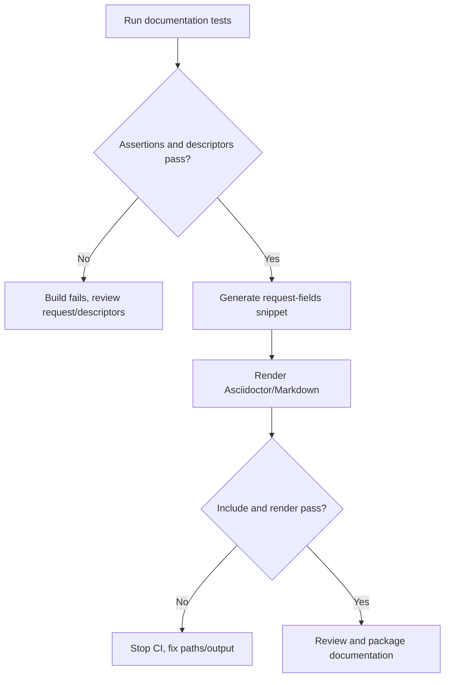

# Missing Field Descriptions Causing Documentation Tests to Fail

## Learning objectives

After this lesson, you will be able to:

- Explain why Spring REST Docs can fail a documentation test when a request payload contains an undocumented field.
- Distinguish a payload containing a field without a descriptor from a descriptor declaring a field absent from the payload.
- Read `requestFields` errors, pinpoint the offending JSON path, and update descriptors appropriately.
- Use `fieldWithPath`, `subsectionWithPath`, `optional`, and `ignored` for their intended purposes; understand the impact of `relaxedRequestFields`.
- Write repeatable request payload tests, verify required structure and values, and generate stable request fields snippets.

## 1. Why can a missing field description fail a test?

Spring REST Docs generates snippets from a test's HTTP exchange. For request bodies, teams commonly use `requestFields` to declare the JSON fields that should appear in the documentation table. Each descriptor both specifies a field path and provides descriptive text for readers.

For example, an order-creation API receives the request:

```json
{
  "customerId": 7,
  "note": "Deliver during business hours",
  "items": [
    {
      "sku": "BOOK-01",
      "quantity": 2
    }
  ]
}
```

The test might declare:

```java
requestFields(
    fieldWithPath("customerId").description("Customer ID"),
    fieldWithPath("items[].sku").description("Product SKU"),
    fieldWithPath("items[].quantity").description("Quantity")
)
```

The descriptors above say nothing about the `note` field. In the default strict mode of `requestFields`, REST Docs checks the payload structure against the list of documented fields. If a field appears in the payload without being described, snippet generation can throw `SnippetException`; the test fails and the build stops.

This is a useful safeguard: when an API adds a new request field, the team must decide whether that field belongs to the client-facing contract, then document it or explicitly handle the exception. Without this verification step, the request fields snippet could become incomplete while the actual payload has already changed.

## 2. Two kinds of mismatch to distinguish

### 2.1. Payload has a field, but descriptors do not declare it

The payload contains:

```json
{
  "customerId": 7,
  "note": "Deliver during business hours"
}
```

Descriptors only include:

```java
requestFields(
    fieldWithPath("customerId").description("Customer ID")
)
```

The `note` field is part of the request sent by the test, yet it has not been documented. In strict mode, REST Docs reports the undocumented part of the payload. Ask: is `note` a public field that consumers are allowed to send? If yes, add a descriptor and explain it. If not, investigate why the endpoint accepts or the test sends that field; do not silence the error mechanically.

### 2.2. Descriptor declares a field not present in the payload

Actual payload:

```json
{
  "customerId": 7
}
```

Descriptors:

```java
requestFields(
    fieldWithPath("customerId").description("Customer ID"),
    fieldWithPath("couponCode").description("Coupon code")
)
```

In this test payload there is no `couponCode`, so the descriptor cannot find the field to document. REST Docs may report that the descriptor points to a non-existent field. This typically happens when:

- The test fixture was not updated after descriptors changed.
- The field name was misspelled or differs from serialization rules.
- The field is actually optional, but the descriptor was not marked `optional`.
- The field was removed from the request contract, yet the descriptor remains.

Do not add dummy fields to JSON just to make the test green if clients are not actually supposed to send that field. Verify the contract, then update either the test or the descriptor to match actual behavior.

### 2.3. Quick comparison table

| Situation | What REST Docs detects | How to handle |
| --- | --- | --- |
| Payload has `note`, descriptors lack `note` | Field in payload is undocumented | Add descriptor if field belongs to contract; otherwise investigate payload/test |
| Descriptor has `couponCode`, payload does not | Descriptor does not match payload | Add field to fixture if test request must include it; or mark optional/remove descriptor |
| Payload changes `customerId` to `customer_id` | Old descriptor no longer points to the right path | Check actual JSON field name and update contract/test/descriptor |
| Payload adds `shippingAddress` object | Object or child fields are undocumented | Document the object and its child structure appropriately |
| Payload has dynamic field outside the documented part | Strict check reports undocumented field | Consider `ignored` or a `relaxed` snippet with a clear scope |

## 3. Hands-on MockMvc example

Suppose the `POST /api/orders` endpoint accepts `customerId`, `note`, and an `items` list. We want to generate a request fields snippet for this payload. The example uses JUnit Jupiter, Spring MVC Test, Jackson, and the `spring-restdocs-mockmvc` dependency compatible with the project's Spring version.

### 3.1. Test with a descriptor missing a field

```java
@ExtendWith(RestDocumentationExtension.class)
class CreateOrderDocumentationTest {
    private MockMvc mvc;

    @BeforeEach
    void setUp(RestDocumentationContextProvider context) {
        mvc = MockMvcBuilders.standaloneSetup(new OrderController())
                .apply(documentationConfiguration(context))
                .build();
    }

    @Test
    void createOrder() throws Exception {
        mvc.perform(post("/api/orders")
                        .contentType(MediaType.APPLICATION_JSON)
                        .accept(MediaType.APPLICATION_JSON)
                        .content("""
                            {
                              "customerId": 7,
                              "note": "Deliver during business hours",
                              "items": [
                                {"sku": "BOOK-01", "quantity": 2}
                              ]
                            }
                            """))
                .andExpect(status().isCreated())
                .andDo(document("orders-create",
                        requestFields(
                                fieldWithPath("customerId")
                                        .description("Customer ID"),
                                fieldWithPath("items[].sku")
                                        .description("Product SKU"),
                                fieldWithPath("items[].quantity")
                                        .description("Product quantity")
                        )
                ));
    }
}
```

The snippet above intentionally omits the `note` descriptor. When the request body reaches the documentation step and REST Docs validates the payload in strict mode, the `request-fields` snippet cannot be generated successfully because `note` is undocumented. The test can fail right at `andDo(document(...))`, after the HTTP request and assertions have run.

For the example to compile in a project, you need the corresponding controller and test configuration along with the necessary static imports such as:

```java
import static org.springframework.restdocs.mockmvc.MockMvcRestDocumentation.document;
import static org.springframework.restdocs.mockmvc.MockMvcRestDocumentation.documentationConfiguration;
import static org.springframework.restdocs.payload.PayloadDocumentation.fieldWithPath;
import static org.springframework.restdocs.payload.PayloadDocumentation.requestFields;
import static org.springframework.test.web.servlet.request.MockMvcRequestBuilders.post;
import static org.springframework.test.web.servlet.result.MockMvcResultMatchers.status;
```

You also need to import `MockMvc`, `MockMvcBuilders`, `RestDocumentationExtension`, `RestDocumentationContextProvider`, `MediaType`, `BeforeEach`, `Test`, and `ExtendWith`. The example focuses on the request payload; a real project also needs response documentation if you want to document the response in the same test.

### 3.2. Fixing the descriptors properly

If `note` is a valid field of the request contract, add its description:

```java
requestFields(
    fieldWithPath("customerId")
            .description("Customer ID"),
    fieldWithPath("note")
            .description("Delivery note provided by the customer"),
    fieldWithPath("items[].sku")
            .description("Product SKU"),
    fieldWithPath("items[].quantity")
            .description("Product quantity")
)
```

Now the descriptors cover the fields in the payload and can generate `request-fields.adoc`. Descriptions must reflect real rules: for instance, whether the note has a length limit, whether it can be omitted, and whether it guides delivery or is purely informational. Do not invent constraints just to make the documentation table look thorough.

### 3.3. Reading the generated snippet

After the test passes, the Gradle output typically has the structure:

```text
build/generated-snippets/
└── orders-create/
    ├── curl-request.adoc
    ├── http-request.adoc
    └── request-fields.adoc
```

The exact paths and set of snippets depend on build/template configuration. `request-fields.adoc` contains the table of declared fields. Do not edit files inside `build/generated-snippets` directly: the next test run can overwrite them. Edit descriptors in the test, then regenerate the snippets.

## 4. Nested fields, objects, and arrays

Real request payloads often have nested structures:

```json
{
  "customer": {
    "id": 7,
    "contact": {
      "email": "lan@example.test"
    }
  },
  "items": [
    {
      "sku": "BOOK-01",
      "quantity": 2
    },
    {
      "sku": "PEN-02",
      "quantity": 3
    }
  ]
}
```

REST Docs uses field paths to locate components:

| Descriptor path | Field described |
| --- | --- |
| `customer` | Customer information object |
| `customer.id` | Customer ID |
| `customer.contact.email` | Contact email |
| `items` | Array of product line items |
| `items[].sku` | SKU of each element |
| `items[].quantity` | Quantity of each element |

Example:

```java
requestFields(
    fieldWithPath("customer").description("Customer information"),
    fieldWithPath("customer.id").description("Customer ID"),
    fieldWithPath("customer.contact.email")
            .description("Contact email"),
    fieldWithPath("items").description("List of product line items"),
    fieldWithPath("items[].sku").description("Product SKU"),
    fieldWithPath("items[].quantity").description("Quantity")
)
```

Descriptors must match the executed JSON structure. When there are multiple levels of nesting, inspect the actual body and determine the exact paths rather than guessing path names from Java field names. The serializer may rename fields.

### 4.1. When to use a subsection descriptor?

If a large object or subtree is documented in a separate snippet, you can consider `subsectionWithPath(...)` instead of describing every field in the same table. For example:

```java
requestFields(
    fieldWithPath("customerId").description("Customer ID"),
    subsectionWithPath("shippingAddress")
            .description("Shipping address details; see the address section")
)
```

When using a subsection, the current document describes that object subtree as a single unit; child fields can be documented in a separate snippet or section. Avoid both describing an entire subtree as a subsection and repeating those same child fields in the same descriptor set if that combination causes overlap. Pick one clear representation and verify it against the actual payload.

## 5. Optional fields: when to use `optional()`?

A field may be absent in some valid requests. For example:

```json
{
  "customerId": 7,
  "items": [{"sku": "BOOK-01", "quantity": 2}]
}
```

In another request, the user provides a note:

```json
{
  "customerId": 7,
  "note": "Deliver after 5 PM",
  "items": [{"sku": "BOOK-01", "quantity": 2}]
}
```

If `note` is truly allowed to be absent under the contract, the descriptor can declare:

```java
fieldWithPath("note")
    .description("Delivery note")
    .optional()
```

`optional()` indicates that the field may be absent from the tested payload. It is not synonymous with `null`, nor does it prove the field is always accepted in every business state. If the contract permits both absence and `null`, verify separately how the serializer, binding, and validation handle `null`.

### 5.1. Three concepts that must not be equated

| Case | JSON example | Meaning |
| --- | --- | --- |
| Absent field | `{"customerId":7}` | No `note` key present |
| Null field | `{"customerId":7,"note":null}` | Key present, value is `null` |
| Empty string field | `{"customerId":7,"note":""}` | Key present, value is empty string |

A test request with `note: null` still contains the `note` field; this differs from a payload without the field. If the API rejects `null`, test and explain that rule. Do not use `optional()` to hide a contract distinction that consumers need to understand.

## 6. Fields that do not need to appear in the table: `ignored()` and relaxed snippets

Not every field in a test payload needs its own row in the description table. There may be technical metadata, experimental fields, or sections documented elsewhere. However, before omitting a field, understand why it is in the request and whether consumers should send it.

### 6.1. Use `ignored()` for fields intentionally excluded from the table

Example:

```java
requestFields(
    fieldWithPath("customerId").description("Customer ID"),
    fieldWithPath("debugContext").ignored(),
    fieldWithPath("items[].sku").description("Product SKU"),
    fieldWithPath("items[].quantity").description("Quantity")
)
```

`ignored()` declares that the field is recognized but no normal description entry is generated for it. This is an explicit decision in the descriptor; it does not mean the field does not exist or that API consumers are encouraged to send arbitrary data. Document the rationale in code review or internal docs.

### 6.2. Use `relaxedRequestFields()` when there is a valid reason to accept undocumented fields

REST Docs also provides a relaxed variant, for example:

```java
relaxedRequestFields(
    fieldWithPath("customerId").description("Customer ID")
)
```

A relaxed snippet allows the payload to contain extra undeclared fields without requiring all of them to be listed in descriptors as strict mode does. This is useful when you only want to introduce part of a payload, or when a payload has an extensible section managed separately.

In return, adding a new field may no longer fail the test. If an important public field appears, the team may miss the signal to update documentation. Therefore:

- Prefer strict `requestFields` for request contracts that need complete documentation.
- Use `relaxed` when the snippet's scope is intentionally partial.
- Clearly state which parts are omitted and where fuller documentation lives.
- Still write assertions and validation tests for important fields; `relaxed` does not replace behavioral verification.

## 7. How to investigate `requestFields` failures

When a test fails at the `document(...)` step, do not rush to switch to `relaxed`. Follow this order:

1. **Read the exact error:** identify which part of the payload is undocumented or which descriptor could not be found in the payload.
2. **Inspect the actual body:** look at the JSON the test sends, including nested fields, arrays, helper-generated fields, and serialized values.
3. **Check JSON paths:** compare actual keys with descriptors; watch camelCase/snake_case names, arrays `[]`, and nested objects.
4. **Confirm the contract:** is the new field allowed, required or optional, and nullable?
5. **Fix the right source:** update the descriptor, fixture, or request builder depending on the cause.
6. **Re-run the test and read the snippet:** ensure the `request-fields` table has accurate content and no field is accidentally exposed.

### 7.1. Error and resolution table

| Symptom | Possible cause | Resolution |
| --- | --- | --- |
| Reports `note` field is undocumented | New payload has `note`, descriptor not updated | Add descriptor or remove field from request if not part of contract |
| Reports `couponCode` does not exist | Stale descriptor still has a removed field or test did not send it | Check contract; remove descriptor, add to payload, or mark optional if appropriate |
| Cannot find `items.sku` | JSON uses an array so path must reflect elements | Use the right path such as `items[].sku` |
| Cannot find `customer.email` | Actual JSON uses `contact.email` or serializer renamed it | Inspect serialized HTTP payload and fix the path |
| Test only fails in CI | Different fixtures or unstable output/snippets | Make fixtures deterministic, check profiles/serialization and clean builds |
| Test passes yet table misses new field | Used relaxed descriptors or test did not exercise new payload | Re-evaluate strictness level and test coverage |

## 8. Relationship between request validation and request documentation

Request documentation is not validation. Both activities can share the same HTTP test, yet they answer two different questions:

| Activity | Question |
| --- | --- |
| Application validation | Is this request valid according to API/business rules? |
| Test assertions | For a specific request, did the server respond as expected? |
| REST Docs descriptors | Which components of the request are described in the snippet? |

For example, `@NotNull`, `@NotBlank`, or `@Positive` on a DTO can make Spring Validation reject invalid payloads. However, if tests only send valid requests and do not check error branches, the documentation does not show what status/body clients receive when validation fails.

A useful testing plan:

| Scenario | Assertions needed | Documentation that may be needed |
| --- | --- | --- |
| Valid request with all fields | Success status, ID, and key response fields | Full request fields, HTTP request/response |
| Missing required field | Error status and error payload | Validation error example, required-field rules |
| Field with invalid format | Contract status/error code | Format constraints and how to fix |
| Optional field absent | Request still valid, default behavior if any | Clearly note optional/default |
| Field sent as `null` | Actual result per contract | Distinguish `null` from absent |
| Unsupported field | System rejects or ignores by design | Actual behavior; do not assume |

Do not infer that every field marked `optional` in REST Docs is optional in validation, or vice versa. One describes presence in the payload snippet; the other is the application's request-validation behavior.

## 9. Embedding the `request-fields` snippet in Asciidoctor documentation

After tests generate snippets, authors can include them in a page:

```asciidoc
== Create order

Send customer information and order line items to create an order.

=== HTTP request
include::{snippets}/orders-create/http-request.adoc[]

=== Request fields
include::{snippets}/orders-create/request-fields.adoc[]
```

The `{snippets}` attribute must point to the snippet directory generated by the tests. When descriptors are updated and tests re-run, `request-fields.adoc` is regenerated according to the verified request contract.

Asciidoctor performs inclusion and rendering; it does not execute HTTP tests. For Markdown, you need snippet templates and an inclusion/assembly mechanism supported by your Markdown renderer; the `include::{snippets}/...[]` syntax above belongs to Asciidoctor, not standard Markdown.

Do not edit `build/generated-snippets/orders-create/request-fields.adoc` directly. Edit the descriptors in the test and let the build regenerate it. The generated file is an intermediate artifact; the editable sources are the test and the AsciiDoc/Markdown document.

## 10. Build and CI

A typical flow:



With Gradle, task configuration must ensure tests generate snippets before Asciidoctor reads them. Illustrative example with Groovy DSL:

```groovy
def snippetsDir = file("$buildDir/generated-snippets")

tasks.named('test') {
    outputs.dir snippetsDir
}

tasks.named('asciidoctor') {
    inputs.dir snippetsDir
    dependsOn tasks.named('test')
}
```

This only illustrates task relationships; the project also needs the Asciidoctor plugin, REST Docs dependencies, compatible versions, and snippet attribute configuration. For releases, run from a clean output directory to avoid leftover snippets after tests or descriptors have been deleted or renamed.

Some useful checks in CI:

- Strict tests for critical payload contracts.
- Tests for both successful requests and validation errors that need to be published.
- Verify snippet directories for required scenarios are generated.
- Render documentation and configure missing includes as build errors.
- Use fake data; never write tokens, cookies, passwords, or personal data into snippets.
- Publish documentation from the same commit/build as the API version.

## 11. Checklist for handling missing field descriptions

- [ ] Read the full REST Docs error message and identify the relevant payload/descriptor.
- [ ] Inspect the actual JSON body sent by the test, not just the Java DTO.
- [ ] Determine the exact field path, including nested objects and arrays.
- [ ] Confirm the field belongs to the contract and whether API consumers are allowed to send it.
- [ ] Add a descriptor with a clear description if the field should be published.
- [ ] Use `optional` only when the field can genuinely be absent.
- [ ] Use `ignored`/`relaxed` only when there is a clear rationale and scope.
- [ ] Keep assertions checking required values and validation.
- [ ] Re-run tests, inspect the newly generated snippet, and render the documentation page.

## 12. Hands-on exercise

The `POST /api/customers` endpoint accepts the payload:

```json
{
  "name": "Lan",
  "email": "lan@example.test",
  "phone": "0900000000",
  "marketingConsent": false
}
```

The test currently declares:

```java
requestFields(
    fieldWithPath("name").description("Customer name"),
    fieldWithPath("email").description("Email address")
)
```

Complete the following tasks:

1. Explain why the descriptors above can cause strict `requestFields` to fail.
2. Add descriptors for `phone` and `marketingConsent`, clearly stating their meaning based on the confirmed assumed contract.
3. Change the fixture to omit `phone`; if this field is truly optional, mark the descriptor appropriately and verify the test still passes.
4. Try sending `phone: null`, record the actual response, and distinguish it from a missing field.
5. Add a nested `metadata.source` field and write the descriptor with the right path.
6. Try using a `relaxed` snippet, observe how undocumented fields are handled, and explain the trade-off when used in public documentation.

**Self-check question:** If a test fails because the payload adds `marketingConsent`, is using `relaxedRequestFields` always the best solution? No. First determine whether the field belongs to the request contract. If clients need to send it and understand its meaning, adding a descriptor is the clearer solution. If the field is an intentional extension documented elsewhere, `relaxed` may fit, provided you accept reduced detection of undocumented fields.

## Conclusion

Strict `requestFields` helps Spring REST Docs catch when a request payload contains an undocumented field or when a descriptor declares a field that does not match the payload. This failure forces the team to re-examine the contract: add a descriptor, fix the fixture, mark it optional, remove an obsolete descriptor, or intentionally use `relaxed`/`ignored` with good reason. Always distinguish an **absent field**, a **null field**, and an **undocumented field**; they represent different situations. When HTTP tests, accurate descriptors, freshly generated snippets, and build/CI work together, the request fields table becomes a verifiable part of the REST API documentation.
