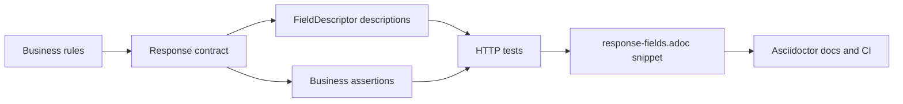

# Linking response fields to business semantics in Spring REST Docs

## 1. Why must JSON field descriptions reflect business semantics?

In the **Response payload** chapter of the **SPRING_REST_DOCS** module, writing `responseFields(...)` may start with descriptions like "Order ID", "Total amount", or "Status". However, a table containing only field names and JSON types is not enough to help integrators use the API correctly.

For example, two fields both have type `NUMBER`:

```json
{
  "discountAmount": 50000,
  "payableAmount": 320000
}
```

Readers still need to know: what unit the amounts are in, whether `discountAmount` has already been subtracted from `payableAmount`, whether shipping fees are calculated before or after discounts, and whether negative amounts are possible. Similarly, `status: "PAID"` must be tied to either **order** status or **payment transaction** status; the two concepts may differ.

Spring REST Docs handles documentation via `fieldWithPath(...).description(...)` and generates snippets from **real HTTP tests** using MockMvc, WebTestClient, or REST Assured. For documentation to remain verifiable, you should add assertions confirming the business rules associated with those fields.

A useful workflow:



**Lesson objectives:** translate business specifications into descriptions useful for clients; distinguish the semantics of values, units, statuses, timestamps, and inter-field relationships; write tests proving key rules; and integrate verified snippets into REST API documentation.

## 2. Running example: REST API returning order details

Suppose an e-commerce system provides the endpoint:

```http
GET /api/orders/ORD-2048 HTTP/1.1
Accept: application/json
```

Response `200 OK`:

```json
{
  "orderId": "ORD-2048",
  "status": "PAID",
  "customer": {
    "id": "CUS-17",
    "displayName": "Customer 17"
  },
  "items": [
    {
      "sku": "B-01",
      "quantity": 2,
      "unitPrice": 125000
    },
    {
      "sku": "B-02",
      "quantity": 1,
      "unitPrice": 100000
    }
  ],
  "pricing": {
    "subtotalAmount": 350000,
    "discountAmount": 50000,
    "shippingFeeAmount": 20000,
    "payableAmount": 320000,
    "currency": "VND"
  },
  "payment": {
    "status": "CAPTURED",
    "paidAt": "2026-11-01T02:00:00Z",
    "providerReference": "TX-987"
  },
  "createdAt": "2026-11-01T01:30:00Z",
  "cancelReason": null
}
```

In the **illustrative contract** of this endpoint:

- `orderId` and `customer.id` are string identifiers. Clients use them to reference resources without assuming an auto-incrementing pattern or parsing meaning from characters in the ID.
- `status` is the **order status**. The example supports `CREATED`, `PAID`, and `CANCELLED`. Confirm the real set of values in your API before publishing.
- `payment.status` is the **payment processing status**. `CAPTURED` means the transaction has been successfully recorded according to the sample system's rules; it is not an order status code.
- `pricing.currency` is `VND` and all monetary amounts in `pricing` are expressed as integer **Vietnamese dong** in this example, rather than mixing multiple units.
- `pricing.subtotalAmount` is the merchandise total **before discounts and before shipping fees**. `pricing.discountAmount` is the discount deducted; `pricing.shippingFeeAmount` is the shipping fee added.
- `pricing.payableAmount` is the total payable after subtracting discounts and adding shipping fees.
- `createdAt` and `payment.paidAt` are ISO 8601 timestamps with time zone. The `Z` suffix in sample data denotes UTC.
- `cancelReason` **always has its key present** in the sample contract, though it may hold a `null` value when the order is not in the `CANCELLED` state.

The values and rules above belong only to the example system. For a real API, verify the specification agreed upon with the business/domain team; do not present common conventions as guarantees if the system does not support them.

## 3. Turning business contracts into a field description table

Before writing test code, build a table answering four questions: **what is this field**, **what is its unit/format**, **how should readers use it**, and **what rule should be tested**.

| Response path | JSON type | Business meaning to clarify | Rule to verify |
| --- | --- | --- | --- |
| `orderId` | STRING | Order reference ID used for lookups; treat as an opaque identifier | Non-empty, matches requested resource |
| `status` | STRING | **Order** processing stage, distinct from payment status | Belongs to the supported status set |
| `customer.id` | STRING | Customer identifier linked to the order; not an email or phone number | Matches subject per test data |
| `customer.displayName` | STRING | Display name, not a unique identifier | Meant for display, not used as a key |
| `items[].sku` | STRING | Product SKU on each line item | Present in sample line items |
| `items[].quantity` | NUMBER | Number of product units ordered on a line item | Integer greater than 0 per sample contract |
| `items[].unitPrice` | NUMBER | Unit price per product, in VND | Non-negative |
| `pricing.subtotalAmount` | NUMBER | Merchandise total before discounts/fees, in VND | Equals sum of `quantity × unitPrice` |
| `pricing.discountAmount` | NUMBER | Total discount applied to the order, in VND | Non-negative; does not exceed subtotal if contract requires |
| `pricing.shippingFeeAmount` | NUMBER | Additional shipping fee, in VND | Non-negative |
| `pricing.payableAmount` | NUMBER | Amount payable, in VND | `subtotal - discount + shippingFee` |
| `pricing.currency` | STRING | Currency code of `pricing.*Amount` fields | Equals `VND` for sample endpoint |
| `payment.status` | STRING | Outcome of the payment flow, independent of `status` | Matches order/payment synchronization rules |
| `payment.paidAt` | STRING | Time of successful payment, ISO 8601 UTC | Parseable; not earlier than `createdAt` in this scenario |
| `payment.providerReference` | STRING | Trace reference issued by the payment processor | Exposed only when appropriate for API scope |
| `createdAt` | STRING | Order creation timestamp, ISO 8601 UTC | Parseable |
| `cancelReason` | STRING or null | Cancellation reason; null if not cancelled | Consistent with order status |

Good descriptions do more than echo the variable name. For example:

```java
// Low value to readers: merely repeats the field name.
fieldWithPath("pricing.payableAmount")
    .description("Payable amount");

// More useful: explains the calculation and unit.
fieldWithPath("pricing.payableAmount")
    .description(
        "Total payable amount in VND: merchandise subtotal "
        + "minus discount, plus shipping fee");
```

If an API involves taxes, service fees, rounding, or refunds, adjust the formula accurately. Do not put a simplified formula in documentation if it does not fully describe real behavior.

## 4. Writing `responseFields` around business meaning

From the payload in section 2, descriptors can be written as follows. The code snippet is the **argument list** passed into `responseFields(...)`:

```java
responseFields(
    fieldWithPath("orderId")
        .description("Order identifier for referencing the resource"),

    fieldWithPath("status")
        .description(
            "Order processing status; e.g. CREATED, PAID, CANCELLED"),

    fieldWithPath("customer")
        .description("Customer information associated with the order"),
    fieldWithPath("customer.id")
        .description("Customer ID, used as a reference identifier"),
    fieldWithPath("customer.displayName")
        .description("Customer display name"),

    fieldWithPath("items")
        .description("Line items contributing to the order subtotal"),
    fieldWithPath("items[].sku")
        .description("Product SKU of each line item"),
    fieldWithPath("items[].quantity")
        .description("Quantity of products ordered on the line item"),
    fieldWithPath("items[].unitPrice")
        .description("Unit price of one product in VND"),

    fieldWithPath("pricing")
        .description("Components used to calculate the order total"),
    fieldWithPath("pricing.subtotalAmount")
        .description("Merchandise total before discounts and shipping, in VND"),
    fieldWithPath("pricing.discountAmount")
        .description("Discount deducted from merchandise total, in VND"),
    fieldWithPath("pricing.shippingFeeAmount")
        .description("Added shipping fee, in VND"),
    fieldWithPath("pricing.payableAmount")
        .description(
            "Total payable in VND = subtotal - discount + shipping fee"),
    fieldWithPath("pricing.currency")
        .description("ISO 4217 currency code; this example uses VND"),

    fieldWithPath("payment")
        .description("Payment transaction information for the order"),
    fieldWithPath("payment.status")
        .description(
            "Payment status; CAPTURED means payment has been recorded"),
    fieldWithPath("payment.paidAt")
        .description("Timestamp when payment was recorded, ISO 8601 UTC"),
    fieldWithPath("payment.providerReference")
        .description("Reference ID for transaction reconciliation"),

    fieldWithPath("createdAt")
        .description("Order creation timestamp, ISO 8601 UTC"),
    fieldWithPath("cancelReason")
        .type(JsonFieldType.STRING)
        .description(
            "Cancellation reason; key is present but null if not cancelled")
)
```

There are several deliberate choices here:

1. `pricing`, `customer`, `items`, and `payment` are described at the object/array level while explicitly declaring the child fields API integrators need to know.
2. `items[].unitPrice` contains the word "Price", yet the description explicitly states **unit price** and **VND currency**; that information cannot be inferred from `NUMBER`.
3. `status` and `payment.status` are described in terms of two distinct business workflows, preventing clients from checking the wrong field to decide payment status.
4. `cancelReason` has a `null` value in the fixture, but its business type when populated is a string, so `.type(JsonFieldType.STRING)` is set. This field **does not have `optional()`** because the sample contract requires the key to always appear, even when null.
5. Statements about enum values, ISO 4217, timestamps, and formulas are all commitments that must align with actual behavior.

Spring REST Docs uses descriptors to generate the field table in `response-fields.adoc`. Writing descriptions like this **does not automatically guarantee** accurate arithmetic or valid status sets; the next section adds tests.

## 5. MockMvc example: documenting and verifying business rules

The example uses JUnit Jupiter, MockMvc, Spring REST Docs MockMvc, and Jackson. The controller returns a fixed payload so the lesson focuses on the link between documentation and testing. Java 11+ is sufficient for `Map.of` and `var` type inference.

```java
import java.time.Instant;
import java.util.LinkedHashMap;
import java.util.List;
import java.util.Map;

import com.fasterxml.jackson.databind.JsonNode;
import com.fasterxml.jackson.databind.ObjectMapper;
import org.junit.jupiter.api.BeforeEach;
import org.junit.jupiter.api.Test;
import org.junit.jupiter.api.extension.ExtendWith;
import org.springframework.http.MediaType;
import org.springframework.restdocs.RestDocumentationContextProvider;
import org.springframework.restdocs.junit.jupiter.RestDocumentationExtension;
import org.springframework.restdocs.payload.JsonFieldType;
import org.springframework.test.web.servlet.MockMvc;
import org.springframework.test.web.servlet.setup.MockMvcBuilders;
import org.springframework.web.bind.annotation.GetMapping;
import org.springframework.web.bind.annotation.PathVariable;
import org.springframework.web.bind.annotation.RestController;

import static org.junit.jupiter.api.Assertions.assertEquals;
import static org.junit.jupiter.api.Assertions.assertTrue;
import static org.springframework.restdocs.mockmvc.MockMvcRestDocumentation.document;
import static org.springframework.restdocs.mockmvc.MockMvcRestDocumentation.documentationConfiguration;
import static org.springframework.restdocs.payload.PayloadDocumentation.fieldWithPath;
import static org.springframework.restdocs.payload.PayloadDocumentation.responseFields;
import static org.springframework.test.web.servlet.request.MockMvcRequestBuilders.get;
import static org.springframework.test.web.servlet.result.MockMvcResultMatchers.jsonPath;
import static org.springframework.test.web.servlet.result.MockMvcResultMatchers.status;

@ExtendWith(RestDocumentationExtension.class)
class OrderBusinessResponseDocumentationTest {

    private MockMvc mockMvc;

    @BeforeEach
    void setUp(RestDocumentationContextProvider documentation) {
        mockMvc = MockMvcBuilders.standaloneSetup(new OrderController())
                .apply(documentationConfiguration(documentation))
                .build();
    }

    @Test
    void documentOrderFieldsAndBusinessRules() throws Exception {
        var result = mockMvc.perform(
                    get("/api/orders/{orderId}", "ORD-2048")
                        .accept(MediaType.APPLICATION_JSON))
                .andExpect(status().isOk())
                .andExpect(jsonPath("$.orderId").value("ORD-2048"))
                .andExpect(jsonPath("$.status").value("PAID"))
                .andExpect(jsonPath("$.payment.status").value("CAPTURED"))
                .andExpect(jsonPath("$.pricing.currency").value("VND"))
                .andDo(document("orders-business-response",
                    responseFields(
                        fieldWithPath("orderId")
                            .description("Order ID used for lookup"),
                        fieldWithPath("status")
                            .description(
                                "Order status: CREATED, PAID, or CANCELLED"),

                        fieldWithPath("customer")
                            .description("Customer for the order"),
                        fieldWithPath("customer.id")
                            .description("Customer reference ID"),
                        fieldWithPath("customer.displayName")
                            .description("Customer display name"),

                        fieldWithPath("items")
                            .description("Line items belonging to the order"),
                        fieldWithPath("items[].sku")
                            .description("Product SKU"),
                        fieldWithPath("items[].quantity")
                            .description("Number of units purchased per product"),
                        fieldWithPath("items[].unitPrice")
                            .description("Unit price in VND"),

                        fieldWithPath("pricing")
                            .description("Order pricing breakdown"),
                        fieldWithPath("pricing.subtotalAmount")
                            .description("Merchandise total before discounts/fees, VND"),
                        fieldWithPath("pricing.discountAmount")
                            .description("Total discount amount, VND"),
                        fieldWithPath("pricing.shippingFeeAmount")
                            .description("Added shipping fee, VND"),
                        fieldWithPath("pricing.payableAmount")
                            .description(
                                "Total payable = subtotal - discount + shipping, VND"),
                        fieldWithPath("pricing.currency")
                            .description("Currency code, e.g. VND"),

                        fieldWithPath("payment")
                            .description("Payment information for the order"),
                        fieldWithPath("payment.status")
                            .description(
                                "CAPTURED when transaction is recorded successfully"),
                        fieldWithPath("payment.paidAt")
                            .description("Payment timestamp, ISO 8601 UTC"),
                        fieldWithPath("payment.providerReference")
                            .description("Transaction trace reference ID"),

                        fieldWithPath("createdAt")
                            .description("Order creation timestamp, ISO 8601 UTC"),
                        fieldWithPath("cancelReason")
                            .type(JsonFieldType.STRING)
                            .description(
                                "Cancellation reason; null when order is not cancelled")
                    )))
                .andReturn();

        JsonNode body = new ObjectMapper()
                .readTree(result.getResponse().getContentAsString());

        // Verify the total calculation formula instead of only documenting it.
        JsonNode pricing = body.path("pricing");
        long subtotal = pricing.path("subtotalAmount").asLong();
        long discount = pricing.path("discountAmount").asLong();
        long shipping = pricing.path("shippingFeeAmount").asLong();
        long payable = pricing.path("payableAmount").asLong();

        assertEquals(subtotal - discount + shipping, payable);
        assertTrue(discount >= 0 && discount <= subtotal);
        assertTrue(shipping >= 0);

        // Merchandise subtotal equals sum of unitPrice * quantity.
        long calculatedSubtotal = 0;
        for (JsonNode item : body.path("items")) {
            long quantity = item.path("quantity").asLong();
            long unitPrice = item.path("unitPrice").asLong();
            assertTrue(quantity > 0);
            assertTrue(unitPrice >= 0);
            calculatedSubtotal += quantity * unitPrice;
        }
        assertEquals(calculatedSubtotal, subtotal);

        // Verify fields with interdependent business semantics.
        if ("PAID".equals(body.path("status").asText())) {
            assertEquals("CAPTURED",
                    body.path("payment").path("status").asText());
            assertTrue(body.path("payment").path("paidAt").isTextual());
        }

        Instant created = Instant.parse(body.path("createdAt").asText());
        Instant paid = Instant.parse(
                body.path("payment").path("paidAt").asText());
        assertTrue(!paid.isBefore(created));

        // Sample contract: key always exists, but is null when not cancelled.
        assertTrue(body.has("cancelReason"));
        assertTrue(body.get("cancelReason").isNull());
    }

    @RestController
    static class OrderController {

        @GetMapping(
            value = "/api/orders/{orderId}",
            produces = MediaType.APPLICATION_JSON_VALUE)
        Map<String, Object> getOrder(
                @PathVariable("orderId") String orderId) {

            Map<String, Object> response = new LinkedHashMap<>();
            response.put("orderId", orderId);
            response.put("status", "PAID");
            response.put("customer", Map.of(
                    "id", "CUS-17",
                    "displayName", "Customer 17"));

            response.put("items", List.of(
                    Map.of("sku", "B-01",
                           "quantity", 2, "unitPrice", 125000),
                    Map.of("sku", "B-02",
                           "quantity", 1, "unitPrice", 100000)));

            response.put("pricing", Map.of(
                    "subtotalAmount", 350000,
                    "discountAmount", 50000,
                    "shippingFeeAmount", 20000,
                    "payableAmount", 320000,
                    "currency", "VND"));

            response.put("payment", Map.of(
                    "status", "CAPTURED",
                    "paidAt", "2026-11-01T02:00:00Z",
                    "providerReference", "TX-987"));
            response.put("createdAt", "2026-11-01T01:30:00Z");
            response.put("cancelReason", null);
            return response;
        }
    }
}
```

In this example:

- `andExpect(...)` verifies the HTTP status and key values such as order ID, paid status, and currency.
- `andDo(document(...))` generates `response-fields.adoc` when field descriptions match the returned JSON.
- The assertions on `JsonNode` verify the total calculation formula, the relationship between merchandise total and line items, valid quantities/unit prices, and chronological order.
- `body.has("cancelReason")` and `body.get("cancelReason").isNull()` verify the difference between an **absent key** and a **key with a null value**.
- `LinkedHashMap` is used for the root object because it can store null values; Java's `Map.of(...)` does not allow null values.

The test above illustrates a `PAID` response. In a real project, add cases for `CREATED`, `CANCELLED`, failed payments, zero discounts, and boundary prices to thoroughly test the business contract. With `@WebMvcTest` or `@SpringBootTest`, you can replace the sample controller with a real controller while preserving the `responseFields` and assertion techniques.

## 6. Writing descriptions informative enough to guide API users

### 6.1. Identifiers: state usage, avoid implying internal structure

For `orderId: "ORD-2048"`, describing it simply as "Order ID" omits how to use it. If clients need the value to call another endpoint, you can write:

```java
fieldWithPath("orderId")
    .description(
        "Order reference ID; pass the exact string when calling "
        + "GET /api/orders/{orderId}");
```

Do not promise a fixed format like "`ORD-` + incrementing number" based merely on an example. Clients should not parse the string into numbers to deduce order sequence or creation date unless the contract guarantees it.

### 6.2. Status enums: state the workflow and valid values

`status` and `payment.status` may both be `STRING` yet represent two distinct meanings:

```java
fieldWithPath("status")
    .description(
        "Order status: CREATED, PAID, or CANCELLED");

fieldWithPath("payment.status")
    .description(
        "Payment transaction status; CAPTURED means "
        + "payment has been recorded");
```

If there is a state lifecycle, describe valid transitions or link to dedicated documentation:

```text
Order:   CREATED -> PAID
                 \-> CANCELLED

Payment: PENDING -> CAPTURED
                 \-> FAILED
```

This diagram is only a **simple example**, not a mandatory standard model for every system. Systems may also have `REFUNDED`, `PARTIALLY_PAID`, `EXPIRED`, or orders with multiple transactions. Documentation must match the API's actual contract.

What matters is **which status belongs to which object**, which values may appear, and what decisions clients should make. Use assertions to verify valid values; `description(...)` only states the commitment.

### 6.3. Currency and units: note them on every necessary amount

Here is a pair of descriptions that illustrates common confusion:

```java
// Unclear unit and calculation.
fieldWithPath("pricing.payableAmount")
    .description("Payable amount");

// Clear unit and components.
fieldWithPath("pricing.payableAmount")
    .description(
        "Integer VND amount payable, equal to subtotal "
        + "minus discount plus shipping fee");
```

In multi-currency systems, amounts may be represented in each currency's smallest unit (minor units) or as decimals; never assume every currency uses two decimal places. If using `BigDecimal` or currency conversion, clearly describe rounding rules, conversion timing, and the applicable currency.

In the sample API, `currency: "VND"` applies to every `pricing.*Amount` and `unitPrice`. If a system uses a different currency for `unitPrice`, provide a separate currency field or unambiguous description.

### 6.4. Timestamps: distinguish point-in-time, deadline, and time zone

Two fields may both be timestamp strings yet have different semantics:

- `createdAt`: when the order was created.
- `payment.paidAt`: when the payment transaction was recorded as successful.

Specify the **format**, **time zone**, and **business event**:

```java
fieldWithPath("createdAt")
    .description("Order creation timestamp, ISO 8601 in UTC");

fieldWithPath("payment.paidAt")
    .description(
        "Timestamp confirming successful payment, "
        + "ISO 8601 in UTC");
```

Do not equate `paidAt` with the bank settlement date if the system has a separate reconciliation/clearing workflow. Timestamps like `updatedAt`, `expiresAt`, and `completedAt` should likewise explain their corresponding events.

The format shown in the fixture includes `Z`, e.g., `2026-11-01T02:00:00Z`. Tests can use `Instant.parse(...)` to verify parseability and chronological ordering.

### 6.5. Nullable/optional: describe what missing data means

In the sample response, `cancelReason` always has its key present, but is `null` if not cancelled:

```java
fieldWithPath("cancelReason")
    .type(JsonFieldType.STRING)
    .description("Cancellation reason; null when status is not CANCELLED");
```

This differs from a contract that allows **omitting** the key entirely:

```java
fieldWithPath("cancelReason")
    .optional()
    .type(JsonFieldType.STRING)
    .description(
        "May be omitted; when present, states the order cancellation reason");
```

Only use `optional()` if the API is permitted to omit the field. This modifier allows the path to be absent during documentation tests, but does not define the semantics of `null`. When you need to guarantee "cancelled orders must include a reason", add an assertion checking `status` and `cancelReason` together.

### 6.6. Customer info: intended usage and exposure scope

Customer-related fields often serve two distinct purposes:

```java
fieldWithPath("customer.id")
    .description("Customer reference ID associated with the order");

fieldWithPath("customer.displayName")
    .description("Display name for UI, not to be used as an identifier");
```

A display name can change, collide across multiple users, or be masked depending on access permissions. Do not encourage clients to use it as an identifier key. For sensitive fields like email, phone number, address, and tokens, descriptions should specify exposure scope, masking rules, and meaning for integrators if the API actually exposes them. Documentation fixtures should never contain real personal data.

## 7. From prose description to business verification

Accurate documentation should correspond to tests capable of catching contract-breaking changes.

| Commitment in description | Illustrative check | Additional conditions to consider |
| --- | --- | --- |
| `payableAmount` = subtotal - discount + shipping | `assertEquals(subtotal - discount + shipping, payable)` | Taxes, extra fees, rounding, refunds |
| `subtotalAmount` is merchandise total | Sum `quantity * unitPrice` across items | Dynamic pricing, per-line discounts |
| `quantity` must be positive | `assertTrue(quantity > 0)` in loop | Distinguish sales orders vs. return orders |
| `status` belongs to business enum set | Use `Set.of(...).contains(status)` | Enum evolution across API versions |
| `payment.paidAt` is meaningful when paid | Check `payment.status` and `paidAt` together | Split payments, refunds, ledger posting time |
| `cancelReason` is null when not cancelled | Check `status` together with `cancelReason` | Can reason be retained if an order is reopened? |
| `currency` defines price unit | Assert currency code and parse amount fields | Multi-currency support, fractional values, minor units |

Example of checking an enum set in a test:

```java
import java.util.Set;

String orderStatus = body.path("status").asText();
assertTrue(
    Set.of("CREATED", "PAID", "CANCELLED").contains(orderStatus));
```

Example of checking the cancellation rule:

```java
String orderStatus = body.path("status").asText();
JsonNode reason = body.path("cancelReason");

if ("CANCELLED".equals(orderStatus)) {
    assertTrue(reason.isTextual() && !reason.asText().isBlank());
} else {
    assertTrue(reason.isNull());
}
```

The snippets above are **standalone assertion examples**, assuming `body` is a `JsonNode` parsed from the response; they must be adapted to the actual API contract.

**Limitation of `responseFields(...)`:** descriptors generally detect certain changes in field presence, path names, and response structure, but cannot prove that an arithmetic formula is correct or that every array element satisfies business rules. When needed, add assertions for branches, boundary-value tests, or JSON Schema.

## 8. Organizing reusable descriptions

Across multiple endpoints, the same concepts like `customer.id`, `pricing.currency`, or `items[].sku` appear repeatedly. If the business meaning is identical, avoid describing them differently in every test.

For example, a descriptor group for a line item:

```java
import org.springframework.restdocs.payload.FieldDescriptor;

import static org.springframework.restdocs.payload.PayloadDocumentation.fieldWithPath;
import static org.springframework.restdocs.payload.PayloadDocumentation.responseFields;

static FieldDescriptor[] itemDescriptors() {
    return new FieldDescriptor[] {
        fieldWithPath("sku")
            .description("Product SKU of the line item"),
        fieldWithPath("quantity")
            .description("Quantity of product ordered"),
        fieldWithPath("unitPrice")
            .description("Unit price per product unit, in VND")
    };
}
```

You can attach a descriptor group to a nested path using `andWithPrefix(...)`:

```java
responseFields(
    fieldWithPath("items")
        .description("Line items of the order")
    // Add the remaining response fields.
).andWithPrefix("items[].", itemDescriptors());
```

The snippet above only illustrates **how prefixing works**, not the complete field list for the response in section 2. When using `responseFields(...)` in strict mode, you must declare all remaining fields or document appropriate subsections.

Reusing descriptors is only valid when **the business meaning is genuinely identical**. If `unitPrice` on a quote endpoint is a pre-tax unit price whereas on a checkout endpoint it is a final tax-inclusive price, keep separate descriptions to avoid misleading semantic reuse.

### 8.1. Adding metadata for custom templates

Beyond `description`, you can attach attributes to `FieldDescriptor` to render columns such as "Unit", "Required", or "Rule" in a custom snippet template:

```java
import static org.springframework.restdocs.snippet.Attributes.key;

fieldWithPath("pricing.payableAmount")
    .description("Total amount payable")
    .attributes(
        key("unit").value("VND"),
        key("businessRule").value(
            "subtotal - discount + shippingFee")
    );
```

These attributes are **metadata for custom templates**; they do not appear by default in the `response-fields.adoc` table and do not generate assertions. Rendering extra columns requires configuring a custom snippet template. Even with metadata, continue verifying the calculation rule in tests.

## 9. Generating snippets and including them in published documentation

From the call:

```java
.andDo(document(
    "orders-business-response",
    responseFields(/* FieldDescriptors */)
))
```

Spring REST Docs creates snippets under the generated snippets directory, for example with a standard Gradle configuration:

```text
build/generated-snippets/
└── orders-business-response/
    ├── http-request.adoc
    ├── http-response.adoc
    └── response-fields.adoc
```

These are the relevant illustrative files; the default configuration may produce additional snippets. Maven projects typically use `target/generated-snippets` or a configured output path.

An Asciidoctor page can combine the **sample response**, **field description table**, and **business rules**:

```adoc
= Order API
:snippets: build/generated-snippets

== View order details

=== Actual tested response
include::{snippets}/orders-business-response/http-response.adoc[]

=== Field meanings
include::{snippets}/orders-business-response/response-fields.adoc[]

=== Total calculation rule
In this example, payableAmount equals subtotalAmount
minus discountAmount plus shippingFeeAmount.
All amounts are expressed in VND.
```

Supplementary prose on the Asciidoctor page must stay consistent with the tested rules. Updating Java/DTO code without re-running tests can leave documentation stale. Therefore, build/CI should:

1. Run HTTP tests integrated with Spring REST Docs.
2. Generate snippets from the tested responses.
3. Fail the pipeline if a response violates the contract or a business assertion fails.
4. Run the Asciidoctor/packaging step after snippets have been generated.
5. Publish documentation tied to the same source code/API version.

If you want to publish Markdown, use an appropriate conversion pipeline or custom template; `response-fields.adoc` is an Asciidoctor snippet by default.

## 10. Common mistakes

| Situation | Underlying issue | How to improve |
| --- | --- | --- |
| `status` is simply described as "status" | Unclear which object or workflow's status it is | Explicitly write "order status" and list valid values |
| `unitPrice` says "price" | Missing unit, or whether it is per line or per item | Specify "unit price of one product", currency code, and tax rules if any |
| `totalAmount` says "total amount" | Unclear whether discounts/fees/taxes are included | Document the exact business formula and assert it |
| `orderId` is described by the fixture's string pattern | Clients easily become coupled to internal formatting | Call it an opaque reference ID and mention endpoints that consume it |
| `createdAt` and `paidAt` are both described as "date" | Conflates creation time with payment time | State the event, format, and time zone |
| A null `cancelReason` is marked `optional()` | Confuses nullable with allowed to be absent | Keep required when the key must always exist; specify `.type(STRING)` |
| Using only `responseFields(...)` to verify amounts | Descriptors do not verify arithmetic | Add assertions for totals, quantities, and statuses |
| Describing `payment.status` identically to `status` | Two workflows have different lifecycles | Separate business terminology and value sets for each field |
| Copying descriptions from one endpoint to another | Identical field names can carry different meanings | Reuse only when contracts are equivalent |
| Doc examples contain real customer data | Fixtures may end up in published documentation | Use synthetic data and review exposure scope |
| Docs state a rule that tests never verify | Business promises are not enforced by CI | Write assertions or appropriate schema/branch tests |

## 11. Practice exercise

Use the response in section 2 and perform these steps in order:

1. **Improve descriptions:** replace descriptions like "ID", "Price", "Status", and "Date" with descriptions that include the subject, unit, format, and usage.
2. **Alter an amount:** change `pricing.payableAmount` from `320000` to `325000` while keeping the other fields unchanged. Observe the calculation test failure; fix the fixture or business rule to be consistent.
3. **Add tax:** add `pricing.taxAmount` and a new `pricing.payableAmount`. Write the updated formula in both the description and assertions; specify whether tax is calculated before or after discounts under the assumed contract.
4. **Change status:** return `status: "CANCELLED"` alongside `payment.status: "CAPTURED"`. Determine what rules are needed for this data to be valid, especially if refunds or post-payment cancellations exist.
5. **Check timestamps:** change `paidAt` to a timestamp earlier than `createdAt`. Run the chronological order assertion; discuss which business scenarios might allow exceptions.
6. **Test null value:** return `cancelReason: null` when `status: "CANCELLED"`. Add an assertion verifying the conditional relationship between the two fields.
7. **Add currency:** return `currency: "USD"` while leaving VND in the descriptions. Point out the contradiction and redesign the contract so every monetary field has a consistent unit.
8. **Publish docs:** include `response-fields.adoc` in Asciidoctor; run snippet-generating tests before the compilation step and confirm business descriptions match the latest response.

**Completion criteria:** every important field in the response has a description sufficient to guide proper client usage; cross-field rules are verified with assertions; documentation accurately reflects currency units, timestamps, enums, data relationships, and null semantics; and snippets are generated from HTTP tests so build/CI catches contract drift.

## References

- [Spring REST Docs — Request and Response Payloads](https://docs.spring.io/spring-restdocs/reference/documenting-your-api/request-response-payloads.html): `responseFields`, `fieldWithPath`, data types, and payload documentation.
- [Spring REST Docs — PayloadDocumentation API](https://docs.spring.io/spring-restdocs/docs/current/api/org/springframework/restdocs/payload/PayloadDocumentation.html): Java API for declaring descriptors, fields, and response snippets.
- [Spring Framework — MockMvc](https://docs.spring.io/spring-framework/reference/testing/spring-mvc-test-framework.html): verifying HTTP responses and integrating assertions in tests.
