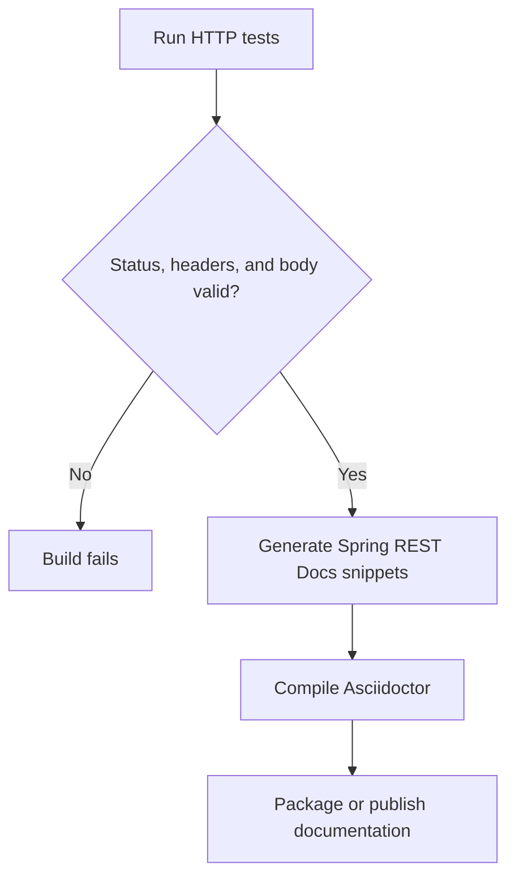

# Handling empty responses or responses without a body in Spring REST Docs

## 1. Objectives and real-world problem

In the **Response payload** chapter of the **SPRING_REST_DOCS** module, most API documentation examples start from JSON responses with fields to declare via `responseFields(...)`. However, some HTTP endpoints **return no body content at all**: successfully deleting a resource, refreshing client state, answering a conditional request, or returning only metadata. Additionally, a body may contain JSON data representing an empty structure such as `[]` or `{}`.

These are **different situations in the API contract**. If handled ambiguously, tests or documentation can mislead readers into thinking the server returns `null`, an empty array, or zero bytes altogether.

After completing this lesson, you will be able to:

- Distinguish **no response body**, **zero-length body**, and **JSON representing an empty value/structure**.
- Choose and test statuses such as `204 No Content`, `205 Reset Content`, `304 Not Modified`, or `HEAD` requests appropriately; and understand `200 OK` with no body.
- Write MockMvc tests verifying the status, headers, and truly empty body.
- Use Spring REST Docs to generate `http-response.adoc` and header snippets without declaring non-existent payload fields.
- Document JSON `{"items": []}` differently from a response with no body.
- Include snippets in Asciidoctor or a Markdown publishing workflow, and verify them in build/CI.

The same contract-modeling principles apply to WebTestClient and REST Assured. Each tool has its own HTTP testing syntax and REST Docs integration, yet all rely on the actual response.

## 2. First, distinguish the types of "empty"

Saying "the API returns an empty response" can refer to at least six different cases:

| Case | Actual body | Illustrative byte count (UTF-8) | Meaning |
| --- | --- | ---: | --- |
| No body | Zero bytes | 0 | No representation in the response |
| Zero-byte body | Empty byte sequence | 0 | Identical at the byte level; HTTP status/headers govern interpretation |
| Empty JSON array | `[]` | 2 | Valid representation: collection with 0 elements |
| Empty JSON object | `{}` | 2 | Valid representation: object with no properties |
| JSON null | `null` | 4 | JSON representation holding the value `null` |
| Empty JSON string | `""` | 2 | JSON representation that is a zero-length string |

A few concrete examples:

```http
HTTP/1.1 204 No Content
X-Operation-Id: delete-99

```

In this case, the blank line ends the headers; there is no JSON afterward.

```http
HTTP/1.1 200 OK
Content-Type: application/json

[]
```

The second response has a **two-character body**. Even though the list contains no elements, a body is still present.

```http
HTTP/1.1 200 OK
Content-Type: application/json

null
```

The third response also has a body. The four-byte sequence `null` is different from a zero-byte body.

> Do not infer "no body" from `null` in a Java DTO or from status `200`. Inspect the status, headers, and **actual bytes sent**; a mapper or framework may serialize a null value as `null`, or omit the body depending on how the response is returned.

### 2.1. Distinguishing client-side semantics

- `204` is usually appropriate when an operation succeeds and the server does not need to return a new representation.
- `200` with `[]` is appropriate when a client requests a list and that list currently has no elements.
- `200` with `{}` is appropriate only when an empty object is a valid value under the contract.
- `200` with `null` is appropriate **only when the API intentionally defines JSON null as a valid representation**.
- `200` without a body may be valid HTTP, yet if clients expect JSON it easily causes parse errors. Document this explicitly.

If a list endpoint sometimes returns `[]` and other times returns `204` merely because there are no results, clients must maintain two handling branches. Choose one consistent contract and prove it with tests.

## 3. HTTP cases that must not contain a message body

### 3.1. `204 No Content`

`204` confirms the server successfully processed the request and sends no response content. A familiar example is `DELETE /api/items/99` succeeding without needing a representation of the deleted resource.

```http
HTTP/1.1 204 No Content
X-Operation-Id: delete-99

```

Points to remember:

- The response has no JSON body. Do not add `"success": true` to a `204` body.
- Meaningful headers may still be included, such as an operation ID or relevant metadata.
- Do not set `Content-Type: application/json` just to signal success when no JSON actually exists.
- Do not confuse sending headers with sending a body; headers can still be documented when the body is absent.

### 3.2. `205 Reset Content`

`205` likewise does not allow the server to generate response content. It instructs the user agent to reset the state of the related UI/document, so do not choose `205` merely because an operation returns an empty body. Use `204` or another more appropriate status when no UI reset is intended.

### 3.3. `304 Not Modified`

`304` is commonly used when a client sends a conditional request, such as `If-None-Match`, and the server indicates the representation has not changed. The response may carry cache/validator headers like `ETag` but **contains no new body**. When documenting such endpoints, highlight headers and caching behavior instead of describing JSON fields that were not transmitted.

### 3.4. `HEAD`

`HEAD` asks the server to return the metadata corresponding to a `GET`, **without sending the response content**. Depending on the situation, some representation headers, including `Content-Length`, may still reflect the corresponding `GET` content. Therefore, you cannot use the presence of `Content-Length` to conclude that a `HEAD` request sent a body.

| Scenario | Response body | Documentation focus |
| --- | --- | --- |
| Successful `DELETE` with `204` | None | Status, success semantics, headers |
| Operation returning `205` | None | Client-side content reset semantics |
| Conditional `GET` returning `304` | None | `ETag`, `Last-Modified`, caching rules |
| `HEAD` | None | Status, representation headers |
| `GET` returning `200` and JSON `[]` | Present | Array/list payload and empty-set semantics |

**Note:** Statuses `204`, `205`, `304`, and the `HEAD` method have specific rules in HTTP. Sample outputs should reflect protocol rules rather than relying on whether an API framework might still attempt to write a body.

## 4. MockMvc: documenting a bodyless `204`

The test should verify three things: **correct status**, **a genuinely 0-byte body**, and **meaningful headers documented**.

### 4.1. Controller returning `ResponseEntity<Void>`

```java
import org.springframework.http.ResponseEntity;
import org.springframework.web.bind.annotation.DeleteMapping;
import org.springframework.web.bind.annotation.PathVariable;
import org.springframework.web.bind.annotation.RestController;

@RestController
class ItemController {

    @DeleteMapping("/api/items/{id}")
    ResponseEntity<Void> deleteItem(@PathVariable("id") long id) {
        // Illustrative example: assume the delete operation succeeded.
        return ResponseEntity.noContent()
                .header("X-Operation-Id", "delete-" + id)
                .build();
    }
}
```

`ResponseEntity.noContent().build()` produces a `204` response with no body content. The `X-Operation-Id` header is illustrative metadata for operation lookup; in a real system, include it only if the API contract defines it.

### 4.2. Testing and generating snippets

```java
import org.junit.jupiter.api.BeforeEach;
import org.junit.jupiter.api.Test;
import org.junit.jupiter.api.extension.ExtendWith;
import org.springframework.http.HttpHeaders;
import org.springframework.restdocs.RestDocumentationContextProvider;
import org.springframework.restdocs.junit.jupiter.RestDocumentationExtension;
import org.springframework.test.web.servlet.MockMvc;
import org.springframework.test.web.servlet.setup.MockMvcBuilders;

import static org.springframework.restdocs.headers.HeaderDocumentation.headerWithName;
import static org.springframework.restdocs.headers.HeaderDocumentation.responseHeaders;
import static org.springframework.restdocs.mockmvc.MockMvcRestDocumentation.document;
import static org.springframework.restdocs.mockmvc.MockMvcRestDocumentation.documentationConfiguration;
import static org.springframework.test.web.servlet.request.MockMvcRequestBuilders.delete;
import static org.springframework.test.web.servlet.result.MockMvcResultMatchers.content;
import static org.springframework.test.web.servlet.result.MockMvcResultMatchers.header;
import static org.springframework.test.web.servlet.result.MockMvcResultMatchers.status;

@ExtendWith(RestDocumentationExtension.class)
class ItemDeleteDocumentationTest {

    private MockMvc mockMvc;

    @BeforeEach
    void setUp(RestDocumentationContextProvider documentation) {
        mockMvc = MockMvcBuilders.standaloneSetup(new ItemController())
                .apply(documentationConfiguration(documentation))
                .build();
    }

    @Test
    void deleteItemReturnsNoContent() throws Exception {
        mockMvc.perform(delete("/api/items/{id}", 99))
                .andExpect(status().isNoContent())
                .andExpect(content().bytes(new byte[0]))
                .andExpect(header().doesNotExist(HttpHeaders.CONTENT_TYPE))
                .andExpect(header().string(
                        "X-Operation-Id", "delete-99"))
                .andDo(document("items-delete-no-content",
                        responseHeaders(
                                headerWithName("X-Operation-Id")
                                        .description(
                                                "Operation ID for looking up deletion result")
                        )
                ));
    }
}
```

Explanation:

1. `status().isNoContent()` confirms the status is `204`.
2. `content().bytes(new byte[0])` confirms **there are zero body bytes**. This is a direct assertion, distinct from checking an empty JSON object or array.
3. `header().doesNotExist(HttpHeaders.CONTENT_TYPE)` verifies the example does not attach an unnecessary Content-Type when no body exists.
4. `header().string(...)` confirms the contracted header actually has the expected value.
5. `document(..., responseHeaders(...))` generates response documentation including meaningful headers. **Do not pass `responseFields(...)`**, because there are no JSON fields to declare.

When there are no business headers to describe, you can use the shorter form:

```java
.andExpect(status().isNoContent())
.andExpect(content().bytes(new byte[0]))
.andDo(document("items-delete-no-content"));
```

This is a fragment of a MockMvc test chain, not a standalone Java program. With REST Docs configured, `document("...")` still generates the default HTTP snippets according to configuration, such as `http-response.adoc`, so readers can see the status and headers.

> `responseFields(...)` is intended for payloads with fields to document. If you apply a required descriptor such as `fieldWithPath("id")` to a `204`, that field cannot be found. Marking every field `optional()` just to suppress the error does not produce useful documentation for a bodyless response.

## 5. Complete test: distinguishing `204`, empty-body `200`, and empty-JSON `200`

The example below includes a controller with three endpoints:

- `DELETE /api/items/{id}` returns `204` with no body.
- `GET /api/heartbeat` returns `200` with a zero-byte body.
- `GET /api/items` returns `200` with JSON containing an empty `items` array.

The example uses JUnit Jupiter, MockMvc, Spring REST Docs MockMvc, and Jackson. Java 9+ supports `Map.of`/`List.of`; in a standard Spring Boot application, the corresponding test dependencies are already configured in the test module.

```java
import java.util.List;
import java.util.Map;

import org.junit.jupiter.api.BeforeEach;
import org.junit.jupiter.api.Test;
import org.junit.jupiter.api.extension.ExtendWith;
import org.springframework.http.HttpHeaders;
import org.springframework.http.MediaType;
import org.springframework.http.ResponseEntity;
import org.springframework.restdocs.RestDocumentationContextProvider;
import org.springframework.restdocs.junit.jupiter.RestDocumentationExtension;
import org.springframework.test.web.servlet.MockMvc;
import org.springframework.test.web.servlet.setup.MockMvcBuilders;
import org.springframework.web.bind.annotation.DeleteMapping;
import org.springframework.web.bind.annotation.GetMapping;
import org.springframework.web.bind.annotation.PathVariable;
import org.springframework.web.bind.annotation.RestController;

import static org.hamcrest.Matchers.hasSize;
import static org.springframework.restdocs.headers.HeaderDocumentation.headerWithName;
import static org.springframework.restdocs.headers.HeaderDocumentation.responseHeaders;
import static org.springframework.restdocs.mockmvc.MockMvcRestDocumentation.document;
import static org.springframework.restdocs.mockmvc.MockMvcRestDocumentation.documentationConfiguration;
import static org.springframework.restdocs.payload.PayloadDocumentation.fieldWithPath;
import static org.springframework.restdocs.payload.PayloadDocumentation.responseFields;
import static org.springframework.test.web.servlet.request.MockMvcRequestBuilders.delete;
import static org.springframework.test.web.servlet.request.MockMvcRequestBuilders.get;
import static org.springframework.test.web.servlet.result.MockMvcResultMatchers.content;
import static org.springframework.test.web.servlet.result.MockMvcResultMatchers.header;
import static org.springframework.test.web.servlet.result.MockMvcResultMatchers.jsonPath;
import static org.springframework.test.web.servlet.result.MockMvcResultMatchers.status;

@ExtendWith(RestDocumentationExtension.class)
class EmptyResponseDocumentationTest {

    private MockMvc mockMvc;

    @BeforeEach
    void setUp(RestDocumentationContextProvider documentation) {
        mockMvc = MockMvcBuilders.standaloneSetup(new DemoController())
                .apply(documentationConfiguration(documentation))
                .build();
    }

    @Test
    void deleteReturns204WithoutBody() throws Exception {
        mockMvc.perform(delete("/api/items/{id}", 99))
                .andExpect(status().isNoContent())
                .andExpect(content().bytes(new byte[0]))
                .andExpect(header().string("X-Operation-Id", "delete-99"))
                .andExpect(header().doesNotExist(HttpHeaders.CONTENT_TYPE))
                .andDo(document("items-delete-no-content",
                        responseHeaders(
                                headerWithName("X-Operation-Id")
                                        .description("Deletion operation ID")
                        )));
    }

    @Test
    void heartbeatReturns200WithZeroBytes() throws Exception {
        mockMvc.perform(get("/api/heartbeat"))
                .andExpect(status().isOk())
                .andExpect(content().bytes(new byte[0]))
                .andDo(document("heartbeat-empty-body"));
    }

    @Test
    void listReturns200WithEmptyJsonArray() throws Exception {
        mockMvc.perform(get("/api/items")
                        .accept(MediaType.APPLICATION_JSON))
                .andExpect(status().isOk())
                .andExpect(content().contentTypeCompatibleWith(
                        MediaType.APPLICATION_JSON))
                .andExpect(jsonPath("$.items").isArray())
                .andExpect(jsonPath("$.items", hasSize(0)))
                .andExpect(jsonPath("$.totalCount").value(0))
                .andDo(document("items-empty-collection",
                        responseFields(
                                fieldWithPath("items")
                                        .description(
                                                "List of products; empty array "
                                                + "when there are no results"),
                                fieldWithPath("totalCount")
                                        .description(
                                                "Total number of matching products, "
                                                + "0 when there are no results")
                        )));
    }

    @RestController
    static class DemoController {

        @DeleteMapping("/api/items/{id}")
        ResponseEntity<Void> deleteItem(@PathVariable("id") long id) {
            return ResponseEntity.noContent()
                    .header("X-Operation-Id", "delete-" + id)
                    .build();
        }

        @GetMapping("/api/heartbeat")
        ResponseEntity<Void> heartbeat() {
            return ResponseEntity.ok().build();
        }

        @GetMapping(value = "/api/items",
                    produces = MediaType.APPLICATION_JSON_VALUE)
        Map<String, Object> listItems() {
            return Map.of(
                    "items", List.of(),
                    "totalCount", 0
            );
        }
    }
}
```

The three tests have distinct purposes:

| Test | Key checks | How REST Docs generates docs |
| --- | --- | --- |
| `deleteReturns204WithoutBody` | `204`, 0 bytes, business header | `document(..., responseHeaders(...))` |
| `heartbeatReturns200WithZeroBytes` | `200` and exactly 0 bytes | `document("...")`, no payload fields declared |
| `listReturns200WithEmptyJsonArray` | `200`, valid JSON, `items` is an empty array | `document(..., responseFields(...))` for `items`, `totalCount` |

The empty `200` on `heartbeat` illustrates the HTTP difference; it does not mean that is the optimal choice for every health API. If an endpoint should return service status as data, return meaningful JSON and test against that contract. If success needs no representation, consider `204` when it fits the endpoint's semantics.

### 5.1. Why does the empty-list test still use `responseFields`?

In the response:

```json
{
  "items": [],
  "totalCount": 0
}
```

Both `items` and `totalCount` **are present**, even though the `items` array has zero elements. Therefore, you can document:

```java
responseFields(
    fieldWithPath("items")
        .description("List of results; may be empty"),
    fieldWithPath("totalCount")
        .description("Number of matching results")
)
```

There is no `items[].id` or `items[].name` in the empty fixture. If you declare those required child descriptors in the documentation test, the paths will not be found. Create a fixture **with representative elements** to generate element structure documentation, and test the empty list as a separate case.

### 5.2. What about a root response of `[]`?

Given the response:

```json
[]
```

The body is not empty in bytes, yet the **root is an array with zero elements**. You can test specifically:

```java
.andExpect(status().isOk())
.andExpect(content().contentTypeCompatibleWith(
        MediaType.APPLICATION_JSON))
.andExpect(content().json("[]"))
```

If you want to document detailed fields like `[].id` and `[].name`, the `[]` fixture has no elements to observe those paths. Use a sample response `[{"id":1,"name":"..."}]` in the test generating element documentation, while keeping a separate test verifying the empty case. For the empty root array case itself, `http-response.adoc` is enough to show the payload, alongside prose explaining what an empty array means in the composite documentation.

## 6. What does Spring REST Docs generate when there is no body?

In a test calling `document("identifier")`, Spring REST Docs can generate default snippets such as:

```text
build/generated-snippets/
└── items-delete-no-content/
    ├── http-request.adoc
    ├── http-response.adoc
    └── response-headers.adoc
```

The list above illustrates the **directly relevant** files for a test declaring `responseHeaders(...)`; depending on configuration, other default snippets may also be generated. Some body-oriented snippets may be generated empty or without useful content; do not include them as if a JSON payload existed. With Maven, the path is typically `target/generated-snippets` instead of `build/generated-snippets`; the directory is customizable.

Understand the differences among the snippets:

| Snippet | When to use | Meaningful content for a bodyless response |
| --- | --- | --- |
| `http-response.adoc` | Want to display the HTTP response | Status line and headers; no fabricated JSON |
| `response-headers.adoc` | Headers were declared with `responseHeaders(...)` | Table of header names and descriptions |
| `response-fields.adoc` | Payload has fields to document | Not applicable to a truly bodyless response |
| `response-body.adoc` | Want to display the response content separately | For a 0-byte response, there is no JSON to show |

An endpoint still has a clear contract without `response-fields.adoc`: its contract lies in its **status, headers, conditions producing that outcome, and absence of a body**. The tests must prove those properties.

### 6.1. Documenting status and the no-body case

For a `204` response, you can write in your API page:

```adoc
== Delete item

`DELETE /api/items/{id}` returns `204 No Content` when deletion succeeds.
The response contains no body.

=== Example HTTP response
include::{snippets}/items-delete-no-content/http-response.adoc[]

=== Response headers
include::{snippets}/items-delete-no-content/response-headers.adoc[]
```

In real Asciidoctor, use backtick syntax for method/endpoint names when formatting, such as `+DELETE /api/items/{id}+` if you want to avoid interpolation. The `include` directives must live inside an `.adoc` file with the `snippets` attribute properly defined. Full example:

```adoc
= Item API
:snippets: build/generated-snippets

== Delete item

When the operation succeeds, the API returns 204 No Content.
The response has no body; the X-Operation-Id header is used to look up the operation.

=== HTTP response
include::{snippets}/items-delete-no-content/http-response.adoc[]

=== Response headers
include::{snippets}/items-delete-no-content/response-headers.adoc[]
```

Do not create an empty "Response JSON fields" table and leave readers guessing. Explicitly state that the endpoint **returns no body** and use the HTTP snippet as test-backed evidence.

## 7. Server not sending a body vs. client not reading a body

Several bugs arise not on the server, but in how tests or clients handle results:

- The client attempts to parse JSON by default on every response, including `204`, causing a parse error on an empty byte stream.
- The test checks only `status().isNoContent()` without confirming an empty body, missing unintended framework/handler behavior.
- The test checks only for an empty body without checking status, failing to distinguish `204` from an empty-body `200`.
- The server returns `200` with `Content-Type: application/json` and a 0-byte body; the client treats it as invalid JSON even though the HTTP request succeeded.
- A list endpoint returns `204` when there are no items while returning `200` with an array at other times; the client must handle an extra status branch.

Clients often need branching logic like:

```text
If HTTP status = 204:
    handle success, do not attempt to parse JSON
Else if status = 200 and Content-Type is application/json:
    parse JSON according to the published schema
Else:
    handle according to the endpoint's HTTP contract
```

This is an illustrative flow. Real clients must also handle error statuses, conditional statuses, invalid data, and specific business rules.

### 7.1. `Content-Type`, `Accept`, and `Content-Length`

- `Accept: application/json` is a **request header** indicating the media type the client prefers; it does not force the server to send a JSON body for every status code.
- `Content-Type` indicates the media type of the representation when a representation is present. For bodyless responses, do not rely on this header to decide whether a payload exists.
- `Content-Length` is not universal proof that a body was actually transmitted. Especially for `HEAD`, this header can reflect the size of the representation that a corresponding `GET` would return even though the `HEAD` response itself has no content.

Therefore, when testing for an empty body, `content().bytes(new byte[0])` is more direct than checking only `Content-Type` or `Content-Length`.

## 8. Applying with WebTestClient and REST Assured

The three tools supported by the **SPRING_REST_DOCS** module are MockMvc, WebTestClient, and REST Assured. The mindset for testing bodyless responses is identical, while syntax and REST Docs integration differ:

| Tool | What to assert | How to attach documentation |
| --- | --- | --- |
| MockMvc | `status().isNoContent()` and `content().bytes(new byte[0])` | `MockMvcRestDocumentation.document(...)` in `andDo(...)` |
| WebTestClient | HTTP status and empty response body in `expectBody()` | `WebTestClientRestDocumentation.document(...)` via test result consumer |
| REST Assured | Status code and 0-length body with appropriate assertions | REST Assured's REST Docs filter attached to the request/test |

In all three cases, **do not declare JSON response fields for a response with no payload**. If the response contains JSON `[]` or `{"items": []}`, you can still verify and document the corresponding body, provided the fixture matches the descriptors.

A clean test structure for the same endpoint:

1. **No-body contract test:** trigger `204`, verify status/headers/0 bytes, generate HTTP snippets.
2. **Payload test:** trigger `200` with JSON, verify schema/fields and generate `response-fields.adoc`.
3. **Edge-case tests:** verify empty collections, cache validators, error branches, or special business conditions.

Tests can share REST Docs setup, but give each outcome a clear snippet identifier such as `items-delete-no-content` and `items-empty-collection`.

## 9. Designing clear contracts for endpoints with multiple outcomes

An endpoint can return multiple statuses, for example:

| Business condition | Illustrative status | Body | Required documentation |
| --- | --- | --- | --- |
| Deleted successfully without returning representation | `204` | None | Status, headers, idempotency behavior if applicable |
| GET list with zero elements | `200` | `{"items":[],"totalCount":0}` | Describe the array and total count |
| GET an existing resource | `200` | JSON object with fields | Full `responseFields(...)` |
| Conditional GET and cache is still valid | `304` | None | `ETag`/`If-None-Match` rules, headers |
| Processing failure per application contract | `4xx` or `5xx` | Possible error body | Document status and error representation if present |

These statuses depend on the specific API design. Do not treat the table as a universal rule for every system; for instance, asynchronous processing may use `202 Accepted` with a status body or polling URL.

One way to avoid contradictions is to document each branch with a dedicated test using a clear identifier:

```text
items-list-success
items-list-empty
items-delete-no-content
items-conditional-not-modified
```

Identifier names should reflect the tested condition so readers do not confuse the response body of the `200` branch with the `204` branch.

## 10. Integrating documentation into build and CI

Suppose the `deleteReturns204WithoutBody` test generated `items-delete-no-content/http-response.adoc` and `response-headers.adoc`. A typical documentation pipeline follows this sequence:



For Spring REST Docs, run the Asciidoctor generation step **after** the snippet-generating test step. If the server begins returning JSON when the contract requires a bodyless `204`, the `content().bytes(new byte[0])` assertion must catch the discrepancy before documentation is published.

When publishing Markdown documentation, use an appropriate conversion workflow or custom template. Do not simply rename `response-fields.adoc` to `.md` because the default snippet syntax is Asciidoctor.

## 11. Common errors

| Symptom | Cause | Resolution |
| --- | --- | --- |
| Using `responseFields(fieldWithPath("id"))` on `204` fails the test | The response has no `id` field | Remove body descriptors; document status and headers |
| Docs say "no body" yet client receives `null` | Server sends JSON literal `null` (4 bytes) | Distinguish empty bytes from JSON literal; fix implementation or docs |
| `200` with 0-byte body breaks JSON parser | Client parses JSON on every `200` by default | Define a clear contract; consider `204` or a valid JSON representation |
| `204` is documented as `{"success":true}` | Confusing a success status with a JSON body | Document only metadata/headers; do not invent a fake payload |
| Empty list leaves `items[].id` descriptors unmatched | Fixture has no elements | Use a fixture with items to document structure; test empty list separately |
| Using `content().string("")` as the only check | Fails to distinguish `204` from empty-body `200` | Check both status and body bytes |
| Confusing `[]` with an empty body | `[]` is two valid JSON bytes | Test as a JSON array, do not call it "no body" |
| No `response-fields.adoc` table for `204` | No fields declared because no payload exists | Use `http-response.adoc` and document status/headers |
| Inferring a body from `Content-Length` on `HEAD` | Header can describe the `GET` representation | Check `HEAD` semantics and body bytes |
| Asciidoctor page missing snippets | Wrong path or docs task runs before tests | Configure generated snippets directory and task dependencies properly |

## 12. Practice exercise

Use the controller and test from section 5 to practice the following cases:

1. **Add a body to a `204` response:** modify the implementation to return JSON content in one branch. Observe how the framework handles the response and verify that the 0-byte assertion and HTTP contract are still enforced.
2. **Switch heartbeat to `204`:** change `ResponseEntity.ok().build()` to `ResponseEntity.noContent().build()`, and update assertions, snippets, and documentation.
3. **Test JSON literal `null`:** create an endpoint returning `200` with body `null` and JSON Content-Type. Compare the byte count with a bodyless `200` endpoint and test client parsing.
4. **Test `{"items": []}`:** keep `responseFields("items", "totalCount")` to document an object containing an empty array.
5. **Add an item to the list:** return `{"items":[{"id":1,"name":"Pen"}],"totalCount":1}`, and expand descriptors to `items[].id` and `items[].name`.
6. **Test an empty root array:** return `[]`, verify `Content-Type` and actual JSON content; compare against a response with completely no body.
7. **Document a header:** add `X-Operation-Id` to the delete branch and use `responseHeaders(...)` to describe its lookup role without creating JSON fields.
8. **Test a conditional branch:** design a `GET` with `ETag`/`If-None-Match` capable of returning `304`. Verify status, headers, and absence of a body in the cache-hit branch.
9. **Build documentation:** include `http-response.adoc` and `response-headers.adoc` in Asciidoctor, then verify tests run before the publishing task.

**Completion criteria:** you can distinguish a bodyless response from empty JSON or `null`, choose accurate assertions for status and body bytes, avoid declaring fake response fields for `204`, still produce useful documentation on headers and status, and make build/CI detect contract-breaking changes.

## References

- [Spring REST Docs — Documenting your API](https://docs.spring.io/spring-restdocs/reference/documenting-your-api/index.html): generating and including snippets from HTTP tests.
- [Spring REST Docs — Request and Response Payloads](https://docs.spring.io/spring-restdocs/reference/documenting-your-api/request-response-payloads.html): documenting `responseFields` and `fieldWithPath` syntax.
- [Spring Framework — MockMvc](https://docs.spring.io/spring-framework/reference/testing/spring-mvc-test-framework.html): testing HTTP response status, headers, and body.
- [RFC 9110 — HTTP Semantics](https://www.rfc-editor.org/rfc/rfc9110.html): semantics of `204`, `205`, `304`, and the `HEAD` method.
