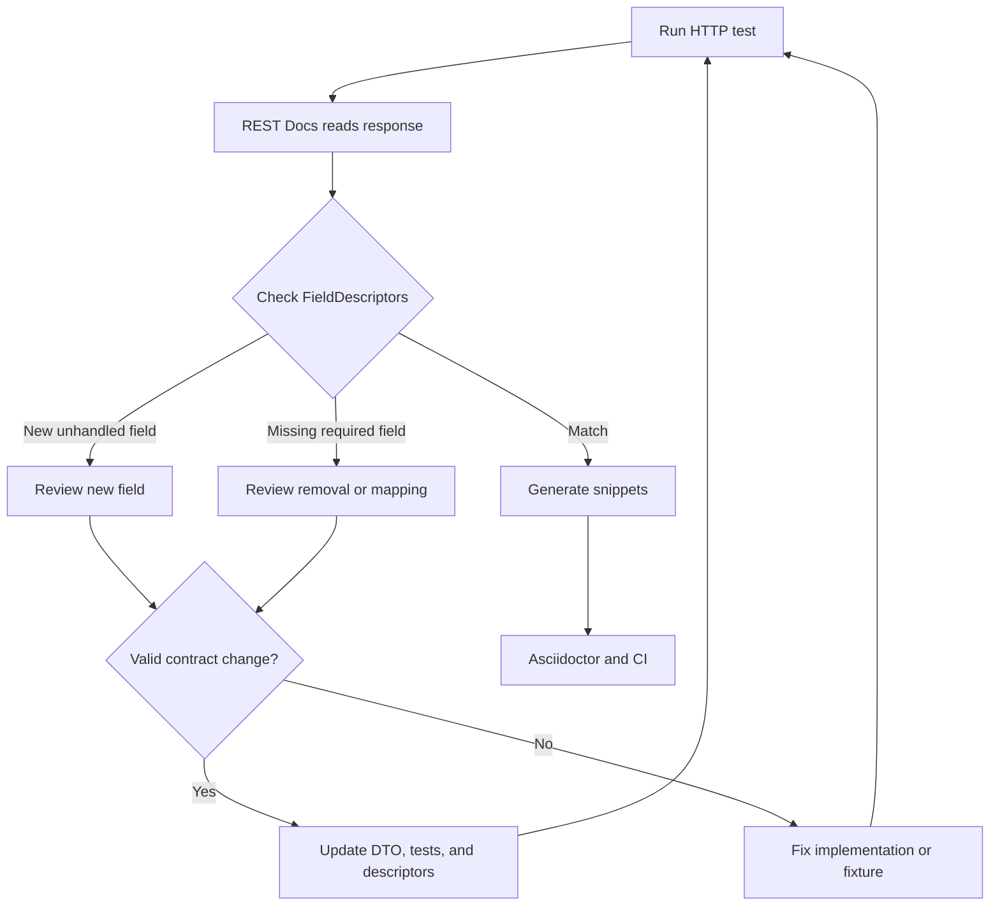
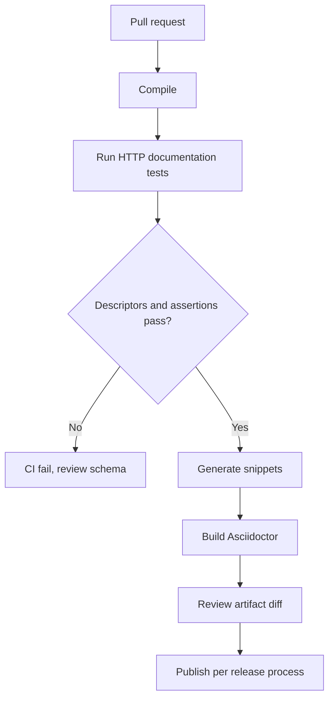

# Testing schema changes that fail documentation tests

## 1. Schema drift in API responses

In the **SPRING_REST_DOCS** module, REST API documentation is generated from HTTP tests using MockMvc, WebTestClient, or REST Assured. When a response payload changes, the endpoint may still return HTTP 200 while the Spring REST Docs test fails because the `FieldDescriptor` list no longer matches the recorded JSON.

This phenomenon is called **schema drift**: the shape or data rules of the response diverge from the previously documented and tested contract.

Initial response:

```json
{
  "orderId": "ORD-501",
  "status": "CONFIRMED",
  "totalAmount": 250000
}
```

Response after refactoring:

```json
{
  "id": "ORD-501",
  "status": "CONFIRMED",
  "totalAmount": 250000,
  "currency": "VND"
}
```

`orderId` was renamed to `id` and a new `currency` field appeared. The old descriptors may report that the `orderId` path was not found and `currency` is undocumented. Strict `responseFields(...)` surfaces these changes for review; this is a signal to evaluate the contract, not a reason to automatically loosen tests just to make them pass.

This lesson helps you recognize schema drift, read REST Docs errors, distinguish contract changes from implementation/fixture bugs, update DTOs, descriptors, assertions, and snippets together with the same decision, and protect the workflow with CI.

## 2. Common types of schema changes

| Type of change | Before | After | Typical impact |
| --- | --- | --- | --- |
| Field added | No `currency` | Has `currency` | Strict test reports unhandled field |
| Field removed | Has `customer.email` | Removed | Required descriptor cannot find path |
| Field renamed | `orderId` | `id` | Old path missing, new path undocumented |
| Type changed | `quantity: 2` | `quantity: "2"` | JSON type changed |
| Structure changed | `customerName` | `customer.displayName` | Path/nesting changed |
| Nullability changed | `note: null` | Key `note` absent | Null differs from missing |
| Array changed to object | `items: []` | `items: {}` | JSON structure changed |
| Array element changed | Has `items[].sku` | Dropped `sku` | Repeating path descriptor fails to match |
| Enum changed | `PAID` | `SETTLED` | Path remains, contract value changed |
| Semantics changed | Amount in VND | Minor units | JSON type may stay the same yet contract changed |

Strict field validation primarily governs paths and whether fields are handled. It does not automatically prove types, enums, units, monetary formulas, or all business rules. Those require additional assertions or schema validation.

## 3. What does strict `responseFields` detect?

Example descriptors:

```java
responseFields(
    fieldWithPath("orderId").description("Order ID"),
    fieldWithPath("status").description("Order status"),
    fieldWithPath("totalAmount").description("Total amount in VND")
)
```

There are two kinds of mismatches:

- **Payload contains an undeclared field.** For example, the server adds `currency`. Snippet generation requires handling the new field via a description, an intentional ignore, or fixing the implementation so it does not emit the field.
- **Descriptor requires a field that no longer exists.** For example, `orderId` was removed or renamed. REST Docs cannot find the path unless the descriptor is updated.

`optional()` is only appropriate when the real contract allows the field to be absent. `ignored()` records that a field is present without putting it in the table. `relaxedResponseFields` permits unlisted fields and therefore weakens detection of new fields. Do not use these mechanisms to mask unreviewed changes.



Tests only reflect the responses of the executed fixtures. If only one response branch is tested, fields appearing exclusively in another branch remain unverified.

## 4. Analyzing each form of drift

### 4.1. Adding a new field

New response:

```json
{
  "orderId": "ORD-501",
  "status": "CONFIRMED",
  "totalAmount": 250000,
  "currency": "VND"
}
```

Before editing descriptors, determine whether `currency` belongs to the public contract, whether it always appears, which monetary fields it applies to, and whether it is unintended metadata injected by a serializer or gateway.

If it is a public field, add a description:

```java
fieldWithPath("currency")
    .description("Currency code for the amount fields, e.g. VND")
```

If it is valid metadata that does not need publication, consider `ignored()`. If it should not appear in the response, fix the DTO/serializer and add an assertion forbidding the field. Do not ignore or switch to relaxed mode before understanding its origin.

### 4.2. Removing a required field

Descriptor:

```java
fieldWithPath("customer.email")
    .description("Customer contact email")
```

New payload:

```json
{
  "customer": {
    "id": "CUS-17",
    "displayName": "Customer 17"
  }
}
```

The `customer.email` path does not exist. If email is still required, the implementation/mapping or fixture is wrong. If the new contract allows absence, declare optional and an explicit type when the fixture no longer has data for inference:

```java
fieldWithPath("customer.email")
    .type(JsonFieldType.STRING)
    .optional()
    .description("Customer email, may not be provided")
```

Do not mark all fields optional to make tests pass; that hides the loss of required fields.

### 4.3. Renaming a field

Changing `{"orderId":"ORD-501"}` to `{"id":"ORD-501"}` is a path change, not a key-order change.

```java
fieldWithPath("id")
    .description("Order reference ID")
```

Evaluate backward compatibility. Existing clients may still read `orderId`; renaming directly can be a breaking change. Depending on API policy, you may need a new API version or a transition period returning both fields.

### 4.4. Changing data type

Before `{"quantity": 2}`, after `{"quantity": "2"}`. The `quantity` path still exists, yet the JSON type changed. Add assertions:

```java
.andExpect(jsonPath("$.quantity").isNumber())
.andExpect(jsonPath("$.quantity").value(2))
```

If the new contract genuinely requires a string, update assertions and descriptors after reviewing client impact. Changing only `type(...)` in the descriptor does not validate that the change is lawful.

### 4.5. Null becoming missing or empty string

Three different payloads:

```json
{"note": null}
```

```json
{}
```

```json
{"note": ""}
```

Use the corresponding assertions:

```java
// Key is present with a null value.
.andExpect(jsonPath("$.note").hasJsonPath())
.andExpect(jsonPath("$.note").value(nullValue()))

// Key is completely absent.
.andExpect(jsonPath("$.note").doesNotHaveJsonPath())
```

`optional()` allows the path to be absent in fixtures. It does not define nullability. Document and verify the exact null/missing contract.

### 4.6. Changing object or array structure

`{"customerName":"Customer 17"}` changes to `{"customer":{"displayName":"Customer 17"}}`. The old path `customerName` is replaced by `customer.displayName`:

```java
fieldWithPath("customer")
    .description("Customer information"),
fieldWithPath("customer.displayName")
    .description("Customer display name")
```

If `items` changes from an array of objects to an array of strings, the path `items[].sku` is no longer valid. Verify whether this is an approved contract change or a mapping bug dropping data.

## 5. Error analysis workflow

1. **Inspect the actual response.** View the body captured by MockMvc/WebTestClient/REST Assured. Do not guess solely from the DTO because Jackson annotations, naming strategies, and custom serializers can alter JSON.
2. **Classify the drift.** New field, missing field, rename, type change, null/missing, or structural change?
3. **Check against the contract.** Was the change intentional? Which clients consume that field?
4. **Decide between implementation or documentation.** Document new public fields; ignore technical fields if appropriate; fix mapping for unintended removals; strip disallowed fields from responses; plan versioning for breaking changes.
5. **Update assertions.** Check paths, types, values, enums, nullability, and related business rules.
6. **Regenerate snippets.** Only after both payload and descriptors reflect the reviewed contract.
7. **Review diffs.** Inspect responses, descriptors, and snippets; consider client compatibility before publishing.

## 6. MockMvc example after the new schema is approved

The example uses JUnit Jupiter, MockMvc, Jackson, and `spring-restdocs-mockmvc`. The controller returns the new schema containing `currency`; this field has been reviewed as public.

```java
import java.util.LinkedHashMap;
import java.util.Map;

import org.junit.jupiter.api.BeforeEach;
import org.junit.jupiter.api.Test;
import org.junit.jupiter.api.extension.ExtendWith;
import org.springframework.http.MediaType;
import org.springframework.restdocs.RestDocumentationContextProvider;
import org.springframework.restdocs.junit.jupiter.RestDocumentationExtension;
import org.springframework.test.web.servlet.MockMvc;
import org.springframework.test.web.servlet.setup.MockMvcBuilders;
import org.springframework.web.bind.annotation.GetMapping;
import org.springframework.web.bind.annotation.PathVariable;
import org.springframework.web.bind.annotation.RestController;

import static org.springframework.restdocs.mockmvc.MockMvcRestDocumentation.document;
import static org.springframework.restdocs.mockmvc.MockMvcRestDocumentation.documentationConfiguration;
import static org.springframework.restdocs.payload.PayloadDocumentation.fieldWithPath;
import static org.springframework.restdocs.payload.PayloadDocumentation.responseFields;
import static org.springframework.test.web.servlet.request.MockMvcRequestBuilders.get;
import static org.springframework.test.web.servlet.result.MockMvcResultMatchers.jsonPath;
import static org.springframework.test.web.servlet.result.MockMvcResultMatchers.status;

@ExtendWith(RestDocumentationExtension.class)
class OrderSchemaChangeDocumentationTest {

    private MockMvc mockMvc;

    @BeforeEach
    void setUp(RestDocumentationContextProvider documentation) {
        mockMvc = MockMvcBuilders.standaloneSetup(new OrderController())
                .apply(documentationConfiguration(documentation))
                .build();
    }

    @Test
    void documentsReviewedSchemaWithCurrency() throws Exception {
        mockMvc.perform(get("/api/orders/{id}", 501)
                        .accept(MediaType.APPLICATION_JSON))
                .andExpect(status().isOk())
                .andExpect(jsonPath("$.orderId").value("ORD-501"))
                .andExpect(jsonPath("$.currency").value("VND"))
                .andExpect(jsonPath("$.totalAmount").isNumber())
                .andDo(document("orders-schema-v2",
                        responseFields(
                                fieldWithPath("orderId")
                                        .description("Order reference ID"),
                                fieldWithPath("status")
                                        .description("Order status"),
                                fieldWithPath("totalAmount")
                                        .description("Total amount in the specified currency"),
                                fieldWithPath("currency")
                                        .description("Currency code of the amount")
                        )
                ));
    }

    @RestController
    static class OrderController {
        @GetMapping(value = "/api/orders/{id}",
                    produces = MediaType.APPLICATION_JSON_VALUE)
        Map<String, Object> getOrder(@PathVariable("id") long id) {
            Map<String, Object> body = new LinkedHashMap<>();
            body.put("orderId", "ORD-" + id);
            body.put("status", "CONFIRMED");
            body.put("totalAmount", 250000);
            body.put("currency", "VND");
            return body;
        }
    }
}
```

To reproduce the failure prior to updating, keep `currency` in the response while omitting its descriptor. Strict verification will report the new field as unhandled. Real applications should use `@WebMvcTest` or `@SpringBootTest` to test real controllers and services; the standalone controller here is only illustrative.

## 7. Avoiding fixes that hide drift

### Switching to relaxed just for a green build

```java
relaxedResponseFields(
    fieldWithPath("orderId").description("Order ID"),
    fieldWithPath("status").description("Status")
)
```

Relaxed mode allows unlisted fields to appear. Use it only when intentionally documenting part of a payload and another mechanism validates the rest.

### Marking every field optional

If `orderId` is required, `optional()` can mask an implementation or fixture bug that drops the order ID. Mark optional only when the real contract allows omission.

### Ignoring a new field without understanding it

```java
fieldWithPath("accessToken").ignored()
```

Ignoring only removes the field from the snippet table, not from the HTTP response. If a token must not be public, fix the implementation and write an assertion prohibiting its presence.

### Changing descriptors without reviewing consumers

Changing paths just to pass tests can turn a breaking change into updated documentation with no migration plan. Assess client impact, versioning, and transition periods before publishing.

## 8. Reviewing snippet diffs

After the test succeeds, snippets may reside at:

```text
build/generated-snippets/
└── orders-schema-v2/
    ├── http-response.adoc
    └── response-fields.adoc
```

A diff of `response-fields.adoc` can reveal added/removed fields, renamed paths, changed displayed types, or updated descriptions. However, snippets do not replace code diffs and compatibility reviews. Enum or monetary formula changes may leave paths unchanged; assertions and content reviews are required.

Asciidoctor:

```adoc
= Order API
:snippets: build/generated-snippets

== View order

=== HTTP response
include::{snippets}/orders-schema-v2/http-response.adoc[]

=== Response fields
include::{snippets}/orders-schema-v2/response-fields.adoc[]
```

With Gradle, the output is usually `build/generated-snippets`; with Maven it is usually `target/generated-snippets`, depending on configuration. Snippet-generating tests must run before Asciidoctor. When publishing Markdown, use an appropriate template/converter; the default snippet is Asciidoctor.

## 9. CI blocking unreviewed schema drift



CI should ensure documentation tests actually execute; when strict descriptors fail, the PR must address the root cause; type/enum/nullability assertions also run; snippets are regenerated in the same build; Asciidoctor runs after snippets exist; reviewers inspect response diffs, DTO/serializer changes, and client impact; and publication happens only once the schema is approved.

For large systems, JSON Schema or contract testing can supplement required, type, enum, nullable, and deep-structural constraints that REST Docs does not verify on its own.

## 10. Checklist for handling failed documentation tests

- [ ] Note the failing test and affected snippet identifier.
- [ ] Inspect status, headers, and raw response body of the fixture.
- [ ] Classify as new field, missing field, rename, type change, or structural change.
- [ ] Verify the serialized JSON rather than only reading the DTO.
- [ ] Confirm whether the change is intentional in the contract.
- [ ] Evaluate backward compatibility and impacted clients.
- [ ] Update the implementation or descriptors per the reviewed decision.
- [ ] Add assertions for types, values, nulls, enums, or business rules.
- [ ] Regenerate snippets; do not apply relaxed/optional/ignored indiscriminately.
- [ ] Review snippet and documentation diffs before publishing.

## 11. Common errors

| Symptom | Cause | Resolution |
| --- | --- | --- |
| New field is undocumented | Payload changed without updating descriptors | Review; document, ignore with reason, or remove from response |
| Descriptor path not found | Field removed/renamed or missing from fixture | Inspect JSON and contract |
| Type in table changed | Type in fixture changed | Add type assertions and review contract |
| Test passes yet clients still fail | Checked paths only, not semantics | Add assertions or schema validation |
| Switched to relaxed for a green build | New field was not reviewed | Keep strict mode when payload control is needed |
| Marked required field optional | Masks implementation bug | Mark optional only per contract |
| Ignored token/secret | Confused doc ignore with security | Remove from response and add leak-prevention tests |
| Stale snippet published | Tests did not run or task ordering wrong | Generate snippets before Asciidoctor |

## 12. Practice exercise

Using the order response from section 2:

1. Add `currency` to the controller without updating descriptors. Run the strict test and record the error.
2. Review whether `currency` belongs to the public contract. If yes, update descriptors/assertions; if no, remove it from the response or ignore with justification.
3. Rename `orderId` to `id` in JSON. Observe the path error and evaluate client compatibility.
4. Change `totalAmount` from number to string. Add a type assertion and decide whether the change is valid.
5. Remove `customer.email` from the fixture and test optional. Distinguish required, optional, and nullable.
6. Rename `items[].sku` to `items[].productCode`. Update paths and tests for the new field name.
7. Add a `debug` object. Try subsection or ignore while ensuring no public field is overlooked.
8. Create two tests for old/new responses if the API has a transition period. Use separate snippet identifiers.
9. Inspect diffs of `response-fields.adoc` and `http-response.adoc`, then compile Asciidoctor from the new snippets.

**Completion criteria:** you can identify why strict REST Docs tests fail; classify schema drift; know when to fix the implementation vs. update descriptors or version the contract; add appropriate assertions; and use snippet diffs/CI to ensure response changes are reviewed.

## References

- [Spring REST Docs — Request and Response Payloads](https://docs.spring.io/spring-restdocs/reference/documenting-your-api/request-response-payloads.html): strict/relaxed payload fields, field paths, and snippets.
- [Spring REST Docs — PayloadDocumentation API](https://docs.spring.io/spring-restdocs/docs/current/api/org/springframework/restdocs/payload/PayloadDocumentation.html): `responseFields`, `relaxedResponseFields`, `fieldWithPath`, and payload descriptors.
- [JSON Schema](https://json-schema.org/learn/getting-started-step-by-step): describing and validating JSON structure, types, and constraints.
