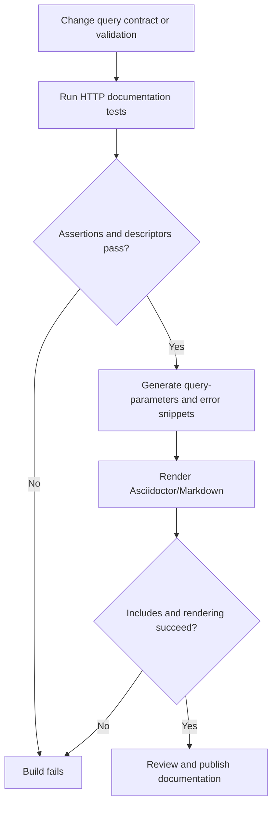

# Linking parameters to validation rules

## Learning objectives

After this lesson, you will be able to:

- Document query parameters in Spring REST Docs using queryParameters(...) and parameterWithName(...).
- Distinguish documentation descriptors from application-enforced validation: one describes the contract, while the other decides whether a request is valid.
- Link the name, type, requiredness, default value, bounds, enum, and format of a query parameter to its corresponding validation rules.
- Write documentation tests for valid and invalid queries, recording error responses as well if that is behavior you want to publish.
- Handle optional query parameters, multiple values, URL encoding, and pagination without misrepresenting behavior.

## 1. Query parameters are more than text after `?`

Query parameters typically pass filtering, pagination, sorting, or representation selection criteria. For example:

```http
GET /api/orders?page=0&size=20&status=PAID HTTP/1.1
Accept: application/json
```

In this request, page specifies the page index, size specifies the maximum number of items requested per page, and status filters by order status.

A useful API page must answer more than "what is the parameter named?":

| Aspect | Question to document |
| --- | --- |
| Data type | Integer, string, date, enum, or list? |
| Requiredness | Must it be sent? Can it be repeated? |
| Default value | When the parameter is omitted, what value does the server use? |
| Value range | What are the minimum/maximum values or valid value set? |
| Semantics | Does the parameter filter, sort, or control pagination? |
| Interactions | Do two parameters depend on or exclude each other? |
| Errors | What status and error body are returned for malformed or out-of-range values? |

Therefore, query parameter documentation must tie into actual validation rules. If the page states a maximum size of 100 while the server accepts 500, the documentation and behavior are in conflict.

## 2. Distinguishing REST Docs descriptors from application validation

These are two separate mechanisms, even though both can be used within the same documentation test.

| Mechanism | Role | Example |
| --- | --- | --- |
| queryParameters(...) | Declares parameters to appear in the snippet and descriptions for readers | parameterWithName("size").description("Items per page") |
| Spring validation/binding | Parses, converts, and validates request values | size must be an integer between 1 and 100 |
| Assertions in tests | Verifies the result returned by the application for a specific request | status().isBadRequest() when size=500 |

**REST Docs does not enforce validation limits on its own.** The descriptor parameterWithName("size") does not make the server reject size=500; it only documents the query parameter. To guarantee that the limit exists, you must configure validation in the application and write tests verifying it.

Conversely, having validation run properly is not enough to generate documentation either. If the test does not declare queryParameters(...), readers may lack a table explaining page, size, or status.

### 2.1. Example of a verifiable contract

Suppose an order listing endpoint has these rules:

| Parameter | Type | Required? | Default value | Rules |
| --- | --- | --- | --- | --- |
| page | Integer | No | 0 | Zero-based, non-negative |
| size | Integer | No | 20 | Between 1 and 100 |
| status | Enum | No | No status filter | Accepts only NEW, PAID, CANCELLED |
| sort | String | No | createdAt,desc | Accepts only API-allowed fields and sort directions |

Valid request example:

```http
GET /api/orders?page=0&size=20&status=PAID&sort=createdAt,desc HTTP/1.1
Accept: application/json
```

Error example:

```http
GET /api/orders?page=-1&size=500 HTTP/1.1
Accept: application/json
```

If the contract specifies out-of-range values as invalid, the application must return a consistent status and error body, such as 400 Bad Request. The exact status and error structure must come from actual application behavior, not be guessed from the table alone.

## 3. Documenting query parameters with Spring REST Docs

With MockMvc, queryParameters(...) takes ParameterDescriptor instances created via parameterWithName(...).

```java
queryParameters(
    parameterWithName("page")
        .description("Zero-based page index"),
    parameterWithName("size")
        .description("Maximum number of items per page"),
    parameterWithName("status")
        .description("Filter orders only by supported statuses")
)
```

Descriptors define names and description text. They do not automatically carry every rule such as min/max, default, enum, or combination conditions. Write those details in description(...) or explanatory prose next to the table.

A more complete descriptor set:

```java
queryParameters(
    parameterWithName("page")
        .description("Zero-based page index; defaults to 0"),
    parameterWithName("size")
        .description("Items per page; defaults to 20, between 1 and 100"),
    parameterWithName("status")
        .description("Status filter: NEW, PAID, or CANCELLED; omit to return all statuses")
)
```

Descriptions must be cross-checked against validation code and tests. When a rule changes, do not edit the wording alone: update the implementation/tests as needed and regenerate snippets.

### 3.1. Optional query parameters

If a parameter may be absent in a valid request, you can use optional():

```java
queryParameters(
    parameterWithName("page")
        .description("Page index; defaults to 0")
        .optional(),
    parameterWithName("size")
        .description("Items per page; defaults to 20")
        .optional()
)
```

optional() specifies that the parameter may be absent from the documented request. It does not configure a default value in the application, does not skip validation, and does not mean any value is accepted. Default values must be implemented in the controller/service or appropriate layer and verified with tests.

For example, if the controller declares @RequestParam(defaultValue = "20") int size, a test omitting size should verify that the application behaves just as when receiving size=20 if that is the intended contract.

### 3.2. Repeatable or multi-value query parameters

Some APIs allow the same name to appear multiple times:

```http
GET /api/orders?status=NEW&status=PAID HTTP/1.1
```

The application can bind this parameter into a list, such as List<OrderStatus>. The descriptor still documents a single parameter name:

```java
queryParameters(
    parameterWithName("status")
        .description("One or more statuses to filter by; parameter may be repeated")
)
```

Only state "may be repeated" if the server actually supports that style of passing values. Some APIs define lists with commas (status=NEW,PAID), some use repeated keys, and some use a JSON body. Tests should send the exact format chosen by the contract.

## 4. Linking validation rules to types and value ranges

Query parameter validation typically spans multiple layers:

1. **Parsing/conversion:** converting query strings into Java types. For example, page=abc cannot bind to an integer without a special converter.
2. **Range constraints:** integers must be non-negative; size must have bounds.
3. **Allowlist constraints:** enum values or sort field names must belong to an allowed set.
4. **Cross-parameter constraints:** from must be less than or equal to to; cursor may be mutually exclusive with page.
5. **Business rules:** whether the caller is authorized to filter by a given status.

### 4.1. Pagination: min/max and defaults

A simple controller example using default values and explicit range checks:

```java
@GetMapping("/api/orders")
OrderPage search(
        @RequestParam(defaultValue = "0") int page,
        @RequestParam(defaultValue = "20") int size) {

    if (page < 0) {
        throw new InvalidQueryParameterException("page must be >= 0");
    }
    if (size < 1 || size > 100) {
        throw new InvalidQueryParameterException("size must be between 1 and 100");
    }
    return orderService.search(page, size);
}
```

This illustrates processing rules, not a recommendation that every controller manually write if statements. Projects can use Bean Validation on method parameters, request models, or a dedicated validator; method validation configuration depends on the Spring version and how validation is enabled. What matters is that tests prove the HTTP behavior after parsing/validation.

### 4.2. Enums and allowlists for sorting

Do not let clients pass arbitrary database column names or query expressions if the API only supports a handful of sort fields. For example:

```java
enum OrderStatus {
    NEW, PAID, CANCELLED
}

enum OrderSortField {
    CREATED_AT, TOTAL_AMOUNT
}
```

If the API accepts sort=createdAt,desc, document the exact public field names, supported asc/desc directions, and default. Java enum names do not have to match the strings published by the API; converters or mappings may determine the representation.

### 4.3. Dates and time ranges

Example query:

```http
GET /api/orders?from=2026-01-01&to=2026-01-31 HTTP/1.1
```

Clarify explicitly:

- Date format, such as YYYY-MM-DD, or ISO-8601 timestamp.
- Applicable timezone if timestamps are included.
- Whether the range endpoints are inclusive.
- Whether from/to can be omitted individually.
- Behavior when from is greater than to.

Do not vaguely write "ISO date" if the API requires a specific offset, timezone, or precision. Use request examples and tests for the supported format.

## 5. Complete example: valid test and validation error test with MockMvc

Suppose an endpoint lists orders by page and size, with page >= 0, 1 <= size <= 100, and defaults of 0 and 20 respectively. Successful responses include page, size, and content.

### 5.1. Test for a valid request

The example below uses JUnit Jupiter, Spring MVC Test, and spring-restdocs-mockmvc. Controller/service details are omitted to focus on query parameters:

```java
@ExtendWith(RestDocumentationExtension.class)
class OrderSearchDocumentationTest {
    private MockMvc mvc;

    @BeforeEach
    void setUp(RestDocumentationContextProvider context) {
        mvc = MockMvcBuilders.standaloneSetup(new OrderController())
                .setControllerAdvice(new ApiExceptionHandler())
                .apply(documentationConfiguration(context))
                .build();
    }

    @Test
    void searchOrders() throws Exception {
        mvc.perform(get("/api/orders")
                        .queryParam("page", "0")
                        .queryParam("size", "20")
                        .accept(MediaType.APPLICATION_JSON))
                .andExpect(status().isOk())
                .andExpect(jsonPath("$.page").value(0))
                .andExpect(jsonPath("$.size").value(20))
                .andDo(document("orders-search",
                        queryParameters(
                                parameterWithName("page")
                                        .description("Zero-based page index"),
                                parameterWithName("size")
                                        .description("Items per page, from 1 to 100")
                        ),
                        responseFields(
                                fieldWithPath("page").description("Returned page"),
                                fieldWithPath("size").description("Page size"),
                                fieldWithPath("content").description("List of orders")
                        )
                ));
    }
}
```

In this example, the test sends page and size, asserts the response values, and then documents query parameters and response fields. You will need the corresponding static imports such as get, status, jsonPath, queryParameters, parameterWithName, responseFields, fieldWithPath, document, and your project's application classes.

### 5.2. Test for invalid values

With size=500, an error test can verify both status and error body structure:

```java
@Test
void rejectsSizeAboveMaximum() throws Exception {
    mvc.perform(get("/api/orders")
                    .queryParam("page", "0")
                    .queryParam("size", "500")
                    .accept(MediaType.APPLICATION_JSON))
            .andExpect(status().isBadRequest())
            .andExpect(jsonPath("$.code").value("INVALID_QUERY_PARAMETER"))
            .andDo(document("orders-search-invalid-size",
                    queryParameters(
                            parameterWithName("page")
                                    .description("Zero-based page index"),
                            parameterWithName("size")
                                    .description("Items per page, from 1 to 100")
                    ),
                    responseFields(
                            fieldWithPath("code").description("Error code"),
                            fieldWithPath("message").description("Error details")
                    )
            ));
}
```

400 and the code, message fields in this example are a hypothetical contract. Replace them with the status/error body your application actually returns. If a test expects 400 while controller advice returns a different structure, assertions must reflect the real design rather than tweaking documentation to force a pass.

The two tests generate two snippet groups:

```text
build/generated-snippets/
├── orders-search/
│   ├── http-request.adoc
│   ├── query-parameters.adoc
│   └── response-fields.adoc
└── orders-search-invalid-size/
    ├── http-request.adoc
    ├── http-response.adoc
    ├── query-parameters.adoc
    └── response-fields.adoc
```

Paths and snippet lists depend on configuration and templates. Generating a separate error snippet lets readers see not only valid parameters, but also the outcome when out-of-range values are sent.

## 6. Default values: documenting and verifying two distinct requests

If page and size have defaults, test a request that omits them:

```java
@Test
void appliesDefaultPagination() throws Exception {
    mvc.perform(get("/api/orders")
                    .accept(MediaType.APPLICATION_JSON))
            .andExpect(status().isOk())
            .andExpect(jsonPath("$.page").value(0))
            .andExpect(jsonPath("$.size").value(20));
}
```

With this test, queryParameters(...) can document both parameters as optional:

```java
queryParameters(
    parameterWithName("page")
        .description("Page index; defaults to 0")
        .optional(),
    parameterWithName("size")
        .description("Items per page; defaults to 20")
        .optional()
)
```

If an earlier test sends page and size, descriptors can declare optionality as part of the overall contract; however, maintain a separate test for the absent case to prove the defaults. Calling optional() does not replace asserting page=0 and size=20.

## 7. Composite query parameters and parameter interactions

Some APIs have rules that evaluate multiple parameters simultaneously:

| Query | Rules to document/test |
| --- | --- |
| from, to | from must not be greater than to; clear date format and timezone |
| minPrice, maxPrice | Non-negative values; lower bound does not exceed upper bound |
| status | Accepts only published enums; multi-value passing style clearly stated |
| sort | Field name in allowlist; sort direction in asc/desc |
| page, cursor | If two pagination modes are mutually exclusive, sending both must be handled explicitly |

Descriptors can document each query parameter individually, while relationships between them usually require additional prose explanation and dedicated tests.

Example test for an inverted date range:

```java
@Test
void rejectsInvertedDateRange() throws Exception {
    mvc.perform(get("/api/orders")
                    .queryParam("from", "2026-02-01")
                    .queryParam("to", "2026-01-01"))
            .andExpect(status().isBadRequest());
}
```

This test only asserts the status in that scenario; if documentation needs to describe the specific error, assert the error code/message and add response field descriptors for the error body.

## 8. URL encoding and reading actual values

Because query strings are transmitted in URIs, special characters may need URL encoding. For example, a search value C++ & Java should not be concatenated into a URI string by hand without encoding, since & separates parameters.

With MockMvc, you can use the builder to add values:

```java
mvc.perform(get("/api/orders")
        .queryParam("q", "C++ & Java"))
```

The mock request builder handles constructing the proper request parameter for the test; when writing documentation, inspect the http-request snippet to ensure the value accurately shows what clients need to send. For tests hitting a real server, verify that the URI is encoded consistently across client and server.

Distinguish an empty query value (q=), an absent parameter, and a parameter with the string "null"; these are distinct requests. If the API behaves differently in these cases, test and document them.

## 9. Assembling snippets into Asciidoctor documentation

After tests generate snippets, an AsciiDoc page can include them:

```asciidoc
== Search orders

The endpoint supports zero-based pagination.
Default page size is 20 and cannot exceed 100.

=== Query parameters
include::{snippets}/orders-search/query-parameters.adoc[]

=== HTTP request
include::{snippets}/orders-search/http-request.adoc[]

=== HTTP response
include::{snippets}/orders-search/http-response.adoc[]

=== Invalid parameters
When size exceeds the limit, the API returns an error per the validation contract.
include::{snippets}/orders-search-invalid-size/http-response.adoc[]
```

The {snippets} attribute must point to the actual output directory. Statements about defaults, min/max bounds, and filter semantics are authored manually and must be verified against the implementation/tests. Asciidoctor only includes and renders files; it does not run validation itself.

If using Markdown, you need appropriate snippet templates and an include/merging mechanism supported by your renderer. The include::{snippets}/...[] syntax above belongs to Asciidoctor, not standard Markdown.

## 10. Build and CI integration

Basic flow:



With Gradle, ensure tests generate snippets before Asciidoctor reads them. Conceptual Groovy DSL example:

```groovy
def snippetsDir = file("$buildDir/generated-snippets")

tasks.named('test') {
    outputs.dir snippetsDir
}

tasks.named('asciidoctor') {
    inputs.dir snippetsDir
    dependsOn tasks.named('test')
}
```

This illustrates task dependencies rather than a complete build script. The project needs the Asciidoctor plugin, Spring REST Docs dependencies and compatible versions, snippets attribute configuration, and matching output directories across tasks. In CI builds, run from clean outputs and check for missing includes to avoid publishing documentation built from stale snippets.

## 11. Common errors

| Symptom | Possible cause | How to resolve |
| --- | --- | --- |
| Query parameter table is missing status | Test did not document the parameter or did not send it in the scenario | Check the request and declare the matching descriptor |
| Documentation test fails due to undocumented query parameter | Request has a new parameter while queryParameters(...) was not updated | Verify the contract, add a descriptor, or investigate the request |
| Descriptor declares a parameter that does not appear | Test request omits that parameter | Send the parameter if required by the scenario, or mark optional if the contract allows |
| Documentation states default 20 while server returns another default | Prose/descriptor is out of sync with actual validation or behavior | Fix implementation or documentation per contract decision; add a default test |
| size=500 is still accepted | Missing validation or test layer does not invoke validation | Add validator/configuration and test within the right scope |
| status=UNKNOWN is not rejected as expected | Enum converter/custom binding or error handler was not tested | Test actual values and update rules |
| Query containing & splits into multiple parameters | Improper URL encoding | Use an appropriate URI builder/client and inspect the request snippet |
| Tests pass, yet error documentation is missing | Only happy-path tests exist | Add validation/error tests and dedicated snippets |

## 12. Checklist for linking query parameters with validation

- [ ] Every query parameter is documented with a clear name and meaning.
- [ ] Data type, requiredness, and multi-value passing style are stated clearly.
- [ ] Default values are verified with requests that omit the parameter.
- [ ] Min/max, enums, formats, allowlists, and cross-parameter rules are documented.
- [ ] Actual validation returns a status/error body matching the contract.
- [ ] Tests contain assertions for both valid values and key invalid cases.
- [ ] queryParameters(...) descriptors match sent requests and do not mask new changes.
- [ ] Fresh snippets are rendered from the same build; documentation does not use stale outputs.

## 13. Practice exercise

A product search endpoint supports:

```http
GET /api/products?q=notebook&page=0&size=20&sort=price,asc
```

Hypothetical contract:

- q is optional, search string up to 80 characters.
- page defaults to 0, non-negative.
- size defaults to 20, from 1 to 50.
- sort allows only price,asc; price,desc; name,asc; name,desc.

Tasks:

1. Write queryParameters(...) documenting all four parameters, including defaults and bounds.
2. Write a test for a valid request and verify the server applies page/size properly.
3. Write tests for size=0, size=51, and page=-1; verify status/error body per your implementation.
4. Write tests for q exceeding 80 characters and sort outside the allowlist.
5. Add a test omitting page and size to verify defaults.
6. If the API supports repeated queries or special encoding, design tests demonstrating that exact behavior.
7. Generate snippets, include them in Asciidoctor, and run a clean build.

**Self-check question:** Does merely declaring parameterWithName("size").description("Maximum 50") guarantee the server rejects size=51? No. Descriptors only describe; you must have application validation and tests proving the response when invalid values are sent.

## Conclusion

Linking query parameters with validation requires two synchronized layers: **Spring REST Docs documents parameter names and meanings**, while the application enforces rules on types, defaults, value ranges, enums, formats, and inter-parameter relationships. Documentation tests must send representative requests, assert valid/error outcomes, and use queryParameters(...) to generate matching snippets. When validation changes, update tests and explanations and regenerate documentation through build/CI. A descriptor alone never replaces validation; only when both reflect a verified contract does query parameter documentation become reliable for integrators.
