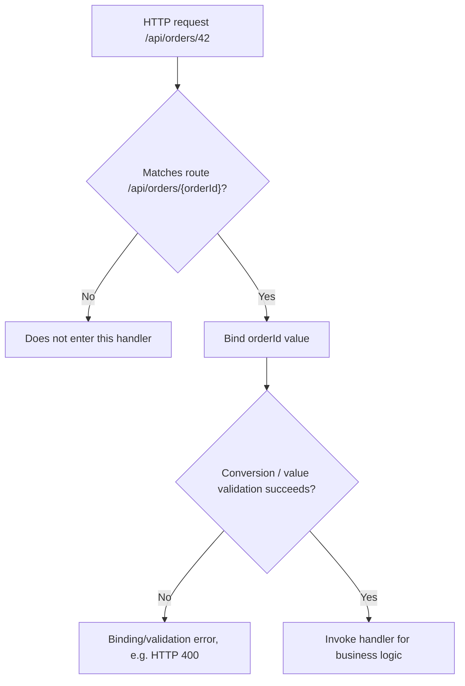

# Path parameters required by routing nature

## Lesson Objectives

In **Spring REST Docs**, REST API documentation is generated from requests/responses executed in HTTP tests using **MockMvc**, **WebTestClient**, or **REST Assured**. Before describing path variables with `pathParameters(...)`, it is important to understand a key principle: **a variable placed in a route's path pattern is generally a required segment for a request to match that route**.

For example, `GET /api/orders/{orderId}` requires a path segment at the `{orderId}` position. The request `GET /api/orders/42` has that segment; `GET /api/orders` does not. Marking a parameter as *optional* in documentation or in a Java method signature does not create a new route on its own.

After this lesson, you will know how to:

- Distinguish requiredness when **matching a URI to a route**, when **binding to `@PathVariable`**, and when **verifying a Spring REST Docs snippet**.
- Understand why `@PathVariable(required = false)` does not automatically make `/orders/{id}` match `/orders`.
- Write MockMvc tests proving both the present and missing path segment cases, then generate the `path-parameters.adoc` snippet.
- Design two explicit routes if you want to support both collection listing and detail lookup.
- Distinguish path parameters from optional query parameters and choose the appropriate documentation method.
- Integrate snippets into Asciidoctor/Markdown documentation and the build/CI pipeline.

## 1. Why are path parameters usually required?

Suppose the application declares:

```java
@GetMapping("/api/orders/{orderId}")
OrderResponse findOne(@PathVariable("orderId") Long orderId) {
    // ...
}
```

The URI template mapped to the handler is `/api/orders/{orderId}`. A request needs a segment corresponding to `{orderId}` to match that pattern.

| Request | Matches route `GET /api/orders/{orderId}`? | Meaning |
| --- | --- | --- |
| `GET /api/orders/42` | Yes | `orderId` receives the string value `42`; it can then be converted to `Long` |
| `GET /api/orders` | No | Missing the entire path segment for `orderId` |
| `GET /api/orders?orderId=42` | No | `orderId` here is a **query parameter**, not a replacement for the `/{orderId}` segment |
| `GET /api/orders/abc` | Yes at the path-matching step | The variable segment is present, but converting `abc` to `Long` typically produces an HTTP 400 response |
| `POST /api/orders/42` | Does not match this **GET** mapping | The path may match, but the HTTP method differs |

**Note on HTTP status codes:** with a controller that only has the detail GET route above, `GET /api/orders` typically receives **404 Not Found** because no matching handler is found. When the application has other routes or custom error handling, the response code depends on the whole system. For example, an unsupported HTTP method on an already-mapped path can result in **405 Method Not Allowed**.

Let's clearly separate the two stages:



Spring REST Docs only performs documentation on tested requests; the library **does not alter the routing algorithm** of Spring MVC or WebFlux.

## 2. Three layers of "required" that are easy to confuse

When reading code, you may encounter `{orderId}`, `@PathVariable(required = false)`, and `parameterWithName("orderId").optional()`. They exist at **three different layers**.

| Layer | Where declared | Actual effect |
| --- | --- | --- |
| **Routing** | `@GetMapping("/api/orders/{orderId}")` | Determines which request paths match the handler |
| **Java parameter binding** | `@PathVariable(required = true/false)` | Governs what happens when the handler is selected but no value is available to bind |
| **Documentation description & verification** | `pathParameters(parameterWithName("orderId").optional())` | Adjusts the descriptor and REST Docs snippet verification |

### 2.1. @PathVariable(required = false) does not automatically widen the route

The following code **does not mean** the endpoint automatically accepts `/api/orders`:

```java
@GetMapping("/api/orders/{orderId}")
OrderResponse findOne(
        @PathVariable(value = "orderId", required = false) Long orderId) {
    // ...
}
```

For `GET /api/orders`, the handler above does not match in the first place because the URI template still contains the `/{orderId}` segment. Spring does not invoke the handler just to assign `orderId = null`.

The `required = false` attribute only matters when the handler can be selected in a situation without a value to bind. One case is **explicitly declaring multiple path patterns** for the same handler; however, for two distinct business operations such as listing items and viewing details, two separate handlers are usually clearer and easier to document.

### 2.2. optional() in Spring REST Docs does not change the route either

Example:

```java
pathParameters(
    parameterWithName("orderId")
        .description("ID of the order to view")
        .optional()
)
```

`optional()` is a property of the **documentation descriptor**. It does not create the `/api/orders` path, does not modify `@GetMapping`, and does not make the application accept a missing path segment. Only use `optional()` when there is a real reason from the API contract and specific tests; do not use it to hide a mismatch between the route and the documentation.

### 2.3. Query parameters can be optional in a different sense

For the endpoint:

```text
GET /api/orders?status=OPEN
```

`status` is a **query parameter**. If the controller declares:

```java
@GetMapping("/api/orders")
List<OrderResponse> list(
        @RequestParam(value = "status", required = false) String status) {
    // ...
}
```

then both `GET /api/orders` and `GET /api/orders?status=OPEN` use **the same path pattern `/api/orders`**. No URI segment appears or disappears. When generating documentation, describe `status` in the query parameters group appropriate for your Spring REST Docs version, **do not put it in `pathParameters(...)`**.

## 3. MockMvc test example: a route with a required path parameter

The example uses **Java 17+**, **Spring Boot 3.x**, **JUnit 5**, and Spring REST Docs for MockMvc. Minimal Gradle configuration in a project that already uses dependency management:

```groovy
dependencies {
    testImplementation 'org.springframework.boot:spring-boot-starter-test'
    testImplementation 'org.springframework.restdocs:spring-restdocs-mockmvc'
}
```

If using Maven, substitute the equivalent dependencies and configure the snippet directory in `target/generated-snippets`.

### 3.1. Controller with only the detail route

Create `OrderController.java`:

```java
import org.springframework.web.bind.annotation.GetMapping;
import org.springframework.web.bind.annotation.PathVariable;
import org.springframework.web.bind.annotation.RestController;

@RestController
class OrderController {

    @GetMapping("/api/orders/{orderId}")
    OrderResponse getOrder(@PathVariable("orderId") Long orderId) {
        return new OrderResponse(orderId, "OPEN");
    }
}

record OrderResponse(Long id, String status) {}
```

To stay focused on routing, the sample controller returns mock data. In a real product, the handler normally calls a service/repository to look up the order; whether the order actually exists is a **business condition**, distinct from whether the path matches the route.

### 3.2. Test with path segment and snippet generation

Create `OrderControllerDocumentationTest.java` in the same package as the controller:

```java
import org.junit.jupiter.api.Test;
import org.springframework.beans.factory.annotation.Autowired;
import org.springframework.boot.test.autoconfigure.restdocs.AutoConfigureRestDocs;
import org.springframework.boot.test.autoconfigure.web.servlet.WebMvcTest;
import org.springframework.http.MediaType;
import org.springframework.test.web.servlet.MockMvc;

import static org.springframework.restdocs.mockmvc.MockMvcRestDocumentation.document;
import static org.springframework.restdocs.mockmvc.RestDocumentationRequestBuilders.get;
import static org.springframework.restdocs.request.RequestDocumentation.parameterWithName;
import static org.springframework.restdocs.request.RequestDocumentation.pathParameters;
import static org.springframework.test.web.servlet.result.MockMvcResultMatchers.jsonPath;
import static org.springframework.test.web.servlet.result.MockMvcResultMatchers.status;

@WebMvcTest(OrderController.class)
@AutoConfigureRestDocs(outputDir = "build/generated-snippets")
class OrderControllerDocumentationTest {

    @Autowired
    MockMvc mockMvc;

    @Test
    void documentGetOneOrder() throws Exception {
        mockMvc.perform(get("/api/orders/{orderId}", 42L)
                .accept(MediaType.APPLICATION_JSON))
            .andExpect(status().isOk())
            .andExpect(jsonPath("$.id").value(42))
            .andExpect(jsonPath("$.status").value("OPEN"))
            .andDo(document("order-detail-get",
                pathParameters(
                    parameterWithName("orderId")
                        .description("Identifier of the order to view")
                )
            ));
    }

    @Test
    void missingPathSegmentDoesNotMatchDetailRoute() throws Exception {
        mockMvc.perform(get("/api/orders")
                .accept(MediaType.APPLICATION_JSON))
            .andExpect(status().isNotFound());
    }

    @Test
    void invalidLongPathValueReturnsBadRequest() throws Exception {
        mockMvc.perform(get("/api/orders/not-a-number")
                .accept(MediaType.APPLICATION_JSON))
            .andExpect(status().isBadRequest());
    }
}
```

In this standalone example, `GET /api/orders` receives **404** because the controller provides no collection route; `GET /api/orders/not-a-number` receives **400** because the value cannot be converted to `Long`. If the application adds other handlers or custom exception handling, the exact outcomes may differ.

**Why use `RestDocumentationRequestBuilders.get(...)`?** This builder provides the URI template to Spring REST Docs, letting the library know that a variable named `orderId` appears in the request. If you only use the already-expanded string `/api/orders/42`, the variable name is no longer visible in the path and generating the path parameters snippet may fail.

In the test:

- `get("/api/orders/{orderId}", 42L)` passes the value `42L` into the `orderId` variable.
- `parameterWithName("orderId")` uses **the variable name in the template**, not `"42"` or `"{orderId}"`.
- `description(...)` explains the meaning of the ID in the documentation.
- `document("order-detail-get", ...)` creates snippets from the executed request/response.

### 3.3. Output results

After running the test successfully, the `build/generated-snippets/order-detail-get/` directory contains snippets according to configuration, including:

```text
build/
└── generated-snippets/
    └── order-detail-get/
        ├── http-request.adoc
        ├── http-response.adoc
        ├── curl-request.adoc
        └── path-parameters.adoc
```

The list above is illustrative; other request/response files may also be generated. `path-parameters.adoc` records a row equivalent to:

| Parameter | Description |
| --- | --- |
| `orderId` | Identifier of the order to view |

In the actual URL, `42` is an example value; in the documentation table, **`orderId`** is the stable variable name that API consumers must supply.

## 4. If missing ID should be valid, design appropriate routes

An API often needs both behaviors:

| Endpoint | Meaning |
| --- | --- |
| `GET /api/orders` | Retrieve list of orders |
| `GET /api/orders/{orderId}` | Retrieve one order by ID |

The clear way to write this is to create two mappings:

```java
@RestController
class OrderQueryController {

    @GetMapping("/api/orders")
    List<OrderResponse> listOrders() {
        return List.of(new OrderResponse(42L, "OPEN"));
    }

    @GetMapping("/api/orders/{orderId}")
    OrderResponse getOrder(@PathVariable("orderId") Long orderId) {
        return new OrderResponse(orderId, "OPEN");
    }
}
```

Then `GET /api/orders` **is valid because it has a separate list route**; that does not turn `{orderId}` on the detail route into an optional path parameter.

If you want to use the same handler for two path patterns, Spring MVC allows declaring two patterns:

```java
@GetMapping({"/api/orders", "/api/orders/{orderId}"})
Object getOrders(
        @PathVariable(value = "orderId", required = false) Long orderId) {
    if (orderId == null) {
        return List.of(new OrderResponse(42L, "OPEN"));
    }
    return new OrderResponse(orderId, "OPEN");
}
```

These are **two explicitly specified URL patterns** that can be handled by the same method. `required = false` allows the Java value to be absent when the handler serves the pattern without the variable. This approach can work for simple logic, though you should consider clarity of the return type, response statuses, and API contract for each case.

### 4.1. Document each case accurately per request

With two independent routes, generate separate snippets for each behavior:

```java
// Test for the detail route:
mockMvc.perform(get("/api/orders/{orderId}", 42L))
    .andExpect(status().isOk())
    .andDo(document("order-detail-get",
        pathParameters(
            parameterWithName("orderId")
                .description("ID of the order to view")
        )));

// Test for the list route:
mockMvc.perform(get("/api/orders"))
    .andExpect(status().isOk())
    .andDo(document("orders-list-get"));
```

The snippet above is **illustrative and placed inside a test already configured with MockMvc REST Docs**, assuming the controller has both routes. In the list route test, the URL has no path variables, so **no `pathParameters(...)` snippet is needed**. If there are `status`, `page`, or `size` parameters after `?`, document them using the corresponding query parameters group.

API documentation should make clear to readers when to call the collection endpoint and when to call the item endpoint, rather than implying that the `/{orderId}` segment of the detail route can be omitted.

## 5. What does Spring REST Docs verify?

In the default strict mode of `pathParameters(...)`, Spring REST Docs checks descriptors against the path variables of the request that carries a URI template. For example:

```java
pathParameters(
    parameterWithName("orderId").description("Order ID")
)
```

| Scenario | Outcome |
| --- | --- |
| Template has `{orderId}`, descriptor named `orderId` | Name matches, snippet can be generated |
| Template has `{orderId}`, descriptor named `id` | Wrong name; documentation declaration does not match |
| Template has `{orderId}`, `orderId` not declared | Undocumented variable; strict mode reports an error |
| Template has `{orderId}` and `{lineId}`, only `orderId` described | Missing descriptor for `lineId` |
| Only `{orderId}` present, yet `lineId` declared | Describes a parameter not present in the template |
| Descriptor marked `ignored()` | Variable is recognized but omitted from the snippet table |

Important point: REST Docs can detect *missing or extra variable names in documentation*, but **cannot by itself prove that the routing contract is business-correct**. Routing tests and response assertions still need to be written explicitly.

### 5.1. ignored() vs optional()

```java
pathParameters(
    parameterWithName("tenantId").ignored(),
    parameterWithName("orderId")
        .description("ID of the order belonging to the tenant")
)
```

With the template `/api/tenants/{tenantId}/orders/{orderId}`, `ignored()` indicates that you are aware of the `tenantId` variable, but choose not to display this descriptor in the table. It does not remove the requirement to provide the `tenantId` segment when calling the route.

Conversely, `optional()` marks the descriptor as not required during Spring REST Docs verification. It **does not turn a URI template into a flexible route**, does not supply a default value, and does not change `@PathVariable` binding behavior. When an endpoint has two distinct URI patterns, the clearest approach is to test and document those two requests separately.

### 5.2. Should you use relaxedPathParameters(...)?

Some older tests may use `relaxedPathParameters(...)` to avoid requiring descriptions for every existing path variable. However, when the URI expands—for example from `/api/orders/{orderId}` to `/api/stores/{storeId}/orders/{orderId}`—the `storeId` variable can be left out of documentation without causing an error. When the goal is documentation **verifiable from tests**, prefer `pathParameters(...)` and declare every variable.

## 6. A value that is invalid vs. a variable that is missing

For `/api/orders/{orderId}`, the three cases below lead to different issues:

1. **Missing variable segment:** `GET /api/orders` does not match the detail route. With no other handler, this is typically 404.
2. **Variable segment present but wrong type:** `GET /api/orders/abc` may match the path pattern, then fail when Spring converts the string `abc` to `Long`, typically returning 400.
3. **Syntactically valid ID that does not exist in data:** `GET /api/orders/9999` still matches the route and binds; the service may decide to return 404 because **the resource was not found**.

In a real API, write separate tests for each relevant case. `pathParameters(...)` describes the variable; **controller, validation, and service tests** verify that the system returns the right error in each scenario.

If the ID is a UUID or business code, state the format clearly in the description:

```java
parameterWithName("orderId")
    .description("UUID of the order, e.g. "
        + "550e8400-e29b-41d4-a716-446655440000")
```

This description provides a convention for consumers but does not automatically trigger format validation. In particular, URL encoding for special characters inside a path segment must be handled properly by the HTTP client/server and cannot be solved by modifying the documentation descriptor.

## 7. Attaching snippets in WebTestClient or REST Assured

The principle that **a segment must be present to match a route containing a variable** does not change across test clients. Only how Spring REST Docs is configured and where `document(...)` is called differs.

### 7.1. WebTestClient

In a test where `documentationConfiguration(...)` is attached to WebTestClient:

```java
webTestClient.get()
    .uri("/api/orders/{orderId}", 42L)
    .exchange()
    .expectStatus().isOk()
    .expectBody()
    .consumeWith(document("order-detail-webtestclient",
        pathParameters(
            parameterWithName("orderId")
                .description("ID of the order to view")
        )
    ));
```

Here, `document(...)` is imported from `WebTestClientRestDocumentation`; `pathParameters(...)` and `parameterWithName(...)` still belong to `RequestDocumentation`.

### 7.2. REST Assured

In a test using a `RequestSpecification spec` configured with REST Docs:

```java
given(spec)
    .filter(document("order-detail-rest-assured",
        pathParameters(
            parameterWithName("orderId")
                .description("ID of the order to view")
        )
    ))
    .pathParam("orderId", 42L)
    .when()
    .get("/api/orders/{orderId}")
    .then()
    .statusCode(200);
```

Here `document(...)` is imported from `RestAssuredRestDocumentation`. `pathParam("orderId", 42L)` supplies the **request value**; `parameterWithName("orderId")` describes the **variable name**.

With both tools, include a separate test for the missing-segment case if the API contract requires observing that status; `document(...)` does not replace routing and response assertions.

## 8. Authoring Asciidoctor docs and integrating build/CI

Suppose the test generates `build/generated-snippets/order-detail-get/path-parameters.adoc`. In `src/docs/asciidoc/index.adoc`:

```asciidoc
= Orders API
:toc: left

== Get order by ID

`GET /api/orders/{orderId}`

=== Path parameters

include::{snippets}/order-detail-get/path-parameters.adoc[]

=== HTTP request

include::{snippets}/order-detail-get/http-request.adoc[]

=== HTTP response

include::{snippets}/order-detail-get/http-response.adoc[]
```

In the build, provide the Asciidoctor `snippets` attribute pointing to the generated directory. Gradle Groovy DSL example, **when the `org.asciidoctor.jvm.convert` plugin is already configured**:

```groovy
def snippetsDir = file('build/generated-snippets')

tasks.named('test') {
    outputs.dir snippetsDir
}

tasks.named('asciidoctor') {
    dependsOn tasks.named('test')
    inputs.dir snippetsDir
    attributes 'snippets': snippetsDir
}
```

In CI, run the documentation build step after the REST Docs tests. If tests fail due to mismatched variable names or ungenerated snippets, the pipeline should stop before publishing documentation. Snippets are regenerated from tests; do not edit files in `generated-snippets` directly.

For **Markdown** documentation, Asciidoctor's `include::{snippets}/...[]` syntax is not understood directly by standard Markdown. You need a conversion step or an embedding mechanism suited to your documentation build tool.

## 9. Common errors

| Symptom | Cause | Fix |
| --- | --- | --- |
| Calling `/orders` does not run the `/orders/{id}` handler | Missing path segment to match the route | Pass the ID, or design a separate `/orders` route |
| `@PathVariable(required = false)` set, yet `/orders` still returns 404 | `required = false` does not change the URI pattern | Declare an additional mapping without the variable if needed |
| Testing `/orders/abc` returns 400 | Binding `abc` to `Long` fails | Supply a value of the right type or handle validation/exceptions |
| `path-parameters.adoc` is not generated | Missing `document(...)`, wrong builder, or missing REST Docs config | Use a REST Docs–integrated test client with a URI template |
| Descriptor reported as not found | Wrote `parameterWithName("id")` when template uses `{orderId}` | Declare `parameterWithName("orderId")` accurately |
| New variable does not appear in docs | Used omitting declaration or relaxed configuration | Use strict `pathParameters(...)`, describe every variable |
| HTML page lacks path parameters table | Wrong snippet path or wrong test/Asciidoctor run order | Check `snippets` and build task dependencies |

## 10. Hands-on exercise

Design an account management API:

```text
GET /api/accounts/{accountId}/transactions/{transactionId}
GET /api/accounts/{accountId}/transactions
```

Perform the following:

1. Explain why `GET /api/accounts/12/transactions` **does not match the first detail route**, yet can match the second list route.
2. Write two appropriate `@GetMapping` methods; the list route can accept an optional `fromDate` query parameter.
3. Write a MockMvc test for the detail route using `get("/api/accounts/{accountId}/transactions/{transactionId}", 12L, 77L)`; assert the response and generate snippets with two descriptors:

   ```java
   pathParameters(
       parameterWithName("accountId")
           .description("ID of the account owning the transaction"),
       parameterWithName("transactionId")
           .description("ID of the transaction to view")
   )
   ```

4. Create a test for the list route without `transactionId`; document only `accountId` as the path parameter of that route.
5. Try calling `GET /api/accounts/12/transactions/not-a-number` when `transactionId` is declared as `Long`; observe the difference between a **missing path segment** and an **unconvertible value**.
6. Include the `path-parameters.adoc` snippets from both tests into two corresponding Asciidoctor documentation sections.

**Completion criteria:** each request matches the right route; tests assert status/response; snippets accurately record the variables of each URI template; and it is clear that adding `optional()` to a descriptor does not make a variable on a detail route optional.

## Key Takeaways

A path parameter in a pattern like `/api/orders/{orderId}` is a component required **for a request to match that exact pattern**. `@PathVariable(required = false)` adjusts binding, while `parameterWithName(...).optional()` adjusts description/verification in Spring REST Docs; neither creates a route that omits the `/{orderId}` segment. Clearly design the accepted URIs, write tests for each behavior, document variables with `pathParameters(...)`, and integrate snippets into build/CI so REST API documentation reflects the tested contract.

**References:** [Spring REST Docs Reference](https://docs.spring.io/spring-restdocs/reference/), [Spring REST Docs RequestDocumentation API](https://docs.spring.io/spring-restdocs/docs/current/api/org/springframework/restdocs/request/RequestDocumentation.html), and [Spring Framework: URI patterns](https://docs.spring.io/spring-framework/reference/web/webmvc/mvc-controller/ann-requestmapping.html).
