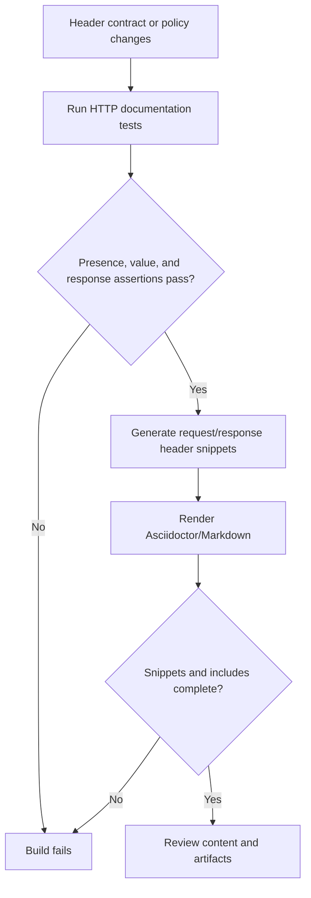

# Required, Optional, and Default Header Values

## Learning Objectives

After this lesson, you will be able to:

- Distinguish between required headers, optional headers, and headers with default values in a REST API contract.
- Document request/response headers in Spring REST Docs using `requestHeaders(...)`, `responseHeaders(...)`, and `headerWithName(...)`.
- Use `optional()` properly and understand why it does not replace application validation or default configuration.
- Write HTTP tests for cases where a header is present, absent, and has an invalid value.
- Distinguish between an absent header, an empty header value, and a header added automatically by the server; verify behavior instead of guessing from code.
- Protect tokens, cookies, and sensitive data when generating snippets and publishing documentation.

## 1. Headers as Part of the HTTP Contract

Headers carry metadata about a request or response. They can indicate media types, authentication, caching, update conditions, tracing identifiers, or resource-related information.

Example request:

```http
POST /api/orders HTTP/1.1
Content-Type: application/json
Accept: application/json
Authorization: Bearer <access-token>
Idempotency-Key: 7b1a4b8d-0c1f-4c92-a09a-82a3b7b1a001

{"customerId":7,"quantity":2}
```

Example response:

```http
HTTP/1.1 201 Created
Content-Type: application/json
Location: /api/orders/43
X-Request-Id: req-8f21

{"id":43,"status":"CREATED"}
```

Integrators need to know which headers must be sent, which headers may be omitted, which values are accepted, and whether the server returns any headers for the client to use.

### 1.1. Classification by Direction

| Group | Example | Role |
| --- | --- | --- |
| Request header | `Accept`, `Content-Type`, `Authorization`, `If-Match` | Client sends metadata or conditions for the server to process the request |
| Response header | `Content-Type`, `Location`, `ETag`, `Cache-Control` | Server describes the response or instructs the client on next steps |
| Application-specific header | `Idempotency-Key`, `X-Request-Id`, `X-Tenant-Id` | API-specific conventions, must be documented per the actual contract |

Not every header needs to be included in the documentation table. Prioritize headers that affect integration, behavior, or response handling. Avoid publishing internal headers not intended for consumers.

## 2. Required, Optional, and Default Headers

These three concepts answer three different questions:

- **Required:** the client must send the header in requests for that scenario; if missing, the API may reject the request or handle it according to published rules.
- **Optional:** the client may send or omit the header; the server handles both cases according to the contract.
- **Has a default value (default):** when the client omits the header, the server applies a defined default value or behavior. Defaults can be implemented by the application, framework, or an intermediary layer.

| Example | Possible Classification | What Needs to Be Published |
| --- | --- | --- |
| `Content-Type` on an endpoint that only accepts JSON | Required in requests with a body | Supported media types and the response when missing/wrong |
| `Accept` if the API only returns JSON | May be optional if the server defaults to JSON | Values the client may send and the representation selected by the server |
| `Authorization` on a protected endpoint | Required per security policy | Scheme, credentials to send, handling of missing/invalid authorization |
| `If-Match` on a conditional update operation | Required if the API enforces optimistic concurrency | Meaning of the validator, response when missing or mismatched |
| `X-Client-Locale` | May be optional | Which default locale the server chooses when the header is absent, if committed |
| `Idempotency-Key` | Required or optional depending on operation design | Key scope, validity period, and behavior on repeated submissions |

These are illustrative examples. Requiredness and defaults must be determined by the **specific endpoint contract**, and cannot be inferred solely from a header name or framework conventions.

### 2.1. Do Not Confuse "Undocumented" with "Optional"

A header that does not appear in the documentation table is not necessarily optional. The author may have forgotten to document it, the test may not have sent it, or the header may fall outside the scope of that snippet.

To declare a header as optional, determine:

1. Is the client allowed to omit it?
2. If omitted, what does the server do?
3. If sent, which values and formats are valid?
4. Are there conditions under which the header becomes required only in certain operations?
5. Which tests verify each case?

## 3. Documenting Request Headers with Spring REST Docs

Spring REST Docs uses `requestHeaders(...)` with `headerWithName(...)` to generate the request header description snippet.

```java
requestHeaders(
    headerWithName("Content-Type")
        .description("Media type of the request body; endpoint accepts application/json"),
    headerWithName("Authorization")
        .description("Caller's Bearer access token")
)
```

Descriptors define the header name and explanation. They do not automatically force clients to send headers on every endpoint, do not generate tokens, and do not configure security.

### 3.1. Required Headers in Tests

Suppose the order creation endpoint requires `Content-Type: application/json` and `Idempotency-Key`. The test sends those headers and records documentation:

```java
mockMvc.perform(post("/api/orders")
        .contentType(MediaType.APPLICATION_JSON)
        .header("Idempotency-Key", "test-order-001")
        .content("""
            {"customerId":7,"quantity":2}
            """))
    .andExpect(status().isCreated())
    .andDo(document("orders-create",
        requestHeaders(
            headerWithName("Content-Type")
                .description("Media type of the request body; must be application/json"),
            headerWithName("Idempotency-Key")
                .description("Deduplication key per API policy")
        )
    ));
```

The example assumes the endpoint has an idempotency policy. In a real project, add appropriate response fields/headers and assertions; the fixture `test-order-001` must not introduce test-order dependencies. Do not use real idempotency keys from production.

### 3.2. Optional Headers with `optional()`

If a header is allowed to be absent in a valid exchange, the descriptor can be marked:

```java
requestHeaders(
    headerWithName("X-Client-Locale")
        .description("Preferred locale; if omitted, the server uses the default locale")
        .optional()
)
```

`optional()` indicates that the header may not appear in the documented request. This is descriptor metadata, not an application configuration that automatically fills in a default header.

For example, if the API commits to a default locale of `vi-VN`, you still need a test that omits `X-Client-Locale` and verifies the response content or corresponding behavior. If you only test requests that include the header, an optional descriptor alone does not prove the server handles the absent case.

### 3.3. Headers Without a Client-Side Default

An API might not require the client to send `X-Request-Id`; the server/gateway generates the request ID itself and returns it in the response. In that case:

- `X-Request-Id` is not a required client request header.
- If the client sends its own correlation ID, document the acceptance/override rules according to actual behavior.
- The response may always contain `X-Request-Id`; test and document the response header separately.

Do not list a request header as required just because the test harness added that header automatically.

## 4. Distinguishing Absent, Empty, and Default Headers

The three requests below can lead to different behavior:

```http
GET /api/orders HTTP/1.1
Accept: application/json
```

```http
GET /api/orders HTTP/1.1
Accept: application/json
X-Client-Locale:
```

```http
GET /api/orders HTTP/1.1
Accept: application/json
X-Client-Locale: vi-VN
```

- The first request does not have the `X-Client-Locale` header.
- The second request has the header with an empty value.
- The third request has the header with a specific value.

If the contract says a header is optional, that does not automatically tell you whether an empty value is accepted. Verify how the server handles both absent and empty cases if API users might encounter them.

Similarly, a default is not a header automatically injected into the request. A default can be internal server behavior when reading a request without the header.

## 5. Default Headers: Verify on the Right Side

Defaults can exist at multiple layers:

| Source of Default | Example | Where to Verify |
| --- | --- | --- |
| Client library | Client automatically adds `Accept` or `User-Agent` | Actual outgoing request |
| API gateway/proxy | Adds correlation header or rewrites headers | Integration test through gateway or appropriate configuration evidence |
| Spring/application | Chooses locale or media type when header is absent | MVC/WebFlux test with application configuration |
| Response policy | Server always returns `Cache-Control` or `X-Request-Id` | Response header assertions in HTTP tests |

Do not attribute a default to the API just because a specific client adds the header automatically. REST API documentation describes the obligations and behavior of the provider/consumer at the chosen boundary.

### 5.1. Example Test Verifying a Default Locale

Suppose the application returns responses localized by `X-Client-Locale`, defaulting to `vi-VN`. A test can omit the header:

```java
@Test
void usesDefaultLocaleWhenHeaderIsAbsent() throws Exception {
    mockMvc.perform(get("/api/catalog")
                    .accept(MediaType.APPLICATION_JSON))
            .andExpect(status().isOk())
            .andExpect(jsonPath("$.locale").value("vi-VN"));
}
```

This test only proves that the response in the tested context contains the `vi-VN` locale. If the locale is selected at the gateway or a service outside the application context, an isolated test may not be sufficient; test through the exact layer that applies the default.

## 6. Documenting Response Headers

For response headers, use `responseHeaders(...)`:

```java
responseHeaders(
    headerWithName("Location")
        .description("URI of the newly created order"),
    headerWithName("X-Request-Id")
        .description("Request tracing ID for log correlation")
)
```

Tests need to verify that the headers actually exist in the response:

```java
mockMvc.perform(post("/api/orders")
        .contentType(MediaType.APPLICATION_JSON)
        .content("""
            {"customerId":7,"quantity":2}
            """))
    .andExpect(status().isCreated())
    .andExpect(header().string("Location", "/api/orders/43"))
    .andExpect(header().exists("X-Request-Id"))
    .andDo(document("orders-create",
        responseHeaders(
            headerWithName("Location")
                .description("URI of the newly created order"),
            headerWithName("X-Request-Id")
                .description("Request tracing ID")
        )
    ));
```

In real tests, if `X-Request-Id` is randomly generated, assertions should only check presence or format if that is what the contract guarantees; avoid hardcoding an unstable value. If the header is generated at a gateway, tests must pass through the gateway to prove that behavior.

## 7. Required Headers Do Not Mean Descriptors Alone

A common mistake is assuming that declaring:

```java
requestHeaders(
    headerWithName("Authorization")
        .description("Bearer token")
)
```

will cause the API to reject requests missing `Authorization`. That is incorrect. Descriptors only generate the description table; required behavior must be enforced by security/configuration and verified by tests.

Example test for a protected endpoint:

```java
@Test
void rejectsMissingAuthorizationHeader() throws Exception {
    mockMvc.perform(get("/api/me")
                    .accept(MediaType.APPLICATION_JSON))
            .andExpect(status().isUnauthorized());
}
```

This test requires the security filter chain to be loaded in the test context. If using `standaloneSetup` without security configuration, the result may not reflect the real application.

Another test with a valid token can generate snippets successfully:

```java
mockMvc.perform(get("/api/me")
        .header(HttpHeaders.AUTHORIZATION, "Bearer test-token")
        .accept(MediaType.APPLICATION_JSON))
    .andExpect(status().isOk())
    .andDo(document("current-user",
        requestHeaders(
            headerWithName(HttpHeaders.AUTHORIZATION)
                .description("Bearer access token; required for this endpoint")
        )
    ));
```

`test-token` is an illustrative dummy value. Test authentication should use the test security mechanism supported by your project rather than issuing real tokens or relying on an expired credential.

## 8. Headers and Value Validation

Having a header present does not mean its value is valid. For example:

| Header | Presence Check | Value Check |
| --- | --- | --- |
| `Content-Type` | Does the request have the header? | Is it a supported media type? |
| `Authorization` | Were credentials sent? | Is the token valid, non-expired, with right issuer/scope? |
| `If-Match` | Is the conditional header present? | Does the ETag match the current representation? |
| `Idempotency-Key` | Was a key sent? | Are format, length, scope, and reuse policy valid? |
| `X-Client-Locale` | Is the header present? | Is the locale in the supported allowlist? |

Spring REST Docs describes header names and descriptors; validation is application behavior. Separate assertions are needed for invalid values:

```java
@Test
void rejectsUnsupportedContentType() throws Exception {
    mockMvc.perform(post("/api/orders")
                    .contentType(MediaType.TEXT_PLAIN)
                    .content("customerId=7"))
            .andExpect(status().isUnsupportedMediaType());
}
```

The exact status depends on the endpoint and actual error handling. Do not guess status codes from example tables; run tests against the appropriate application configuration and assert the defined contract result.

## 9. Sensitive Headers and Snippet Protection

Do not include real credentials in documentation. Headers requiring special caution:

- `Authorization`
- `Cookie` and `Set-Cookie`
- Headers containing API keys or signatures
- Internal headers with tenant IDs, user IDs, or sensitive operational details

Measures:

1. Use dummy fixtures/tokens dedicated to tests.
2. Do not copy raw requests from production into snippets.
3. Apply preprocessors or Spring REST Docs masking mechanisms when needed.
4. Review `http-request`, `request-headers`, and `http-response` before publishing.
5. Do not publish internal headers if consumers do not need to know them.

Example preprocessor configuration that masks authentication headers:

```java
document("current-user",
    preprocessRequest(removeHeaders("Authorization")),
    requestHeaders(
        headerWithName("Authorization")
            .description("Bearer access token; required")
    )
)
```

If header values are removed from the HTTP snippet, the descriptor table still documents the required header; ensure the generated output does not accidentally expose credentials. API tests should also use dummy values, because preprocessors are not a reason to put production secrets into tests.

## 10. Combining Request/Response Header Snippets with Asciidoctor

After documentation tests generate snippets, an AsciiDoc page can include them:

```asciidoc
== Create order

Endpoint requires a JSON request body and an idempotency key per API policy.

=== Request headers
include::{snippets}/orders-create/request-headers.adoc[]

=== HTTP request
include::{snippets}/orders-create/http-request.adoc[]

=== Response headers
include::{snippets}/orders-create/response-headers.adoc[]

=== HTTP response
include::{snippets}/orders-create/http-response.adoc[]
```

The `{snippets}` attribute must point to the right output directory. Asciidoctor assembles the content; it does not verify whether a header is required or defaulted on the server. Those assurances come from the contract, tests, and explanations written by the author.

For Markdown, compatible snippet templates and include/assembly tools are required. Standard Markdown does not support Asciidoctor's `include::{snippets}/...[]` syntax.

## 11. Build and CI

The header verification workflow should include tests for important cases, snippet generation, and rendering:



With Gradle, ensure the test task generates snippets before the Asciidoctor task:

```groovy
def snippetsDir = file("$buildDir/generated-snippets")

tasks.named('test') {
    outputs.dir snippetsDir
}

tasks.named('asciidoctor') {
    inputs.dir snippetsDir
    dependsOn tasks.named('test')
}
```

This illustrates the task dependency; projects need the appropriate plugins, REST Docs dependencies, and snippets attribute configuration. Use clean output when publishing to avoid including stale snippets. Verify that missing includes and render errors actually fail CI.

## 12. Common Errors

| Symptom | Possible Cause | Resolution |
| --- | --- | --- |
| Test reports undocumented request header | Request has a new header but descriptors were not updated | Confirm whether the header belongs to the contract; add descriptor or investigate unexpected header |
| Header descriptor not found in request | Test did not send that header | Send the header if required in the scenario; or mark optional if the contract allows |
| `optional()` used but server still rejects when missing | Descriptors do not configure validation | Check application security/validation and document the true contract |
| Docs state a default but server does not apply it | Default was only written in prose, not implemented/tested | Add actual behavior and test the header-absent case |
| Header present with invalid value is still accepted | Value check missing or untested | Add validator/assertions per the contract |
| `X-Request-Id` does not appear in MockMvc | Header is added by gateway or filter was not loaded | Run tests through the layer that generates the header |
| Snippet leaks token | Request used real credentials or lacked preprocessing | Use dummy data, mask headers, and review artifacts |
| Docs lack response headers | Test only used `requestHeaders` | Declare `responseHeaders` and assert corresponding response headers |

## 13. Header Documentation Checklist

- [ ] Determine whether the header belongs to the request or response.
- [ ] Clearly classify required, optional, and default per endpoint.
- [ ] Describe name, format, allowed values, and semantics.
- [ ] Test absent, empty, and valid values when those cases matter.
- [ ] Use `optional()` only for headers that can be absent under the contract.
- [ ] Write assertions for presence, value, and response behavior.
- [ ] Run tests with the required filters/gateway/context.
- [ ] Do not expose `Authorization`, `Cookie`, API keys, or sensitive information.
- [ ] Regenerate request/response header snippets and inspect the output.

## 14. Practice Exercise

The `GET /api/reports` endpoint has a hypothetical contract:

- `Authorization` is required; caller must have `REPORT_READ` permission.
- `Accept` can be omitted; if absent, the server returns JSON.
- `X-Client-Locale` is optional; defaults to `vi-VN`.
- The response always includes `Content-Type` and `X-Request-Id`.

Perform the following:

1. Write `requestHeaders(...)` describing the three request headers, using `.optional()` for headers allowed to be absent.
2. Write a test missing `Authorization` and a test with a valid token; verify status/body per the actual security configuration.
3. Write a test omitting `Accept`, checking the representation/default media type chosen by the server.
4. Write a test omitting `X-Client-Locale`, verifying the response uses the default locale; then test with another valid locale.
5. Use `responseHeaders(...)` to describe `Content-Type` and `X-Request-Id`, and assert the required presence/format.
6. Generate snippets so they contain no real tokens; include the header tables in an Asciidoctor page and run a clean build.

**Self-check question:** Does marking `Authorization` as `.optional()` in the descriptor make the endpoint accept requests without a token? No. Descriptors only describe whether a header may be absent in snippets; security policy and tests determine whether that request is accepted or rejected.

## Conclusion

Required, optional, and default headers are distinct parts of the HTTP contract. Spring REST Docs uses `requestHeaders(...)` and `responseHeaders(...)` to document headers; `optional()` only states that a header may be absent in the documented exchange, and does not configure server defaults or validation. For trustworthy documentation, test cases with/without headers, valid/invalid values, and response headers generated at the right layer separately. Then generate snippets, mask sensitive credentials, combine them with explanations in Asciidoctor/Markdown, and verify in CI. Only when client obligations and server behavior are described accurately do header tables help integrators send requests and handle responses correctly.
