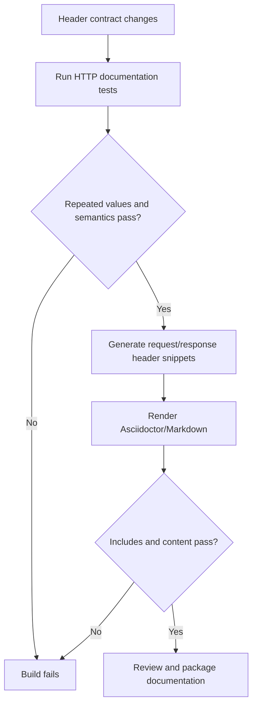

# Repeated or Multi-Valued Headers

## Learning Objectives

After this lesson, you will be able to:

- Distinguish between a header appearing on multiple lines and a header containing a comma-separated list of values.
- Understand how Spring REST Docs documents a header name using `requestHeaders(...)` and `responseHeaders(...)`, even when an HTTP exchange contains multiple values.
- Write MockMvc tests for requests/responses with multi-valued headers and assert what clients actually observe.
- Recognize list-valued headers such as `Accept`, `Accept-Language`, `Cache-Control`, and `Vary`.
- Handle `Set-Cookie` as a special case whose cookie values must not be joined with commas.
- Document rules for repetition, ordering, limits, and value interpretation according to the API contract.

## 1. Why Can a Header Have Multiple Values?

An HTTP header is not always a simple single name/value pair. Some fields allow carrying a list of values. Some fields can be sent across multiple lines with the same name. Therefore, when inspecting a request or response, you may encounter forms such as:

**A single line containing a list:**

```http
Accept: application/json, application/xml
```

**Multiple lines with the same name:**

```http
X-Feature: preview
X-Feature: audit
```

**Multiple cookie lines in a response:**

```http
Set-Cookie: session=abc123; Path=/; HttpOnly; Secure
Set-Cookie: preference=compact; Path=/; SameSite=Lax
```

The examples above do not share the same semantics:

- `Accept` is a field with media range list syntax; values are typically represented with commas on the same field line.
- `X-Feature` is a custom header in this example; the application's contract must define whether multiple lines are supported and what they mean.
- `Set-Cookie` often appears multiple times, each line representing a separate cookie. Do not combine them into a comma-separated list.

**What matters when writing documentation:** describe how clients are allowed to send and must interpret the header, rather than merely copying the header string seen in a single test.

## 2. Distinguishing Repeated Field Lines from Comma-Separated Values

The following two forms may look similar, but they must not be treated as equivalent in every case.

| Form | Example | Meaning |
| --- | --- | --- |
| Multiple field lines | `X-Tag: priority` and `X-Tag: fragile` | The same header name appears multiple times |
| Single field line with list | `X-Tag: priority, fragile` | One field value containing a list separated according to the header's syntax |
| Multiple cookies | Multiple `Set-Cookie` lines | Separate cookies; do not combine arbitrarily |

HTTP allows combining multiple field lines with the same name into a comma-separated field value if that field's definition permits it. However, not every field has list syntax or can be combined safely. `Set-Cookie` is an important case that must remain on separate lines.

Do not assume a custom header `X-Tag` can be repeated simply because it starts with `X-`. Documentation and implementation must clearly define:

- Should clients send multiple field lines or one comma-separated line?
- Does the server treat them as a list, independent values, or reject the request?
- Is there a priority order?
- Is there a limit on item count or total length?
- If both forms are sent, how does the server handle them?

## 3. Value Lists in Common Headers

Several standard headers have syntax allowing multiple components:

| Header | Example | Key Semantics to Note |
| --- | --- | --- |
| `Accept` | `application/json, application/problem+json` | Media ranges accepted by the client; may include `q` parameters indicating preference weights |
| `Accept-Language` | `vi-VN, en-US;q=0.8` | List of languages and preference weights |
| `Cache-Control` | `no-cache, no-store` | May include multiple directives, each with its own semantics |
| `Vary` | `Accept-Encoding, Accept-Language` | Lists request headers affecting the cached representation |
| `Allow` | `GET, HEAD, OPTIONS` | Methods supported for the resource in the corresponding response |
| `Set-Cookie` | Multiple separate lines | Distinct cookies; do not treat commas as delimiters to merge multiple cookies |

A value list is not necessarily an unordered set. For example, `Accept` and `Accept-Language` can use `q` parameters to express preference. Do not omit ordering or weights from documentation if they affect representation selection.

### 3.1. Commas Are Not Universal Delimiters for Every Header

Do not write a naive parser like `value.split(",")` for every header. Some syntaxes include quoted strings or parameters where commas can appear inside data components. Parsing must follow each field's definition.

For instance, `Set-Cookie` can contain an `Expires` attribute with a date that contains a comma:

```http
Set-Cookie: session=abc123; Expires=Wed, 21 Oct 2026 07:28:00 GMT; Path=/
```

If two `Set-Cookie` values were joined with a comma and split again, the client might misparse cookie boundaries and the `Expires` attribute. Therefore, each cookie must be kept as a separate field line.

## 4. How Does Spring REST Docs Document Multi-Valued Headers?

Spring REST Docs uses one descriptor per header name rather than creating separate descriptors for each value of the same header:

```java
requestHeaders(
    headerWithName("X-Feature")
        .description("Feature flags requested by the client; the API allows sending multiple values")
)
```

Or for a response:

```java
responseHeaders(
    headerWithName("Vary")
        .description("Request headers affecting representation selection")
)
```

Descriptors generate header tables and verify that documented headers match the HTTP exchange. They do not define the header parser, automatically convert multiple lines into a list per application semantics, or prove whether ordering or priority rules are correct.

**The explanation must clearly state the format.** For example: "Send one `X-Feature` line per feature; the server merges the values into the requested feature set." Only write this if the implementation actually behaves that way.

## 5. Practice with MockMvc: Requests with Multiple Lines of the Same Name

Suppose a report endpoint accepts multiple `X-Feature` values. In a MockMvc test, `header(name, values...)` can set multiple values for the same request header:

```java
@Test
void acceptsRepeatedFeatureHeaders() throws Exception {
    mockMvc.perform(get("/api/report")
                    .header("X-Feature", "preview", "audit")
                    .accept(MediaType.APPLICATION_JSON))
            .andExpect(status().isOk())
            .andExpect(jsonPath("$.features[0]").value("preview"))
            .andExpect(jsonPath("$.features[1]").value("audit"))
            .andDo(document("report-repeated-features",
                    requestHeaders(
                            headerWithName("X-Feature")
                                    .description("Requested features; multiple values may be sent")
                    )
            ));
}
```

This is a hypothetical example of a custom API. The controller must bind and process the header according to how the application is designed; assertions on order are only appropriate if order is part of the contract. If the API treats features as an unordered set, assert membership or business outcome instead of relying on indices.

When reviewing the `http-request` snippet, check how values are displayed. Some HTTP/test layers may represent multiple values in combined form, so the snippet might not preserve how the client originally wrote individual field lines. If this distinction matters, add prose explanation and test at the appropriate layer.

### 5.1. Documenting a List-Valued Header

With `Accept-Language`, a single field line containing a list and weights is typically sent:

```java
mockMvc.perform(get("/api/catalog")
        .header("Accept-Language", "vi-VN, en-US;q=0.8")
        .accept(MediaType.APPLICATION_JSON))
    .andExpect(status().isOk())
    .andDo(document("catalog-language",
        requestHeaders(
            headerWithName("Accept-Language")
                .description("List of preferred languages; q is the preference weight from 0 to 1")
        )
    ));
```

Do not create two `Accept-Language` descriptors just because the header contains two language tags. The descriptor represents the field; the description explains list syntax and weights.

## 6. Multi-Valued Response Headers

Servers can also return repeated headers. For example, a response with two cookies:

```java
@Test
void returnsSeparateCookies() throws Exception {
    mockMvc.perform(get("/api/session"))
            .andExpect(status().isOk())
            .andExpect(header().exists("Set-Cookie"))
            .andDo(document("session-response",
                    responseHeaders(
                            headerWithName("Set-Cookie")
                                    .description("Cookies issued by the server; each cookie is returned on a separate field line")
                    )
            ));
}
```

The test above only checks that the header is present and generates the descriptor. If the contract requires two specific cookies, check them in a way that preserves each individual value:

```java
MvcResult result = mockMvc.perform(get("/api/session"))
        .andExpect(status().isOk())
        .andReturn();

List<String> cookies = result.getResponse().getHeaders("Set-Cookie");

assertThat(cookies).hasSize(2);
assertThat(cookies).anyMatch(value -> value.startsWith("session="));
assertThat(cookies).anyMatch(value -> value.startsWith("preference="));
```

This check uses AssertJ; the appropriate dependency/assertion library is required. Do not join `Set-Cookie` values with a comma to assert a single string. With REST Docs, one `headerWithName("Set-Cookie")` descriptor documents the field; inspect the output snippet to make sure values are presented clearly and do not reveal real cookies.

## 7. Ordering of Multiple Values

Not every API needs to preserve order:

| Header Type | Might Order Matter? | Appropriate Verification |
| --- | --- | --- |
| `Accept` | Can affect priority, especially with `q` | Verify the representation selected by order/weights |
| `Accept-Language` | Can affect selected language | Assert locale/representation per negotiation rules |
| Custom `X-Feature` | Depends on contract; many APIs treat as a set | Assert order if committed, otherwise verify value set |
| `Vary` | Usually describes dimensions affecting cache; do not rely on string order unless contracted | Check required tokens and cache semantics |
| `Set-Cookie` | Each cookie is independent; clients should not depend on order unless specified | Verify each field value/cookie separately |

If order matters to clients, state it explicitly in the description and write tests demonstrating it. If not, avoid brittle assertions tied to ordering, as they can break when frameworks change how values are represented.

## 8. Checking Duplicate Headers and Preventing Ambiguity

An API needs to decide how to handle cases such as:

- The same header appearing multiple times with different values.
- The same header appearing multiple times with duplicate values.
- The same header name appearing in both multi-line and single comma-separated forms.
- A header with an empty value.
- An invalid value appearing among valid values.
- Count or total length exceeding limits.

For example, if `X-Feature` only accepts `preview` and `audit`, the API must define how to handle `X-Feature: preview` together with `X-Feature: unknown`: reject the whole request, ignore the unknown value, or handle it under another policy. Never let behavior depend accidentally on header reading order.

A test can illustrate:

```java
@Test
void rejectsUnknownFeatureValue() throws Exception {
    mockMvc.perform(get("/api/report")
                    .header("X-Feature", "preview", "unknown"))
            .andExpect(status().isBadRequest());
}
```

Status 400 here is only an example contract. For a real application, assert the agreed status and error body. If the error needs to be documented, create a separate snippet for that scenario.

## 9. Using REST Docs Descriptors and Snippets Properly

Example of a more complete `document` block:

```java
document("report-repeated-features",
    preprocessRequest(removeHeaders("Authorization")),
    requestHeaders(
        headerWithName("X-Feature")
            .description("One or more features; each value is one occurrence of the header")
    ),
    responseHeaders(
        headerWithName("Vary")
            .description("Request headers affecting the representation")
    )
)
```

The snippet above only illustrates organizing descriptors and preprocessors; only put `Authorization` in the removal list if the request actually contains it. Do not use preprocessors to hide an unclear contract. If a snippet combines values, the description still needs to state clearly whether clients should send repeated lines or a comma-separated list.

Do not:

- Declare the same header name across multiple descriptors just to document each list element.
- List one sample value as the only accepted value if the API supports a list.
- Use `optional()` to imply that a header accepts an arbitrary number of values.
- Rely on a single snippet to deduce ordering and combination rules.
- Merge `Set-Cookie` into a single comma-separated string.

Do:

- Document syntax, examples, and valid counts of values.
- Write tests with multiple values and boundary tests.
- Assert observable semantics, not just header presence.
- Keep each `Set-Cookie` separate in tests and documentation.
- Inspect generated snippets and explain any differences caused by HTTP layer representation.

## 10. Compiling Snippets into Asciidoctor Documentation

After tests generate snippets, you can include request/response header tables:

```asciidoc
== Filter report by feature

Clients can request multiple features by sending the X-Feature header
multiple times. Each value must belong to the set of features supported by the API.

=== Request headers
include::{snippets}/report-repeated-features/request-headers.adoc[]

=== HTTP request
include::{snippets}/report-repeated-features/http-request.adoc[]

=== Response headers
include::{snippets}/report-repeated-features/response-headers.adoc[]
```

The `{snippets}` attribute must point to the right output directory. Prose explaining repeated field lines, list syntax, ordering, and limits is written by the author; cross-check it with the implementation and tests.

For Markdown, compatible snippet templates and renderers supporting embedding/includes are required. The `include::{snippets}/...[]` syntax in the example belongs to Asciidoctor, not standard Markdown.

## 11. Build and CI

Verification workflow:



With Gradle, tests must generate snippets before Asciidoctor reads them:

```groovy
def snippetsDir = file("$buildDir/generated-snippets")

tasks.named('test') {
    outputs.dir snippetsDir
}

tasks.named('asciidoctor') {
    inputs.dir snippetsDir
    dependsOn tasks.named('test')
}
```

This illustrates the task dependency; the project still needs the corresponding plugins, REST Docs dependencies, and snippets attribute configuration. Use clean outputs when publishing to eliminate stale snippets and ensure missing includes fail CI if the page requires completeness.

## 12. Common Errors

| Symptom | Possible Cause | Resolution |
| --- | --- | --- |
| Table shows only one value when client sent multiple | Test layer or snippet displays combined values | Inspect HTTP exchange, clearly document list/repeated semantics, and test at the right layer |
| Docs describe a list header as multiple distinct headers | Confused list elements with field names | Use one descriptor for the header name and explain multi-value syntax |
| Test depends on order when API does not commit to order | Overly strict assertion | Assert the value set or actually committed behavior |
| `Set-Cookie` parsed incorrectly | Merged multiple cookies with commas | Keep separate field values and verify each cookie |
| API accepts unknown values | Missing list/limit validation | Add policy and tests per contract |
| Empty header value treated as absent | Application fails to distinguish the two cases | Define behavior and add absent/empty tests |
| Snippet contains internal headers or sensitive cookies | Test data not sanitized or preprocessor missing | Use dummy values, mask data, and review artifacts |

## 13. Multi-Valued Header Documentation Checklist

- [ ] Determine whether the header uses list syntax, repeated field lines, or a single value.
- [ ] Check the header definition; do not blindly apply comma-separation rules to every field.
- [ ] Explicitly state whether clients must send repeated lines or a single line containing a list.
- [ ] Describe ordering, weights, maximum counts, and allowlists when part of the contract.
- [ ] Include tests for single values, multiple values, and invalid values.
- [ ] Use a single descriptor per header name in `requestHeaders`/`responseHeaders`.
- [ ] Keep multiple `Set-Cookie` headers separate and verify each cookie.
- [ ] Inspect snippets after generation to confirm the representation is clear.
- [ ] Do not publish sensitive cookies, tokens, or internal headers.

## 14. Practice Exercise

The `GET /api/search` endpoint supports:

- `Accept-Language` as a weighted language list.
- `X-Category` sent multiple times to filter by multiple categories.
- A response with `Vary: Accept-Language, X-Category`.
- A separate login endpoint returning two cookies: `session` and `preference`.

Perform the following:

1. Write `requestHeaders(...)` documenting `Accept-Language` and `X-Category`.
2. Write a test sending `X-Category` twice with two valid values, and assert the filtering result.
3. Write a test for an invalid category and verify the status/error body per contract.
4. Test content negotiation when changing `q` weights in `Accept-Language`.
5. Use `responseHeaders(...)` to document `Vary` and assert the required tokens.
6. For the login response, assert that `Set-Cookie` has two separate field values; do not join them into a single comma-separated string.
7. Generate snippets, review output, and include the header tables in Asciidoctor.

**Self-check question:** If a snippet displays `X-Category: book, office`, does that prove clients must send a single line? No. You must inspect the request builder, HTTP exchange, and API contract to know whether the server accepts a single-line list or multiple field lines. Documentation must state the supported sending form clearly.

## Conclusion

Repeated and multi-valued headers must be understood according to each field's syntax. Some headers use comma-separated lists; some can appear on multiple field lines; `Set-Cookie` must keep each cookie separate. Spring REST Docs documents each header name with one descriptor, while semantics around sending format, ordering, limits, and validation must be explained and verified with HTTP tests. By testing multiple values, asserting actual behavior, inspecting generated snippets, and combining them with Asciidoctor/Markdown, documentation helps clients send and interpret headers accurately.
