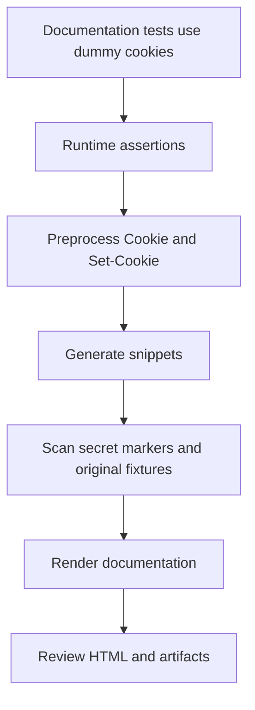

# Masking session or token values in snippets

## Learning Objectives

After this lesson, you will be able to distinguish request `Cookie` headers from response `Set-Cookie` headers, identify session/token values that must be masked, apply Spring REST Docs preprocessors to the right side, preserve cookie names and meaningful attributes, handle multi-cookie responses, and inspect artifacts before publishing.

## 1. Why do cookies need masking?

Cookies often carry session state, login identifiers, or tokens that the server uses to identify clients. If real values appear in snippets, documentation readers or anyone accessing build artifacts could copy and reuse them while the cookie remains valid.

Example request:

```http
GET /api/profile HTTP/1.1
Accept: application/json
Cookie: SESSION=8f7c9d0e-prod-session; theme=dark
```

Example response:

```http
HTTP/1.1 200 OK
Content-Type: application/json
Set-Cookie: SESSION=ab12cd34-session-secret; Path=/; HttpOnly; Secure; SameSite=Lax
Set-Cookie: refresh_token=eyJhbGciOi...; Path=/auth; HttpOnly; Secure; SameSite=Strict
```

`SESSION` and `refresh_token` in the example represent sensitive data. Integrators typically need to know cookie names, purpose, scope, lifetime, and security attributes; they do not need real authentication values.

Snippets can retain contract information while replacing values with placeholders:

```http
Cookie: SESSION=<REDACTED>; theme=dark
```

```http
Set-Cookie: SESSION=<REDACTED>; Path=/; HttpOnly; Secure; SameSite=Lax
```

Preprocessing is one layer of defense in the documentation pipeline. It does not replace dummy fixtures, secret management, artifact reviews, and access controls on documentation.

## 2. Distinguishing Cookie and Set-Cookie

The two headers travel in opposite directions:

| Header | Direction | Content | Purpose |
| --- | --- | --- | --- |
| Cookie | Request | Cookie name/value pairs sent back by the client | Sends cookie data issued by the server or managed by the client |
| Set-Cookie | Response | A cookie along with control attributes | Instructs the client to store, update, or delete a cookie |

Example sent by client:

```http
Cookie: SESSION=session-value; preference=compact
```

Returned by server:

```http
Set-Cookie: SESSION=new-session-value; Path=/; HttpOnly; Secure
```

In a request, `Cookie` typically holds `name=value` pairs. Attributes such as `HttpOnly`, `Secure`, and `SameSite` are set by the server in `Set-Cookie` on the response.

Do not apply the exact same processing to both without inspecting their structure:

- For `Cookie`, the goal is typically replacing values of one or more cookies while keeping cookie names that need illustration.
- For `Set-Cookie`, preserve each cookie and its security-relevant attributes while masking the cookie value separately.

## 3. Which values to mask and which details to keep?

| Component | Example | Usually appropriate handling |
| --- | --- | --- |
| Session identifier | `SESSION=...` | Replace with placeholder; do not publish real values |
| Access/refresh token | `access_token=...` | Mask value; consider removing if header is outside the guide's scope |
| CSRF token | `XSRF-TOKEN=...` | Mask value while preserving how clients read/send the token if part of the contract |
| Non-sensitive preference | `theme=dark` | Can be kept if helpful and free of personal data |
| Cookie attributes | `Path`, `HttpOnly`, `Secure`, `SameSite`, `Max-Age`, `Expires` | Keep if part of the API behavior being documented |

Cookie names and attributes tell integrators how cookies behave. Session/token values should be replaced with placeholders that cannot be used to hijack or continue a login session.

## 4. Preprocessing cookies in Spring REST Docs

Spring REST Docs lets you attach operation preprocessors to requests or responses via `preprocessRequest(...)` and `preprocessResponse(...)`. You can:

- Replace header values with placeholders.
- Remove headers outside the scope of documentation.
- Keep headers that need documentation while sanitizing sensitive contents.

Common operations include `modifyHeaders(...)` to edit headers, `removeHeaders(...)` to strip specific headers, and `removeMatchingHeaders(...)` to strip by pattern. Check the exact API for your project's Spring REST Docs version.

### 4.1. Replacing the request Cookie with a sample value

If a request only needs to illustrate a session cookie, you can replace the header in a preprocessor:

```java
import static org.springframework.restdocs.operation.preprocess.Preprocessors.modifyHeaders;
import static org.springframework.restdocs.operation.preprocess.Preprocessors.preprocessRequest;

mockMvc.perform(get("/api/profile")
        .cookie(new Cookie("SESSION", "documentation-session-secret"))
        .accept(MediaType.APPLICATION_JSON))
    .andExpect(status().isOk())
    .andDo(document("profile-get",
        preprocessRequest(
            modifyHeaders(headers ->
                headers.set("Cookie", "SESSION=<REDACTED>")
            )
        ),
        requestHeaders(
            headerWithName("Cookie")
                .description("Server-issued session cookie; client sends it back when accessing authenticated resources")
        )
    ));
```

This example demonstrates keeping the header name while replacing the recorded content in the snippet. The test still sends the dummy cookie so the application authenticates; the preprocessor only affects the recorded exchange. Verify the `modifyHeaders` API and `Headers` type in your REST Docs version to ensure proper header modification.

If a request has multiple cookies and you want to preserve some non-sensitive ones, replace each sensitive value by cookie name while keeping the semicolon delimiter of the `Cookie` request header. Never overwrite the entire header with a single sample value if that drops other cookies required by the contract.

### 4.2. Removing the request Cookie when documentation is unnecessary

If an example endpoint is not meant to demonstrate cookies and authentication has already been explained elsewhere, you can strip the header:

```java
import static org.springframework.restdocs.operation.preprocess.Preprocessors.removeHeaders;
import static org.springframework.restdocs.operation.preprocess.Preprocessors.preprocessRequest;

document("public-catalog",
    preprocessRequest(removeHeaders("Cookie"))
)
```

When removing a header, do not simultaneously declare `headerWithName("Cookie")` in `requestHeaders(...)` for the same snippet, as the header no longer exists in the exchange observed by REST Docs. If the cookie is part of the contract clients must send, mask the value instead of removing it.

## 5. Masking response Set-Cookie

Response `Set-Cookie` headers are often crucial for login, session-renewal, or logout documentation because they show clients how the server issues and configures cookies.

Snippet before masking:

```http
Set-Cookie: SESSION=abc123-secret; Path=/; HttpOnly; Secure; SameSite=Lax
```

Masked snippet:

```http
Set-Cookie: SESSION=<REDACTED>; Path=/; HttpOnly; Secure; SameSite=Lax
```

### 5.1. Replacing the value while keeping attributes

For a cookie with a known structure, you can replace the header value with a representative string:

```java
import static org.springframework.restdocs.operation.preprocess.Preprocessors.modifyHeaders;
import static org.springframework.restdocs.operation.preprocess.Preprocessors.preprocessResponse;

document("login",
    preprocessResponse(
        modifyHeaders(headers ->
            headers.set(
                "Set-Cookie",
                "SESSION=<REDACTED>; Path=/; HttpOnly; Secure; SameSite=Lax"
            )
        )
    ),
    responseHeaders(
        headerWithName("Set-Cookie")
            .description("Session cookie; HttpOnly and Secure enabled, SameSite is Lax")
    )
)
```

This approach fits examples where only a single `Set-Cookie` is documented. Attribute values must come from the real contract/response; do not copy `SameSite=Lax` or `Path=/` if the server actually returns a different configuration.

### 5.2. Responses with multiple Set-Cookie headers

A response can issue multiple cookies:

```http
Set-Cookie: SESSION=session-secret; Path=/; HttpOnly; Secure
Set-Cookie: refresh_token=refresh-secret; Path=/auth; HttpOnly; Secure; SameSite=Strict
```

A safe snippet must keep both field values separate:

```http
Set-Cookie: SESSION=<REDACTED>; Path=/; HttpOnly; Secure
Set-Cookie: refresh_token=<REDACTED>; Path=/auth; HttpOnly; Secure; SameSite=Strict
```

Do not replace the entire header with a single line if doing so accidentally drops the second cookie. Your preprocessor logic should read all `Set-Cookie` values, replace the value after the equals sign for each cookie by name or known rule, and write back the list of distinct values. Specific header-editing APIs vary by abstraction/version; never join the list with commas.

If you cannot reliably preserve each field value with your current preprocessor, the safe fallback is `removeHeaders("Set-Cookie")` and documenting cookie attributes in prose or a separately crafted sanitized example. Never publish raw session/token values just to keep a snippet intact.

### 5.3. Why must Set-Cookie headers never be joined with commas?

`Set-Cookie` is a special case: multiple cookies are returned on separate field lines. Moreover, the `Expires` attribute can contain a comma inside the date string:

```http
Set-Cookie: SESSION=abc; Expires=Wed, 21 Oct 2026 07:28:00 GMT; Path=/
Set-Cookie: preference=compact; Path=/
```

If lines are joined and later split on commas, a parser can mistake the comma inside `Expires` for a cookie boundary. Always keep each cookie as a separate `Set-Cookie` value from test execution through snippet writing.

## 6. Testing cookies with MockMvc

### 6.1. Testing a request that sends a session cookie

MockMvc can attach cookies to requests:

```java
@Test
void readsProfileWithSessionCookie() throws Exception {
    mockMvc.perform(get("/api/profile")
                    .cookie(new Cookie("SESSION", "documentation-session-secret"))
                    .accept(MediaType.APPLICATION_JSON))
            .andExpect(status().isOk())
            .andExpect(jsonPath("$.id").value("user-42"))
            .andDo(document("profile-get",
                    preprocessRequest(
                            modifyHeaders(headers ->
                                    headers.set("Cookie", "SESSION=<REDACTED>"))
                    ),
                    requestHeaders(
                            headerWithName("Cookie")
                                    .description("Server-issued session cookie")
                    ),
                    responseFields(
                            fieldWithPath("id").description("User ID")
                    )
            ));
}
```

Assertions run against the application's response; the preprocessor only sanitizes the request recorded in snippets. Use dummy sessions dedicated to tests or an appropriate security testing mechanism. Never use cookies captured from a real browser.

### 6.2. Testing a response that issues a cookie

You can inspect response headers before documenting:

```java
@Test
void loginSetsSecureSessionCookie() throws Exception {
    MvcResult result = mockMvc.perform(post("/api/login")
                    .contentType(MediaType.APPLICATION_JSON)
                    .content("""
                        {"username":"demo","password":"test-only-password"}
                        """))
            .andExpect(status().isOk())
            .andReturn();

    List<String> setCookies = result.getResponse().getHeaders("Set-Cookie");

    assertThat(setCookies)
            .anyMatch(value -> value.startsWith("SESSION=")
                    && value.contains("HttpOnly")
                    && value.contains("Secure"));
}
```

This example uses AssertJ. In a complete test, chain the call with `document(...)` and `preprocessResponse(...)` so snippets contain only masked values. Assertions should verify attributes committed to by the contract; do not assert an attribute merely because it appeared in one environment-specific example.

### 6.3. Testing logout or cookie deletion

A server can instruct clients to delete a cookie by returning `Set-Cookie` with an empty value and an expired timestamp or `Max-Age=0`, depending on implementation:

```http
Set-Cookie: SESSION=; Path=/; Max-Age=0; HttpOnly; Secure
```

This is not a new session cookie. It is a cookie-update directive telling the client to discard the matching cookie. Documentation should explain this clearly when a logout endpoint returns this header. Tests should verify the cookie name, matching path/domain, and expiration directive actually used by the application.

## 7. Session cookies, access tokens, and refresh tokens

A cookie's name does not guarantee its sensitivity level. Classify by function:

| Data type | Role | What to do in snippets |
| --- | --- | --- |
| Session ID | Server-side session reference | Mask value; keep name/attributes if required by contract |
| Access token | Carries short-lived access rights | Mask entire token; never record real tokens |
| Refresh token | Used to obtain new access tokens | Mask completely; consider omitting from examples if unnecessary |
| CSRF token cookie | Participates in request-forgery protection | Mask value while showing how clients read/send the token if part of the contract |
| Preference cookie | Stores non-sensitive UI choices | May keep dummy values without personal data |

If clients must read a CSRF cookie and send the token in a separate header, documentation needs to explain the relationship between both steps. Masking values while deleting the CSRF cookie name or header altogether can leave examples missing critical integration details.

## 8. Snippet preprocessing does not alter runtime cookies

Spring REST Docs preprocessors only modify the exchange written into snippets. They do not change:

- Cookies the server actually sends to clients at runtime.
- Cookie lifetime or scope.
- `HttpOnly`, `Secure`, or `SameSite` flags.
- Authentication and session management rules.
- Browser cookie jars or cookie sending behavior on subsequent requests.

For example, changing `Set-Cookie: SESSION=secret` to `Set-Cookie: SESSION=<REDACTED>` in a snippet does not mean the server altered the actual cookie. Assertions in tests can still check the real cookie in the test response; only documentation artifacts receive the masked value.

This is an important debugging boundary: if a browser fails to store a cookie, inspect the runtime response and cookie attributes; do not tweak a preprocessor to fix a runtime bug.

## 9. Choosing between masking values and removing cookie headers

| Page purpose | Appropriate handling |
| --- | --- |
| Guiding clients on sending a session cookie | Keep `Cookie`, replace session value with a placeholder |
| Documenting login and server-issued cookie attributes | Keep `Set-Cookie`, mask value, preserve attributes |
| Public endpoint unrelated to cookies | Can remove `Cookie`/`Set-Cookie` if outside the example |
| Multiple cookies with sensitive values | Mask each cookie individually; if unsafe/uncertain, remove header and document safely in prose |
| Header with non-sensitive preference cookie | May keep dummy value if it exposes no personal data |

Do not apply `removeHeaders("Cookie", "Set-Cookie")` as a global rule across all endpoints. That can strip essential details from login/session docs. Conversely, do not retain every cookie just for the sake of having complete snippets; choose based on each page's goal.

## 10. Including cookie snippets in Asciidoctor

Once documentation tests generate snippets, an AsciiDoc page can include them:

```asciidoc
== Login

The server issues a session cookie after successful authentication.
Cookie values in the examples are masked; clients must store and return
the cookie according to the API's security policy.

=== Response headers
include::{snippets}/login/response-headers.adoc[]

=== HTTP response
include::{snippets}/login/http-response.adoc[]
```

The `{snippets}` attribute must point to the actual snippets directory. Prose explaining the cookie lifecycle is written by the author; snippets show the tested and sanitized exchange.

Markdown can be used if snippet template configuration and your renderer support file inclusion. The `include::{snippets}/...[]` syntax is an Asciidoctor directive, not standard Markdown syntax.

## 11. Build and CI: verifying no cookie leaks

Suggested flow:



CI can:

1. Run documentation tests with dummy cookies/tokens.
2. Clean the old generated snippets directory before building.
3. Generate request/response snippets.
4. Search for known raw fixture values such as `documentation-session-secret` or `refresh-secret`.
5. Verify placeholders appear where expected and header/cookie names are preserved.
6. Check `HttpOnly`, `Secure`, `SameSite`, `Path`, `Max-Age`, or `Expires` if part of the contract.
7. Render Asciidoctor/Markdown and scan the entire artifact output directory prior to publishing.

Do not scan only `response-headers.adoc`: cookie values can appear in `http-response.adoc`, `curl-request.adoc`, test logs, or other debug files. Scan scope should cover all packaged outputs.

## 12. Common errors

| Symptom | Possible cause | Resolution |
| --- | --- | --- |
| Session ID appears in `http-request.adoc` | Request `Cookie` was not preprocessed | Replace cookie value or remove header if outside documentation |
| Refresh token remains in `http-response.adoc` | Only preprocessed request, missed response | Use `preprocessResponse(...)` for `Set-Cookie` |
| `Cookie` descriptor cannot find header | Header was removed before snippet creation | Replace value if documentation is still needed; if removing, drop the corresponding descriptor |
| Second cookie lost after masking | Preprocessor overwrote all `Set-Cookie` headers with one value | Process each field value individually |
| `Set-Cookie` split incorrectly | Cookies joined into one comma-separated string | Keep multiple field values separate; do not split by comma |
| `Secure`/`SameSite` attributes disappeared | Replaced entire line with too short a string | Preserve contract attributes inside the placeholder value |
| Logout cookie mistaken for new session | Did not explain `Max-Age=0` or past `Expires` | Document this as a cookie deletion/update directive |
| HTML lacks secrets yet raw snippets still have them | Only inspected rendered files | Scan all generated snippets and artifacts |

## 13. Checklist for masking sessions or tokens in cookies

- [ ] Distinguish request `Cookie` from response `Set-Cookie`.
- [ ] Identify which cookies hold session IDs, access tokens, refresh tokens, or CSRF tokens.
- [ ] Use dummy values in tests; never use cookies from browsers or production.
- [ ] Keep cookie names and published attributes; replace values with placeholders when appropriate.
- [ ] If removing a header, remove the corresponding descriptor and add necessary prose explanations.
- [ ] Process each `Set-Cookie` separately; never join with commas.
- [ ] Check `Path`, `Domain`, `Max-Age`, `Expires`, `HttpOnly`, `Secure`, and `SameSite` against the contract.
- [ ] Keep runtime assertions independent of preprocessed values.
- [ ] Scan raw snippets and final artifacts in CI.

## 14. Practice exercise

An application has three endpoints:

- `POST /api/login` issues a `SESSION` cookie and `refresh_token`.
- `GET /api/profile` requires the client to send back `SESSION`.
- `POST /api/logout` returns an expired cookie so the client clears the session.

Complete the following:

1. Write a login test verifying the response has two separate `Set-Cookie` headers.
2. Generate a response snippet masking both cookie values while preserving `Path`, `HttpOnly`, `Secure`, and `SameSite` from the real response.
3. Write a profile test sending `Cookie: SESSION=...`, verify the response, and replace the session value in the snippet.
4. Write a logout test confirming the cookie is cleared via `Max-Age=0` or the expiration rule used by the application.
5. Configure separate preprocessors for request and response; do not accidentally apply request rules to responses.
6. Scan all generated snippets to ensure no original session/token strings remain.
7. Include the sanitized snippets in Asciidoctor and review the rendered page.

**Self-check question:** Can two `Set-Cookie` lines be combined into one `Set-Cookie: SESSION=<REDACTED>, refresh_token=<REDACTED>` line to make the documentation more compact? No. The two cookies must remain two separate field values; commas can also appear inside `Expires` attributes. Mask each cookie without altering their boundaries or attributes.

## Conclusion

Masking session or token values in snippets requires distinguishing request `Cookie` headers from response `Set-Cookie` headers. Spring REST Docs can preprocess both sides independently: replacing values when cookie names and security attributes need to stay in documentation, or removing headers when they are outside consumer scope. With multiple cookies, process and preserve each `Set-Cookie` separately rather than joining with commas. Use dummy fixtures, keep contract details such as `Path`, `HttpOnly`, `Secure`, and `SameSite` where needed, inspect raw snippets and rendered artifacts, and run automated CI scans. That way, documentation accurately teaches the cookie lifecycle without exposing information that could be used to hijack sessions or access accounts.
