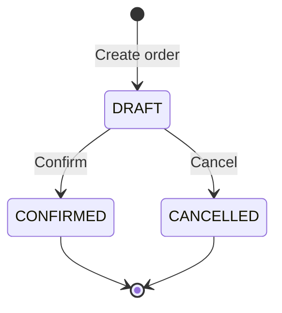

# Hand-Written Documentation Explaining the Business Meaning of Resources

An HTTP example generated from a test can show that the API received `GET /api/orders/42` and returned `200 OK` with JSON `{"status":"DRAFT","total":250000,"currency":"VND"}`. However, looking solely at that response, an integrator cannot yet tell **what DRAFT means**, whether `total` already includes tax, which orders a user is allowed to view, or what the next action is. This is the gap that **human-written documentation** needs to explain.

In **Spring REST Docs**, complete documentation combines two sources: **snippets generated from HTTP tests** and **business contract explanations owned by the documentation author**. Snippets keep request, response, payload, parameter, and header examples tied to an actual operation; hand-written prose supplies the purpose, rules, context, and business decisions that a single HTTP exchange cannot express on its own.

This lesson belongs to the **Documentation Model** chapter of the `SPRING_REST_DOCS` module, where we learn how to produce verifiable REST API documentation with **MockMvc**, **WebTestClient**, or **REST Assured**, compile Asciidoctor/Markdown, and integrate it into build and CI pipelines. The focus here is **writing business content clearly enough and pairing it accurately with verified snippets**.

## 1. Learning Objectives

After completing this lesson, you can:

1. Distinguish documentation **generated from tests** from parts that **must be explained in prose**.
2. Write resource descriptions covering specific purpose, identity, lifecycle, and usage rules.
3. Explain the business meaning of statuses, units, currencies, constraints, and HTTP errors.
4. Include Spring REST Docs snippets in an Asciidoctor documentation page using a clear structure.
5. Know what has been verified by tests and what remains a rule needing additional tests or review.
6. Establish a workflow for updating hand-written documentation when the API contract changes.

## 2. Why Is Hand-Written Documentation Needed When Snippets Exist?

Suppose a test generates the following response snippet:

```http
HTTP/1.1 200 OK
Content-Type: application/json

{
  "id": 42,
  "status": "DRAFT",
  "total": 250000,
  "currency": "VND"
}
```

And the `response-fields.adoc` table states:

| Field | Type | Basic technical description |
| --- | --- | --- |
| `id` | Number | Order identifier |
| `status` | String | Order status |
| `total` | Number | Total amount |
| `currency` | String | Currency code |

This table is helpful, yet insufficient for integration decisions. Readers may ask:

- **What is an order?** A cart draft, a purchase request, or a paid transaction?
- **What does DRAFT mean?** Has inventory been reserved yet, and has payment been charged?
- **What does 250000 VND cover?** Does the price already include tax and shipping fees?
- **Who is allowed to view order 42?** The owner, support staff, or any client with an API key?
- **When can the status change?** From `DRAFT`, can it be confirmed, canceled, or edited?
- **How are errors handled?** On not found, insufficient permissions, or state conflicts, what does the API return?

Do not expect snippets to answer those questions on their own. A sample request/response **only reflects what happened in the tested scenario**, not the entirety of business regulations, security policies, or data semantics.

### 2.1. Clear Division of Roles Across Three Documentation Layers

| Layer | Primary content | Source and responsibility |
| --- | --- | --- |
| **HTTP examples** | Method, path, headers, body, status, actual response | Generated from an operation in tests via Spring REST Docs |
| **Structure description tables** | Field names/paths, types, optionality, brief descriptions | Descriptors in tests such as `responseFields(...)` |
| **Business explanations** | Resource purpose, states, conditions, access rights, currency rules, next actions | Confirmed by the author with business contract owners and written in the documentation page |

These layers **complement one another** rather than replacing each other automatically. HTTP examples and descriptors can catch many technical changes; business prose still requires human updates and verification.

## 3. Business Content to Write for a Resource

A resource description section should answer at least the following groups of questions. Not every API needs all of them, but **every rule affecting how clients use the API needs a place to be explained**.

| Information group | What to clarify | Example with orders |
| --- | --- | --- |
| Identity and purpose | Which entity does the resource represent; why is it created and used? | An order represents a customer's purchase request |
| Access scope | Who can view or modify the resource? | The creator and staff with appropriate permissions |
| Lifecycle | Which states can exist and how do transitions work? | `DRAFT`, `CONFIRMED`, `CANCELLED` |
| Input constraints | Which fields are required; what are valid values and limits? | Negative quantities are not accepted |
| Calculation rules | How amounts, taxes, fees, rounding, and units are computed | `total` is the amount in `currency` |
| Time and consistency | Timestamps, timezones, and whether data updates immediately | `createdAt` in ISO 8601, UTC if specified by contract |
| Effects and repeatability | Does an action cause side effects? Is retrying safe? | Confirming an order may reserve inventory |
| Error conditions | When are `400`, `401`, `403`, `404`, `409` returned? | Cannot confirm a canceled order |
| Links to other APIs | After reading the resource, which operations should be used? | View line items, confirm, or cancel |

The list above is a **content checklist**. If an API has no statuses or no currency, do not add those rules just to fill out every row.

### 3.1. Identity Differs from URI and Representation

For instance, `/api/orders/42` is a URI used to access an order, while JSON is **one representation** of the order at a point in time. In the business domain, an order may also have access rules, pricing logic, and state transitions that JSON does not fully enumerate.

A good hand-written paragraph might read:

> An **Order** records a customer's request to purchase products. The `id` identifies the order for subsequent lookups. Allowed actions and visible details depend on the order's status and the caller's permissions.

This paragraph defines the **meaning** of the resource before guiding readers to HTTP details. When writing for a real system, replace unverified assumptions with content approved by business owners.

### 3.2. Explaining the Lifecycle, Not Just Listing Enums

A response field table can confirm that `status` is a string, yet clients need to know which business decisions each value governs.

In **the hypothetical contract of this learning example**, we agree on:

| Status | Meaning | Next allowed actions in the example |
| --- | --- | --- |
| `DRAFT` | Order has been created, but the customer has not confirmed the purchase request | Can be confirmed or canceled |
| `CONFIRMED` | The system has accepted the purchase request | Cannot revert back to `DRAFT` |
| `CANCELLED` | Order has been canceled; purchase flow does not continue | Cannot be confirmed again |

This can be illustrated with a diagram:



This is an **illustrative lifecycle**, not default rules from Spring REST Docs. If a real product allows canceling an order after confirmation or issuing refunds, the diagram and prose must accurately reflect those flows. A test that only reads `DRAFT` does not prove state transitions.

### 3.3. Explicitly State Units and Number Definitions

A response with `"total":250000` and `"currency":"VND"` can still cause misunderstandings. For clients to calculate accurately, the contract must specify:

- Whether `total` represents the amount before or after tax, and whether shipping fees are included.
- Whether the unit represents the main currency unit or the minor unit; rounding rules and decimal places.
- Which standard `currency` follows, and whether multiple currencies are supported.
- When prices are locked in and when they may be recalculated.

For example, **only once the business has finalized the rule**, the documentation may state:

> In this illustrative API, `total` is the sum of product prices after discounts, denominated in Vietnamese dong; shipping fees and taxes are calculated separately. The `currency` value is always `VND`.

The sentence above is **an assumed rule example**, not something inferred from JSON. If the product team decides `total` includes tax, the documentation, calculations, and related tests must all be updated.

### 3.4. Distinguishing Technical Errors and Business Conflicts

HTTP status codes indicate outcome categories; hand-written documentation must explain the **business conditions** that trigger them.

| Status | General HTTP meaning | Business info to write |
| --- | --- | --- |
| `400 Bad Request` | Request data is invalid for how the server processes it | Which fields are invalid, what limits apply, specific error codes |
| `401 Unauthorized` | Request lacks or has invalid authentication credentials | Authentication mechanism, how to obtain/refresh credentials |
| `403 Forbidden` | Identity is known, but not permitted to perform the action | Which permissions are needed, resource-level restrictions |
| `404 Not Found` | Server cannot find an appropriate representation for the URI | When the order does not exist or is hidden by policy |
| `409 Conflict` | Request conflicts with the current state of the resource | Which state transition was rejected; whether the client should re-fetch data |
| `422 Unprocessable Content` | Syntactically valid content that cannot be processed semantically (if used by API) | Which business rule was violated, which error code is returned |

Do not blindly map every validation error to `400` or every business conflict to `409` if the real contract uses other codes. When an API intentionally returns `404` instead of `403` to avoid leaking resource existence, that should also be explained without exposing sensitive security internals.

## 4. Example: Writing a Business Page for the Order Resource

Let us construct an **illustrative contract** for a sales API. The documentation has two parts: hand-written prose explaining resource semantics and test-generated snippets containing requests/responses.

Assumptions for the example:

1. `GET /api/orders/{orderId}` returns order details when the ID exists.
2. Sample order `42` is currently in `DRAFT` status.
3. The response contains `id`, `status`, `total`, and `currency`.
4. If the ID does not exist in fixtures, the controller returns `404 Not Found`.
5. The authorization, tax calculation, and state-transition rules above **are not yet implemented or proven by the simplified controller/test below**; they serve only as explanatory content to verify against the real business system before actual publication.

### 4.1. HTTP Example from a Successful Operation

```http
GET /api/orders/42 HTTP/1.1
Accept: application/json
```

```http
HTTP/1.1 200 OK
Content-Type: application/json

{
  "id": 42,
  "status": "DRAFT",
  "total": 250000,
  "currency": "VND"
}
```

From a request/response pair like the one above, Spring REST Docs can generate `http-request.adoc` and `http-response.adoc`, then add `path-parameters.adoc` and `response-fields.adoc` per the descriptors.

Still, the documentation page needs sentences such as:

> This query is intended for callers authorized to view the order. Status `DRAFT` means the customer has not yet confirmed the purchase request. Clients may use this status to decide whether to display a “Confirm” action when permissions and other conditions allow.

When authorization tests or contracts do not yet exist, a safer phrasing is to mark a section **access conditions to verify**, rather than claiming the endpoint already enforces that policy.

## 5. Generating Verified Snippets with MockMvc

To clearly see the boundary between hand-written content and auto-generated parts, below is a complete JUnit 5 test in Spring REST Docs 3.x style. The example uses Java 17+ and Jackson with `record` support, running MockMvc in `standaloneSetup` mode.

```java
import java.math.BigDecimal;

import org.junit.jupiter.api.BeforeEach;
import org.junit.jupiter.api.Test;
import org.junit.jupiter.api.extension.ExtendWith;
import org.springframework.http.MediaType;
import org.springframework.http.ResponseEntity;
import org.springframework.restdocs.RestDocumentationContextProvider;
import org.springframework.restdocs.RestDocumentationExtension;
import org.springframework.restdocs.payload.JsonFieldType;
import org.springframework.test.web.servlet.MockMvc;
import org.springframework.test.web.servlet.setup.MockMvcBuilders;
import org.springframework.web.bind.annotation.GetMapping;
import org.springframework.web.bind.annotation.PathVariable;
import org.springframework.web.bind.annotation.RestController;

import static org.springframework.restdocs.mockmvc.MockMvcRestDocumentation.document;
import static org.springframework.restdocs.mockmvc.MockMvcRestDocumentation.documentationConfiguration;
import static org.springframework.restdocs.mockmvc.RestDocumentationRequestBuilders.get;
import static org.springframework.restdocs.payload.PayloadDocumentation.fieldWithPath;
import static org.springframework.restdocs.payload.PayloadDocumentation.responseFields;
import static org.springframework.restdocs.request.RequestDocumentation.parameterWithName;
import static org.springframework.restdocs.request.RequestDocumentation.pathParameters;
import static org.springframework.test.web.servlet.result.MockMvcResultMatchers.jsonPath;
import static org.springframework.test.web.servlet.result.MockMvcResultMatchers.status;

@ExtendWith(RestDocumentationExtension.class)
class OrderDocumentationTest {

    private MockMvc mockMvc;

    @BeforeEach
    void setUp(RestDocumentationContextProvider provider) {
        mockMvc = MockMvcBuilders
            .standaloneSetup(new OrderController())
            .apply(documentationConfiguration(provider))
            .build();
    }

    @RestController
    static class OrderController {
        @GetMapping(
            value = "/api/orders/{orderId}",
            produces = MediaType.APPLICATION_JSON_VALUE
        )
        ResponseEntity<OrderView> getOrder(
                @PathVariable long orderId) {
            if (orderId != 42L) {
                return ResponseEntity.notFound().build();
            }

            return ResponseEntity.ok(
                new OrderView(
                    42L, "DRAFT",
                    new BigDecimal("250000"), "VND"
                )
            );
        }
    }

    record OrderView(
        long id, String status, BigDecimal total, String currency
    ) {}

    @Test
    void getOrder_success() throws Exception {
        mockMvc.perform(
                get("/api/orders/{orderId}", 42L)
                    .accept(MediaType.APPLICATION_JSON)
            )
            .andExpect(status().isOk())
            .andExpect(jsonPath("$.id").value(42))
            .andExpect(jsonPath("$.status").value("DRAFT"))
            .andExpect(jsonPath("$.currency").value("VND"))
            .andDo(document("orders-get-success",
                pathParameters(
                    parameterWithName("orderId")
                        .description("ID of the order to view")
                ),
                responseFields(
                    fieldWithPath("id")
                        .type(JsonFieldType.NUMBER)
                        .description("Order identifier"),
                    fieldWithPath("status")
                        .type(JsonFieldType.STRING)
                        .description("Current status of the order"),
                    fieldWithPath("total")
                        .type(JsonFieldType.NUMBER)
                        .description("Monetary value of the order"),
                    fieldWithPath("currency")
                        .type(JsonFieldType.STRING)
                        .description("Currency code of the total amount")
                )
            ));
    }

    @Test
    void getOrder_notFound() throws Exception {
        mockMvc.perform(
                get("/api/orders/{orderId}", 999L)
                    .accept(MediaType.APPLICATION_JSON)
            )
            .andExpect(status().isNotFound())
            .andDo(document("orders-get-not-found",
                pathParameters(
                    parameterWithName("orderId")
                        .description("ID of the order to view")
                )
            ));
    }
}
```

**How to read the example:**

- `RestDocumentationExtension` and `documentationConfiguration(...)` set up the documentation generation environment for the test.
- `RestDocumentationRequestBuilders.get(...)` preserves the URI template `{orderId}` so `pathParameters(...)` documents the variable accurately.
- `andExpect(...)` verifies HTTP behavior and several key business values.
- `document("orders-get-success", ...)` generates snippets from the successful operation; `orders-get-not-found` is a separate operation for `404`.
- `responseFields(...)` describes the observed JSON structure. In the commonly used strict documentation mode, tests fail if a field is undocumented or a required documented field does not appear.

This setup only constructs a sample controller, without a database or security filters. Therefore, the test results **do not yet prove** access control, tax rules, `total` values in other contexts, or any state transitions. That is precisely why hand-written documentation must stay synchronized with appropriate tests across other scopes.

### 5.1. Where Are Snippets Created?

With a standard build setup, output looks like:

```text
build/generated-snippets/
├── orders-get-success/
│   ├── http-request.adoc
│   ├── http-response.adoc
│   ├── path-parameters.adoc
│   └── response-fields.adoc
└── orders-get-not-found/
    ├── http-request.adoc
    ├── http-response.adoc
    └── path-parameters.adoc
```

The listed files are **the fragments relevant to this lesson**; Spring REST Docs can also create other default snippets such as `curl-request.adoc`, `httpie-request.adoc`, and body snippets depending on configuration. Maven typically outputs to `target/generated-snippets`, and Gradle to `build/generated-snippets`.

Do not assume a `response-fields.adoc` file is generated for the `404` operation when the test does not declare `responseFields(...)` and the response has no JSON body.

## 6. Combining Hand-Written Explanations and Snippets into an Asciidoctor Page

The example below is **source documentation written by an author**. Business prose is written directly; HTTP blocks and field tables are pulled via includes from test output.

```asciidoc
[[orders]]
== Orders

An order represents a customer's request to purchase products.
The id identifies the order in subsequent queries.

=== Order lifecycle

In the illustrative contract:

* DRAFT: The order has been created but not yet confirmed.
* CONFIRMED: The purchase request has been accepted.
* CANCELLED: The order has been canceled and cannot be reconfirmed.

These are status semantics and do not imply that payment has completed.

=== Look up an order

Call GET /api/orders/{orderId} to read the current representation
of an order. Clients must follow access permission rules
under the system contract.

==== Sample request

include::{snippets}/orders-get-success/http-request.adoc[]

==== Path parameter

include::{snippets}/orders-get-success/path-parameters.adoc[]

==== Successful response (200)

include::{snippets}/orders-get-success/http-response.adoc[]

==== Response fields

include::{snippets}/orders-get-success/response-fields.adoc[]

In official documentation, clearly state which charges total
includes, the currency unit, and rounding rules.

==== Not found (404)

include::{snippets}/orders-get-not-found/http-request.adoc[]

include::{snippets}/orders-get-not-found/http-response.adoc[]
```

A good documentation page is not merely a string of `include` directives. **Headings and explanatory paragraphs help readers understand which scenario each snippet illustrates, preconditions for calling it, and how to interpret the results.**

Here `{snippets}` is an attribute configured when compiling Asciidoctor. Directory names `orders-get-success`/`orders-get-not-found` must match the identifiers in `document(...)`. If a test renames its identifier without updating the page, rendering may fail on the include or keep using stale output if the old directory still exists.

### 6.1. When Outputting Markdown, Keep the Principle but Swap the Embedding Mechanism

The `include::{snippets}/...[]` syntax **belongs to Asciidoctor**, not standard Markdown syntax. For Markdown documentation, you can:

1. Compile AsciiDoc sources into a target format supported by your system.
2. Use a tool to inject/convert snippet contents into Markdown.
3. Configure snippet templates compatible with your Markdown pipeline, if your project has such a solution.

Whichever approach you choose, preserve three properties: **snippets sourced from test operations**, **business explanations curated by authors**, and **builds capable of regenerating the complete page from current sources**.

### 6.2. Avoid Duplicating Information Prone to Drift

If `response-fields.adoc` already lists the name and type of `total`, hand-written text should add **rules for calculating total** rather than duplicating an identical table. When two places hold required constraints, determine which one is the source of truth and how synchronization is checked.

An example to avoid:

> Snippet table: `total` is Number. Hand-written prose: `total` is String.

Such contradictions leave API consumers unsure which source to trust. Before publishing, fix the code/test/descriptor or incorrect prose so everything matches the contract.

## 7. Writing Actionable Explanations

A sentence like “The API efficiently supports order management” offers little help to integrators. Write explanations specific enough for them to know **when to call the endpoint, what to send, what to expect, and what to do next**.

Comparison:

| Generic description | Helpful description for integrators |
| --- | --- |
| “Order status indicates the condition.” | “`DRAFT` means the customer has not confirmed the purchase request; in the example contract, only `DRAFT` orders may invoke the confirm action.” |
| “Total amount of the order.” | “`total` is calculated according to the currency rules and fee/tax scope defined in the Pricing Rules section.” |
| “Returns an error if invalid.” | “When confirming a canceled order, the API returns a conflict status and contract business error code; the client should refresh the state before prompting the user to continue.” |
| “Only authorized users may view.” | “Explicitly list roles, ownership scope, resource-hiding behavior, and the HTTP code used for each access case.” |

Detailed descriptions in the right-hand column should **only be added to product documentation as commitments** after verifying against real design and behavior. That column illustrates the target quality of explanation, not proof that those rules are implemented in the sample controller.

### 7.1. Describing Preconditions, Consequences, and Exceptions

For an action that mutates resource state, documentation should generally cover three groups of information:

- **Preconditions:** who may call it, what state the resource must be in, and what conditions supplementary data must satisfy.
- **Consequences on success:** which state or data changes; whether there are side effects like reserving stock, sending notifications, or triggering payment.
- **Exceptions and handling:** which cases are rejected, which error/status codes are returned, and whether the client can retry or must adjust data.

For example, a “Confirm order” action might require `DRAFT` status and available inventory. Yet **never infer from the name `POST /confirm` that payment has definitely been settled**; clear contract documentation and corresponding tests are needed.

### 7.2. Clarifying Idempotency and Retry Impact

Clients may retry requests due to flaky networks. If an operation has business effects like creating an order or charging payment, documentation must specify the retry strategy:

- Is the method idempotent by contract/HTTP semantics?
- Is an `Idempotency-Key` or an equivalent request identifier mechanism used?
- If the first request succeeded without the client receiving the response, what does a retry return?
- If the same key is sent with different content, how does the API respond?

Never assume a `POST` operation is automatically idempotent. Spring REST Docs can record headers and responses from **a tested retry scenario**, yet **retry and transaction semantics** still require manual explanation and multi-call tests.

## 8. Cross-Checking Business Promises Against Test Depth

So documentation never promises more than the system guarantees, build a verification matrix. For the MockMvc controller in section 5:

| Claim | Confirmed by the sample test? | Action needed |
| --- | --- | --- |
| `GET /api/orders/42` returns `200` | Yes, in standalone MockMvc configuration | Keep status assertion |
| Sample response has `status = DRAFT` and `currency = VND` | Yes, with fixture `42` | Keep assertions for critical values |
| `GET /api/orders/999` returns `404` | Yes, with fixture `999` | Keep separate snippet and document error case |
| Every nonexistent order ID returns `404` | Not yet | Add meaningful cases or appropriate contract tests |
| Only the order owner can view the order | Not yet | Add security/ownership tests appropriate for the app |
| `total` includes tax/fees per rules stated in docs | Not yet | Verify calculation rules and write pricing tests |
| `DRAFT` can be confirmed, `CANCELLED` is rejected | Not yet | Write state-transition tests and explain errors |
| Client retries are safe when creating orders | Not yet | Finalize idempotency policy and test repeated calls |

**Hand-written documentation and tests describe the same contract while proving different aspects of it.** Prose should explain all agreed rules; the test suite must expand coverage for rules that carry risk or affect clients. Do not label something “verified” if no test actually checks it.

### 8.1. An Example of an API Change

Suppose a new version renames the `total` field to `grandTotal`.

- Tests using `jsonPath("$.total")` (if present) catch the value/path discrepancy.
- `responseFields(fieldWithPath("total"))` in strict mode fails because the documented field no longer appears or a new field exists.
- The `http-response.adoc` snippet, once tests are updated, reflects the new JSON.
- However, the hand-written sentence “`total` is the amount after tax” **does not rename itself or update its meaning automatically**.

Therefore, when changing schemas, update **code, tests, descriptors, related includes, and hand-written business content** to match the new contract. If the meaning of `total` changes while keeping the field name and Number type, structural tests may still pass; business tests and documentation reviews become even more vital.

## 9. Workflow for Maintaining Hand-Written Docs in Build and CI

A typical Spring REST Docs pipeline can be organized as follows:

```text
Design and align on business rules
                    │
                    ▼
      Code + HTTP tests + descriptors
                    │
                    ▼
           Run HTTP tests
             │           │
            FAIL         PASS
             │           │
          Stop CI   Generate snippets
                         │
                         ▼
             Compile Asciidoctor/Markdown
             + hand-written explanations
                         │
                         ▼
         Verify includes, links, and rendering
                         │
                         ▼
              Review business content
                         │
                         ▼
               Publish documentation
```

The build should make the documentation compilation task depend on the snippet-generating test task, declare the snippet directory path as an input, and regenerate clean outputs on CI. With Gradle, the output is typically `build/generated-snippets`; with Maven, `target/generated-snippets` under common example setups.

CI checks help catch failing tests, missing snippets, or broken includes. However, **CI cannot verify on its own that a tax, access control, or order lifecycle description is accurate merely because rendering succeeded**. A content review workflow aligned with business ownership is required.

### 9.1. A Concise Change-Control Checklist

When the API contract changes, authors can ask themselves:

1. **Did the request/response change?** Update assertions and descriptors.
2. **Did field semantics change?** Update explanations and usage examples.
3. **Did state transition rules change?** Update the lifecycle diagram and state-transition tests.
4. **Did access conditions change?** Review authorization descriptions alongside security tests.
5. **Did error codes or error conditions change?** Create or update error test operations and explanations.
6. **Does the documentation page still include the right snippets?** Check identifiers, includes, links, and output on a clean build.

For significant changes, have someone familiar with the domain verify the content before publishing. A test can pass while the prose is wrong, especially for rules not yet expressed as assertions.

## 10. Common Mistakes When Writing Business Content

| Symptom | Cause | How to fix |
| --- | --- | --- |
| Page only has request/response and field tables | Assumed snippets describe the whole resource by themselves | Add purpose, permissions, lifecycle, constraints, and error scenarios |
| Field `status` has three values with no guidance on when to use them | Only listed enum values without explaining transitions | Write a meaning table and an approved business flow diagram |
| `total` is interpreted differently by backend and frontend teams | Missing definitions for tax, fees, units, and rounding | Agree on one definition and state it explicitly in docs |
| Docs say everyone can view, yet security blocks access | Written by hand without checking auth/authz config | Verify contract and add authorization tests |
| Page describes `409` with no tested error example | Copied an unimplemented assumption | Add a `409` test operation or remove the inaccurate claim |
| Hand-written content contradicts snippet tables | Two descriptions were not updated together | Audit against contract changes; designate a source of truth for terms |
| JSON changed, yet snippets stay stale | Render step uses generated snippets from an earlier run | Force render to depend on tests and run a clean build |
| Markdown docs show literal `include::{snippets}` | Used Asciidoctor syntax in an unsupported pipeline | Use an embedding/conversion tool compatible with Markdown |
| Wrote “verified” for an untested policy | Confused HTTP examples with full-system proof | State test scope clearly and add needed tests |
| Docs expose real usernames or tokens | Test data fed straight into snippets | Use dummy fixtures, mask sensitive data, and inspect output before publishing |

## 11. Hands-On Exercise: Writing Explanations That Help Clients Use the API Correctly

Suppose you are documenting `GET /api/orders/{orderId}`. Tests already verify a `200` response for a `DRAFT` order and `404` for a nonexistent ID.

**Tasks:**

1. Write a 3–5 sentence introduction: what resource “Order” represents, who uses it, and under what circumstances.
2. Create a table explaining the meanings of `DRAFT`, `CONFIRMED`, and `CANCELLED` using **explicitly stated hypothetical rules**; list which actions are allowed or forbidden.
3. Identify open questions about `total`, `currency`, tax, fees, and rounding; flag items needing confirmation before publication.
4. Write an “Access and Errors” section distinguishing not found, unauthorized/forbidden, and state conflicts under the planned contract.
5. Use `orders-get-success/http-request.adoc`, `http-response.adoc`, and `response-fields.adoc` snippets in an AsciiDoc page; add the `404` snippets under the errors section.
6. Build a table separating **claims backed by tests** from **claims needing additional tests**, especially around authorization, pricing, and state transitions.
7. Suppose the product team changes the definition of `total` to “includes shipping fee”. Point out which hand-written prose, pricing code, assertions, descriptors, and examples must be reviewed.

**Completion criteria:** readers understand **the meaning of the resource and how to make decisions when using the API**, can trace snippets back to test operations, and know which rules are proven versus which need further confirmation.

## 12. Takeaways

- Spring REST Docs generates **HTTP snippets and description tables** from operations in tests; they reflect observed data and descriptions in tested scenarios.
- **Hand-written documentation explains business meaning**: what the resource is for, who can access it, what statuses mean, how amounts are calculated, when errors occur, and how clients should handle them.
- Combining **snippets + explanations + error scenarios** into an Asciidoctor or Markdown page gives documentation both verifiable examples and context for correct usage.
- **Passing tests do not automatically guarantee every business rule is verified**. Know your test scope, add appropriate tests, and review hand-written prose whenever the contract changes.
- Build and CI regenerate snippets and catch technical documentation errors; **business owners** must still confirm rules and semantics before publication.
