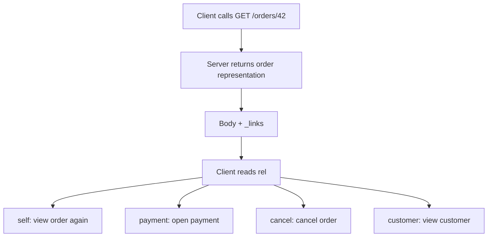

# Documenting HATEOAS Links in Responses

## 1. Why document hypermedia links?

A REST API that uses hypermedia provides links directly in the response so clients can discover related operations or resources. The client reads the link relation (abbreviated `rel`) and decides the next step, instead of having to construct every URL itself from path conventions.

**HATEOAS** (Hypermedia as the Engine of Application State) is an architectural constraint in which responses provide hypermedia controls that help clients navigate application state. For example, an order response might include `self`, `payment`, `cancel`, and `customer`. The relations indicate what type of resource or action the link points to; the `href` value indicates the current target.

Spring REST Docs supports documenting these links using `links(...)` and `linkWithRel(...)` in `HypermediaDocumentation`. The generated snippet has the default name `links.adoc`, presenting a table of link relations in the response. This complements the HTTP request/response snippets and the JSON fields description table.



Example HAL response:

```json
{
  "id": 42,
  "status": "PENDING",
  "total": 125000,
  "_links": {
    "self": { "href": "/api/orders/42" },
    "payment": { "href": "/api/orders/42/payment" },
    "cancel": { "href": "/api/orders/42/cancel" },
    "customer": { "href": "/api/customers/7" }
  }
}
```

`_links` is the HAL link container. The strings `self`, `payment`, `cancel`, and `customer` are relation names; `href` is the target URL. When documenting links, describe the relation and meaning of each link, without hardcoding environment-dependent URLs into the description.

## 2. Preparing dependencies and responses with HAL links

The examples use Spring Boot 3.x, Java 17+, JUnit 5, REST Assured, and Spring REST Docs. If the project already uses the Spring Boot BOM for version management, the Gradle dependencies can be declared as:

```groovy
dependencies {
    implementation 'org.springframework.boot:spring-boot-starter-web'
    implementation 'org.springframework.boot:spring-boot-starter-hateoas'

    testImplementation 'org.springframework.boot:spring-boot-starter-test'
    testImplementation 'io.rest-assured:rest-assured'
    testImplementation 'org.springframework.restdocs:spring-restdocs-restassured'
}

tasks.named('test') {
    useJUnitPlatform()
}
```

`spring-boot-starter-hateoas` provides Spring HATEOAS to build representations and links. `spring-restdocs-restassured` integrates HTTP tests with REST Docs; `rest-assured` sends HTTP requests and verifies responses. When using Maven, add the corresponding artifacts; test libraries use `<scope>test</scope>`. Let the appropriate BOM/parent manage the versions of Spring Boot and Spring REST Docs.

A simple Spring HATEOAS endpoint can return an `EntityModel`:

```java
@RestController
@RequestMapping("/api/orders")
class OrderController {

    @GetMapping(value = "/{id}", produces = "application/hal+json")
    EntityModel<Order> getOrder(@PathVariable long id) {
        Order order = new Order(id, "PENDING", 125000);

        return EntityModel.of(order,
                linkTo(methodOn(OrderController.class).getOrder(id)).withSelfRel(),
                linkTo(methodOn(PaymentController.class).getPayment(id)).withRel("payment"),
                linkTo(methodOn(OrderController.class).cancelOrder(id)).withRel("cancel"));
    }

    @PostMapping("/{id}/cancel")
    ResponseEntity<Void> cancelOrder(@PathVariable long id) {
        return ResponseEntity.noContent().build();
    }
}
```

In this example, `Order` is an illustrative domain model with `id`, `status`, and `total` properties; `PaymentController` is the controller corresponding to the payment link. In a real application, the controller usually calls a service/repository and only provides `cancel` when the order status allows it. Common Spring HATEOAS static imports include `linkTo` and `methodOn` from `WebMvcLinkBuilder`.

Spring HATEOAS automatically generates a HAL representation for `EntityModel` when the appropriate message converter is configured. You can verify that the response Content-Type is `application/hal+json` and the payload contains `_links` before writing documentation tests.

## 3. Documenting links with REST Assured

Spring REST Docs automatically detects the link format based on the response Content-Type. The two built-in formats are:

| Format | Link structure | Default detected Content-Type |
| --- | --- | --- |
| Atom | `links` array | Compatible with `application/json` |
| HAL | `_links` map | Compatible with `application/hal+json` |

If the API uses HAL but the response has a different Content-Type, pass the extractor explicitly via `halLinks()`. You do not need to write a custom parser for standard HAL.

Key static imports:

```java
import static org.springframework.restdocs.hypermedia.HypermediaDocumentation.halLinks;
import static org.springframework.restdocs.hypermedia.HypermediaDocumentation.linkWithRel;
import static org.springframework.restdocs.hypermedia.HypermediaDocumentation.links;
import static org.springframework.restdocs.restassured.RestAssuredRestDocumentation.document;
```

Illustrative REST Assured test:

```java
@SpringBootTest(webEnvironment = SpringBootTest.WebEnvironment.RANDOM_PORT)
@ExtendWith(RestDocumentationExtension.class)
class OrderHypermediaDocumentationTest {

    @LocalServerPort
    private int port;

    private RequestSpecification specification;

    @BeforeEach
    void setUp(RestDocumentationContextProvider restDocumentation) {
        this.specification = new RequestSpecBuilder()
                .setBaseUri("http://localhost")
                .setPort(this.port)
                .addFilter(documentationConfiguration(restDocumentation))
                .build();
    }

    @Test
    void documentOrderLinks() {
        given(this.specification)
                .accept("application/hal+json")
                .filter(document("orders-get",
                        links(
                                linkWithRel("self").description("This order itself"),
                                linkWithRel("payment").description("Payment details or action"),
                                linkWithRel("cancel").description("Cancel the order"))))
        .when()
                .get("/api/orders/{id}", 42)
        .then()
                .statusCode(200)
                .contentType("application/hal+json")
                .body("id", equalTo(42))
                .body("_links.self.href", notNullValue())
                .body("_links.payment.href", notNullValue());
    }
}
```

To make the test snippet complete, include the following static imports and types:

```java
import io.restassured.builder.RequestSpecBuilder;
import io.restassured.specification.RequestSpecification;
import org.junit.jupiter.api.BeforeEach;
import org.junit.jupiter.api.Test;
import org.junit.jupiter.api.extension.ExtendWith;
import org.springframework.boot.test.context.SpringBootTest;
import org.springframework.boot.test.web.server.LocalServerPort;
import org.springframework.restdocs.RestDocumentationContextProvider;
import org.springframework.restdocs.RestDocumentationExtension;

import static io.restassured.RestAssured.given;
import static org.hamcrest.Matchers.equalTo;
import static org.hamcrest.Matchers.notNullValue;
import static org.springframework.restdocs.restassured.RestAssuredRestDocumentation.documentationConfiguration;
```

In `.filter(document("orders-get", links(...)))`, the identifier `orders-get` is the snippet directory name. `links(...)` creates the `links.adoc` snippet; `linkWithRel("payment")` describes the link by the `payment` relation, independent of any specific `href`. The REST Assured assertions still verify the actual response. The test requires the fixture and controller to return the declared relations.

## 4. Meaning of `linkWithRel(...)` and descriptors

`linkWithRel(String rel)` creates a `LinkDescriptor` for a link relation. Each descriptor should express the meaning that the client can make use of:

```java
links(
    linkWithRel("self").description("Link to the current order"),
    linkWithRel("payment").description("Link to the payment flow"),
    linkWithRel("cancel").description("Link to cancel the order"),
    linkWithRel("customer").description("Link to the customer profile"))
```

The description should clearly state what the client can do or what resource it will receive. Avoid descriptions that merely repeat the relation (`payment`: "payment link"), because that does not help readers understand the behavior.

If the link in the response has a `title` attribute, `.description(...)` can be omitted; Spring REST Docs will use `title` as the description. If the link does not have a `title` and the descriptor also lacks a description, snippet generation fails. Therefore, for clear and stable documentation, you should declare explicit descriptions for important relations.

Several ways to customize a descriptor:

| Declaration | Effect |
| --- | --- |
| `.description("...")` | Describes the link relation in the snippet table. |
| `.optional()` | Allows the link to be absent in some responses. |
| `.ignored()` | Excludes the link from the snippet table and prevents the test from failing just because the link appears. |

## 5. Strict links, optional links, and ignored links

By default, `links(...)` strictly validates the list of links:

- If the response contains an undocumented link, the test fails.
- If a descriptor declares a required link but the response does not contain it, the test also fails.
- If you do not want to document a link even though the response may contain it, mark the descriptor as `.ignored()`.
- If a link may or may not be present depending on the resource state, mark it `.optional()`.

For example, the `cancel` link only appears when the order has not yet been processed:

```java
links(
        linkWithRel("self").description("The current order"),
        linkWithRel("payment").description("Pay for the order"),
        linkWithRel("cancel").description("Cancel the order").optional())
```

In a completed response, `cancel` can be absent without failing the snippet; if the link appears, it is still documented in the table. Only use `.optional()` when its absence is valid according to the API contract—never use it to hide the server dropping a required link.

If you want to exclude `curies` from every link table because it is already explained in the overview section:

```java
links(
        linkWithRel("self").ignored(),
        linkWithRel("curies").ignored(),
        linkWithRel("payment").description("Pay for the order"),
        linkWithRel("cancel").description("Cancel the order").optional())
```

`ignored()` helps avoid repeating common relations across every snippet. However, you should still document them in an easy-to-find place if readers need to understand how to navigate the API.

## 6. Using `relaxedLinks(...)` when focusing on a subset of links

If a response has many links that vary by version or state, but the test only needs to describe a subset, you can use `relaxedLinks(...)`:

```java
import static org.springframework.restdocs.hypermedia.HypermediaDocumentation.relaxedLinks;

.filter(document("orders-summary",
        relaxedLinks(
                linkWithRel("self").description("The current order"),
                linkWithRel("payment").description("Payment flow"))))
```

In relaxed mode, links that appear without being described are ignored instead of failing the test. However, a non-optional descriptor whose corresponding link is not found will still fail the test. This differs from `links(...)`, where an undocumented link causes an error.

Do not use `relaxedLinks(...)` just to "make tests green" when the API adds a new relation that has not been reviewed yet. It is appropriate when the test's intent is to document a subset of links in a specific scenario and the rest are documented elsewhere.

## 7. When responses use HAL, Atom, or custom formats

Spring REST Docs detects two formats by default based on Content-Type:

**HAL**: links reside in a `_links` object, for example:

```json
{
  "_links": {
    "self": { "href": "/orders/42" },
    "next": { "href": "/orders?page=1" }
  }
}
```

**Atom**: links reside in a `links` array, for example:

```json
{
  "id": "urn:example:orders:42",
  "links": [
    { "rel": "self", "href": "/orders/42" },
    { "rel": "next", "href": "/orders?page=1" }
  ]
}
```

If the Content-Type does not reflect the format or the API returns HAL under `application/json`, specify the extractor explicitly:

```java
links(halLinks(),
        linkWithRel("self").description("The current resource"),
        linkWithRel("next").description("The next page"))
```

For Atom:

```java
links(atomLinks(),
        linkWithRel("self").description("The current resource"),
        linkWithRel("next").description("The next page"))
```

If the API uses a different structure, you can implement a custom `LinkExtractor` and pass it into `links(customExtractor, ...)`. The extractor should properly parse the response structure and create the corresponding `Link` objects; avoid parsing JSON with regex because field order, escaping, and nesting can vary.

## 8. CURIEs and relation names

HAL can use CURIEs to shorten relation URIs, for example:

```json
{
  "_links": {
    "curies": [{
      "name": "ea",
      "href": "https://example.com/rels/{rel}",
      "templated": true
    }],
    "self": { "href": "/orders/42" },
    "ea:find": { "href": "/orders{?id}", "templated": true }
  }
}
```

`ea:find` is a relation prefixed with `ea` that resolves via the `ea` CURIE; `templated: true` indicates that `href` is a URI template containing variables to substitute, not a complete URL to call as-is. When documenting, choose to describe the full relation according to the format published by the API; you can document `curies` in the overview section and ignore this link in other snippets once it has been clearly explained.

For example:

```java
links(
        linkWithRel("self").description("The current order"),
        linkWithRel("curies").ignored(),
        linkWithRel("ea:find").description("Find orders by criteria"))
```

Do not confuse a relation name with a JSON property name. `self` and `ea:find` are link relations; `_links` is the HAL container. URI templates and CURIEs serve distinct roles in how clients discover the API.

## 9. Combining links snippets with body and field snippets

Hypermedia links only describe part of a response. For readers to understand the resource, you should also document the body fields when business attributes are meaningful:

```java
.filter(document("orders-get",
        links(
                linkWithRel("self").description("The current order"),
                linkWithRel("payment").description("Pay for the order"),
                linkWithRel("cancel").description("Cancel the order").optional()),
        responseFields(
                fieldWithPath("id").description("Order ID"),
                fieldWithPath("status").description("Processing status"),
                fieldWithPath("total").description("Order total amount"))))
```

With HAL responses, standard body descriptors focus on business fields. Link relations are handled separately with `links(...)`; there is no need to manually describe every `_links.*.href` using `fieldWithPath(...)` if the goal is to produce a links table. This separation keeps the links table readable and less coupled to specific URLs.

In Asciidoctor, include the snippets:

```asciidoc
== View order

=== HTTP response
include::{snippets}/orders-get/http-response.adoc[]

=== Links
include::{snippets}/orders-get/links.adoc[]

=== Response fields
include::{snippets}/orders-get/response-fields.adoc[]
```

The `links.adoc` snippet is typically a table containing the relation, description, and related attributes recognized by the link extractor. Check the actual generated file to confirm the exact columns for your link format and Spring REST Docs version.

## 10. Common links and reusing descriptors

HAL responses often repeat links such as `self` and `curies`. If these links are described in every operation, the documentation becomes long and repetitive. You can define a shared `LinksSnippet` that already ignores common links, and then append operation-specific descriptors:

```java
import org.springframework.restdocs.hypermedia.HypermediaDocumentation;
import org.springframework.restdocs.hypermedia.LinkDescriptor;
import org.springframework.restdocs.hypermedia.LinksSnippet;

static LinksSnippet linksIgnoringSelfAndCuries(LinkDescriptor... descriptors) {
    return HypermediaDocumentation.links(
            linkWithRel("self").ignored().optional(),
            linkWithRel("curies").ignored())
            .and(descriptors);
}
```

Usage:

```java
.filter(document("orders-get",
        linksIgnoringSelfAndCuries(
                linkWithRel("payment").description("Pay for the order"),
                linkWithRel("cancel").description("Cancel the order").optional())))
```

This is a way to reuse snippet descriptors supported by Spring REST Docs. `self` is marked optional because some representations or test responses might not contain it; `curies` is ignored but not optional in the helper above, so if the project has responses without `curies`, adjust the descriptor accordingly. Always keep the strict/optional/ignored policy aligned with the actual contract.

## 11. Common errors when documenting links

| Symptom | Cause | How to fix |
| --- | --- | --- |
| `links.adoc` is not generated | `links(...)` was not added to `document(...)`, or the response has no recognized link format. | Check the filter, Content-Type, and `_links`/`links` structure. |
| HAL links are not detected | Content-Type is not compatible with `application/hal+json`. | Use `links(halLinks(), ...)` to specify the extractor. |
| Test reports an undocumented link | The response has a new relation without a descriptor in strict `links(...)`. | Review the relation and add a descriptor, or ignore it if intentionally undocumented. |
| Test reports a missing required link | A descriptor declares a relation that the response does not contain. | Check the resource state; mark `.optional()` only when absence is valid. |
| Descriptor without description causes error | The link has no `title` and the descriptor has no description either. | Add a clear `.description(...)`. |
| Links table repeats `self`/`curies` | Common links are documented in every operation. | Document common links once and reuse a snippet with common links ignored. |
| Link URLs change by environment | Documentation ties `href` closely to the test host. | Use an appropriate URI preprocessor for HTTP snippets; describe links by `rel`, not by specific URL. |
| Using relaxed links causes loss of control | New links appear without failing the test anymore. | Only use `relaxedLinks(...)` for scenarios intentionally documenting a subset. |

## 12. Practice checklist

- [ ] The endpoint returns a representation with hypermedia links and a Content-Type matching the format.
- [ ] The link format has been identified: HAL (`_links`) or Atom (`links`).
- [ ] `links(...)` or `links(halLinks(), ...)` has been added to `document(...)`.
- [ ] Every important relation has a meaningful `.description(...)` or an appropriate `title` in the link.
- [ ] Required, optional, and ignored links are properly distinguished according to the API contract.
- [ ] `relaxedLinks(...)` has been considered and its behavior of ignoring undocumented links is clearly understood.
- [ ] CURIEs and URI templates are explained if the API uses them.
- [ ] Body fields are also documented when the response contains business data that needs to be understood.
- [ ] Verified that `links.adoc` is generated and properly included in the final documentation.

With Spring REST Docs, `links(...)` and `linkWithRel(...)` turn hypermedia relations in responses into a verifiable documentation table. By clearly describing the meaning of each relation and properly using strict, optional, ignored, or relaxed mode, integrators know how to discover the API via links without guessing internal URLs.

## References

- [Spring REST Docs – Hypermedia](https://docs.spring.io/spring-restdocs/reference/documenting-your-api/hypermedia.html)
- [Spring REST Docs – HypermediaDocumentation API](https://docs.spring.io/spring-restdocs/docs/current/api/org/springframework/restdocs/hypermedia/HypermediaDocumentation.html)
- [Spring HATEOAS Reference](https://docs.spring.io/spring-hateoas/docs/current/reference/html/)
