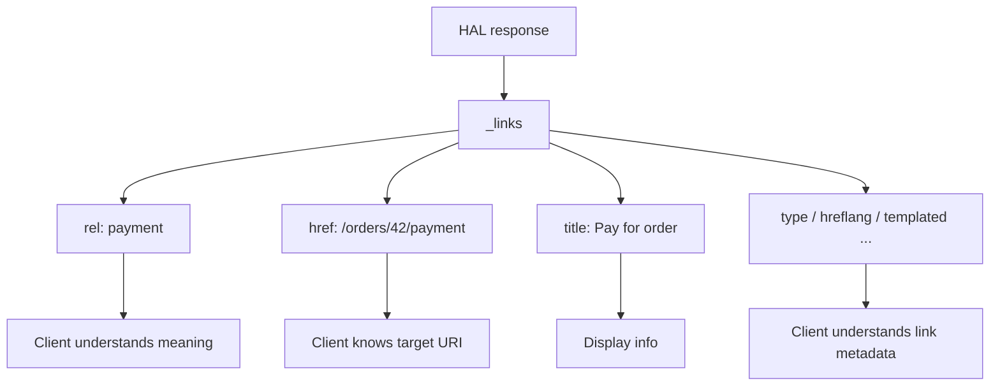

# Link Relation, href, and Link Attributes

## 1. Three components to distinguish in a hypermedia link

In a hypermedia-driven REST API, a response does not only return data; it also provides links for clients to discover related resources and next actions. When documenting with Spring REST Docs, it is important to understand three concepts: **relation (`rel`)**, **link target (`href`)**, and **additional link attributes**.

Example HAL response:

```json
{
  "id": 42,
  "status": "PENDING",
  "_links": {
    "self": {
      "href": "https://api.example.test/orders/42",
      "title": "Current order",
      "type": "application/hal+json"
    },
    "payment": {
      "href": "https://api.example.test/orders/42/payment",
      "title": "Pay for order",
      "type": "application/json",
      "hreflang": "en"
    },
    "search": {
      "href": "https://api.example.test/orders{?status,page}",
      "templated": true,
      "title": "Search orders"
    }
  }
}
```

| Component | Example | Role |
| --- | --- | --- |
| `rel` | `self`, `payment`, `search` | Indicates what relation the link has with the current resource. |
| `href` | `/orders/42/payment` | Target URI that the client navigates to; may be a URI template. |
| `title` | `Pay for order` | Friendly label that can assist with display or describing the link. |
| Additional attributes | `templated`, `type`, `hreflang` | Provide metadata so clients understand how to use the link or what the target contains. |

`rel` is the meaning of the link, not a URL. `href` is the specific target, not the action name. A relation can remain unchanged even if URLs change across hosts, API versions, or deployment environments. Additional attributes depend on the hypermedia format and API contract.



## 2. How Spring REST Docs represents links

Spring REST Docs provides the main APIs:

- `links(...)` creates a snippet describing the links present in the response.
- `linkWithRel("...")` creates a descriptor for a specific relation.
- `halLinks()` and `atomLinks()` specify how to extract links if the Content-Type is insufficient to auto-detect the format.
- `relaxedLinks(...)` allows ignoring relations present in the response that are not listed in the descriptors.

Example:

```java
links(
        linkWithRel("self").description("Current order"),
        linkWithRel("payment").description("Open payment flow"),
        linkWithRel("search").description("Search orders by criteria"))
```

Spring REST Docs generates the `links.adoc` snippet, typically a table of relations and descriptions. If a link has a `title`, `.description(...)` can be omitted; REST Docs uses `title` as the description. If both the descriptor and the link lack a description/title, snippet generation fails.

**Boundary to keep in mind:** Spring REST Docs 3.0.6's `LinkDescriptor` is created from `linkWithRel(rel)` and provides description, optional/ignored flags, and descriptor attributes. The `Link` model used when extracting links holds `rel`, `href`, and `title` values. The `links.adoc` snippet focuses on describing relations; do not assume it automatically creates a separate column for every HAL attribute such as `templated`, `type`, `hreflang`, `deprecation`, or `profile`.

Additional HAL attributes remain visible in `http-response.adoc`/`response-body.adoc` if the full response is recorded. You can describe the `_links` structure in `responseFields(...)` so readers also understand the metadata not shown in the relation table.

## 3. Documenting `rel` with `links(...)` and `linkWithRel(...)`

Suppose the application returns a HAL response at `GET /api/orders/{id}`. A REST Assured test can document the relations as follows:

```java
given(this.specification)
        .accept("application/hal+json")
        .pathParam("id", 42)
        .filter(document("orders-get",
                links(
                        linkWithRel("self").description("Current order"),
                        linkWithRel("payment").description("Pay for the order"),
                        linkWithRel("search").description("Search orders by criteria"))))
.when()
        .get("/api/orders/{id}")
.then()
        .statusCode(200)
        .contentType("application/hal+json");
```

Required static imports:

```java
import static org.springframework.restdocs.hypermedia.HypermediaDocumentation.linkWithRel;
import static org.springframework.restdocs.hypermedia.HypermediaDocumentation.links;
import static org.springframework.restdocs.restassured.RestAssuredRestDocumentation.document;
```

REST Docs automatically detects HAL links inside the `_links` map when the response Content-Type is compatible with `application/hal+json`. If the response uses another media type while keeping a HAL structure, specify the extractor explicitly:

```java
links(halLinks(),
        linkWithRel("self").description("Current order"),
        linkWithRel("payment").description("Pay for the order"))
```

For Atom, you can use `atomLinks()`. If the API has a custom hypermedia format, implement `LinkExtractor` instead of parsing JSON with regex. A custom extractor should convert the response structure into link objects that REST Docs can document.

## 4. Where to document `href` and additional metadata?

Because the links snippet focuses on relations and descriptions, documentation authors should keep the HTTP response or response body snippet so readers can see the actual `href` and additional attributes. Example in Asciidoctor:

```asciidoc
== Get order

=== HTTP response
include::{snippets}/orders-get/http-response.adoc[]

=== Links and relation meanings
include::{snippets}/orders-get/links.adoc[]
```

In the HAL example, `http-response.adoc` shows the actual JSON, including `_links`, `href`, `title`, and link metadata. `links.adoc` provides an easy-to-read relation/description table. The two snippets complement each other:

| Snippet | Question answered |
| --- | --- |
| `http-response.adoc` | What status/headers/body does the server return? What are the concrete `href` and metadata? |
| `links.adoc` | What does each relation mean and what should the client use it for? |
| `response-fields.adoc` | What do the business data fields in the resource mean? |

### Describing `_links` as a subsection

If you want a separate fields table describing the structure of `id`, `status`, and the `_links` section, you can use `subsectionWithPath("_links")`:

```java
responseFields(
        fieldWithPath("id").description("Order ID"),
        fieldWithPath("status").description("Order status"),
        subsectionWithPath("_links")
                .description("Hypermedia links and corresponding metadata"))
```

The subsection descriptor treats child fields inside `_links` as covered. Thus you do not need to declare every nested `href` in the same table. The `response-fields.adoc` snippet describes the link section at a structural level; `links.adoc` describes the relations semantically.

## 5. Meaning of common link attributes

A HAL link object can carry attributes other than `href`. Some common attributes:

| Attribute | Meaning | What to clarify in documentation |
| --- | --- | --- |
| `href` | URI or URI template of the target. | Path, query template, and how the client builds the final URI. |
| `templated` | Indicates that `href` is a URI template. | Which template variables must be provided and how values are encoded. |
| `title` | Suggested label for the link. | Can be used as description when the descriptor does not specify one. |
| `type` | Expected media type of the target resource. | Which format the client should handle when dereferencing the link. |
| `hreflang` | Language of the target resource. | Language values and supported options. |
| `deprecation` | URI providing information about the link/relation being deprecated. | Whether the link should still be used and its replacement. |
| `name` | Secondary name of the link depending on format. | How to distinguish links with the same relation or alternatives. |
| `profile` | URI to a profile describing semantics or representation. | Profile documentation and rules the client must follow. |

Not every format or Link implementation supports all attributes. The examples above are common metadata in HAL/Web Linking; document the actual attributes that the API returns and clients need to use. Do not add `templated: false` or `hreflang` into examples if the server does not emit them.

### Absolute URIs and relative URIs

`href` can be an absolute URI:

```json
{ "href": "https://api.example.test/orders/42/payment" }
```

Or a relative URI:

```json
{ "href": "/orders/42/payment" }
```

When using relative URIs, clients must apply URI resolution rules based on the base URI of the representation or request per the API contract. Therefore, documentation should clarify the base URI and give complete URL examples if integrators need them. When tests run on `localhost:<random-port>`, a preprocessor can be used to normalize URLs in snippets; do not alter the path/rel of the real response.

## 6. URI templates and `templated: true`

A link may contain variables for the client to supply when using it:

```json
{
  "_links": {
    "search": {
      "href": "/api/orders{?status,page,size}",
      "templated": true,
      "title": "Search orders"
    }
  }
}
```

`templated: true` indicates the client must expand the URI template before sending the request. With the template above, the client can provide `status=PAID`, `page=0`, `size=20` to construct the corresponding URL:

```text
/api/orders?status=PAID&page=0&size=20
```

When documenting, do not just write "Search orders". Describe the meaning of the query variables, accepted values, defaults, and pagination behavior. URI templates should not be treated as complete URLs to invoke verbatim.

The `links.adoc` snippet describes the relation and its meaning; the response snippet preserves the template `href` and `templated`. If you need a separate table of actual query parameters accepted by the endpoint after URI expansion, document that search endpoint using `queryParameters(...)` in the corresponding HTTP test.

## 7. `title` and description: avoiding confusion

`title` is an attribute of the link in the representation. `description(...)` is content provided by the test author to the Spring REST Docs descriptor.

```java
linkWithRel("payment")
        .description("Open the payment flow for the order")
```

If `.description(...)` is omitted, REST Docs can use `title` from the link. However, if the link has no `title`, the snippet cannot infer its meaning and will fail. For public APIs, an explicit description is usually better because:

- `title` may be short and intended for UI display.
- Description can explain behavior, conditions, or outcomes of the operation.
- A relation may be emitted across multiple resource states, yet the contract meaning still needs a consistent explanation.

Descriptor example:

```java
links(
        linkWithRel("self").description("Retrieve the representation of this order"),
        linkWithRel("payment").description("Start or continue order payment"),
        linkWithRel("cancel").description("Cancel the order while still in an allowed state"))
```

## 8. Optional, ignored, and strict links

By default, `links(...)` validates strictly:

- A link appearing in the response without a descriptor fails the test.
- A required descriptor whose link does not appear also fails the test.
- `optional()` allows a documented relation to be absent in some states.
- `ignored()` excludes a link from the snippet without failing the test just because the link appears.
- `relaxedLinks(...)` ignores undocumented links, though documented relations must still be present unless optional.

Example where the `cancel` relation only appears when the order has not yet been paid:

```java
links(
        linkWithRel("self").description("Current order"),
        linkWithRel("payment").description("Pay for the order"),
        linkWithRel("cancel").description("Cancel the order").optional(),
        linkWithRel("curies").ignored())
```

If `curies` is described on the hypermedia overview page, you can ignore it in per-endpoint snippets. Do not use relaxed mode to skip a new relation before determining whether it changes the API contract.

## 9. `LinkDescriptor` attributes differ from HAL link attributes

This is a common point of confusion when seeing the `.attributes(...)` API:

```java
import static org.springframework.restdocs.snippet.Attributes.key;

linkWithRel("payment")
        .description("Pay for the order")
        .attributes(key("example-note").value("Example snippet metadata"));
```

`attributes(...)` is inherited from `AbstractDescriptor` and attaches values for snippet/template generation. It **does not add HAL attributes** such as `type`, `hreflang`, or `templated` to the response, nor does it automatically verify those attributes. To prove the response actually contains that metadata, inspect the HTTP response or describe the `_links` section with a payload snippet.

If you need to display a custom column in `links.adoc`, you can create a custom snippet/template and provide snippet attributes to the template. However, the new column should come from extracted data or controlled context; do not pretend it is real metadata if the extractor does not provide it. When you need to inspect multiple HAL attributes per link, you can:

1. Keep `http-response.adoc`/`response-body.adoc`, where the payload displays the full link objects.
2. Document `_links` with `subsectionWithPath("_links")`.
3. Build a custom `LinkExtractor` or custom snippet if the links table needs to display `href`, `templated`, `type`, or `hreflang` as columns.

`Link` in Spring REST Docs 3.0.6 models `rel`, `href`, and `title`; `LinkDescriptor` uses `rel`, description, and optional/ignored flags. Verify the version you are using since APIs and implementations can change across release lines.

## 10. Complete example: documenting relations while preserving href/metadata

Suppose the test receives a HAL response as in section 1. You can combine the links snippet with body fields:

```java
given(this.specification)
        .accept("application/hal+json")
        .filter(document("orders-get",
                links(
                        linkWithRel("self").description("Current order"),
                        linkWithRel("payment").description("Payment flow"),
                        linkWithRel("search").description("Search orders by criteria")),
                responseFields(
                        fieldWithPath("id").description("Order ID"),
                        fieldWithPath("status").description("Processing status"),
                        subsectionWithPath("_links")
                                .description("Link relations, hrefs, and metadata"))))
.when()
        .get("/api/orders/{id}", 42)
.then()
        .statusCode(200)
        .contentType("application/hal+json")
        .body("_links.payment.href", notNullValue())
        .body("_links.search.templated", equalTo(true));
```

In this example:

- `links(...)` validates the relations `self`, `payment`, `search` and generates the `links.adoc` table.
- `responseFields(...)` describes the business fields and groups all of `_links` into a subsection.
- `http-response.adoc` preserves the actual HAL payload, including `href`, `title`, `type`, `hreflang`, or `templated` if emitted by the server.
- `.then()` verifies that the payment link has an href and search is indeed a URI template.

Additional static imports for the example:

```java
import static org.springframework.restdocs.payload.PayloadDocumentation.subsectionWithPath;
import static org.hamcrest.Matchers.notNullValue;
import static org.hamcrest.Matchers.equalTo;
```

For complex response schemas, confirm that `subsectionWithPath("_links")` covers the right payload region and other descriptors do not duplicate child paths. If you want to verify individual detailed attributes of a specific relation, specific assertions or a custom link snippet may be needed in addition to the default links table.

## 11. Including snippets into the final documentation

Asciidoctor example:

```asciidoc
== View order

=== HTTP response
include::{snippets}/orders-get/http-response.adoc[]

=== Link relations
include::{snippets}/orders-get/links.adoc[]

=== Response fields
include::{snippets}/orders-get/response-fields.adoc[]
```

The three snippets complement each other: HTTP response shows a real example, links explains relation meanings, and response fields covers the resource structure and `_links`. If the documentation uses Markdown, an appropriate AsciiDoc embedding/conversion step is required; plain Markdown does not process `include::...[]`.

In CI, tests that generate snippets must run before Asciidoctor. If a link descriptor or assertion fails, do not compile and publish snippets from the failing run. Use a clean output directory for each build to avoid stale links remaining after response changes.

## 12. Common errors

| Symptom | Cause | How to fix |
| --- | --- | --- |
| Missing `links.adoc` | `links(...)` was not called or extractor did not find link structure. | Check filter, Content-Type, and location of `_links`/`links`. |
| HAL not recognized | Response has HAL structure but incompatible media type. | Use `links(halLinks(), ...)`. |
| Links table has `rel` but readers don't understand `href` | Included only `links.adoc`, omitted `http-response.adoc`. | Include HTTP response or response body to keep actual hrefs. |
| Metadata `templated`/`type` missing from links table | Default snippet focuses on relation and description. | Keep response body, describe `_links` subsection, or create a custom snippet/extractor. |
| Link missing description causes error | Link has no `title` and descriptor has no description. | Add a meaningful `.description(...)`. |
| Undocumented link | Response contains a relation without a descriptor in strict mode. | Review relation and add a descriptor, ignored, or intentional relaxed mode. |
| Required link missing | Non-optional descriptor but relation is absent in response. | Check resource state; only use `.optional()` when that behavior is valid. |
| Thinking `.attributes(...)` adds HAL property | Confused snippet descriptor metadata with response data. | Inspect raw response; use payload/custom snippet for link properties. |

## 13. Practice checklist

- [ ] Identified each `rel` and the meaning of the relation for the current resource.
- [ ] Checked whether `href` is an absolute URI, relative URI, or URI template.
- [ ] Clarified the meaning of `templated`, `type`, `hreflang`, `title`, or other metadata if used by the API.
- [ ] Used `links(...)` and `linkWithRel(...)` to document relations.
- [ ] Kept `http-response.adoc` or `response-body.adoc` so readers can see actual hrefs and link attributes.
- [ ] Considered `responseFields(subsectionWithPath("_links"))` or a custom snippet if describing link structure is needed.
- [ ] Distinguished REST Docs descriptor attributes from HAL link properties.
- [ ] Selected strict/optional/ignored/relaxed properly according to the API contract.
- [ ] Verified the `links.adoc` snippet and final documentation after tests pass.

`rel` answers what this link means; `href` answers where the client goes; additional attributes such as `templated`, `type`, and `hreflang` explain how to interpret or use the link. Combining `links.adoc` with HTTP response and payload snippets enables Spring REST Docs documentation to preserve both navigation semantics and per-link details.

## References

- [Spring REST Docs – Hypermedia](https://docs.spring.io/spring-restdocs/reference/documenting-your-api/hypermedia.html)
- [Spring REST Docs 3.0.6 – HypermediaDocumentation API](https://docs.spring.io/spring-restdocs/docs/current/api/org/springframework/restdocs/hypermedia/HypermediaDocumentation.html)
- [Spring REST Docs 3.0.6 – Link API](https://docs.spring.io/spring-restdocs/docs/current/api/org/springframework/restdocs/hypermedia/Link.html)
- [Spring REST Docs 3.0.6 – AbstractDescriptor API](https://docs.spring.io/spring-restdocs/docs/current/api/org/springframework/restdocs/snippet/AbstractDescriptor.html)
- [Spring HATEOAS Reference](https://docs.spring.io/spring-hateoas/docs/current/reference/html/)
